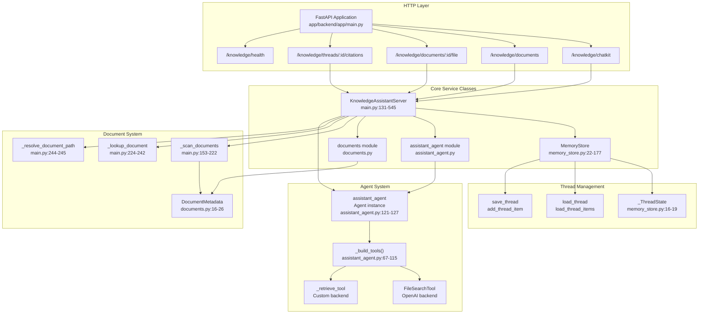
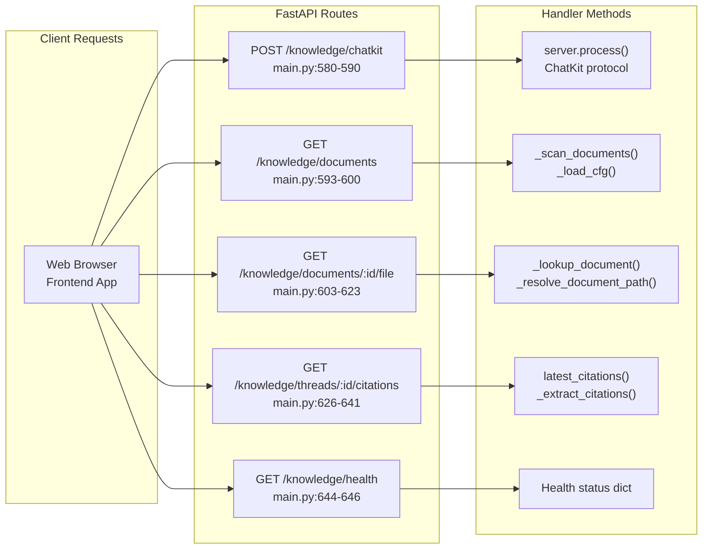
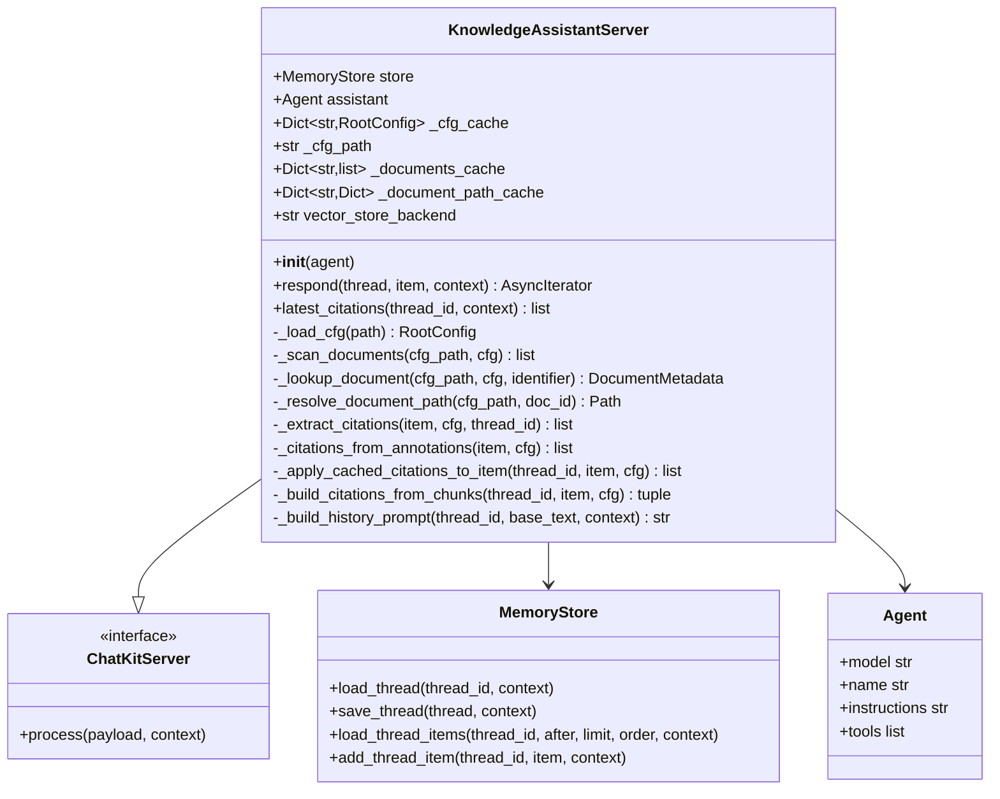
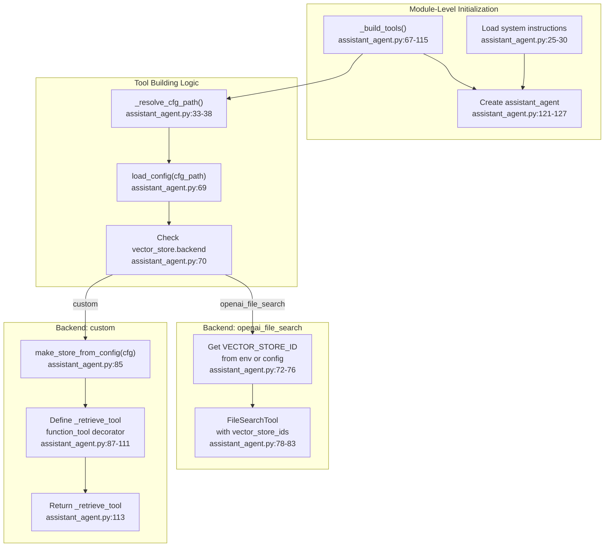
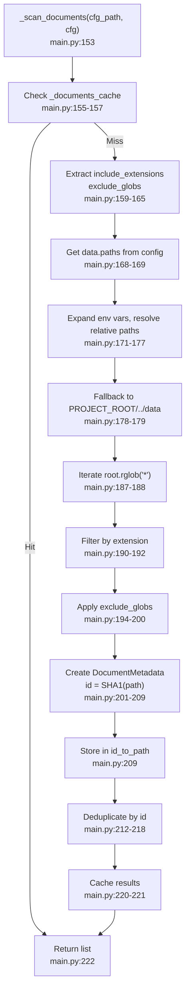
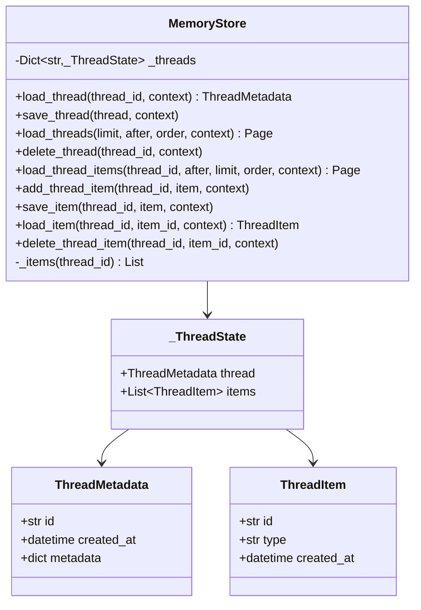
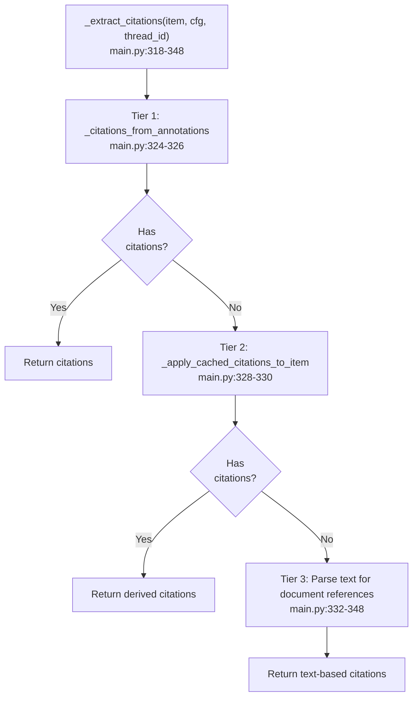
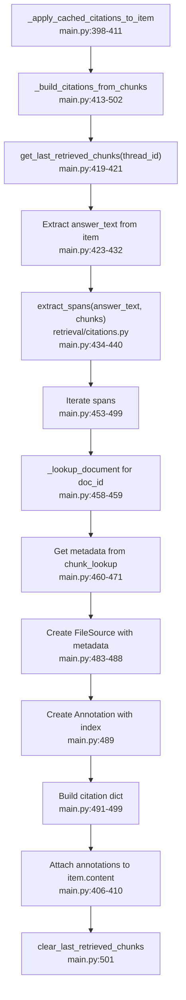
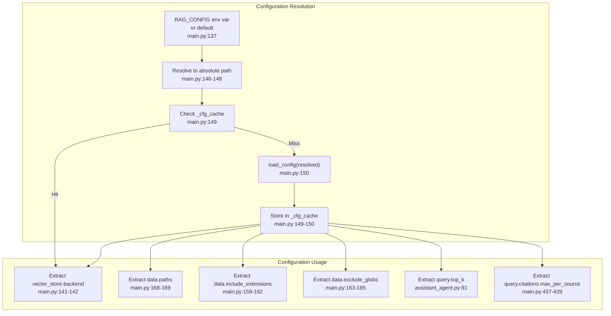
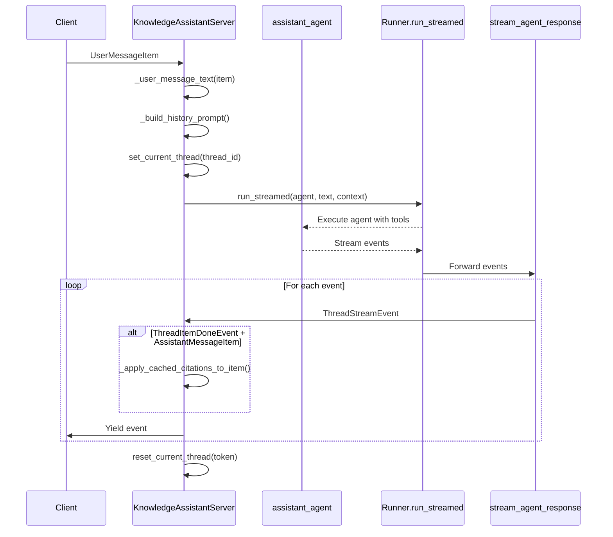

<!-- source: DeepWiki mcp.deepwiki.com · repo openai/openai-knowledge-retrieval · page 4 Backend Components · fetched 2026-10-26 -->

# Backend Components

<details>
<summary>Relevant source files</summary>

The following files were used as context for generating this wiki page:

- [app/backend/app/assistant_agent.py](app/backend/app/assistant_agent.py)
- [app/backend/app/documents.py](app/backend/app/documents.py)
- [app/backend/app/main.py](app/backend/app/main.py)
- [app/backend/app/memory_store.py](app/backend/app/memory_store.py)

</details>


## Purpose and Scope

This document provides a detailed technical reference for the Python backend components that power the Knowledge Retrieval system. The backend is built on FastAPI and implements a ChatKit-compatible conversational AI server with document retrieval, citation extraction, and thread management capabilities.

The backend components covered here include:
- The FastAPI application and HTTP endpoints ([app/backend/app/main.py:1-647]())
- The assistant agent system with tool building ([app/backend/app/assistant_agent.py:1-128]())
- Document metadata management ([app/backend/app/documents.py:1-43]())
- In-memory thread storage ([app/backend/app/memory_store.py:1-177]())

For frontend components and UI integration, see [Frontend Components](#5). For CLI tools and data ingestion workflows, see [CLI Tools](#6). For RAG pipeline details, see [RAG Pipeline](#3.4).

---

## Core Component Architecture

The backend is organized around four primary components that work together to handle conversational retrieval requests:



**Sources:** [app/backend/app/main.py:1-647](), [app/backend/app/assistant_agent.py:1-128](), [app/backend/app/memory_store.py:1-177](), [app/backend/app/documents.py:1-43]()

---

## Key Classes and Modules

| Component | File | Primary Class/Function | Responsibility |
|-----------|------|----------------------|----------------|
| FastAPI Server | `main.py` | `KnowledgeAssistantServer` | Orchestrates all backend operations, handles HTTP endpoints |
| Agent System | `assistant_agent.py` | `assistant_agent`, `_build_tools()` | Manages AI agent, tools, and retrieval caching |
| Document Metadata | `documents.py` | `DocumentMetadata` | Represents document metadata structure |
| Thread Storage | `memory_store.py` | `MemoryStore` | In-memory persistence for threads and messages |

**Sources:** [app/backend/app/main.py:131-545](), [app/backend/app/assistant_agent.py:121-127](), [app/backend/app/documents.py:16-26](), [app/backend/app/memory_store.py:22-177]()

---

## HTTP API Endpoints

The FastAPI application exposes five endpoints for client interaction:



**Sources:** [app/backend/app/main.py:580-646]()

### Endpoint Reference Table

| Method | Path | Handler | Response Type | Purpose |
|--------|------|---------|---------------|---------|
| `POST` | `/knowledge/chatkit` | `chatkit_endpoint` | SSE stream or JSON | ChatKit protocol processing, agent responses |
| `GET` | `/knowledge/documents` | `list_documents` | JSON | List all available documents |
| `GET` | `/knowledge/documents/{document_id}/file` | `document_file` | File | Download/preview document file |
| `GET` | `/knowledge/threads/{thread_id}/citations` | `thread_citations` | JSON | Retrieve citations for a thread |
| `GET` | `/knowledge/health` | `health_check` | JSON | Service health status |

**Sources:** [app/backend/app/main.py:580-646]()

---

## KnowledgeAssistantServer Class

The `KnowledgeAssistantServer` class ([main.py:131-545]()) extends `ChatKitServer` and serves as the main orchestrator for all backend functionality.

### Class Structure



**Sources:** [app/backend/app/main.py:131-545]()

### Instance Initialization

The server initializes with several caches and loads the RAG configuration:

- `store`: `MemoryStore` instance for thread persistence ([main.py:133]())
- `_cfg_cache`: Caches loaded `RootConfig` objects by path ([main.py:136]())
- `_cfg_path`: Resolved from `RAG_CONFIG` environment variable or defaults to `configs/default.openai.yaml` ([main.py:137]())
- `_documents_cache`: Caches scanned `DocumentMetadata` lists by config path ([main.py:138]())
- `_document_path_cache`: Maps document IDs to filesystem paths ([main.py:139]())
- `vector_store_backend`: Extracted from config to determine tool behavior ([main.py:142]())

**Sources:** [app/backend/app/main.py:132-143]()

---

## Assistant Agent System

The agent system ([assistant_agent.py:1-128]()) creates an OpenAI Agent instance with dynamically configured tools based on the vector store backend.

### Agent Initialization



**Sources:** [app/backend/app/assistant_agent.py:25-127]()

### Retrieval Caching Mechanism

The agent system maintains a thread-local cache of retrieved chunks to enable citation derivation after the assistant responds:

- `_RETRIEVAL_CACHE`: Dictionary mapping thread IDs to lists of retrieved chunks ([assistant_agent.py:19]())
- `_THREAD_ID_CTX`: `ContextVar` storing the current thread ID ([assistant_agent.py:20-22]())
- `record_retrieved_chunks()`: Stores chunks for a thread ([assistant_agent.py:41-47]())
- `get_last_retrieved_chunks()`: Retrieves cached chunks ([assistant_agent.py:50-52]())
- `clear_last_retrieved_chunks()`: Clears cache after citation extraction ([assistant_agent.py:55-56]())
- `set_current_thread()`: Sets context variable ([assistant_agent.py:59-60]())
- `reset_current_thread()`: Resets context variable ([assistant_agent.py:63-64]())

**Sources:** [app/backend/app/assistant_agent.py:19-64]()

### Tool Building: Custom Retrieve Tool

When `vector_store.backend` is set to `"custom"`, the system builds a `_retrieve_tool` function tool:

```python
@function_tool(name_override="retrieve_context")
def _retrieve_tool(query: str) -> Dict[str, Any]:
    # Validates query, calls retrieve_custom_chunks, 
    # records chunks, returns payload
```

This tool:
1. Validates the query is non-empty ([assistant_agent.py:89-91]())
2. Calls `retrieve_custom_chunks` from the retrieval pipeline ([assistant_agent.py:92-97]())
3. Constructs payload chunks with metadata ([assistant_agent.py:98-109]())
4. Records chunks to `_RETRIEVAL_CACHE` via thread context ([assistant_agent.py:110]())
5. Returns chunk data to the agent ([assistant_agent.py:111]())

**Sources:** [app/backend/app/assistant_agent.py:87-113]()

---

## Document Management

The document management system scans configured data paths, builds metadata objects, and serves files to clients.

### DocumentMetadata Class

```python
@dataclass(frozen=True, slots=True)
class DocumentMetadata:
    id: str              # SHA1 hash of file path
    filename: str        # File name (e.g., "report.pdf")
    title: str           # Human-readable title
    description: str | None = None
    
    @property
    def stem(self) -> str:
        return Path(self.filename).stem
```

**Sources:** [app/backend/app/documents.py:16-26]()

### Document Scanning Workflow



**Sources:** [app/backend/app/main.py:153-222]()

### Document Lookup Methods

The server provides three methods for document resolution:

| Method | Purpose | Search Strategy |
|--------|---------|-----------------|
| `_scan_documents` | Scan filesystem and build metadata | Recursive glob with filters |
| `_lookup_document` | Find document by ID, filename, or title | Sequential search with normalization |
| `_resolve_document_path` | Get filesystem path for document ID | Direct dictionary lookup |

**`_lookup_document` Resolution Order:**
1. Exact match on `document.id` ([main.py:231-232]())
2. Match on normalized filename or stem ([main.py:234-237]())
3. Match on slugified title ([main.py:238-241]())

**Sources:** [app/backend/app/main.py:224-245]()

---

## Memory Store Implementation

`MemoryStore` ([memory_store.py:22-177]()) provides an in-memory implementation of the `ChatKit Store` interface for thread and message persistence.

### Internal Data Structure



**Sources:** [app/backend/app/memory_store.py:16-177]()

### Thread Operations

**Thread Metadata CRUD:**

- `load_thread`: Retrieves thread metadata, raises `NotFoundError` if missing ([memory_store.py:30-36]())
- `save_thread`: Creates or updates thread metadata with deep copy ([memory_store.py:38-48]())
- `load_threads`: Returns paginated list with sorting and pagination ([memory_store.py:50-77]())
- `delete_thread`: Removes thread and all items ([memory_store.py:79-80]())

**Thread Items CRUD:**

- `load_thread_items`: Returns paginated items with sorting ([memory_store.py:93-117]())
- `add_thread_item`: Appends item to thread's item list ([memory_store.py:119-122]())
- `save_item`: Updates existing item or appends if new ([memory_store.py:124-132]())
- `load_item`: Retrieves specific item by ID ([memory_store.py:134-140]())
- `delete_thread_item`: Removes item from thread ([memory_store.py:142-146]())

**Sources:** [app/backend/app/memory_store.py:30-146]()

### Pagination Strategy

Both `load_threads` and `load_thread_items` implement cursor-based pagination:

1. Sort items by `created_at` with configurable order ([memory_store.py:103-105]())
2. Find starting index based on `after` cursor ([memory_store.py:107-111]())
3. Slice items with `limit + 1` to detect more pages ([memory_store.py:113]())
4. Set `has_more` flag and compute `next_after` cursor ([memory_store.py:114-116]())

**Sources:** [app/backend/app/memory_store.py:93-117]()

---

## Citation Extraction System

The citation system employs a three-tier fallback strategy to derive document citations from assistant responses.

### Citation Extraction Flow



**Sources:** [app/backend/app/main.py:318-348]()

### Tier 1: Annotations-Based Citations

Extracts citations from `Annotation` objects attached to assistant message content:

1. Iterate through `item.content` and `content.annotations` ([main.py:356-359]())
2. Resolve document via `_resolve_document()` helper ([main.py:360]())
3. Fallback to `_lookup_document()` if needed ([main.py:362-366]())
4. Extract metadata fields (id, filename, title, description) ([main.py:367-386]())
5. Build citation dictionary with `annotation_index` ([main.py:387-395]())

**Sources:** [app/backend/app/main.py:350-396]()

### Tier 2: Chunk-Based Citation Derivation

When annotations are unavailable (custom backend), derives citations from cached retrieval chunks:



**Sources:** [app/backend/app/main.py:398-502]()

**Key Functions:**
- `extract_spans()`: Performs fuzzy text matching between answer and chunks ([main.py:434]())
- `get_last_retrieved_chunks()`: Retrieves cached chunks from assistant agent ([main.py:419]())
- `clear_last_retrieved_chunks()`: Removes cache after processing ([main.py:501]())

### Tier 3: Text-Based Fallback

If both annotation and chunk-based methods fail, parses assistant response text for document references. This is a legacy fallback and typically unused ([main.py:332-348]()).

**Sources:** [app/backend/app/main.py:332-348]()

---

## Configuration Management

The server loads and caches RAG configuration files to determine vector store backend, retrieval parameters, and data paths.

### Configuration Loading



**Sources:** [app/backend/app/main.py:136-151](), [app/backend/app/assistant_agent.py:81]()

### Cache Structure

The `_cfg_cache` dictionary maps resolved absolute paths to `RootConfig` objects, ensuring each configuration file is parsed only once:

```python
self._cfg_cache: Dict[str, RootConfig] = {}
```

**Sources:** [app/backend/app/main.py:136]()

---

## Response Streaming

The `respond()` method ([main.py:247-294]()) handles the core conversational loop:



**Sources:** [app/backend/app/main.py:247-294]()

### History Enrichment

Before sending to the agent, the server enriches the user message with conversation history via `_build_history_prompt()` ([main.py:504-544]()):

1. Load recent thread items (up to `max_turns * 2`) ([main.py:515-523]())
2. Extract text from `UserMessageItem` and `AssistantMessageItem` ([main.py:526-534]())
3. Format as "User: ..." and "Assistant: ..." lines ([main.py:528-534]())
4. Prepend history block to current message ([main.py:540-544]())

This provides the agent with context for multi-turn conversations without modifying the agent's native conversation history.

**Sources:** [app/backend/app/main.py:504-544]()

---

## CORS Configuration

The FastAPI application configures CORS middleware to allow frontend access:

```python
cors_allow_origins = _parse_cors_allow_origins(
    os.getenv("KNOWLEDGE_CORS_ALLOW_ORIGINS")
) or [
    "http://localhost:5172",
    "http://127.0.0.1:5172",
]

app.add_middleware(
    CORSMiddleware,
    allow_origins=cors_allow_origins,
    allow_credentials=False,
    allow_methods=["GET", "POST", "OPTIONS"],
    allow_headers=["Accept", "Content-Type", "Authorization"],
    expose_headers=["Content-Disposition"],
)
```

The `KNOWLEDGE_CORS_ALLOW_ORIGINS` environment variable accepts a comma-separated list of allowed origins. If unset, defaults to local development ports.

**Sources:** [app/backend/app/main.py:551-573]()

---

## Dependency Injection

The server uses FastAPI's dependency injection to provide the `KnowledgeAssistantServer` instance to endpoint handlers:

```python
def get_server() -> KnowledgeAssistantServer:
    return knowledge_server

@app.post("/knowledge/chatkit")
async def chatkit_endpoint(
    request: Request, 
    server: KnowledgeAssistantServer = Depends(get_server)
) -> Response:
    # Handler implementation
```

This pattern allows for cleaner testing and potential future support for multiple server instances.

**Sources:** [app/backend/app/main.py:576-590]()

---

## Summary of Key Backend Patterns

| Pattern | Implementation | Purpose |
|---------|---------------|---------|
| **Caching** | `_cfg_cache`, `_documents_cache`, `_document_path_cache` | Avoid re-parsing configs and re-scanning filesystem |
| **Fallback Strategy** | Three-tier citation extraction | Robustly derive citations across different backends |
| **Context Variables** | `_THREAD_ID_CTX` in assistant_agent.py | Thread-safe retrieval cache access |
| **Dependency Injection** | `Depends(get_server)` | Clean separation of concerns in endpoints |
| **Deep Copying** | `model_copy(deep=True)` throughout MemoryStore | Prevent accidental mutations of stored data |
| **Dynamic Tool Building** | `_build_tools()` based on config | Support multiple vector store backends |
| **History Enrichment** | `_build_history_prompt()` | Multi-turn conversation without agent history mutation |

**Sources:** [app/backend/app/main.py:1-647](), [app/backend/app/assistant_agent.py:1-128](), [app/backend/app/memory_store.py:1-177]()

---

