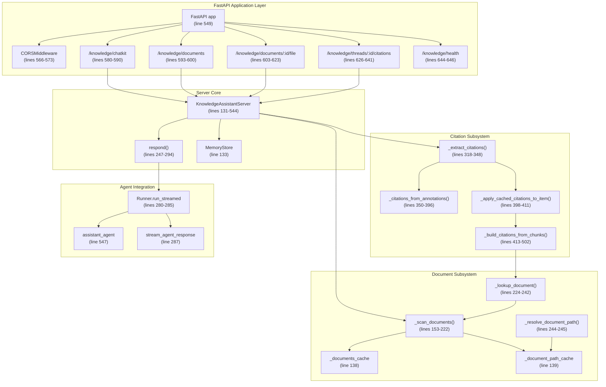
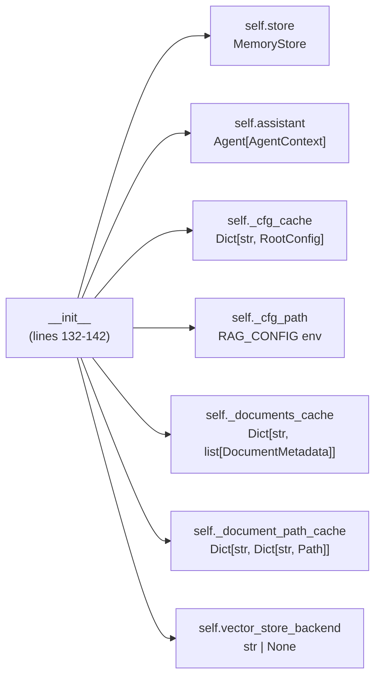
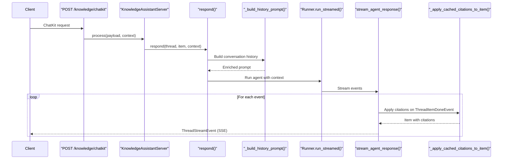
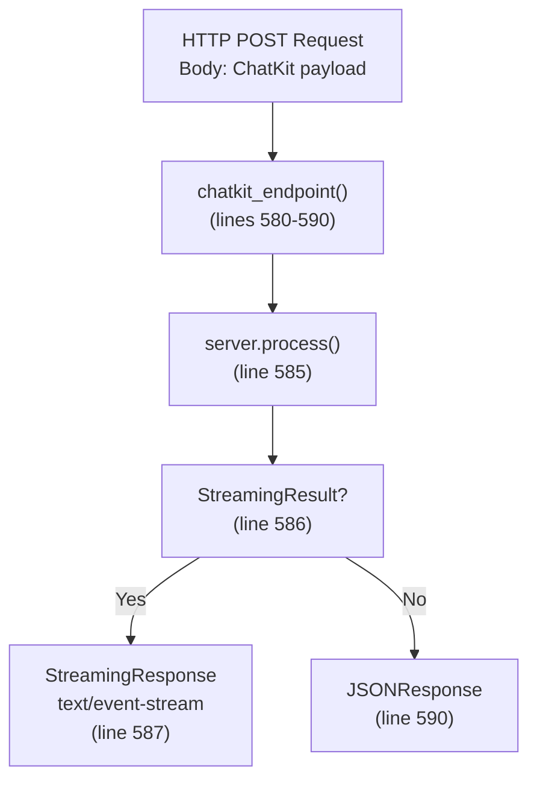
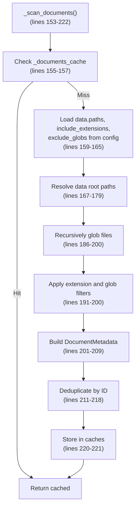
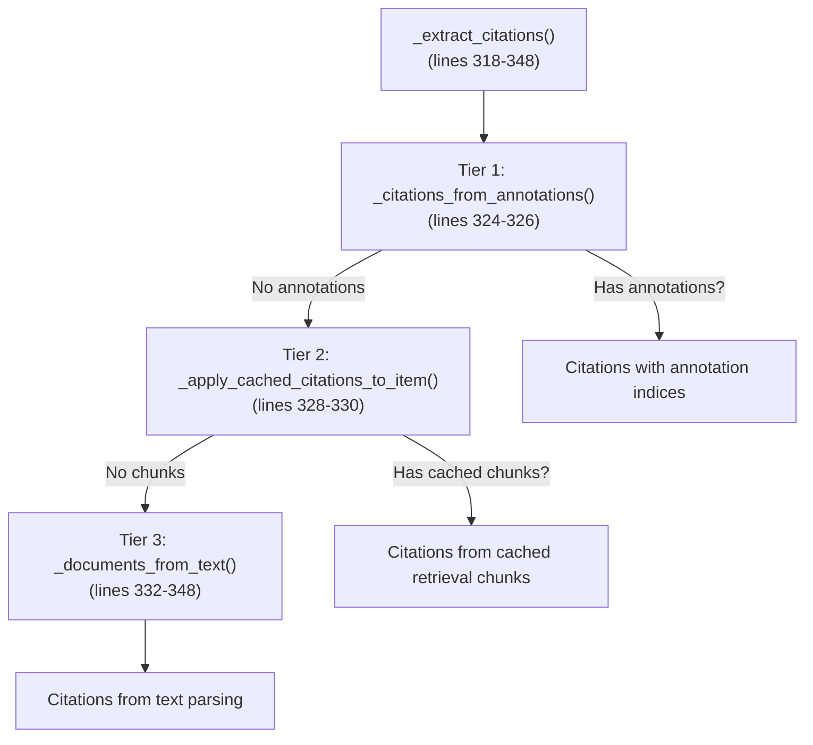
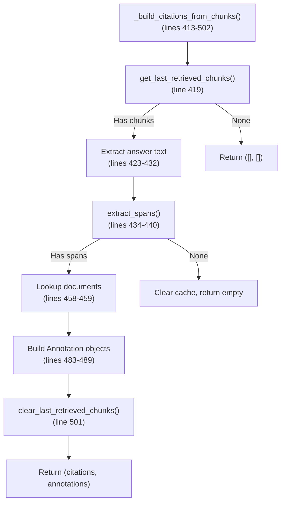
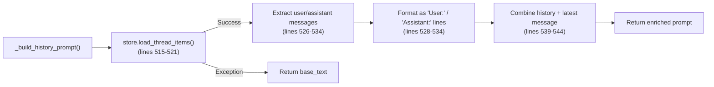
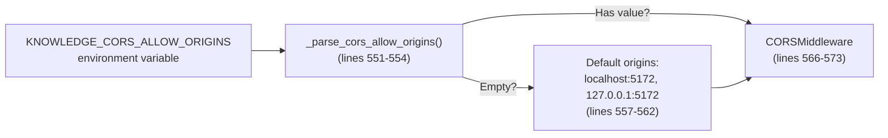

<!-- source: DeepWiki mcp.deepwiki.com · repo openai/openai-knowledge-retrieval · page 4.1 FastAPI Application (main.py) · fetched 2026-10-26 -->

# FastAPI Application (main.py)

<details>
<summary>Relevant source files</summary>

The following files were used as context for generating this wiki page:

- [app/backend/app/__init__.py](app/backend/app/__init__.py)
- [app/backend/app/main.py](app/backend/app/main.py)

</details>


## Purpose and Scope

This document covers the FastAPI backend application defined in `app/backend/app/main.py`. It details the `KnowledgeAssistantServer` class, HTTP API endpoints, request handling flow, document management, and citation extraction mechanisms. For information about the assistant agent and retrieval tools, see [Assistant Agent System](#4.2). For memory storage implementation, see [Memory Store](#4.4). For document metadata structures, see [Document Management](#4.3).

**Sources:** [app/backend/app/main.py:1-647]()

---

## Architecture Overview

The `main.py` module serves as the entry point for the FastAPI backend. It orchestrates the integration between the ChatKit server framework, OpenAI agent system, document management, and citation extraction. The `KnowledgeAssistantServer` class extends `ChatKitServer` to provide knowledge retrieval capabilities with streaming responses and citation support.



**Sources:** [app/backend/app/main.py:1-647]()

---

## KnowledgeAssistantServer Class

The `KnowledgeAssistantServer` class (lines 131-544) is the central orchestrator that extends `ChatKitServer[dict[str, Any]]` from the chatkit library. It manages conversation threads, document metadata, configuration caching, and citation extraction.

### Initialization and State



The constructor initializes:
- **`self.store`**: `MemoryStore` instance for thread persistence (line 133)
- **`self.assistant`**: The `assistant_agent` instance from the agent module (line 135)
- **`self._cfg_cache`**: Cache for loaded YAML configurations indexed by path (line 136)
- **`self._cfg_path`**: Path to RAG configuration file from `RAG_CONFIG` environment variable or default (line 137)
- **`self._documents_cache`**: Cache of scanned document metadata per configuration (line 138)
- **`self._document_path_cache`**: Mapping of document IDs to file paths per configuration (line 139)
- **`self.vector_store_backend`**: Vector store backend type (`openai` or custom) extracted from config (lines 141-142)

**Sources:** [app/backend/app/main.py:131-142]()

### Request Processing Flow



The `respond()` method (lines 247-294) handles incoming user messages:

1. **Validation** (lines 253-263): Checks if item is a `UserMessageItem` with text content
2. **History Enrichment** (lines 266-270): Calls `_build_history_prompt()` to prepend conversation history
3. **Agent Context Creation** (lines 272-276): Builds `AgentContext` with thread, store, and request context
4. **Thread Token Management** (lines 278, 294): Sets/resets current thread ID via `set_current_thread()` and `reset_current_thread()`
5. **Agent Execution** (lines 280-285): Invokes `Runner.run_streamed()` with the assistant agent
6. **Event Streaming** (lines 287-292): Iterates over `stream_agent_response()` events
7. **Citation Application** (lines 288-291): When `ThreadItemDoneEvent` occurs with `AssistantMessageItem`, calls `_apply_cached_citations_to_item()`

**Sources:** [app/backend/app/main.py:247-294]()

---

## API Endpoints

The FastAPI application exposes five HTTP endpoints under the `/knowledge` prefix:

### Endpoint Summary

| Endpoint | Method | Purpose | Handler |
|----------|--------|---------|---------|
| `/knowledge/chatkit` | POST | ChatKit request processing | `chatkit_endpoint` (lines 580-590) |
| `/knowledge/documents` | GET | List available documents | `list_documents` (lines 593-600) |
| `/knowledge/documents/{document_id}/file` | GET | Serve document file | `document_file` (lines 603-623) |
| `/knowledge/threads/{thread_id}/citations` | GET | Retrieve thread citations | `thread_citations` (lines 626-641) |
| `/knowledge/health` | GET | Health check | `health_check` (lines 644-646) |

**Sources:** [app/backend/app/main.py:580-646]()

### POST /knowledge/chatkit



The primary endpoint for conversational interaction. It:
1. Receives raw request body (line 584)
2. Passes to `server.process()` with context dictionary containing the request (line 585)
3. Returns `StreamingResponse` with `text/event-stream` media type if result is `StreamingResult` (lines 586-587)
4. Returns `JSONResponse` for non-streaming results (lines 589-590)

**Sources:** [app/backend/app/main.py:580-590]()

### GET /knowledge/documents

Lists all scanned documents from configured data paths. Implementation:
1. Retrieves `cfg_path` from server (line 597)
2. Loads configuration via `_load_cfg()` (line 598)
3. Scans documents via `_scan_documents()` (line 599)
4. Returns dictionary with `documents` key containing serialized metadata (line 600)

**Sources:** [app/backend/app/main.py:593-600]()

### GET /knowledge/documents/{document_id}/file

Serves document files with proper content types. Flow:
1. Looks up document metadata via `_lookup_document()` (line 609)
2. Raises 404 if document not found (lines 610-611)
3. Resolves file path via `_resolve_document_path()` (line 613)
4. Validates path existence (lines 614-615)
5. Determines MIME type using `mimetypes.guess_type()` (line 617)
6. Sets `Content-Disposition` header to `inline` with filename (line 618)
7. Returns `FileResponse` with appropriate media type (lines 619-623)

**Sources:** [app/backend/app/main.py:603-623]()

### GET /knowledge/threads/{thread_id}/citations

Retrieves citations for the most recent assistant message in a thread:
1. Calls `server.latest_citations()` with thread ID and context (line 633)
2. Extracts unique document IDs from citations (lines 634-640)
3. Returns JSON with `documentIds` array and full `citations` array (line 641)

**Sources:** [app/backend/app/main.py:626-641]()

---

## Document Management System

The document management system provides scanning, caching, and lookup capabilities for files in configured data directories.

### Document Scanning Flow



The `_scan_documents()` method (lines 153-222) performs:

1. **Cache Check** (lines 155-157): Returns cached results if available
2. **Configuration Loading** (lines 159-165):
   - `include_extensions`: File extensions to include (e.g., `.pdf`, `.txt`)
   - `exclude_globs`: Glob patterns to exclude
3. **Root Path Resolution** (lines 167-179):
   - Expands environment variables and user home paths
   - Converts relative paths to absolute relative to `PROJECT_ROOT`
   - Falls back to `_DATA_DIR` if no paths configured
4. **File Traversal** (lines 186-200):
   - Uses `rglob("*")` to recursively find files
   - Filters by extension if `include_extensions` specified
   - Applies exclude globs against both relative and absolute paths
5. **Metadata Creation** (lines 201-209):
   - Generates document ID via `_sha1_of_path()`
   - Extracts filename
   - Creates human-readable title via `_humanize_title()`
6. **Deduplication** (lines 211-218): Preserves first occurrence of each ID
7. **Caching** (lines 220-221): Stores in `_documents_cache` and `_document_path_cache`

**Sources:** [app/backend/app/main.py:153-222]()

### Document Lookup Strategy

The `_lookup_document()` method (lines 224-242) implements a multi-strategy lookup:

1. **Exact ID Match** (lines 231-233): Direct document ID comparison
2. **Filename Match** (lines 234-237): Normalized filename or stem comparison
3. **Title Slug Match** (lines 238-241): Alphanumeric-only title comparison

This supports lookups by various identifiers from both UI and citation systems.

**Sources:** [app/backend/app/main.py:224-242]()

---

## Citation Extraction System

The citation system employs a three-tier fallback strategy to extract and present source document references.

### Three-Tier Citation Strategy



### Tier 1: Citations from Annotations

The `_citations_from_annotations()` method (lines 350-396) extracts citations from OpenAI-native annotations:

1. **Annotation Iteration** (lines 356-359): Loops through `content.annotations` for each `AssistantMessageContent`
2. **Document Resolution** (lines 360-366):
   - First attempts `_resolve_document()` using cached document paths (line 360)
   - Falls back to `_lookup_document()` using `source.group` as identifier (lines 363-366)
3. **Field Extraction** (lines 367-386):
   - `document_id`: From resolved document or `source.group`
   - `filename`: From document or `source.filename`
   - `title`: From document, `source.title`, or humanized filename
   - `description`: From document or `source.description`
4. **Citation Construction** (lines 387-395): Returns list of citation dictionaries with `annotation_index`

**Sources:** [app/backend/app/main.py:350-396]()

### Tier 2: Citations from Cached Chunks



The `_build_citations_from_chunks()` method (lines 413-502) derives citations from thread-local cached retrieval results:

1. **Chunk Retrieval** (line 419): Gets chunks via `get_last_retrieved_chunks(thread_id)` from assistant agent module
2. **Answer Text Extraction** (lines 423-432): Concatenates text from all `AssistantMessageContent` items
3. **Span Extraction** (lines 434-440):
   - Calls `extract_spans()` from `retrieval.citations` module
   - Passes answer text, chunks, and `max_per_source` config
   - Returns empty if no spans found and clears cache (lines 441-443)
4. **Chunk Lookup** (lines 445-449): Builds dictionary mapping `doc_id` to chunk metadata
5. **Citation Building** (lines 451-499):
   - For each span, looks up document metadata (lines 458-459)
   - Extracts chunk title and filename from metadata (lines 460-472)
   - Constructs `FileSource` with filename, title, description, and group ID (lines 483-488)
   - Creates `Annotation` object with source and index (line 489)
   - Appends to both results and annotations lists (lines 491-499)
6. **Cache Clearing** (line 501): Clears cached chunks after successful extraction

**Sources:** [app/backend/app/main.py:413-502]()

### Tier 3: Text-Based Fallback

When tiers 1 and 2 fail, the `_extract_citations()` method falls back to parsing document references from text (lines 332-348). This calls `_documents_from_text()` (imported but not defined in this file) to extract document mentions.

**Sources:** [app/backend/app/main.py:332-348]()

### Citation Application

The `_apply_cached_citations_to_item()` method (lines 398-411) mutates `AssistantMessageItem` objects:

1. Calls `_build_citations_from_chunks()` to get citations and annotations (line 404)
2. If annotations exist, updates all `AssistantMessageContent.annotations` with deep copies (lines 405-410)
3. Returns citation list for response inclusion (line 411)

This enables citation display in the UI even when using custom retrieval backends that don't provide native annotations.

**Sources:** [app/backend/app/main.py:398-411]()

---

## Configuration and Caching

### Configuration Loading

The `_load_cfg()` method (lines 144-151) implements configuration caching:

1. **Path Resolution** (lines 146-148): Converts relative paths to absolute relative to `PROJECT_ROOT`
2. **Cache Check** (lines 149-150): Returns cached `RootConfig` if available
3. **Loading** (line 150): Calls `load_config()` from `cli.config` module
4. **Caching** (line 150): Stores in `_cfg_cache` indexed by resolved path

The default configuration path is determined by:
- `RAG_CONFIG` environment variable
- Falls back to `"configs/default.openai.yaml"` (line 137)

**Sources:** [app/backend/app/main.py:144-151]()

### Cache Strategy

The server maintains three cache dictionaries:

| Cache | Type | Key | Value | Purpose |
|-------|------|-----|-------|---------|
| `_cfg_cache` | `Dict[str, RootConfig]` | Resolved config path | Loaded config object | Avoid re-parsing YAML |
| `_documents_cache` | `Dict[str, list[DocumentMetadata]]` | Config path | Scanned documents | Avoid filesystem traversal |
| `_document_path_cache` | `Dict[str, Dict[str, Path]]` | Config path | Document ID → file path | Fast path resolution |

All caches are indexed by configuration path to support multi-configuration scenarios.

**Sources:** [app/backend/app/main.py:136-139]()

---

## Conversation History Management

The `_build_history_prompt()` method (lines 504-544) enriches user queries with conversation context:

### History Prompt Flow



Implementation details:
1. **History Loading** (lines 515-521):
   - Loads up to `max_turns * 2` items (default: 16 items for 8 turns)
   - Orders by ascending (oldest first)
   - Handles exceptions by returning base text
2. **Message Extraction** (lines 526-534):
   - Processes `UserMessageItem` via `_user_message_text()`
   - Processes `AssistantMessageItem` via `_assistant_message_text()`
   - Formats as `"User: {text}"` or `"Assistant: {text}"`
3. **Prompt Construction** (lines 539-544):
   - Prepends "Conversation history so far (chronological):"
   - Lists all extracted messages
   - Appends "Latest user message:" with current query

This enables the agent to maintain context across turns without requiring explicit conversation history management in the agent itself.

**Sources:** [app/backend/app/main.py:504-544]()

---

## CORS Configuration

The application configures Cross-Origin Resource Sharing (CORS) to enable frontend access:



Configuration details (lines 557-573):
- **Allow Origins**: Comma-separated list from `KNOWLEDGE_CORS_ALLOW_ORIGINS` or default to `localhost:5172` and `127.0.0.1:5172`
- **Allow Credentials**: `False` (no cookies/auth headers)
- **Allow Methods**: `GET`, `POST`, `OPTIONS`
- **Allow Headers**: `Accept`, `Content-Type`, `Authorization`
- **Expose Headers**: `Content-Disposition` (for file downloads)

The parser function `_parse_cors_allow_origins()` (lines 551-554) splits on commas and strips whitespace, returning empty list if input is None or empty.

**Sources:** [app/backend/app/main.py:551-573]()

---

## Helper Functions

The module defines several utility functions:

| Function | Lines | Purpose |
|----------|-------|---------|
| `_sha1_of_path()` | 63-66 | Generate stable document ID from file path |
| `_humanize_title()` | 69-72 | Convert filename stem to readable title |
| `_user_message_text()` | 75-81 | Extract text from `UserMessageItem` |
| `_assistant_message_text()` | 84-91 | Extract text from `AssistantMessageItem` |
| `_normalise()` | 94-95 | Lowercase and strip string |
| `_resolve_document()` | 98-120 | Resolve document from annotation |
| `_normalise_filename()` | 123-124 | Normalize filename for comparison |
| `_is_tool_completion_item()` | 127-128 | Check if item is `ClientToolCallItem` |

These functions provide text extraction, normalization, and type checking throughout the application.

**Sources:** [app/backend/app/main.py:63-128]()

---

## Application Instantiation

The module instantiates global objects at module level:

```python
knowledge_server = KnowledgeAssistantServer(agent=assistant_agent)  # line 547
app = FastAPI(title="ChatKit Knowledge Retrieval API")  # line 549
```

The `assistant_agent` is imported from `.assistant_agent` module (lines 47-53), which is documented in [Assistant Agent System](#4.2).

The `get_server()` dependency function (lines 576-577) returns the global `knowledge_server` instance for FastAPI dependency injection.

**Sources:** [app/backend/app/main.py:547-577]()

---

