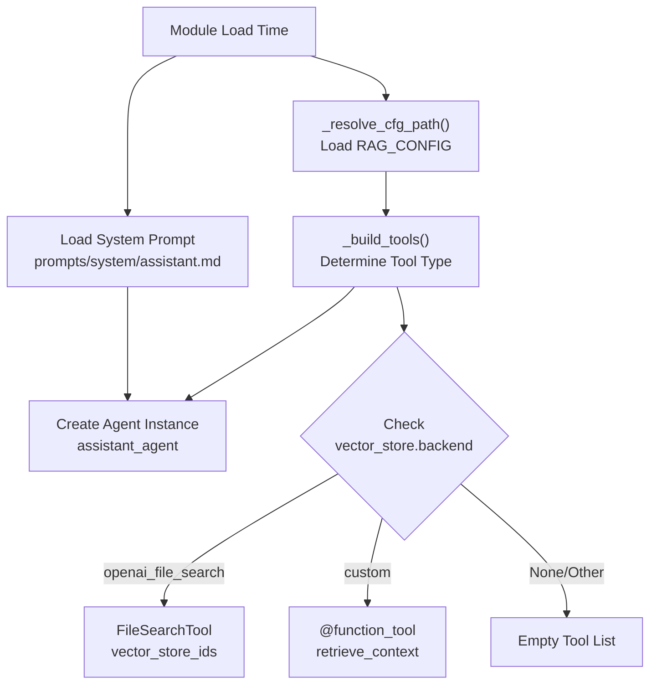
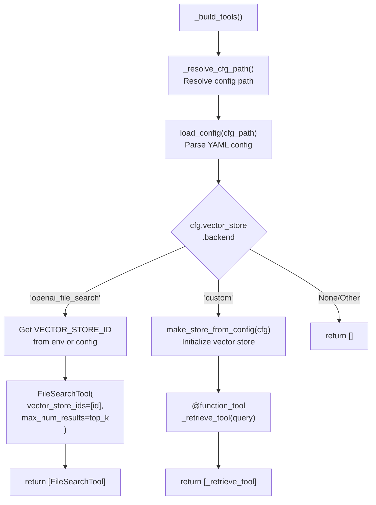
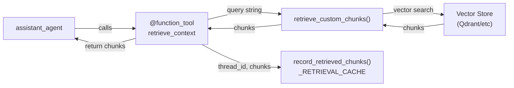
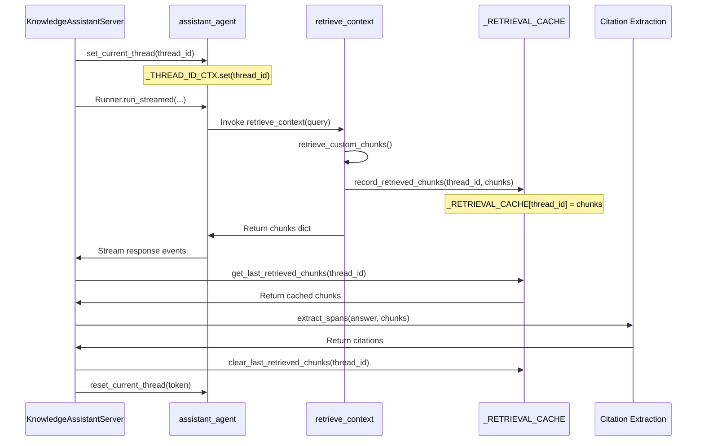
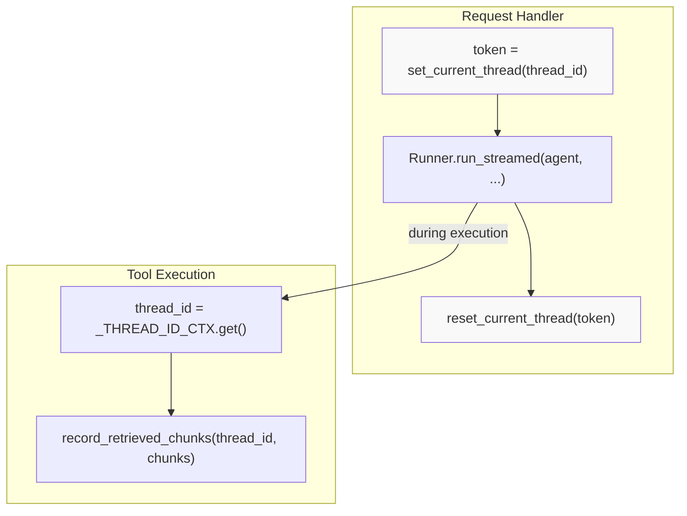
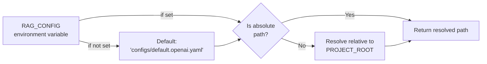
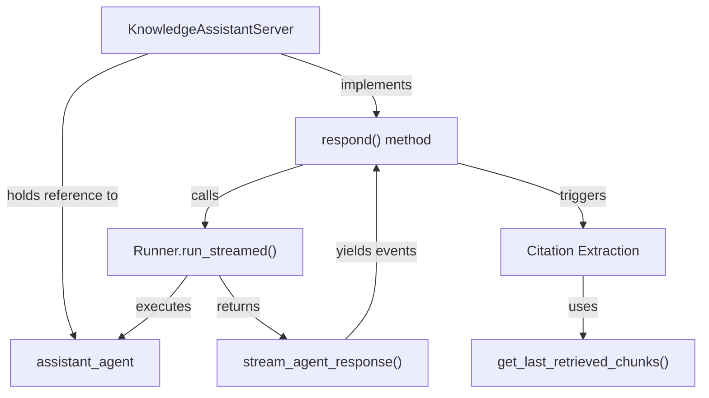

<!-- source: DeepWiki mcp.deepwiki.com · repo openai/openai-knowledge-retrieval · page 4.2 Assistant Agent System · fetched 2026-10-26 -->

# Assistant Agent System

<details>
<summary>Relevant source files</summary>

The following files were used as context for generating this wiki page:

- [app/backend/app/assistant_agent.py](app/backend/app/assistant_agent.py)
- [app/backend/app/main.py](app/backend/app/main.py)

</details>


## Purpose and Scope

This document describes the Assistant Agent System, which provides the core AI agent logic for the knowledge retrieval application. The system is responsible for initializing the OpenAI agent, dynamically building retrieval tools based on configuration, managing retrieval caching for citation extraction, and maintaining thread context during agent execution.

For information about how the agent is integrated into the HTTP API layer and how responses are streamed to clients, see [FastAPI Application (main.py)](#4.1). For details on the retrieval pipeline that the agent invokes, see [RAG Pipeline](#3.4).

**Sources:** [app/backend/app/assistant_agent.py:1-128]()

---

## Overview

The Assistant Agent System is implemented in `app/backend/app/assistant_agent.py` and provides a configured OpenAI `Agent` instance that handles user queries by leveraging retrieval tools. The system adapts its behavior based on the configured vector store backend, dynamically building either OpenAI's native `FileSearchTool` or a custom `retrieve_tool` function.

A key responsibility of this system is maintaining a thread-local cache of retrieved document chunks, enabling the backend to extract citations after the agent generates a response. This cache is managed using Python's `contextvars` module to ensure thread safety.

**Sources:** [app/backend/app/assistant_agent.py:1-128]()

---

## Agent Initialization

### Agent Configuration

The `assistant_agent` is initialized as a global singleton at module load time with the following configuration:

| Component | Value | Description |
|-----------|-------|-------------|
| Model | `gpt-5-mini` | The language model used for agent responses |
| Name | `"Knowledge Retrieval"` | Display name for the agent |
| Instructions | Loaded from `prompts/system/assistant.md` | System prompt defining agent behavior |
| Tools | Dynamically built via `_build_tools()` | Retrieval tools based on configuration |
| Model Settings | `reasoning_effort="minimal"` | Controls inference behavior |

The system prompt is loaded from the repository's `prompts/system/assistant.md` file, which defines how the agent should respond to queries and interact with retrieval tools.

**Diagram: Agent Initialization Flow**



**Sources:** [app/backend/app/assistant_agent.py:25-127]()

---

## Dynamic Tool Building

### Tool Selection Logic

The `_build_tools()` function examines the RAG configuration to determine which retrieval tools to attach to the agent. The decision is based on the `vector_store.backend` setting:

**Diagram: Tool Building Decision Tree**



**Sources:** [app/backend/app/assistant_agent.py:67-115]()

### OpenAI File Search Backend

When `vector_store.backend` is set to `"openai_file_search"`, the system creates a `FileSearchTool` that leverages OpenAI's managed vector search service:

```python
# Pseudo-code representation of the logic
FileSearchTool(
    vector_store_ids=[VECTOR_STORE_ID],
    max_num_results=cfg.query.top_k  # Default: 8
)
```

The vector store ID is retrieved from:
1. The `VECTOR_STORE_ID` environment variable (highest priority)
2. The configuration path `cfg.vector_store.openai_file_search.vector_store_id`

**Sources:** [app/backend/app/assistant_agent.py:71-83]()

### Custom Vector Store Backend

When `vector_store.backend` is set to `"custom"`, the system creates a function tool named `retrieve_context` that wraps the custom retrieval pipeline:

**Diagram: Custom Retrieve Tool Architecture**



The function tool implementation:
- Accepts a `query: str` parameter
- Validates the query is non-empty
- Calls `retrieve_custom_chunks()` with the configuration, store, client, and query
- Extracts relevant fields from each chunk (doc_id, title, text, score, metadata, page)
- Records the chunks in the retrieval cache for later citation extraction
- Returns a dictionary containing the chunk list

**Sources:** [app/backend/app/assistant_agent.py:84-113]()

---

## Retrieval Cache System

The retrieval cache is a critical component that enables citation extraction after the agent generates a response. Since OpenAI's custom function tools don't automatically provide annotations like `FileSearchTool` does, the system must cache retrieved chunks for later processing.

### Cache Data Structures

| Variable | Type | Purpose |
|----------|------|---------|
| `_RETRIEVAL_CACHE` | `Dict[str, List[Dict[str, Any]]]` | Maps thread IDs to their most recent retrieved chunks |
| `_THREAD_ID_CTX` | `ContextVar[Optional[str]]` | Context variable storing the current thread ID |

**Diagram: Retrieval Cache Workflow**



**Sources:** [app/backend/app/assistant_agent.py:17-65]()

### Cache Management Functions

The module provides a clean API for managing the retrieval cache:

| Function | Signature | Purpose |
|----------|-----------|---------|
| `record_retrieved_chunks` | `(thread_id: Optional[str], chunks: List[Dict]) -> None` | Store chunks for a thread (creates shallow copy) |
| `get_last_retrieved_chunks` | `(thread_id: str) -> List[Dict]` | Retrieve cached chunks (returns shallow copy) |
| `clear_last_retrieved_chunks` | `(thread_id: str) -> None` | Remove cached chunks for a thread |
| `set_current_thread` | `(thread_id: Optional[str]) -> Token` | Set context variable for current thread |
| `reset_current_thread` | `(token: Token) -> None` | Reset context variable to previous value |

All functions that return chunks create shallow copies to prevent unintended mutations by downstream consumers.

**Sources:** [app/backend/app/assistant_agent.py:41-64]()

---

## Thread Context Management

The system uses Python's `contextvars` module to maintain thread-safe context during agent execution. This is necessary because the `retrieve_context` tool needs to know which thread it's retrieving for, but function tools don't receive thread context as parameters.

### Context Variable Pattern



The backend's `respond()` method uses a try/finally block to ensure the context variable is always reset, even if an exception occurs during agent execution:

```python
# Simplified pattern from main.py
token = set_current_thread(thread.id)
try:
    result = Runner.run_streamed(assistant_agent, ...)
    async for event in stream_agent_response(...):
        yield event
finally:
    reset_current_thread(token)
```

**Sources:** [app/backend/app/assistant_agent.py:20-64](), [app/backend/app/main.py:278-294]()

---

## Configuration Resolution

The assistant agent system loads its configuration from a YAML file specified by the `RAG_CONFIG` environment variable (default: `configs/default.openai.yaml`). The `_resolve_cfg_path()` helper function handles both absolute and relative paths:

**Diagram: Configuration Path Resolution**



Relative paths are resolved against the project root (three directories up from `assistant_agent.py`), ensuring consistent behavior regardless of the current working directory.

**Sources:** [app/backend/app/assistant_agent.py:33-38]()

---

## Integration with Backend Server

The `assistant_agent` is imported and used by the `KnowledgeAssistantServer` class in `main.py`. The integration follows this pattern:

**Diagram: Backend Integration Points**



### Key Integration Points

1. **Initialization**: The server creates a singleton instance with the agent [app/backend/app/main.py:547]()
2. **Request Handling**: The `respond()` method sets thread context before running the agent [app/backend/app/main.py:278-294]()
3. **Citation Extraction**: After assistant responses, the server retrieves cached chunks [app/backend/app/main.py:398-411]()
4. **Context Cleanup**: Thread context is always reset in a finally block [app/backend/app/main.py:293-294]()

**Sources:** [app/backend/app/main.py:131-294](), [app/backend/app/main.py:547]()

---

## System Instructions

The agent's behavior is defined by a markdown file loaded at module initialization. This file is located at `prompts/system/assistant.md` (relative to project root) and contains instructions on how the agent should:
- Respond to user queries
- Use retrieval tools appropriately
- Format responses with citations
- Handle edge cases and errors

The instructions are stored in the `KNOWLEDGE_ASSISTANT_INSTRUCTIONS` constant and passed to the `Agent` constructor.

**Sources:** [app/backend/app/assistant_agent.py:25-30](), [app/backend/app/assistant_agent.py:125]()

---

## Model Settings

The agent uses a `ModelSettings` object to configure inference behavior:

| Setting | Value | Effect |
|---------|-------|--------|
| `reasoning_effort` | `"minimal"` | Optimizes for faster responses with lower computational overhead |

These settings are passed both at agent initialization and when creating `RunConfig` instances during execution.

**Sources:** [app/backend/app/assistant_agent.py:117-119](), [app/backend/app/main.py:284]()

---

## Chunk Payload Structure

When the custom `retrieve_context` tool is invoked, it returns chunks with the following structure:

| Field | Type | Description |
|-------|------|-------------|
| `doc_id` | `str` | Unique identifier for the source document |
| `title` | `str` | Human-readable document title |
| `text` | `str` | The actual chunk text content |
| `score` | `float` | Relevance score (reranked if enabled) |
| `similarity_score` | `float` | Raw vector similarity score |
| `metadata` | `dict` | Additional metadata (path, page numbers, etc.) |
| `page` | `int` | Page number where chunk appears (if applicable) |

This structure is designed to provide the agent with sufficient context while also enabling citation extraction on the backend.

**Sources:** [app/backend/app/assistant_agent.py:98-111]()

---

## Error Handling

The assistant agent system implements minimal error handling, relying on upstream components to manage exceptions. Key error scenarios:

| Scenario | Handling |
|----------|----------|
| Empty query string | `ValueError` raised by `retrieve_context` tool |
| Missing vector store ID | Tool list returns empty (no FileSearchTool created) |
| Configuration load failure | Exception propagates to caller |
| Cache access with invalid thread ID | Gracefully returns empty list |

The backend server wraps agent execution in try/finally blocks to ensure proper cleanup even when errors occur.

**Sources:** [app/backend/app/assistant_agent.py:90-91](), [app/backend/app/main.py:278-294]()

---

## Summary

The Assistant Agent System provides a flexible, configuration-driven approach to building AI agents with retrieval capabilities. Key design decisions include:

- **Dynamic tool building** based on vector store backend configuration
- **Thread-local caching** using context variables for citation support
- **Shallow copying** of chunk data to prevent unintended mutations
- **Clean separation** between agent logic and backend server concerns

This architecture enables the same agent code to work with both OpenAI's managed File Search service and custom vector stores like Qdrant, while maintaining the ability to extract citations regardless of which backend is used.

**Sources:** [app/backend/app/assistant_agent.py:1-128]()

---

