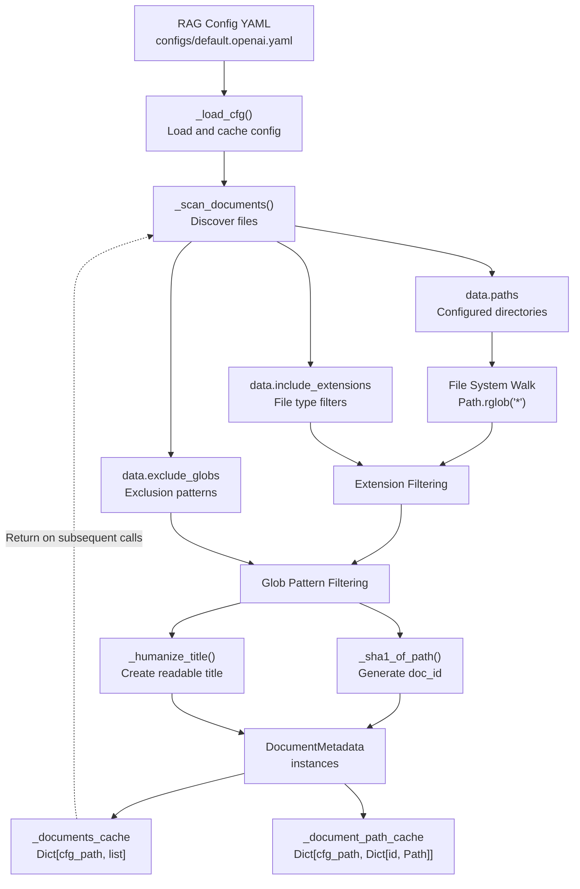
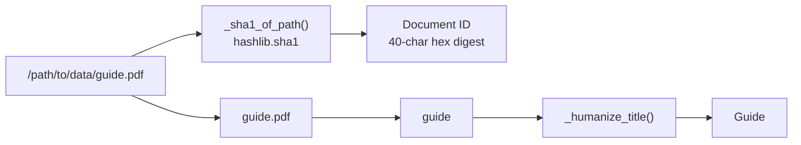
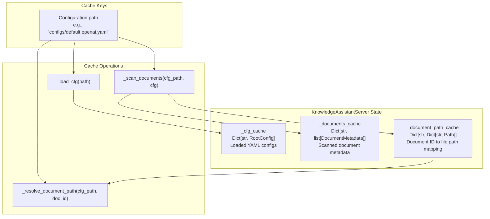
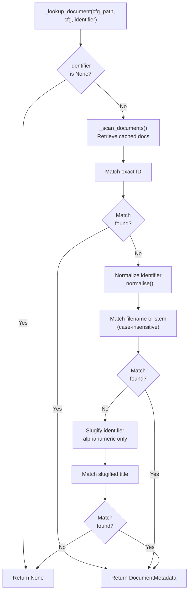
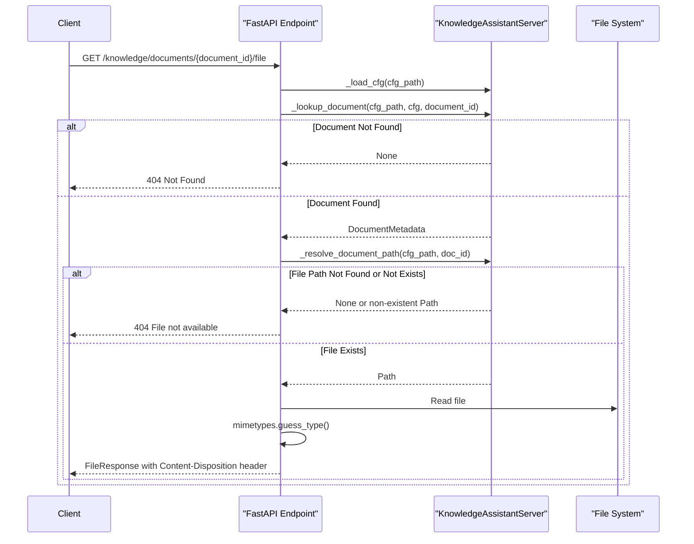
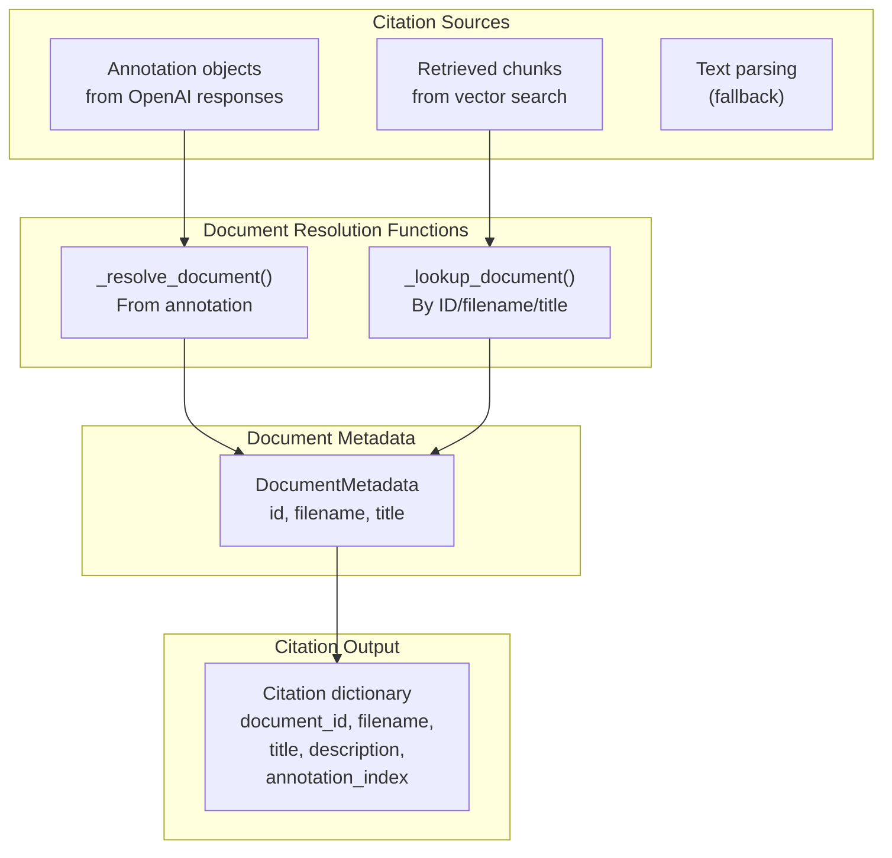
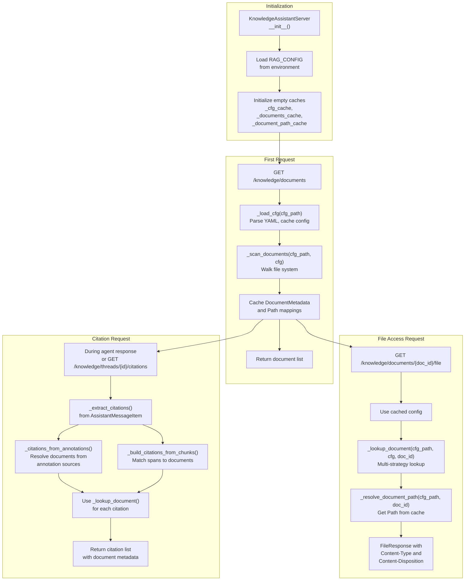

<!-- source: DeepWiki mcp.deepwiki.com · repo openai/openai-knowledge-retrieval · page 4.3 Document Management · fetched 2026-10-26 -->

# Document Management

<details>
<summary>Relevant source files</summary>

The following files were used as context for generating this wiki page:

- [app/backend/app/documents.py](app/backend/app/documents.py)
- [app/backend/app/main.py](app/backend/app/main.py)

</details>


## Purpose and Scope

This document details the document management subsystem in the backend, which handles metadata extraction, caching, lookup, and file serving for documents in the knowledge base. The system dynamically discovers documents from configured data paths, maintains in-memory caches of metadata, and provides HTTP endpoints for document access.

For information about document ingestion and embedding generation, see [Data Ingestion](#6.2). For the broader backend architecture, see [FastAPI Application](#4.1). For citation extraction that depends on document metadata, see [Backend API Endpoints](#11.1).

**Sources**: [app/backend/app/documents.py:1-43](), [app/backend/app/main.py:131-647]()

---

## Core Data Structures

### DocumentMetadata Class

The `DocumentMetadata` dataclass serves as the fundamental data structure for document representation throughout the system.

```python
@dataclass(frozen=True, slots=True)
class DocumentMetadata:
    id: str
    filename: str
    title: str
    description: str | None = None
```

| Field | Type | Purpose |
|-------|------|---------|
| `id` | `str` | SHA-1 hash of the document's file path, used as a stable identifier |
| `filename` | `str` | Original filename (basename) of the document |
| `title` | `str` | Human-readable title derived from filename |
| `description` | `str \| None` | Optional description (typically `None` for file-based documents) |

The dataclass includes a `stem` property that extracts the filename without extension using `Path(self.filename).stem`.

**Sources**: [app/backend/app/documents.py:16-26]()

### Helper Functions

The module provides normalization and conversion utilities:

| Function | Purpose | Implementation |
|----------|---------|----------------|
| `_normalise(value)` | Converts strings to lowercase and strips whitespace | `value.strip().lower()` |
| `_slugify(value)` | Creates alphanumeric-only slugs | Filters non-alphanumeric characters |
| `as_dicts(documents)` | Converts DocumentMetadata instances to dictionaries | Uses `dataclasses.asdict()` |

**Sources**: [app/backend/app/documents.py:8-36]()

---

## Document Discovery System

### Configuration-Driven Scanning

The `KnowledgeAssistantServer` class implements document discovery by scanning configured data paths from the RAG configuration YAML files.



**Scanning Algorithm** (`_scan_documents` method):

1. **Check Cache**: Returns cached results if configuration path exists in `_documents_cache`
2. **Load Configuration**: Extracts `data.paths`, `data.include_extensions`, and `data.exclude_globs`
3. **Resolve Paths**: Expands environment variables and user home directories, resolves relative paths against `PROJECT_ROOT`
4. **Walk File System**: Recursively traverses each root directory using `Path.rglob("*")`
5. **Apply Filters**:
   - Skip non-files
   - Filter by extension if `include_extensions` specified
   - Apply exclusion patterns using `fnmatch` against both relative and absolute paths
6. **Generate Metadata**:
   - Create document ID using `_sha1_of_path()` (SHA-1 hash of path)
   - Extract filename using `path.name`
   - Generate title using `_humanize_title()` (capitalizes stem, replaces underscores/hyphens with spaces)
7. **Deduplicate**: Preserves first occurrence based on document ID
8. **Update Caches**: Stores results in `_documents_cache` and path mapping in `_document_path_cache`

**Sources**: [app/backend/app/main.py:153-222]()

### Path Resolution and ID Generation



**ID Generation** ([app/backend/app/main.py:63-66]()):
- Uses SHA-1 hash of the full file path string
- Provides stable identifiers even if filename is duplicated in different directories
- Returns 40-character hexadecimal digest

**Title Humanization** ([app/backend/app/main.py:69-72]()):
- Extracts filename stem (without extension)
- Replaces underscores and hyphens with spaces
- Capitalizes each word
- Example: `user_guide-v2.pdf` → `User Guide V2`

**Sources**: [app/backend/app/main.py:63-72]()

---

## Caching Strategy

### Multi-Level Cache Architecture

The `KnowledgeAssistantServer` maintains three cache dictionaries, all keyed by configuration file path:



**Cache Initialization** ([app/backend/app/main.py:136-142]()):
```python
self._cfg_cache: Dict[str, RootConfig] = {}
self._documents_cache: Dict[str, list[DocumentMetadata]] = {}
self._document_path_cache: Dict[str, Dict[str, Path]] = {}
self._cfg_path = os.getenv("RAG_CONFIG") or "configs/default.openai.yaml"
```

**Cache Behavior**:
- **Configuration Cache**: Stores parsed YAML configurations, prevents redundant parsing
- **Documents Cache**: Stores list of `DocumentMetadata` instances per configuration
- **Path Cache**: Maps document IDs to `Path` objects for efficient file access
- **Invalidation**: Caches persist for server lifetime; requires restart to reflect file system changes

**Sources**: [app/backend/app/main.py:136-142](), [app/backend/app/main.py:153-222]()

---

## Document Lookup System

### Multi-Strategy Lookup

The `_lookup_document` method implements a cascading lookup strategy that attempts multiple matching approaches:



**Lookup Stages** ([app/backend/app/main.py:224-242]()):

| Stage | Comparison | Example Match |
|-------|------------|---------------|
| 1. Exact ID | `d.id == identifier` | `"a3f2...e891"` matches document with same ID |
| 2. Filename | `d.filename.lower() == norm` | `"guide.pdf"` matches `filename="guide.pdf"` |
| 3. Stem | `Path(d.filename).stem.lower() == norm` | `"guide"` matches `filename="guide.pdf"` |
| 4. Slugified Title | `slugify(d.title) == slugify(identifier)` | `"user guide"` matches `title="User Guide"` |

**Normalization Functions**:
- `_normalise()`: Strips whitespace and converts to lowercase
- `_slugify()` (implicit): Removes all non-alphanumeric characters and lowercases

**Sources**: [app/backend/app/main.py:224-242]()

### Path Resolution

The `_resolve_document_path` method provides fast path lookup using the cached mapping:

```python
def _resolve_document_path(self, cfg_path: str, doc_id: str) -> Path | None:
    return (self._document_path_cache.get(cfg_path) or {}).get(doc_id)
```

This method returns `None` if:
- The configuration path is not in the cache
- The document ID does not exist in the path mapping

**Sources**: [app/backend/app/main.py:244-245]()

---

## File Serving

### HTTP Endpoint for Document Access

The `/knowledge/documents/{document_id}/file` endpoint provides authenticated file access with proper content types:



**Endpoint Implementation** ([app/backend/app/main.py:603-623]()):

```python
@app.get("/knowledge/documents/{document_id}/file")
async def document_file(
    document_id: str, 
    server: KnowledgeAssistantServer = Depends(get_server)
) -> FileResponse:
    cfg_path = server._cfg_path
    cfg = server._load_cfg(cfg_path)
    document = server._lookup_document(cfg_path, cfg, document_id)
    if document is None:
        raise HTTPException(status_code=404, detail="Document not found")
    
    file_path = server._resolve_document_path(cfg_path, document.id)
    if not file_path or not file_path.exists():
        raise HTTPException(status_code=404, detail="File not available")
    
    media_type, _ = mimetypes.guess_type(str(file_path))
    headers = {"Content-Disposition": f'inline; filename="{document.filename}"'}
    return FileResponse(
        file_path,
        media_type=media_type or "application/octet-stream",
        headers=headers,
    )
```

**Response Headers**:
- `Content-Type`: Automatically detected using `mimetypes.guess_type()`, defaults to `application/octet-stream`
- `Content-Disposition`: Set to `inline` with original filename for browser rendering

**Sources**: [app/backend/app/main.py:603-623]()

### Document Listing Endpoint

The `/knowledge/documents` endpoint provides a list of all available documents:

```python
@app.get("/knowledge/documents")
async def list_documents(
    server: KnowledgeAssistantServer = Depends(get_server),
) -> dict[str, Any]:
    cfg_path = server._cfg_path
    cfg = server._load_cfg(cfg_path)
    docs = server._scan_documents(cfg_path, cfg)
    return {"documents": as_dicts(docs)}
```

**Response Format**:
```json
{
  "documents": [
    {
      "id": "a3f2c8...",
      "filename": "user_guide.pdf",
      "title": "User Guide",
      "description": null
    }
  ]
}
```

**Sources**: [app/backend/app/main.py:593-600]()

---

## Citation Integration

### Document Resolution for Citations

The document management system integrates tightly with the citation extraction system, providing metadata for citation sources.



**Resolution from Annotations** ([app/backend/app/main.py:98-121]()):

The `_resolve_document` function extracts filename from annotation sources and matches against the document path cache:

1. Extract `source.filename` from annotation
2. Normalize filename using `_normalise_filename()`
3. Search `_document_path_cache` for matching file paths
4. Return `DocumentMetadata` if found, otherwise `None`

**Resolution from Chunks** ([app/backend/app/main.py:413-502]()):

The `_build_citations_from_chunks` method integrates with retrieved chunks:

1. Retrieve cached chunks using `get_last_retrieved_chunks(thread_id)`
2. Extract answer text from assistant message content
3. Call `extract_spans()` to identify citation spans in answer
4. For each span, lookup document using `_lookup_document()` with `doc_id`
5. Construct citation with document metadata or chunk metadata as fallback
6. Build `Annotation` objects with `FileSource` containing document info

**Fallback Strategy**:
- **Primary**: Use `document.filename` and `document.title` from looked-up metadata
- **Secondary**: Use chunk metadata `path` and `title` fields
- **Tertiary**: Use `doc_id` directly as filename if no metadata available

**Sources**: [app/backend/app/main.py:98-121](), [app/backend/app/main.py:413-502]()

---

## Document Management Workflow

### Complete Flow Diagram



**Sources**: [app/backend/app/main.py:131-647]()

---

## Configuration and Environment

### Relevant Configuration Options

The document management system respects the following configuration from RAG YAML files:

| Configuration Path | Type | Purpose |
|-------------------|------|---------|
| `data.paths` | `list[str]` | List of directories to scan for documents |
| `data.include_extensions` | `list[str]` | File extensions to include (e.g., `[".pdf", ".txt"]`) |
| `data.exclude_globs` | `list[str]` | Glob patterns for files/directories to exclude |

### Environment Variables

| Variable | Default | Purpose |
|----------|---------|---------|
| `RAG_CONFIG` | `configs/default.openai.yaml` | Path to RAG configuration file |

**Path Resolution**:
- Paths in `data.paths` support environment variable expansion using `os.path.expandvars()`
- User home directory expansion using `os.path.expanduser()`
- Relative paths resolved against `PROJECT_ROOT`
- Absolute paths used as-is

**Sources**: [app/backend/app/main.py:137](), [app/backend/app/main.py:167-177]()

---

## Error Handling

### HTTP Status Codes

| Status Code | Scenario | Response |
|-------------|----------|----------|
| `200 OK` | Document found and served successfully | File content with headers |
| `404 Not Found` | Document ID not in metadata cache | `{"detail": "Document not found"}` |
| `404 Not Found` | File path not found or file doesn't exist | `{"detail": "File not available"}` |

### Null Handling

The system gracefully handles missing or invalid data:

- **Null Identifier**: `_lookup_document()` returns `None` immediately if identifier is `None`
- **Missing Path**: `_resolve_document_path()` returns `None` if path not in cache
- **Missing File**: HTTP endpoint checks `file_path.exists()` before serving
- **Missing Metadata**: Citation functions fall back to chunk metadata or `doc_id`

**Sources**: [app/backend/app/main.py:603-623](), [app/backend/app/main.py:224-242]()

---

## Summary

The document management subsystem provides a robust, cache-efficient system for discovering, indexing, and serving documents from configured data directories. Key characteristics:

- **Dynamic Discovery**: Scans file system based on configuration, not hard-coded lists
- **Multi-Level Caching**: Caches configurations, metadata lists, and path mappings
- **Flexible Lookup**: Supports lookup by exact ID, filename, stem, or slugified title
- **Citation Integration**: Provides metadata for citation resolution from multiple sources
- **Content-Type Detection**: Automatically determines MIME types for proper browser rendering
- **Configuration-Driven**: Respects include/exclude patterns and custom data paths

The system is initialized lazily on first use and maintains in-memory caches for the server lifetime, requiring restart to reflect file system changes.

**Sources**: [app/backend/app/documents.py:1-43](), [app/backend/app/main.py:131-647]()

---

