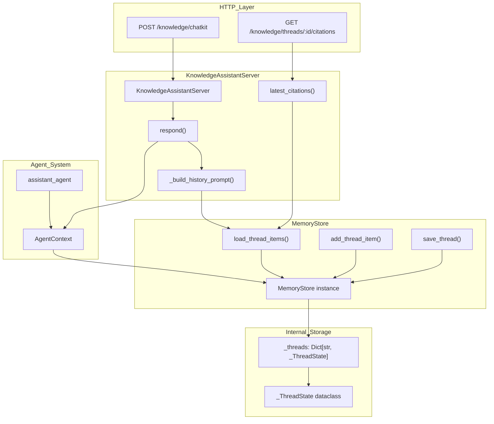
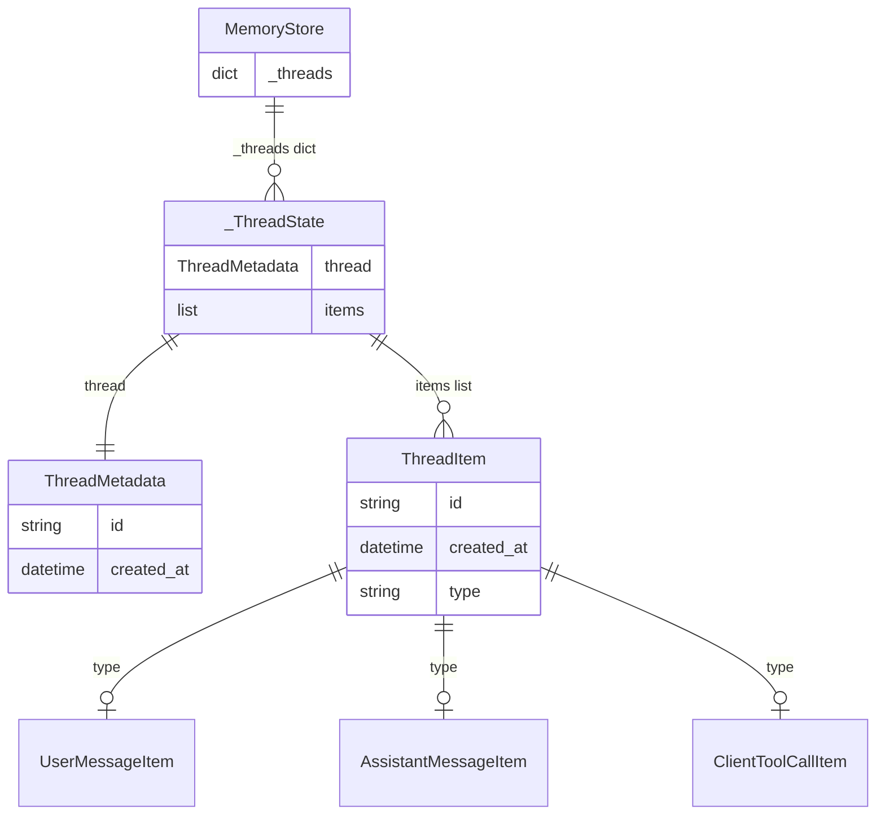
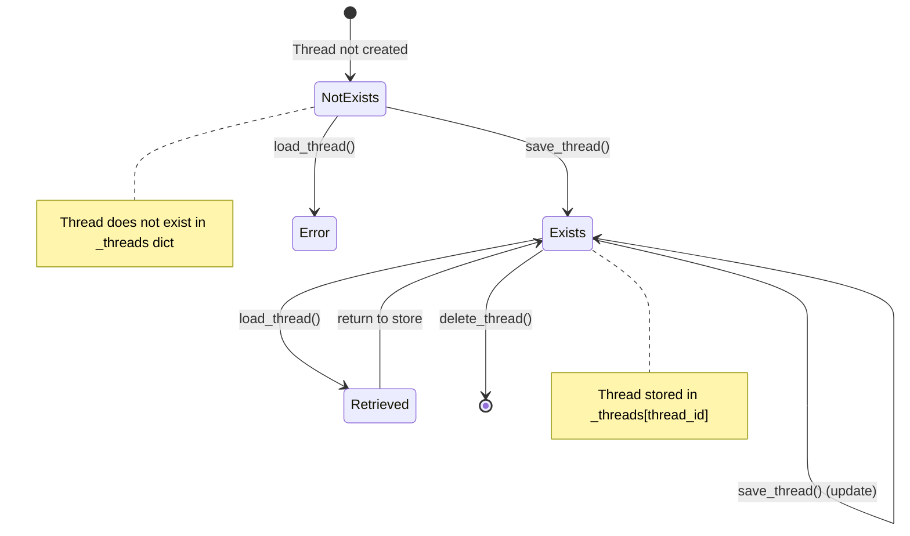
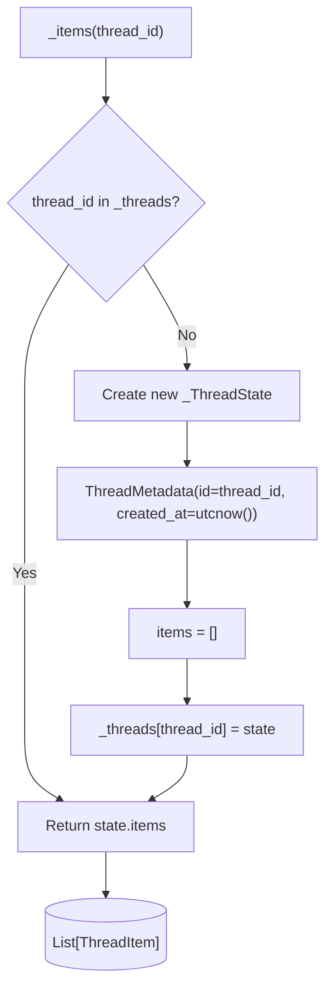
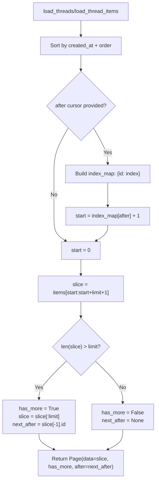
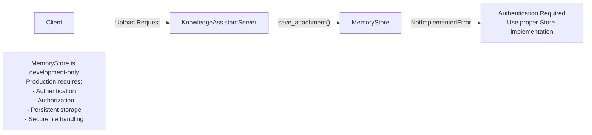
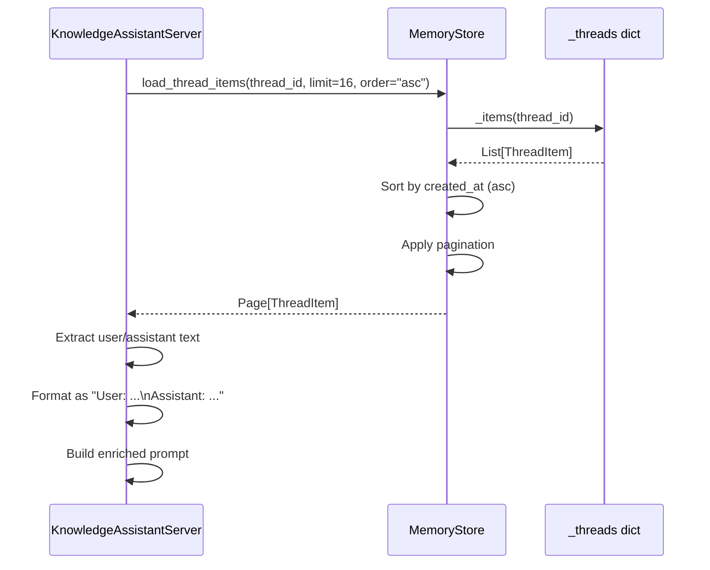

<!-- source: DeepWiki mcp.deepwiki.com · repo openai/openai-knowledge-retrieval · page 4.4 Memory Store · fetched 2026-10-26 -->

# Memory Store

<details>
<summary>Relevant source files</summary>

The following files were used as context for generating this wiki page:

- [app/backend/app/main.py](app/backend/app/main.py)
- [app/backend/app/memory_store.py](app/backend/app/memory_store.py)

</details>


## Purpose and Scope

This document describes the `MemoryStore` class, an in-memory implementation of the ChatKit `Store` interface used for persisting conversation threads and messages in the Knowledge Retrieval application. The Memory Store provides temporary, non-persistent storage for conversational state during runtime.

For information about the broader backend architecture and how the Memory Store integrates with other backend services, see [Backend Architecture](#3.2). For details about the agent system that uses stored conversation history, see [Assistant Agent System](#4.2).

**Sources:** [app/backend/app/memory_store.py]()

---

## Overview

The `MemoryStore` class provides an in-memory storage solution for conversation threads and messages. It implements the `chatkit.store.Store[dict[str, Any]]` interface, enabling the `KnowledgeAssistantServer` to persist conversational state without requiring an external database. All data is stored in Python dictionaries and lost when the server restarts.

The Memory Store explicitly does **not** support file attachments, raising `NotImplementedError` for attachment operations. This design decision ensures that file upload functionality requires a proper store implementation with authentication and authorization.

**Key Characteristics:**
- **Volatile Storage**: All data stored in Python dictionaries; no persistence across restarts
- **Thread-Centric**: Organizes data around conversation threads, each containing metadata and items
- **Pagination Support**: Implements cursor-based pagination for both threads and thread items
- **Deep Copying**: All retrieved objects are deep-copied to prevent external mutations
- **No Authentication**: Suitable only for development/demo; production requires authenticated store

**Sources:** [app/backend/app/memory_store.py:1-177](), [app/backend/app/main.py:132-134]()

---

## Architecture and Integration

### Class Structure

```mermaid
classDiagram
    class Store~TContext~ {
        <<interface>>
        +load_thread(thread_id, context) ThreadMetadata
        +save_thread(thread, context)
        +load_threads(limit, after, order, context) Page~ThreadMetadata~
        +delete_thread(thread_id, context)
        +load_thread_items(thread_id, after, limit, order, context) Page~ThreadItem~
        +add_thread_item(thread_id, item, context)
        +save_item(thread_id, item, context)
        +load_item(thread_id, item_id, context) ThreadItem
        +delete_thread_item(thread_id, item_id, context)
        +save_attachment(attachment, context)
        +load_attachment(attachment_id, context) Attachment
        +delete_attachment(attachment_id, context)
    }
    
    class MemoryStore {
        -Dict~str, _ThreadState~ _threads
        +load_thread(thread_id, context) ThreadMetadata
        +save_thread(thread, context)
        +load_threads(limit, after, order, context) Page~ThreadMetadata~
        +delete_thread(thread_id, context)
        +load_thread_items(thread_id, after, limit, order, context) Page~ThreadItem~
        +add_thread_item(thread_id, item, context)
        +save_item(thread_id, item, context)
        +load_item(thread_id, item_id, context) ThreadItem
        +delete_thread_item(thread_id, item_id, context)
        +save_attachment(attachment, context) NotImplementedError
        +load_attachment(attachment_id, context) NotImplementedError
        +delete_attachment(attachment_id, context) NotImplementedError
        -_items(thread_id) List~ThreadItem~
    }
    
    class _ThreadState {
        +ThreadMetadata thread
        +List~ThreadItem~ items
    }
    
    class KnowledgeAssistantServer {
        +MemoryStore store
        +respond(thread, item, context)
        +latest_citations(thread_id, context)
        -_build_history_prompt(thread_id, base_text, context)
    }
    
    class ChatKitServer~TContext~ {
        <<abstract>>
        +Store~TContext~ store
        +process(payload, context)
    }
    
    Store~TContext~ <|.. MemoryStore : implements
    MemoryStore o-- "_ThreadState" : contains
    KnowledgeAssistantServer *-- MemoryStore : owns
    ChatKitServer~TContext~ <|-- KnowledgeAssistantServer : extends
    ChatKitServer~TContext~ o-- Store~TContext~ : uses
```

**Sources:** [app/backend/app/memory_store.py:16-28](), [app/backend/app/main.py:131-134]()

### Integration with Backend Services



**Sources:** [app/backend/app/main.py:247-295](), [app/backend/app/main.py:299-316](), [app/backend/app/main.py:504-544]()

---

## Data Model

### Internal Storage Structure

The `MemoryStore` maintains a single dictionary mapping thread IDs to thread state objects:



**Sources:** [app/backend/app/memory_store.py:16-20](), [app/backend/app/memory_store.py:25-27]()

### Data Types

| Type | Description | Fields | Source |
|------|-------------|--------|--------|
| `_ThreadState` | Internal storage wrapper | `thread: ThreadMetadata`<br/>`items: List[ThreadItem]` | [memory_store.py:16-20]() |
| `ThreadMetadata` | Thread metadata from ChatKit | `id: str`<br/>`created_at: datetime`<br/>*(additional ChatKit fields)* | ChatKit types |
| `ThreadItem` | Base type for conversation items | Varies by subtype | ChatKit types |
| `UserMessageItem` | User message in conversation | `id: str`<br/>`content: List[ContentPart]`<br/>`created_at: datetime` | ChatKit types |
| `AssistantMessageItem` | Assistant response message | `id: str`<br/>`content: List[AssistantMessageContent]`<br/>`created_at: datetime` | ChatKit types |
| `Page[T]` | Pagination wrapper | `data: List[T]`<br/>`has_more: bool`<br/>`after: str \| None` | ChatKit types |

**Sources:** [app/backend/app/memory_store.py:8-13](), [app/backend/app/main.py:13-25]()

---

## Thread Management Operations

### Thread CRUD Operations

The `MemoryStore` provides four primary operations for managing thread metadata:



**Sources:** [app/backend/app/memory_store.py:30-81]()

#### load_thread

Retrieves thread metadata by ID. Raises `NotFoundError` if thread does not exist.

**Implementation:** [app/backend/app/memory_store.py:30-36]()

```python
async def load_thread(self, thread_id: str, context: dict[str, Any]) -> ThreadMetadata
```

**Behavior:**
1. Looks up thread ID in `_threads` dictionary
2. Raises `NotFoundError` if not found
3. Returns deep copy of `ThreadMetadata` to prevent mutations

#### save_thread

Creates or updates thread metadata.

**Implementation:** [app/backend/app/memory_store.py:38-48]()

```python
async def save_thread(self, thread: ThreadMetadata, context: dict[str, Any]) -> None
```

**Behavior:**
1. If thread exists: Updates `_ThreadState.thread` with deep copy
2. If thread does not exist: Creates new `_ThreadState` with empty items list
3. Always stores deep copy to prevent external mutations

#### load_threads

Retrieves paginated list of all threads, sorted by creation time.

**Implementation:** [app/backend/app/memory_store.py:50-77]()

```python
async def load_threads(
    self, limit: int, after: str | None, order: str, context: dict[str, Any]
) -> Page[ThreadMetadata]
```

**Parameters:**
- `limit`: Maximum number of threads to return
- `after`: Cursor for pagination (thread ID to start after)
- `order`: Sort direction (`"asc"` or `"desc"`)
- `context`: Request context (unused in memory store)

**Pagination Algorithm:**
1. Collect all threads and sort by `created_at` (ascending or descending)
2. If `after` provided, find index of that thread and start from next position
3. Slice `limit + 1` items to detect if more pages exist
4. Return `Page` with `data`, `has_more`, and `after` (last item ID if more exist)

#### delete_thread

Removes thread and all its items from storage.

**Implementation:** [app/backend/app/memory_store.py:79-80]()

```python
async def delete_thread(self, thread_id: str, context: dict[str, Any]) -> None
```

**Behavior:**
- Uses `dict.pop()` with default `None` to silently ignore non-existent threads

**Sources:** [app/backend/app/memory_store.py:30-81]()

---

## Thread Item Operations

Thread items represent individual messages and events within a conversation thread. The `MemoryStore` provides operations to manage these items.

### Item Access and Lazy Initialization



**Sources:** [app/backend/app/memory_store.py:83-91]()

The `_items()` helper method implements lazy thread creation: if a thread doesn't exist when accessing items, it creates a minimal thread with current timestamp.

### Item CRUD Operations

#### load_thread_items

Retrieves paginated, sorted list of items for a thread.

**Implementation:** [app/backend/app/memory_store.py:93-117]()

```python
async def load_thread_items(
    self, thread_id: str, after: str | None, limit: int, order: str, context: dict[str, Any]
) -> Page[ThreadItem]
```

**Behavior:**
1. Retrieves items via `_items()` (creates thread if needed)
2. Deep copies all items to prevent mutation
3. Sorts by `created_at` field (ascending or descending)
4. Applies cursor-based pagination identical to `load_threads()`
5. Returns `Page[ThreadItem]` with pagination metadata

**Usage Example:** Loading conversation history for prompt building [app/backend/app/main.py:515-521]()

#### add_thread_item

Appends new item to thread's item list.

**Implementation:** [app/backend/app/memory_store.py:119-122]()

```python
async def add_thread_item(
    self, thread_id: str, item: ThreadItem, context: dict[str, Any]
) -> None
```

**Behavior:**
1. Retrieves items list via `_items()` (creates thread if needed)
2. Appends deep copy of item to list
3. No duplicate checking - allows multiple items with same ID

**Integration:** Called by `ChatKitServer` during message streaming [chatkit.server module]()

#### save_item

Updates existing item or adds if not found.

**Implementation:** [app/backend/app/memory_store.py:124-132]()

```python
async def save_item(
    self, thread_id: str, item: ThreadItem, context: dict[str, Any]
) -> None
```

**Behavior:**
1. Searches for item with matching ID in thread's items
2. If found: Replaces with deep copy of new item
3. If not found: Appends deep copy to list (same as `add_thread_item`)

#### load_item

Retrieves specific item by ID from thread.

**Implementation:** [app/backend/app/memory_store.py:134-140]()

```python
async def load_item(
    self, thread_id: str, item_id: str, context: dict[str, Any]
) -> ThreadItem
```

**Behavior:**
1. Iterates through thread's items looking for matching ID
2. Returns deep copy if found
3. Raises `NotFoundError` if item doesn't exist

#### delete_thread_item

Removes item from thread by ID.

**Implementation:** [app/backend/app/memory_store.py:142-146]()

```python
async def delete_thread_item(
    self, thread_id: str, item_id: str, context: dict[str, Any]
) -> None
```

**Behavior:**
- Filters items list, keeping all except the one with matching ID
- Silently succeeds if item doesn't exist (no error raised)

**Sources:** [app/backend/app/memory_store.py:83-146]()

---

## Pagination Implementation

The `MemoryStore` implements cursor-based pagination for both threads and items. The pagination strategy uses item/thread IDs as cursors.

### Pagination Algorithm



**Sources:** [app/backend/app/memory_store.py:57-77](), [app/backend/app/memory_store.py:101-117]()

### Pagination Example

Given threads with IDs: `["t1", "t2", "t3", "t4", "t5"]` sorted by `created_at`

| Request | `after` | `limit` | Returned IDs | `has_more` | `next_after` |
|---------|---------|---------|--------------|------------|--------------|
| First page | `None` | 2 | `["t1", "t2"]` | `True` | `"t2"` |
| Next page | `"t2"` | 2 | `["t3", "t4"]` | `True` | `"t4"` |
| Last page | `"t4"` | 2 | `["t5"]` | `False` | `None` |

The algorithm fetches `limit + 1` items to detect whether more pages exist, then truncates to `limit` before returning.

**Sources:** [app/backend/app/memory_store.py:50-77]()

---

## Attachment Operations (Not Supported)

The `MemoryStore` explicitly does not implement attachment storage. All three attachment operations raise `NotImplementedError` with explanatory messages.

### Rationale for Non-Support



**Sources:** [app/backend/app/memory_store.py:148-176]()

### Method Signatures

| Method | Implementation | Error Message |
|--------|---------------|---------------|
| `save_attachment` | [memory_store.py:151-159]() | "MemoryStore does not persist attachments. Provide a Store implementation that enforces authentication and authorization before enabling uploads." |
| `load_attachment` | [memory_store.py:161-169]() | "MemoryStore does not load attachments. Provide a Store implementation that enforces authentication and authorization before enabling uploads." |
| `delete_attachment` | [memory_store.py:171-176]() | "MemoryStore does not delete attachments because they are never stored." |

The error messages emphasize that attachment handling requires:
- **Authentication**: Verifying user identity
- **Authorization**: Ensuring users can only access their own files
- **Persistent storage**: Files must survive server restarts
- **Security**: Proper handling of uploaded content

**Sources:** [app/backend/app/memory_store.py:148-176]()

---

## Usage in the Knowledge Retrieval System

### Instantiation

The `MemoryStore` is instantiated once as part of the `KnowledgeAssistantServer` initialization:

[app/backend/app/main.py:131-134]()
```python
class KnowledgeAssistantServer(ChatKitServer[dict[str, Any]]):
    def __init__(self, agent: Agent[AgentContext]) -> None:
        self.store = MemoryStore()
        super().__init__(self.store)
```

The store is passed to the `ChatKitServer` parent class, which uses it for all thread/item persistence operations.

### Key Usage Patterns

#### 1. Building Conversation History for Prompts

The `_build_history_prompt()` method retrieves recent conversation items to provide context to the agent:

[app/backend/app/main.py:504-544]()



**Process:**
1. Loads up to 16 items (`max_turns * 2`) in ascending order
2. Extracts text from `UserMessageItem` and `AssistantMessageItem` objects
3. Formats as conversation history with `"User:"` and `"Assistant:"` prefixes
4. Prepends history to current user message

#### 2. Retrieving Citations from Recent Messages

The `latest_citations()` method scans recent messages for citation information:

[app/backend/app/main.py:299-316]()

```python
async def latest_citations(self, thread_id: str, context: dict[str, Any]) -> list[dict[str, Any]]:
    items = await self.store.load_thread_items(
        thread_id,
        after=None,
        limit=50,
        order="desc",
        context=context,
    )
    # Process items to extract citations...
```

**Process:**
1. Loads up to 50 items in descending order (most recent first)
2. Iterates through items looking for `AssistantMessageItem`
3. Extracts citations from first assistant message found
4. Returns citations for display in UI

#### 3. Agent Context Integration

The store is passed to the agent system via `AgentContext`:

[app/backend/app/main.py:272-276]()
```python
agent_context = AgentContext(
    thread=thread,
    store=self.store,
    request_context=context,
)
```

This allows the agent and ChatKit streaming utilities to access and modify thread state during execution.

**Sources:** [app/backend/app/main.py:131-134](), [app/backend/app/main.py:247-295](), [app/backend/app/main.py:299-316](), [app/backend/app/main.py:504-544]()

---

## Limitations and Considerations

### Volatility

All data is stored in memory and lost when the server restarts. There is no persistence layer.

| Event | Data Loss | Impact |
|-------|-----------|--------|
| Server restart | All threads and messages | Users lose conversation history |
| Server crash | All threads and messages | No recovery possible |
| Code reload | All threads and messages | Development disruption |

**Sources:** [app/backend/app/memory_store.py:22-28]()

### Concurrency

The `MemoryStore` does not implement any locking or synchronization mechanisms. It relies on Python's GIL (Global Interpreter Lock) for thread safety. This is acceptable for:
- Single-process deployments
- Development environments
- Low-concurrency scenarios

For production, consider:
- Race conditions during concurrent thread modifications
- Potential data corruption with multiple workers
- Need for proper database with ACID properties

**Sources:** [app/backend/app/memory_store.py:25-27]()

### Authentication and Authorization

The `MemoryStore` has no concept of user identity or permissions. All threads are accessible to all requests. The `context` parameter is accepted but unused.

**Security Implications:**
- Any request can access any thread by ID
- No user isolation
- Unsuitable for multi-tenant production environments

**Sources:** [app/backend/app/memory_store.py:148-159]()

### No Attachment Support

As documented in [Attachment Operations](#attachment-operations-not-supported), file uploads are explicitly not supported. To enable file attachments, implement a custom `Store` with:
- User authentication
- File storage backend (e.g., S3, filesystem with permissions)
- Authorization checks
- Virus scanning (recommended)
- Size limits and validation

**Sources:** [app/backend/app/memory_store.py:148-176]()

### Memory Consumption

All data is kept in memory. Large-scale usage can lead to:
- Unbounded memory growth as conversations accumulate
- No garbage collection of old threads
- Potential out-of-memory errors

**Mitigation Strategies:**
- Implement TTL-based cleanup
- Add maximum thread count limits
- Use persistent store for production

**Sources:** [app/backend/app/memory_store.py:25-27]()

---

## Summary

The `MemoryStore` provides a simple, ephemeral storage solution suitable for development and demonstration purposes. It fully implements the ChatKit `Store` interface for thread and item management while explicitly rejecting attachment operations that require security considerations.

### When to Use MemoryStore

✅ **Appropriate for:**
- Local development
- Testing and evaluation
- Demo environments
- Single-user scenarios
- Prototyping

❌ **Not appropriate for:**
- Production deployments
- Multi-user applications
- Scenarios requiring data persistence
- Applications with file upload needs
- High-concurrency environments

### Migration Path

To move beyond `MemoryStore`, implement a custom `Store` class with:
1. Database backend (PostgreSQL, MySQL, etc.)
2. User authentication integration
3. Authorization checks on all operations
4. Secure file storage for attachments
5. Proper indexing for pagination queries

**Sources:** [app/backend/app/memory_store.py:1-177](), [app/backend/app/main.py:131-134]()

---

