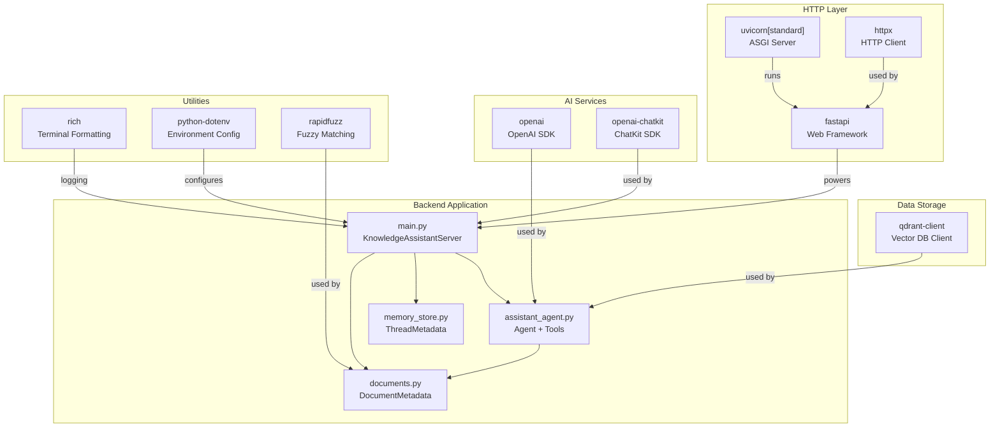
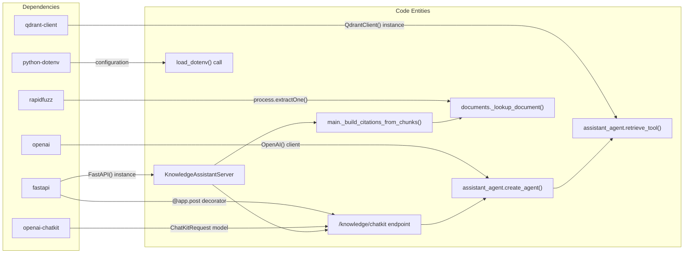

<!-- source: DeepWiki mcp.deepwiki.com · repo openai/openai-knowledge-retrieval · page 4.5 Backend Dependencies · fetched 2026-10-26 -->

# Backend Dependencies

<details>
<summary>Relevant source files</summary>

The following files were used as context for generating this wiki page:

- [app/backend/pyproject.toml](app/backend/pyproject.toml)
- [app/backend/uv.lock](app/backend/uv.lock)

</details>


## Purpose and Scope

This page documents all Python dependencies used by the backend service, their purposes, version constraints, and how they integrate with the backend architecture. The dependencies are defined in [app/backend/pyproject.toml](). 

For information about frontend npm dependencies, see [Frontend Dependencies](#5.5). For backend component architecture and how these dependencies are used, see [Backend Components](#4).

---

## Dependency Categories

The backend uses two categories of dependencies:

1. **Runtime Dependencies**: Required for the FastAPI server, agent system, and document management
2. **Development Dependencies**: Used for code quality, linting, and type checking

**Sources**: [app/backend/pyproject.toml:7-17](), [app/backend/pyproject.toml:19-23]()

---

## Runtime Dependencies

### Web Framework and Server

| Dependency | Version Constraint | Purpose |
|------------|-------------------|---------|
| `fastapi` | `>=0.114.1,<0.116` | ASGI web framework providing HTTP endpoints |
| `uvicorn[standard]` | `>=0.36,<0.37` | ASGI server with WebSocket and HTTP/2 support |
| `httpx` | `>=0.28,<0.29` | HTTP client for async API requests |

**FastAPI** serves as the core web framework, implementing the `KnowledgeAssistantServer` class in [app/backend/app/main.py](). It provides the API endpoints for chat requests, document serving, and health checks.

**Uvicorn** is the production-ready ASGI server that runs the FastAPI application. The `[standard]` extra includes performance optimizations like `uvloop` and `httptools`.

**httpx** is used internally by FastAPI for making HTTP requests to external services.

**Sources**: [app/backend/pyproject.toml:8-10]()

---

### OpenAI Integration

| Dependency | Version Constraint | Purpose |
|------------|-------------------|---------|
| `openai` | `>=1.40` | OpenAI API client for GPT models and embeddings |
| `openai-chatkit` | `>=0.0.2` | ChatKit SDK for conversational interfaces |

**openai** provides the Python SDK for interacting with OpenAI's API. It is used in:
- [app/backend/app/assistant_agent.py]() for creating agents and handling tool calls
- Embedding generation during document ingestion
- GPT model invocations for synthesis and query processing

**openai-chatkit** provides integration with the ChatKit platform, including request/response models and streaming utilities used by the `/knowledge/chatkit` endpoint.

**Sources**: [app/backend/pyproject.toml:11-12]()

---

### Vector Database

| Dependency | Version Constraint | Purpose |
|------------|-------------------|---------|
| `qdrant-client` | `>=1.13.3` | Python client for Qdrant vector database |

**qdrant-client** enables interaction with Qdrant vector stores for custom retrieval. When the RAG configuration uses a custom backend (as opposed to OpenAI File Search), this client:
- Stores document embeddings during ingestion
- Performs vector similarity searches during retrieval
- Manages collection metadata and vector payloads

Used by the `retrieve_tool` function in [app/backend/app/assistant_agent.py]().

**Sources**: [app/backend/pyproject.toml:15]()

---

### Utility Libraries

| Dependency | Version Constraint | Purpose |
|------------|-------------------|---------|
| `rich` | `>=13.7.1` | Terminal formatting and pretty-printing |
| `python-dotenv` | `>=1.0.1` | Environment variable loading from `.env` files |
| `rapidfuzz` | `>=3.8.1` | Fuzzy string matching for document lookup |

**rich** provides formatted console output, used primarily for logging and CLI feedback during development.

**python-dotenv** loads environment variables from `.env` files into `os.environ`. This is called early in the application lifecycle to configure API keys and service endpoints.

**rapidfuzz** implements fuzzy string matching algorithms used in document lookup operations. When citations reference documents by partial filenames or titles, rapidfuzz helps match them to actual documents in the metadata cache.

**Sources**: [app/backend/pyproject.toml:13-16]()

---

## Development Dependencies

| Dependency | Version Constraint | Purpose |
|------------|-------------------|---------|
| `ruff` | `>=0.6.4,<0.7` | Fast Python linter and code formatter |
| `mypy` | `>=1.8,<2` | Static type checker for Python |

**ruff** is an extremely fast Python linter that combines the functionality of flake8, isort, and other tools. Configuration is defined in [app/backend/pyproject.toml:29-33]() with a line length of 100 characters and import sorting enabled.

**mypy** performs static type analysis to catch type errors before runtime. The backend codebase uses type hints throughout for improved code quality and IDE support.

Development dependencies are installed with: `pip install -e ".[dev]"`

**Sources**: [app/backend/pyproject.toml:20-23]()

---

## Version Constraints

### Dependency Pinning Strategy

The project uses **minimum version with upper bounds** for most dependencies:

```toml
fastapi>=0.114.1,<0.116
openai>=1.40
qdrant-client>=1.13.3
```

This strategy:
- **Minimum versions** ensure required features are available
- **Upper bounds** (where specified) prevent breaking changes from major updates
- **Open-ended constraints** (e.g., `openai>=1.40`) allow patch and minor updates

### Critical Version Requirements

- **Python >=3.11**: Required for improved type hint support and performance
- **FastAPI >=0.114.1**: Includes WebSocket and SSE improvements for streaming
- **OpenAI >=1.40**: Supports the Assistants API v2 with streaming and file search

**Sources**: [app/backend/pyproject.toml:6-17]()

---

## Build System

The backend uses **setuptools** as the build backend:

```toml
[build-system]
requires = ["setuptools>=68.0", "wheel"]
build-backend = "setuptools.build_meta"
```

This configuration enables:
- Creating distributable wheel packages
- Editable installs for development (`pip install -e .`)
- PEP 517/518 compliant package builds

**Sources**: [app/backend/pyproject.toml:25-27]()

---

## Dependency Architecture

### Runtime Dependency Graph



**Sources**: [app/backend/pyproject.toml:7-17]()

---

### Dependency-to-Code Mapping



**Sources**: [app/backend/pyproject.toml:7-17](), [app/backend/app/main.py](), [app/backend/app/assistant_agent.py](), [app/backend/app/documents.py]()

---

## Installation

### Production Installation

Install runtime dependencies:

```bash
cd app/backend
pip install -e .
```

### Development Installation

Install with development tools:

```bash
cd app/backend
pip install -e ".[dev]"
```

### Using Make Targets

The project Makefile provides convenient targets:

- `make dev`: Install backend and frontend dependencies
- `make install`: Production installation

**Sources**: [app/backend/pyproject.toml:1-34]()

---

## Dependency Usage by Component

| Component | Primary Dependencies |
|-----------|---------------------|
| `main.py` | `fastapi`, `openai-chatkit`, `python-dotenv`, `rich` |
| `assistant_agent.py` | `openai`, `qdrant-client` |
| `memory_store.py` | (standard library only) |
| `documents.py` | `rapidfuzz` |

The backend is designed with minimal external dependencies, leveraging Python's standard library where possible for core data structures (`dataclasses`, `pathlib`, `threading`).

**Sources**: [app/backend/pyproject.toml:7-17]()

---

