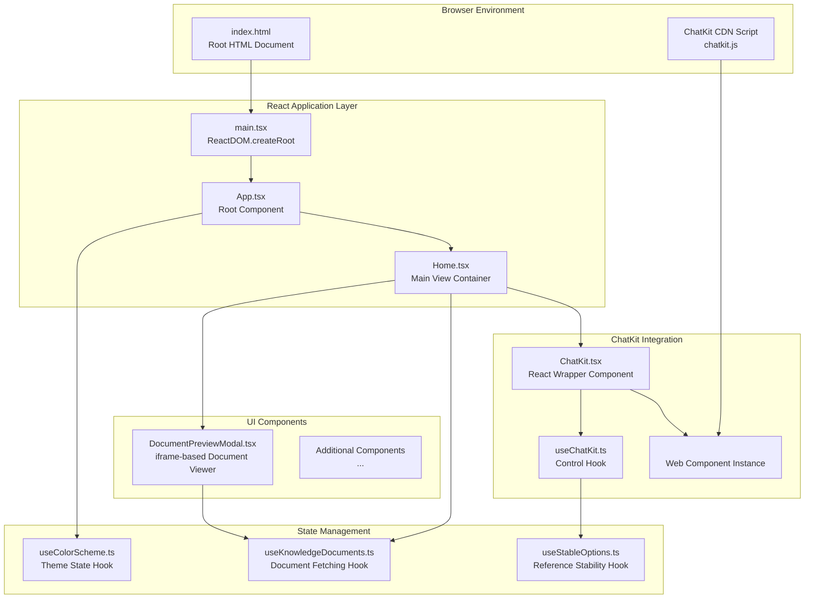
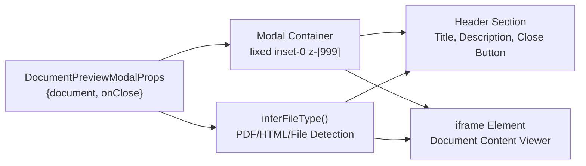
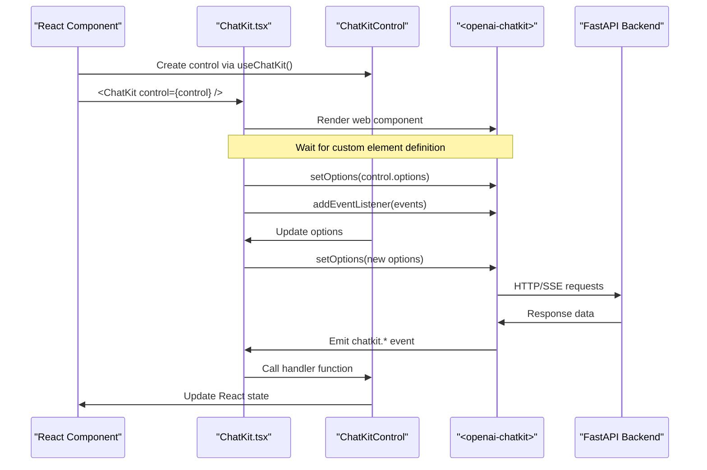
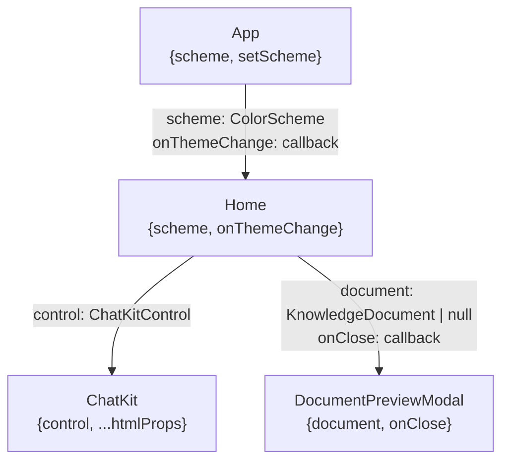
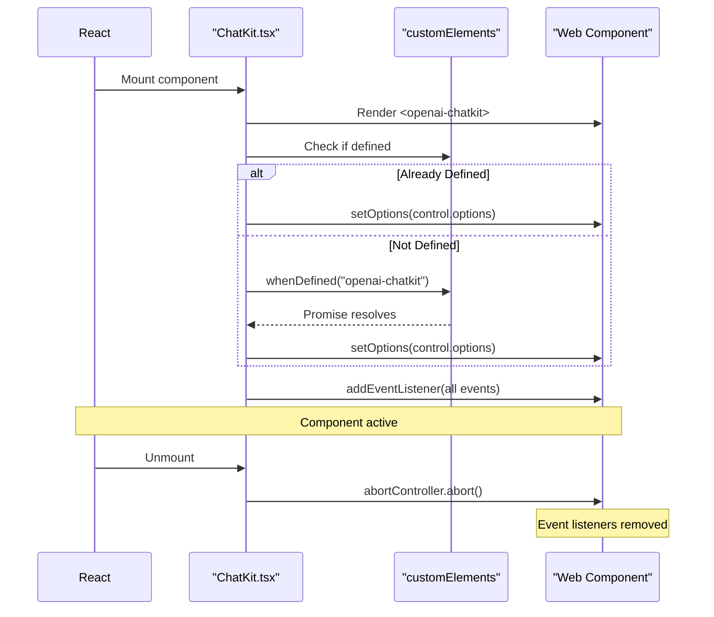

<!-- source: DeepWiki mcp.deepwiki.com · repo openai/openai-knowledge-retrieval · page 5 Frontend Components · fetched 2026-10-26 -->

# Frontend Components

<details>
<summary>Relevant source files</summary>

The following files were used as context for generating this wiki page:

- [app/frontend/index.html](app/frontend/index.html)
- [app/frontend/src/App.tsx](app/frontend/src/App.tsx)
- [app/frontend/src/chatkit-react/ChatKit.tsx](app/frontend/src/chatkit-react/ChatKit.tsx)
- [app/frontend/src/components/DocumentPreviewModal.tsx](app/frontend/src/components/DocumentPreviewModal.tsx)

</details>


## Purpose and Scope

This document provides a technical overview of the frontend React application components, their architecture, and implementation details. It covers the component hierarchy, ChatKit web component integration, state management hooks, and styling infrastructure.

For details on specific subsystems, see:
- React application structure and routing: [React Application Structure](#5.1)
- ChatKit integration patterns: [ChatKit Integration](#5.2)
- Individual UI component implementations: [UI Components](#5.3)
- Build configuration and tooling: [Build and Development Tools](#5.4)
- Dependency catalog: [Frontend Dependencies](#5.5)

For backend API endpoints that the frontend consumes, see [Backend API Endpoints](#11.1).

## Technology Stack

The frontend is built using the following core technologies:

| Technology | Version | Purpose |
|------------|---------|---------|
| React | 19.0.0 | UI framework |
| TypeScript | 5.6.2 | Type safety |
| Vite | 6.0.7 | Build tool and dev server |
| TailwindCSS | 3.4.17 | Utility-first styling |
| OpenAI ChatKit | CDN-loaded | Conversational UI web component |

**Sources:** [app/frontend/package.json](), [app/frontend/index.html:7]()

## Application Entry Points

### HTML Entry Point

The application loads via [app/frontend/index.html](), which:
- Loads the ChatKit web component from CDN: [app/frontend/index.html:7]()
- Provides a root mounting point: [app/frontend/index.html:10]()
- Bootstraps the React application: [app/frontend/index.html:11]()

### React Root Component

The `App` component [app/frontend/src/App.tsx:6-17]() serves as the root React component and:
- Manages global color scheme state via `useColorScheme` hook
- Delegates theme changes through `handleThemeChange` callback
- Renders the `Home` component with theme props

**Sources:** [app/frontend/src/App.tsx]()

## Component Architecture

### Component Hierarchy Diagram



**Sources:** [app/frontend/src/App.tsx](), [app/frontend/src/chatkit-react/ChatKit.tsx](), [app/frontend/src/components/DocumentPreviewModal.tsx](), [app/frontend/index.html]()

## Core Component Responsibilities

### App Component

The `App` component [app/frontend/src/App.tsx:6-17]() is responsible for:

| Responsibility | Implementation |
|----------------|----------------|
| Theme Management | `useColorScheme()` hook [app/frontend/src/App.tsx:7]() |
| Theme Propagation | `handleThemeChange` callback [app/frontend/src/App.tsx:9-14]() |
| Root Rendering | Renders `Home` component with theme props [app/frontend/src/App.tsx:16]() |

**Sources:** [app/frontend/src/App.tsx]()

### ChatKit React Wrapper

The `ChatKit` component [app/frontend/src/chatkit-react/ChatKit.tsx:22-99]() bridges React and the OpenAI ChatKit web component:

**Key Responsibilities:**

1. **Custom Element Declaration** [app/frontend/src/chatkit-react/ChatKit.tsx:10-20]()
   - Extends JSX namespace to recognize `<openai-chatkit>` element
   - Provides TypeScript type safety for web component

2. **Options Synchronization** [app/frontend/src/chatkit-react/ChatKit.tsx:26-45]()
   - Waits for custom element definition
   - Calls `setOptions()` on web component when control updates
   - Uses `useLayoutEffect` to ensure synchronous updates

3. **Event Handling** [app/frontend/src/chatkit-react/ChatKit.tsx:47-82]()
   - Maps ChatKit events to React handler functions
   - Supports: `chatkit.error`, `chatkit.response.end`, `chatkit.response.start`, `chatkit.log`, `chatkit.thread.change`
   - Cleanup via `AbortController`

4. **Ref Management** [app/frontend/src/chatkit-react/ChatKit.tsx:84-95]()
   - Forwards refs to underlying web component
   - Notifies control via `setInstance()`

### Event Mapping Table

| ChatKit Event | Handler Key | Purpose |
|---------------|-------------|---------|
| `chatkit.error` | `onError` | Error handling |
| `chatkit.response.end` | `onResponseEnd` | Response completion |
| `chatkit.response.start` | `onResponseStart` | Response initiation |
| `chatkit.log` | `onLog` | Logging events |
| `chatkit.thread.change` | `onThreadChange` | Thread state changes |

**Sources:** [app/frontend/src/chatkit-react/ChatKit.tsx:51-59]()

### DocumentPreviewModal Component

The `DocumentPreviewModal` [app/frontend/src/components/DocumentPreviewModal.tsx:11-64]() provides document viewing functionality:

**Component Structure:**



**Implementation Details:**

| Feature | Implementation | Location |
|---------|----------------|----------|
| Modal Overlay | Fixed positioning with backdrop blur | [app/frontend/src/components/DocumentPreviewModal.tsx:20]() |
| Header | Document metadata display | [app/frontend/src/components/DocumentPreviewModal.tsx:22-47]() |
| Preview URL | `KNOWLEDGE_DOCUMENT_FILE_URL(document.id)` | [app/frontend/src/components/DocumentPreviewModal.tsx:16]() |
| File Type Detection | `inferFileType(filename)` function | [app/frontend/src/components/DocumentPreviewModal.tsx:66-71]() |
| iframe Rendering | Full-height with conditional styling | [app/frontend/src/components/DocumentPreviewModal.tsx:50-60]() |

**File Type Detection Logic:**

The `inferFileType` function [app/frontend/src/components/DocumentPreviewModal.tsx:66-71]() returns:
- `"pdf"` for `.pdf` files
- `"html"` for `.html` files
- `"file"` as default fallback

**Sources:** [app/frontend/src/components/DocumentPreviewModal.tsx]()

## ChatKit Integration Pattern

### Integration Flow Diagram



**Sources:** [app/frontend/src/chatkit-react/ChatKit.tsx]()

### Control Interface

The `ChatKitControl` interface manages the web component lifecycle:

| Property | Type | Purpose |
|----------|------|---------|
| `options` | ChatKit options object | Configuration passed to web component |
| `handlers` | Event handler map | React callbacks for ChatKit events |
| `setInstance` | `(el: ChatKitElement \| null) => void` | Receives web component ref |

**Sources:** [app/frontend/src/chatkit-react/ChatKit.tsx:3-4](), [app/frontend/src/chatkit-react/ChatKit.tsx:6-8]()

## Styling Infrastructure

The application uses TailwindCSS for styling with the following approach:

**Example from DocumentPreviewModal:**

| Element | Tailwind Classes | Purpose |
|---------|------------------|---------|
| Overlay | `fixed inset-0 z-[999] bg-slate-950/70 backdrop-blur-sm` | Modal backdrop [app/frontend/src/components/DocumentPreviewModal.tsx:20]() |
| Container | `rounded-3xl border shadow-2xl ring-1` | Elevated card appearance [app/frontend/src/components/DocumentPreviewModal.tsx:21]() |
| Dark Mode | `dark:bg-slate-950/90 dark:border-slate-700/60` | Theme support [app/frontend/src/components/DocumentPreviewModal.tsx:21]() |

**Theme System:**

The `useColorScheme` hook [app/frontend/src/App.tsx:7]() manages application-wide theme state, supporting:
- Light mode
- Dark mode
- System preference detection

**Sources:** [app/frontend/src/components/DocumentPreviewModal.tsx](), [app/frontend/src/App.tsx]()

## TypeScript Integration

### Custom Element Type Safety

The ChatKit wrapper extends React's JSX namespace to provide type safety for the web component [app/frontend/src/chatkit-react/ChatKit.tsx:10-20]():

```typescript
declare module "react" {
  namespace JSX {
    interface IntrinsicElements {
      "openai-chatkit": React.DetailedHTMLProps<
        React.HTMLAttributes<ChatKitElement>,
        ChatKitElement
      >;
    }
  }
}
```

This enables:
- TypeScript autocomplete for `<openai-chatkit>` element
- Type checking for props and refs
- Integration with React's type system

**Sources:** [app/frontend/src/chatkit-react/ChatKit.tsx:10-20]()

## Component Communication Patterns

### Props Flow



**Sources:** [app/frontend/src/App.tsx:16](), [app/frontend/src/chatkit-react/ChatKit.tsx:6-8](), [app/frontend/src/components/DocumentPreviewModal.tsx:6-9]()

### Ref Handling Pattern

The ChatKit component implements a multi-ref pattern [app/frontend/src/chatkit-react/ChatKit.tsx:84-95]():

1. **Internal Ref:** `ref.current` maintains instance reference
2. **Control Notification:** `control.setInstance(chatKit)` notifies parent
3. **Forwarded Ref:** Supports both function refs and object refs

This enables:
- Parent components to access web component methods
- Control hook to manage web component lifecycle
- Standard React ref forwarding patterns

**Sources:** [app/frontend/src/chatkit-react/ChatKit.tsx:84-95]()

## Component Lifecycle

### ChatKit Initialization Sequence



**Sources:** [app/frontend/src/chatkit-react/ChatKit.tsx:26-45](), [app/frontend/src/chatkit-react/ChatKit.tsx:47-82]()

The `useLayoutEffect` hook [app/frontend/src/chatkit-react/ChatKit.tsx:26-45]() ensures options are set synchronously before browser paint, preventing visual flicker. The custom element check [app/frontend/src/chatkit-react/ChatKit.tsx:31-44]() handles race conditions where the web component script may load after React mounts.

**Sources:** [app/frontend/src/chatkit-react/ChatKit.tsx]()

---

