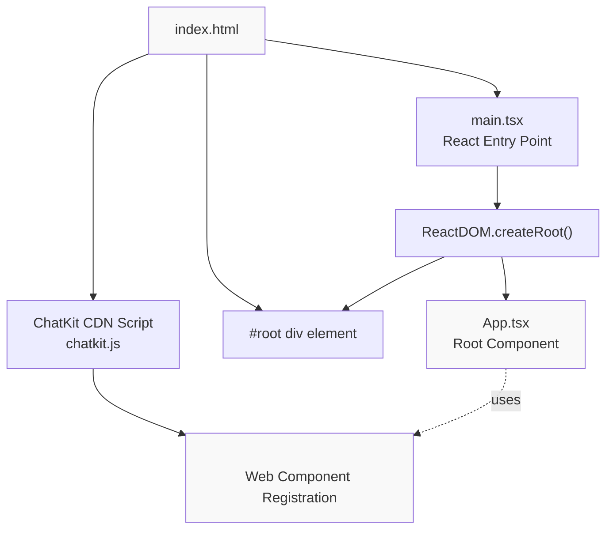
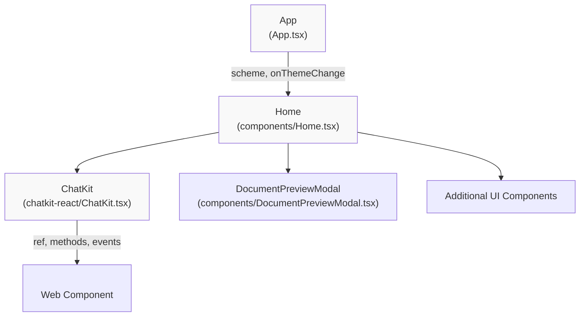
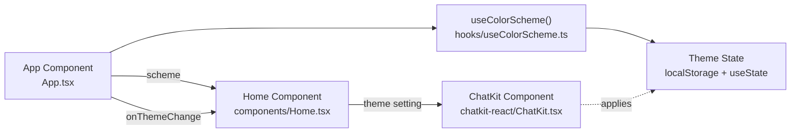
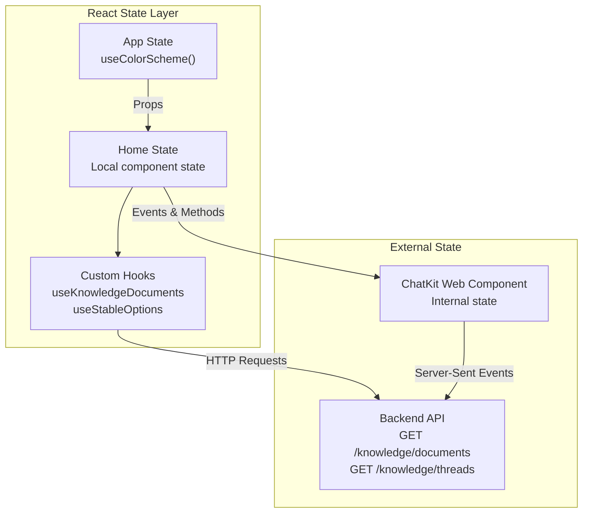
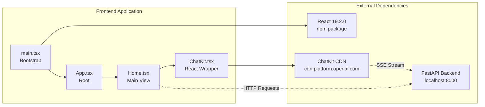

<!-- source: DeepWiki mcp.deepwiki.com · repo openai/openai-knowledge-retrieval · page 5.1 React Application Structure · fetched 2026-10-26 -->

# React Application Structure

<details>
<summary>Relevant source files</summary>

The following files were used as context for generating this wiki page:

- [app/frontend/index.html](app/frontend/index.html)
- [app/frontend/package.json](app/frontend/package.json)
- [app/frontend/src/App.tsx](app/frontend/src/App.tsx)

</details>


## Purpose and Scope

This document describes the React application structure for the frontend of the OpenAI Knowledge Retrieval system. It covers the application bootstrap process, root component architecture, component hierarchy, theme management, and file organization. For details on ChatKit integration and the `useChatKit` hook, see [5.2](#5.2). For information on specific UI components like `DocumentPreviewModal`, see [5.3](#5.3). For build tooling and development setup, see [5.4](#5.4).

The frontend is a React 19 application built with Vite, TypeScript, and TailwindCSS. It serves as a thin wrapper around OpenAI's ChatKit web component while providing theme management and document preview capabilities.

**Sources:** [app/frontend/package.json](), [app/frontend/src/App.tsx](), Diagram 4 from high-level architecture

---

## Application Bootstrap Process

The application follows a standard React 19 initialization flow, with the addition of loading the ChatKit web component from a CDN.

### HTML Entry Point

The [app/frontend/index.html]() file serves as the application entry point. It includes:

1. **ChatKit Web Component Script** - Loaded from OpenAI's CDN at [app/frontend/index.html:7]()
2. **Root Mount Point** - A `<div id="root">` element at [app/frontend/index.html:10]()
3. **Main Script Module** - The TypeScript entry point `/src/main.tsx` at [app/frontend/index.html:11]()

```
<!DOCTYPE html>
<html lang="en">
  <head>
    <meta charset="UTF-8" />
    <meta name="viewport" content="width=device-width, initial-scale=1.0" />
    <title>Knowledge Retrieval</title>
    <script src="https://cdn.platform.openai.com/deployments/chatkit/chatkit.js"></script>
  </head>
  <body>
    <div id="root"></div>
    <script type="module" src="/src/main.tsx"></script>
  </body>
</html>
```

The ChatKit script must load before React initializes, as it registers the `<openai-chatkit>` web component that the application uses.

### Bootstrap Flow Diagram



**Sources:** [app/frontend/index.html](), Diagram 4 from high-level architecture

---

## Root Component Architecture

The `App` component serves as the application root, managing global theme state and delegating rendering to the `Home` component.

### App Component Structure

The [app/frontend/src/App.tsx]() file exports the root `App` component with the following responsibilities:

| Responsibility | Implementation | Lines |
|----------------|----------------|-------|
| Theme state management | `useColorScheme()` hook | [app/frontend/src/App.tsx:7]() |
| Theme change handling | `handleThemeChange` callback | [app/frontend/src/App.tsx:9-14]() |
| Main view rendering | `<Home>` component | [app/frontend/src/App.tsx:16]() |

### Component Implementation

```typescript
export default function App() {
  const { scheme, setScheme } = useColorScheme();

  const handleThemeChange = useCallback(
    (value: ColorScheme) => {
      setScheme(value);
    },
    [setScheme],
  );

  return <Home scheme={scheme} onThemeChange={handleThemeChange} />;
}
```

The component uses React 19's `useCallback` hook with proper dependency tracking at [app/frontend/src/App.tsx:9-14]() to memoize the theme change handler, preventing unnecessary re-renders of the `Home` component.

### Theme Management Props

The `App` component passes two props to `Home`:

- **`scheme`** - Current color scheme value (`ColorScheme` type)
- **`onThemeChange`** - Callback function to change the theme

This prop-drilling pattern enables the `Home` component to both display the current theme and allow users to change it through UI controls.

**Sources:** [app/frontend/src/App.tsx](), Diagram 4 from high-level architecture

---

## Component Hierarchy

The application follows a shallow component hierarchy, with most functionality encapsulated in the `Home` component and its immediate children.

### Component Tree Diagram



### Component Responsibilities

| Component | File Path | Primary Responsibilities |
|-----------|-----------|-------------------------|
| `App` | `app/frontend/src/App.tsx` | Theme state management, root rendering |
| `Home` | `app/frontend/src/components/Home.tsx` | Main view, ChatKit integration, UI layout |
| `ChatKit` | `app/frontend/src/chatkit-react/ChatKit.tsx` | React wrapper for ChatKit web component |
| `DocumentPreviewModal` | `app/frontend/src/components/DocumentPreviewModal.tsx` | Document viewing with iframe |

The hierarchy is deliberately flat to minimize prop drilling and state management complexity. Most application logic resides in the `Home` component, which orchestrates interactions between ChatKit and other UI elements.

**Sources:** [app/frontend/src/App.tsx](), Diagram 4 from high-level architecture

---

## Theme Management System

The application implements a persistent theme system supporting light, dark, and system color schemes.

### useColorScheme Hook

The `useColorScheme` hook provides theme state management. Based on the [app/frontend/src/App.tsx:4]() import, it exposes:

```typescript
type ColorScheme = "light" | "dark" | "system";

interface UseColorSchemeReturn {
  scheme: ColorScheme;
  setScheme: (scheme: ColorScheme) => void;
}
```

### Theme Flow Diagram



### Implementation Pattern

The theme management follows this pattern:

1. **Hook initialization** - `useColorScheme()` called at [app/frontend/src/App.tsx:7]()
2. **State extraction** - `{ scheme, setScheme }` destructured from hook
3. **Callback memoization** - `handleThemeChange` wrapped with `useCallback` at [app/frontend/src/App.tsx:9-14]()
4. **Prop propagation** - Both `scheme` and `onThemeChange` passed to `Home` at [app/frontend/src/App.tsx:16]()

The use of `useCallback` at [app/frontend/src/App.tsx:9-14]() ensures that the `Home` component doesn't re-render unnecessarily when the parent `App` component re-renders for unrelated reasons. The dependency array `[setScheme]` ensures the callback updates only when the setter function changes (which should be stable across renders).

**Sources:** [app/frontend/src/App.tsx:1-17]()

---

## State Management Architecture

The application uses a minimal state management approach, relying on React 19's built-in hooks and local component state rather than external state management libraries.

### State Management Patterns

| Pattern | Usage | Location |
|---------|-------|----------|
| Local State | Component-specific UI state | Individual components |
| Custom Hooks | Shared stateful logic | `src/hooks/` directory |
| Prop Drilling | Theme configuration | `App` → `Home` → children |
| Context (implicit) | ChatKit web component state | ChatKit web component boundary |

### State Flow Diagram



### Dependencies and State Sources

Based on [app/frontend/package.json:16-21](), the application uses:

- **React 19.2.0** - Core state management with hooks
- **@openai/chatkit-react 0.x** - ChatKit integration utilities
- **clsx 2.1.1** - Conditional CSS class composition
- **lucide-react 0.544.0** - Icon components (stateless)

The application does not use external state management libraries like Redux, Zustand, or Jotai. All state is managed through React's built-in primitives (`useState`, `useCallback`, `useMemo`, etc.) and custom hooks.

**Sources:** [app/frontend/package.json:16-21](), [app/frontend/src/App.tsx](), Diagram 4 from high-level architecture

---

## File Organization

The frontend follows a standard React project structure with clear separation of concerns.

### Directory Structure

```
app/frontend/
├── index.html                          # HTML entry point
├── package.json                        # Dependencies and scripts
├── src/
│   ├── main.tsx                        # React bootstrap
│   ├── App.tsx                         # Root component
│   ├── components/                     # UI components
│   │   ├── Home.tsx                    # Main view component
│   │   └── DocumentPreviewModal.tsx    # Document viewer
│   ├── chatkit-react/                  # ChatKit integration
│   │   ├── ChatKit.tsx                 # React wrapper
│   │   └── useChatKit.ts               # Integration hook
│   ├── hooks/                          # Custom React hooks
│   │   ├── useColorScheme.ts           # Theme management
│   │   ├── useKnowledgeDocuments.ts    # Document fetching
│   │   └── useStableOptions.ts         # Reference stability
│   └── lib/                            # Utility functions
│       └── config.ts                   # API endpoints
├── vite.config.ts                      # Vite configuration
├── tsconfig.json                       # TypeScript configuration
├── eslint.config.js                    # ESLint rules
├── postcss.config.cjs                  # PostCSS/Tailwind
└── tailwind.config.cjs                 # Tailwind configuration
```

### File Purpose Mapping

| Directory/File | Purpose | Key Files |
|----------------|---------|-----------|
| `src/` | Application source code | `main.tsx`, `App.tsx` |
| `src/components/` | Reusable React components | `Home.tsx`, `DocumentPreviewModal.tsx` |
| `src/chatkit-react/` | ChatKit web component integration | `ChatKit.tsx`, `useChatKit.ts` |
| `src/hooks/` | Custom React hooks for shared logic | `useColorScheme.ts`, `useKnowledgeDocuments.ts` |
| `src/lib/` | Utility functions and configuration | `config.ts` |
| Root config files | Build tools and linting | `vite.config.ts`, `eslint.config.js` |

### Build and Development Scripts

The [app/frontend/package.json:6-10]() defines these scripts:

| Script | Command | Purpose |
|--------|---------|---------|
| `dev` | `vite` | Start development server on port 5173 |
| `build` | `vite build` | Create optimized production bundle |
| `preview` | `vite preview` | Preview production build locally |
| `lint` | `eslint . --ext ts,tsx` | Run ESLint on TypeScript files |

The development workflow is orchestrated through the project's Makefile, which calls `make run-app-frontend` to execute the `dev` script. See [8.1](#8.1) for details on the development workflow.

**Sources:** [app/frontend/package.json](), Diagram 4 from high-level architecture

---

## Technology Stack Summary

### Core Dependencies

The application's technology stack is defined in [app/frontend/package.json]():

| Technology | Version | Purpose |
|------------|---------|---------|
| React | 19.2.0 | UI library |
| React DOM | 19.2.0 | React rendering |
| TypeScript | 5.4.0 | Type safety |
| Vite | 7.1.9 | Build tool and dev server |
| @openai/chatkit-react | 0.x | ChatKit React utilities |

### Build Tooling

| Tool | Version | Purpose |
|------|---------|---------|
| @vitejs/plugin-react-swc | 3.5.0 | React Fast Refresh with SWC compiler |
| ESLint | 8.57.1 | Code linting |
| TypeScript ESLint | 7.18.0 | TypeScript-aware linting |
| Prettier | 9.1.0 | Code formatting integration |

### Styling Stack

| Tool | Version | Purpose |
|------|---------|---------|
| TailwindCSS | 3.4.13 | Utility-first CSS framework |
| PostCSS | 8.4.47 | CSS transformation pipeline |
| Autoprefixer | 10.4.20 | Vendor prefix automation |
| clsx | 2.1.1 | Conditional class name composition |

### Engine Requirements

The [app/frontend/package.json:12-15]() specifies:

- **Node.js** - >= 18.18
- **npm** - >= 9

These version constraints ensure compatibility with React 19 and modern JavaScript features used throughout the codebase.

**Sources:** [app/frontend/package.json:12-42]()

---

## Integration Points

The React application integrates with several external systems and components.

### Backend API Integration

The frontend communicates with the FastAPI backend through HTTP and Server-Sent Events (SSE):

- **API Base URL** - Configured in `src/lib/config.ts`
- **Document Listing** - `GET /knowledge/documents`
- **File Download** - `GET /knowledge/documents/:id/file`
- **Chat Endpoint** - `POST /knowledge/chatkit` (via ChatKit web component)
- **Citations** - `GET /knowledge/threads/:id/citations`

### ChatKit Web Component Integration

The application integrates with OpenAI's ChatKit platform through:

1. **CDN Script** - Loaded at [app/frontend/index.html:7]()
2. **Web Component** - `<openai-chatkit>` custom element
3. **React Wrapper** - `src/chatkit-react/ChatKit.tsx` component
4. **Hook Interface** - `src/chatkit-react/useChatKit.ts` for imperative control

The web component handles all chat functionality, including:
- Message rendering
- Streaming responses
- Citation display
- Chat history
- User authentication (if configured)

### Module System Diagram



**Sources:** [app/frontend/index.html:7](), Diagram 4 from high-level architecture

---

