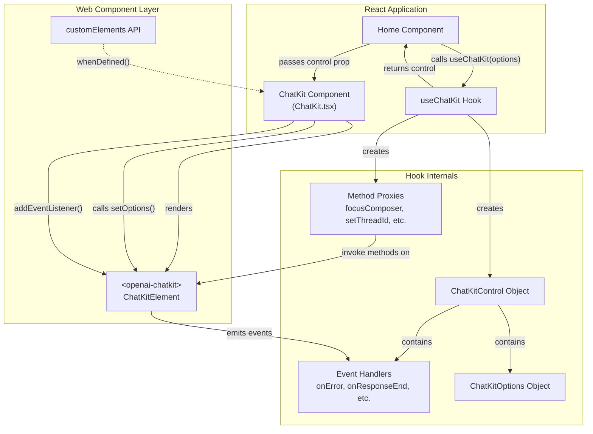
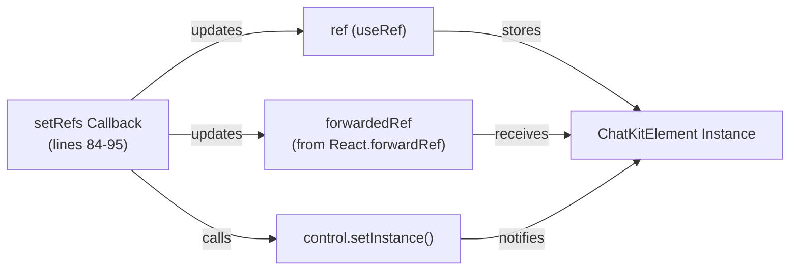
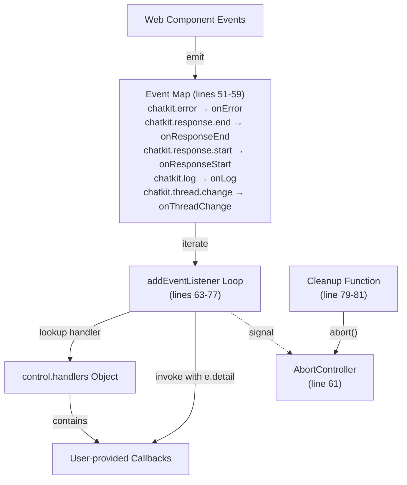
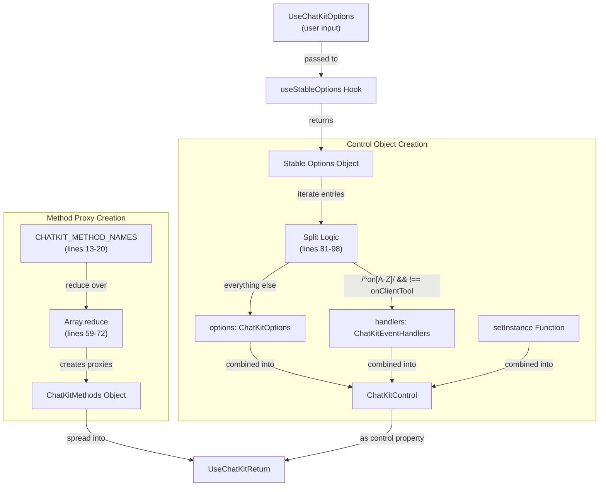
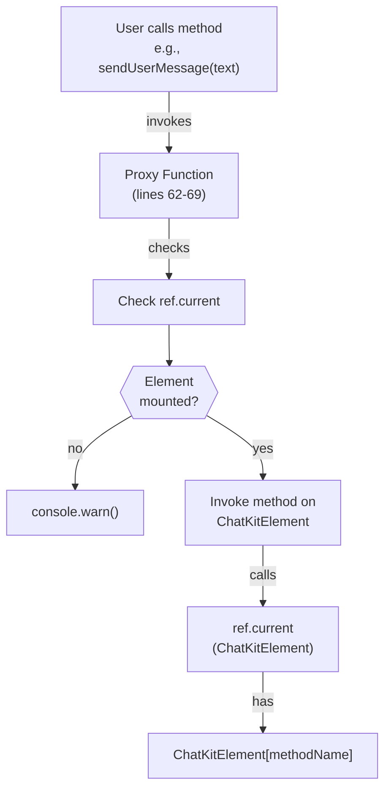
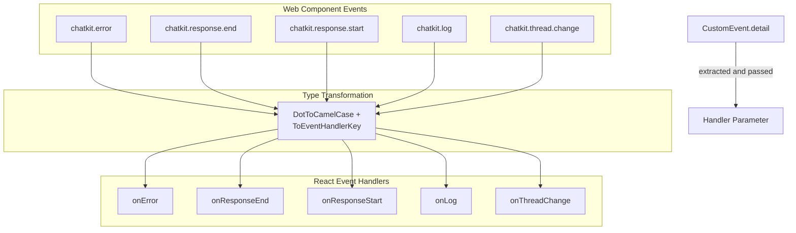
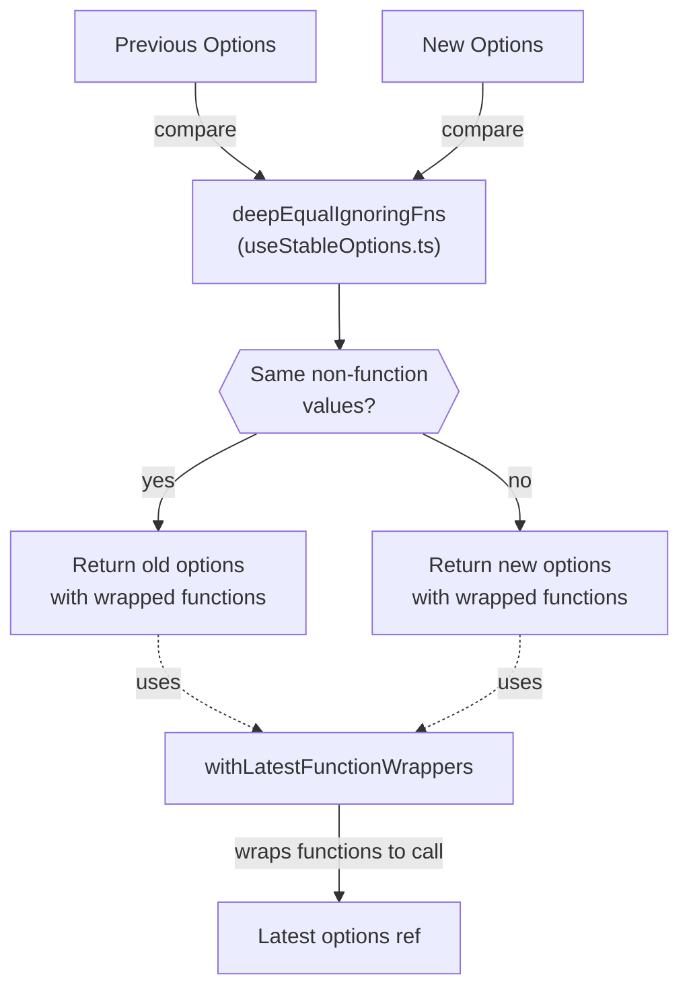
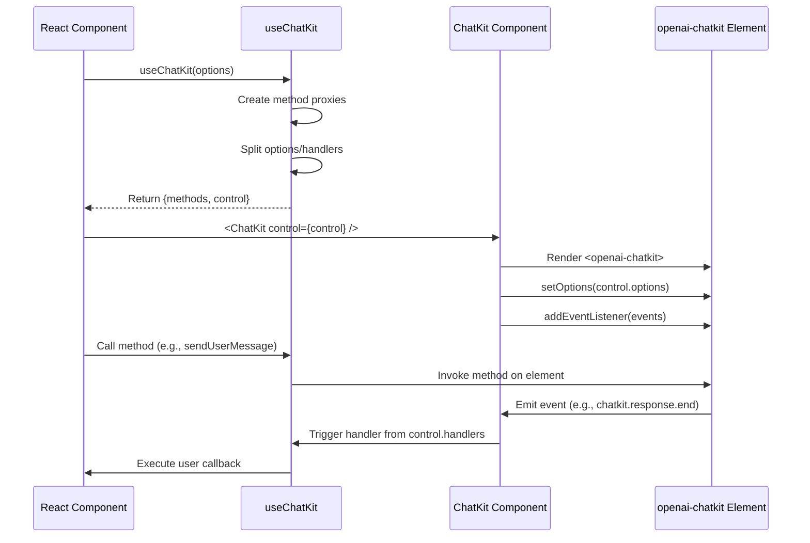

<!-- source: DeepWiki mcp.deepwiki.com · repo openai/openai-knowledge-retrieval · page 5.2 ChatKit Integration · fetched 2026-10-26 -->

# ChatKit Integration

<details>
<summary>Relevant source files</summary>

The following files were used as context for generating this wiki page:

- [app/frontend/src/chatkit-react/ChatKit.tsx](app/frontend/src/chatkit-react/ChatKit.tsx)
- [app/frontend/src/chatkit-react/index.ts](app/frontend/src/chatkit-react/index.ts)
- [app/frontend/src/chatkit-react/useChatKit.ts](app/frontend/src/chatkit-react/useChatKit.ts)
- [app/frontend/src/chatkit-react/useStableOptions.test.ts](app/frontend/src/chatkit-react/useStableOptions.test.ts)

</details>


## Purpose and Scope

This document describes the integration layer that bridges OpenAI's ChatKit web component (`<openai-chatkit>`) with React. The integration consists of a React wrapper component (`ChatKit`) and a custom hook (`useChatKit`) that provide idiomatic React patterns for working with the web component, including event handling, method proxying, and reference management.

For information about the overall frontend application structure, see [React Application Structure](#5.1). For details about other UI components, see [UI Components](#5.3).

**Sources:** [app/frontend/src/chatkit-react/ChatKit.tsx](), [app/frontend/src/chatkit-react/useChatKit.ts](), [app/frontend/src/chatkit-react/index.ts]()

---

## Architecture Overview

The ChatKit integration layer provides a React-friendly interface to the `@openai/chatkit` web component. The architecture consists of three primary elements:

1. **Web Component** (`<openai-chatkit>`) - Loaded from CDN, provides the core ChatKit UI
2. **React Wrapper** (`ChatKit`) - Bridges the web component to React's lifecycle
3. **React Hook** (`useChatKit`) - Manages state, methods, and event handlers



**Sources:** [app/frontend/src/chatkit-react/ChatKit.tsx:1-100](), [app/frontend/src/chatkit-react/useChatKit.ts:1-102]()

---

## Component Structure

### ChatKit Component

The `ChatKit` component ([app/frontend/src/chatkit-react/ChatKit.tsx]()) is a React wrapper that renders the `<openai-chatkit>` web component and manages its lifecycle.

#### Key Responsibilities

| Responsibility | Implementation |
|---|---|
| **JSX Declaration** | Extends React's JSX namespace to recognize `<openai-chatkit>` element |
| **Reference Management** | Maintains both internal and forwarded refs to the web component |
| **Option Synchronization** | Calls `setOptions()` when options change or when web component is defined |
| **Event Binding** | Attaches event listeners to the web component for ChatKit events |
| **Lifecycle Coordination** | Uses `useLayoutEffect` and `useEffect` for synchronous and asynchronous updates |

#### JSX Type Extension

The component extends React's type system to support the custom element:

```
Lines 10-20: Module augmentation for react namespace
- Declares "openai-chatkit" as valid JSX intrinsic element
- Maps to React.DetailedHTMLProps with ChatKitElement type
```

**Sources:** [app/frontend/src/chatkit-react/ChatKit.tsx:10-20]()

#### Reference Management



**Sources:** [app/frontend/src/chatkit-react/ChatKit.tsx:84-95]()

#### Option Synchronization Lifecycle

The component handles two scenarios for option synchronization:

1. **Web component already defined**: Immediately calls `setOptions()` via `useLayoutEffect`
2. **Web component not yet defined**: Waits for `customElements.whenDefined()` promise, then calls `setOptions()`

```
Lines 26-45: useLayoutEffect for option synchronization
- Checks if customElements.get("openai-chatkit") exists
- If exists: calls el.setOptions(control.options) immediately
- If not: waits for customElements.whenDefined("openai-chatkit")
- Uses cleanup function to prevent stale updates (active flag)
```

**Sources:** [app/frontend/src/chatkit-react/ChatKit.tsx:26-45]()

#### Event Handling System



**Sources:** [app/frontend/src/chatkit-react/ChatKit.tsx:47-82]()

---

## The useChatKit Hook

The `useChatKit` hook ([app/frontend/src/chatkit-react/useChatKit.ts]()) is the primary interface for managing ChatKit instances in React. It accepts options and event handlers, returning a control object and method proxies.

### Hook Signature

```typescript
function useChatKit(options: UseChatKitOptions): UseChatKitReturn
```

| Type | Description |
|---|---|
| `UseChatKitOptions` | Combines `ChatKitOptions` and `ChatKitEventHandlers` |
| `UseChatKitReturn` | Contains method proxies and `control` object |

**Sources:** [app/frontend/src/chatkit-react/useChatKit.ts:43-53]()

### Internal Architecture



**Sources:** [app/frontend/src/chatkit-react/useChatKit.ts:55-101]()

---

## Method Proxying System

### Supported Methods

The hook exposes six methods from the `ChatKitElement`:

```
Lines 13-20: CHATKIT_METHOD_NAMES constant
1. focusComposer
2. setThreadId
3. sendUserMessage
4. setComposerValue
5. fetchUpdates
6. sendCustomAction
```

**Sources:** [app/frontend/src/chatkit-react/useChatKit.ts:13-20]()

### Proxy Implementation



Each proxy method:
1. Checks if `ref.current` (the web component instance) exists
2. If not: logs a warning to console
3. If yes: invokes the corresponding method on the web component with forwarded arguments

**Sources:** [app/frontend/src/chatkit-react/useChatKit.ts:59-72]()

---

## Event Handler Mapping

### Type Transformation

The hook transforms web component event names to React-style event handler names using TypeScript type manipulation:

```
Lines 9-11: DotToCamelCase type
- Transforms "chatkit.response.end" → "chatkitResponseEnd"

Lines 28-31: ToEventHandlerKey type
- Transforms "chatkitResponseEnd" → "onResponseEnd"
- Removes "chatkit" prefix, capitalizes first letter, adds "on" prefix
```

**Sources:** [app/frontend/src/chatkit-react/useChatKit.ts:9-31]()

### Event Handler Interface



**Sources:** [app/frontend/src/chatkit-react/useChatKit.ts:28-41](), [app/frontend/src/chatkit-react/ChatKit.tsx:51-77]()

---

## Options Stability with useStableOptions

### Purpose

The `useStableOptions` hook ensures that the options object passed to the web component maintains referential stability unless non-function values change. This prevents unnecessary re-renders and option updates when only function references change (a common occurrence in React due to closure semantics).

### Deep Equality Algorithm

The stability system uses a custom deep equality check that ignores function identity:



**Key behaviors tested:**
- Primitive values compared with `Object.is` semantics
- Functions treated as equal if both are functions (identity ignored)
- Objects and arrays compared recursively
- Cyclic references supported
- Non-plain objects (Date, Map, Set) compared by reference

**Sources:** [app/frontend/src/chatkit-react/useStableOptions.test.ts:8-119]()

### Function Wrapper Mechanism

```
Lines 121-229: withLatestFunctionWrappers tests
- Wraps functions to always call the latest version from a ref
- Preserves 'this' binding to latest parent object
- Handles nested structures and arrays
- Returns new object/array identities while preserving primitives
```

This allows the options object reference to remain stable while ensuring that when functions are called, they invoke the most recent closure, capturing the latest React state.

**Sources:** [app/frontend/src/chatkit-react/useStableOptions.test.ts:121-229]()

---

## TypeScript Interface Definitions

### Core Types

| Type | Definition | Purpose |
|---|---|---|
| `ChatKitElement` | From `@openai/chatkit` | Web component interface |
| `ChatKitOptions` | From `@openai/chatkit` | Configuration options |
| `ChatKitElementEventMap` | From `@openai/chatkit` | Event name to CustomEvent mapping |
| `ChatKitMethods` | Lines 24-26 | Method subset from ChatKitElement |
| `ChatKitEventHandlers` | Lines 33-41 | React-style event handler types |
| `UseChatKitOptions` | Line 43 | Union of options and handlers |
| `ChatKitControl` | Lines 45-49 | Control object interface |
| `UseChatKitReturn` | Lines 51-53 | Hook return type |

**Sources:** [app/frontend/src/chatkit-react/useChatKit.ts:1-53]()

### Event Handler Type Construction

The event handler types are constructed via mapped types:

```typescript
type ChatKitEventHandlers = Partial<{
  [K in keyof ChatKitElementEventMap as ToEventHandlerKey<K>]: 
    ChatKitElementEventMap[K] extends CustomEvent<infer Detail>
      ? Detail extends void
        ? () => void
        : (event: Detail) => void
      : never;
}>;
```

This:
1. Iterates over all keys in `ChatKitElementEventMap`
2. Transforms each key to handler name via `ToEventHandlerKey`
3. Extracts the `detail` type from the `CustomEvent`
4. Creates handler function signature based on detail type

**Sources:** [app/frontend/src/chatkit-react/useChatKit.ts:33-41]()

---

## Usage Pattern

### Typical Implementation

```typescript
// In a React component
const chatkit = useChatKit({
  // ChatKit options
  assistantOptions: { ... },
  threadOptions: { ... },
  
  // Event handlers
  onError: (error) => { console.error(error); },
  onResponseEnd: (response) => { handleResponse(response); },
  onThreadChange: (thread) => { updateThread(thread); }
});

// Use methods
chatkit.sendUserMessage("Hello");
chatkit.focusComposer();

// Pass control to component
<ChatKit control={chatkit.control} />
```

### Control Flow



**Sources:** [app/frontend/src/chatkit-react/ChatKit.tsx:22-99](), [app/frontend/src/chatkit-react/useChatKit.ts:55-101]()

---

## Module Exports

The `chatkit-react` module exports:

```
Lines 1-8: index.ts exports
- All types from @openai/chatkit (re-export)
- ChatKit component
- useChatKit hook
- Type exports: UseChatKitOptions, UseChatKitReturn, ChatKitControl
```

This provides a single entry point for consumers to access all ChatKit integration functionality.

**Sources:** [app/frontend/src/chatkit-react/index.ts:1-8]()

---

