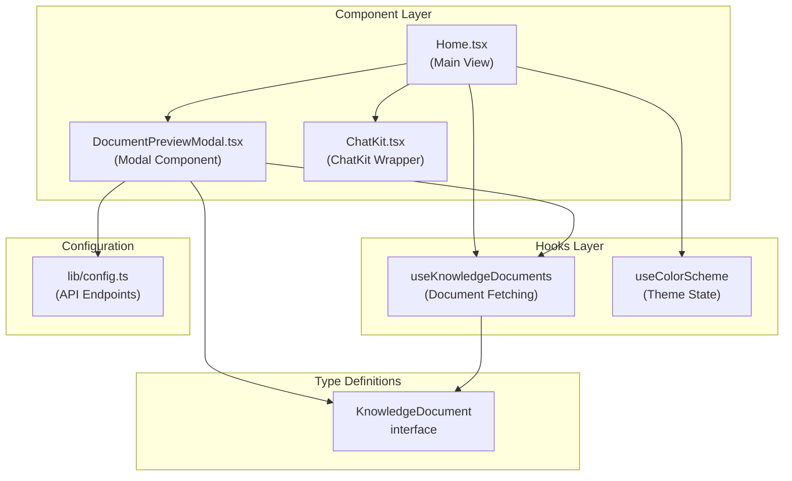
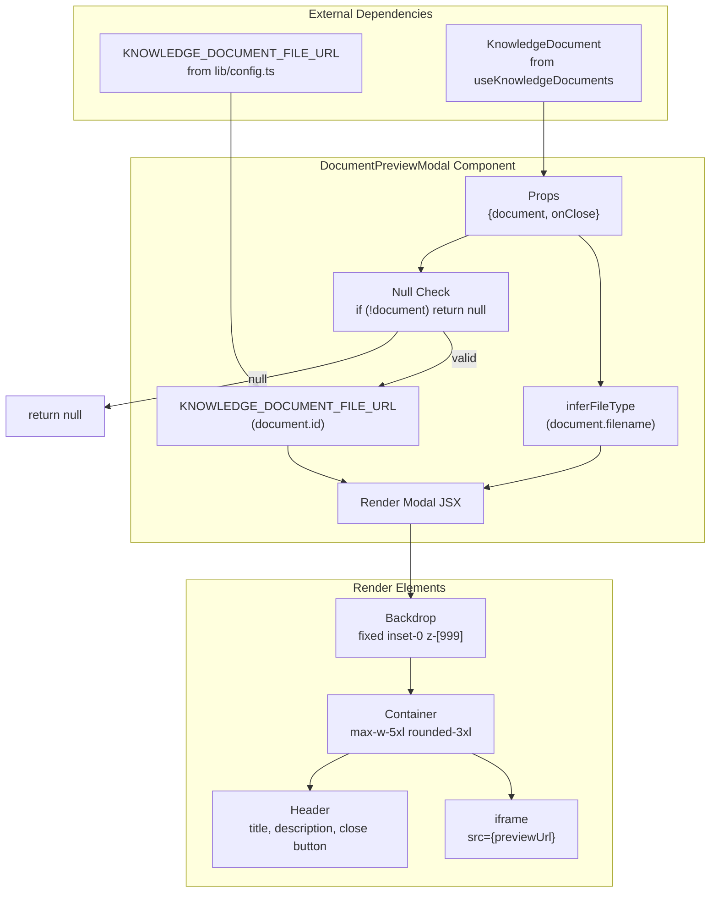
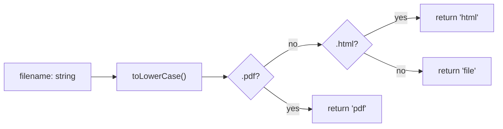
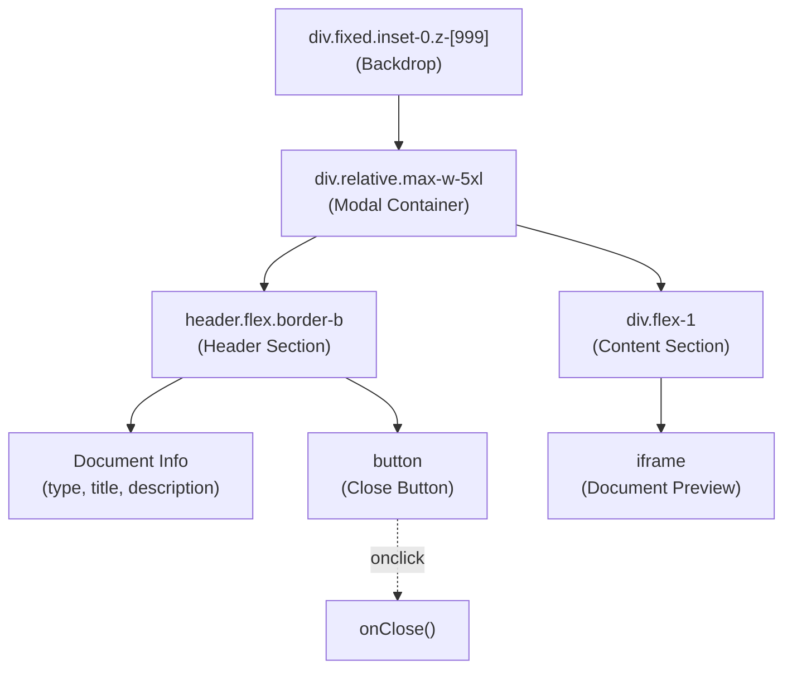
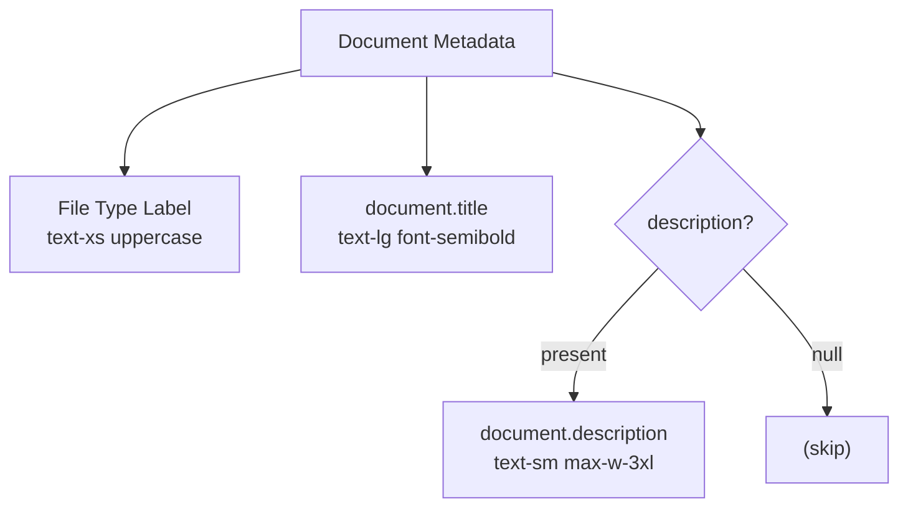
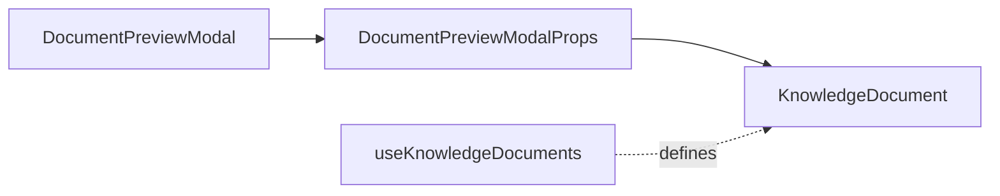
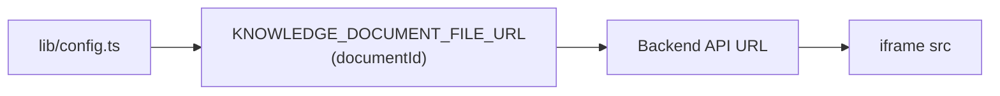

<!-- source: DeepWiki mcp.deepwiki.com · repo openai/openai-knowledge-retrieval · page 5.3 UI Components · fetched 2026-10-26 -->

# UI Components

<details>
<summary>Relevant source files</summary>

The following files were used as context for generating this wiki page:

- [app/frontend/src/App.tsx](app/frontend/src/App.tsx)
- [app/frontend/src/components/DocumentPreviewModal.tsx](app/frontend/src/components/DocumentPreviewModal.tsx)

</details>


## Purpose and Scope

This page documents the reusable UI components in the frontend application, focusing on their structure, functionality, and integration patterns. Currently, the primary documented component is `DocumentPreviewModal`, which provides document viewing capabilities within the chat interface.

For information about the overall React application structure and routing, see [React Application Structure](#5.1). For ChatKit-specific components and integration, see [ChatKit Integration](#5.2).

## Component Architecture Overview

The frontend UI components follow a consistent pattern using React functional components with TypeScript, styled with TailwindCSS utility classes. Components are co-located with their dependencies and use explicit prop interfaces for type safety.

### Component Organization



**Sources:**
- [app/frontend/src/components/DocumentPreviewModal.tsx:1-72]()
- [app/frontend/src/App.tsx:1-18]()

## DocumentPreviewModal Component

The `DocumentPreviewModal` component is a full-screen modal that displays document previews using iframe-based rendering. It supports multiple file types and integrates with the document management system.

### Component Interface

The component accepts two props defined in `DocumentPreviewModalProps`:

| Prop | Type | Purpose |
|------|------|---------|
| `document` | `KnowledgeDocument \| null` | The document to preview, or null to hide modal |
| `onClose` | `() => void` | Callback function invoked when user closes modal |

**Sources:**
- [app/frontend/src/components/DocumentPreviewModal.tsx:6-9]()

### Component Structure and Data Flow



**Sources:**
- [app/frontend/src/components/DocumentPreviewModal.tsx:11-64]()

### File Type Inference

The component includes a utility function `inferFileType` that determines the file type from the filename extension:



The file type determines:
- Header label text (e.g., "PDF document", "HTML document", "File preview")
- iframe background styling

**Sources:**
- [app/frontend/src/components/DocumentPreviewModal.tsx:66-71]()

### Rendering Logic

The component employs a conditional rendering pattern:

1. **Early return for null state**: If `document` is null, the component returns null immediately [app/frontend/src/components/DocumentPreviewModal.tsx:12-14]()
2. **URL construction**: Builds preview URL using `KNOWLEDGE_DOCUMENT_FILE_URL(document.id)` [app/frontend/src/components/DocumentPreviewModal.tsx:16]()
3. **File type inference**: Determines display mode via `inferFileType` [app/frontend/src/components/DocumentPreviewModal.tsx:17]()
4. **Modal structure**: Renders fixed-position overlay with nested content

### Modal DOM Structure



**Sources:**
- [app/frontend/src/components/DocumentPreviewModal.tsx:20-63]()

### Styling Approach

The component uses TailwindCSS utility classes for all styling:

| Section | Key Styles | Purpose |
|---------|-----------|---------|
| Backdrop | `fixed inset-0 z-[999] bg-slate-950/70 backdrop-blur-sm` | Full-screen overlay with blur effect |
| Container | `max-w-5xl rounded-3xl border shadow-2xl` | Centered modal with elevation |
| Header | `border-b bg-white/90 dark:bg-slate-900/80` | Semi-transparent header with theme support |
| Content | `flex-1 bg-slate-950/5 dark:bg-slate-900/40` | Flexible content area with theme support |
| iframe | `h-full w-full border-0` | Full-size embedded document |

The component fully supports dark mode through Tailwind's `dark:` variant prefix.

**Sources:**
- [app/frontend/src/components/DocumentPreviewModal.tsx:20-60]()

### Document Metadata Display

The header section displays document information with conditional rendering:



**Sources:**
- [app/frontend/src/components/DocumentPreviewModal.tsx:23-38]()

### Close Button Interaction

The close button invokes the `onClose` callback prop when clicked, allowing the parent component to control modal visibility:

```typescript
// Close button implementation
onClick={onClose}
```

This pattern follows React best practices by lifting state management to the parent component (typically `Home.tsx`).

**Sources:**
- [app/frontend/src/components/DocumentPreviewModal.tsx:40-46]()

## Component Patterns and Conventions

### Modal Pattern

The modal implementation follows these patterns:

1. **Portal-like positioning**: Uses `fixed inset-0` to break out of normal document flow
2. **High z-index**: `z-[999]` ensures modal appears above all other content
3. **Backdrop click handling**: Currently requires explicit close button (no backdrop dismissal)
4. **Conditional mounting**: Component returns null when document is null

### Styling Conventions

All components in the codebase follow consistent styling practices:

| Convention | Implementation |
|-----------|----------------|
| **Utility-first CSS** | TailwindCSS classes for all styling |
| **Dark mode support** | `dark:` variant for all theme-dependent styles |
| **Responsive design** | Mobile-first breakpoints with `md:`, `lg:` prefixes |
| **Spacing scale** | Tailwind's spacing scale (4px base unit) |
| **Color palette** | Slate color family for neutrals, blue for interactive elements |

**Sources:**
- [app/frontend/src/components/DocumentPreviewModal.tsx:20-60]()

### Accessibility Considerations

The `DocumentPreviewModal` implements several accessibility features:

1. **Semantic HTML**: Uses `<header>` for header section
2. **Button semantics**: Close button uses `<button type="button">`
3. **Focus management**: Close button includes `focus-visible:outline` styles
4. **iframe title**: iframe has `title` attribute for screen readers
5. **ARIA attributes**: Could be enhanced with `role="dialog"` and `aria-modal="true"`

**Sources:**
- [app/frontend/src/components/DocumentPreviewModal.tsx:40-59]()

## Integration with Document System

The component integrates with the broader document management system through:

### Type Dependency



The `KnowledgeDocument` type is imported from `useKnowledgeDocuments` hook and defines the document structure:

```typescript
// Type structure (from import)
type KnowledgeDocument = {
  id: string;
  title: string;
  filename: string;
  description?: string;
  // ... other fields
}
```

**Sources:**
- [app/frontend/src/components/DocumentPreviewModal.tsx:3]()

### URL Configuration

The component retrieves document file URLs through the `KNOWLEDGE_DOCUMENT_FILE_URL` function from configuration:



This function constructs the backend API endpoint for document file serving.

**Sources:**
- [app/frontend/src/components/DocumentPreviewModal.tsx:4]()
- [app/frontend/src/components/DocumentPreviewModal.tsx:16]()

## Usage Example

While not explicitly shown in the provided files, the typical usage pattern would be:

```typescript
// In parent component (e.g., Home.tsx)
const [selectedDocument, setSelectedDocument] = useState<KnowledgeDocument | null>(null);

return (
  <>
    {/* Other UI elements */}
    <DocumentPreviewModal
      document={selectedDocument}
      onClose={() => setSelectedDocument(null)}
    />
  </>
);
```

The parent component manages the selected document state, passing it to the modal and handling the close callback.

**Sources:**
- [app/frontend/src/components/DocumentPreviewModal.tsx:6-14]()

## Future Component Additions

Based on the codebase structure, potential future UI components might include:

- Document list/grid view components
- Search result highlighting components
- Citation display components
- Settings/configuration panels
- Error boundary components

These would follow the same patterns established by `DocumentPreviewModal`: TypeScript props interfaces, Tailwind styling, and functional component patterns.

---

