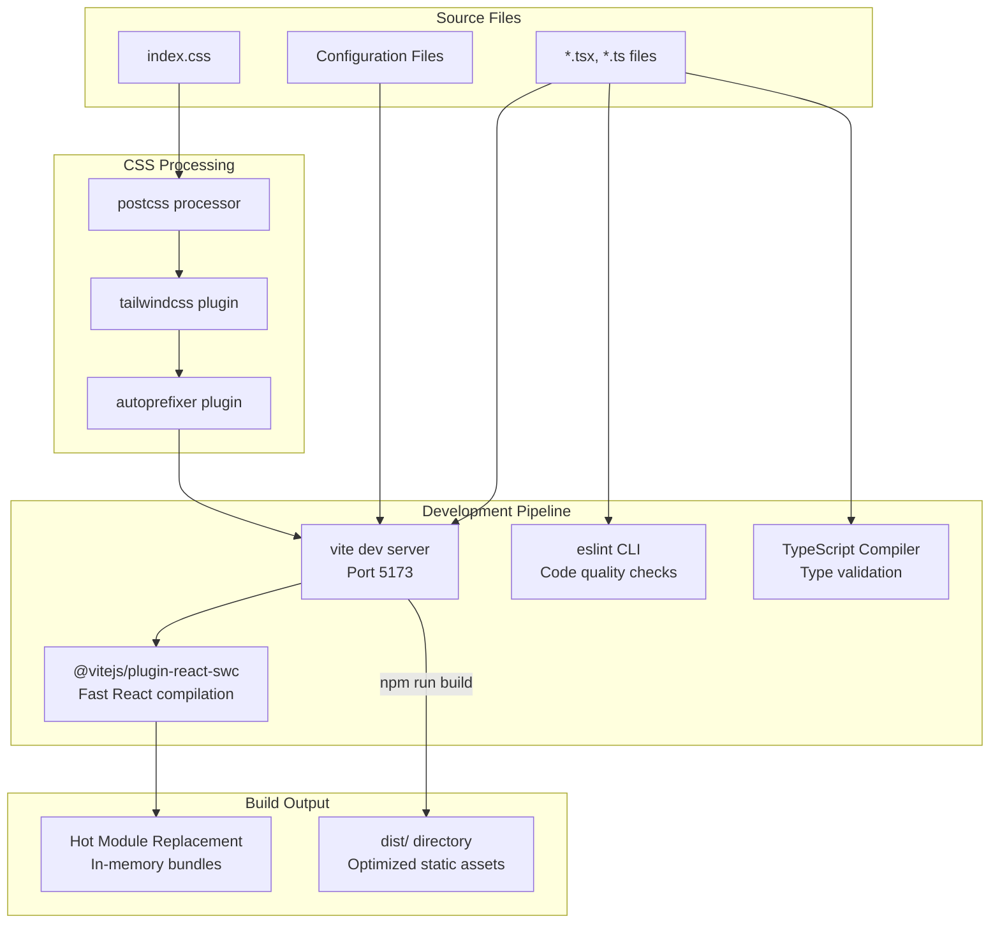
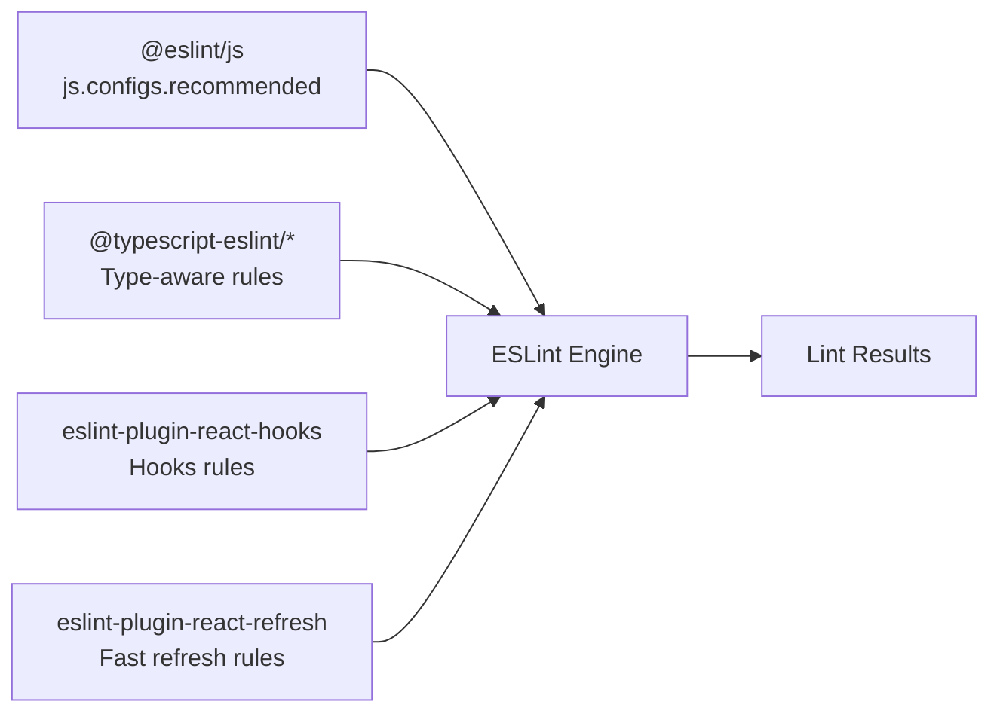
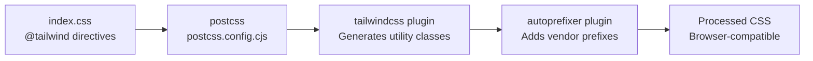
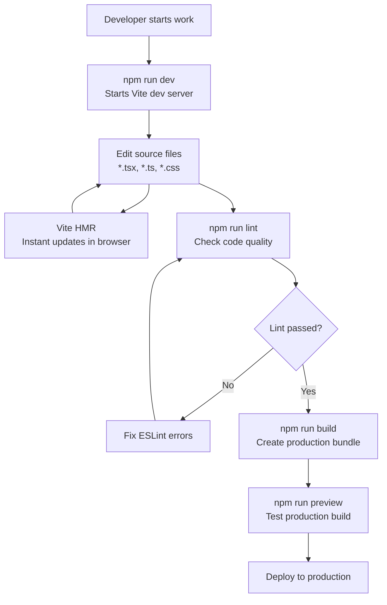

<!-- source: DeepWiki mcp.deepwiki.com · repo openai/openai-knowledge-retrieval · page 5.4 Build and Development Tools · fetched 2026-10-26 -->

# Build and Development Tools

<details>
<summary>Relevant source files</summary>

The following files were used as context for generating this wiki page:

- [app/frontend/eslint.config.js](app/frontend/eslint.config.js)
- [app/frontend/package-lock.json](app/frontend/package-lock.json)
- [app/frontend/package.json](app/frontend/package.json)
- [app/frontend/postcss.config.cjs](app/frontend/postcss.config.cjs)

</details>


This document covers the frontend build system and development tooling for the React application. It explains the configuration of Vite (build tool and dev server), ESLint (linting), TypeScript (type checking), PostCSS/Tailwind (styling), and Vitest (testing). For information about the React application structure and components, see [React Application Structure](#5.1). For details on frontend dependencies and libraries, see [Frontend Dependencies](#5.5).

---

## Overview

The frontend build system uses modern JavaScript tooling to provide fast development iterations, code quality enforcement, and optimized production builds. The toolchain is orchestrated through npm scripts defined in [app/frontend/package.json:6-11]().

**Core Build Tools:**

| Tool | Purpose | Version |
|------|---------|---------|
| Vite | Development server and production bundler | ^7.1.9 |
| TypeScript | Static type checking and compilation | ^5.4.0 |
| ESLint | Code linting and style enforcement | ^8.57.1 |
| PostCSS | CSS processing and transformation | ^8.4.47 |
| Tailwind CSS | Utility-first CSS framework | ^3.4.13 |
| Vitest | Unit testing framework | ^3.2.4 |

Sources: [app/frontend/package.json:1-44]()

---

## Build Toolchain Architecture



**Sources:** [app/frontend/package.json:6-11](), [app/frontend/postcss.config.cjs:1-7]()

---

## Vite Configuration

Vite serves as both the development server and production bundler. It uses the `@vitejs/plugin-react-swc` plugin for fast React compilation via SWC (Speedy Web Compiler) instead of Babel.

### Development Server

The development server is started with the `npm run dev` command, which executes `vite` [app/frontend/package.json:7](). Vite runs on **port 5173** by default and provides:

- **Hot Module Replacement (HMR)**: Changes to React components are reflected instantly without full page reload
- **Fast startup**: Uses native ES modules and on-demand compilation
- **SWC compilation**: The `@vitejs/plugin-react-swc` dependency [app/frontend/package.json:30]() provides faster TypeScript/JSX transformation than Babel

### Production Build

The production build is created with `npm run build` [app/frontend/package.json:8](), which executes `vite build`. This generates optimized static assets in the `dist/` directory with:

- Code splitting and tree shaking
- Minification and compression
- Asset hashing for cache busting

### Preview Server

The `npm run preview` command [app/frontend/package.json:9]() starts a local server to preview the production build.

**Sources:** [app/frontend/package.json:6-11](), [app/frontend/package.json:30]()

---

## ESLint Configuration

ESLint enforces code quality standards and detects potential issues. The configuration is defined in [app/frontend/eslint.config.js:1-40]() using the flat config format.

### Configuration Structure



### Parser and Plugins

The ESLint configuration uses the following key components:

**Parser**: `@typescript-eslint/parser` [app/frontend/eslint.config.js:6,13]() enables ESLint to understand TypeScript syntax.

**Plugins**:
- `@typescript-eslint/eslint-plugin` [app/frontend/eslint.config.js:26]() - TypeScript-specific linting rules
- `eslint-plugin-react-hooks` [app/frontend/eslint.config.js:27]() - Enforces Rules of Hooks
- `eslint-plugin-react-refresh` [app/frontend/eslint.config.js:28]() - Ensures Fast Refresh compatibility

### Rule Configuration

Key rules configured in [app/frontend/eslint.config.js:30-36]():

| Rule | Setting | Purpose |
|------|---------|---------|
| `no-tabs` | `error` | Enforces spaces over tabs |
| `indent` | `error, 4 spaces` | Enforces 4-space indentation |
| `react-refresh/only-export-components` | `warn` | Warns if non-component exports break Fast Refresh |

TypeScript rules are inherited from `@typescript-eslint/eslint-plugin`'s `recommended-type-checked` preset [app/frontend/eslint.config.js:31](), which requires type information from the TypeScript compiler.

### Type-Aware Linting

The parser is configured with `projectService: true` [app/frontend/eslint.config.js:15](), enabling type-aware linting rules that understand TypeScript types and can catch more subtle errors.

### Running ESLint

Execute linting with `npm run lint` [app/frontend/package.json:10](), which runs:
```bash
eslint . --ext ts,tsx
```

**Sources:** [app/frontend/eslint.config.js:1-40](), [app/frontend/package.json:10](), [app/frontend/package.json:23-35]()

---

## TypeScript Configuration

TypeScript provides static type checking for the React application. The compiler configuration would typically be in `tsconfig.json` (not provided in the files, but referenced by the build system).

### TypeScript Compiler

The TypeScript version is `^5.4.0` [app/frontend/package.json:39]().

### Integration with Build Tools

TypeScript is integrated into the build pipeline through:

1. **Vite + SWC**: The `@vitejs/plugin-react-swc` plugin [app/frontend/package.json:30]() compiles TypeScript to JavaScript during development and builds
2. **ESLint**: The TypeScript parser enables type-aware linting [app/frontend/eslint.config.js:13-19]()
3. **Type Definitions**: Type packages for dependencies:
   - `@types/node` [app/frontend/package.json:25]()
   - `@types/react` [app/frontend/package.json:26]()
   - `@types/react-dom` [app/frontend/package.json:27]()

**Sources:** [app/frontend/package.json:25-27,39](), [app/frontend/eslint.config.js:13-19]()

---

## CSS Processing Pipeline

The frontend uses PostCSS to process CSS with Tailwind CSS for utility-first styling.



### PostCSS Configuration

The PostCSS configuration is defined in [app/frontend/postcss.config.cjs:1-7]() as a CommonJS module:

```javascript
module.exports = {
  plugins: {
    tailwindcss: {},
    autoprefixer: {},
  },
};
```

### Plugin Chain

1. **tailwindcss** [app/frontend/postcss.config.cjs:3](): Processes `@tailwind` directives and generates utility classes based on usage
2. **autoprefixer** [app/frontend/postcss.config.cjs:4](): Automatically adds vendor prefixes for cross-browser compatibility

### Tailwind CSS

Tailwind CSS version `^3.4.13` [app/frontend/package.json:38]() provides utility classes for rapid UI development. The framework is configured through a `tailwind.config.js` file (not provided) which defines:
- Content paths to scan for class usage
- Theme customization
- Plugin extensions

### Autoprefixer

Autoprefixer version `^10.4.20` [app/frontend/package.json:31]() uses data from [Can I Use](https://caniuse.com) to add necessary vendor prefixes.

**Sources:** [app/frontend/postcss.config.cjs:1-7](), [app/frontend/package.json:31,38]()

---

## Testing Framework

Vitest is configured for unit testing with version `^3.2.4` [app/frontend/package.json:41]().

### Vitest Features

Vitest is a Vite-native testing framework that provides:
- **Fast execution**: Uses the same Vite transformation pipeline
- **ESM, TypeScript, JSX support**: Out-of-the-box without configuration
- **Jest-compatible API**: Familiar testing API for developers
- **Watch mode**: Re-runs tests on file changes

### Dependencies

Testing-related dependencies in the lock file include:
- `@vitest/expect`, `@vitest/spy`, `@vitest/utils` - Core testing utilities
- `@vitest/mocker` - Mocking support
- `@vitest/snapshot` - Snapshot testing
- `@vitest/runner` - Test execution engine

**Sources:** [app/frontend/package.json:41]()

---

## npm Scripts Reference

The [app/frontend/package.json:6-11]() defines the following scripts:

| Script | Command | Purpose |
|--------|---------|---------|
| `dev` | `vite` | Start development server on port 5173 |
| `build` | `vite build` | Create production build in `dist/` |
| `preview` | `vite preview` | Preview production build locally |
| `lint` | `eslint . --ext ts,tsx` | Run ESLint on all TypeScript files |

### Development Workflow



**Sources:** [app/frontend/package.json:6-11]()

---

## Engine Requirements

The project specifies minimum versions in [app/frontend/package.json:12-15]():

| Engine | Minimum Version |
|--------|----------------|
| Node.js | >=18.18 |
| npm | >=9 |

These requirements ensure compatibility with modern JavaScript features and package management capabilities.

**Sources:** [app/frontend/package.json:12-15]()

---

## Key Dependencies Overview

### Build Tool Dependencies

| Package | Version | Purpose |
|---------|---------|---------|
| `vite` | ^7.1.9 | Dev server and bundler |
| `@vitejs/plugin-react-swc` | ^3.5.0 | React plugin with SWC compiler |
| `@swc/core` | 1.13.5 | Fast JavaScript/TypeScript compiler |

### Code Quality Dependencies

| Package | Version | Purpose |
|---------|---------|---------|
| `eslint` | ^8.57.1 | JavaScript/TypeScript linter |
| `@typescript-eslint/parser` | ^7.18.0 | TypeScript parser for ESLint |
| `@typescript-eslint/eslint-plugin` | ^7.18.0 | TypeScript-specific lint rules |
| `eslint-plugin-react-hooks` | ^4.6.0 | React Hooks lint rules |
| `eslint-plugin-react-refresh` | ^0.4.7 | Fast Refresh compatibility rules |
| `typescript` | ^5.4.0 | Type checking and compilation |

### CSS Processing Dependencies

| Package | Version | Purpose |
|---------|---------|---------|
| `postcss` | ^8.4.47 | CSS transformation tool |
| `tailwindcss` | ^3.4.13 | Utility-first CSS framework |
| `autoprefixer` | ^10.4.20 | Automatic vendor prefix addition |

### Testing Dependencies

| Package | Version | Purpose |
|---------|---------|---------|
| `vitest` | ^3.2.4 | Test runner and framework |

**Sources:** [app/frontend/package.json:23-42]()

---

