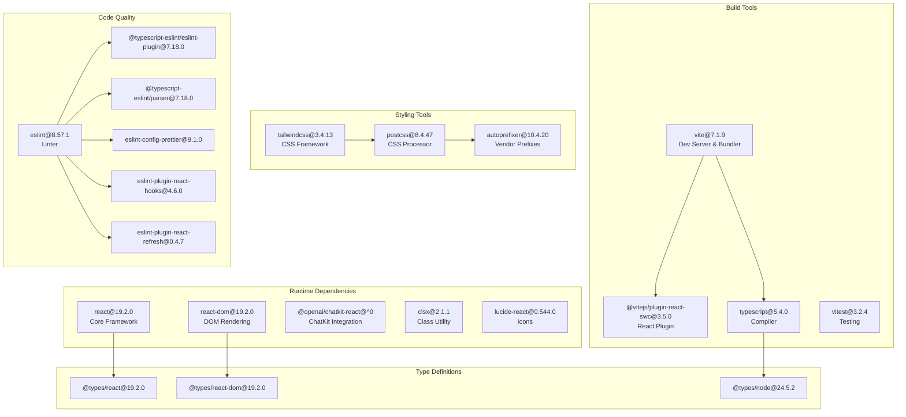
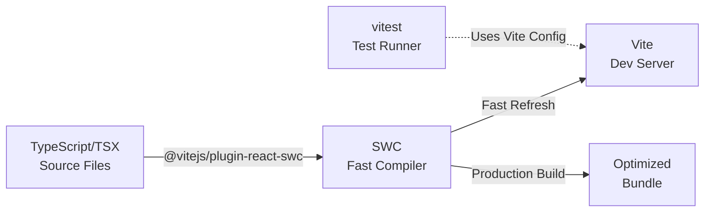
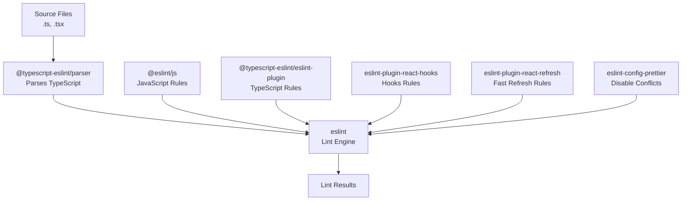
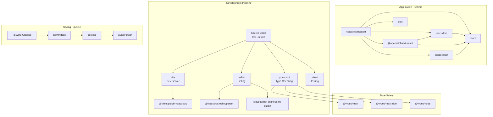

<!-- source: DeepWiki mcp.deepwiki.com · repo openai/openai-knowledge-retrieval · page 5.5 Frontend Dependencies · fetched 2026-10-26 -->

# Frontend Dependencies

<details>
<summary>Relevant source files</summary>

The following files were used as context for generating this wiki page:

- [app/frontend/package-lock.json](app/frontend/package-lock.json)
- [app/frontend/package.json](app/frontend/package.json)

</details>


## Overview

This document catalogs and explains all npm dependencies used by the frontend application. The frontend leverages a modern React 19 stack with TypeScript, Vite for tooling, and Tailwind CSS for styling. Dependencies are categorized into runtime libraries, development tools, type definitions, and code quality utilities.

For information about frontend build configuration and development workflows, see [Build and Development Tools](#5.4). For details on the React application structure and component architecture, see [React Application Structure](#5.1).

**Sources:** [app/frontend/package.json:1-43]()

---

## Dependency Categories



**Sources:** [app/frontend/package.json:16-42]()

---

## Runtime Dependencies

Runtime dependencies are included in the production bundle and required for the application to function in the browser.

### Core Framework

| Package | Version | Purpose |
|---------|---------|---------|
| `react` | 19.2.0 | Core React library providing component model, hooks, and rendering primitives |
| `react-dom` | 19.2.0 | React renderer for DOM environments, handles mounting and updating components |

React 19 is the latest major version, introducing improvements to the compiler, concurrent features, and server components. The application uses React's modern hooks-based API throughout.

**Sources:** [app/frontend/package.json:20-21]()

---

### ChatKit Integration

| Package | Version | Purpose |
|---------|---------|---------|
| `@openai/chatkit-react` | ^0 | React wrapper and hooks for OpenAI's ChatKit web component |

This dependency provides the `ChatKit` component and `useChatKit` hook that bridge React with the `<openai-chatkit>` web component. The `^0` version constraint indicates the package is in early release and follows semantic versioning from 0.x.

The integration loads the ChatKit web component from a CDN at runtime and provides React-friendly APIs for configuration, event handling, and method invocation.

**Sources:** [app/frontend/package.json:17](), [app/frontend/package-lock.json:792-803]()

---

### Utility Libraries

| Package | Version | Purpose |
|---------|---------|---------|
| `clsx` | 2.1.1 | Conditionally construct className strings |
| `lucide-react` | 0.544.0 | Icon library with React components |

**`clsx`** is used throughout the application for dynamic class name composition, particularly when combining Tailwind utility classes with conditional styles:

```typescript
className={clsx("base-class", condition && "conditional-class")}
```

**`lucide-react`** provides SVG icons as React components. Icons are imported as needed and rendered inline, maintaining TypeScript type safety and enabling tree-shaking for optimal bundle size.

**Sources:** [app/frontend/package.json:18-19]()

---

## Development Dependencies

Development dependencies are used during development and build time but not included in the production bundle.

### Type Definitions

| Package | Version | Purpose |
|---------|---------|---------|
| `@types/react` | 19.2.0 | TypeScript type definitions for React |
| `@types/react-dom` | 19.2.0 | TypeScript type definitions for React DOM |
| `@types/node` | 24.5.2 | TypeScript type definitions for Node.js APIs |

These packages provide TypeScript declarations for their respective libraries, enabling type checking, IntelliSense, and compile-time validation. The `@types/react` and `@types/react-dom` versions are aligned with the runtime React version (19.2.0).

`@types/node` enables type-safe use of Node.js globals and modules used in build scripts and configuration files.

**Sources:** [app/frontend/package.json:25-27]()

---

## Build and Development Tools

### Vite Ecosystem

| Package | Version | Purpose |
|---------|---------|---------|
| `vite` | 7.1.9 | Fast build tool and development server |
| `@vitejs/plugin-react-swc` | 3.5.0 | Vite plugin for React using SWC compiler |
| `typescript` | 5.4.0 | TypeScript language and compiler |
| `vitest` | 3.2.4 | Unit testing framework built on Vite |



**`vite`** provides:
- Lightning-fast hot module replacement (HMR) during development
- Native ES modules support in development
- Optimized production bundling with Rollup
- Development server on port 5173 (configured in startup scripts)

**`@vitejs/plugin-react-swc`** uses SWC (Speedy Web Compiler) instead of Babel for:
- 10-100x faster TypeScript/JSX compilation
- React Fast Refresh support for instant component updates
- Automatic JSX runtime injection

**`vitest`** shares Vite's configuration and transformation pipeline, providing:
- Zero-config testing with Vite compatibility
- Native ESM and TypeScript support
- Watch mode with instant feedback

**Sources:** [app/frontend/package.json:30,34,39-41]()

---

## Code Quality Tools

### ESLint Configuration

The application uses a comprehensive ESLint setup for maintaining code quality:

| Package | Version | Purpose |
|---------|---------|---------|
| `eslint` | 8.57.1 | Core linting engine |
| `@eslint/js` | 8.57.1 | ESLint's JavaScript rule presets |
| `@typescript-eslint/parser` | 7.18.0 | TypeScript parser for ESLint |
| `@typescript-eslint/eslint-plugin` | 7.18.0 | TypeScript-specific lint rules |
| `eslint-config-prettier` | 9.1.0 | Disables ESLint rules that conflict with Prettier |
| `eslint-plugin-react-hooks` | 4.6.0 | Enforces React Hooks rules |
| `eslint-plugin-react-refresh` | 0.4.7 | Ensures components are compatible with Fast Refresh |
| `globals` | 15.3.0 | Global identifiers for different environments |



**Key Lint Rules Enforced:**

- **TypeScript:** Strict type checking, no unused variables, consistent type imports
- **React Hooks:** Rules of hooks (exhaustive deps, no conditional hooks)
- **React Refresh:** Ensures components are named exports for HMR compatibility
- **Code Style:** Consistent formatting (coordinated with Prettier)

The lint command runs via `npm run lint` and checks all `.ts` and `.tsx` files.

**Sources:** [app/frontend/package.json:24,28-29,32-37]()

---

## Styling Dependencies

### Tailwind CSS Ecosystem

| Package | Version | Purpose |
|---------|---------|---------|
| `tailwindcss` | 3.4.13 | Utility-first CSS framework |
| `postcss` | 8.4.47 | CSS transformation tool |
| `autoprefixer` | 10.4.20 | PostCSS plugin for vendor prefixes |


**`tailwindcss`** provides:
- Utility classes for rapid UI development
- Just-in-time (JIT) compilation for minimal CSS bundle size
- Only generates CSS for classes actually used in the codebase
- Configured via `tailwind.config.js` for custom theme and content paths

**`postcss`** acts as the CSS transformation pipeline, processing Tailwind directives and applying plugins.

**`autoprefixer`** automatically adds vendor prefixes for CSS properties based on browser compatibility data from Can I Use, ensuring cross-browser support.

**Sources:** [app/frontend/package.json:31,37-38]()

---

## Engine Requirements

The `package.json` specifies minimum runtime versions for Node.js and npm:

```json
"engines": {
  "node": ">=18.18",
  "npm": ">=9"
}
```

These requirements ensure:
- **Node.js 18.18+:** Native ES modules support, fetch API, and modern JavaScript features
- **npm 9+:** Improved lockfile format, faster installs, and enhanced workspace support

The Vite 7.x dependency further requires Node.js 18+ for optimal performance.

**Sources:** [app/frontend/package.json:12-15]()

---

## Version Constraints

The project uses semantic versioning constraints:

| Constraint | Meaning | Example | Used For |
|------------|---------|---------|----------|
| `^x.y.z` | Allow minor and patch updates | `^19.2.0` → 19.x.x | Most stable dependencies |
| `~x.y.z` | Allow only patch updates | N/A | Not used in this project |
| `>=x.y.z` | Minimum version | `>=18.18` | Engine requirements |
| Exact | Lock to specific version | `19.2.0` | Not used (all use ranges) |

The caret (`^`) constraint is used for all dependencies, allowing automatic minor version updates while preventing breaking changes. This balances stability with security updates and feature improvements.

**Sources:** [app/frontend/package.json:16-42]()

---

## Dependency Graph



**Sources:** [app/frontend/package.json:1-43](), [app/frontend/package-lock.json:7-42]()

---

## Package Lock File

The `package-lock.json` file (v3 lockfile format) ensures deterministic installs across environments by:
- Locking exact resolved versions of all packages and their transitive dependencies
- Recording integrity hashes for security verification
- Defining the full dependency tree structure
- Specifying registry URLs and package metadata

The lockfile contains 2000+ packages including all transitive dependencies, platform-specific binaries (esbuild, SWC), and development tools. This file should be committed to version control and updated via `npm install` or `npm update`.

**Sources:** [app/frontend/package-lock.json:1-6]()

---

