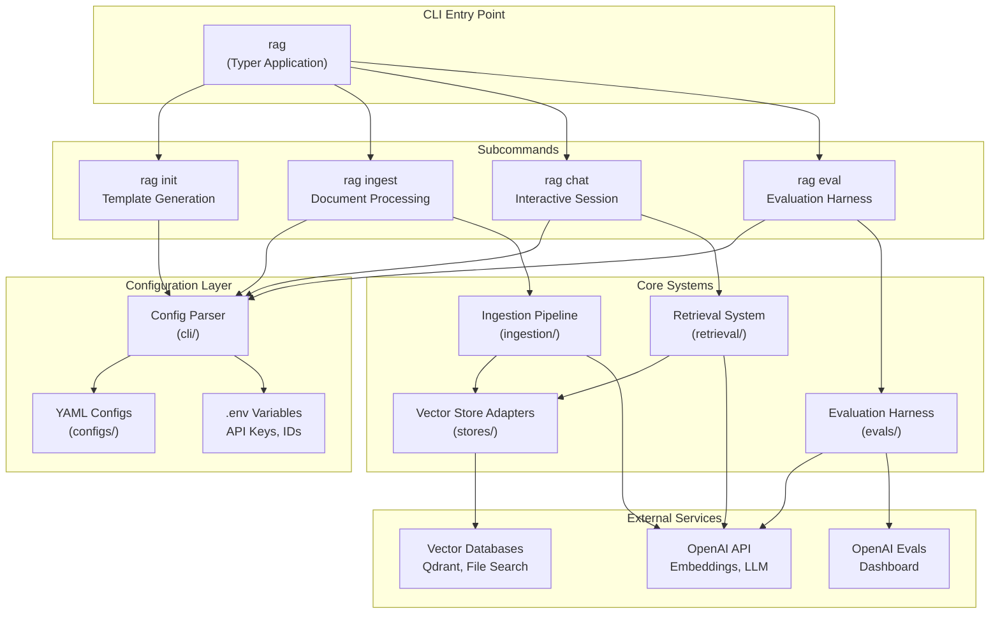
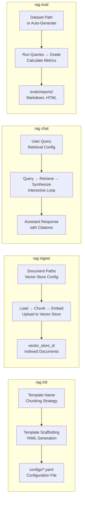
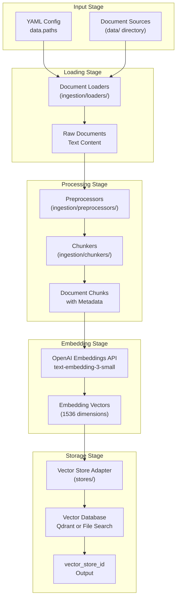
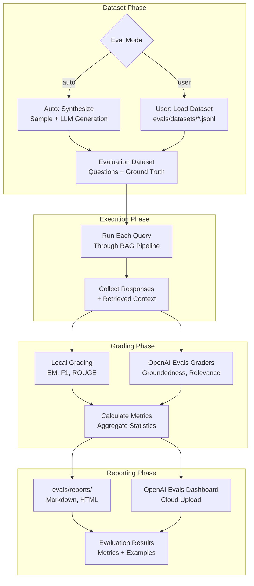
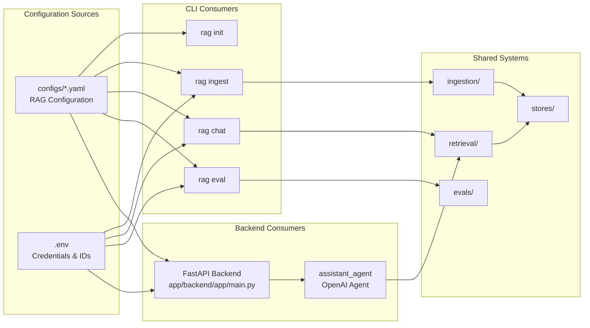

<!-- source: DeepWiki mcp.deepwiki.com · repo openai/openai-knowledge-retrieval · page 6 CLI Tools · fetched 2026-10-26 -->

# CLI Tools

<details>
<summary>Relevant source files</summary>

The following files were used as context for generating this wiki page:

- [Makefile](Makefile)
- [README.md](README.md)

</details>


## Purpose and Scope

The CLI tools provide a command-line interface for administrative tasks including configuration initialization, document ingestion, interactive chat sessions, and evaluation runs. The primary entry point is the `rag` command, built with Typer, which orchestrates the ingestion, retrieval, and evaluation subsystems. This page documents the CLI architecture, available commands, and their integration with backend components.

For information about running the web-based application, see [Getting Started](#2). For detailed configuration of the YAML files that CLI commands consume, see [Configuration](#7).

**Sources:** [README.md:1-308](), [Makefile:1-38]()

---

## CLI Architecture

The CLI system is implemented as a Typer application that provides a unified interface for managing the RAG pipeline. The `rag` command serves as the main entry point and delegates to subcommands that handle specific workflows.

### Command Structure



**Figure 1: CLI Architecture and Command Flow**

The CLI follows a layered architecture where Typer-based subcommands consume YAML configuration and environment variables through a shared config parser in `cli/`. Each command then delegates to specialized subsystems for execution.

**Sources:** [README.md:56-65](), [Makefile:31-38]()

---

## Command Invocation

### Direct Invocation

Commands can be invoked directly using the `rag` executable after installation:

```bash
rag <command> --config <path> [options]
```

### Makefile Shortcuts

The repository provides Makefile targets that wrap common CLI invocations with default configurations:

| Makefile Target | Equivalent Command | Purpose |
|----------------|-------------------|---------|
| `make ingest` | `rag ingest --config configs/default.openai.yaml` | Ingest documents into vector store |
| `make chat` | `rag chat --config configs/default.openai.yaml` | Start interactive chat session |
| `make eval` | `rag eval --config configs/default.openai.yaml` | Run evaluation harness |

**Sources:** [Makefile:31-38](), [README.md:12-42]()

### Configuration Precedence

Configuration is resolved in the following order (later sources override earlier ones):

1. YAML configuration file defaults
2. Environment variables from `.env`
3. Command-line arguments
4. `env` block in YAML (provides fallback defaults)

**Sources:** [README.md:235-238]()

---

## Available Commands

### Command Overview



**Figure 2: CLI Command Data Flow**

Each CLI command implements a specific phase of the RAG workflow, from initial setup through evaluation.

**Sources:** [README.md:96-150]()

---

## `rag init` - Configuration Initialization

### Purpose

Generates YAML configuration files from predefined templates, scaffolding the settings needed for ingestion, retrieval, and synthesis.

### Usage

```bash
rag init --template <template_name> [--chunking <strategy>] > configs/my.yaml
```

### Templates

| Template | Description | Vector Store Backend |
|----------|-------------|---------------------|
| `openai` | Default template using OpenAI File Search | `openai_file_search` |
| `custom-qdrant` | Local Qdrant vector database | `custom` (Qdrant adapter) |

### Chunking Strategies

The `--chunking` flag selects a predefined chunking configuration:

| Strategy | Description | Use Case |
|----------|-------------|----------|
| `recursive` | Recursively splits by hierarchy | General documents |
| `heading` | Uses heading structure | Structured documents |
| `hybrid` | Combines heading and recursive (default) | Mixed formats |
| `xml_aware` | XML-aware splitting | Technical manuals |
| `custom` | Custom chunker via plugin | Specialized needs |

### Output

Produces a complete YAML configuration file with sections for:
- `data.paths` - Document source paths
- `vector_store` - Storage backend configuration
- `chunking` - Chunking strategy and parameters
- `query` - Retrieval pipeline settings
- `synthesis` - Response generation configuration
- `evals` - Evaluation harness settings

**Sources:** [README.md:96-101](), [README.md:156-183]()

---

## `rag ingest` - Document Ingestion

### Purpose

Processes documents from specified paths, generates embeddings, and uploads them to the configured vector store. This command orchestrates the complete ingestion pipeline.

### Usage

```bash
rag ingest --config configs/my.yaml
```

Or via Makefile:
```bash
make ingest
```

### Ingestion Pipeline



**Figure 3: Document Ingestion Pipeline**

The ingestion process reads documents, chunks them according to configuration, generates embeddings via OpenAI API, and stores vectors in the target database.

### Key Configuration Options

| Section | Parameter | Description |
|---------|-----------|-------------|
| `data.paths` | Document paths | List of file/directory paths to ingest |
| `chunking.strategy` | Chunking method | `recursive`, `heading`, `hybrid`, `xml_aware`, `custom` |
| `chunking.target_token_range` | Token window | `[min, max]` tokens per chunk |
| `chunking.overlap_tokens` | Overlap size | Tokens to overlap between chunks |
| `vector_store.backend` | Store type | `openai_file_search` or `custom` |
| `vector_store.vector_store_id` | Existing store | Reuse existing store instead of creating new |

### Output

The command prints:
- Number of documents processed
- Number of chunks created
- `vector_store_id` for reuse in subsequent operations
- Ingestion statistics and timing

The `vector_store_id` should be persisted in `.env` for use by the backend application and other CLI commands.

**Sources:** [README.md:116-123](), [README.md:166-183](), [Makefile:31-32]()

---

## `rag chat` - Interactive Chat Session

### Purpose

Launches an interactive command-line chat interface that uses the configured retrieval pipeline to answer queries with citations.

### Usage

```bash
rag chat --config configs/my.yaml
```

Or via Makefile:
```bash
make chat
```

### Chat Session Flow

```mermaid
sequenceDiagram
    participant User
    participant RagChat["rag chat<br/>(CLI)"]
    participant RetPipe["Retrieval Pipeline<br/>(retrieval/)"]
    participant VectorStore["Vector Store<br/>(stores/)"]
    participant LLM["OpenAI API<br/>(Synthesis)"]
    
    User->>RagChat: Start session
    RagChat->>User: Display prompt
    
    loop Interactive Session
        User->>RagChat: Enter query
        RagChat->>RetPipe: Process query
        
        opt Query Expansion
            RetPipe->>LLM: Generate variants
            LLM->>RetPipe: Expanded queries
        end
        
        opt HyDE
            RetPipe->>LLM: Generate hypothetical doc
            LLM->>RetPipe: HyDE passage
        end
        
        RetPipe->>VectorStore: Vector search
        VectorStore->>RetPipe: Retrieved chunks
        
        opt Reranking
            RetPipe->>LLM: Rerank candidates
            LLM->>RetPipe: Reranked results
        end
        
        RetPipe->>LLM: Synthesize response
        LLM->>RetPipe: Generated answer
        RetPipe->>RagChat: Response + citations
        RagChat->>User: Display answer
    end
    
    User->>RagChat: Exit (Ctrl+C)
    RagChat->>User: Session terminated
```

**Figure 4: Interactive Chat Session Sequence**

The chat command provides a REPL-style interface where each user query triggers the full retrieval and synthesis pipeline.

### Features

- **Query Enhancement**: Optional query expansion and HyDE generation based on configuration
- **Similarity Filtering**: Filters results below configured threshold before reranking
- **Reranking**: Optional LLM-based reranking of retrieved candidates
- **Citations**: Displays source documents and relevant passages
- **Conversation History**: Maintains context across multiple turns

### Configuration Impact

The chat session behavior is controlled by settings in the YAML configuration:

| Setting | Effect |
|---------|--------|
| `query.expansion.enabled` | Generates multiple query variants |
| `query.hyde.enabled` | Creates hypothetical document embeddings |
| `query.similarity_filter.enabled` | Filters low-similarity results |
| `query.rerank.enabled` | Applies LLM cross-encoder reranking |
| `synthesis.model` | Sets the response generation model |
| `synthesis.system_prompt` | Customizes assistant behavior |

**Sources:** [README.md:34-36](), [README.md:210-224](), [Makefile:34-35]()

---

## `rag eval` - Evaluation Harness

### Purpose

Executes the evaluation pipeline to assess retrieval quality and response accuracy. Supports both auto-generated synthetic datasets and user-curated evaluation sets.

### Usage

```bash
rag eval --config configs/my.yaml
```

Or via Makefile:
```bash
make eval
```

### Evaluation Modes

#### Auto Mode (`evals.mode: auto`)

Automatically generates evaluation data from the ingested corpus:

1. **Sampling**: Selects representative chunks from vector store
2. **Question Generation**: Uses LLM to create realistic user queries
3. **Dataset Storage**: Saves to `evals/datasets/` in JSONL format
4. **Execution**: Runs queries and grades responses

#### User Mode (`evals.mode: user`)

Uses a pre-existing dataset specified in `evals.dataset_path`. Each JSONL record must include:

```json
{
  "id": "unique-id",
  "question": "User query text",
  "citation_text": "Supporting passage for groundedness",
  "correct_answer": "Expected answer for EM/F1 scoring",
  "source_id": "document-id",
  "page": 1,
  "char_start": 100,
  "char_end": 500,
  "difficulty": "medium",
  "tags": ["topic1", "topic2"]
}
```

### Evaluation Pipeline



**Figure 5: Evaluation Harness Pipeline**

The evaluation harness orchestrates dataset preparation, query execution, grading, and report generation.

### Grading Metrics

#### Local Metrics

Computed locally without external API calls:

| Metric | Description |
|--------|-------------|
| **Exact Match (EM)** | Binary match after normalization |
| **F1 Score** | Token overlap between prediction and ground truth |
| **ROUGE-L** | Longest common subsequence similarity |

#### OpenAI Evals Graders

When `evals.openai_evals.enabled: true`, results are uploaded to OpenAI Evals platform with configurable graders:

| Grader | Assessment |
|--------|------------|
| **Groundedness** | Whether response is supported by retrieved context |
| **Relevance** | Whether response directly answers the question |
| **Custom Rubrics** | User-defined evaluation criteria |

### Configuration Options

| Parameter | Description |
|-----------|-------------|
| `evals.mode` | `auto` or `user` for dataset source |
| `evals.dataset_path` | Path to curated JSONL dataset (user mode) |
| `evals.auto.num_samples` | Number of chunks to sample (auto mode) |
| `evals.auto.questions_per_chunk` | Questions generated per chunk |
| `evals.openai_evals.enabled` | Enable OpenAI Evals dashboard sync |
| `evals.openai_evals.graders` | List of grader configurations |
| `evals.openai_evals.run_name` | Display name for dashboard |

### Output Artifacts

1. **Local Reports**: Written to `evals/reports/` directory
   - `{run_name}.md` - Markdown report with metrics and examples
   - `{run_name}.html` - HTML formatted report
   
2. **Dataset Files**: Saved to `evals/datasets/`
   - `auto_generated_{timestamp}.jsonl` - Auto-generated questions
   - Validated and canonicalized user datasets

3. **OpenAI Evals**: If enabled, provides dashboard link for viewing results in OpenAI platform

### Schema Validation

The CLI validates dataset schema using [evals/datasets/schema.py]() before execution. Required fields are enforced and answers are canonicalized for consistent scoring.

**Sources:** [README.md:143-149](), [README.md:252-286](), [Makefile:37-38]()

---

## Integration with Backend Services

### Shared Configuration

Both CLI tools and the FastAPI backend consume the same YAML configuration files from `configs/`. This ensures consistency between command-line operations and web application behavior.

### Configuration Flow



**Figure 6: CLI and Backend Configuration Integration**

The CLI and backend share configuration files and core subsystems, enabling consistent behavior across command-line and web interfaces.

### Environment Variable Resolution

The `RAG_CONFIG` environment variable specifies which configuration file to use:

```bash
export RAG_CONFIG=configs/my.openai.yaml
make run-app-backend  # Backend uses my.openai.yaml
rag ingest            # CLI uses my.openai.yaml
```

If `RAG_CONFIG` is not set, both systems default to [configs/default.openai.yaml]().

### Vector Store ID Persistence

After ingestion, the CLI prints a `vector_store_id` that should be persisted in `.env`:

```bash
VECTOR_STORE_ID=vs_abc123xyz
```

This ID is then used by:
- The backend to retrieve documents during chat sessions
- Subsequent CLI commands to reuse the same vector store
- Evaluation harness to query the indexed corpus

**Sources:** [README.md:86-93](), [README.md:106-107](), [README.md:127-140]()

---

## Command-Line Options Reference

### Global Options

| Option | Description | Example |
|--------|-------------|---------|
| `--config <path>` | Path to YAML configuration file | `--config configs/custom.yaml` |
| `--help` | Display command help | `rag ingest --help` |

### Command-Specific Options

#### `rag init`

| Option | Description | Default |
|--------|-------------|---------|
| `--template <name>` | Template to scaffold | Required |
| `--chunking <strategy>` | Chunking strategy | `hybrid` |

#### `rag ingest`

Configuration-driven; no additional flags. All settings are specified in the YAML configuration file.

#### `rag chat`

Configuration-driven; no additional flags. Session behavior is controlled by YAML settings.

#### `rag eval`

Configuration-driven; evaluation mode, dataset path, and grading options are specified in YAML configuration.

**Sources:** [README.md:96-150](), [Makefile:31-38]()

---

## Best Practices

### Configuration Management

1. **Version Control**: Store YAML configurations in version control
2. **Environment-Specific Configs**: Maintain separate configs for dev/staging/production
3. **Credential Separation**: Keep API keys in `.env`, not in YAML files
4. **Template Usage**: Start with `rag init` templates rather than manual YAML creation

### Ingestion Workflow

1. **Incremental Updates**: Use the same `vector_store_id` to update existing stores
2. **Validation**: Review ingestion statistics to verify expected document count
3. **Persistence**: Always save `vector_store_id` to `.env` after ingestion
4. **Monitoring**: Check vector store metrics to ensure proper embedding generation

### Evaluation Workflow

1. **Dataset Versioning**: Save auto-generated datasets for reproducibility
2. **Baseline Establishment**: Run evaluations before configuration changes
3. **Metric Selection**: Choose graders appropriate for your domain and requirements
4. **Report Review**: Examine failure cases in generated reports to identify issues

### Makefile Integration

For common workflows, define Makefile targets that encapsulate CLI commands with appropriate configurations:

```makefile
ingest-production:
    rag ingest --config configs/production.yaml

eval-staging:
    rag eval --config configs/staging.yaml
```

**Sources:** [README.md:151-286](), [Makefile:1-38]()

---

## Troubleshooting

### Common Issues

| Issue | Cause | Solution |
|-------|-------|----------|
| `OPENAI_API_KEY not set` | Missing environment variable | Add key to `.env` file |
| `vector_store_id not found` | Store not created or ID not persisted | Run `rag ingest` and save ID to `.env` |
| `Config file not found` | Invalid path or missing file | Verify path with `ls configs/` |
| `Import error` | Missing dependencies | Run `make dev` to install all dependencies |
| `Qdrant connection refused` | Vector DB not running | Run `make qdrant-up` |

### Debug Mode

Enable verbose logging by setting environment variables:

```bash
export LOG_LEVEL=DEBUG
rag ingest --config configs/my.yaml
```

### Configuration Validation

Test configuration parsing without executing commands:

```bash
# Validate YAML syntax
python -c "import yaml; yaml.safe_load(open('configs/my.yaml'))"
```

**Sources:** [README.md:68-124](), [Makefile:25-29]()

---

