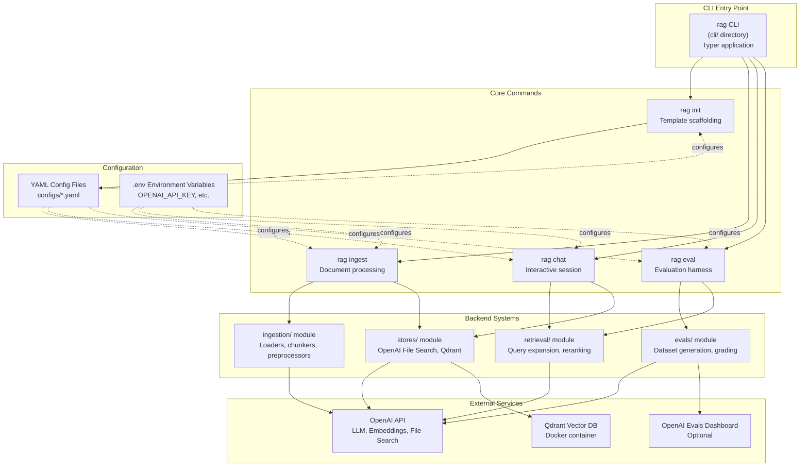
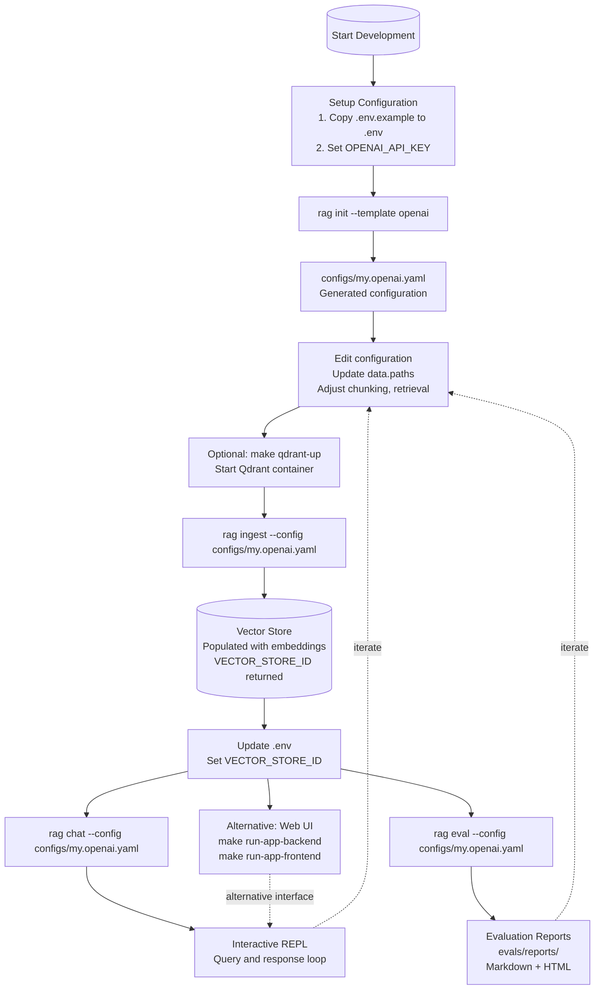
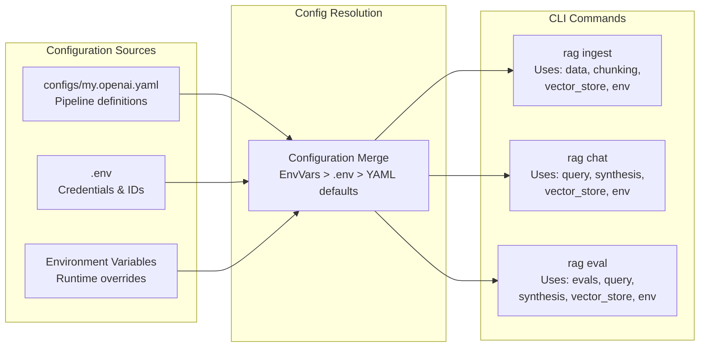

<!-- source: DeepWiki mcp.deepwiki.com · repo openai/openai-knowledge-retrieval · page 6.1 CLI Commands Overview · fetched 2026-10-26 -->

# CLI Commands Overview

<details>
<summary>Relevant source files</summary>

The following files were used as context for generating this wiki page:

- [Makefile](Makefile)
- [README.md](README.md)

</details>


This document provides a comprehensive reference for the `rag` command-line interface (CLI), which serves as the primary administrative tool for managing document ingestion, interactive chat sessions, and evaluation workflows in the OpenAI Knowledge Retrieval system. The CLI is built with Typer and provides a config-first interface to all pipeline operations.

For detailed information about the ingestion process and document processing, see [Data Ingestion](#6.2). For evaluation workflows, dataset generation, and grading, see [Evaluation System](#6.3). For YAML configuration structure and options, see [RAG Configuration Files](#7.2).

## CLI Architecture

The `rag` CLI is a Typer-based command-line application located in the [`cli/`]() directory. It provides a unified interface for configuration management, data ingestion, interactive chat, and evaluation operations. All commands accept a `--config` parameter that points to a YAML configuration file, enabling declarative pipeline control without code modification.



**Sources:** [README.md:56](), [Makefile:31-38]()

## Command Structure

All `rag` commands follow a consistent structure:

```
rag <command> [OPTIONS]
```

### Common Options

All commands support the following common options:

| Option | Description | Default |
|--------|-------------|---------|
| `--config` | Path to YAML configuration file | `configs/default.openai.yaml` |
| `--help` | Display command-specific help | N/A |

The `--config` parameter is the primary mechanism for controlling pipeline behavior. Configuration files are located in the [`configs/`]() directory and define data sources, chunking strategies, retrieval pipelines, synthesis models, and evaluation parameters.

**Sources:** [README.md:99-101](), [README.md:119](), [README.md:146](), [Makefile:32-38]()

## Command Reference

### rag init

**Purpose:** Generate configuration templates from predefined scaffolds.

**Usage:**
```bash
rag init --template <template_name> [--chunking <strategy>]
```

**Parameters:**

| Parameter | Description | Options |
|-----------|-------------|---------|
| `--template` | Configuration template to scaffold | `openai`, `custom-qdrant` |
| `--chunking` | Chunking strategy to include | `recursive`, `heading`, `hybrid`, `xml_aware`, `custom` |

**Output:** The command prints a complete YAML configuration to stdout, which can be redirected to a file in the `configs/` directory.

**Behavior:**
- Generates a complete YAML configuration based on the selected template
- `openai` template uses OpenAI File Search as the vector store backend
- `custom-qdrant` template configures a local Qdrant instance
- The `--chunking` parameter pre-configures chunking strategy parameters
- Does not modify any files; output must be redirected manually

**Example:**
```bash
rag init --template openai > configs/my.openai.yaml
rag init --template custom-qdrant --chunking heading > configs/my.qdrant.yaml
```

**Sources:** [README.md:97-104](), [README.md:156-164]()

### rag ingest

**Purpose:** Process documents and populate vector stores with embeddings.

**Usage:**
```bash
rag ingest --config <config_path>
```

**Configuration Requirements:**
- `data.paths`: List of document directories or file paths
- `vector_store.backend`: Either `openai_file_search` or `custom`
- `chunking`: Chunking strategy and parameters
- `env.OPENAI_API_KEY`: OpenAI API key for embeddings

**Behavior:**
1. Loads documents from paths specified in `data.paths`
2. Applies preprocessing rules (metadata extraction, cleaning)
3. Chunks documents according to the configured strategy
4. Generates embeddings via OpenAI Embeddings API
5. Uploads chunks and embeddings to the configured vector store
6. Creates or reuses vector store based on `vector_store_id` or `vector_store_name`
7. Prints the resulting `vector_store_id` for persistence in `.env`

**Makefile Integration:**
```bash
make ingest  # Executes: rag ingest --config configs/default.openai.yaml
```

**Output:**
- Console logs showing ingestion progress
- Vector store ID for persistence
- Document count and chunk statistics

**Sources:** [README.md:29-30](), [README.md:116-123](), [Makefile:31-32]()

### rag chat

**Purpose:** Launch an interactive command-line chat session with the knowledge assistant.

**Usage:**
```bash
rag chat --config <config_path>
```

**Configuration Requirements:**
- `vector_store.backend`: Configured vector store with ingested data
- `query`: Retrieval pipeline configuration (expansion, reranking, etc.)
- `synthesis`: Response model and system prompt
- `env.OPENAI_API_KEY`: OpenAI API key for LLM access
- `env.VECTOR_STORE_ID`: Vector store identifier (if using OpenAI File Search)

**Behavior:**
1. Initializes the retrieval pipeline from configuration
2. Connects to the configured vector store
3. Launches an interactive REPL (Read-Eval-Print Loop)
4. Processes user queries through the full RAG pipeline:
   - Query expansion (if enabled)
   - HyDE generation (if enabled)
   - Vector search
   - Similarity filtering (if enabled)
   - Reranking (if enabled)
   - Response synthesis with citations
5. Streams responses to the terminal
6. Maintains conversation history within the session

**Makefile Integration:**
```bash
make chat  # Executes: rag chat --config configs/default.openai.yaml
```

**Interactive Commands:**
- Type queries directly at the prompt
- Exit with `Ctrl+C` or `quit`/`exit`

**Sources:** [README.md:34-35](), [Makefile:34-35]()

### rag eval

**Purpose:** Execute the evaluation harness to measure retrieval and synthesis quality.

**Usage:**
```bash
rag eval --config <config_path>
```

**Configuration Requirements:**
- `evals.mode`: Either `auto` (synthetic generation) or `user` (curated dataset)
- `evals.dataset_path`: Path to JSONL dataset (for `user` mode)
- `evals.openai_evals.enabled`: Whether to mirror results to OpenAI Evals dashboard
- `evals.openai_evals.graders`: List of grading criteria (groundedness, relevance, etc.)
- `vector_store.backend`: Configured vector store with ingested data

**Behavior:**

**Auto Mode (`evals.mode: auto`):**
1. Samples ingested chunks from the vector store
2. Generates synthetic user questions via LLM
3. Creates ground truth answers and citations
4. Stores dataset in `evals/datasets/` as JSONL
5. Executes evaluation runs against the generated data

**User Mode (`evals.mode: user`):**
1. Loads curated dataset from `evals.dataset_path`
2. Validates schema (id, question, citation_text, correct_answer)
3. Executes evaluation runs against the provided data

**Evaluation Process:**
1. For each question in the dataset:
   - Executes the full retrieval pipeline
   - Generates a response via synthesis model
   - Extracts citations from response
2. Grades results using configured graders:
   - Local LLM-based grading (prompt-driven)
   - OpenAI Evals platform grading (if enabled)
3. Computes metrics (F1, EM, groundedness, relevance)
4. Generates reports in `evals/reports/` (Markdown, HTML)
5. Mirrors results to OpenAI Evals dashboard (if enabled)

**Makefile Integration:**
```bash
make eval  # Executes: rag eval --config configs/default.openai.yaml
```

**Output:**
- Console logs with evaluation progress
- Reports in `evals/reports/` with metrics and per-question breakdowns
- Link to OpenAI Evals dashboard (if enabled)

**Sources:** [README.md:40-41](), [README.md:143-149](), [README.md:252-287](), [Makefile:37-38]()

## Command Workflow

The following diagram illustrates typical command sequences and their relationships:



**Sources:** [README.md:16-42](), [README.md:97-149]()

## Configuration-Driven Execution

All CLI commands read their behavior from YAML configuration files. The configuration file controls:

| Section | Controls | Relevant Commands |
|---------|----------|-------------------|
| `data.paths` | Document sources for ingestion | `ingest` |
| `chunking` | Chunking strategy and parameters | `ingest` |
| `vector_store` | Backend selection and credentials | `ingest`, `chat`, `eval` |
| `query` | Retrieval pipeline (expansion, reranking) | `chat`, `eval` |
| `synthesis` | Response model and system prompt | `chat`, `eval` |
| `evals` | Evaluation mode, dataset, graders | `eval` |
| `env` | Default environment variable values | All commands |

**Example Configuration Flow:**



**Sources:** [README.md:151-239](), [README.md:85-93]()

## Makefile Shortcuts

The project provides Makefile targets that wrap common CLI commands with default configurations:

| Makefile Target | Equivalent CLI Command | Purpose |
|-----------------|------------------------|---------|
| `make ingest` | `rag ingest --config configs/default.openai.yaml` | Ingest with default config |
| `make chat` | `rag chat --config configs/default.openai.yaml` | Chat with default config |
| `make eval` | `rag eval --config configs/default.openai.yaml` | Evaluate with default config |

These targets provide quick access to common workflows while maintaining consistency with the CLI interface. Developers can customize behavior by modifying `configs/default.openai.yaml` or creating alternate configurations and invoking `rag` commands directly.

**Sources:** [Makefile:31-38]()

## Error Handling and Validation

The CLI performs validation at multiple stages:

### Configuration Validation
- YAML syntax checking on load
- Schema validation for required fields
- Type checking for parameters
- Cross-field dependency validation (e.g., `vector_store_id` when reusing stores)

### Pre-execution Validation
- API key presence and format
- Vector store connectivity (for `custom` backends)
- Document path existence (for `ingest`)
- Dataset schema compliance (for `eval` in `user` mode)

### Runtime Validation
- Document format compatibility
- Embedding dimension consistency
- Token limit adherence for chunking
- LLM response structure validation

Validation failures result in informative error messages with suggestions for resolution.

**Sources:** [README.md:269-276]()

## Advanced Usage Patterns

### Multiple Configurations

Maintain separate configurations for different use cases:

```bash
# Development configuration with verbose logging
rag ingest --config configs/dev.yaml

# Production configuration with optimized parameters
rag ingest --config configs/prod.yaml

# Evaluation-specific configuration with synthetic data generation
rag eval --config configs/eval-synthetic.yaml
```

### Pipeline Iteration

Use the CLI for rapid experimentation:

```bash
# 1. Initial ingestion
rag ingest --config configs/base.yaml

# 2. Test retrieval interactively
rag chat --config configs/base.yaml

# 3. Adjust query.expansion settings in configs/base.yaml

# 4. Re-test without re-ingesting
rag chat --config configs/base.yaml

# 5. Measure improvements
rag eval --config configs/base.yaml
```

### Template Customization

Scaffold and modify templates for specific scenarios:

```bash
# Start with OpenAI template
rag init --template openai > configs/custom.yaml

# Edit custom.yaml to add custom chunker
# Change vector_store.backend to custom
# Configure custom Qdrant connection

# Ingest with customized pipeline
rag ingest --config configs/custom.yaml
```

**Sources:** [README.md:97-104](), [README.md:151-239]()

---

