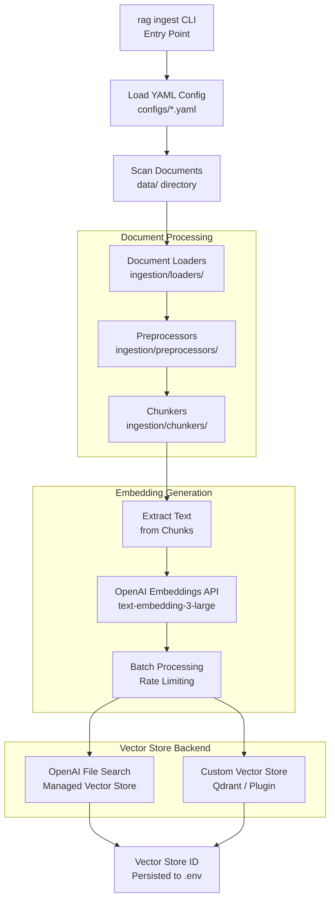
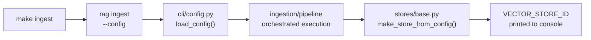
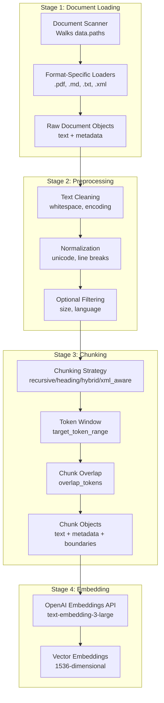
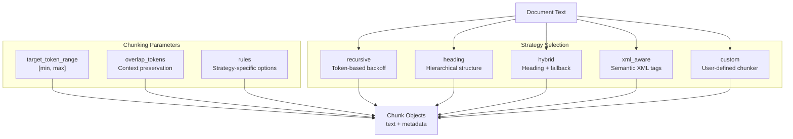
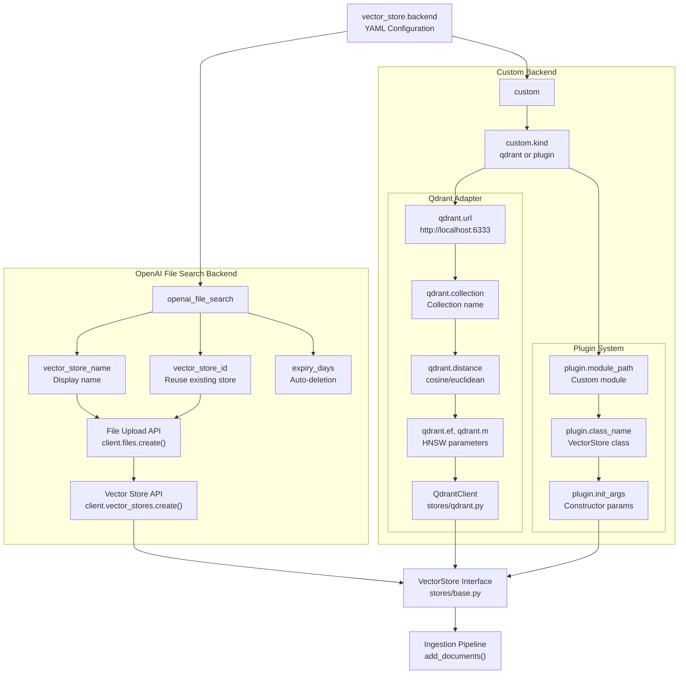
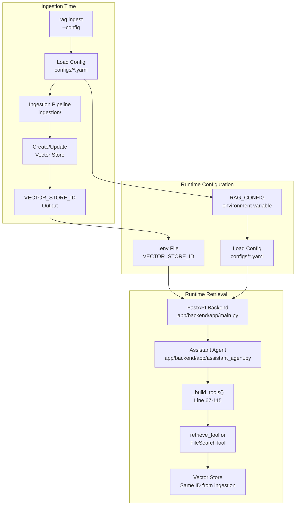

<!-- source: DeepWiki mcp.deepwiki.com · repo openai/openai-knowledge-retrieval · page 6.2 Data Ingestion · fetched 2026-10-26 -->

# Data Ingestion

<details>
<summary>Relevant source files</summary>

The following files were used as context for generating this wiki page:

- [Makefile](Makefile)
- [README.md](README.md)
- [app/backend/app/assistant_agent.py](app/backend/app/assistant_agent.py)

</details>


## Purpose and Scope

This document describes the data ingestion process in the OpenAI Knowledge Retrieval system. Ingestion is the process of loading documents, chunking them into retrievable units, generating embeddings, and storing them in a vector database. This is a prerequisite step before the system can answer user queries.

For information about the RAG pipeline architecture and how ingestion fits into the overall system, see [Architecture](#3). For details on retrieval and query processing, see [RAG Pipeline](#3.4). For evaluation of retrieval quality, see [Evaluation System](#6.3).

**Sources:** [README.md:1-308]()

---

## Ingestion Workflow Overview

The ingestion workflow transforms raw documents into searchable vector embeddings through a multi-stage pipeline. The process is initiated via the `rag ingest` CLI command and controlled by YAML configuration files.

### End-to-End Ingestion Flow



**Sources:** [README.md:116-124](), [Makefile:31-32]()

---

## Command Line Interface

### The `rag ingest` Command

The ingestion process is triggered through the `rag ingest` CLI command. This command reads a configuration file, processes documents, and populates the vector store.

```bash
# Basic usage with default configuration
make ingest

# Equivalent direct invocation
rag ingest --config configs/default.openai.yaml

# Using a custom configuration
rag ingest --config configs/my-custom.yaml
```

The Makefile provides a convenient wrapper that uses the default configuration path defined in [Makefile:31-32]().

### Command Flow



The command flow starts with the Makefile target, invokes the Typer-based CLI in `cli/`, loads configuration via `load_config()`, orchestrates the ingestion pipeline in `ingestion/`, and creates the appropriate vector store adapter via `make_store_from_config()`.

**Sources:** [Makefile:31-32](), [README.md:116-124](), [README.md:54-66]()

---

## Data Processing Pipeline

The ingestion pipeline consists of four main stages: document loading, preprocessing, chunking, and embedding generation. Each stage is configurable through the YAML configuration file.

### Pipeline Architecture



**Sources:** [README.md:54-66](), [README.md:166-183]()

### Configuration Mapping

| Pipeline Stage | Configuration Key | Location | Purpose |
|---|---|---|---|
| Document Loading | `data.paths` | Top level | Directories/files to ingest |
| Format Detection | `data.file_types` | Top level | Allowed extensions (pdf, md, txt, xml) |
| Preprocessing | `preprocessing` | Top level | Text cleaning and normalization rules |
| Chunking Strategy | `chunking.strategy` | Top level | Algorithm selection (recursive, heading, etc.) |
| Token Window | `chunking.target_token_range` | Top level | [min, max] tokens per chunk |
| Overlap | `chunking.overlap_tokens` | Top level | Tokens shared between chunks |
| Embedding Model | `embedding.model` | Top level | OpenAI model identifier |
| Vector Store | `vector_store.backend` | Top level | openai_file_search or custom |

**Sources:** [README.md:166-209]()

---

## Chunking Strategies

Chunking is the process of splitting documents into retrievable units. The system supports five built-in strategies, each optimized for different document structures.

### Strategy Overview



### Strategy Details

#### 1. Recursive Chunking
Recursively reduces chunk size by backing off from headings → paragraphs → sentences → tokens until the target window is reached.

**Configuration:**
```yaml
chunking:
  strategy: recursive
  target_token_range: [300, 500]
  overlap_tokens: 50
```

#### 2. Heading-Based Chunking
Uses document structure (Markdown `#`, ALL CAPS headings, numbered headings) to maintain semantic coherence.

**Configuration:**
```yaml
chunking:
  strategy: heading
  target_token_range: [300, 500]
  overlap_tokens: 50
  rules:
    detect_markdown_headings: true
    detect_caps_headings: true
```

#### 3. Hybrid Chunking (Default)
Attempts heading-based chunking first, falls back to recursive when structural markers are absent.

**Configuration:**
```yaml
chunking:
  strategy: hybrid
  target_token_range: [300, 500]
  overlap_tokens: 50
```

#### 4. XML-Aware Chunking
Purpose-built for XML/HTML documents. Splits on semantic tags (chapters, sections) and converts tables to Markdown.

**Configuration:**
```yaml
chunking:
  strategy: xml_aware
  target_token_range: [300, 500]
  overlap_tokens: 50
  rules:
    split_tags: ["chapter", "section", "subsection"]
    convert_tables: true
```

#### 5. Custom Chunking
Load a user-defined chunker class via module path.

**Configuration:**
```yaml
chunking:
  strategy: custom
  target_token_range: [300, 500]
  overlap_tokens: 50
  custom_chunker:
    module_path: my_package.chunkers
    class_name: MyCustomChunker
    init_args:
      param1: value1
```

**Sources:** [README.md:166-183]()

---

## Vector Store Backends

The ingestion system supports two vector store backend modes: OpenAI File Search (managed) and custom vector stores (self-hosted).

### Backend Selection Architecture



**Sources:** [README.md:184-209](), [app/backend/app/assistant_agent.py:68-115]()

### OpenAI File Search Configuration

OpenAI File Search is a fully managed vector store that handles file uploads, deduplication, and metadata management.

**Configuration Example:**
```yaml
vector_store:
  backend: openai_file_search
  openai_file_search:
    vector_store_name: "My Knowledge Base"
    vector_store_id: "vs_abc123"  # Optional: reuse existing
    expiry_days: 7
    chunking:
      max_chunk_size_tokens: 800
      chunk_overlap_tokens: 400
```

**Key Configuration Fields:**
- `vector_store_name`: Display name for the store
- `vector_store_id`: Reuse an existing vector store instead of creating a new one
- `expiry_days`: Automatic deletion after N days (optional)
- `chunking.max_chunk_size_tokens`: Maximum tokens per chunk (OpenAI's internal chunking)
- `chunking.chunk_overlap_tokens`: Overlap between chunks

The system creates or reuses a vector store via the OpenAI API, then uploads documents which are automatically chunked, embedded, and indexed.

**Sources:** [README.md:186-191](), [app/backend/app/assistant_agent.py:71-83]()

### Custom Vector Store (Qdrant)

The included Qdrant adapter provides a self-hosted alternative with fine-grained control over indexing parameters.

**Configuration Example:**
```yaml
vector_store:
  backend: custom
  custom:
    kind: qdrant
    qdrant:
      url: "http://localhost:6333"
      collection: "knowledge_base"
      distance: cosine
      ef: 64  # HNSW construction parameter
      m: 32   # HNSW construction parameter
```

**Starting Qdrant:**
```bash
make qdrant-up  # Starts Docker container on port 6333
```

**Key Configuration Fields:**
- `url`: Qdrant server endpoint
- `collection`: Collection name (created if doesn't exist)
- `distance`: Distance metric (cosine, euclidean, dot)
- `ef`: HNSW index construction ef parameter (higher = more accurate, slower)
- `m`: HNSW index M parameter (number of bi-directional links)

The Qdrant adapter is implemented in `stores/qdrant.py` and provides the `VectorStore` interface for ingestion and retrieval.

**Sources:** [README.md:192-205](), [Makefile:25-29](), [README.md:109-114]()

### Plugin System

For custom vector stores not covered by built-in adapters, use the plugin system:

**Configuration Example:**
```yaml
vector_store:
  backend: custom
  custom:
    kind: plugin
    plugin:
      module_path: my_package.stores
      class_name: MyVectorStore
      init_args:
        endpoint: "https://my-db.example.com"
        api_key: "${MY_DB_API_KEY}"
```

The plugin class must implement the `VectorStore` interface defined in `stores/base.py`.

**Sources:** [README.md:207-209]()

---

## Embedding Generation

The ingestion pipeline uses OpenAI's embedding models to convert text chunks into vector representations. Embeddings are generated via the OpenAI Embeddings API after chunking is complete.

### Embedding Pipeline


### Configuration

```yaml
embedding:
  model: text-embedding-3-large
  dimensions: 1536  # Optional: reduce dimensions
  batch_size: 100   # Chunks per API call
```

**Default Model:** `text-embedding-3-large` (1536 dimensions)

The embedding model can be customized in the configuration file. The system handles API rate limiting, retry logic, and batch processing automatically during ingestion.

**Sources:** [README.md:54-66]()

---

## Ingestion Outputs

### Vector Store ID

Upon successful ingestion, the system prints the `VECTOR_STORE_ID` to the console:

```
Vector store created: vs_abc123def456
Ingested 42 documents, 387 chunks
Add this to your .env file:
VECTOR_STORE_ID=vs_abc123def456
```

This ID should be added to the `.env` file to enable retrieval:

```bash
echo "VECTOR_STORE_ID=vs_abc123def456" >> .env
```

The backend reads this environment variable when initializing the retrieval system. The vector store ID is used by the assistant agent to configure retrieval tools as shown in [app/backend/app/assistant_agent.py:72-76]().

### Metadata Persistence

Ingestion also generates metadata files:

- **Document metadata:** Information about ingested files (titles, paths, sizes)
- **Chunk statistics:** Token counts, overlap analysis
- **Embedding metadata:** Model version, dimensions, timestamps

This metadata is used during retrieval for citation generation and document serving.

**Sources:** [README.md:116-124](), [app/backend/app/assistant_agent.py:72-83]()

---

## Configuration File Structure

The ingestion process is controlled by a YAML configuration file. Use `rag init` to generate a template:

```bash
# Generate OpenAI File Search configuration
rag init --template openai > configs/my.openai.yaml

# Generate Qdrant configuration
rag init --template custom-qdrant > configs/my.qdrant.yaml

# Generate with specific chunking strategy
rag init --template openai --chunking heading > configs/my.heading.yaml
```

### Complete Configuration Example

```yaml
# Data sources
data:
  paths:
    - data/docs/
    - data/manuals/
  file_types: [pdf, md, txt, xml]

# Preprocessing
preprocessing:
  clean_whitespace: true
  normalize_unicode: true
  
# Chunking strategy
chunking:
  strategy: hybrid
  target_token_range: [300, 500]
  overlap_tokens: 50
  rules:
    detect_markdown_headings: true

# Embedding configuration
embedding:
  model: text-embedding-3-large
  dimensions: 1536

# Vector store backend
vector_store:
  backend: openai_file_search
  openai_file_search:
    vector_store_name: "My Knowledge Base"
    expiry_days: 7
    chunking:
      max_chunk_size_tokens: 800
      chunk_overlap_tokens: 400

# Environment variable defaults
env:
  OPENAI_API_KEY: sk-...
  VECTOR_STORE_ID: vs_...
```

**Sources:** [README.md:96-107](), [README.md:151-239]()

---

## Common Ingestion Workflows

### Workflow 1: Initial Ingestion with OpenAI File Search

```bash
# 1. Set up configuration
rag init --template openai > configs/my-project.yaml

# 2. Edit data.paths to point to your documents
# Edit configs/my-project.yaml

# 3. Run ingestion
rag ingest --config configs/my-project.yaml

# 4. Save the vector store ID
echo "VECTOR_STORE_ID=vs_xyz" >> .env

# 5. Start the backend to enable retrieval
make run-app-backend
```

### Workflow 2: Self-Hosted Qdrant Ingestion

```bash
# 1. Start Qdrant container
make qdrant-up

# 2. Generate Qdrant configuration
rag init --template custom-qdrant > configs/my-qdrant.yaml

# 3. Edit configuration
# Set data.paths and qdrant.collection in configs/my-qdrant.yaml

# 4. Run ingestion
rag ingest --config configs/my-qdrant.yaml

# 5. Start backend
make run-app-backend
```

### Workflow 3: Re-ingestion with Updated Documents

```bash
# 1. Update documents in data/ directory

# 2. Re-run ingestion (reuses existing vector store ID)
rag ingest --config configs/my-project.yaml

# 3. Restart backend to pick up changes
make stop-app-backend
make run-app-backend
```

**Sources:** [README.md:12-42](), [README.md:109-114]()

---

## Ingestion and Retrieval Integration

The ingestion process populates the vector store that the assistant agent uses during retrieval. The connection between ingestion and runtime retrieval is established through configuration and environment variables.

### Configuration Flow



The `_build_tools()` function in [app/backend/app/assistant_agent.py:67-115]() reads the same configuration file used during ingestion to determine which vector store backend to use. For OpenAI File Search, it reads `VECTOR_STORE_ID` from the environment [app/backend/app/assistant_agent.py:72-76](). For custom stores, it instantiates the same store adapter using `make_store_from_config()` [app/backend/app/assistant_agent.py:85]().

**Sources:** [app/backend/app/assistant_agent.py:33-115](), [README.md:127-141]()

---

## Troubleshooting

### Common Issues

| Issue | Cause | Solution |
|---|---|---|
| `OPENAI_API_KEY not found` | Missing API key | Add to `.env` file: `OPENAI_API_KEY=sk-...` |
| `No documents found in data/` | Empty or missing directory | Place documents in `data/` or update `data.paths` in config |
| `Qdrant connection refused` | Qdrant not running | Run `make qdrant-up` to start Docker container |
| `Rate limit exceeded` | Too many API calls | Reduce batch size or add delays in config |
| `Vector store ID not found` | Missing environment variable | Add `VECTOR_STORE_ID=vs_...` to `.env` after ingestion |
| `Chunking produces empty chunks` | Token range too restrictive | Increase `target_token_range` max value |
| `Out of memory` | Large documents | Enable streaming or reduce batch size |

### Validation

After ingestion, verify success:

```bash
# Check vector store was created
cat .env | grep VECTOR_STORE_ID

# For Qdrant, check collection exists
curl http://localhost:6333/collections/knowledge_base

# Start backend and test retrieval
make run-app-backend
# Open http://localhost:8002/knowledge/health
```

**Sources:** [README.md:83-94](), [Makefile:25-29]()

---

