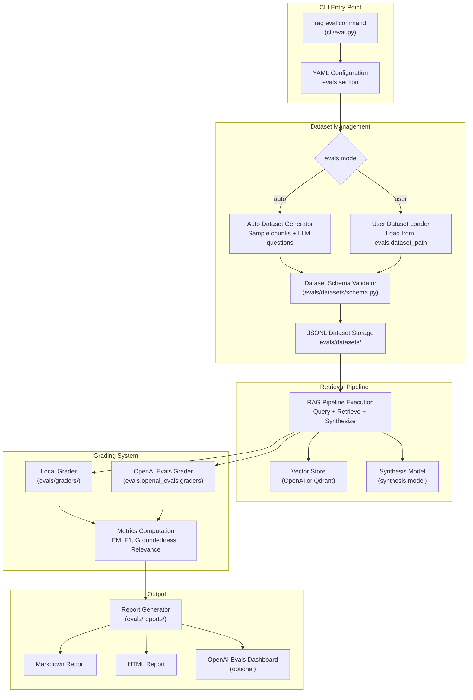
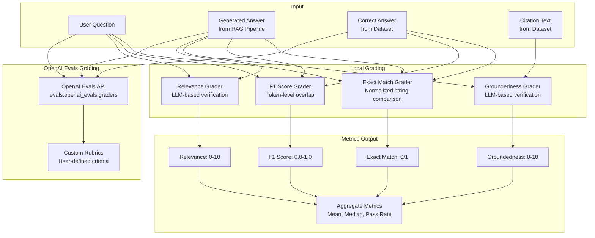
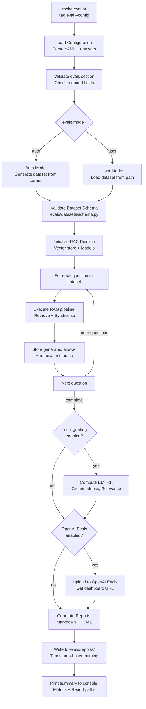

<!-- source: DeepWiki mcp.deepwiki.com · repo openai/openai-knowledge-retrieval · page 6.3 Evaluation System · fetched 2026-10-26 -->

# Evaluation System

<details>
<summary>Relevant source files</summary>

The following files were used as context for generating this wiki page:

- [Makefile](Makefile)
- [README.md](README.md)

</details>


## Purpose and Scope

The Evaluation System provides a comprehensive harness for assessing retrieval quality and answer accuracy in the knowledge retrieval pipeline. This system supports both synthetic dataset generation and manual evaluation datasets, with optional integration to OpenAI's Evals platform for hosted grading and visualization. The evaluation workflow includes dataset creation, retrieval testing, answer grading, and report generation.

For information about data ingestion into the vector store, see [Data Ingestion](#6.2). For general CLI command usage, see [CLI Commands Overview](#6.1).

---

## System Architecture

The evaluation system consists of four main components: dataset management, retrieval execution, grading pipeline, and report generation. The system is invoked through the `rag eval` CLI command and configured via YAML files.



**Sources:** README.md:252-286, Makefile:37-38, README.md:56-65

---

## Evaluation Modes

The evaluation system operates in two distinct modes controlled by the `evals.mode` configuration parameter.

### Auto Mode

Auto mode synthesizes evaluation datasets from the ingested corpus. This approach:

1. Samples chunks from the vector store
2. Generates realistic user questions via LLM prompting
3. Stores generated questions with their source chunks as ground truth
4. Enables rapid coverage expansion without manual curation

**Configuration:**
```yaml
evals:
  mode: auto
  auto_generation:
    model: gpt-4o
    num_questions: 100
    sampling_strategy: diverse
```

The dataset generation process creates JSONL files under `evals/datasets/` that can be reused or expanded in subsequent runs.

### User Mode

User mode loads a manually curated dataset from a specified path. This approach enables:

- Precise control over evaluation scenarios
- Domain-specific question targeting
- Reproducible benchmarking across system changes
- Custom difficulty levels and tagging

**Configuration:**
```yaml
evals:
  mode: user
  dataset_path: evals/datasets/my_custom_eval.jsonl
```

**Sources:** README.md:256-276, README.md:144-149

---

## Dataset Schema

Evaluation datasets follow a structured JSONL format defined in `evals/datasets/schema.py`. Each record represents a single evaluation case.

### Required Fields

| Field | Type | Description |
|-------|------|-------------|
| `id` | string | Unique identifier for the evaluation case |
| `question` | string | User query to be evaluated |
| `citation_text` | string | Supporting passage for groundedness validation |
| `correct_answer` | string | Ideal answer for EM/F1 scoring |

### Optional Metadata Fields

| Field | Type | Description |
|-------|------|-------------|
| `source_id` | string | Document identifier where citation originates |
| `page` | integer | Page number within source document |
| `char_start` | integer | Character offset of citation start |
| `char_end` | integer | Character offset of citation end |
| `difficulty` | string | Difficulty level (easy, medium, hard) |
| `tags` | array | Classification tags for filtering and analysis |

### Example Record

```json
{
  "id": "eval_001",
  "question": "What are the prerequisites for installation?",
  "citation_text": "Python 3.10 or later, Node.js 18.18 or later, and an OpenAI API key",
  "correct_answer": "Python 3.10+, Node.js 18.18+, OpenAI API key",
  "source_id": "README.md",
  "difficulty": "easy",
  "tags": ["setup", "prerequisites"]
}
```

The CLI validates all fields before execution and canonicalizes answers internally for consistent scoring.

**Sources:** README.md:268-275

---

## Grading Pipeline

The grading pipeline evaluates both retrieval quality and answer accuracy through multiple metrics. The system supports local grading and optional OpenAI Evals platform integration.



### Grading Metrics

**Exact Match (EM):** Binary metric indicating whether the generated answer exactly matches the correct answer after normalization (lowercasing, whitespace removal).

**F1 Score:** Token-level precision and recall measuring overlap between generated and correct answers. Computed as:
- Precision = (tokens in both) / (tokens in generated)
- Recall = (tokens in both) / (tokens in correct)
- F1 = 2 × (Precision × Recall) / (Precision + Recall)

**Groundedness:** LLM-based scoring (0-10) evaluating whether the generated answer is supported by the citation text. Uses prompts from `prompts/` directory.

**Relevance:** LLM-based scoring (0-10) evaluating whether the generated answer addresses the user question appropriately.

**Sources:** README.md:252-286

---

## OpenAI Evals Integration

When `evals.openai_evals.enabled: true`, the system mirrors evaluation runs to the OpenAI Evals hosted platform, enabling dashboard visualization and team collaboration.

### Configuration

```yaml
evals:
  openai_evals:
    enabled: true
    graders:
      - groundedness
      - relevance
      - custom_rubric_name
    run_name: "v1.2_with_reranking"
    organization_id: org-xxxxx  # optional override
    project_id: proj-xxxxx      # optional override
```

### Grader Types

| Grader | Description |
|--------|-------------|
| `groundedness` | Validates answer support from retrieved context |
| `relevance` | Validates answer alignment with user question |
| `custom` | User-defined rubrics with specific criteria |

### Synchronization Process

1. Local evaluation completes with full metrics
2. Results are formatted for OpenAI Evals API
3. Dataset and run metadata are uploaded
4. Platform returns dashboard URL for visualization
5. Local reports include link to hosted results

The system creates a new eval run for each execution, preserving historical comparisons across configuration changes.

**Sources:** README.md:278-286

---

## Execution Workflow

### Command Line Invocation

Execute evaluations using the `rag eval` command with a configuration file:

```bash
# Using Makefile wrapper
make eval

# Direct CLI invocation
rag eval --config configs/default.openai.yaml

# With specific dataset
rag eval --config configs/custom.yaml --dataset evals/datasets/my_test.jsonl
```

The command reads configuration from the specified YAML file, loads or generates the dataset, executes the RAG pipeline for each question, and produces comprehensive reports.

### Execution Flow



**Sources:** README.md:144-149, Makefile:37-38, README.md:252-286

---

## Report Generation

The evaluation system produces multiple report formats stored in `evals/reports/` with timestamp-based naming for historical tracking.

### Report Types

**Markdown Reports:** Human-readable summary including:
- Aggregate metrics (mean, median, standard deviation)
- Per-question results table with scores
- Configuration snapshot
- Execution metadata (duration, model versions)

**HTML Reports:** Interactive visualization with:
- Sortable tables for per-question analysis
- Metric distribution charts
- Pass/fail categorization
- Expandable details for each evaluation case

**OpenAI Evals Links:** When platform integration is enabled, reports include direct links to the hosted dashboard for team review and annotation.

### Report Structure

| Section | Content |
|---------|---------|
| Summary | Aggregate metrics across all questions |
| Configuration | Snapshot of YAML config used |
| Results | Per-question breakdown with all scores |
| Failures | Questions below threshold with analysis |
| Metadata | Execution time, model versions, dataset info |

### File Naming Convention

Reports use ISO 8601 timestamps to ensure chronological ordering:

```
evals/reports/eval_2024-01-15T14-30-00_v1.2.md
evals/reports/eval_2024-01-15T14-30-00_v1.2.html
```

Re-running evaluations generates new timestamped reports, preserving full evaluation history for comparison and regression detection.

**Sources:** README.md:286, README.md:56-65

---

## Configuration Reference

The evaluation system is configured via the `evals` section of the YAML configuration file.

### Complete Configuration Example

```yaml
evals:
  # Execution mode
  mode: auto  # or 'user'
  
  # Dataset configuration
  dataset_path: evals/datasets/custom_eval.jsonl  # for user mode
  
  # Auto-generation settings
  auto_generation:
    model: gpt-4o
    prompt_path: prompts/question_generation.md
    num_questions: 100
    sampling_strategy: diverse
    chunk_sample_size: 500
  
  # Local grading configuration
  local_grading:
    enabled: true
    groundedness:
      model: gpt-4o-mini
      prompt_path: prompts/judge/groundedness.md
    relevance:
      model: gpt-4o-mini
      prompt_path: prompts/judge/relevance.md
  
  # OpenAI Evals integration
  openai_evals:
    enabled: true
    graders:
      - groundedness
      - relevance
    run_name: "production_baseline"
    organization_id: org-xxxxx
    project_id: proj-xxxxx
  
  # Report generation
  reports:
    output_dir: evals/reports
    formats:
      - markdown
      - html
    include_failures_only: false
```

### Key Configuration Parameters

| Parameter | Type | Default | Description |
|-----------|------|---------|-------------|
| `mode` | string | `auto` | Evaluation mode: `auto` or `user` |
| `dataset_path` | string | - | Path to user-provided dataset (user mode) |
| `auto_generation.model` | string | `gpt-4o` | LLM for question generation |
| `auto_generation.num_questions` | integer | 100 | Number of questions to generate |
| `local_grading.enabled` | boolean | `true` | Enable local grading pipeline |
| `openai_evals.enabled` | boolean | `false` | Enable OpenAI Evals sync |
| `openai_evals.run_name` | string | - | Identifier for dashboard run |
| `reports.output_dir` | string | `evals/reports` | Directory for report output |

**Sources:** README.md:144-149, README.md:252-286

---

