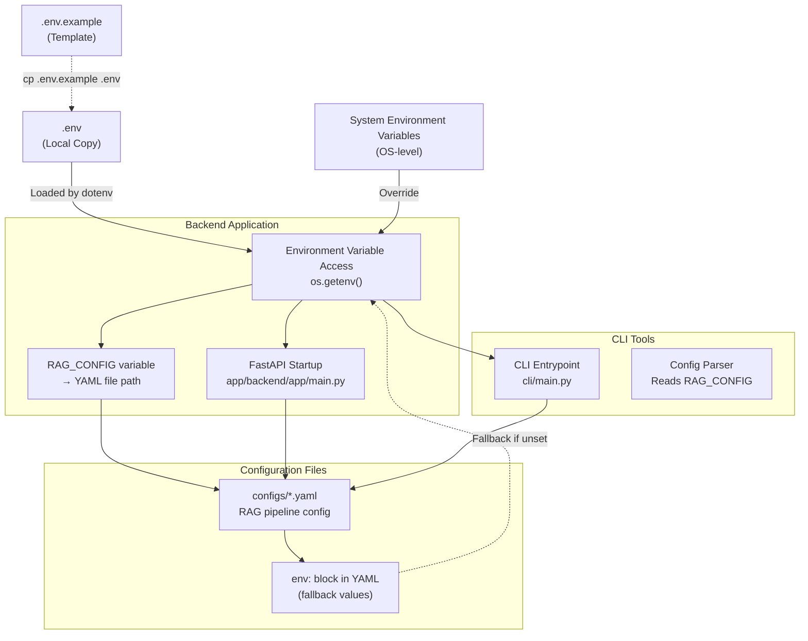
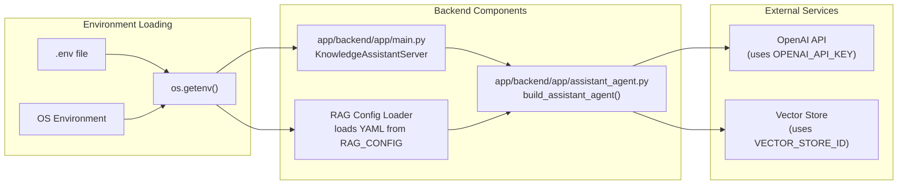

<!-- source: DeepWiki mcp.deepwiki.com · repo openai/openai-knowledge-retrieval · page 7.1 Environment Variables · fetched 2026-10-26 -->

# Environment Variables

<details>
<summary>Relevant source files</summary>

The following files were used as context for generating this wiki page:

- [.env.example](.env.example)
- [README.md](README.md)

</details>


This document provides comprehensive documentation for all environment variables used in the OpenAI Knowledge Retrieval system. Environment variables control API credentials, service configuration, and runtime behavior for both the backend and frontend components.

For information about YAML-based RAG configuration options, see [RAG Configuration Files](#7.2). For vector store-specific settings, see [Vector Store Configuration](#7.3).

## Purpose and Scope

Environment variables serve as the primary mechanism for:
- **Authentication**: OpenAI API credentials and organization identifiers
- **Service Configuration**: Vector store references, CORS policies, and endpoint URLs
- **Configuration File Selection**: Specifying which RAG YAML configuration to load

These variables are loaded at application startup and are distinct from the runtime behavior controlled by YAML configuration files.

**Sources**: [.env.example:1-6](), [README.md:84-93]()

## Environment Variable Overview

The system uses a `.env` file for local development and testing. This file is never committed to version control; developers copy [.env.example:1-6]() to `.env` and populate it with their specific values.

### Configuration Loading Flow



**Diagram**: Environment variable loading and precedence hierarchy showing how `.env` files, system environment variables, and YAML configuration interact.

**Sources**: [.env.example:1-6](), [README.md:84-93]()

## Required Environment Variables

### OPENAI_API_KEY

| Property | Value |
|----------|-------|
| **Type** | String (API key) |
| **Required** | Yes |
| **Format** | `sk-...` (OpenAI API key format) |
| **Used By** | Backend, CLI |

The OpenAI API key authenticates all requests to OpenAI services including:
- GPT model invocations for synthesis, query expansion, HyDE, and reranking
- Embedding generation (e.g., `text-embedding-3-small`)
- File Search API operations
- OpenAI Evals synchronization

**Configuration Location**: Must be set in `.env` or as a system environment variable. Can also be specified as a fallback in the YAML config's `env.OPENAI_API_KEY` field, though this is less secure.

**Example**:
```bash
OPENAI_API_KEY="sk-proj-abc123..."
```

**Sources**: [.env.example:1](), [README.md:23-24](), [README.md:86-93]()

## Optional Environment Variables

### OPENAI_ORG_ID

| Property | Value |
|----------|-------|
| **Type** | String (organization identifier) |
| **Required** | No |
| **Format** | `org-...` |
| **Used By** | Backend, CLI |

Specifies the OpenAI organization ID when your account belongs to multiple organizations. This ensures API requests are billed to and have access to the correct organization's resources.

**When Required**: 
- Multi-organization accounts
- Organization-specific vector stores or file search resources
- Organization-scoped evaluation runs

**Example**:
```bash
OPENAI_ORG_ID="org-XYZ123..."
```

**Sources**: [.env.example:2](), [README.md:90]()

### OPENAI_PROJECT_ID

| Property | Value |
|----------|-------|
| **Type** | String (project identifier) |
| **Required** | No |
| **Format** | `proj-...` |
| **Used By** | Backend, CLI |

Specifies the OpenAI project ID for isolating resources and usage within an organization. Projects provide additional isolation for API keys, usage tracking, and billing.

**When Required**:
- Project-scoped API access
- Project-specific evaluation runs
- Multi-project organizations requiring resource isolation

**Example**:
```bash
OPENAI_PROJECT_ID="proj-ABC789..."
```

**Sources**: [.env.example:3](), [README.md:91]()

### RAG_CONFIG

| Property | Value |
|----------|-------|
| **Type** | String (file path) |
| **Required** | No |
| **Default** | `configs/default.openai.yaml` |
| **Used By** | Backend, CLI |

Path to the YAML configuration file that defines the RAG pipeline behavior. This file controls:
- Chunking strategy and parameters
- Vector store backend selection
- Query processing stages (expansion, HyDE, reranking)
- Synthesis model and prompts
- Evaluation configuration

**Default Behavior**: The backend [app/backend/app/main.py]() defaults to `configs/default.openai.yaml` if `RAG_CONFIG` is not set.

**Example**:
```bash
RAG_CONFIG="configs/my.openai.yaml"
# or
RAG_CONFIG="configs/custom-qdrant.yaml"
```

**Common Patterns**:
- Use different configs for different deployment environments
- Switch between OpenAI File Search and custom vector stores
- Enable/disable query processing stages without code changes

**Sources**: [.env.example:4](), [README.md:106](), [README.md:127]()

### VECTOR_STORE_ID

| Property | Value |
|----------|-------|
| **Type** | String (vector store identifier) |
| **Required** | No (depends on vector store backend) |
| **Format** | `vs-...` (for OpenAI File Search) |
| **Used By** | Backend, CLI |

References an existing OpenAI File Search vector store. When set, the ingestion process reuses this store instead of creating a new one.

**When Required**:
- Using OpenAI File Search backend (`vector_store.backend: openai_file_search`)
- Reusing a vector store across multiple ingestion runs
- Sharing a vector store across environments

**When Not Used**:
- Custom vector store backends (e.g., Qdrant) manage their own identifiers
- First-time ingestion when a new store should be created

**Workflow**:
1. Run `rag ingest` without `VECTOR_STORE_ID` → creates new store, prints ID
2. Set `VECTOR_STORE_ID=vs-...` in `.env`
3. Subsequent `rag ingest` runs update the existing store

**Example**:
```bash
VECTOR_STORE_ID="vs-abc123xyz789"
```

**Sources**: [.env.example:5](), [README.md:92](), [README.md:123]()

### KNOWLEDGE_CORS_ALLOW_ORIGINS

| Property | Value |
|----------|-------|
| **Type** | String (comma-separated URLs) |
| **Required** | No |
| **Default** | `http://localhost:5173,http://127.0.0.1:5173` |
| **Used By** | Backend only |

Configures Cross-Origin Resource Sharing (CORS) policy for the FastAPI backend. Lists allowed origins that can make HTTP requests to the backend API.

**Default Configuration**: Allows the default Vite development server URLs (ports 5173).

**Production Considerations**:
- Set to your production frontend domain(s)
- Remove `localhost` origins in production
- Multiple origins separated by commas (no spaces)

**Example**:
```bash
# Development
KNOWLEDGE_CORS_ALLOW_ORIGINS="http://localhost:5173,http://127.0.0.1:5173"

# Production
KNOWLEDGE_CORS_ALLOW_ORIGINS="https://app.example.com,https://www.example.com"
```

**Sources**: [.env.example:6]()

## Environment Variable Usage Patterns

### Backend Application Integration



**Diagram**: Backend component dependency on environment variables, showing how credentials flow from configuration to external services.

**Sources**: [README.md:127-137]()

### CLI Tool Integration

The `rag` CLI tool accesses environment variables through the same mechanism but uses them for different operations:

| Command | Environment Variables Used | Purpose |
|---------|---------------------------|---------|
| `rag init` | None | Generates YAML config templates |
| `rag ingest` | `OPENAI_API_KEY`, `OPENAI_ORG_ID`, `OPENAI_PROJECT_ID`, `VECTOR_STORE_ID` | Document processing and embedding |
| `rag chat` | `OPENAI_API_KEY`, `OPENAI_ORG_ID`, `OPENAI_PROJECT_ID`, `RAG_CONFIG` | Interactive chat session |
| `rag eval` | `OPENAI_API_KEY`, `OPENAI_ORG_ID`, `OPENAI_PROJECT_ID`, `RAG_CONFIG` | Evaluation execution |

**Sources**: [README.md:98-149]()

## Configuration Precedence

Environment variables follow this precedence order (highest to lowest):

1. **System environment variables** (set via `export` or container orchestration)
2. **`.env` file values** (loaded by dotenv libraries)
3. **YAML config `env` block** (fallback values specified in config files)
4. **Application defaults** (hardcoded in source)

**Example Precedence**:
```yaml
# In configs/my.yaml
env:
  OPENAI_API_KEY: "fallback-key-from-yaml"
  RAG_CONFIG: "configs/default.openai.yaml"
```

If `OPENAI_API_KEY` is set in `.env` or system environment, it overrides the YAML fallback. If not set anywhere, the YAML fallback is used.

**Sources**: [README.md:236-238]()

## Environment Setup Checklist

Use this checklist when setting up a new development or deployment environment:

- [ ] Copy `.env.example` to `.env`
- [ ] Set `OPENAI_API_KEY` with a valid API key
- [ ] (Optional) Set `OPENAI_ORG_ID` if using multi-org account
- [ ] (Optional) Set `OPENAI_PROJECT_ID` if using project isolation
- [ ] (Optional) Set `RAG_CONFIG` if not using `configs/default.openai.yaml`
- [ ] Run initial ingestion: `make ingest`
- [ ] Copy `VECTOR_STORE_ID` from ingestion output to `.env` (if using OpenAI File Search)
- [ ] (Production) Update `KNOWLEDGE_CORS_ALLOW_ORIGINS` with production domains
- [ ] Verify configuration: `make run-app-backend` should start without errors

**Sources**: [README.md:15-42]()

## Security Considerations

### API Key Protection

**Never commit `.env` files to version control.** The repository includes `.env` in `.gitignore` to prevent accidental exposure.

**Best Practices**:
- Use separate API keys for development, staging, and production
- Rotate keys periodically
- Use environment variables in CI/CD rather than storing in config files
- Consider using secret management services (AWS Secrets Manager, HashiCorp Vault) for production

### Environment Variable Exposure

Environment variables are logged at startup for debugging. Ensure:
- Log aggregation systems mask sensitive values
- Error reporting tools (Sentry, etc.) are configured to sanitize environment data
- Production environments use minimal logging

**Sources**: [README.md:84-93]()

## Examples and Common Patterns

### Development Environment

Typical `.env` for local development:
```bash
OPENAI_API_KEY="sk-proj-dev123..."
OPENAI_ORG_ID="org-DevTeam"
OPENAI_PROJECT_ID="proj-KnowledgeRetrieval"
RAG_CONFIG="configs/default.openai.yaml"
VECTOR_STORE_ID="vs-dev789"
KNOWLEDGE_CORS_ALLOW_ORIGINS="http://localhost:5173,http://127.0.0.1:5173"
```

### Production Environment

Typical production configuration (via container environment or secrets):
```bash
OPENAI_API_KEY="sk-proj-prod-xyz..."
OPENAI_ORG_ID="org-Production"
OPENAI_PROJECT_ID="proj-KnowledgeRetrieval-Prod"
RAG_CONFIG="configs/production.openai.yaml"
VECTOR_STORE_ID="vs-prod-abc123"
KNOWLEDGE_CORS_ALLOW_ORIGINS="https://knowledge.example.com"
```

### Qdrant Custom Vector Store

When using Qdrant instead of OpenAI File Search:
```bash
OPENAI_API_KEY="sk-proj-qdrant123..."
RAG_CONFIG="configs/custom-qdrant.yaml"
# VECTOR_STORE_ID is not used for Qdrant
KNOWLEDGE_CORS_ALLOW_ORIGINS="http://localhost:5173"
```

The Qdrant connection details are specified in the YAML config rather than environment variables.

**Sources**: [README.md:108-114](), [README.md:194-208]()

## Troubleshooting

### Common Issues

| Issue | Symptom | Solution |
|-------|---------|----------|
| Missing API key | `401 Unauthorized` from OpenAI | Set `OPENAI_API_KEY` in `.env` |
| Wrong organization | `404 Not Found` for vector store | Verify `OPENAI_ORG_ID` matches vector store owner |
| Config not found | `FileNotFoundError` on startup | Check `RAG_CONFIG` path is correct and file exists |
| CORS errors | Browser console shows CORS policy errors | Add frontend URL to `KNOWLEDGE_CORS_ALLOW_ORIGINS` |
| Vector store not found | Ingestion creates new store each time | Set `VECTOR_STORE_ID` in `.env` after first ingestion |

### Verification Steps

1. **Check environment loading**:
   ```bash
   python -c "import os; print(os.getenv('OPENAI_API_KEY', 'NOT SET'))"
   ```

2. **Verify config file**:
   ```bash
   cat $RAG_CONFIG  # Should display YAML content
   ```

3. **Test API key**:
   ```bash
   rag chat --config $RAG_CONFIG
   # Should start interactive chat without authentication errors
   ```

**Sources**: [README.md:84-93]()

---

