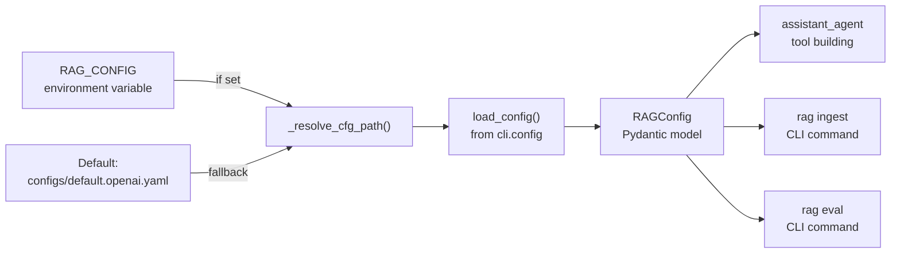
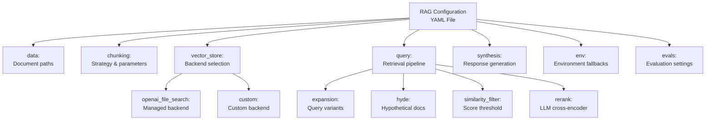
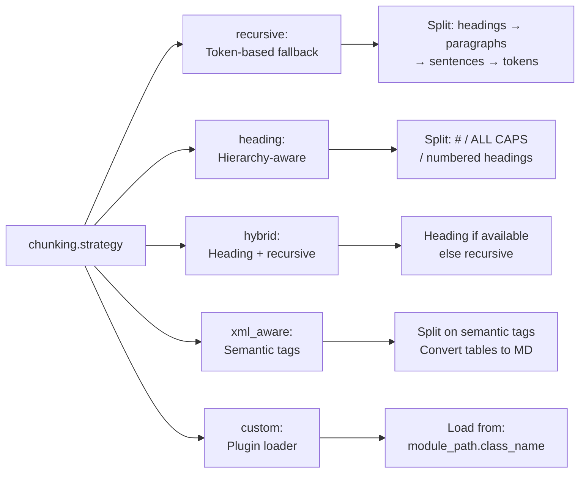
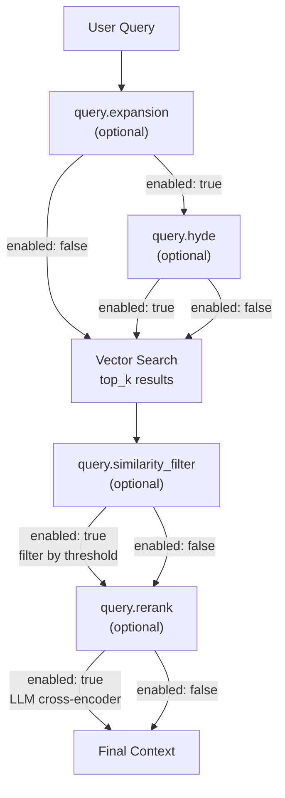
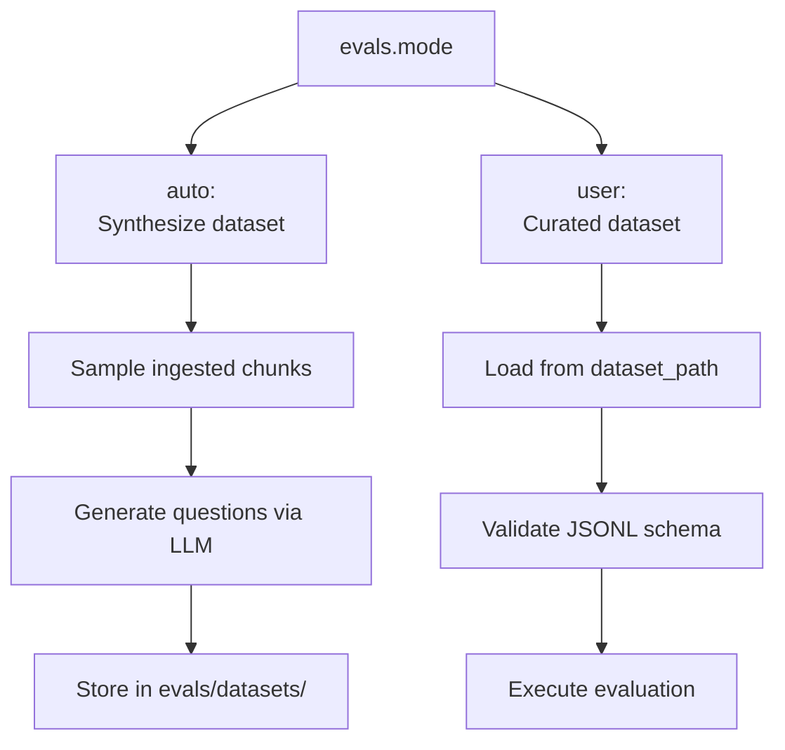
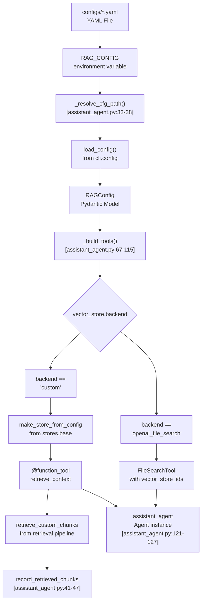

<!-- source: DeepWiki mcp.deepwiki.com · repo openai/openai-knowledge-retrieval · page 7.2 RAG Configuration Files · fetched 2026-10-26 -->

# RAG Configuration Files

<details>
<summary>Relevant source files</summary>

The following files were used as context for generating this wiki page:

- [.env.example](.env.example)
- [README.md](README.md)
- [app/backend/app/assistant_agent.py](app/backend/app/assistant_agent.py)

</details>


## Purpose and Scope

This document describes the YAML configuration files that control the Retrieval Augmented Generation (RAG) pipeline behavior in the OpenAI Knowledge Retrieval system. These configuration files define how documents are chunked, embedded, retrieved, and synthesized into responses without requiring code changes.

For environment variable configuration (API keys, vector store IDs), see [Environment Variables](#7.1). For detailed vector store setup and backends, see [Vector Store Configuration](#7.3). For information about the ingestion process that uses these configurations, see [Data Ingestion](#6.2).

---

## Configuration File Location and Loading

RAG configuration files are YAML documents stored in the `configs/` directory. The active configuration is specified via the `RAG_CONFIG` environment variable, which defaults to `configs/default.openai.yaml`.

```
RAG_CONFIG="configs/default.openai.yaml"
```

The configuration path can be absolute or relative to the project root. The backend resolves the path at runtime in [app/backend/app/assistant_agent.py:33-38]().

### Configuration Resolution Flow



**Sources:** [app/backend/app/assistant_agent.py:33-38](), [.env.example:4](), [README.md:127]()

---

## Configuration Templates

The system provides pre-built templates that can be initialized using the `rag init` command. Templates define complete pipeline configurations optimized for specific backends and use cases.

### Available Templates

| Template | Backend | Description | Use Case |
|----------|---------|-------------|----------|
| `openai` | OpenAI File Search | Managed vector store with automatic chunking | Quick setup, minimal configuration |
| `custom-qdrant` | Qdrant | Self-hosted vector database with full control | Custom retrieval, local deployment |

Templates can be combined with chunking strategies using the `--chunking` flag:

```bash
rag init --template openai --chunking recursive > configs/my.openai.yaml
```

**Sources:** [README.md:97-104](), [README.md:156-164]()

---

## Configuration Structure Overview

RAG configuration files are organized into logical sections that control different stages of the pipeline:



**Sources:** [README.md:151-239]()

---

## Data Configuration

The `data` section specifies the document sources for ingestion. Paths can be individual files or directories that will be recursively scanned.

### Data Configuration Options

| Field | Type | Description | Example |
|-------|------|-------------|---------|
| `paths` | List[str] | File or directory paths to ingest | `["data/example_data/"]` |

### Example Configuration

```yaml
data:
  paths:
    - data/example_data/
    - data/additional_docs/
    - data/specific_file.pdf
```

The ingestion pipeline processes all files matching supported extensions (`.txt`, `.md`, `.pdf`, etc.) from the specified paths.

**Sources:** [README.md:103-104]()

---

## Chunking Configuration

The `chunking` section controls how documents are split into processable segments. Different strategies optimize for document structure, semantic coherence, or specific formats.

### Chunking Strategies



### Chunking Parameters

| Parameter | Type | Description | Default |
|-----------|------|-------------|---------|
| `strategy` | str | Chunking strategy name | `"hybrid"` |
| `target_token_range` | [int, int] | Min and max tokens per chunk | `[100, 512]` |
| `overlap_tokens` | int | Token overlap between chunks | `50` |
| `rules` | Dict | Strategy-specific options | `{}` |

### OpenAI File Search Chunking

For `vector_store.backend: openai_file_search`, additional parameters are available:

| Parameter | Type | Description | Default |
|-----------|------|-------------|---------|
| `max_chunk_size_tokens` | int | Maximum chunk size for File Search | `800` |
| `chunk_overlap_tokens` | int | Overlap for File Search chunks | `400` |

### Custom Chunker Configuration

```yaml
chunking:
  strategy: custom
  custom_chunker:
    module_path: "my_project.chunkers"
    class_name: "MyCustomChunker"
    init_args:
      special_param: 42
```

**Sources:** [README.md:166-183](), [README.md:189-191]()

---

## Vector Store Configuration

The `vector_store` section selects and configures the vector database backend. This section is documented in detail in [Vector Store Configuration](#7.3).

### Backend Selection

| Backend Value | Description | Configuration Section |
|---------------|-------------|----------------------|
| `openai_file_search` | OpenAI managed vector store | `vector_store.openai_file_search` |
| `custom` | Custom vector store adapter | `vector_store.custom` |

### OpenAI File Search Options

```yaml
vector_store:
  backend: openai_file_search
  openai_file_search:
    vector_store_name: "my-knowledge-base"
    vector_store_id: "vs_abc123"  # Optional: reuse existing
    expiry_days: 7
```

### Custom Vector Store Options

```yaml
vector_store:
  backend: custom
  custom:
    kind: qdrant
    qdrant:
      url: "http://localhost:6333"
      collection: "my_collection"
      distance: cosine
      ef: 64
      m: 32
```

**Sources:** [README.md:184-209](), [app/backend/app/assistant_agent.py:68-115]()

---

## Query and Retrieval Pipeline Configuration

The `query` section configures four optional retrieval enhancement stages: query expansion, HyDE generation, similarity filtering, and reranking. These stages transform and filter retrieved results before synthesis.

### Retrieval Pipeline Flow



### Query Expansion Configuration

Query expansion generates alternative phrasings of the user's query to improve recall.

| Field | Type | Description | Default |
|-------|------|-------------|---------|
| `enabled` | bool | Enable query expansion | `false` |
| `model` | str | LLM model for expansion | `"gpt-4o-mini"` |
| `prompt_path` | str | Path to expansion prompt | `"prompts/expansion/default.md"` |
| `variants` | int | Number of query variants | `3` |
| `style` | str | Expansion style | `"diverse"` |

### HyDE (Hypothetical Document Embeddings) Configuration

HyDE generates synthetic passages that answer the query, which are embedded alongside the original query.

| Field | Type | Description | Default |
|-------|------|-------------|---------|
| `enabled` | bool | Enable HyDE | `false` |
| `model` | str | LLM model for generation | `"gpt-4o-mini"` |
| `prompt_path` | str | Path to HyDE prompt | `"prompts/hyde/default.md"` |

### Similarity Filter Configuration

Filters out low-scoring results before reranking.

| Field | Type | Description | Default |
|-------|------|-------------|---------|
| `enabled` | bool | Enable similarity filtering | `false` |
| `threshold` | float | Minimum similarity score (0-1) | `0.7` |

### Reranking Configuration

Applies an LLM-based cross-encoder to reorder retrieved chunks by relevance.

| Field | Type | Description | Default |
|-------|------|-------------|---------|
| `enabled` | bool | Enable reranking | `false` |
| `model` | str | LLM model for reranking | `"gpt-4o-mini"` |
| `prompt_path` | str | Path to rerank prompt | `"prompts/rerank/default.md"` |
| `max_candidates` | int | Maximum chunks to rerank | `20` |
| `score_threshold` | float | Minimum rerank score | `0.0` |

### Top-K Configuration

| Field | Type | Description | Default |
|-------|------|-------------|---------|
| `top_k` | int | Maximum results to retrieve | `8` |

### Example Query Configuration

```yaml
query:
  top_k: 10
  expansion:
    enabled: true
    model: "gpt-4o-mini"
    variants: 3
  hyde:
    enabled: false
  similarity_filter:
    enabled: true
    threshold: 0.75
  rerank:
    enabled: true
    model: "gpt-4o-mini"
    max_candidates: 20
```

**Sources:** [README.md:210-224](), [app/backend/app/assistant_agent.py:81-82]()

---

## Synthesis Configuration

The `synthesis` section controls how retrieved context is combined with conversation history to generate responses.

### Synthesis Configuration Options

| Field | Type | Description | Default |
|-------|------|-------------|---------|
| `model` | str | Response generation model | `"gpt-4o-mini"` |
| `system_prompt` | str | Inline prompt or file path | `"prompts/system/assistant.md"` |
| `structured_outputs` | bool | Enable schema-based responses | `false` |
| `reasoning_effort` | str | Model reasoning effort hint | `"medium"` |

### Model Selection

Supported model values include:
- `"gpt-4o-mini"` - Fast, cost-effective
- `"gpt-4o"` - Higher quality
- `"gpt-5-mini"` - Latest mini model
- `"o4-mini-high"` - Extended reasoning

### System Prompt Configuration

The system prompt can be specified inline or as a file path:

```yaml
synthesis:
  model: "gpt-4o-mini"
  system_prompt: |
    You are a helpful assistant that answers questions
    based on the provided context. Always cite your sources.
```

Or reference a file:

```yaml
synthesis:
  system_prompt: "prompts/system/custom_assistant.md"
```

The default system prompt is loaded from [prompts/system/assistant.md]() and stored in the `KNOWLEDGE_ASSISTANT_INSTRUCTIONS` constant in [app/backend/app/assistant_agent.py:25-30]().

### Reasoning Effort

| Value | Description |
|-------|-------------|
| `"low"` | Minimal reasoning, fastest |
| `"medium"` | Balanced reasoning and speed |
| `"high"` | Extended reasoning, slower |

**Sources:** [README.md:225-234](), [app/backend/app/assistant_agent.py:25-30](), [app/backend/app/assistant_agent.py:117-127]()

---

## Environment Fallbacks

The `env` section provides default values for credentials and identifiers that can be overridden by actual environment variables. This allows configuration files to be more self-contained while still supporting secure credential management.

### Environment Fallback Options

| Field | Type | Description | Environment Variable |
|-------|------|-------------|---------------------|
| `OPENAI_API_KEY` | str | OpenAI API key default | `OPENAI_API_KEY` |
| `OPENAI_PROJECT_ID` | str | OpenAI project ID | `OPENAI_PROJECT_ID` |
| `OPENAI_ORG_ID` | str | OpenAI organization ID | `OPENAI_ORG_ID` |
| `VECTOR_STORE_ID` | str | Vector store identifier | `VECTOR_STORE_ID` |

Actual environment variables take precedence over values specified in the `env` block.

### Example Configuration

```yaml
env:
  OPENAI_API_KEY: ""  # Set via environment variable
  VECTOR_STORE_ID: "vs_abc123"  # Fallback if not in environment
```

**Sources:** [README.md:235-239](), [.env.example:1-6]()

---

## Evaluation Configuration

The `evals` section configures the evaluation harness for testing retrieval quality. For detailed information about running evaluations, see [Evaluation System](#6.3).

### Evaluation Configuration Options

| Field | Type | Description | Default |
|-------|------|-------------|---------|
| `mode` | str | `"auto"` or `"user"` | `"auto"` |
| `dataset_path` | str | Path to JSONL dataset (user mode) | `null` |
| `openai_evals.enabled` | bool | Mirror to OpenAI Evals | `false` |
| `openai_evals.graders` | List[str] | Grader types to apply | `["groundedness", "relevance"]` |
| `openai_evals.run_name` | str | Friendly name for dashboard | `null` |
| `openai_evals.organization_id` | str | Override organization | `null` |
| `openai_evals.project_id` | str | Override project | `null` |

### Evaluation Modes



### OpenAI Evals Integration

When `openai_evals.enabled: true`, results are synchronized to the hosted OpenAI Evals platform:

```yaml
evals:
  mode: auto
  openai_evals:
    enabled: true
    graders:
      - groundedness
      - relevance
    run_name: "my-eval-run"
```

**Sources:** [README.md:252-286]()

---

## Configuration Usage in Code

The configuration system is implemented using Pydantic models that validate and type-check all settings. The configuration flows from YAML files through several key code paths.

### Configuration Loading and Agent Tool Building



### Key Code Components

| Component | Location | Purpose |
|-----------|----------|---------|
| `_resolve_cfg_path()` | [app/backend/app/assistant_agent.py:33-38]() | Resolves config path from environment or default |
| `load_config()` | `cli.config` module | Parses YAML into Pydantic model |
| `_build_tools()` | [app/backend/app/assistant_agent.py:67-115]() | Constructs agent tools based on vector store backend |
| `FileSearchTool` | [app/backend/app/assistant_agent.py:79-82]() | OpenAI File Search integration |
| `retrieve_context` | [app/backend/app/assistant_agent.py:87-111]() | Custom vector store retrieval function |
| `record_retrieved_chunks()` | [app/backend/app/assistant_agent.py:41-47]() | Caches chunks for citation extraction |
| `assistant_agent` | [app/backend/app/assistant_agent.py:121-127]() | Global agent instance initialized with tools |

### Backend-Specific Configuration Usage

The configuration's `vector_store.backend` field determines which retrieval tool is built:

**OpenAI File Search Backend:**
- Reads `VECTOR_STORE_ID` from environment ([assistant_agent.py:72]())
- Falls back to `vector_store.openai_file_search.vector_store_id` from config ([assistant_agent.py:73-76]())
- Constructs `FileSearchTool` with `max_num_results` from `query.top_k` ([assistant_agent.py:79-82]())

**Custom Backend:**
- Instantiates store via `make_store_from_config()` ([assistant_agent.py:85]())
- Wraps `retrieve_custom_chunks()` in a `@function_tool` decorator ([assistant_agent.py:87-111]())
- Records retrieved chunks in thread-local cache for citation extraction ([assistant_agent.py:110]())

**Sources:** [app/backend/app/assistant_agent.py:33-38](), [app/backend/app/assistant_agent.py:67-115](), [app/backend/app/assistant_agent.py:121-127]()

---

