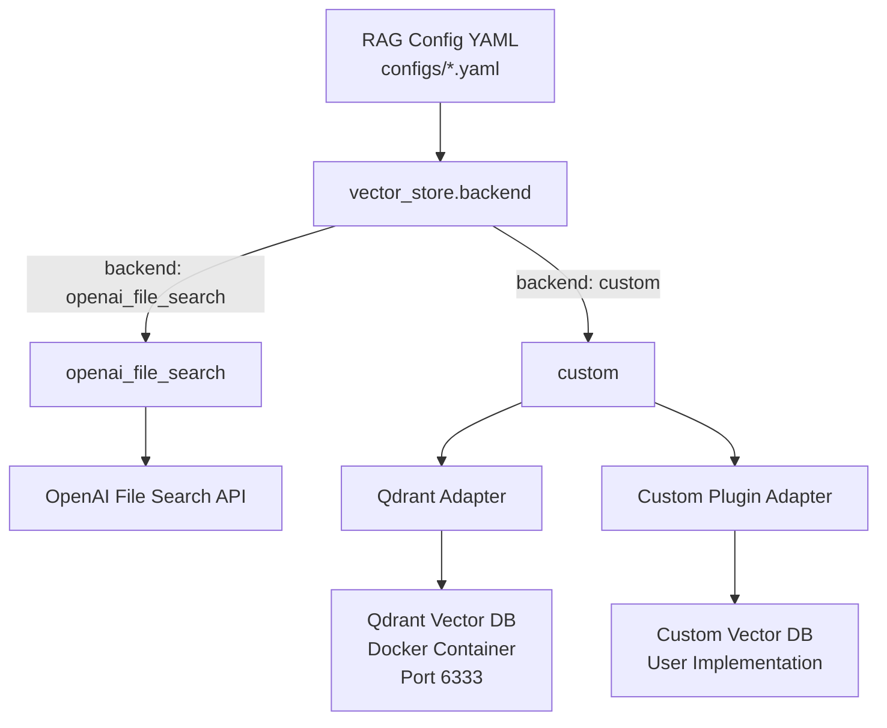
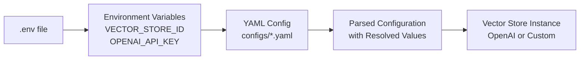
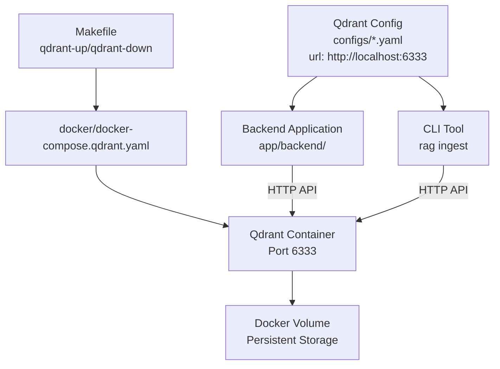

<!-- source: DeepWiki mcp.deepwiki.com · repo openai/openai-knowledge-retrieval · page 7.3 Vector Store Configuration · fetched 2026-10-26 -->

# Vector Store Configuration

<details>
<summary>Relevant source files</summary>

The following files were used as context for generating this wiki page:

- [.env.example](.env.example)
- [Makefile](Makefile)
- [README.md](README.md)

</details>


## Purpose and Scope

This document describes how to configure vector stores for document retrieval in the OpenAI Knowledge Retrieval system. Vector stores are responsible for storing document embeddings and performing similarity searches during the retrieval phase of the RAG pipeline.

The system supports two primary backends:
1. **OpenAI File Search** - A managed vector store service that handles uploads, deduplication, and metadata
2. **Custom Vector Stores** - Bring-your-own implementation with an included Qdrant adapter

For general environment configuration, see [Environment Variables](#7.1). For broader RAG pipeline configuration, see [RAG Configuration Files](#7.2). For information about the retrieval pipeline that queries these vector stores, see [RAG Pipeline](#3.4).

**Sources:** [README.md:184-209]()

---

## Vector Store Backend Selection

The vector store backend is specified in the RAG configuration file under the `vector_store.backend` field. The system routes to different implementations based on this value.



**Diagram: Vector Store Backend Routing**

The configuration is parsed during system initialization and determines which vector store implementation is used for both ingestion and retrieval operations.

**Sources:** [README.md:184-209]()

---

## OpenAI File Search Configuration

The OpenAI File Search backend uses OpenAI's managed vector store service. This is the default configuration and requires minimal setup.

### Configuration Structure

The following YAML structure configures OpenAI File Search:

```yaml
vector_store:
  backend: openai_file_search
  vector_store_name: "my-knowledge-base"
  vector_store_id: "vs_abc123..."  # Optional: reuse existing store
  expiry_days: 7
  chunking:
    max_chunk_size_tokens: 800
    chunk_overlap_tokens: 400
```

### Configuration Parameters

| Parameter | Type | Required | Description |
|-----------|------|----------|-------------|
| `backend` | string | Yes | Must be set to `openai_file_search` |
| `vector_store_name` | string | Yes | Display name for the vector store |
| `vector_store_id` | string | No | ID of existing vector store to reuse. If not provided, a new store is created |
| `expiry_days` | integer | No | Number of days before the vector store expires (OpenAI managed) |
| `chunking.max_chunk_size_tokens` | integer | No | Maximum tokens per chunk for OpenAI File Search |
| `chunking.chunk_overlap_tokens` | integer | No | Overlap between adjacent chunks |

### Vector Store ID Persistence

When ingesting data with OpenAI File Search, the system creates a new vector store if `vector_store_id` is not specified. The resulting ID is printed by the CLI:

```bash
rag ingest --config configs/my.openai.yaml
# Output: Created vector store: vs_abc123...
```

This ID should be persisted in the `.env` file for reuse:

```bash
VECTOR_STORE_ID="vs_abc123..."
```

The environment variable is referenced in the configuration via the `env` block (see [Environment Variable Integration](#environment-variable-integration)).

**Sources:** [README.md:188-191](), [README.md:118-124](), [.env.example:5]()

---

## Custom Vector Store Configuration

The custom backend allows integration with self-hosted or third-party vector databases. The system includes a Qdrant adapter as a reference implementation.

### Qdrant Configuration

```yaml
vector_store:
  backend: custom
  custom:
    kind: qdrant
    qdrant:
      url: http://localhost:6333
      collection: my_collection
      distance: cosine
      ef: 64
      m: 32
```

### Qdrant Parameters

| Parameter | Type | Required | Description |
|-----------|------|----------|-------------|
| `kind` | string | Yes | Must be set to `qdrant` for the built-in adapter |
| `qdrant.url` | string | Yes | Qdrant server URL (typically `http://localhost:6333` for Docker) |
| `qdrant.collection` | string | Yes | Name of the collection to create/use |
| `qdrant.distance` | string | No | Distance metric: `cosine`, `euclidean`, or `dot` |
| `qdrant.ef` | integer | No | HNSW `ef` parameter for search accuracy |
| `qdrant.m` | integer | No | HNSW `m` parameter for graph connectivity |

### Custom Plugin Configuration

For vector databases not included in the system, specify a custom plugin:

```yaml
vector_store:
  backend: custom
  custom:
    kind: plugin
    plugin:
      module_path: "my_company.vector_stores"
      class_name: "PineconeAdapter"
      init_args:
        api_key: "${PINECONE_API_KEY}"
        environment: "us-east1-gcp"
        index_name: "knowledge-base"
```

### Plugin Parameters

| Parameter | Type | Required | Description |
|-----------|------|----------|-------------|
| `kind` | string | Yes | Must be set to `plugin` for custom implementations |
| `plugin.module_path` | string | Yes | Python module path containing the adapter class |
| `plugin.class_name` | string | Yes | Name of the adapter class to instantiate |
| `plugin.init_args` | dict | No | Keyword arguments passed to the adapter constructor |

The custom adapter must implement the vector store interface expected by the ingestion and retrieval pipelines (see `stores/` directory for examples).

**Sources:** [README.md:192-209]()

---

## Environment Variable Integration

Vector store configuration supports environment variable interpolation for sensitive values like API keys and IDs.



**Diagram: Environment Variable Resolution Flow**

### Environment Block in YAML

The `env` block in the configuration specifies default values that are overridden by actual environment variables:

```yaml
env:
  OPENAI_API_KEY: ""  # Required
  OPENAI_PROJECT_ID: ""  # Optional
  VECTOR_STORE_ID: ""  # Populated after first ingest
```

### Variable Interpolation

Configuration values can reference environment variables using `${VAR_NAME}` syntax:

```yaml
vector_store:
  backend: custom
  custom:
    kind: plugin
    plugin:
      init_args:
        api_key: "${CUSTOM_VECTOR_DB_KEY}"
        index_id: "${VECTOR_STORE_ID}"
```

The system resolves these references at runtime, first checking actual environment variables, then falling back to the `env` block defaults.

**Sources:** [.env.example:1-6](), [README.md:236-238](), [README.md:86-93]()

---

## Docker Setup for Qdrant

The system includes Docker Compose configuration for running Qdrant locally during development.

### Starting Qdrant

```bash
make qdrant-up
```

This command executes:
```bash
docker compose -f docker/docker-compose.qdrant.yaml up -d
```

The Qdrant container runs on port 6333 and persists data between restarts.

### Stopping Qdrant

```bash
make qdrant-down
```

This command executes:
```bash
docker compose -f docker/docker-compose.qdrant.yaml down --remove-orphans
```

### Docker Compose Configuration



**Diagram: Qdrant Docker Setup Architecture**

The Docker container must be running before executing `rag ingest` or starting the backend application when using the Qdrant backend.

**Sources:** [Makefile:25-29](), [README.md:109-114]()

---

## Configuration Templates

The system provides predefined templates for common vector store configurations.

### Available Templates

| Template | Backend | Description |
|----------|---------|-------------|
| `openai` | `openai_file_search` | Default configuration using OpenAI File Search |
| `custom-qdrant` | `custom` (Qdrant) | Configuration for local Qdrant instance |

### Generating Templates

```bash
rag init --template openai > configs/my.openai.yaml
rag init --template custom-qdrant > configs/my.qdrant.yaml
```

Templates can be combined with chunking strategy flags:

```bash
rag init --template custom-qdrant --chunking recursive > configs/my.config.yaml
```

The generated YAML files contain all necessary vector store configuration with sensible defaults that can be customized.

**Sources:** [README.md:156-165](), [README.md:97-106]()

---

## Configuration Workflow

The following diagram shows how vector store configuration flows through the system during different operations:

```mermaid
sequenceDiagram
    participant User
    participant CLI["CLI<br/>rag ingest/chat"]
    participant ConfigParser["Config Parser"]
    participant EnvLoader[".env Loader"]
    participant VectorStoreFactory["Vector Store Factory"]
    participant OpenAI["OpenAI File Search API"]
    participant Qdrant["Qdrant Instance"]
    
    User->>CLI: Execute command
    CLI->>ConfigParser: Load YAML config
    ConfigParser->>EnvLoader: Resolve env variables
    EnvLoader-->>ConfigParser: Return resolved values
    ConfigParser-->>CLI: Parsed configuration
    
    CLI->>VectorStoreFactory: Create vector store<br/>with config
    
    alt OpenAI File Search Backend
        VectorStoreFactory->>OpenAI: Initialize connection
        OpenAI-->>VectorStoreFactory: Vector store ready
    else Custom Backend (Qdrant)
        VectorStoreFactory->>Qdrant: Initialize connection
        Qdrant-->>VectorStoreFactory: Vector store ready
    end
    
    VectorStoreFactory-->>CLI: Return vector store instance
    CLI->>CLI: Execute operation<br/>(ingest/retrieval)
```

**Diagram: Vector Store Configuration and Initialization Sequence**

**Sources:** [README.md:27-42](), [README.md:115-124]()

---

## Configuration Examples

### Example 1: OpenAI File Search with Existing Store

```yaml
vector_store:
  backend: openai_file_search
  vector_store_id: "vs_abc123xyz"  # Reuse existing store
  vector_store_name: "production-kb"
  expiry_days: 30

env:
  OPENAI_API_KEY: ""
  VECTOR_STORE_ID: "vs_abc123xyz"
```

### Example 2: Qdrant with Custom Distance Metric

```yaml
vector_store:
  backend: custom
  custom:
    kind: qdrant
    qdrant:
      url: http://localhost:6333
      collection: technical_docs
      distance: dot
      ef: 128
      m: 16
```

### Example 3: Custom Plugin with Environment Variables

```yaml
vector_store:
  backend: custom
  custom:
    kind: plugin
    plugin:
      module_path: "company.stores"
      class_name: "WeaviateAdapter"
      init_args:
        url: "${WEAVIATE_URL}"
        api_key: "${WEAVIATE_API_KEY}"
        class_name: "KnowledgeChunk"
```

**Sources:** [README.md:188-209]()

---

## Best Practices

### OpenAI File Search

1. **Persist Vector Store IDs**: Always save the `VECTOR_STORE_ID` to `.env` after the first ingestion to avoid creating duplicate stores.

2. **Configure Expiry**: Set `expiry_days` appropriately based on your usage pattern to manage costs.

3. **Chunk Size**: The default `max_chunk_size_tokens: 800` works well for most use cases. Adjust based on your document structure and retrieval requirements.

### Custom Vector Stores

1. **Docker Management**: Always run `make qdrant-up` before ingestion or running the backend when using Qdrant.

2. **HNSW Parameters**: The default `ef: 64` and `m: 32` provide a good balance. Increase `ef` for higher recall at the cost of slower queries.

3. **Collection Naming**: Use descriptive collection names that reflect the dataset or environment (e.g., `production-docs`, `staging-kb`).

4. **Connection Resilience**: Ensure the vector store is reachable before starting ingestion. The system does not currently implement automatic retries.

### Security

1. **Credential Management**: Never commit `.env` files with real credentials. Use `${ENV_VAR}` interpolation in YAML for sensitive values.

2. **Network Isolation**: In production, ensure Qdrant or other custom vector stores are not exposed to the public internet without proper authentication.

**Sources:** [README.md:83-93](), [Makefile:25-29]()

---

