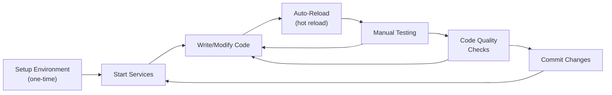
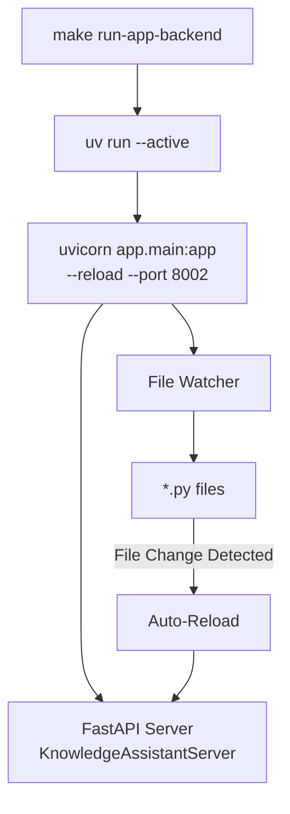
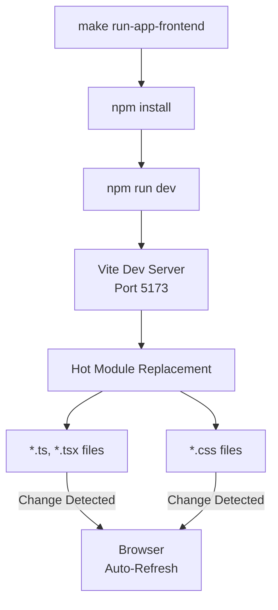
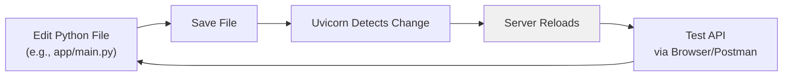
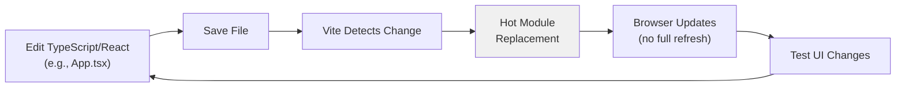
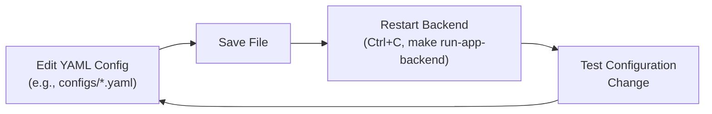
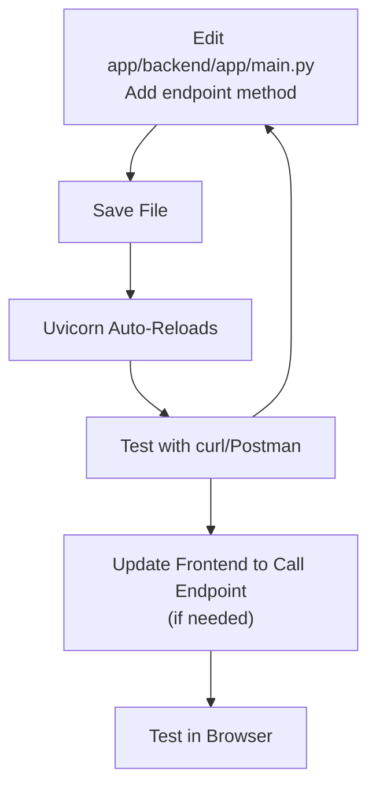
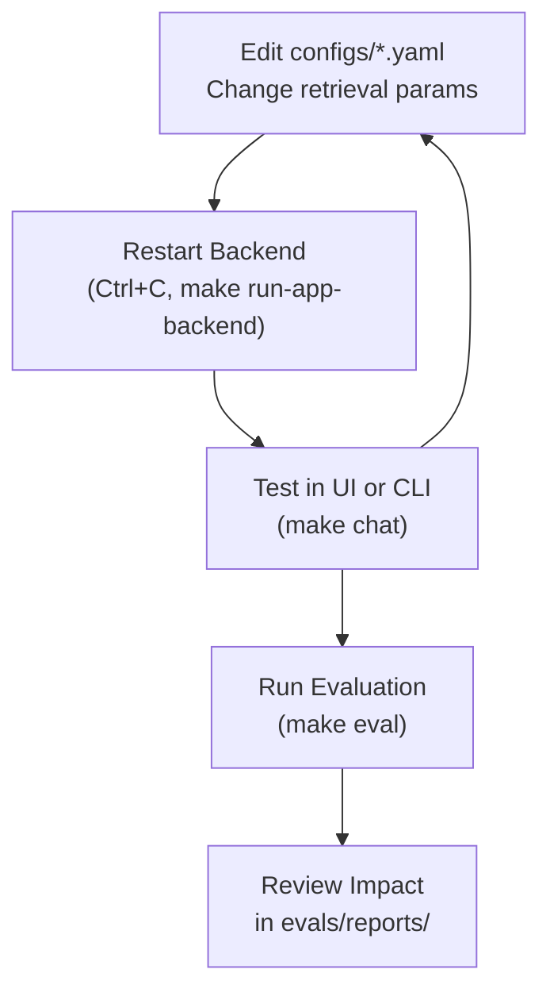
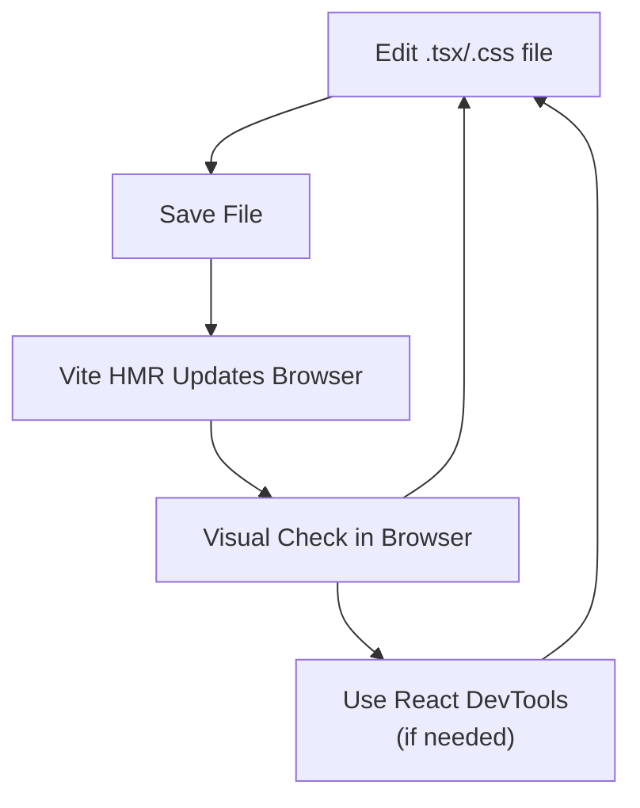

<!-- source: DeepWiki mcp.deepwiki.com · repo openai/openai-knowledge-retrieval · page 8.1 Development Workflow · fetched 2026-10-26 -->

# Development Workflow

<details>
<summary>Relevant source files</summary>

The following files were used as context for generating this wiki page:

- [.editorconfig](.editorconfig)
- [CONTRIBUTING.md](CONTRIBUTING.md)
- [Makefile](Makefile)

</details>


## Purpose and Scope

This page describes the daily development workflow for working on the OpenAI Knowledge Retrieval starter kit, including running services locally, iterating on code changes, and using the Makefile orchestrator. For initial environment setup and installation, see [Prerequisites and Environment Setup](#2.1) and [Installation](#2.2). For code quality standards and testing procedures, see [Code Quality and Testing](#8.2). For contribution processes and coding standards, see [Contributing Guidelines](#8.3).

---

## Development Cycle Overview

The development workflow follows an iterative cycle centered around the Makefile orchestrator, which manages all services and development tasks. The cycle typically progresses through these phases:



**Sources**: [Makefile:1-38](), [CONTRIBUTING.md:10-32]()

---

## Makefile Command Reference

The [`Makefile`]() serves as the central orchestrator for all development tasks. It provides a unified interface across the multi-component system.

### Core Installation Commands

| Command | Purpose | Details |
|---------|---------|---------|
| `make install` | Install project in standard mode | Installs package using `pip install -e .` |
| `make dev` | Install with development dependencies | Installs package using `pip install -e .[dev]`, includes testing and linting tools |

**Implementation**: [Makefile:6-10]()

### Service Management Commands

| Command | Purpose | Port | Hot Reload |
|---------|---------|------|------------|
| `make run-api` | Start standalone API server | 8000 | Yes |
| `make run-app-backend` | Start application backend | 8002 | Yes |
| `make run-app-frontend` | Start React development server | 5173 | Yes |
| `make qdrant-up` | Start Qdrant vector database | 6333 | N/A |
| `make qdrant-down` | Stop Qdrant container | N/A | N/A |
| `make stop-app-backend` | Stop application backend | N/A | N/A |

**Implementation**: [Makefile:12-29]()

### Data and Evaluation Commands

| Command | Purpose | Configuration |
|---------|---------|---------------|
| `make ingest` | Run document ingestion pipeline | Uses `configs/default.openai.yaml` |
| `make chat` | Start CLI chat interface | Uses `configs/default.openai.yaml` |
| `make eval` | Run evaluation harness | Uses `configs/default.openai.yaml` |

**Implementation**: [Makefile:31-38]()

**Sources**: [Makefile:1-38]()

---

## Running Services Locally

### Backend Service with Hot Reload

The backend runs using `uvicorn` with the `--reload` flag, enabling automatic reloading when Python files change:

```bash
make run-app-backend
```

This command:
1. Changes to the `app/backend` directory
2. Uses `uv run` to execute within the virtual environment
3. Starts `uvicorn` on port 8002 with hot reload enabled
4. Watches for changes to any `.py` files

**Command Details**: [Makefile:18-19]()



**Sources**: [Makefile:18-19]()

### Frontend Development Server

The frontend runs using Vite's development server with hot module replacement (HMR):

```bash
make run-app-frontend
```

This command:
1. Changes to the `app/frontend` directory
2. Runs `npm install` to ensure dependencies are current
3. Starts `npm run dev`, which launches Vite on port 5173
4. Enables HMR for instant updates on file changes

**Command Details**: [Makefile:15-16]()



**Sources**: [Makefile:15-16]()

### Vector Database Service

Qdrant runs as a Docker container for local development:

```bash
# Start Qdrant
make qdrant-up

# Stop Qdrant and clean up
make qdrant-down
```

**Command Details**: [Makefile:25-29]()

The `docker-compose.qdrant.yaml` file configures:
- Container name and image
- Port mapping (6333)
- Volume persistence
- Network configuration

**Sources**: [Makefile:25-29]()

### Running the Full Stack

For full-stack development, open three terminal windows:

```bash
# Terminal 1: Vector Database
make qdrant-up

# Terminal 2: Backend Service
make run-app-backend

# Terminal 3: Frontend Service
make run-app-frontend
```

This configuration enables:
- Backend hot reload on Python changes
- Frontend HMR on TypeScript/React changes
- Persistent vector store across restarts
- Complete end-to-end testing

**Sources**: [Makefile:15-29]()

---

## Development Feedback Loops

### Backend Development Loop



**Typical Iteration Time**: 1-3 seconds from save to server ready

**Affected Files Pattern**: `app/backend/**/*.py`

**Sources**: [Makefile:18-19]()

### Frontend Development Loop



**Typical Iteration Time**: <1 second from save to browser update

**Affected Files Pattern**: `app/frontend/src/**/*.{ts,tsx,css}`

**Sources**: [Makefile:15-16]()

### Configuration Changes Loop

Configuration changes to YAML files require manual restart since they are loaded at startup:



**Affected Files**: `configs/*.yaml`, `.env`

**Sources**: [Makefile:18-19]()

---

## Component-Specific Development

### Backend-Only Development

When working exclusively on backend code (API endpoints, agent logic, document management):

```bash
# Start only backend and Qdrant
make qdrant-up
make run-app-backend

# Backend available at http://localhost:8002
```

**Common Backend Tasks**:
- Modifying API endpoints in `app/backend/app/main.py`
- Updating agent logic in `app/backend/app/assistant_agent.py`
- Changing document handling in `app/backend/app/documents.py`
- Adjusting memory store in `app/backend/app/memory_store.py`

**Testing Backend**: Use curl, Postman, or similar HTTP clients to test endpoints directly without frontend.

**Sources**: [Makefile:18-19](), [Makefile:25-26]()

### Frontend-Only Development

When working exclusively on UI components and styling:

```bash
# Start frontend with mock backend (if available)
make run-app-frontend

# Or start full stack if backend features are needed
make qdrant-up
make run-app-backend
make run-app-frontend
```

**Common Frontend Tasks**:
- Adding/modifying React components in `app/frontend/src/components/`
- Updating ChatKit integration in `app/frontend/src/chatkit-react/`
- Changing styles and theme in CSS files
- Modifying hooks in `app/frontend/src/hooks/`

**Testing Frontend**: Browser at `http://localhost:5173` with browser DevTools for debugging.

**Sources**: [Makefile:15-16]()

### RAG Pipeline Development

When modifying the retrieval pipeline, query processing, or synthesis:

```bash
# 1. Modify configuration
vim configs/default.openai.yaml

# 2. Re-ingest data (if embedding/indexing changed)
make ingest

# 3. Test via CLI
make chat

# 4. Or test via web UI
make run-app-backend
make run-app-frontend
```

**Common RAG Tasks**:
- Adjusting retrieval parameters in YAML config
- Modifying query expansion/HyDE logic
- Changing reranking strategy
- Updating synthesis prompts

**Sources**: [Makefile:31-36]()

---

## Stopping Services

### Graceful Shutdown

Use `Ctrl+C` in terminal windows to stop services gracefully:
- Backend: `Ctrl+C` in terminal running `make run-app-backend`
- Frontend: `Ctrl+C` in terminal running `make run-app-frontend`

### Force Stop Backend

If the backend process is not responding:

```bash
make stop-app-backend
```

This command performs:
1. `pkill -f "uvicorn app.main:app --reload --port 8002"` - kills process by name
2. `lsof -t -i:8002 | xargs kill -9` - force kills any process on port 8002

**Implementation**: [Makefile:21-23]()

### Stop Vector Database

```bash
make qdrant-down
```

This stops and removes the Qdrant Docker container, with `--remove-orphans` flag to clean up any orphaned containers.

**Implementation**: [Makefile:28-29]()

**Sources**: [Makefile:21-29]()

---

## Code Style Configuration

The repository uses `.editorconfig` to maintain consistent coding style across editors:

```
[*]
indent_style = space
indent_size = 4
end_of_line = lf
charset = utf-8
insert_final_newline = true
trim_trailing_whitespace = true

[*.md]
trim_trailing_whitespace = false

[Makefile]
indent_style = tab
```

**Configuration Details**: [.editorconfig:1-17]()

Most modern editors (VS Code, IntelliJ, Sublime Text) automatically respect these settings when the EditorConfig plugin is installed.

**Sources**: [.editorconfig:1-17]()

---

## Development Environment Setup

For first-time setup, the workflow involves creating a Python virtual environment and installing dependencies:

```bash
# Create and activate virtual environment
python3 -m venv .venv
source .venv/bin/activate  # Linux/Mac
# .venv\Scripts\activate   # Windows

# Install with development dependencies
make dev

# Install frontend dependencies (optional)
cd app/frontend
npm install
```

**Setup Details**: [CONTRIBUTING.md:12-25]()

After initial setup:
1. Copy `.env.example` to `.env`
2. Configure `OPENAI_API_KEY` and other required variables
3. Start services as described above

**Sources**: [CONTRIBUTING.md:12-32]()

---

## Common Development Workflows

### Adding a New API Endpoint



**Sources**: [Makefile:18-19]()

### Modifying RAG Configuration



**Sources**: [Makefile:18-19](), [Makefile:31-38]()

### Updating UI Components



**Sources**: [Makefile:15-16]()

---

## Troubleshooting Development Issues

### Port Already in Use

If ports 8002, 5173, or 6333 are already in use:

```bash
# Find and kill process on port 8002
lsof -ti:8002 | xargs kill -9

# Or use make target for backend
make stop-app-backend

# For frontend (port 5173)
lsof -ti:5173 | xargs kill -9

# For Qdrant, stop and restart
make qdrant-down
make qdrant-up
```

**Sources**: [Makefile:21-23]()

### Changes Not Reflecting

**Backend Changes**: Ensure `uvicorn` is running with `--reload` flag. Check terminal for reload messages.

**Frontend Changes**: Vite HMR should be active. If not working:
1. Check terminal for Vite errors
2. Hard refresh browser (Ctrl+Shift+R)
3. Restart frontend server

**Configuration Changes**: Always require manual backend restart.

**Sources**: [Makefile:15-19]()

### Virtual Environment Issues

If commands fail with import errors:

```bash
# Ensure virtual environment is activated
source .venv/bin/activate  # Linux/Mac

# Reinstall dependencies
make dev
```

**Sources**: [CONTRIBUTING.md:14-18]()

---

## Next Steps

- For code quality checks and testing procedures, see [Code Quality and Testing](#8.2)
- For contribution guidelines and PR process, see [Contributing Guidelines](#8.3)
- For production deployment, see [Production Build](#9.1)

**Sources**: [CONTRIBUTING.md:1-72](), [Makefile:1-38]()

---

