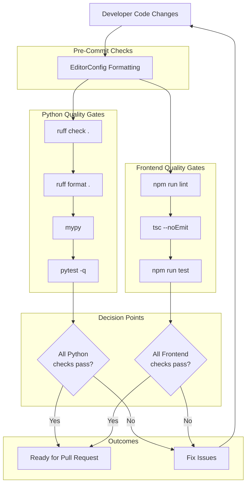
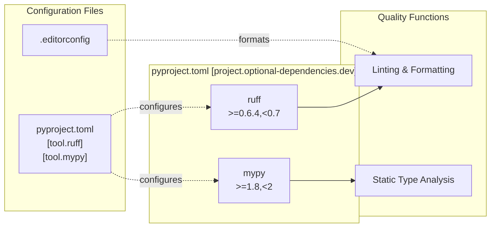

<!-- source: DeepWiki mcp.deepwiki.com · repo openai/openai-knowledge-retrieval · page 8.2 Code Quality and Testing · fetched 2026-10-26 -->

# Code Quality and Testing

<details>
<summary>Relevant source files</summary>

The following files were used as context for generating this wiki page:

- [.editorconfig](.editorconfig)
- [CONTRIBUTING.md](CONTRIBUTING.md)
- [app/backend/pyproject.toml](app/backend/pyproject.toml)
- [app/frontend/eslint.config.js](app/frontend/eslint.config.js)

</details>


## Purpose and Scope

This page documents the code quality tools, testing frameworks, type checking systems, and quality standards enforced in the OpenAI Knowledge Retrieval starter kit. It covers linting configurations, test execution, type safety enforcement, and editor settings for both Python backend and TypeScript frontend codebases.

For information about the development workflow and running these tools, see [Development Workflow](#8.1). For contribution guidelines and commit standards, see [Contributing Guidelines](#8.3).

---

## Quality Tool Stack Overview

The project employs separate but parallel quality toolchains for backend and frontend:

### Quality Tools by Component

| Component | Linting | Formatting | Type Checking | Testing |
|-----------|---------|------------|---------------|---------|
| **Backend (Python)** | `ruff check` | `ruff format` | `mypy` | `pytest` |
| **Frontend (TypeScript)** | `eslint` | `eslint --fix` | `tsc` | `vitest` |
| **Editor** | `.editorconfig` | `.editorconfig` | N/A | N/A |

**Sources:**
- [CONTRIBUTING.md:48-56]()
- [app/backend/pyproject.toml:20-23]()
- [app/frontend/eslint.config.js:1-39]()

---

## Backend Quality Tools (Python)

### Ruff: Linting and Formatting

Ruff serves as the primary Python linter and formatter, replacing multiple legacy tools (black, isort, flake8) with a single fast implementation.

#### Configuration

The ruff configuration is defined in [app/backend/pyproject.toml:29-33]():

```toml
[tool.ruff]
line-length = 100

[tool.ruff.lint]
extend-select = ["I"]
```

**Key Settings:**
- **Line length**: 100 characters maximum
- **Import sorting**: Enabled via `["I"]` rule selection, providing automatic import organization

#### Version Requirements

Ruff is pinned in the development dependencies:
- Version constraint: `>=0.6.4,<0.7` ([app/backend/pyproject.toml:21]())
- Ensures consistency across development environments

**Sources:**
- [app/backend/pyproject.toml:21-33]()

---

### Mypy: Static Type Checking

Mypy enforces static type analysis for Python code, catching type-related errors before runtime.

#### Type Annotation Requirements

The project requires type hints for all new code ([CONTRIBUTING.md:36]()):
- Python 3.10+ syntax supported
- Function signatures must include parameter and return type annotations
- Type: ignore comments should be used sparingly with justification

#### Version Requirements

Mypy is included in development dependencies:
- Version constraint: `>=1.8,<2` ([app/backend/pyproject.toml:22]())

**Sources:**
- [app/backend/pyproject.toml:22]()
- [CONTRIBUTING.md:36]()

---

### Pytest: Testing Framework

While pytest is referenced in the contribution guidelines ([CONTRIBUTING.md:52]()), test configuration and fixtures are not visible in the provided files. The command `pytest -q` is used for running tests in quiet mode.

**Sources:**
- [CONTRIBUTING.md:52]()

---

## Frontend Quality Tools (TypeScript/React)

### ESLint Configuration

ESLint provides comprehensive linting for TypeScript and React code with multiple plugin integrations.

#### Configuration Architecture

```mermaid
graph TB
    ConfigFile["eslint.config.js"]
    
    subgraph "Base Configurations"
        JSRec["js.configs.recommended"]
        TSRec["tseslint.configs.recommended-type-checked"]
        RHRec["reactHooks.configs.recommended"]
    end
    
    subgraph "Plugins"
        TSPlugin["@typescript-eslint/eslint-plugin"]
        TSParser["@typescript-eslint/parser"]
        RHPlugin["eslint-plugin-react-hooks"]
        RRPlugin["eslint-plugin-react-refresh"]
    end
    
    subgraph "File Targets"
        TSFiles["**/*.{ts,tsx}"]
    end
    
    subgraph "Language Options"
        Parser["TypeScript Parser"]
        Globals["browser + node globals"]
        JSX["JSX enabled"]
    end
    
    subgraph "Custom Rules"
        NoTabs["no-tabs: error"]
        Indent["indent: error, 4 spaces"]
        RefreshWarn["react-refresh: warn"]
    end
    
    ConfigFile --> JSRec
    ConfigFile --> TSRec
    ConfigFile --> RHRec
    
    ConfigFile --> TSPlugin
    ConfigFile --> TSParser
    ConfigFile --> RHPlugin
    ConfigFile --> RRPlugin
    
    ConfigFile --> TSFiles
    ConfigFile --> Parser
    ConfigFile --> Globals
    ConfigFile --> JSX
    
    ConfigFile --> NoTabs
    ConfigFile --> Indent
    ConfigFile --> RefreshWarn
```



**Diagram: ESLint Configuration Structure**

**Sources:**
- [app/frontend/eslint.config.js:1-39]()

---

#### ESLint Plugin Stack

The frontend employs four specialized plugins ([app/frontend/eslint.config.js:1-6, 25-29]()):

1. **@typescript-eslint**: Type-aware linting for TypeScript code
2. **eslint-plugin-react-hooks**: Enforces React Hooks rules
3. **eslint-plugin-react-refresh**: Warns about components that break Fast Refresh
4. **globals**: Provides browser and Node.js global variable definitions

#### Parser Configuration

TypeScript parsing is configured with project service integration ([app/frontend/eslint.config.js:12-19]()):

```javascript
languageOptions: {
  parser: tsParser,
  parserOptions: {
    projectService: true,
    ecmaFeatures: {
      jsx: true,
    },
  },
}
```

**Key Features:**
- **projectService**: Enables TypeScript project-aware linting
- **JSX support**: Allows React component syntax
- **Global scope**: Includes both browser and Node.js globals

**Sources:**
- [app/frontend/eslint.config.js:12-24]()

---

#### Custom Rule Configuration

Three custom rules override defaults ([app/frontend/eslint.config.js:30-36]()):

| Rule | Severity | Configuration | Purpose |
|------|----------|---------------|---------|
| `no-tabs` | error | N/A | Enforces space indentation |
| `indent` | error | 4 spaces, SwitchCase: 1 | Standardizes indentation |
| `react-refresh/only-export-components` | warn | allowConstantExport: true | Ensures Fast Refresh compatibility |

**Sources:**
- [app/frontend/eslint.config.js:33-35]()

---

### TypeScript Type Checking

TypeScript provides compile-time type safety for the frontend codebase. The parser is configured to use project service ([app/frontend/eslint.config.js:15]()), enabling full project-aware type checking.

**Execution:**
```bash
npm run lint  # Runs ESLint with TypeScript type checking
```

**Sources:**
- [CONTRIBUTING.md:53]()
- [app/frontend/eslint.config.js:15]()

---

### Vitest: Frontend Testing

Vitest is referenced in Diagram 5 of the architecture overview but specific configuration is not visible in the provided files.

---

## Editor Configuration

### EditorConfig Standard

The `.editorconfig` file enforces consistent formatting across editors and IDEs, independent of individual developer configurations.

#### Global Settings

Default settings apply to all files ([.editorconfig:3-9]()):

```
[*]
indent_style = space
indent_size = 4
end_of_line = lf
charset = utf-8
insert_final_newline = true
trim_trailing_whitespace = true
```

#### File-Specific Overrides

Two special cases override defaults:

1. **Markdown files** ([.editorconfig:11-12]()): Preserve trailing whitespace (for hard line breaks)
2. **Makefiles** ([.editorconfig:14-15]()): Use tab indentation (required by Make syntax)

**Sources:**
- [.editorconfig:1-17]()

---

## Quality Standards Enforcement

### Code Quality Checks Pipeline



**Diagram: Quality Check Pipeline Flow**

**Sources:**
- [CONTRIBUTING.md:48-56]()
- [app/backend/pyproject.toml:20-23]()
- [app/frontend/eslint.config.js:1-39]()

---

### Required Pre-PR Checks

Before submitting a pull request, contributors must ensure all quality checks pass locally ([CONTRIBUTING.md:48-56]()):

#### Backend Checks
```bash
ruff check .    # Lint all Python files
pytest -q       # Run tests in quiet mode
```

#### Frontend Checks (if UI code modified)
```bash
npm run lint    # Run ESLint with TypeScript checking
```

**Sources:**
- [CONTRIBUTING.md:48-56]()

---

## Coding Standards

### Python Standards

From [CONTRIBUTING.md:36-40]():

1. **Python version**: 3.10+ required
2. **Type hints**: Required for all new code
3. **Function size**: Keep functions small and focused
4. **Code organization**: Extract shared logic to `lib/` modules
5. **Documentation**: Concise docstrings where intent is non-obvious
6. **File naming**: `snake_case` for Python files

### Frontend Standards

From [CONTRIBUTING.md:38-40]():

1. **Component style**: Functional components and hooks preferred
2. **Composition**: Favor composition over duplication
3. **File naming**: `kebab-case` for new frontend modules

**Sources:**
- [CONTRIBUTING.md:35-40]()

---

## Quality Tool Dependency Matrix

### Backend Dependencies (Development)



**Diagram: Backend Quality Tool Dependencies**

**Sources:**
- [app/backend/pyproject.toml:19-23]()
- [app/backend/pyproject.toml:29-33]()

---

### Frontend Dependencies (Development)

The frontend ESLint configuration requires multiple packages ([app/frontend/eslint.config.js:1-6]()):

| Package | Version Constraint | Purpose |
|---------|-------------------|---------|
| `@eslint/js` | Latest | Core ESLint JavaScript rules |
| `@typescript-eslint/eslint-plugin` | Latest | TypeScript-specific linting |
| `@typescript-eslint/parser` | Latest | TypeScript parsing for ESLint |
| `eslint-plugin-react-hooks` | Latest | React Hooks rules enforcement |
| `eslint-plugin-react-refresh` | Latest | Fast Refresh compatibility |
| `globals` | Latest | Browser/Node global definitions |

**Sources:**
- [app/frontend/eslint.config.js:1-6]()

---

## Running Quality Checks

### Local Development Execution

#### Backend Quality Checks
```bash
# Activate virtual environment
source .venv/bin/activate

# Run linting
ruff check .

# Run formatting (auto-fix)
ruff format .

# Run type checking
mypy .

# Run tests
pytest -q
```

#### Frontend Quality Checks
```bash
cd app/frontend

# Run ESLint
npm run lint

# Run ESLint with auto-fix
npm run lint -- --fix

# Run TypeScript compiler check
npx tsc --noEmit

# Run tests
npm run test
```

**Sources:**
- [CONTRIBUTING.md:48-56]()
- [CONTRIBUTING.md:14-25]()

---

## Integration with Development Workflow

Quality checks integrate into the development workflow at multiple points:

1. **Editor integration**: `.editorconfig` enforces formatting automatically
2. **Local development**: Developers run checks before committing
3. **Pre-commit**: Quality gates prevent committing broken code
4. **Pull request**: All checks must pass before merge

For comprehensive workflow documentation, see [Development Workflow](#8.1).

**Sources:**
- [CONTRIBUTING.md:43-56]()
- [.editorconfig:1-17]()

---

