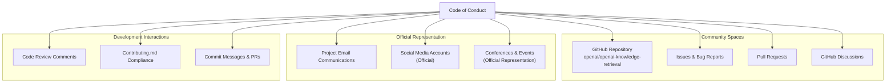
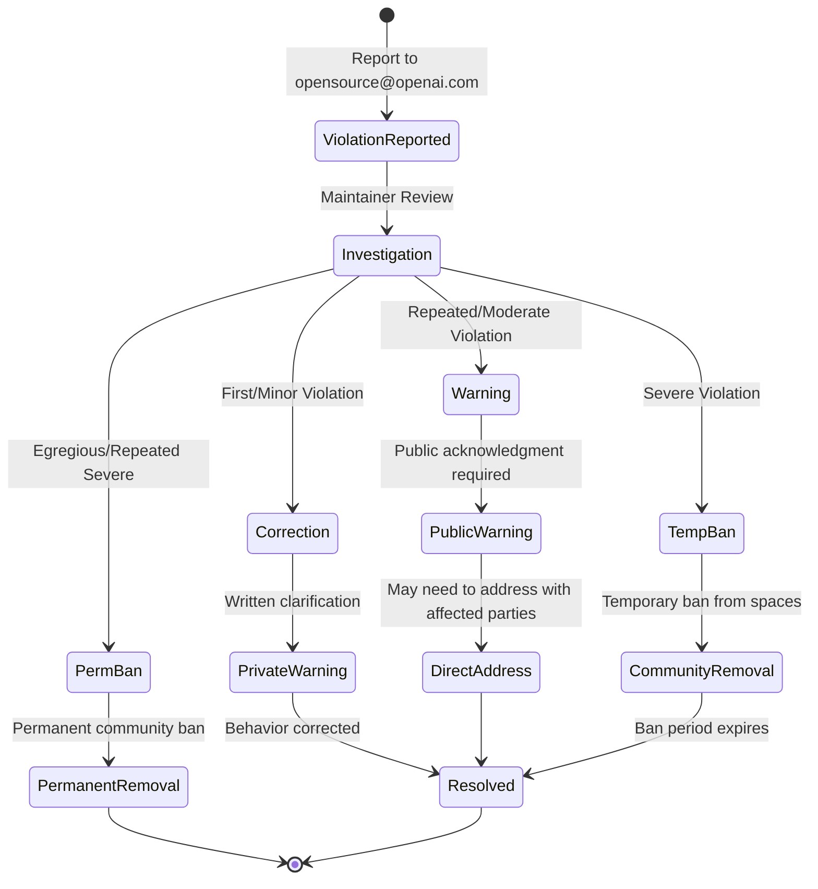
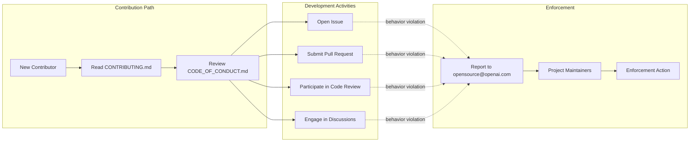

<!-- source: DeepWiki mcp.deepwiki.com · repo openai/openai-knowledge-retrieval · page 8.4 Code of Conduct · fetched 2026-10-26 -->

# Code of Conduct

<details>
<summary>Relevant source files</summary>

The following files were used as context for generating this wiki page:

- [CODE_OF_CONDUCT.md](CODE_OF_CONDUCT.md)

</details>


## Purpose and Scope

This document outlines the community standards, behavioral expectations, and enforcement policies for the OpenAI Knowledge Retrieval project. The Code of Conduct applies to all community spaces including GitHub issues, pull requests, discussions, and any official representation of the project in public forums.

For information about technical contribution guidelines and development practices, see [Contributing Guidelines](#8.3). For information about security vulnerability reporting, see [Security Policy](#10.1).

**Sources:** [CODE_OF_CONDUCT.md:1-72]()

---

## Community Pledge

The OpenAI Knowledge Retrieval project is committed to fostering an inclusive, harassment-free environment for all participants. The community pledge establishes the foundation for interactions across all project spaces.

### Core Commitments

| Commitment Area | Description |
|----------------|-------------|
| **Inclusivity** | Participation free from discrimination based on age, body size, disability, ethnicity, sex characteristics, gender identity/expression, experience level, education, socio-economic status, nationality, appearance, race, caste, color, religion, or sexual identity/orientation |
| **Community Health** | Actions and interactions that contribute to an open, welcoming, diverse, inclusive, and healthy environment |
| **Collective Focus** | Prioritizing what is best for the overall community, not just individual interests |

The pledge applies to all members, contributors, and leaders within the project ecosystem.

**Sources:** [CODE_OF_CONDUCT.md:3-12]()

---

## Behavioral Standards

### Encouraged Behaviors

The following behaviors contribute to a positive community environment:

| Behavior | Description |
|----------|-------------|
| **Empathy and Kindness** | Demonstrating understanding and consideration toward other community members |
| **Respectful Discourse** | Being respectful of differing opinions, viewpoints, and experiences |
| **Constructive Feedback** | Giving and gracefully accepting feedback focused on improvement |
| **Accountability** | Accepting responsibility, apologizing when mistakes are made, and learning from experiences |
| **Community Focus** | Focusing on collective benefit rather than individual gain |

### Prohibited Behaviors

The following behaviors are unacceptable within community spaces:

| Violation Type | Examples |
|----------------|----------|
| **Sexualized Content** | Use of sexualized language or imagery, unwanted sexual attention or advances |
| **Hostile Communication** | Trolling, insulting or derogatory comments, personal or political attacks |
| **Harassment** | Public or private harassment of any kind |
| **Privacy Violations** | Publishing others' private information (physical/email addresses) without explicit permission |
| **Professional Misconduct** | Other conduct reasonably considered inappropriate in a professional setting |

**Sources:** [CODE_OF_CONDUCT.md:14-32]()

---

## Scope of Application

The Code of Conduct applies across multiple interaction contexts within the project ecosystem.



**Diagram: Code of Conduct Application Scope**

The Code of Conduct applies within all community spaces and extends to situations where individuals officially represent the project in public spaces.

**Sources:** [CODE_OF_CONDUCT.md:40-43]()

---

## Enforcement Framework

### Responsibilities

Project maintainers bear the responsibility for clarifying and enforcing behavioral standards. Their duties include:

- Clarifying standards of acceptable behavior
- Taking appropriate and fair corrective action in response to violations
- Removing, editing, or rejecting contributions that violate the Code of Conduct
- Communicating reasons for moderation decisions when appropriate

**Sources:** [CODE_OF_CONDUCT.md:34-38]()

### Reporting Process

Violations can be reported through the following mechanism:

| Component | Details |
|-----------|---------|
| **Reporting Channel** | Email to `opensource@openai.com` |
| **Response Commitment** | All complaints reviewed and investigated promptly and fairly |
| **Confidentiality** | Maintainers obligated to respect privacy and security of reporters |
| **Follow-up** | Reporters will receive updates on the investigation and resolution |

**Sources:** [CODE_OF_CONDUCT.md:45-52]()

---

## Enforcement Workflow

The enforcement process follows a graduated response system based on violation severity and frequency.



**Diagram: Violation Enforcement State Machine**

### Enforcement Levels

The following table details the graduated enforcement approach:

| Level | Name | Application | Outcome |
|-------|------|-------------|---------|
| **1** | Correction | First-time or minor violations | Private written warning clarifying violation nature and explaining why behavior was inappropriate |
| **2** | Warning | Repeated or severe violations | Public warning; individual may be required to directly address behavior with affected parties |
| **3** | Temporary Ban | Behavior violating the code | Temporary removal from community spaces for specified period |
| **4** | Permanent Ban | Repeated or egregious violations | Permanent removal from project and community spaces |

**Sources:** [CODE_OF_CONDUCT.md:54-65]()

---

## Implementation in Project Context

The Code of Conduct integrates with the project's development workflow and contribution process.



**Diagram: Code of Conduct Integration with Development Workflow**

### Relationship with Contributing Guidelines

The Code of Conduct complements the technical Contributing Guidelines ([CONTRIBUTING.md](#8.3)) by establishing behavioral expectations while the contributing guide establishes technical standards:

| Document | Focus | Enforcement |
|----------|-------|-------------|
| **CODE_OF_CONDUCT.md** | Community behavior, interpersonal interactions, inclusivity | Email reporting to `opensource@openai.com`, graduated enforcement levels |
| **CONTRIBUTING.md** | Code quality, testing standards, commit conventions, development workflow | Pull request review process, CI checks, maintainer feedback |

Both documents work together to create a healthy development environment that is both technically sound and socially inclusive.

**Sources:** [CODE_OF_CONDUCT.md:1-72]()

---

## Attribution and Adaptation

This Code of Conduct is adapted from the **Contributor Covenant, version 2.1**, a widely-adopted standard for open source community guidelines.

| Attribute | Value |
|-----------|-------|
| **Source** | Contributor Covenant |
| **Version** | 2.1 |
| **Homepage** | https://www.contributor-covenant.org |
| **License** | CC BY 4.0 (implied through Contributor Covenant) |
| **Adaptation Level** | Minimal customization with OpenAI-specific contact information |

The choice of Contributor Covenant demonstrates alignment with established open source community standards and provides consistency with broader ecosystem practices.

**Sources:** [CODE_OF_CONDUCT.md:67-71]()

---

## Contact Information

For Code of Conduct violations or questions:

```
Email: opensource@openai.com
Subject: [Knowledge Retrieval] Code of Conduct Report
```

Include:
- Description of the violation
- Context and location (issue #, PR #, discussion link)
- Relevant screenshots or links
- Any additional information that would assist investigation

All reports are treated confidentially and investigated promptly by project maintainers.

**Sources:** [CODE_OF_CONDUCT.md:47-49]()

---

