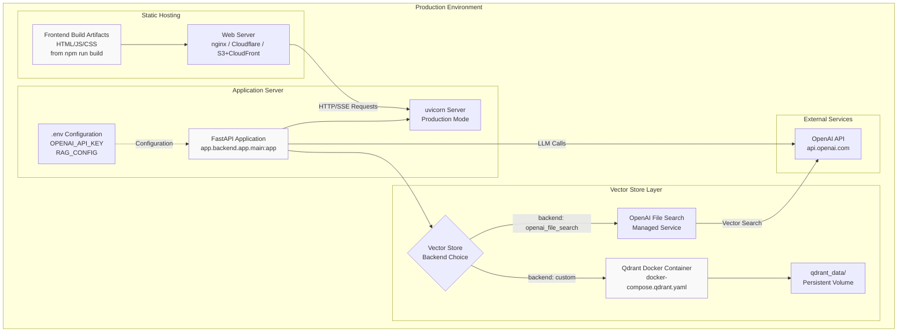
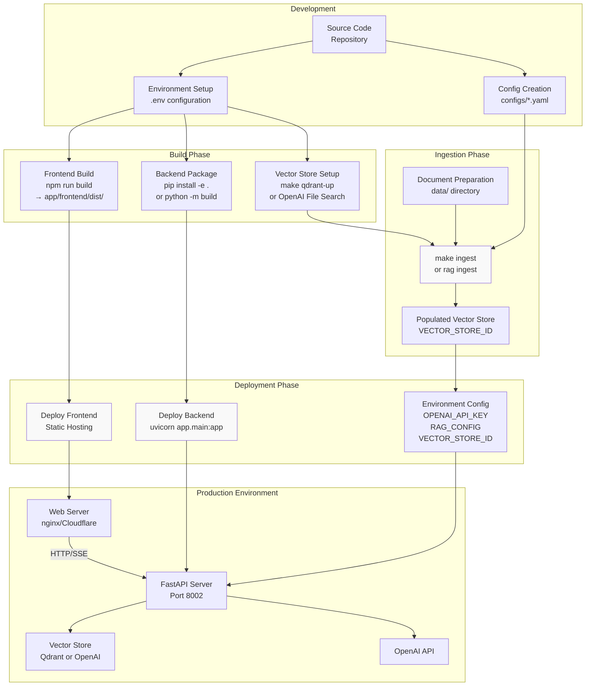
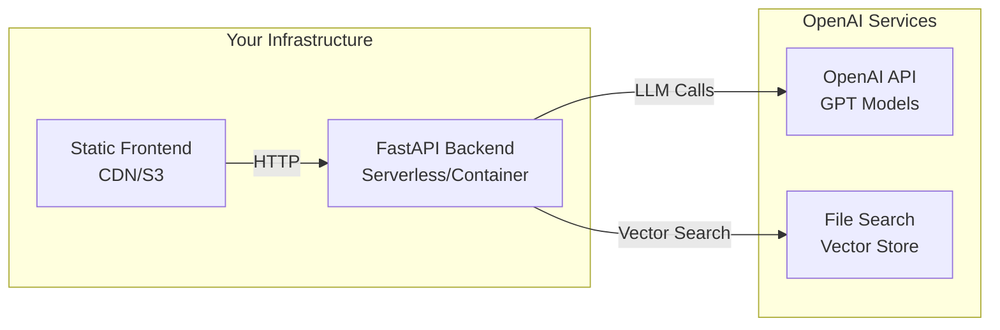
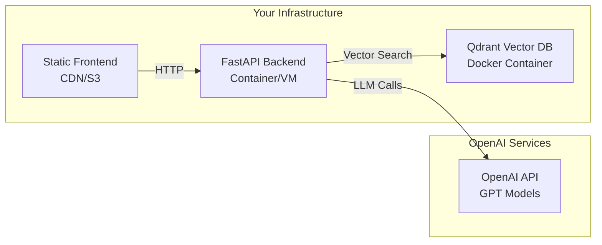

<!-- source: DeepWiki mcp.deepwiki.com · repo openai/openai-knowledge-retrieval · page 9 Deployment · fetched 2026-10-26 -->

# Deployment

<details>
<summary>Relevant source files</summary>

The following files were used as context for generating this wiki page:

- [.gitignore](.gitignore)
- [Makefile](Makefile)
- [README.md](README.md)

</details>


This document provides guidance for deploying the OpenAI Knowledge Retrieval application to production environments. It covers building production-ready artifacts, containerization strategies, configuration management, and deployment architecture options.

For development workflow and local setup, see [Development Guide](#8). For configuration details, see [Configuration](#7).

---

## Deployment Overview

The OpenAI Knowledge Retrieval system consists of three deployable components:

1. **Frontend Application** - React 19 + Vite static site requiring a web server
2. **Backend API Service** - FastAPI application requiring Python runtime
3. **Vector Store** - Either managed OpenAI File Search or self-hosted Qdrant

Each component can be deployed independently, allowing flexible architecture choices based on infrastructure requirements.

### Deployment Architecture



**Sources**: [README.md:1-308](), [Makefile:1-38](), [.gitignore:1-72]()

---

## Production Build Process

For detailed instructions on creating production builds, see [Production Build](#9.1).

### Frontend Build

The frontend application uses Vite to create an optimized production bundle:

```bash
cd app/frontend
npm run build
```

This generates static assets in `app/frontend/dist/` including:
- Minified JavaScript bundles with code splitting
- Optimized CSS with PostCSS/Tailwind
- Static HTML entry point
- Asset fingerprinting for cache management

The build artifacts can be served from any static hosting provider (nginx, Apache, CDN).

### Backend Packaging

The backend FastAPI application is packaged as a Python distribution:

```bash
# Install in production mode (no dev dependencies)
pip install -e .

# Or build a wheel for distribution
python -m build
```

The backend can be deployed as:
- A Python package installed in a production environment
- A Docker image with Python runtime and dependencies
- A serverless function (requires adaptation)

**Build Configuration Files**:
- [app/frontend/package.json]() - defines `build` script and dependencies
- [app/frontend/vite.config.ts]() - Vite build configuration
- [pyproject.toml]() - Python package metadata and dependencies

**Sources**: [README.md:244-249](), [app/frontend/package.json](), [Makefile:15-16]()

---

## Docker Deployment

For comprehensive Docker deployment instructions, see [Docker Deployment](#9.2).

### Qdrant Vector Store

The repository includes Docker Compose configuration for self-hosted Qdrant:

[docker/docker-compose.qdrant.yaml]()

**Starting Qdrant**:
```bash
make qdrant-up
```

This command executes:
```bash
docker compose -f docker/docker-compose.qdrant.yaml up -d
```

**Stopping Qdrant**:
```bash
make qdrant-down
```

This executes:
```bash
docker compose -f docker/docker-compose.qdrant.yaml down --remove-orphans
```

### Persistent Data

Qdrant data is stored in a Docker volume that persists across container restarts. The `.gitignore` configuration excludes local data directories:

- `qdrant_data/` - Local Qdrant data directory
- `docker-data/` - General Docker volume data

In production, ensure these directories (or their Docker volume equivalents) are:
1. Backed up regularly
2. Mounted with appropriate permissions
3. Monitored for disk usage

### Container Orchestration

The Makefile provides basic Docker Compose orchestration. For production deployments, consider:

- **Docker Swarm** - Native Docker orchestration
- **Kubernetes** - Full container orchestration with Helm charts
- **Managed Container Services** - AWS ECS, Google Cloud Run, Azure Container Instances

**Sources**: [Makefile:25-29](), [docker/docker-compose.qdrant.yaml](), [.gitignore:56-58]()

---

## Production Configuration

### Environment Variables

Production deployments require careful environment variable management. Copy and customize `.env.example`:

```bash
cp .env.example .env
```

**Required Variables**:
- `OPENAI_API_KEY` - OpenAI API authentication
- `RAG_CONFIG` - Path to production YAML config (defaults to `configs/default.openai.yaml`)

**Optional Variables**:
- `OPENAI_ORG_ID` - OpenAI organization identifier
- `OPENAI_PROJECT_ID` - OpenAI project identifier
- `VECTOR_STORE_ID` - Existing vector store ID to reuse

**Security Considerations**:
1. Never commit `.env` files (enforced by [.gitignore:17]())
2. Use secrets management (AWS Secrets Manager, HashiCorp Vault)
3. Rotate API keys regularly
4. Use environment-specific configurations

### Configuration Files

Production configurations live in `configs/` directory. The `.gitignore` excludes all configs except defaults:

```
configs/
!configs/default.openai.yaml
!configs/default.qdrant.yaml
```

**Production Configuration Strategy**:
1. Create environment-specific configs: `configs/production.openai.yaml`
2. Reference via `RAG_CONFIG` environment variable
3. Store sensitive values in environment variables, not YAML
4. Use the `env` block in YAML for environment variable fallbacks

Example production config structure:
```yaml
env:
  OPENAI_API_KEY: ${OPENAI_API_KEY}
  OPENAI_PROJECT_ID: ${OPENAI_PROJECT_ID}
  VECTOR_STORE_ID: ${VECTOR_STORE_ID}

synthesis:
  model: gpt-4o-mini
  reasoning_effort: medium
```

**Sources**: [README.md:85-93](), [.env.example](), [.gitignore:65-68]()

---

## Deployment Workflow

The following diagram maps the complete deployment process from code to production:



**Sources**: [README.md:12-42](), [Makefile:1-38]()

---

## Running in Production

### Frontend Serving

The production frontend build produces static files that can be served by any HTTP server:

**nginx Configuration Example**:
```nginx
server {
    listen 80;
    server_name your-domain.com;
    
    root /path/to/app/frontend/dist;
    index index.html;
    
    location / {
        try_files $uri $uri/ /index.html;
    }
    
    # Proxy API requests to backend
    location /knowledge/ {
        proxy_pass http://localhost:8002;
        proxy_http_version 1.1;
        proxy_set_header Upgrade $http_upgrade;
        proxy_set_header Connection 'upgrade';
        proxy_set_header Host $host;
        proxy_cache_bypass $http_upgrade;
    }
}
```

### Backend Service

Run the FastAPI backend with production settings:

```bash
# Production mode (no --reload)
uvicorn app.backend.app.main:app --host 0.0.0.0 --port 8002 --workers 4
```

**Production Server Options**:
- `--host 0.0.0.0` - Bind to all network interfaces
- `--port 8002` - Default port (configurable)
- `--workers N` - Number of worker processes (CPU cores * 2)
- Remove `--reload` flag (development only)

**Process Management**:
Use a process manager for production deployments:
- **systemd** - Linux native service management
- **supervisor** - Python-based process control
- **PM2** - Node.js process manager (can manage Python too)
- **Docker** - Containerized deployment

Example systemd service:
```ini
[Unit]
Description=Knowledge Retrieval Backend
After=network.target

[Service]
Type=simple
User=www-data
WorkingDirectory=/opt/knowledge-retrieval
Environment="PATH=/opt/knowledge-retrieval/.venv/bin"
ExecStart=/opt/knowledge-retrieval/.venv/bin/uvicorn app.backend.app.main:app --host 0.0.0.0 --port 8002 --workers 4
Restart=always

[Install]
WantedBy=multi-user.target
```

**Sources**: [Makefile:18-19](), [app/backend/app/main.py]()

---

## Deployment Architecture Options

### Architecture 1: Fully Managed (OpenAI File Search)



**Pros**:
- Minimal infrastructure management
- Automatic scaling
- No vector database maintenance

**Cons**:
- Vendor lock-in
- Limited customization
- API rate limits

### Architecture 2: Hybrid (Custom Vector Store)



**Pros**:
- Full control over vector operations
- Custom retrieval logic
- No vector search API costs

**Cons**:
- Infrastructure management
- Scaling complexity
- Backup and maintenance

**Sources**: [README.md:186-208](), [configs/default.openai.yaml](), [configs/default.qdrant.yaml]()

---

## Monitoring and Observability

### Health Checks

The backend exposes a health check endpoint at [app/backend/app/main.py]():

```
GET /knowledge/health
```

Use this endpoint for:
- Load balancer health probes
- Container orchestration liveness checks
- Monitoring system uptime checks

### Logging

Configure production logging levels via environment variables or application settings. Key areas to monitor:

- API request/response patterns
- OpenAI API call latency and errors
- Vector search performance
- Document serving metrics

### Metrics

Consider instrumenting the following metrics:
- Request rate per endpoint
- Response time percentiles (p50, p95, p99)
- OpenAI API token usage
- Vector search result quality
- Error rates by type

**Sources**: [app/backend/app/main.py]()

---

## Security Considerations

### API Key Management

1. **Never commit API keys** - Enforced by [.gitignore:17-20]()
2. **Use secrets management** - AWS Secrets Manager, HashiCorp Vault, etc.
3. **Rotate keys regularly** - Implement key rotation policy
4. **Scope API keys** - Use project-specific keys when possible

### Network Security

1. **HTTPS only** - Terminate TLS at load balancer or reverse proxy
2. **CORS configuration** - Restrict allowed origins in production
3. **Rate limiting** - Protect against abuse
4. **Authentication** - Add user authentication layer if needed

### Data Protection

1. **Encrypt at rest** - Vector store data and backups
2. **Encrypt in transit** - HTTPS, TLS for database connections
3. **Access control** - Restrict vector store access
4. **Audit logging** - Track data access patterns

For detailed security policies, see [Security](#10).

**Sources**: [.gitignore:17-20](), [SECURITY.md]()

---

## Troubleshooting Production Issues

### Backend Service Won't Start

Check the following:

1. **Port availability**: `lsof -i :8002`
2. **Environment variables**: Verify `.env` is loaded
3. **Python dependencies**: `pip list` shows correct versions
4. **Configuration file**: Validate `RAG_CONFIG` path exists

The Makefile includes cleanup commands at [Makefile:21-23]():
```bash
make stop-app-backend  # Kills processes on port 8002
```

### Frontend Build Failures

Common issues:
1. **Node version**: Requires Node.js 18.18+
2. **Dependencies**: Run `npm install` in `app/frontend/`
3. **TypeScript errors**: Run `npm run lint` to check
4. **Memory limits**: Increase Node.js heap size for large builds

### Vector Store Connection Issues

**Qdrant**:
- Verify Docker container is running: `docker ps`
- Check port 6333 accessibility
- Verify network configuration in `docker-compose.qdrant.yaml`

**OpenAI File Search**:
- Verify `VECTOR_STORE_ID` is set correctly
- Check API key has access to File Search
- Ensure vector store wasn't deleted

**Sources**: [Makefile:21-29](), [README.md:244-249]()

---

## Next Steps

- For production build details, see [Production Build](#9.1)
- For Docker containerization, see [Docker Deployment](#9.2)
- For security best practices, see [Security](#10)
- For API reference, see [API Reference](#11)

---

