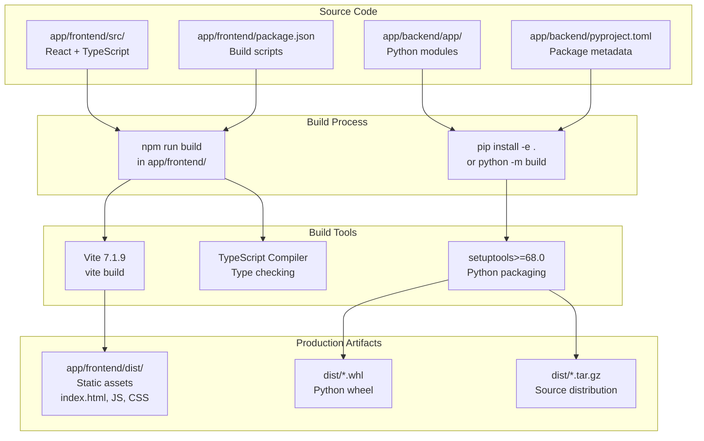
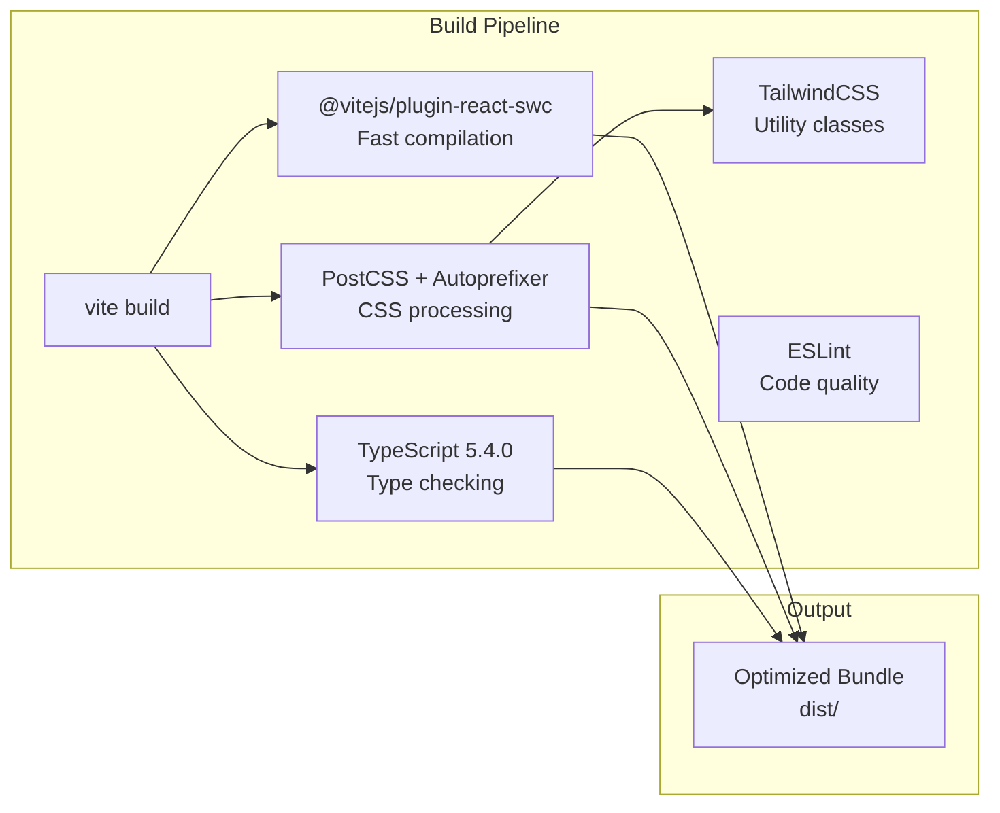
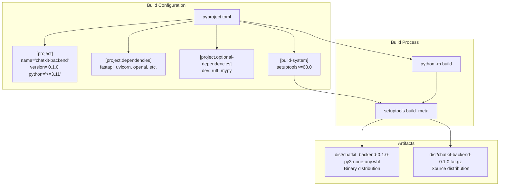
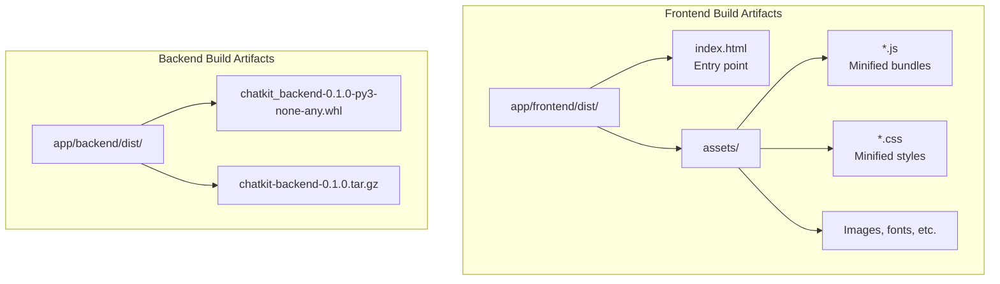

<!-- source: DeepWiki mcp.deepwiki.com · repo openai/openai-knowledge-retrieval · page 9.1 Production Build · fetched 2026-10-26 -->

# Production Build

<details>
<summary>Relevant source files</summary>

The following files were used as context for generating this wiki page:

- [Makefile](Makefile)
- [app/backend/pyproject.toml](app/backend/pyproject.toml)
- [app/frontend/package.json](app/frontend/package.json)

</details>


## Purpose and Scope

This document explains how to create optimized production builds for both the frontend and backend components of the OpenAI Knowledge Retrieval application. It covers build commands, output artifacts, configuration requirements, and optimization strategies. For deployment instructions using these builds, see [Docker Deployment](#9.2). For development server configuration, see [Running the Application](#2.4).

---

## Overview

The production build process creates optimized, minified artifacts suitable for deployment to production environments. The frontend uses Vite's build system to generate static assets, while the backend uses Python's setuptools to create distributable packages.

### Build Process Architecture



**Sources:** [app/frontend/package.json:1-43](), [app/backend/pyproject.toml:1-34](), [Makefile:1-38]()

---

## Frontend Production Build

### Build Command

The frontend production build is executed using the npm build script defined in `package.json`:

```bash
cd app/frontend
npm run build
```

This command invokes `vite build`, which performs the following optimizations:

- **Code splitting**: Breaks the application into smaller chunks for optimal loading
- **Minification**: Reduces JavaScript and CSS file sizes
- **Tree shaking**: Removes unused code from the final bundle
- **Asset optimization**: Optimizes images and other static assets
- **Source maps**: Generates source maps for debugging (configurable)

**Sources:** [app/frontend/package.json:8]()

### Build Output Structure

The build process generates static assets in the `app/frontend/dist/` directory:

| File Type | Location | Description |
|-----------|----------|-------------|
| Entry HTML | `dist/index.html` | Main HTML file with asset references |
| JavaScript | `dist/assets/*.js` | Minified JavaScript bundles with content hashing |
| CSS | `dist/assets/*.css` | Minified stylesheets with content hashing |
| Assets | `dist/assets/*` | Images, fonts, and other static resources |

The generated filenames include content hashes (e.g., `main-a1b2c3d4.js`) to enable aggressive caching strategies.

**Sources:** [app/frontend/package.json:8]()

### Build Dependencies and Tools



**Key build dependencies:**

- **Vite 7.1.9**: Modern build tool with fast HMR and optimized builds
- **@vitejs/plugin-react-swc**: Uses SWC (Rust-based) for faster React compilation
- **TypeScript 5.4.0**: Type checking and compilation
- **Tailwind CSS 3.4.13**: Utility-first CSS framework with PurgeCSS
- **PostCSS 8.4.47**: CSS transformations and autoprefixing

**Sources:** [app/frontend/package.json:30-41]()

### Environment Configuration for Frontend Build

The frontend build requires proper environment configuration. Create a `.env.production` file or set environment variables:

| Variable | Purpose | Example |
|----------|---------|---------|
| `VITE_API_BASE_URL` | Backend API endpoint | `https://api.example.com` |
| `VITE_CHATKIT_CDN_URL` | ChatKit web component URL | CDN path |

Environment variables prefixed with `VITE_` are embedded into the build at compile time and become available to the application code.

**Sources:** [app/frontend/package.json:1-43]()

### Build Verification

After building, verify the output:

```bash
# Check build output
ls -lh app/frontend/dist/

# Preview the production build locally
npm run preview
```

The `preview` command serves the `dist/` folder using Vite's preview server, allowing you to test the production build locally before deployment.

**Sources:** [app/frontend/package.json:9]()

---

## Backend Production Build

### Package Distribution

The backend uses Python's setuptools build system as configured in `pyproject.toml`. To create production-ready distributions:

```bash
cd app/backend

# Option 1: Install in editable mode (development)
pip install -e .

# Option 2: Build distribution packages
python -m build

# Option 3: Install from built package
pip install dist/chatkit_backend-0.1.0-py3-none-any.whl
```

**Sources:** [app/backend/pyproject.toml:1-34](), [Makefile:6-7]()

### Build System Configuration



**Package metadata:**

- **Name**: `chatkit-backend`
- **Version**: `0.1.0`
- **Python requirement**: `>=3.11`
- **Build backend**: `setuptools.build_meta`

**Sources:** [app/backend/pyproject.toml:1-27]()

### Production Dependencies

The backend requires the following runtime dependencies for production:

| Package | Version | Purpose |
|---------|---------|---------|
| `fastapi` | >=0.114.1,<0.116 | Web framework |
| `uvicorn[standard]` | >=0.36,<0.37 | ASGI server |
| `openai` | >=1.40 | OpenAI API client |
| `openai-chatkit` | >=0.0.2 | ChatKit integration |
| `httpx` | >=0.28,<0.29 | HTTP client |
| `python-dotenv` | >=1.0.1 | Environment configuration |
| `qdrant-client` | >=1.13.3 | Vector database client |
| `rapidfuzz` | >=3.8.1 | Fuzzy string matching |
| `rich` | >=13.7.1 | Terminal formatting |

Development dependencies (`ruff`, `mypy`) are not required in production but may be included for debugging.

**Sources:** [app/backend/pyproject.toml:7-17]()

### Production Server Configuration

For production deployment, the backend should be run with a production-grade ASGI server. The development command uses `--reload`:

```bash
# Development (from Makefile)
uvicorn app.main:app --reload --port 8002

# Production (recommended)
uvicorn app.main:app --host 0.0.0.0 --port 8002 --workers 4
```

**Production uvicorn options:**

- `--host 0.0.0.0`: Bind to all network interfaces
- `--workers N`: Number of worker processes (typically CPU count)
- `--no-reload`: Disable auto-reload for stability
- `--log-level info`: Production logging level
- `--proxy-headers`: Trust proxy headers when behind a reverse proxy

**Sources:** [Makefile:18-19]()

---

## Build Artifacts Summary

### Complete Build Output Structure



**Sources:** [app/frontend/package.json:8](), [app/backend/pyproject.toml:1-27]()

### File Size Expectations

Typical production build sizes:

| Artifact | Approximate Size | Notes |
|----------|-----------------|-------|
| Frontend bundle (JS) | 200-500 KB | Gzipped size typically 30-40% of uncompressed |
| Frontend bundle (CSS) | 10-50 KB | Tailwind CSS with PurgeCSS optimization |
| Backend wheel | 10-30 KB | Python code only, dependencies separate |

---

## Environment Configuration for Production

### Required Environment Variables

Both frontend and backend require proper environment configuration for production:

**Backend (.env):**
```bash
OPENAI_API_KEY=sk-...
VECTOR_STORE_ID=vs_...  # If using OpenAI File Search
QDRANT_URL=http://qdrant:6333  # If using Qdrant
```

**Frontend (embedded at build time):**
```bash
VITE_API_BASE_URL=https://api.production.com
```

For detailed environment configuration, see [Environment Variables](#7.1).

**Sources:** [Makefile:1-38]()

---

## Build Optimization Strategies

### Frontend Optimization

1. **Code splitting**: Vite automatically splits code by route and dynamic imports
2. **Asset compression**: Enable gzip/brotli compression in your web server
3. **CDN deployment**: Deploy static assets to a CDN for faster global delivery
4. **Lazy loading**: React components can be lazy-loaded using `React.lazy()`
5. **Bundle analysis**: Use `vite-plugin-bundle-analyzer` to identify large dependencies

### Backend Optimization

1. **Dependency management**: Include only necessary dependencies in production
2. **Worker processes**: Configure uvicorn with multiple workers based on CPU cores
3. **Database connection pooling**: Configure appropriate pool sizes for vector stores
4. **Caching**: Leverage document metadata caching in production

**Sources:** [app/frontend/package.json:1-43](), [app/backend/pyproject.toml:1-34]()

---

## Build Verification Checklist

Before deploying production builds, verify:

**Frontend:**
- [ ] Build completes without errors (`npm run build`)
- [ ] No TypeScript type errors
- [ ] ESLint passes (`npm run lint`)
- [ ] Preview build works locally (`npm run preview`)
- [ ] Environment variables are correctly embedded
- [ ] Asset URLs are correct (relative vs. absolute paths)

**Backend:**
- [ ] Package builds successfully (`python -m build`)
- [ ] All dependencies resolve correctly
- [ ] Production environment variables are set
- [ ] Server starts without errors
- [ ] Health check endpoint responds (`GET /knowledge/health`)
- [ ] No development-only features enabled (e.g., `--reload`)

**Sources:** [app/frontend/package.json:6-11](), [app/backend/pyproject.toml:1-34](), [Makefile:1-38]()

---

## Next Steps

After creating production builds:

1. Deploy using Docker containers (see [Docker Deployment](#9.2))
2. Configure production environment variables (see [Environment Variables](#7.1))
3. Set up monitoring and logging for production services
4. Configure reverse proxy (nginx, Caddy) for serving frontend static assets
5. Implement CI/CD pipelines for automated builds and deployments

**Sources:** [Makefile:1-38]()

---

