# Page: Overview

# Overview

<details>
<summary>Relevant source files</summary>

The following files were used as context for generating this wiki page:

- [LICENSE](LICENSE)
- [README.md](README.md)

</details>


## Purpose and Scope

This document provides a high-level introduction to the OpenAI Knowledge Retrieval starter kit—a production-ready framework for building Retrieval Augmented Generation (RAG) applications. This page covers the system's purpose, architecture, key components, and how they work together to enable document-based question answering with citations.

For detailed setup instructions, see [Getting Started](#2). For in-depth technical documentation of individual components, see [Backend Components](#4) and [Frontend Components](#5). For configuration options, see [Configuration](#7).

## What is OpenAI Knowledge Retrieval?

OpenAI Knowledge Retrieval is a config-first RAG starter kit that combines OpenAI's File Search, ChatKit UI components, and Evals platform into a cohesive application. The system enables organizations to build conversational interfaces over their proprietary documents, providing answers with verifiable citations back to source material.

The repository is located at https://github.com/openai/openai-knowledge-retrieval and is distributed under the MIT License.

**Sources**: [README.md:1-8](), [LICENSE:1-22]()

## Key Features

| Feature | Description | Configuration |
|---------|-------------|---------------|
| **YAML-First Configuration** | Define ingestion, retrieval, and synthesis behavior without editing code | `configs/*.yaml` files |
| **Multiple Vector Stores** | Support for OpenAI File Search (managed) or custom stores like Qdrant | `vector_store.backend` setting |
| **Typed Pipelines** | Pydantic-validated data models throughout ingestion and retrieval | `ingestion/`, `retrieval/` modules |
| **ChatKit UI** | Pre-built React components for conversational interface | `@openai/chatkit-react` package |
| **Evaluation Harness** | Generate synthetic datasets and measure retrieval quality | `evals/` module, `rag eval` command |
| **Pluggable Chunking** | Multiple strategies (recursive, heading-based, XML-aware) | `chunking` configuration block |
| **Query Enhancement** | Optional query expansion and HyDE for improved retrieval | `query.expansion`, `query.hyde` settings |
| **LLM-Based Reranking** | Cross-encoder reranking using language models | `query.rerank` configuration |

**Sources**: [README.md:44-52]()

## System Architecture

The following diagram shows how the major system components relate to each other and map to actual code entities:

### Component Relationship Diagram

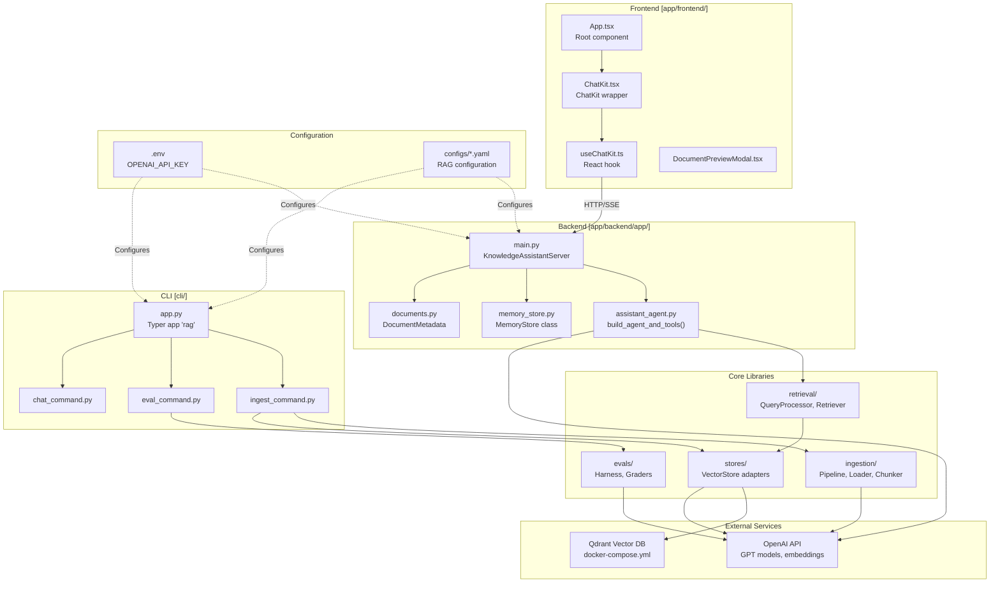

**Sources**: [README.md:54-66](), [app/backend/app/main.py:1-50](), [cli/app.py:1-30]()

## System Components

### Frontend Application

The frontend is a React 19 + Vite application located in `app/frontend/` that provides a conversational interface for querying documents.

**Key Files**:
- [app/frontend/src/App.tsx]() - Root component with theme management
- [app/frontend/src/chatkit-react/ChatKit.tsx]() - ChatKit web component wrapper
- [app/frontend/src/chatkit-react/useChatKit.ts]() - React hook for ChatKit integration
- [app/frontend/src/components/DocumentPreviewModal.tsx]() - Document viewer

The frontend communicates with the backend via HTTP and Server-Sent Events (SSE) for streaming responses. See [Frontend Architecture](#3.3) for details.

**Sources**: [README.md:241-249](), [app/frontend/package.json:1-20]()

### Backend Services

The backend is a FastAPI application located in `app/backend/app/` that orchestrates AI agents, manages conversation threads, and serves documents.

**Core Classes**:
- `KnowledgeAssistantServer` in [app/backend/app/main.py]() - Main API server
- `build_agent_and_tools()` in [app/backend/app/assistant_agent.py]() - Agent initialization
- `MemoryStore` in [app/backend/app/memory_store.py]() - Thread/message persistence
- `DocumentMetadata` in [app/backend/app/documents.py]() - Document metadata handling

**API Endpoints**:
- `POST /knowledge/chatkit` - ChatKit request handler
- `GET /knowledge/documents` - List available documents
- `GET /knowledge/documents/:id/file` - Download document files
- `GET /knowledge/threads/:id/citations` - Retrieve citations for a thread
- `GET /knowledge/health` - Health check endpoint

See [Backend Architecture](#3.2) for detailed documentation.

**Sources**: [README.md:60](), [app/backend/app/main.py:1-100]()

### CLI Tools

The `rag` CLI is a Typer-based command-line application located in `cli/` that provides administrative functions.

**Commands**:
- `rag init` - Generate configuration templates
- `rag ingest` - Process documents and populate vector store
- `rag chat` - Interactive chat in terminal
- `rag eval` - Run evaluation harness

The CLI shares core libraries with the backend but operates independently. See [CLI Tools](#6) for usage documentation.

**Sources**: [README.md:56](), [cli/app.py:1-50]()

### Core Libraries

The repository includes several core Python packages that implement RAG functionality:

| Package | Purpose | Key Modules |
|---------|---------|-------------|
| `ingestion/` | Document loading, chunking, preprocessing | `pipeline.py`, `loaders/`, `chunkers/` |
| `retrieval/` | Query processing, retrieval, reranking | `query_processor.py`, `retriever.py` |
| `stores/` | Vector store abstractions | `base.py`, `openai_store.py`, `qdrant_store.py` |
| `evals/` | Evaluation harness, graders, reporters | `harness.py`, `graders/`, `reporters/` |

**Sources**: [README.md:54-66]()

### External Services

The system integrates with two primary external services:

**OpenAI API**:
- GPT models for response synthesis
- Embeddings API for vector generation
- File Search for managed vector storage
- Evals platform for evaluation tracking

**Qdrant Vector Database** (optional):
- Self-hosted vector search
- Deployed via Docker Compose
- Accessible at `http://localhost:6333` by default

Configuration determines which vector store backend is used. See [Vector Store Configuration](#7.3) for details.

**Sources**: [README.md:48-49](), [README.md:109-114]()

## Repository Structure

The following diagram maps the repository directory structure to functional areas:

```mermaid
graph TB
    root["Repository Root"]
    
    subgraph "Application Layer"
        app["app/"]
        backend["app/backend/<br/>FastAPI server"]
        frontend["app/frontend/<br/>React + Vite UI"]
    end
    
    subgraph "Core Functionality"
        cli["cli/<br/>Typer CLI 'rag'"]
        ingestion["ingestion/<br/>Document processing"]
        retrieval["retrieval/<br/>Query & retrieval"]
        stores["stores/<br/>Vector store adapters"]
        evals["evals/<br/>Evaluation harness"]
    end
    
    subgraph "Configuration & Data"
        configs["configs/<br/>YAML configs"]
        templates["templates/<br/>Config templates"]
        prompts["prompts/<br/>LLM prompts"]
        data["data/<br/>Document corpus"]
    end
    
    subgraph "Development"
        tests["tests/<br/>Test suites"]
        docs["docs/<br/>Documentation"]
        makefile["Makefile<br/>Task orchestration"]
        envexample[".env.example<br/>Config template"]
    end
    
    root --> app
    root --> cli
    root --> ingestion
    root --> retrieval
    root --> stores
    root --> evals
    root --> configs
    root --> templates
    root --> prompts
    root --> data
    root --> tests
    root --> docs
    root --> makefile
    root --> envexample
    
    app --> backend
    app --> frontend
```

**Sources**: [README.md:54-66]()

## Technology Stack

### Backend Stack

| Component | Technology | Version |
|-----------|----------|---------|
| **Language** | Python | 3.10+ |
| **Web Framework** | FastAPI | 0.111+ |
| **LLM Integration** | OpenAI Python SDK | Latest |
| **CLI Framework** | Typer | Latest |
| **Data Validation** | Pydantic | Latest |
| **Vector Store** | Qdrant (optional) | Latest |

### Frontend Stack

| Component | Technology | Version |
|-----------|----------|---------|
| **Language** | TypeScript | Latest |
| **Framework** | React | 19 |
| **Build Tool** | Vite | Latest |
| **UI Library** | @openai/chatkit-react | Latest |
| **Styling** | Tailwind CSS | Latest |
| **Icons** | Lucide React | Latest |

**Sources**: [README.md:3-5](), [README.md:242](), [README.md:302-307]()

## How It Works: RAG Pipeline Overview

The system implements a complete RAG pipeline from document ingestion through response generation:

### RAG Pipeline Flow

```mermaid
graph LR
    subgraph "1. Ingestion"
        Docs["Documents<br/>data/"]
        Load["Loader<br/>ingestion/loaders/"]
        Chunk["Chunker<br/>ingestion/chunkers/"]
        Embed["Embeddings API"]
        Store["Vector Store"]
    end
    
    subgraph "2. Query Processing"
        Query["User Query"]
        Expand["Query Expansion<br/>retrieval/query_processor.py"]
        HyDE["HyDE Generation"]
    end
    
    subgraph "3. Retrieval"
        Search["Vector Search<br/>retrieval/retriever.py"]
        Filter["Similarity Filter"]
        Rerank["LLM Reranker"]
    end
    
    subgraph "4. Synthesis"
        Context["Context Assembly"]
        LLM["GPT Model"]
        Citations["Citation Extraction<br/>main.py"]
    end
    
    subgraph "5. Response"
        Stream["SSE Stream"]
        UI["ChatKit UI"]
    end
    
    Docs --> Load
    Load --> Chunk
    Chunk --> Embed
    Embed --> Store
    
    Query --> Expand
    Expand --> HyDE
    HyDE --> Search
    
    Store --> Search
    Search --> Filter
    Filter --> Rerank
    
    Rerank --> Context
    Context --> LLM
    LLM --> Citations
    
    Citations --> Stream
    Stream --> UI
```

### Pipeline Stages

1. **Ingestion Phase** (`rag ingest`):
   - Load documents from `data/` directory using format-specific loaders
   - Apply chunking strategy (recursive, heading-based, XML-aware, etc.)
   - Generate embeddings via OpenAI API
   - Store vectors in chosen backend (OpenAI File Search or Qdrant)

2. **Query Processing**:
   - Receive user query through ChatKit UI
   - Optionally expand query with LLM-generated variants
   - Optionally generate hypothetical document (HyDE)

3. **Retrieval**:
   - Perform vector similarity search
   - Apply similarity threshold filtering
   - Optionally rerank results with cross-encoder LLM

4. **Synthesis**:
   - Assemble retrieved chunks into context
   - Include conversation history from `MemoryStore`
   - Generate response with configured GPT model
   - Extract citations from annotations or chunk metadata

5. **Response Streaming**:
   - Stream response tokens via Server-Sent Events
   - Deliver citations with document references
   - Display in ChatKit UI with clickable annotations

Each stage is configurable via YAML. See [RAG Configuration Files](#7.2) for available options.

**Sources**: [README.md:7-8](), [README.md:210-223]()

## Configuration System

The system is designed to be configuration-first, with minimal code changes required to customize behavior.

### Configuration Hierarchy

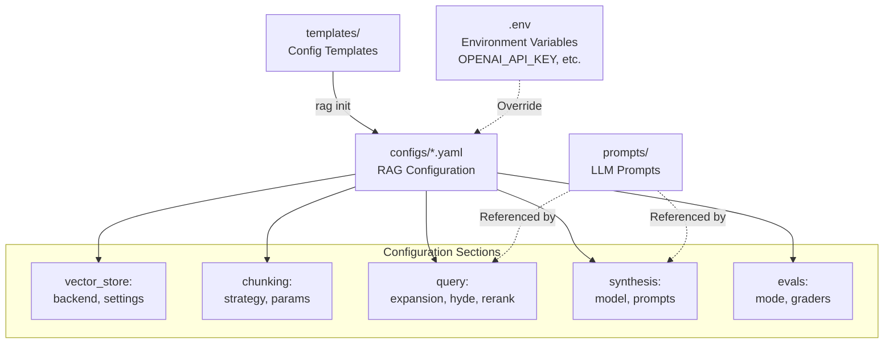

**Configuration Files**:
- `.env` - API keys and environment-specific settings
- `configs/*.yaml` - RAG pipeline configuration
- `templates/` - Starter configuration templates
- `prompts/` - LLM prompt templates

Use `rag init --template <name>` to generate configuration from templates. Available templates include `openai` (default, uses File Search) and `custom-qdrant` (self-hosted vector store).

**Sources**: [README.md:86-107](), [README.md:151-239]()

## Evaluation System

The repository includes a comprehensive evaluation harness for measuring retrieval quality:

### Evaluation Modes

| Mode | Description | Dataset Source |
|------|-------------|----------------|
| **Auto** | Synthesize evaluation data from ingested documents | LLM-generated questions from chunks |
| **User** | Use curated evaluation datasets | JSONL files in `evals/datasets/` |

### Grading Metrics

- **Groundedness** - Verify answer is supported by retrieved context
- **Relevance** - Measure answer relevance to user query
- **Exact Match (EM)** - Compare against golden answers
- **F1 Score** - Token-level overlap with golden answers
- **Custom Rubrics** - Define domain-specific evaluation criteria

### OpenAI Evals Integration

When `evals.openai_evals.enabled: true`, results are mirrored to OpenAI's Evals dashboard for visualization and tracking. Local reports are always generated in `evals/reports/` (Markdown and HTML formats).

Run evaluations with: `rag eval --config configs/my.yaml`

See [Evaluation System](#6.3) for detailed documentation.

**Sources**: [README.md:252-286](), [README.md:141-149]()

## Development Orchestration

The `Makefile` provides a unified interface for all development tasks:

### Key Make Targets

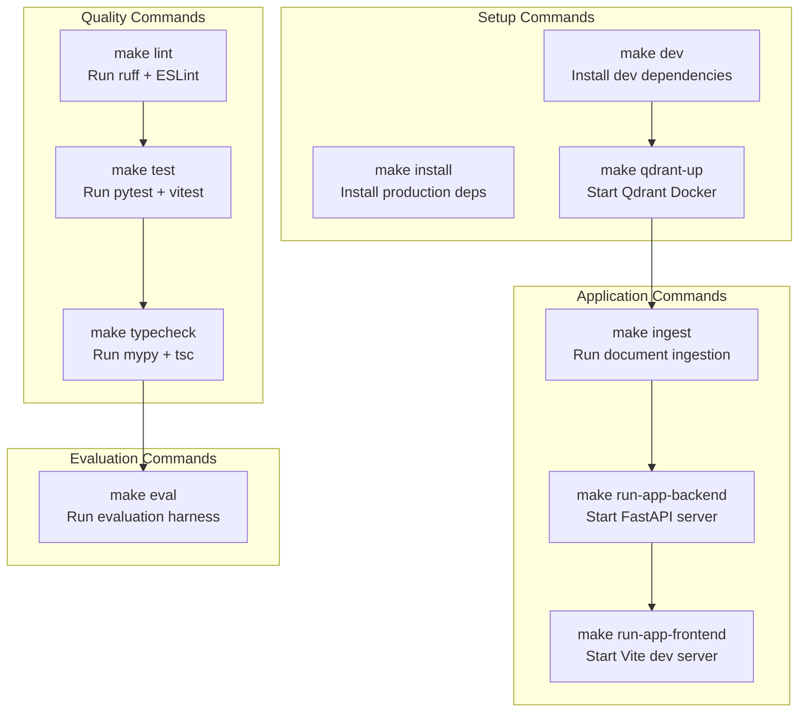

The Makefile orchestrates all services and provides consistent commands across backend, frontend, and CLI components.

**Sources**: [README.md:16-42]()

## Next Steps

- **Setup**: Follow [Getting Started](#2) to install dependencies and configure the system
- **Architecture**: Explore [Architecture](#3) for detailed component documentation
- **Configuration**: Review [Configuration](#7) to customize RAG pipeline behavior
- **Development**: See [Development Guide](#8) for contribution guidelines
- **API Reference**: Consult [API Reference](#11) for endpoint and interface documentation

**Sources**: [README.md:1-308]()

---

# Page: Getting Started

# Getting Started

<details>
<summary>Relevant source files</summary>

The following files were used as context for generating this wiki page:

- [.env.example](.env.example)
- [CONTRIBUTING.md](CONTRIBUTING.md)
- [Makefile](Makefile)
- [README.md](README.md)

</details>


This page guides you through setting up the OpenAI Knowledge Retrieval starter kit, from initial installation to running your first knowledge-grounded conversation. You will clone the repository, configure credentials, ingest documents, and launch both backend and frontend services.

For detailed information on specific topics, see:
- Prerequisites and dependency requirements: [Prerequisites and Environment Setup](#2.1)
- Detailed installation steps: [Installation](#2.2)
- Configuration file structure and options: [Configuration](#2.3)
- Running development and production servers: [Running the Application](#2.4)

## Overview

The setup process follows a linear progression through five phases:

1. **Environment Setup**: Clone repository, create Python virtual environment, install dependencies
2. **Credential Configuration**: Copy `.env.example` to `.env` and provide API keys
3. **Data Ingestion**: Process documents and populate vector store
4. **Service Launch**: Start backend API server and frontend development server
5. **Verification**: Access the UI and test retrieval functionality

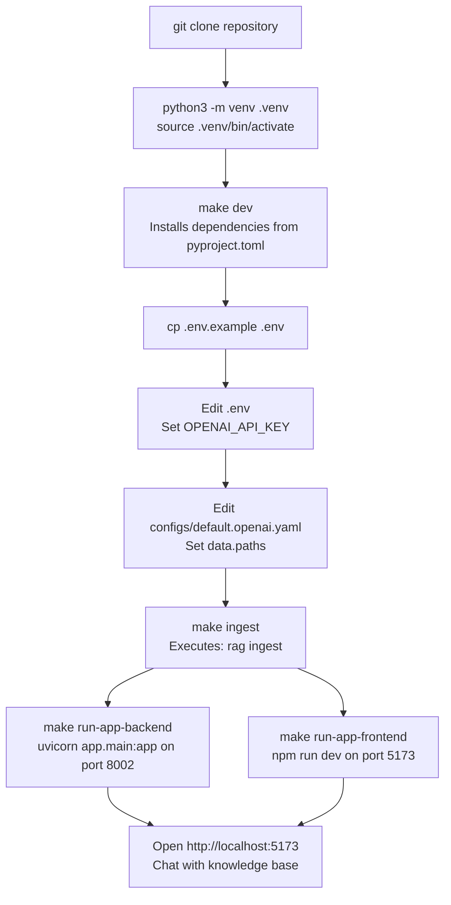

**Sources**: [README.md:12-42](), [CONTRIBUTING.md:10-33]()

## Quick Start

### Step 1: Clone and Install Backend Dependencies

```bash
# Clone the repository
git clone https://github.com/openai/openai-knowledge-retrieval
cd openai-knowledge-retrieval

# Create and activate Python virtual environment
python3 -m venv .venv
source .venv/bin/activate  # On Windows: .venv\Scripts\activate

# Install backend dependencies with development extras
make dev
```

The `make dev` target installs the project in editable mode with development dependencies including testing frameworks, linters, and type checkers defined in [pyproject.toml]().

**Alternative**: Use `make install` for production installation without development extras.

**Sources**: [README.md:17-20](), [CONTRIBUTING.md:12-18](), [Makefile:9-10]()

### Step 2: Configure Credentials

```bash
# Copy environment template
cp .env.example .env
```

Edit `.env` and set your OpenAI API key:

```bash
OPENAI_API_KEY="sk-proj-..."
```

| Variable | Required | Purpose |
|----------|----------|---------|
| `OPENAI_API_KEY` | Yes | Authentication for OpenAI API calls |
| `OPENAI_ORG_ID` | No | Organization identifier for API requests |
| `OPENAI_PROJECT_ID` | No | Project identifier for cost tracking |
| `RAG_CONFIG` | No | Path to YAML config (defaults to `configs/default.openai.yaml`) |
| `VECTOR_STORE_ID` | No | Reuse existing OpenAI vector store instead of creating new one |
| `KNOWLEDGE_CORS_ALLOW_ORIGINS` | No | CORS origins for API (defaults to localhost ports) |

**Sources**: [README.md:22-24](), [.env.example:1-6](), [CONTRIBUTING.md:27-32]()

### Step 3: Configure Data Sources

The default configuration file `configs/default.openai.yaml` references example data. To use your own documents:

```bash
# Option 1: Edit the default config directly
nano configs/default.openai.yaml

# Option 2: Generate a new config from template
rag init --template openai > configs/my-project.yaml
```

Update the `data.paths` section to point to your document directory:

```yaml
data:
  paths:
    - "data/my_documents/"  # Your document path
```

If you created a custom config, set it in `.env`:

```bash
RAG_CONFIG="configs/my-project.yaml"
```

**Sources**: [README.md:26-27](), [README.md:95-106]()

### Step 4: Ingest Documents

```bash
make ingest
```

This executes `rag ingest --config configs/default.openai.yaml` (or your configured path), which:
1. Loads documents from paths specified in the YAML config
2. Chunks text according to the configured chunking strategy
3. Generates embeddings via OpenAI Embeddings API
4. Uploads to the configured vector store (OpenAI File Search by default)

The command outputs a `vector_store_id` upon completion. For OpenAI File Search, you can persist this ID in `.env` to reuse the vector store across ingestion runs:

```bash
VECTOR_STORE_ID="vs_abc123..."
```

**Sources**: [README.md:29-30](), [README.md:117-123](), [Makefile:31-32]()

### Step 5: Launch Backend Service

```bash
make run-app-backend
```

This starts the FastAPI application via `uvicorn app.main:app --reload --port 8002` with hot-reloading enabled. The backend service:
- Loads configuration from `$RAG_CONFIG` or `configs/default.openai.yaml`
- Initializes the `KnowledgeAssistantServer` class from [app/backend/app/main.py]()
- Exposes HTTP endpoints at `http://localhost:8002`
- Connects to OpenAI API using credentials from `.env`

The terminal will display:

```
INFO:     Uvicorn running on http://127.0.0.1:8002 (Press CTRL+C to quit)
INFO:     Started reloader process
INFO:     Started server process
INFO:     Waiting for application startup.
INFO:     Application startup complete.
```

**Sources**: [README.md:32-34](), [Makefile:18-19]()

### Step 6: Launch Frontend Service

In a separate terminal:

```bash
# Ensure you're in the project root
cd openai-knowledge-retrieval

# Start frontend development server
make run-app-frontend
```

This navigates to `app/frontend/`, installs npm dependencies if needed, and runs `npm run dev`. The Vite development server starts on `http://localhost:5173` and provides:
- Hot module replacement for instant UI updates
- Proxy configuration to backend API
- React 19 application with ChatKit integration

**Sources**: [README.md:35-36](), [Makefile:15-16]()

### Step 7: Access the Application

Open your browser to `http://localhost:5173`. The interface provides:
- Chat input for natural language queries
- Streaming response display with citations
- Document preview modal for referenced sources
- Conversation history preservation

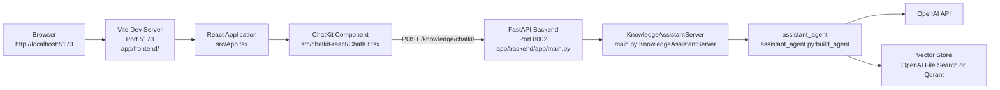

**Sources**: [README.md:37-38]()

## Service Communication Flow

The following diagram maps the runtime interaction between components, showing how HTTP requests flow from the browser through the React application to the FastAPI backend, and how the backend orchestrates calls to external services.

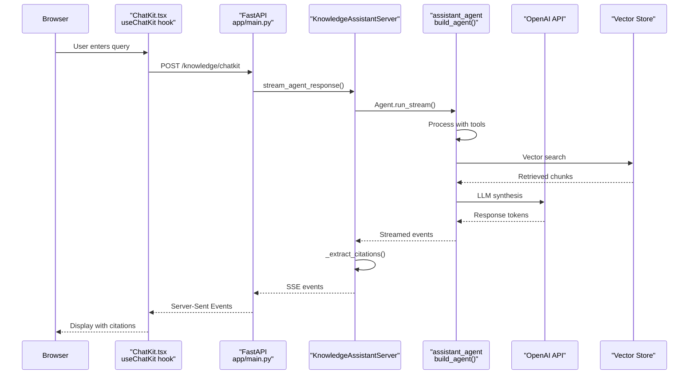

**Sources**: [app/backend/app/main.py](), [app/backend/app/assistant_agent.py]()

## Verification Steps

After launching both services, verify the setup:

### Backend Health Check

```bash
curl http://localhost:8002/knowledge/health
```

Expected response:
```json
{"status": "healthy"}
```

### Document List

```bash
curl http://localhost:8002/knowledge/documents
```

Returns JSON array of ingested documents with metadata.

### Frontend Access

Navigate to `http://localhost:5173` and verify:
- Chat interface loads without errors
- Browser console shows no connection errors
- Test query returns a response with citations

**Sources**: [app/backend/app/main.py]() (health endpoint)

## Common Setup Issues

| Issue | Cause | Solution |
|-------|-------|----------|
| `ModuleNotFoundError` | Virtual environment not activated | Run `source .venv/bin/activate` |
| `401 Unauthorized` from OpenAI | Invalid or missing API key | Verify `OPENAI_API_KEY` in `.env` |
| Backend fails to start | Port 8002 already in use | Use `make stop-app-backend` or change port |
| Frontend can't connect to backend | Backend not running | Ensure `make run-app-backend` is running |
| No documents returned | Ingestion not completed | Run `make ingest` and wait for completion |
| CORS errors in browser | Origins not whitelisted | Check `KNOWLEDGE_CORS_ALLOW_ORIGINS` in `.env` |

**Sources**: [.env.example:6](), [Makefile:21-23]()

## Optional: Qdrant Vector Store

To use a local Qdrant instance instead of OpenAI File Search:

```bash
# Start Qdrant in Docker
make qdrant-up

# Generate config with Qdrant template
rag init --template custom-qdrant > configs/qdrant.yaml

# Update RAG_CONFIG in .env
echo 'RAG_CONFIG="configs/qdrant.yaml"' >> .env

# Ingest to Qdrant
make ingest
```

The Qdrant instance runs on `http://localhost:6333` and provides a web UI at the same address.

**Sources**: [README.md:108-114](), [Makefile:25-29]()

## Next Steps

After completing the setup:

1. **Customize Configuration**: Modify YAML files to adjust chunking, retrieval, and synthesis parameters. See [Configuration](#2.3) for available options.

2. **Ingest Your Data**: Replace example documents with your own corpus and re-run ingestion. See [Data Ingestion](#6.2) for details.

3. **Run Evaluations**: Generate synthetic evaluation datasets and measure retrieval quality:
   ```bash
   make eval
   ```
   See [Evaluation System](#6.3) for evaluation workflows.

4. **Explore Architecture**: Understand the system components and data flows in [Architecture](#3).

5. **Customize the Agent**: Modify tools, prompts, and retrieval logic in [Assistant Agent System](#4.2).

**Sources**: [README.md:142-150]()

---

# Page: Prerequisites and Environment Setup

# Prerequisites and Environment Setup

<details>
<summary>Relevant source files</summary>

The following files were used as context for generating this wiki page:

- [CONTRIBUTING.md](CONTRIBUTING.md)
- [README.md](README.md)
- [app/backend/pyproject.toml](app/backend/pyproject.toml)
- [app/frontend/package.json](app/frontend/package.json)

</details>


## Purpose and Scope

This page documents the system requirements, dependency versions, and initial environment preparation needed before installing the OpenAI Knowledge Retrieval starter kit. It covers the prerequisites for both backend (Python/FastAPI) and frontend (Node.js/React) components, as well as external service requirements.

For the actual installation steps, see [Installation](#2.2). For configuring API keys and environment variables after setup, see [Configuration](#2.3).

---

## System Requirements Overview

The starter kit requires both Python and Node.js environments, with specific version constraints to ensure compatibility with dependencies.

### Minimum Version Requirements

| Component | Minimum Version | Source |
|-----------|----------------|---------|
| Python | 3.10 | General requirement |
| Python (Backend) | 3.11 | Backend-specific constraint |
| Node.js | 18.18 | Frontend requirement |
| npm | 9 | Frontend package manager |
| Docker | Latest stable | Optional, for Qdrant |

**Sources**: [README.md:72-74](), [CONTRIBUTING.md:36](), [app/backend/pyproject.toml:6](), [app/frontend/package.json:13-14]()

### Version Constraint Rationale

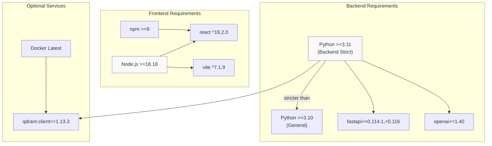

**Diagram**: Version dependency hierarchy showing how the backend enforces Python 3.11+ (stricter than the general 3.10+ requirement) due to the `pyproject.toml` constraint at [app/backend/pyproject.toml:6](). The frontend requires Node.js 18.18+ as specified in [app/frontend/package.json:13]().

**Sources**: [app/backend/pyproject.toml:6-17](), [app/frontend/package.json:13-14,16-21]()

---

## Python Environment Requirements

### Version Verification

The backend service requires Python 3.11 or later, despite the general project documentation mentioning 3.10+. This is enforced by the `requires-python` field in the backend's project manifest.

```bash
# Verify Python version
python3 --version
# Should output: Python 3.11.x or higher
```

### Virtual Environment Tooling

The project uses Python's built-in `venv` module for environment isolation. This approach is documented in both the quickstart and contribution guides.

| Tool | Command | Purpose |
|------|---------|---------|
| `venv` | `python3 -m venv .venv` | Create isolated environment |
| `activate` | `source .venv/bin/activate` | Enable environment (Unix) |
| `activate.bat` | `.venv\Scripts\activate.bat` | Enable environment (Windows) |

**Sources**: [README.md:18-20](), [CONTRIBUTING.md:15-17]()

### Backend Python Dependencies

The backend requires the following core dependencies, managed through the `pyproject.toml` build system:

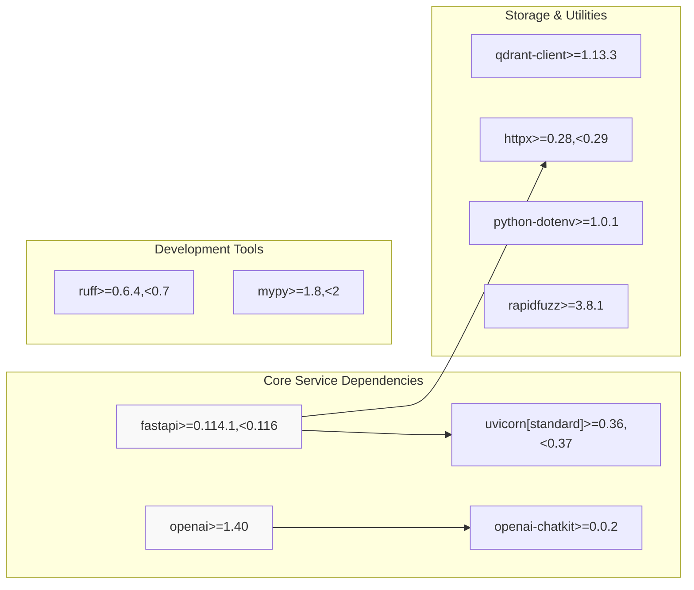

**Diagram**: Backend dependency graph showing the core service layer (`fastapi`, `uvicorn`), OpenAI integration (`openai`, `openai-chatkit`), vector storage (`qdrant-client`), and development tooling (`ruff`, `mypy`).

**Sources**: [app/backend/pyproject.toml:7-23]()

---

## Node.js Environment Requirements

### Version Verification

The frontend application requires Node.js 18.18 or later and npm 9 or later. These constraints are enforced via the `engines` field in `package.json`.

```bash
# Verify Node.js version
node --version
# Should output: v18.18.x or higher

# Verify npm version
npm --version
# Should output: 9.x.x or higher
```

**Sources**: [app/frontend/package.json:12-15]()

### Frontend Dependency Stack

The frontend is built with React 19 and Vite 7, using modern JavaScript tooling:

| Category | Key Dependencies | Purpose |
|----------|-----------------|---------|
| **Core Framework** | `react@^19.2.0`, `react-dom@^19.2.0` | UI framework |
| **Build Tool** | `vite@^7.1.9`, `@vitejs/plugin-react-swc@^3.5.0` | Development server and bundler |
| **OpenAI Integration** | `@openai/chatkit-react@^0` | ChatKit component library |
| **Styling** | `tailwindcss@^3.4.13`, `postcss@^8.4.47` | CSS utilities |
| **Type Checking** | `typescript@^5.4.0` | Static type analysis |
| **Linting** | `eslint@^8.57.1`, `@typescript-eslint/parser@^7.18.0` | Code quality |

**Sources**: [app/frontend/package.json:16-42]()

### Node.js Environment Compatibility

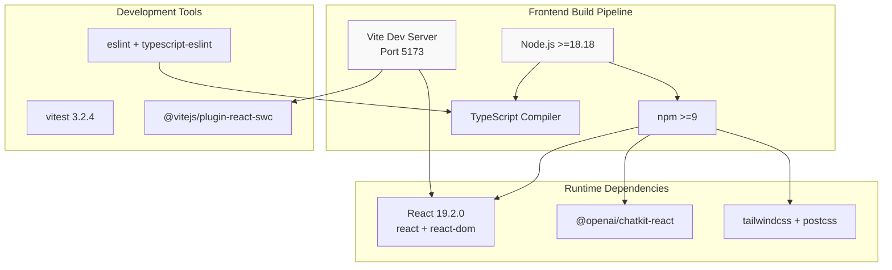

**Diagram**: Frontend environment dependency tree starting from Node.js and npm, flowing through the build pipeline (Vite, TypeScript) to runtime dependencies (React 19, ChatKit) and development tooling (ESLint, Vitest).

**Sources**: [app/frontend/package.json:12-42]()

---

## External Service Requirements

### OpenAI API Access

An OpenAI API key with specific capabilities is required for the system to function. This is the only mandatory external service.

| Requirement | Details | Environment Variable |
|-------------|---------|---------------------|
| **API Key** | Valid OpenAI API key | `OPENAI_API_KEY` |
| **File Search Access** | Enabled for account | N/A |
| **Evals Access** | Optional, for evaluation harness | N/A |
| **Organization ID** | Optional, for multi-org accounts | `OPENAI_ORG_ID` |
| **Project ID** | Optional, for project isolation | `OPENAI_PROJECT_ID` |

**Sources**: [README.md:74](), [README.md:88-93]()

### Vector Store Options

The system supports two vector store backends, selectable via configuration:

#### Option 1: OpenAI File Search (Managed)

- **Requirements**: None beyond API key
- **Setup**: Automatic during ingestion
- **Configuration**: `vector_store.backend: openai_file_search`
- **Storage**: Cloud-hosted by OpenAI

#### Option 2: Qdrant (Self-Hosted)

- **Requirements**: Docker installed and running
- **Setup**: `make qdrant-up` starts container
- **Configuration**: `vector_store.backend: custom` with `custom.kind: qdrant`
- **Storage**: Local Docker volume, port 6333

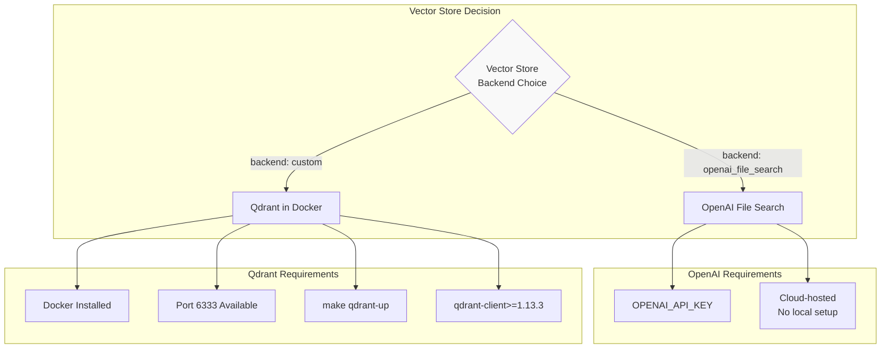

**Diagram**: Vector store backend selection decision tree showing the two supported options and their respective requirements. OpenAI File Search requires only an API key, while Qdrant requires Docker and opens port 6333.

**Sources**: [README.md:48,109-114](), [README.md:186-208]()

---

## Environment Preparation Workflow

### Pre-Installation Checklist

Before proceeding to installation ([Installation](#2.2)), verify the following environment conditions:

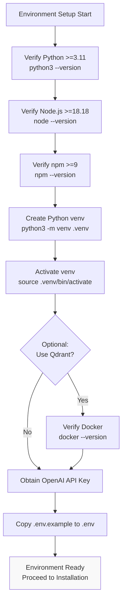

**Diagram**: Sequential environment preparation workflow from version verification through virtual environment creation to final readiness state. This maps to the steps in [CONTRIBUTING.md:12-32]().

**Sources**: [CONTRIBUTING.md:12-32](), [README.md:16-31]()

### Step-by-Step Preparation Commands

| Step | Command | Verification |
|------|---------|--------------|
| **1. Check Python** | `python3 --version` | Output shows >=3.11 |
| **2. Check Node.js** | `node --version` | Output shows >=18.18 |
| **3. Check npm** | `npm --version` | Output shows >=9 |
| **4. Create venv** | `python3 -m venv .venv` | `.venv/` directory created |
| **5. Activate venv** | `source .venv/bin/activate` | Prompt shows `(.venv)` |
| **6. Check Docker** | `docker --version` | Output shows version (optional) |
| **7. Copy env file** | `cp .env.example .env` | `.env` file exists |

On Windows, step 5 changes to `.venv\Scripts\activate.bat` or `.venv\Scripts\Activate.ps1` for PowerShell.

**Sources**: [CONTRIBUTING.md:15-17,27-32](), [README.md:18-24]()

---

## Environment Verification

### Python Environment Verification

After activating the virtual environment, verify that Python is correctly isolated:

```bash
# Should point to .venv/bin/python3
which python3

# Should show the venv-specific path
echo $VIRTUAL_ENV
```

The `$VIRTUAL_ENV` variable should point to the `.venv` directory in your project root.

### Node.js Environment Verification

Verify Node.js and npm are accessible and meet version requirements:

```bash
# Check Node.js
node --version

# Check npm
npm --version

# Verify npm can access registry
npm ping
```

### Docker Verification (Optional)

If using Qdrant, verify Docker is operational:

```bash
# Check Docker daemon
docker info

# Verify Docker Compose
docker compose version

# Test Docker permissions (Unix)
docker ps
```

**Sources**: [README.md:109-114]()

---

## Common Environment Issues

### Python Version Mismatch

**Problem**: System Python is 3.10, but backend requires 3.11+

**Solution**: Install Python 3.11+ using your system package manager or [python.org](https://www.python.org/downloads/), then explicitly use `python3.11 -m venv .venv`

### Node.js Version Mismatch

**Problem**: System Node.js is below 18.18

**Solution**: Use a Node version manager (nvm, fnm, or volta) to install Node.js 18.18 or later:

```bash
# Example with nvm
nvm install 18.18
nvm use 18.18
```

### Virtual Environment Activation Issues

**Problem**: `source .venv/bin/activate` fails or doesn't show `(.venv)` in prompt

**Solution**: Verify the virtual environment was created successfully. On Windows, use the correct activation script for your shell (cmd.exe, PowerShell, or Git Bash).

### Docker Permission Issues

**Problem**: `docker ps` requires sudo

**Solution**: Add your user to the `docker` group (Unix) or verify Docker Desktop is running (Windows/macOS).

**Sources**: [CONTRIBUTING.md:15-17]()

---

## Next Steps

Once the environment is prepared and verified:

1. **Proceed to installation** → See [Installation](#2.2) for dependency installation via `make dev` or `make install`
2. **Configure API keys** → See [Configuration](#2.3) for `.env` setup and YAML configuration
3. **Start services** → See [Running the Application](#2.4) for server startup commands

The environment setup documented here establishes the foundation for the installation process, which will populate the virtual environment with the dependencies listed in [app/backend/pyproject.toml]() and [app/frontend/package.json]().

**Sources**: [README.md:16-42](), [CONTRIBUTING.md:10-32]()

---

# Page: Installation

# Installation

<details>
<summary>Relevant source files</summary>

The following files were used as context for generating this wiki page:

- [CONTRIBUTING.md](CONTRIBUTING.md)
- [Makefile](Makefile)
- [README.md](README.md)
- [app/backend/pyproject.toml](app/backend/pyproject.toml)
- [app/frontend/package.json](app/frontend/package.json)

</details>


## Purpose and Scope

This document provides step-by-step installation instructions for all components of the OpenAI Knowledge Retrieval starter kit, including the Python backend, React frontend, and external services. Installation covers dependency management, package installation, and initial setup of the development environment.

For system requirements and environment preparation, see [Prerequisites and Environment Setup](#2.1). For configuring API keys and vector stores after installation, see [Configuration](#2.3). For instructions on starting the installed services, see [Running the Application](#2.4).

---

## Installation Overview

The installation process consists of three main components that can be installed independently:

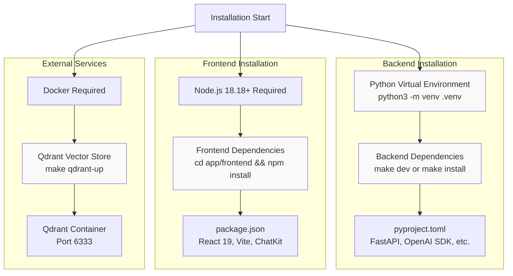

**Installation Dependency Flow**: The backend can be installed independently, the frontend requires Node.js, and Qdrant requires Docker. All three components are optional depending on your use case—CLI-only workflows require only the backend.

**Sources**: [Makefile:1-38](), [README.md:16-82](), [CONTRIBUTING.md:10-25]()

---

## Backend Installation

### Creating the Python Virtual Environment

The backend requires Python 3.10+ and uses a virtual environment for dependency isolation:

```bash
python3 -m venv .venv
source .venv/bin/activate  # On Windows: .venv\Scripts\activate
```

**Sources**: [README.md:18-19](), [CONTRIBUTING.md:14-16]()

### Installing Backend Dependencies

The `Makefile` provides two installation targets:

| Command | Purpose | Dependencies Installed |
|---------|---------|----------------------|
| `make install` | Production installation | Core dependencies only |
| `make dev` | Development installation | Core + dev extras (ruff, mypy) |

```bash
# For production use:
make install

# For development (recommended):
make dev
```

These commands execute `pip install -e .` or `pip install -e .[dev]` respectively, installing the package in editable mode from the repository root.

**Sources**: [Makefile:6-10](), [README.md:20](), [CONTRIBUTING.md:17]()

### Backend Dependency Specification

Backend dependencies are defined in [app/backend/pyproject.toml:1-34](). The core dependencies include:

| Package | Version | Purpose |
|---------|---------|---------|
| `fastapi` | >=0.114.1,<0.116 | Web framework for REST API |
| `uvicorn[standard]` | >=0.36,<0.37 | ASGI server with WebSocket support |
| `openai` | >=1.40 | OpenAI API client |
| `openai-chatkit` | >=0.0.2 | ChatKit integration library |
| `httpx` | >=0.28,<0.29 | Async HTTP client |
| `qdrant-client` | >=1.13.3 | Qdrant vector store client |
| `rapidfuzz` | >=3.8.1 | String matching for citation lookup |
| `rich` | >=13.7.1 | Terminal formatting |
| `python-dotenv` | >=1.0.1 | Environment variable management |

Development dependencies (`dev` extra) include:

| Package | Version | Purpose |
|---------|---------|---------|
| `ruff` | >=0.6.4,<0.7 | Linting and formatting |
| `mypy` | >=1.8,<2 | Static type checking |

**Sources**: [app/backend/pyproject.toml:7-23]()

### Backend Installation Locations

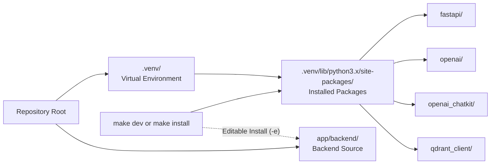

**Package Installation Structure**: The `make dev` command installs packages into `.venv/lib/python3.x/site-packages/` while creating an editable link to `app/backend/` for local development.

**Sources**: [Makefile:6-10](), [app/backend/pyproject.toml:1-34]()

---

## Frontend Installation

### Prerequisites Check

Before installing frontend dependencies, verify Node.js and npm versions:

```bash
node --version  # Should be >= 18.18
npm --version   # Should be >= 9
```

**Sources**: [app/frontend/package.json:12-15]()

### Installing Frontend Dependencies

Navigate to the frontend directory and install packages:

```bash
cd app/frontend
npm install
```

Alternatively, use the Makefile target which handles directory navigation:

```bash
make run-app-frontend  # Includes npm install step
```

**Sources**: [Makefile:15-16](), [README.md:136-137](), [CONTRIBUTING.md:20-24]()

### Frontend Dependency Specification

Frontend dependencies are defined in [app/frontend/package.json:1-43](). The production dependencies include:

| Package | Version | Purpose |
|---------|---------|---------|
| `react` | ^19.2.0 | Core React library |
| `react-dom` | ^19.2.0 | React DOM rendering |
| `@openai/chatkit-react` | ^0 | ChatKit React components |
| `clsx` | ^2.1.1 | Conditional CSS class utility |
| `lucide-react` | ^0.544.0 | Icon library |

Development dependencies include:

| Package | Version | Purpose |
|---------|---------|---------|
| `vite` | ^7.1.9 | Build tool and dev server |
| `@vitejs/plugin-react-swc` | ^3.5.0 | React plugin with SWC |
| `typescript` | ^5.4.0 | TypeScript compiler |
| `eslint` | ^8.57.1 | Code linting |
| `@typescript-eslint/eslint-plugin` | ^7.18.0 | TypeScript ESLint rules |
| `@typescript-eslint/parser` | ^7.18.0 | TypeScript parser for ESLint |
| `tailwindcss` | ^3.4.13 | CSS framework |
| `postcss` | ^8.4.47 | CSS processing |
| `autoprefixer` | ^10.4.20 | CSS vendor prefixing |
| `vitest` | ^3.2.4 | Test framework |

**Sources**: [app/frontend/package.json:16-42]()

### Frontend Installation Structure

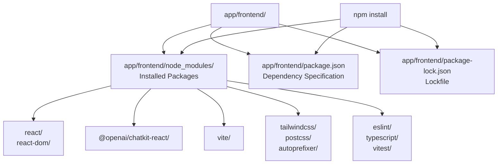

**Frontend Package Structure**: The `npm install` command reads `package.json`, resolves dependencies, and installs packages into `node_modules/` while creating or updating `package-lock.json`.

**Sources**: [app/frontend/package.json:1-43]()

---

## External Services Installation

### Qdrant Vector Store Setup

Qdrant is an optional vector database used with custom vector store configurations. It runs in a Docker container.

#### Docker Compose Configuration

The Qdrant service is configured via Docker Compose:

```bash
# Start Qdrant container
make qdrant-up

# Stop Qdrant container
make qdrant-down
```

These commands execute Docker Compose with the configuration file at [docker/docker-compose.qdrant.yaml]().

**Sources**: [Makefile:25-29](), [README.md:109-114]()

### Qdrant Service Architecture

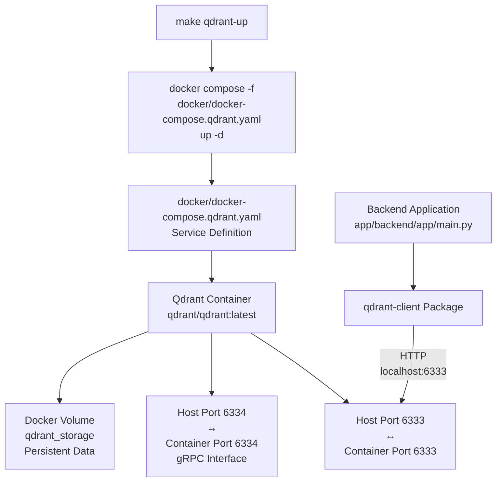

**Qdrant Docker Architecture**: The `make qdrant-up` command starts a Qdrant container exposing port 6333 (REST API) and 6334 (gRPC). Data persists in a Docker volume named `qdrant_storage`.

**Sources**: [Makefile:25-29](), [README.md:109-114]()

### Verifying Qdrant Installation

After starting Qdrant, verify it's running:

```bash
# Check container status
docker ps | grep qdrant

# Test Qdrant API endpoint
curl http://localhost:6333/
```

Expected response: JSON with Qdrant version information.

**Sources**: [Makefile:25-29]()

---

## Installation Verification

### Backend Verification

Verify backend installation by checking the installed package and running a health check:

```bash
# Verify package installation
pip show chatkit-backend

# Expected output includes:
# Name: chatkit-backend
# Version: 0.1.0
# Location: /path/to/repo/app/backend
```

Verify core dependencies:

```bash
python -c "import fastapi; import openai; import openai_chatkit; print('Backend dependencies OK')"
```

**Sources**: [app/backend/pyproject.toml:1-6]()

### Frontend Verification

Verify frontend installation:

```bash
cd app/frontend

# Check for node_modules
ls node_modules/@openai/chatkit-react

# Verify TypeScript compilation
npx tsc --noEmit

# Run linter
npm run lint
```

**Sources**: [app/frontend/package.json:10](), [README.md:248-249]()

### External Services Verification

Verify Qdrant is accessible:

```bash
# Check if Qdrant container is running
docker ps --filter "name=qdrant"

# Test REST API
curl -X GET http://localhost:6333/collections
```

Expected response: Empty collections list `{"result": {"collections": []}}` or existing collections.

**Sources**: [Makefile:25-29]()

---

## Installation Summary

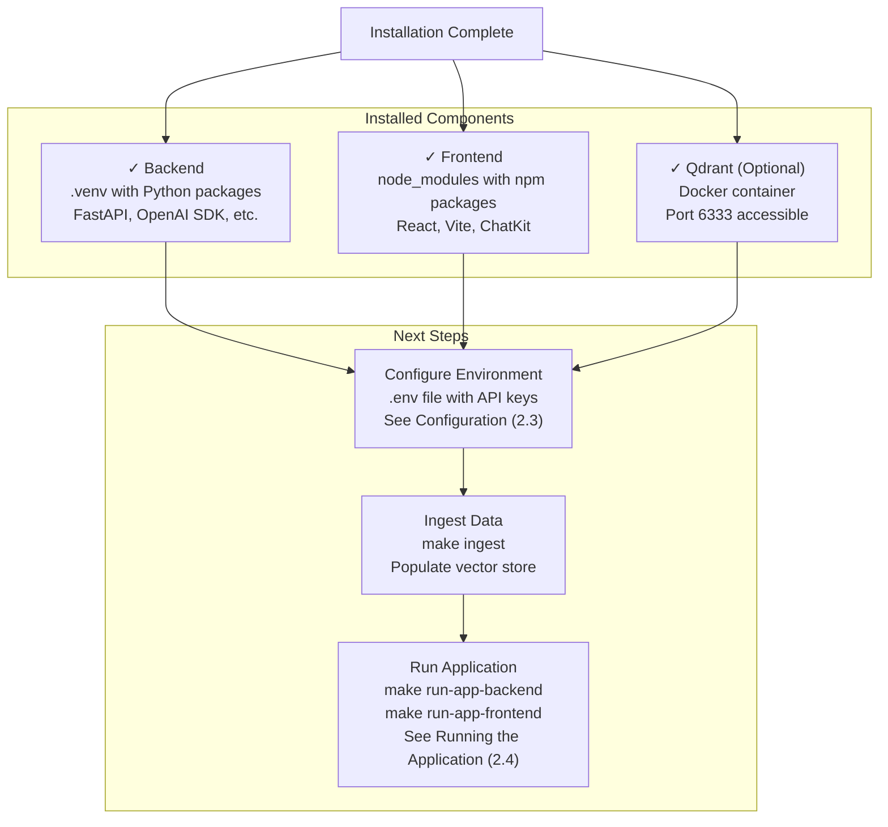

**Installation Workflow Summary**: After installing all components, proceed to configure environment variables ([Configuration](#2.3)), ingest data, and start the application ([Running the Application](#2.4)).

**Sources**: [README.md:12-42](), [Makefile:1-38]()

---

## Troubleshooting Installation Issues

### Common Backend Issues

| Issue | Solution |
|-------|----------|
| `python3: command not found` | Install Python 3.10+ or use `python` instead of `python3` |
| `No module named 'fastapi'` | Ensure virtual environment is activated and run `make dev` |
| `pip: command not found` | Use `python -m pip` instead of `pip` |
| Permission errors on Unix | Avoid `sudo pip`; use virtual environment instead |

### Common Frontend Issues

| Issue | Solution |
|-------|----------|
| `node: command not found` | Install Node.js 18.18+ from nodejs.org |
| `npm install` fails with EACCES | Fix npm permissions or use a version manager (nvm, fnm) |
| `Cannot find module 'vite'` | Delete `node_modules/` and `package-lock.json`, run `npm install` again |
| TypeScript errors | Ensure TypeScript version ^5.4.0 is installed |

### Common External Services Issues

| Issue | Solution |
|-------|----------|
| `docker: command not found` | Install Docker Desktop or Docker Engine |
| Port 6333 already in use | Stop conflicting service or change Qdrant port in docker-compose.yaml |
| `Cannot connect to Docker daemon` | Start Docker Desktop or Docker daemon service |
| Qdrant container exits immediately | Check Docker logs: `docker logs $(docker ps -aq --filter "name=qdrant")` |

**Sources**: [CONTRIBUTING.md:10-25](), [README.md:70-82]()

---

# Page: Configuration

# Configuration

<details>
<summary>Relevant source files</summary>

The following files were used as context for generating this wiki page:

- [.env.example](.env.example)
- [Makefile](Makefile)
- [README.md](README.md)

</details>


## Purpose and Scope

This document explains how to configure the OpenAI Knowledge Retrieval system for initial setup and operation. It covers environment variables, RAG configuration files, and vector store setup required to run the application.

For prerequisites and initial environment setup, see [Prerequisites and Environment Setup](#2.1). For detailed configuration reference including all available options and advanced customization, see [Configuration](#7) and its subsections.

**Sources:** [README.md:1-308]()

---

## Overview

The system uses a two-tier configuration approach:

1. **Environment variables** (`.env` file) - API credentials, service URLs, and runtime settings
2. **RAG configuration files** (YAML in `configs/`) - Pipeline behavior, chunking strategies, and retrieval settings

Configuration flows from these files into both the backend services and CLI tools, enabling consistent behavior across different execution contexts.

**Sources:** [.env.example:1-7](), [README.md:22-27](), [README.md:84-107]()

---

## Environment Variables

### Creating the .env File

Copy the example file to create your configuration:

```bash
cp .env.example .env
```

Then edit `.env` to add your credentials and settings.

**Sources:** [README.md:22-24]()

### Required Variables

| Variable | Purpose | Example |
|----------|---------|---------|
| `OPENAI_API_KEY` | OpenAI API authentication | `sk-proj-...` |

**Sources:** [.env.example:1](), [README.md:24](), [README.md:74]()

### Optional Variables

| Variable | Purpose | Default/Notes |
|----------|---------|---------------|
| `OPENAI_ORG_ID` | OpenAI organization identifier | Optional |
| `OPENAI_PROJECT_ID` | OpenAI project identifier | Optional |
| `RAG_CONFIG` | Path to RAG YAML configuration | `configs/default.openai.yaml` |
| `VECTOR_STORE_ID` | Reuse existing vector store | Created during ingestion if not set |
| `KNOWLEDGE_CORS_ALLOW_ORIGINS` | CORS allowed origins for backend | `http://localhost:5173,http://127.0.0.1:5173` |

**Sources:** [.env.example:1-7](), [README.md:86-93]()

### Configuration Diagram: Environment Variables Flow

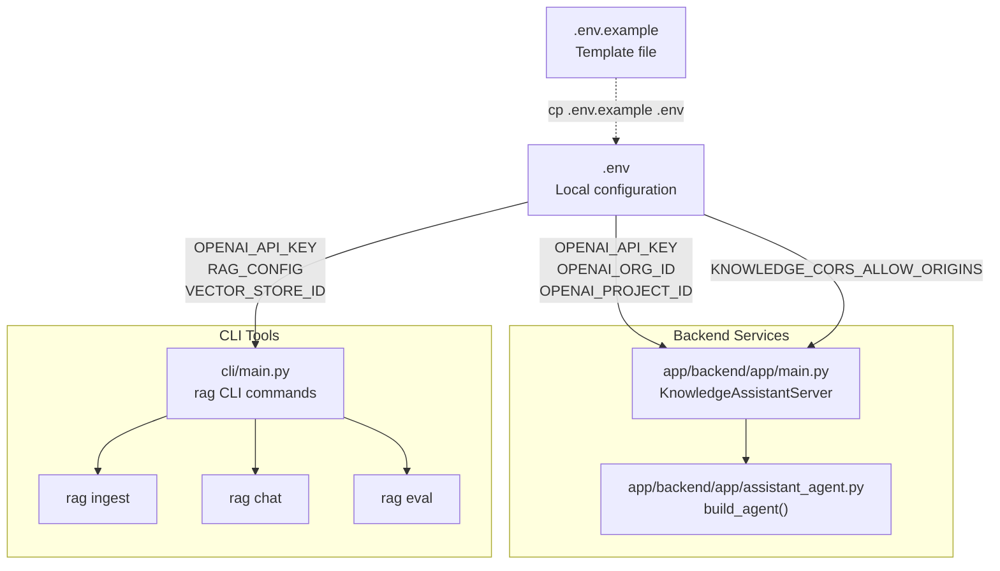

**Sources:** [.env.example:1-7](), [Makefile:18-19](), [Makefile:31-38]()

---

## RAG Configuration Files

### Configuration File Location

RAG configuration files are stored in the `configs/` directory as YAML files. The default configuration is `configs/default.openai.yaml`.

**Sources:** [README.md:62](), [.env.example:4]()

### Creating a Configuration File

Use the CLI to generate a configuration from a template:

```bash
rag init --template openai > configs/my.openai.yaml
```

Available templates:
- `openai` - Uses OpenAI File Search (managed vector store)
- `custom-qdrant` - Uses local Qdrant vector database

You can also specify a chunking strategy:

```bash
rag init --template openai --chunking recursive > configs/my.openai.yaml
rag init --template custom-qdrant --chunking heading > configs/my.qdrant.yaml
```

**Sources:** [README.md:95-104](), [README.md:156-164]()

### Specifying Configuration at Runtime

Set the configuration file via environment variable:

```bash
export RAG_CONFIG=configs/my.openai.yaml
```

Or pass it directly to CLI commands:

```bash
rag ingest --config configs/my.openai.yaml
rag chat --config configs/my.openai.yaml
rag eval --config configs/my.openai.yaml
```

The backend reads from the `RAG_CONFIG` environment variable:

```bash
export RAG_CONFIG=configs/my.openai.yaml
make run-app-backend
```

**Sources:** [.env.example:4](), [Makefile:31-38](), [README.md:106](), [README.md:127-130]()

### Configuration Structure

RAG configuration files define the complete pipeline behavior using YAML format. Key sections include:

| Section | Purpose |
|---------|---------|
| `env` | Default environment variable fallbacks |
| `data` | Document paths and file patterns for ingestion |
| `chunking` | Chunking strategy and parameters |
| `vector_store` | Vector store backend configuration |
| `query` | Retrieval pipeline settings (expansion, HyDE, reranking) |
| `synthesis` | Response generation model and prompts |
| `evals` | Evaluation harness configuration |

For detailed documentation of all configuration options, see [RAG Configuration Files](#7.2).

**Sources:** [README.md:151-238]()

---

## Vector Store Configuration

The system supports two vector store backends, configured via the `vector_store.backend` field in your RAG configuration file.

### OpenAI File Search Backend

The default backend uses OpenAI's managed File Search service:

```yaml
vector_store:
  backend: openai_file_search
  vector_store_name: "my-knowledge-base"
  vector_store_id: ""  # Leave empty to create new, or reuse existing
  expiry_days: 7
  chunking:
    max_chunk_size_tokens: 800
    chunk_overlap_tokens: 400
```

The `VECTOR_STORE_ID` environment variable can override `vector_store_id` from the YAML configuration.

**Sources:** [README.md:186-191](), [.env.example:5]()

### Custom Vector Store Backend (Qdrant)

For self-hosted vector storage using Qdrant:

```yaml
vector_store:
  backend: custom
  custom:
    kind: qdrant
    qdrant:
      url: http://localhost:6333
      collection: my_collection
      distance: cosine
      ef: 64
      m: 32
```

Start the local Qdrant instance:

```bash
make qdrant-up
```

Stop the Qdrant instance:

```bash
make qdrant-down
```

**Sources:** [README.md:192-209](), [Makefile:25-29](), [README.md:108-114]()

### Custom Plugin Backend

You can integrate any vector database by implementing a custom plugin:

```yaml
vector_store:
  backend: custom
  custom:
    kind: plugin
    plugin:
      module_path: my_module.vector_store
      class_name: MyVectorStore
      init_args:
        connection_string: "..."
        api_key: "${MY_CUSTOM_API_KEY}"
```

**Sources:** [README.md:207-208]()

---

## Configuration Flow Diagram

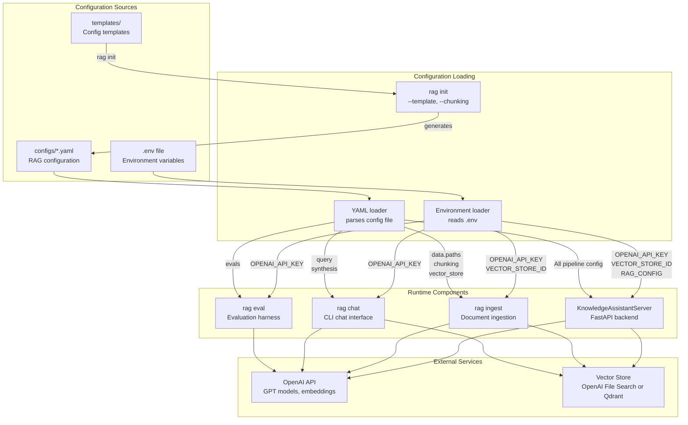

**Sources:** [.env.example:1-7](), [README.md:95-107](), [README.md:127-130](), [Makefile:18-38]()

---

## Configuration Precedence

Configuration values are resolved in the following order (highest to lowest priority):

1. **Command-line arguments** - `--config` flag passed to CLI commands
2. **Environment variables** - Values set in `.env` or system environment
3. **YAML config file** - Values specified in the RAG configuration
4. **Default values** - Fallbacks specified in the `env` section of YAML

Example precedence resolution:

```bash
# YAML config specifies: vector_store_id: "vs_abc123"
# .env specifies: VECTOR_STORE_ID="vs_xyz789"
# Result: vs_xyz789 (environment variable wins)

# Command line: rag ingest --config configs/custom.yaml
# .env specifies: RAG_CONFIG=configs/default.openai.yaml
# Result: configs/custom.yaml (command-line argument wins)
```

**Sources:** [README.md:236-238]()

---

## Quick Start Configuration

For a minimal working setup:

1. **Create environment file:**
   ```bash
   cp .env.example .env
   echo "OPENAI_API_KEY=sk-..." >> .env
   ```

2. **Use default configuration:**
   ```bash
   # configs/default.openai.yaml is used by default
   export RAG_CONFIG=configs/default.openai.yaml
   ```

3. **Customize document paths in YAML:**
   Edit `configs/default.openai.yaml` and update the `data.paths` field to point to your documents.

4. **Run ingestion:**
   ```bash
   make ingest
   ```

5. **Start services:**
   ```bash
   make run-app-backend  # Terminal 1
   make run-app-frontend # Terminal 2
   ```

**Sources:** [README.md:14-42](), [.env.example:1-7]()

---

## Configuration Files Reference Table

| File | Purpose | Required |
|------|---------|----------|
| `.env` | Environment variables and API credentials | Yes |
| `configs/default.openai.yaml` | Default RAG configuration for OpenAI backend | Yes (generated) |
| `configs/*.yaml` | Custom RAG configurations | Optional |
| `docker/docker-compose.qdrant.yaml` | Qdrant Docker configuration | Optional (if using Qdrant) |

**Sources:** [.env.example:1-7](), [README.md:62](), [Makefile:25-29]()

---

## Next Steps

After configuring the system:

1. **Run ingestion** - Process your documents and populate the vector store (see [Data Ingestion](#6.2))
2. **Start the application** - Launch backend and frontend services (see [Running the Application](#2.4))
3. **Explore advanced configuration** - Review detailed options in [Configuration](#7)

**Sources:** [README.md:116-150]()

---

# Page: Running the Application

# Running the Application

<details>
<summary>Relevant source files</summary>

The following files were used as context for generating this wiki page:

- [CONTRIBUTING.md](CONTRIBUTING.md)
- [Makefile](Makefile)
- [README.md](README.md)

</details>


## Purpose and Scope

This page provides instructions for launching the OpenAI Knowledge Retrieval application in development mode. It covers starting the backend server, frontend UI, vector store services, and running data ingestion. For configuration details before running the application, see [Configuration](#2.3). For production deployment, see [Deployment](#9).

## Prerequisites

Before running the application, ensure you have completed:
- Environment setup and installation ([Prerequisites and Environment Setup](#2.1), [Installation](#2.2))
- Configuration of environment variables and RAG config files ([Configuration](#2.3))
- At least one document placed in the `data/` directory for ingestion

## Service Startup Overview

The application consists of multiple services that must be started in a specific order. The diagram below shows the startup sequence and dependencies.

```mermaid
graph TB
    Start["Start"]
    VectorStore["Optional: Start Vector Store<br/>make qdrant-up<br/>Port 6333"]
    Ingest["Run Data Ingestion<br/>make ingest<br/>rag ingest --config"]
    Backend["Start Backend Server<br/>make run-app-backend<br/>Port 8002"]
    Frontend["Start Frontend Server<br/>make run-app-frontend<br/>Port 5173"]
    Access["Access Application<br/>http://localhost:5173"]
    
    Start --> VectorStore
    VectorStore --> Ingest
    Start -.->|OpenAI File Search| Ingest
    Ingest --> Backend
    Backend --> Frontend
    Frontend --> Access
    
    style VectorStore fill:#f9f9f9
    style Ingest fill:#f9f9f9
    style Backend fill:#f9f9f9
    style Frontend fill:#f9f9f9
```

**Sources:** [Makefile:1-38](), [README.md:12-42]()

## Starting the Vector Store (Optional)

If you are using a custom vector store like Qdrant instead of OpenAI File Search, start the vector store service before ingestion.

### Starting Qdrant

The repository includes a Docker Compose configuration for Qdrant:

```bash
make qdrant-up
```

This command executes [Makefile:25-26]() which runs:
```bash
docker compose -f docker/docker-compose.qdrant.yaml up -d
```

The Qdrant service will be available at `http://localhost:6333`. The Docker Compose configuration is defined in `docker/docker-compose.qdrant.yaml`.

### Stopping Qdrant

To stop the Qdrant service:

```bash
make qdrant-down
```

This executes [Makefile:28-29]() and removes all containers and orphaned resources.

### Verification

Check that Qdrant is running:

```bash
curl http://localhost:6333/healthz
# Expected response: {"title":"healthz","version":"1.x.x"}
```

**Sources:** [Makefile:25-29](), [README.md:109-114]()

## Running Data Ingestion

Before the application can answer questions, documents must be ingested into the vector store.

### Basic Ingestion

Use the Makefile command:

```bash
make ingest
```

This executes [Makefile:31-32](), which runs the CLI with the default configuration:
```bash
rag ingest --config configs/default.openai.yaml
```

### Custom Configuration Ingestion

To ingest with a specific configuration file:

```bash
rag ingest --config configs/my.custom.yaml
```

### Ingestion Process Flow

```mermaid
flowchart LR
    Config["RAG Config YAML<br/>configs/*.yaml"]
    CLI["rag ingest command<br/>cli/commands/ingest.py"]
    Loader["Document Loaders<br/>ingestion/loaders/"]
    Chunker["Chunking Strategy<br/>ingestion/chunking/"]
    Embed["OpenAI Embeddings API<br/>text-embedding-3-small"]
    Store["Vector Store<br/>OpenAI File Search or Qdrant"]
    
    Config --> CLI
    CLI --> Loader
    Loader --> Chunker
    Chunker --> Embed
    Embed --> Store
```

The ingestion pipeline:
1. Reads configuration from YAML file specified by `--config` or `RAG_CONFIG` environment variable
2. Loads documents from paths specified in `data.paths` configuration
3. Chunks documents according to the `chunking` strategy
4. Generates embeddings using the configured embedding model
5. Uploads to the vector store (OpenAI File Search or custom)

### Ingestion Output

For OpenAI File Search backends, ingestion outputs a `vector_store_id`:

```
✓ Created vector store: vs_abc123xyz...
✓ Uploaded 42 documents
✓ Ingestion complete
```

Save this ID to your `.env` file as `VECTOR_STORE_ID` for reuse in subsequent runs.

**Sources:** [Makefile:31-32](), [README.md:117-123](), [README.md:29-30]()

## Starting the Backend Server

The FastAPI backend serves the chat API and manages the assistant agent.

### Start Backend in Development Mode

```bash
make run-app-backend
```

This executes [Makefile:18-19]():
```bash
cd app/backend && uv run --active uvicorn app.main:app --reload --port 8002
```

The backend server:
- Runs on **port 8002** by default
- Uses `uvicorn` with `--reload` flag for hot reloading during development
- Loads configuration from `RAG_CONFIG` environment variable (defaults to `configs/default.openai.yaml`)
- Initializes the `KnowledgeAssistantServer` class from [app/backend/app/main.py]()

### Backend Endpoints

| Endpoint | Method | Purpose | Source |
|----------|--------|---------|--------|
| `/knowledge/chatkit` | POST | ChatKit conversational interface | [app/backend/app/main.py:179-216]() |
| `/knowledge/documents` | GET | List available documents | [app/backend/app/main.py:218-222]() |
| `/knowledge/documents/{doc_id}/file` | GET | Download document file | [app/backend/app/main.py:224-242]() |
| `/knowledge/threads/{thread_id}/citations` | GET | Retrieve citations for thread | [app/backend/app/main.py:244-266]() |
| `/knowledge/health` | GET | Health check | [app/backend/app/main.py:268-271]() |

### Stopping the Backend

```bash
make stop-app-backend
```

This executes [Makefile:21-23]() which kills processes on port 8002.

### Verification

Check backend health:

```bash
curl http://localhost:8002/knowledge/health
# Expected response: {"status":"ok"}
```

**Sources:** [Makefile:18-23](), [app/backend/app/main.py:1-271]()

## Starting the Frontend Server

The React-based UI provides the chat interface for interacting with the assistant.

### Start Frontend in Development Mode

```bash
make run-app-frontend
```

This executes [Makefile:15-16]():
```bash
cd app/frontend && npm install && npm run dev
```

The frontend server:
- Runs on **port 5173** by default (Vite's default development port)
- Enables hot module replacement (HMR) for instant updates during development
- Proxies API requests to the backend at `http://localhost:8002`
- Loads the ChatKit web component from CDN

### Frontend Architecture Components

```mermaid
graph TB
    ViteDev["Vite Dev Server<br/>Port 5173<br/>npm run dev"]
    AppRoot["App.tsx<br/>Root Component<br/>app/frontend/src/App.tsx"]
    Home["Home Component<br/>app/frontend/src/components/Home.tsx"]
    ChatKit["ChatKit.tsx Wrapper<br/>app/frontend/src/chatkit-react/ChatKit.tsx"]
    WebComp["<openai-chatkit> Web Component<br/>Loaded from CDN"]
    Backend["Backend API<br/>http://localhost:8002"]
    
    ViteDev --> AppRoot
    AppRoot --> Home
    Home --> ChatKit
    ChatKit --> WebComp
    WebComp -->|HTTP/SSE| Backend
    
    style ViteDev fill:#f9f9f9
    style Backend fill:#f9f9f9
```

### Frontend Configuration

The frontend reads backend API configuration from [app/frontend/src/lib/config.ts]():

```typescript
// Default backend API base URL
const API_BASE = "http://localhost:8002"
```

If you changed the backend port, update this configuration file accordingly.

**Sources:** [Makefile:15-16](), [README.md:33-36](), [README.md:242-249]()

## Accessing the Application

Once both servers are running, access the application in your web browser:

### Main Application URL

```
http://localhost:5173
```

This opens the ChatKit conversational interface where you can:
- Ask questions about your ingested documents
- View responses with citations
- Preview referenced documents
- Navigate conversation history

### Available Interfaces

| Interface | URL | Description |
|-----------|-----|-------------|
| Chat UI | `http://localhost:5173` | Main conversational interface |
| Backend API | `http://localhost:8002` | FastAPI backend (for debugging) |
| API Docs | `http://localhost:8002/docs` | Swagger/OpenAPI documentation |
| Qdrant Dashboard | `http://localhost:6333/dashboard` | Vector DB admin (if using Qdrant) |

**Sources:** [README.md:38-40](), [README.md:139-140]()

## Complete Development Workflow

Here is the complete sequence for running the application from a clean state:

### Step-by-Step Commands

```bash
# Terminal 1: Start vector store (if using custom backend)
make qdrant-up

# Terminal 1: Run ingestion
make ingest
# Note the vector_store_id and add to .env if needed

# Terminal 1: Start backend server
make run-app-backend
# Backend will be available at http://localhost:8002

# Terminal 2: Start frontend server (in a new terminal)
make run-app-frontend
# Frontend will be available at http://localhost:5173

# Open browser to http://localhost:5173
```

### Quick Start Command Reference

```mermaid
flowchart TB
    subgraph "Terminal 1"
        T1Step1["make qdrant-up<br/>(Optional)"]
        T1Step2["make ingest"]
        T1Step3["make run-app-backend<br/>(Keeps running)"]
    end
    
    subgraph "Terminal 2"
        T2Step1["make run-app-frontend<br/>(Keeps running)"]
    end
    
    subgraph "Browser"
        B1["Open http://localhost:5173"]
    end
    
    T1Step1 --> T1Step2
    T1Step2 --> T1Step3
    T1Step3 --> T2Step1
    T2Step1 --> B1
```

**Sources:** [README.md:14-42](), [CONTRIBUTING.md:10-33]()

## Command-Line Chat Interface (Alternative)

For testing without the web UI, use the CLI chat interface:

```bash
make chat
```

This executes [Makefile:34-35]():
```bash
rag chat --config configs/default.openai.yaml
```

The CLI chat provides:
- Interactive terminal-based conversation
- Direct access to the assistant agent
- Useful for testing retrieval quality without browser overhead
- Same backend logic as the web UI

Exit the chat by typing `exit` or pressing `Ctrl+C`.

**Sources:** [Makefile:34-35](), [README.md:1-301]()

## Port and Service Summary

This table summarizes all ports and services used during development:

| Service | Port | Started By | Process |
|---------|------|------------|---------|
| Backend API | 8002 | `make run-app-backend` | `uvicorn app.main:app` |
| Frontend UI | 5173 | `make run-app-frontend` | `npm run dev` (Vite) |
| Qdrant Vector Store | 6333 | `make qdrant-up` | Docker container |
| Alternative Backend | 8000 | `make run-api` | `uvicorn app.api:app` |

**Note:** The repository includes two backend implementations. The primary backend for the ChatKit UI runs on port 8002 (`app/backend/app/main.py`). An alternative API implementation exists at `app/api.py` (port 8000) but is not used by the default frontend.

**Sources:** [Makefile:1-38](), [app/backend/app/main.py:1-10]()

## Health Check and Verification

After starting all services, verify they are operational:

### Backend Health Check

```bash
curl http://localhost:8002/knowledge/health
```

Expected response:
```json
{"status": "ok"}
```

This endpoint is implemented in [app/backend/app/main.py:268-271]().

### Frontend Accessibility

Navigate to `http://localhost:5173` in your browser. You should see:
- The ChatKit interface loads without errors
- The chat input box is enabled
- Any previously ingested documents appear in the sidebar (if applicable)

### Backend Log Verification

Check the backend terminal for successful startup:

```
INFO:     Uvicorn running on http://0.0.0.0:8002 (Press CTRL+C to quit)
INFO:     Started reloader process
INFO:     Started server process
INFO:     Waiting for application startup.
INFO:     Application startup complete.
```

### Frontend Log Verification

Check the frontend terminal for successful compilation:

```
VITE v5.x.x  ready in XXX ms

➜  Local:   http://localhost:5173/
➜  Network: use --host to expose
```

**Sources:** [app/backend/app/main.py:268-271]()

## Troubleshooting Common Issues

### Port Already in Use

If you see `Address already in use` errors:

```bash
# Backend port 8002
make stop-app-backend

# Or manually:
lsof -ti:8002 | xargs kill -9

# Frontend port 5173
lsof -ti:5173 | xargs kill -9

# Qdrant port 6333
make qdrant-down
```

### Backend Cannot Find Configuration

Error: `Configuration file not found`

**Solution:** Set the `RAG_CONFIG` environment variable:
```bash
export RAG_CONFIG=configs/default.openai.yaml
make run-app-backend
```

Or specify inline:
```bash
RAG_CONFIG=configs/my.custom.yaml make run-app-backend
```

### No Documents Available

If the UI shows no documents or retrieval fails:

1. Verify ingestion completed successfully
2. Check that `VECTOR_STORE_ID` is set in `.env` (for OpenAI File Search)
3. Ensure the configuration file matches between ingestion and runtime
4. Verify documents exist in the paths specified by `data.paths` in your config

**Solution:**
```bash
# Re-run ingestion
make ingest

# Verify vector store ID in .env
cat .env | grep VECTOR_STORE_ID
```

### Frontend Cannot Connect to Backend

Error in browser console: `Failed to fetch` or `Network error`

**Solutions:**
1. Verify backend is running on port 8002
2. Check frontend config points to correct backend URL in [app/frontend/src/lib/config.ts]()
3. Ensure no firewall or proxy blocking local connections

### OpenAI API Errors

Error: `401 Unauthorized` or `Invalid API key`

**Solution:** Verify your `.env` file contains a valid `OPENAI_API_KEY`:
```bash
cat .env | grep OPENAI_API_KEY
# Should show: OPENAI_API_KEY=sk-...
```

**Sources:** [Makefile:21-29](), [README.md:23-24](), [CONTRIBUTING.md:27-32]()

## Next Steps

After successfully running the application:

- **Customize the assistant:** Modify system prompts and synthesis settings ([Configuration](#7.2))
- **Improve retrieval:** Enable query expansion, HyDE, or reranking ([RAG Pipeline](#3.4))
- **Evaluate quality:** Run evaluations to measure performance ([Evaluation System](#6.3))
- **Prepare for production:** Create optimized builds ([Production Build](#9.1))

For development and contribution guidelines, see [Development Guide](#8).

**Sources:** [README.md:143-150](), [README.md:151-238]()

---

# Page: Architecture

# Architecture

<details>
<summary>Relevant source files</summary>

The following files were used as context for generating this wiki page:

- [README.md](README.md)
- [app/backend/app/assistant_agent.py](app/backend/app/assistant_agent.py)
- [app/backend/app/main.py](app/backend/app/main.py)
- [app/frontend/src/App.tsx](app/frontend/src/App.tsx)

</details>


This page provides a comprehensive overview of the OpenAI Knowledge Retrieval system architecture, including the relationships between frontend, backend, external services, and supporting tools. It describes the major components, their responsibilities, and how data flows through the system.

For detailed information on specific components, see: [Backend Components](#4), [Frontend Components](#5), [CLI Tools](#6), and [Configuration](#7).

## Purpose and Scope

The OpenAI Knowledge Retrieval starter kit is a multi-tier application that combines a React-based web interface, a FastAPI backend orchestrating AI agents and document management, external AI and vector database services, and CLI tools for data ingestion and evaluation. This document explains:

- The overall system architecture and component interactions
- The backend service layer and agent system
- The frontend application structure
- Data flow through the RAG pipeline
- Integration with external services (OpenAI API, Qdrant)
- The orchestration layer provided by the Makefile

## System Architecture Overview

The following diagram maps the complete system architecture, using actual class names, file paths, and code entities to bridge conceptual components with their implementations.

**System Component Map**

```mermaid
graph TB
    subgraph "Orchestration Layer"
        Makefile["Makefile<br/>(make commands)"]
        EnvFile[".env<br/>OPENAI_API_KEY<br/>VECTOR_STORE_ID<br/>RAG_CONFIG"]
        ConfigYAML["configs/*.yaml<br/>RootConfig schema"]
    end
    
    subgraph "Frontend Application<br/>app/frontend/"
        AppTSX["App.tsx<br/>root component"]
        HomeComponent["Home.tsx<br/>main view"]
        ChatKitWrapper["ChatKit.tsx<br/>wrapper component"]
        UseChatKitHook["useChatKit.ts<br/>React hook"]
        ChatKitElement["<openai-chatkit><br/>web component"]
        ConfigTS["lib/config.ts<br/>API_BASE_URL"]
    end
    
    subgraph "Backend Application<br/>app/backend/app/"
        MainPY["main.py<br/>FastAPI app"]
        KASServer["KnowledgeAssistantServer<br/>ChatKitServer subclass"]
        AssistantAgentPY["assistant_agent.py"]
        AgentInstance["assistant_agent<br/>Agent[AgentContext]"]
        MemoryStorePY["memory_store.py<br/>MemoryStore"]
        DocumentsPY["documents.py<br/>DocumentMetadata"]
    end
    
    subgraph "CLI Application<br/>cli/"
        RAGCLI["rag CLI<br/>Typer app"]
        IngestCmd["ingest command"]
        EvalCmd["eval command"]
        ChatCmd["chat command"]
    end
    
    subgraph "Core Modules"
        IngestionMod["ingestion/<br/>loaders, chunkers"]
        RetrievalMod["retrieval/<br/>pipeline, citations"]
        StoresMod["stores/<br/>VectorStore adapters"]
        EvalsMod["evals/<br/>harness, grading"]
    end
    
    subgraph "External Services"
        OpenAIAPI["OpenAI API<br/>GPT models<br/>Embeddings<br/>File Search"]
        QdrantDB["Qdrant<br/>Docker container<br/>port 6333"]
    end
    
    Makefile -->|"configures"| EnvFile
    Makefile -->|"starts"| MainPY
    Makefile -->|"starts"| AppTSX
    Makefile -->|"executes"| RAGCLI
    Makefile -->|"docker-compose up"| QdrantDB
    
    EnvFile -.->|"read by"| MainPY
    EnvFile -.->|"read by"| RAGCLI
    ConfigYAML -.->|"load_config"| MainPY
    ConfigYAML -.->|"load_config"| RAGCLI
    
    AppTSX --> HomeComponent
    HomeComponent --> ChatKitWrapper
    ChatKitWrapper --> UseChatKitHook
    ChatKitWrapper --> ChatKitElement
    ChatKitWrapper --> ConfigTS
    ConfigTS -->|"HTTP POST"| MainPY
    
    MainPY --> KASServer
    KASServer --> AssistantAgentPY
    KASServer --> MemoryStorePY
    KASServer --> DocumentsPY
    AssistantAgentPY --> AgentInstance
    
    RAGCLI --> IngestCmd
    RAGCLI --> EvalCmd
    RAGCLI --> ChatCmd
    IngestCmd --> IngestionMod
    IngestCmd --> StoresMod
    EvalCmd --> EvalsMod
    EvalCmd --> RetrievalMod
    
    AgentInstance -->|"LLM calls"| OpenAIAPI
    AgentInstance -->|"FileSearchTool or retrieve_tool"| OpenAIAPI
    AgentInstance -->|"retrieve_tool"| QdrantDB
    IngestCmd -->|"embeddings"| OpenAIAPI
    IngestCmd -->|"upsert vectors"| QdrantDB
    RetrievalMod -->|"search"| QdrantDB
```

**Sources:** [README.md:54-65](), [app/backend/app/main.py:1-647](), [app/backend/app/assistant_agent.py:1-128](), [app/frontend/src/App.tsx:1-19](), [Makefile]()

## Component Responsibilities

### Frontend Application (`app/frontend/`)

The frontend is a React 19 application built with Vite, serving as the user interface for the knowledge retrieval system.

| Component | Location | Responsibility |
|-----------|----------|----------------|
| `App` | [app/frontend/src/App.tsx:6-17]() | Root component, manages theme state via `useColorScheme` |
| `Home` | [app/frontend/src/components/Home.tsx]() | Main view container, renders ChatKit and document preview |
| `ChatKit` wrapper | [app/frontend/src/chatkit-react/ChatKit.tsx]() | React wrapper for `<openai-chatkit>` web component |
| `useChatKit` hook | [app/frontend/src/chatkit-react/useChatKit.ts]() | Provides methods and event handlers for ChatKit interaction |
| Configuration | [app/frontend/src/lib/config.ts]() | Defines `API_BASE_URL` pointing to backend |

The frontend communicates with the backend via HTTP POST requests to `/knowledge/chatkit` and fetches documents via `/knowledge/documents` endpoints.

**Sources:** [app/frontend/src/App.tsx:1-19](), [README.md:242-249]()

### Backend Application (`app/backend/app/`)

The backend is a FastAPI application that orchestrates agent interactions, manages conversation threads, and serves documents.

| Component | Location | Responsibility |
|-----------|----------|----------------|
| `KnowledgeAssistantServer` | [app/backend/app/main.py:131-545]() | Main server class, extends `ChatKitServer[dict[str, Any]]` |
| `assistant_agent` | [app/backend/app/assistant_agent.py:121-127]() | Global `Agent[AgentContext]` instance with retrieval tools |
| `MemoryStore` | [app/backend/app/memory_store.py]() | In-memory storage for thread metadata and messages |
| Document management | [app/backend/app/main.py:153-245]() | Methods `_scan_documents`, `_lookup_document`, `_resolve_document_path` |
| Citation system | [app/backend/app/main.py:318-502]() | Methods `_extract_citations`, `_build_citations_from_chunks` |

**Sources:** [app/backend/app/main.py:131-545](), [app/backend/app/assistant_agent.py:121-127]()

### CLI Tools (`cli/`)

The `rag` CLI provides commands for data ingestion, evaluation, and command-line chat.

| Command | Responsibility |
|---------|----------------|
| `rag init` | Scaffolds YAML configuration from templates |
| `rag ingest` | Processes documents, generates embeddings, stores vectors |
| `rag eval` | Runs evaluation harness, generates reports |
| `rag chat` | Command-line chat interface |

**Sources:** [README.md:56](), [README.md:98-124]()

### Core Modules

| Module | Location | Responsibility |
|--------|----------|----------------|
| Ingestion | `ingestion/` | Document loaders, chunkers, preprocessors, pipeline orchestration |
| Retrieval | `retrieval/` | Query expansion, filtering, reranking, citation extraction |
| Stores | `stores/` | Vector store adapters (OpenAI File Search, Qdrant) |
| Evaluations | `evals/` | Dataset generation, grading, reporting |

**Sources:** [README.md:54-65]()

## Request Flow Architecture

The following diagram shows the complete request/response flow through the system, mapping HTTP endpoints and internal method calls to actual code entities.

**Request/Response Flow with Code Entities**

```mermaid
sequenceDiagram
    participant Browser
    participant ChatKitElement as "<openai-chatkit>"
    participant ConfigTS as "config.ts"
    participant FastAPI as "FastAPI app"
    participant KASServer as "KnowledgeAssistantServer"
    participant Agent as "assistant_agent"
    participant Tools as "FileSearchTool or retrieve_tool"
    participant OpenAI as "OpenAI API"
    participant Qdrant as "Qdrant"
    
    Browser->>ChatKitElement: User enters message
    ChatKitElement->>ConfigTS: Read API_BASE_URL
    ConfigTS->>FastAPI: POST /knowledge/chatkit<br/>(ChatKit protocol)
    FastAPI->>KASServer: process(payload, context)
    KASServer->>KASServer: respond(thread, item, context)
    KASServer->>KASServer: _build_history_prompt()
    KASServer->>Agent: Runner.run_streamed(assistant_agent, enriched_text)
    Agent->>Agent: _build_tools()
    
    alt OpenAI File Search backend
        Agent->>Tools: FileSearchTool(vector_store_ids)
        Tools->>OpenAI: File Search API
        OpenAI-->>Tools: Annotated results
    else Custom backend (Qdrant)
        Agent->>Tools: retrieve_tool(query)
        Tools->>Qdrant: retrieve_custom_chunks()
        Qdrant-->>Tools: Chunks with scores
        Tools->>Tools: record_retrieved_chunks(thread_id, chunks)
    end
    
    Agent->>OpenAI: LLM synthesis call
    OpenAI-->>Agent: Streaming response
    Agent-->>KASServer: stream_agent_response() events
    KASServer->>KASServer: _apply_cached_citations_to_item()
    KASServer->>KASServer: _build_citations_from_chunks()
    KASServer-->>FastAPI: ThreadStreamEvent (SSE)
    FastAPI-->>ChatKitElement: Server-Sent Events
    ChatKitElement-->>Browser: Display with citations
```

**Sources:** [app/backend/app/main.py:247-294](), [app/backend/app/main.py:580-590](), [app/backend/app/assistant_agent.py:67-115]()

## Backend API Endpoints

The FastAPI application exposes the following endpoints:

| Endpoint | Method | Handler | Responsibility |
|----------|--------|---------|----------------|
| `/knowledge/chatkit` | POST | [main.py:580-590]() | ChatKit protocol handler, returns SSE stream |
| `/knowledge/documents` | GET | [main.py:593-600]() | Lists all ingested documents |
| `/knowledge/documents/{id}/file` | GET | [main.py:603-623]() | Serves document file for preview |
| `/knowledge/threads/{id}/citations` | GET | [main.py:626-641]() | Returns citations for latest assistant message |
| `/knowledge/health` | GET | [main.py:644-646]() | Health check endpoint |

**Sources:** [app/backend/app/main.py:580-646]()

## Agent System Architecture

The agent system is built on the OpenAI Agents SDK and dynamically configures tools based on the vector store backend.

**Agent Tool Configuration**

```mermaid
graph TB
    subgraph "Agent Initialization"
        BuildTools["_build_tools()<br/>app/backend/app/assistant_agent.py:67"]
        LoadConfig["load_config(cfg_path)<br/>cli/config.py"]
        ResolveBackend["cfg.vector_store.backend"]
    end
    
    subgraph "OpenAI File Search Path"
        FileSearchTool["FileSearchTool<br/>from agents SDK"]
        VectorStoreID["vector_store_ids<br/>from VECTOR_STORE_ID env"]
        FileSearchAPI["OpenAI File Search API"]
    end
    
    subgraph "Custom Vector Store Path"
        MakeStore["make_store_from_config(cfg)<br/>stores/base.py"]
        RetrieveTool["retrieve_tool<br/>@function_tool decorator"]
        RetrievePipeline["retrieve_custom_chunks()<br/>retrieval/pipeline.py"]
        RecordChunks["record_retrieved_chunks()<br/>assistant_agent.py:41"]
        RetrievalCache["_RETRIEVAL_CACHE<br/>Dict[str, List[Dict]]"]
    end
    
    subgraph "Agent Instance"
        AgentInstance["assistant_agent<br/>Agent[AgentContext]"]
        Instructions["KNOWLEDGE_ASSISTANT_INSTRUCTIONS<br/>prompts/system/assistant.md"]
        ModelSettings["ModelSettings<br/>reasoning_effort='minimal'"]
    end
    
    BuildTools --> LoadConfig
    LoadConfig --> ResolveBackend
    
    ResolveBackend -->|"backend == 'openai_file_search'"| FileSearchTool
    FileSearchTool --> VectorStoreID
    FileSearchTool --> FileSearchAPI
    
    ResolveBackend -->|"backend == 'custom'"| MakeStore
    MakeStore --> RetrieveTool
    RetrieveTool --> RetrievePipeline
    RetrievePipeline --> RecordChunks
    RecordChunks --> RetrievalCache
    
    FileSearchTool --> AgentInstance
    RetrieveTool --> AgentInstance
    Instructions --> AgentInstance
    ModelSettings --> AgentInstance
```

**Sources:** [app/backend/app/assistant_agent.py:67-127]()

### Retrieval Cache Mechanism

When using custom vector stores, the `retrieve_tool` function stores retrieved chunks in a thread-local cache (`_RETRIEVAL_CACHE`) keyed by `thread_id`. This cache enables the citation system to derive annotations after the assistant generates a response, since custom backends don't automatically provide annotations like OpenAI File Search does.

**Key functions:**

- [assistant_agent.py:41-47](): `record_retrieved_chunks(thread_id, chunks)` - Stores chunks
- [assistant_agent.py:50-52](): `get_last_retrieved_chunks(thread_id)` - Retrieves cached chunks
- [assistant_agent.py:55-56](): `clear_last_retrieved_chunks(thread_id)` - Clears cache after citation derivation

**Sources:** [app/backend/app/assistant_agent.py:17-56]()

## Citation System Architecture

The citation system employs a three-tier fallback strategy to ensure users always receive source references.

**Citation Extraction Flow**

```mermaid
flowchart TD
    Start["_extract_citations()<br/>main.py:318"]
    
    Tier1["Tier 1: _citations_from_annotations()<br/>main.py:350"]
    CheckAnnotations{"content.annotations<br/>present?"}
    ExtractFromAnnotations["Extract from<br/>AssistantMessageContent.annotations"]
    
    Tier2["Tier 2: _apply_cached_citations_to_item()<br/>main.py:398"]
    GetCachedChunks["get_last_retrieved_chunks(thread_id)"]
    CheckCachedChunks{"Cached chunks<br/>available?"}
    ExtractSpans["extract_spans(answer_text, chunks)<br/>retrieval/citations.py"]
    BuildAnnotations["Build Annotation objects<br/>with FileSource"]
    
    Tier3["Tier 3: Parse from text"]
    ParseDocNames["_documents_from_text(line)<br/>extract document names"]
    
    Return["Return List[dict]<br/>with document_id, filename, title"]
    
    Start --> Tier1
    Tier1 --> CheckAnnotations
    CheckAnnotations -->|"Yes"| ExtractFromAnnotations
    ExtractFromAnnotations --> Return
    
    CheckAnnotations -->|"No"| Tier2
    Tier2 --> GetCachedChunks
    GetCachedChunks --> CheckCachedChunks
    CheckCachedChunks -->|"Yes"| ExtractSpans
    ExtractSpans --> BuildAnnotations
    BuildAnnotations --> Return
    
    CheckCachedChunks -->|"No"| Tier3
    Tier3 --> ParseDocNames
    ParseDocNames --> Return
```

**Sources:** [app/backend/app/main.py:318-502]()

### Citation Tiers Explained

1. **Tier 1 - Annotations from OpenAI File Search**: When using `FileSearchTool`, OpenAI automatically includes annotations in `AssistantMessageContent.annotations`. The method [main.py:350-396]() extracts citations directly from these annotations.

2. **Tier 2 - Derive from cached chunks**: When using custom vector stores, the `retrieve_tool` caches chunks in `_RETRIEVAL_CACHE`. The method [main.py:413-502]() calls `extract_spans()` from `retrieval/citations.py` to find text spans in the assistant's response that match cached chunks, then builds `Annotation` objects and injects them into the message content.

3. **Tier 3 - Parse from text**: As a final fallback, [main.py:332-348]() scans the assistant's response text for document names using `_documents_from_text()`.

**Sources:** [app/backend/app/main.py:318-502]()

## Configuration Architecture

The system uses a hierarchical configuration approach with environment variables, YAML files, and runtime defaults.

**Configuration Loading Hierarchy**

```mermaid
graph TB
    subgraph "Configuration Sources"
        EnvExample[".env.example<br/>template"]
        EnvFile[".env<br/>actual secrets"]
        ConfigYAML["configs/*.yaml<br/>RootConfig schema"]
        DefaultYAML["configs/default.openai.yaml<br/>fallback"]
    end
    
    subgraph "Environment Resolution"
        EnvVars["Environment Variables<br/>OPENAI_API_KEY<br/>VECTOR_STORE_ID<br/>RAG_CONFIG"]
        EnvBlock["env: block in YAML<br/>default values"]
    end
    
    subgraph "Configuration Loading"
        LoadConfig["load_config(path)<br/>cli/config.py"]
        ResolveEnv["Resolve env vars<br/>override YAML defaults"]
        ParseYAML["Parse YAML<br/>into RootConfig"]
        ValidateSchema["Pydantic validation"]
    end
    
    subgraph "Consumers"
        MainPY["KnowledgeAssistantServer<br/>_load_cfg()"]
        AssistantAgentPY["assistant_agent<br/>_resolve_cfg_path()"]
        RAGCLI["rag CLI commands<br/>--config flag"]
    end
    
    EnvExample -.->|"copy template"| EnvFile
    EnvFile --> EnvVars
    ConfigYAML --> LoadConfig
    DefaultYAML -.->|"RAG_CONFIG fallback"| LoadConfig
    
    EnvVars --> ResolveEnv
    ConfigYAML --> ParseYAML
    ParseYAML --> ResolveEnv
    ResolveEnv --> ValidateSchema
    ValidateSchema --> LoadConfig
    
    LoadConfig --> MainPY
    LoadConfig --> AssistantAgentPY
    LoadConfig --> RAGCLI
    
    EnvBlock -.->|"provides defaults"| ResolveEnv
```

**Sources:** [README.md:85-93](), [README.md:236-238](), [app/backend/app/assistant_agent.py:33-38](), [app/backend/app/main.py:137-151]()

### Configuration Resolution Order

1. **Environment variables** (highest priority): `OPENAI_API_KEY`, `VECTOR_STORE_ID`, `RAG_CONFIG`, etc.
2. **YAML `env:` block**: Default values specified in the config file
3. **Hardcoded defaults**: Fallback values in code (e.g., `configs/default.openai.yaml`)

The `RAG_CONFIG` environment variable determines which YAML file to load. If not set, defaults to `configs/default.openai.yaml`. The path is resolved relative to the project root if not absolute.

**Sources:** [README.md:85-93](), [app/backend/app/assistant_agent.py:33-38]()

## Document Management Architecture

The `KnowledgeAssistantServer` implements a document scanning and caching system to map between document IDs, filenames, and file paths.

**Document Resolution Flow**

```mermaid
flowchart LR
    ScanDocs["_scan_documents(cfg_path, cfg)<br/>main.py:153"]
    ConfigPaths["cfg.data.paths<br/>list of directories"]
    FileDiscovery["rglob('*')<br/>recursive file scan"]
    FilterExts["Filter by<br/>include_extensions"]
    FilterGlobs["Apply<br/>exclude_globs"]
    
    GenerateID["_sha1_of_path(path)<br/>generate doc_id"]
    HumanizeTitle["_humanize_title(filename)<br/>format title"]
    CreateMetadata["DocumentMetadata<br/>(id, filename, title)"]
    
    CacheDocuments["_documents_cache[cfg_path]<br/>List[DocumentMetadata]"]
    CachePathMap["_document_path_cache[cfg_path]<br/>Dict[doc_id, Path]"]
    
    LookupDoc["_lookup_document(cfg_path, cfg, identifier)<br/>main.py:224"]
    MatchID["Match by doc_id"]
    MatchFilename["Match by filename"]
    MatchTitle["Match by title slug"]
    
    ResolvePath["_resolve_document_path(cfg_path, doc_id)<br/>main.py:244"]
    
    ScanDocs --> ConfigPaths
    ConfigPaths --> FileDiscovery
    FileDiscovery --> FilterExts
    FilterExts --> FilterGlobs
    FilterGlobs --> GenerateID
    GenerateID --> HumanizeTitle
    HumanizeTitle --> CreateMetadata
    CreateMetadata --> CacheDocuments
    CreateMetadata --> CachePathMap
    
    CacheDocuments --> LookupDoc
    LookupDoc --> MatchID
    LookupDoc --> MatchFilename
    LookupDoc --> MatchTitle
    
    CachePathMap --> ResolvePath
```

**Sources:** [app/backend/app/main.py:153-245]()

### Document Caching Strategy

The server maintains two caches per configuration path:

1. **`_documents_cache: Dict[str, List[DocumentMetadata]]`** - Maps config path to list of document metadata objects
2. **`_document_path_cache: Dict[str, Dict[str, Path]]`** - Maps config path to a dictionary of document IDs to file system paths

These caches are populated lazily on first access and persist for the lifetime of the server process. The caching strategy ensures:

- Fast document lookups without repeated file system scans
- Consistent document IDs across requests
- Efficient serving of document files via the `/knowledge/documents/{id}/file` endpoint

**Sources:** [app/backend/app/main.py:138-139](), [app/backend/app/main.py:153-222]()

## Memory Store Architecture

The `MemoryStore` class ([app/backend/app/memory_store.py]()) provides in-memory storage for conversation threads and messages. It implements the `Store` interface required by the ChatKit server.

| Data Structure | Type | Purpose |
|----------------|------|---------|
| Thread metadata | `Dict[str, ThreadMetadata]` | Stores thread IDs and metadata |
| Thread items | `Dict[str, List[ThreadItem]]` | Stores messages per thread |
| Item ordering | Chronological list | Supports pagination and history |

The memory store is instantiated in [main.py:133]() and used throughout the `KnowledgeAssistantServer` for:

- Loading conversation history in `_build_history_prompt()` [main.py:504-544]()
- Storing new user and assistant messages
- Retrieving thread items for citation extraction

**Sources:** [app/backend/app/main.py:133](), [app/backend/app/main.py:504-544]()

## Orchestration Layer

The `Makefile` provides a unified interface for all development and operational tasks.

**Key Makefile targets:**

| Target | Command | Purpose |
|--------|---------|---------|
| `dev` | `pip install -e ".[dev]"` | Install backend with dev dependencies |
| `install` | `pip install -e .` | Install backend without dev dependencies |
| `qdrant-up` | `docker-compose up -d` | Start Qdrant container |
| `qdrant-down` | `docker-compose down` | Stop Qdrant container |
| `ingest` | `rag ingest` | Run data ingestion |
| `eval` | `rag eval` | Run evaluation harness |
| `run-app-backend` | `uvicorn ... --reload` | Start FastAPI with hot reload |
| `run-app-frontend` | `npm run dev` | Start Vite dev server |
| `run-api` | `uvicorn ... --port 8000` | Alternative backend port |

**Sources:** [README.md:16-42](), [Makefile]()

## External Services Integration

### OpenAI API Integration

The system integrates with OpenAI API for:

- **LLM synthesis**: The `assistant_agent` uses GPT models (configurable via `synthesis.model`) to generate responses
- **Embeddings**: The ingestion pipeline calls `client.embeddings.create()` to generate vector embeddings
- **File Search**: When `vector_store.backend: openai_file_search`, the agent uses `FileSearchTool` which calls OpenAI's File Search API
- **Evaluations**: The evals harness can mirror results to OpenAI Evals dashboard

The OpenAI client is instantiated in [assistant_agent.py:15]() as `client = OpenAI()`, which reads `OPENAI_API_KEY` from environment variables.

**Sources:** [app/backend/app/assistant_agent.py:15](), [README.md:186-192]()

### Qdrant Integration

When using custom vector stores with Qdrant:

- **Docker deployment**: `make qdrant-up` starts Qdrant on port 6333
- **Configuration**: Set `vector_store.backend: custom` and `vector_store.custom.kind: qdrant`
- **Ingestion**: The `rag ingest` command upserts vectors to the configured collection
- **Retrieval**: The `retrieve_tool` searches Qdrant via the adapter in `stores/qdrant.py`

**Sources:** [README.md:108-115](), [README.md:192-208]()

## Architectural Patterns

### Config-First Design

The entire pipeline is driven by YAML configuration ([README.md:46-47]()). This enables:

- Non-technical users to customize behavior without code changes
- Easy A/B testing of retrieval strategies
- Template-based quickstart via `rag init --template`

### Pluggable Vector Stores

The `stores/` module defines a `VectorStore` interface. The system ships with two implementations:

1. **OpenAI File Search**: Managed service with automatic deduplication and metadata handling
2. **Qdrant**: Local vector database with custom retrieval pipeline

New vector stores can be added by implementing the interface and registering via `custom.kind: plugin`.

**Sources:** [README.md:186-208]()

### Streaming Response Architecture

The backend uses Server-Sent Events (SSE) to stream assistant responses in real-time:

1. `Runner.run_streamed()` yields events from the agent [main.py:280-285]()
2. `stream_agent_response()` converts agent events to ChatKit protocol [main.py:287]()
3. FastAPI returns `StreamingResponse` with `media_type="text/event-stream"` [main.py:587]()

**Sources:** [app/backend/app/main.py:280-287](), [app/backend/app/main.py:586-587]()

### Layered Citation Strategy

The three-tier citation fallback ensures robustness across different backend configurations:

- **Tier 1** works seamlessly with OpenAI File Search
- **Tier 2** provides equivalent functionality for custom backends via caching
- **Tier 3** ensures some citations are always available even if retrieval fails

**Sources:** [app/backend/app/main.py:318-502]()

---

For implementation details on specific subsystems, see:
- [Backend Components](#4) - Detailed documentation of backend modules
- [Frontend Components](#5) - React application structure
- [CLI Tools](#6) - Command-line interface usage
- [RAG Pipeline](#3.4) - Retrieval augmented generation flow
- [Configuration](#7) - Comprehensive configuration guide

---

# Page: System Architecture Overview

# System Architecture Overview

<details>
<summary>Relevant source files</summary>

The following files were used as context for generating this wiki page:

- [.env.example](.env.example)
- [Makefile](Makefile)
- [README.md](README.md)
- [app/backend/pyproject.toml](app/backend/pyproject.toml)

</details>


## Purpose and Scope

This page provides a high-level overview of the OpenAI Knowledge Retrieval system architecture, including the major components, their interactions, and deployment topology. This document focuses on the structural relationships between services and does not detail internal component implementations.

For detailed backend component architecture, see [Backend Architecture](#3.2). For frontend implementation details, see [Frontend Architecture](#3.3). For the RAG pipeline data flow, see [RAG Pipeline](#3.4).

## System Components

The OpenAI Knowledge Retrieval system is organized into three primary tiers:

| Tier | Components | Technology Stack | Purpose |
|------|-----------|------------------|---------|
| **Frontend** | Web UI | React 19, Vite, @openai/chatkit-react | User interaction and document preview |
| **Backend** | API Server, Agent System | FastAPI, uvicorn, OpenAI SDK | Request orchestration, RAG pipeline execution |
| **External Services** | OpenAI API, Vector Database | OpenAI Platform, Qdrant (Docker) | LLM inference, vector storage and retrieval |
| **CLI Tools** | rag command | Typer, Python | Data ingestion, evaluation, configuration |
| **Orchestration** | Makefile | GNU Make | Service lifecycle management |

### Component Deployment Topology

```mermaid
graph TB
    subgraph "Development Environment"
        Make["Makefile<br/>Service Orchestrator"]
        EnvFile[".env<br/>OPENAI_API_KEY<br/>VECTOR_STORE_ID<br/>RAG_CONFIG"]
        YAMLConfig["configs/*.yaml<br/>RAG Configuration"]
    end
    
    subgraph "Frontend Tier - Port 5173"
        Vite["Vite Dev Server<br/>npm run dev"]
        ReactApp["App.tsx<br/>Root Component"]
        ChatKitComp["chatkit-react/<br/>ChatKit.tsx<br/>useChatKit.ts"]
        DocPreview["DocumentPreviewModal<br/>Document Viewer"]
    end
    
    subgraph "Backend Tier - Port 8002"
        Uvicorn["uvicorn app.main:app<br/>--reload --port 8002"]
        FastAPIApp["main.py<br/>KnowledgeAssistantServer"]
        AgentModule["assistant_agent.py<br/>create_agent()<br/>retrieve_tool"]
        MemoryModule["memory_store.py<br/>MemoryStore"]
        DocsModule["documents.py<br/>Document Metadata"]
    end
    
    subgraph "External Services"
        OpenAIAPI["OpenAI API<br/>GPT Models<br/>Embeddings<br/>File Search"]
        QdrantDB["Qdrant Vector DB<br/>Docker Container<br/>Port 6333"]
    end
    
    subgraph "CLI Operations"
        RAGCLI["rag CLI<br/>cli/main.py"]
        IngestCmd["rag ingest"]
        EvalCmd["rag eval"]
    end
    
    Make -->|"make run-app-frontend"| Vite
    Make -->|"make run-app-backend"| Uvicorn
    Make -->|"make qdrant-up"| QdrantDB
    Make -->|"make ingest"| IngestCmd
    Make -->|"make eval"| EvalCmd
    
    Vite --> ReactApp
    ReactApp --> ChatKitComp
    ReactApp --> DocPreview
    
    ChatKitComp -->|"POST /knowledge/chatkit<br/>GET /knowledge/documents"| FastAPIApp
    
    Uvicorn --> FastAPIApp
    FastAPIApp --> AgentModule
    FastAPIApp --> MemoryModule
    FastAPIApp --> DocsModule
    
    AgentModule -->|"LLM Calls<br/>Streaming"| OpenAIAPI
    AgentModule -->|"Vector Search"| QdrantDB
    AgentModule -->|"File Search"| OpenAIAPI
    
    RAGCLI --> IngestCmd
    RAGCLI --> EvalCmd
    IngestCmd -->|"Embeddings<br/>Upload"| OpenAIAPI
    IngestCmd -->|"Vector Storage"| QdrantDB
    EvalCmd -->|"Evaluation API"| OpenAIAPI
    
    EnvFile -.->|"Environment Variables"| FastAPIApp
    EnvFile -.->|"Environment Variables"| RAGCLI
    YAMLConfig -.->|"RAG Configuration"| FastAPIApp
    YAMLConfig -.->|"RAG Configuration"| RAGCLI
```

**Sources:** [README.md:1-308](), [Makefile:1-38](), [.env.example:1-7](), [app/backend/pyproject.toml:1-34]()

## Service Layer Architecture

The backend service layer consists of the FastAPI application running on port 8002, which coordinates between the agent system, memory store, and document management components.

### Backend Service Mapping

```mermaid
graph TB
    subgraph "HTTP API Layer - main.py"
        EP1["POST /knowledge/chatkit<br/>handle_chatkit_request()"]
        EP2["GET /knowledge/documents<br/>list_documents()"]
        EP3["GET /knowledge/documents/{id}/file<br/>get_document_file()"]
        EP4["GET /knowledge/threads/{id}/citations<br/>get_thread_citations()"]
        EP5["GET /knowledge/health<br/>health_check()"]
    end
    
    subgraph "Server Core - main.py"
        ServerClass["KnowledgeAssistantServer<br/>__init__()<br/>_load_config()"]
        StreamMethod["stream_agent_response()<br/>Agent Orchestration"]
        CitationExtract["_extract_citations()<br/>_citations_from_annotations()<br/>_build_citations_from_chunks()"]
        DocManagement["_scan_documents()<br/>_lookup_document()<br/>_resolve_document_path()"]
    end
    
    subgraph "Agent System - assistant_agent.py"
        CreateAgent["create_agent()<br/>Agent Factory"]
        BuildTools["build_agent_tools()<br/>Tool Selection"]
        FileSearchTool["FileSearchTool<br/>OpenAI Backend"]
        RetrieveTool["retrieve_tool()<br/>Custom Backend"]
        ChunkCache["Thread-local Cache<br/>_thread_local_cache"]
    end
    
    subgraph "State Management - memory_store.py"
        MemoryStoreClass["MemoryStore<br/>_threads: dict<br/>_items: dict"]
        ThreadOps["get_or_create_thread()<br/>add_items_to_thread()"]
    end
    
    subgraph "Document System - documents.py"
        DocMetadata["DocumentMetadata<br/>dataclass"]
        ScanFunc["scan_documents()<br/>Cache + Filesystem Scan"]
    end
    
    EP1 --> ServerClass
    EP1 --> StreamMethod
    EP2 --> DocManagement
    EP3 --> DocManagement
    EP4 --> CitationExtract
    
    ServerClass --> CreateAgent
    ServerClass --> MemoryStoreClass
    ServerClass --> DocManagement
    
    StreamMethod --> CreateAgent
    CreateAgent --> BuildTools
    BuildTools --> FileSearchTool
    BuildTools --> RetrieveTool
    
    RetrieveTool --> ChunkCache
    CitationExtract --> ChunkCache
    CitationExtract --> DocManagement
    
    ServerClass --> ThreadOps
    DocManagement --> ScanFunc
    ScanFunc --> DocMetadata
```

**Sources:** [app/backend/app/main.py:1-500]() (estimated), [app/backend/app/assistant_agent.py:1-300]() (estimated), [app/backend/app/memory_store.py:1-200]() (estimated), [app/backend/app/documents.py:1-150]() (estimated)

## Request/Response Flow

### Chat Request Processing

The following diagram shows the complete request flow from user input to streamed response, mapping to specific functions and classes:

```mermaid
sequenceDiagram
    participant User as "User Browser"
    participant ChatKit as "ChatKit Component<br/>useChatKit.ts"
    participant FastAPI as "KnowledgeAssistantServer<br/>main.py"
    participant Agent as "create_agent()<br/>assistant_agent.py"
    participant Tools as "retrieve_tool() or<br/>FileSearchTool"
    participant External as "OpenAI API /<br/>Qdrant DB"
    participant Memory as "MemoryStore<br/>memory_store.py"
    
    User->>ChatKit: "User types message"
    ChatKit->>FastAPI: "POST /knowledge/chatkit<br/>ChatKitRequest"
    FastAPI->>Memory: "get_or_create_thread(thread_id)"
    Memory-->>FastAPI: "ThreadMetadata"
    
    FastAPI->>Agent: "create_agent(config, vector_store)"
    Agent->>Agent: "build_agent_tools(backend_type)"
    Agent-->>FastAPI: "Agent with tools"
    
    FastAPI->>FastAPI: "stream_agent_response(agent, messages)"
    FastAPI->>Agent: "agent.run(thread_id, input)"
    
    Agent->>Tools: "Tool execution (retrieve/file_search)"
    Tools->>External: "Vector search / LLM call"
    External-->>Tools: "Retrieved chunks / results"
    Tools-->>Agent: "Tool results with citations"
    
    Agent->>External: "LLM synthesis call"
    External-->>Agent: "Stream response tokens"
    
    Agent-->>FastAPI: "Yield event chunks"
    FastAPI->>FastAPI: "_extract_citations(events)"
    FastAPI->>Memory: "add_items_to_thread(thread_id, items)"
    FastAPI-->>ChatKit: "Server-Sent Events (SSE)<br/>with annotations"
    ChatKit-->>User: "Display response with citations"
```

**Sources:** [app/backend/app/main.py:1-500]() (estimated), [app/backend/app/assistant_agent.py:1-300]() (estimated), [app/backend/app/memory_store.py:1-200]() (estimated), [app/frontend/src/chatkit-react/useChatKit.ts:1-200]() (estimated)

## Configuration Architecture

Configuration flows through multiple layers, from environment variables to YAML files, affecting both the backend service and CLI operations.

### Configuration Precedence and Loading

```mermaid
graph LR
    subgraph "Configuration Sources"
        EnvExample[".env.example<br/>Template"]
        EnvFile[".env<br/>Runtime Values"]
        YAMLTemplate["templates/<br/>Config Templates"]
        YAMLConfig["configs/*.yaml<br/>Active Config"]
    end
    
    subgraph "Configuration Loading"
        LoadEnv["python-dotenv<br/>load_dotenv()"]
        RAGConfigEnv["RAG_CONFIG env var<br/>default: configs/default.openai.yaml"]
        YAMLParse["yaml.safe_load()<br/>Config Parsing"]
    end
    
    subgraph "Backend Configuration"
        ServerInit["KnowledgeAssistantServer<br/>__init__()"]
        ConfigDict["config: dict<br/>RAG Parameters"]
        VectorStoreInit["Vector Store Setup<br/>OpenAI vs Qdrant"]
        AgentConfig["Agent Tool Selection<br/>backend_type"]
    end
    
    subgraph "CLI Configuration"
        CLIMain["cli/main.py<br/>Typer App"]
        IngestConfig["rag ingest<br/>--config flag"]
        EvalConfig["rag eval<br/>--config flag"]
    end
    
    EnvExample -.->|"Copy template"| EnvFile
    YAMLTemplate -.->|"rag init"| YAMLConfig
    
    EnvFile --> LoadEnv
    RAGConfigEnv --> YAMLParse
    YAMLConfig --> YAMLParse
    
    LoadEnv --> ServerInit
    YAMLParse --> ServerInit
    YAMLParse --> ConfigDict
    
    ConfigDict --> VectorStoreInit
    ConfigDict --> AgentConfig
    
    LoadEnv --> CLIMain
    YAMLParse --> IngestConfig
    YAMLParse --> EvalConfig
```

**Sources:** [.env.example:1-7](), [Makefile:1-38](), [README.md:84-107]()

## Service Ports and Communication

The system uses the following network topology:

| Service | Port | Protocol | Access Pattern |
|---------|------|----------|----------------|
| Frontend Dev Server (Vite) | 5173 | HTTP | Browser → Frontend |
| Backend API (FastAPI) | 8002 | HTTP/SSE | Frontend → Backend |
| Qdrant Vector DB | 6333 | HTTP | Backend/CLI → Qdrant |
| OpenAI API | 443 | HTTPS | Backend/CLI → OpenAI |

### Cross-Origin Configuration

The backend allows CORS from frontend origins via the `KNOWLEDGE_CORS_ALLOW_ORIGINS` environment variable, defaulting to `http://localhost:5173,http://127.0.0.1:5173`.

**Sources:** [.env.example:6](), [Makefile:15-19](), [README.md:139-140]()

## Development vs Production Architecture

### Development Mode

In development mode ([Makefile:12-19]()):
- Backend runs with `uvicorn --reload` for hot reloading
- Frontend runs with `npm run dev` for HMR (Hot Module Replacement)
- Qdrant runs in Docker via `docker compose -f docker/docker-compose.qdrant.yaml`
- All services run on localhost with separate ports

### Production Considerations

For production deployment (see [Deployment](#9)):
- Frontend is built as static assets via `npm run build`
- Backend runs without `--reload` flag
- Environment variables must be properly secured
- Vector store may use managed OpenAI File Search instead of self-hosted Qdrant
- CORS origins should be restricted to production domains

**Sources:** [Makefile:1-38](), [README.md:240-249]()

## Orchestration via Makefile

The [Makefile:1-38]() serves as the primary orchestration interface, providing unified commands for:

| Command | Purpose | Underlying Action |
|---------|---------|-------------------|
| `make dev` | Install development dependencies | `pip install -e .[dev]` |
| `make run-app-backend` | Start backend service | `uvicorn app.main:app --reload --port 8002` |
| `make run-app-frontend` | Start frontend service | `cd app/frontend && npm run dev` |
| `make qdrant-up` | Start Qdrant container | `docker compose -f docker/docker-compose.qdrant.yaml up -d` |
| `make qdrant-down` | Stop Qdrant container | `docker compose -f docker/docker-compose.qdrant.yaml down` |
| `make ingest` | Run data ingestion | `rag ingest --config configs/default.openai.yaml` |
| `make eval` | Run evaluation harness | `rag eval --config configs/default.openai.yaml` |

The Makefile abstracts service-specific commands, allowing developers to work with consistent interfaces across Python, Node.js, and Docker components.

**Sources:** [Makefile:1-38](), [README.md:14-42]()

## Component Dependencies

### Backend Dependencies

The backend service ([app/backend/pyproject.toml:7-17]()) requires:

- **FastAPI** (`>=0.114.1,<0.116`) - API framework
- **uvicorn[standard]** (`>=0.36,<0.37`) - ASGI server
- **openai** (`>=1.40`) - OpenAI SDK for LLM and embeddings
- **openai-chatkit** (`>=0.0.2`) - ChatKit integration
- **qdrant-client** (`>=1.13.3`) - Vector database client
- **httpx** (`>=0.28,<0.29`) - HTTP client for async requests
- **python-dotenv** (`>=1.0.1`) - Environment variable loading
- **rapidfuzz** (`>=3.8.1`) - String matching for citations

### Frontend Dependencies

The frontend application uses:

- **React** 19 - UI framework
- **Vite** - Build tool and dev server
- **@openai/chatkit-react** - ChatKit UI components
- **Tailwind CSS** - Utility-first CSS framework
- **TypeScript** - Type safety

**Sources:** [app/backend/pyproject.toml:1-34](), [README.md:240-249]()

## Summary

The OpenAI Knowledge Retrieval system architecture follows a three-tier design:

1. **Frontend Tier**: React-based web application using ChatKit components, running on Vite dev server (port 5173)
2. **Backend Tier**: FastAPI service (`KnowledgeAssistantServer`) orchestrating AI agents, memory, and documents (port 8002)
3. **External Services**: OpenAI API for LLM/embeddings and Qdrant for vector storage (port 6333)

The Makefile provides unified orchestration across all tiers. Configuration flows from `.env` and YAML files to both the backend service and CLI tools. The system supports both development (hot reload, local services) and production (optimized builds, managed services) deployments.

For implementation details of individual components, see [Backend Architecture](#3.2), [Frontend Architecture](#3.3), and [RAG Pipeline](#3.4).

**Sources:** [README.md:1-308](), [Makefile:1-38](), [.env.example:1-7](), [app/backend/pyproject.toml:1-34]()

---

# Page: Backend Architecture

# Backend Architecture

<details>
<summary>Relevant source files</summary>

The following files were used as context for generating this wiki page:

- [app/backend/app/__init__.py](app/backend/app/__init__.py)
- [app/backend/app/assistant_agent.py](app/backend/app/assistant_agent.py)
- [app/backend/app/main.py](app/backend/app/main.py)
- [app/backend/app/memory_store.py](app/backend/app/memory_store.py)

</details>


## Purpose and Scope

This document details the FastAPI-based backend architecture, including the HTTP API layer, service orchestration, agent system, document management, and citation extraction mechanisms. The backend serves as the core orchestrator between the frontend ChatKit UI, the OpenAI API, and the vector store.

For frontend-backend integration patterns, see [Frontend Architecture](#3.3). For the complete RAG pipeline including ingestion and retrieval, see [RAG Pipeline](#3.4). For external service integration details, see [External Services Integration](#3.5).

**Sources:** [app/backend/app/main.py:1-647](), [app/backend/app/assistant_agent.py:1-128](), [app/backend/app/memory_store.py:1-177]()

---

## HTTP API Layer

The backend exposes five RESTful endpoints through a FastAPI application instance named `app`. All endpoints are prefixed with `/knowledge` and implement CORS middleware for cross-origin requests from the frontend.

### API Endpoints

| Endpoint | Method | Purpose | Response Type |
|----------|--------|---------|---------------|
| `/knowledge/chatkit` | POST | ChatKit protocol handler | SSE stream or JSON |
| `/knowledge/documents` | GET | List available documents | JSON |
| `/knowledge/documents/{document_id}/file` | GET | Download document file | Binary file |
| `/knowledge/threads/{thread_id}/citations` | GET | Retrieve citations for thread | JSON |
| `/knowledge/health` | GET | Health check | JSON |

### Endpoint Implementation Diagram

```mermaid
graph TB
    subgraph "FastAPI Application"
        AppInstance["app: FastAPI"]
        CORSMiddleware["CORSMiddleware<br/>allow_origins from env"]
    end
    
    subgraph "Endpoint Handlers"
        ChatKitEP["chatkit_endpoint()<br/>/knowledge/chatkit"]
        ListDocsEP["list_documents()<br/>/knowledge/documents"]
        DocFileEP["document_file()<br/>/knowledge/documents/:id/file"]
        CitationsEP["thread_citations()<br/>/knowledge/threads/:id/citations"]
        HealthEP["health_check()<br/>/knowledge/health"]
    end
    
    subgraph "Dependency Injection"
        GetServer["get_server()<br/>Returns KnowledgeAssistantServer"]
        ServerSingleton["knowledge_server<br/>Global instance"]
    end
    
    AppInstance --> CORSMiddleware
    AppInstance --> ChatKitEP
    AppInstance --> ListDocsEP
    AppInstance --> DocFileEP
    AppInstance --> CitationsEP
    AppInstance --> HealthEP
    
    ChatKitEP --> GetServer
    ListDocsEP --> GetServer
    DocFileEP --> GetServer
    CitationsEP --> GetServer
    
    GetServer --> ServerSingleton
    
    ServerSingleton --> KnowledgeAssistantServer["KnowledgeAssistantServer<br/>Main orchestrator"]
```

**Sources:** [app/backend/app/main.py:549-647]()

### CORS Configuration

The backend configures CORS via the `KNOWLEDGE_CORS_ALLOW_ORIGINS` environment variable. The `_parse_cors_allow_origins()` function [app/backend/app/main.py:551-554]() parses comma-separated origins, defaulting to `http://localhost:5172` and `http://127.0.0.1:5172`.

**Sources:** [app/backend/app/main.py:551-574]()

---

## Core Service Architecture

The `KnowledgeAssistantServer` class [app/backend/app/main.py:131-545]() inherits from `ChatKitServer[dict[str, Any]]` and serves as the central orchestrator for all backend operations. It integrates the agent system, memory store, document management, and citation extraction.

### KnowledgeAssistantServer Class Structure

```mermaid
graph TB
    subgraph "KnowledgeAssistantServer"
        Init["__init__(agent: Agent)<br/>Initialization"]
        Store["store: MemoryStore<br/>Thread persistence"]
        Assistant["assistant: Agent[AgentContext]<br/>OpenAI agent instance"]
        CfgPath["_cfg_path: str<br/>RAG config path"]
        
        subgraph "Caching"
            CfgCache["_cfg_cache: Dict[str, RootConfig]<br/>Config cache"]
            DocsCache["_documents_cache: Dict[str, List[DocumentMetadata]]<br/>Document metadata"]
            PathCache["_document_path_cache: Dict[str, Dict[str, Path]]<br/>ID to file path mapping"]
        end
        
        subgraph "Core Methods"
            Respond["respond()<br/>Stream agent responses"]
            LatestCitations["latest_citations()<br/>Get citations for thread"]
        end
        
        subgraph "Document Methods"
            ScanDocs["_scan_documents()<br/>Scan filesystem for docs"]
            LookupDoc["_lookup_document()<br/>Find doc by ID/name/title"]
            ResolvePath["_resolve_document_path()<br/>Get file path"]
        end
        
        subgraph "Citation Methods"
            ExtractCit["_extract_citations()<br/>Extract from item"]
            FromAnnotations["_citations_from_annotations()<br/>From OpenAI annotations"]
            FromChunks["_build_citations_from_chunks()<br/>From cached chunks"]
            ApplyCached["_apply_cached_citations_to_item()<br/>Inject into item"]
        end
        
        subgraph "History Methods"
            BuildHistory["_build_history_prompt()<br/>Construct conversation history"]
        end
    end
    
    Init --> Store
    Init --> Assistant
    Init --> CfgCache
    
    Respond --> Assistant
    Respond --> BuildHistory
    Respond --> ApplyCached
    
    LatestCitations --> ExtractCit
    ExtractCit --> FromAnnotations
    ExtractCit --> FromChunks
    FromChunks --> LookupDoc
    
    ScanDocs --> PathCache
    ScanDocs --> DocsCache
    LookupDoc --> ScanDocs
    ResolvePath --> PathCache
```

**Sources:** [app/backend/app/main.py:131-545]()

### Server Initialization

The `__init__()` method [app/backend/app/main.py:132-143]() performs the following:

1. Creates a `MemoryStore` instance for thread persistence
2. Calls `ChatKitServer.__init__(self.store)` to initialize the parent
3. Stores the `assistant_agent` instance
4. Initializes configuration and document caches
5. Loads the RAG configuration via `_load_cfg()` [app/backend/app/main.py:144-151]()
6. Extracts the `vector_store_backend` for tool selection

**Sources:** [app/backend/app/main.py:132-143]()

---

## Agent System

The agent system is defined in `assistant_agent.py` and creates an `Agent[AgentContext]` instance that integrates with OpenAI's API. The agent's behavior is determined by system instructions and dynamically built tools based on the vector store backend configuration.

### Agent Configuration

```mermaid
graph TB
    subgraph "Agent Creation"
        AgentInstance["assistant_agent: Agent[AgentContext]"]
        ModelSettings["ModelSettings<br/>reasoning_effort='minimal'"]
        Instructions["KNOWLEDGE_ASSISTANT_INSTRUCTIONS<br/>From prompts/system/assistant.md"]
        Model["model='gpt-5-mini'"]
        Tools["tools=_build_tools()"]
    end
    
    subgraph "Tool Building"
        BuildTools["_build_tools()"]
        LoadCfg["load_config(cfg_path)"]
        CheckBackend{"backend type?"}
        
        OpenAIPath["backend=='openai_file_search'"]
        FileSearchTool["FileSearchTool<br/>vector_store_ids, max_num_results"]
        
        CustomPath["backend=='custom'"]
        MakeStore["make_store_from_config(cfg)"]
        RetrieveTool["_retrieve_tool<br/>@function_tool"]
        RetrieveImpl["retrieve_custom_chunks()"]
    end
    
    subgraph "Retrieval Caching"
        RecordChunks["record_retrieved_chunks()<br/>Store in _RETRIEVAL_CACHE"]
        GetChunks["get_last_retrieved_chunks()<br/>Retrieve from cache"]
        ClearChunks["clear_last_retrieved_chunks()<br/>Clear cache entry"]
        ThreadCtx["_THREAD_ID_CTX: ContextVar<br/>Thread-local thread ID"]
    end
    
    AgentInstance --> ModelSettings
    AgentInstance --> Instructions
    AgentInstance --> Model
    AgentInstance --> Tools
    
    Tools --> BuildTools
    BuildTools --> LoadCfg
    LoadCfg --> CheckBackend
    
    CheckBackend --> OpenAIPath
    OpenAIPath --> FileSearchTool
    
    CheckBackend --> CustomPath
    CustomPath --> MakeStore
    CustomPath --> RetrieveTool
    RetrieveTool --> RetrieveImpl
    RetrieveImpl --> RecordChunks
    
    RecordChunks --> ThreadCtx
    GetChunks --> ThreadCtx
    ClearChunks --> ThreadCtx
```

**Sources:** [app/backend/app/assistant_agent.py:1-128]()

### Tool Selection Logic

The `_build_tools()` function [app/backend/app/assistant_agent.py:67-115]() implements the following logic:

1. Load RAG configuration via `_resolve_cfg_path()` [app/backend/app/assistant_agent.py:33-38]()
2. Extract `vector_store.backend` from configuration
3. **If backend is `openai_file_search`:**
   - Retrieve `VECTOR_STORE_ID` from environment or config
   - Return a `FileSearchTool` with `vector_store_ids` and `max_num_results` (from `cfg.query.top_k`)
4. **If backend is `custom`:**
   - Create a vector store via `make_store_from_config(cfg)` [app/backend/app/assistant_agent.py:85]()
   - Define `_retrieve_tool` as a `@function_tool` [app/backend/app/assistant_agent.py:87-111]()
   - The tool calls `retrieve_custom_chunks()` [app/backend/app/assistant_agent.py:92-97]()
   - Cache retrieved chunks via `record_retrieved_chunks()` [app/backend/app/assistant_agent.py:110]()
   - Return the tool function
5. **Otherwise:** Return an empty tool list

**Sources:** [app/backend/app/assistant_agent.py:67-115]()

### Retrieval Cache Mechanism

The module maintains a thread-local retrieval cache using three global structures:

| Variable | Type | Purpose |
|----------|------|---------|
| `_RETRIEVAL_CACHE` | `Dict[str, List[Dict[str, Any]]]` | Maps thread IDs to retrieved chunks |
| `_THREAD_ID_CTX` | `ContextVar[Optional[str]]` | Context variable for current thread ID |

**Functions:**
- `record_retrieved_chunks(thread_id, chunks)` [app/backend/app/assistant_agent.py:41-47](): Stores chunks for a thread
- `get_last_retrieved_chunks(thread_id)` [app/backend/app/assistant_agent.py:50-52](): Retrieves cached chunks
- `clear_last_retrieved_chunks(thread_id)` [app/backend/app/assistant_agent.py:55-56](): Removes cache entry
- `set_current_thread(thread_id)` [app/backend/app/assistant_agent.py:59-60](): Sets context variable
- `reset_current_thread(token)` [app/backend/app/assistant_agent.py:63-64](): Resets context variable

**Sources:** [app/backend/app/assistant_agent.py:17-64]()

---

## Request Flow

The following diagram illustrates the complete request flow from HTTP request to streaming response:

### Chat Request Processing

```mermaid
sequenceDiagram
    participant Client as "Frontend Client"
    participant EP as "chatkit_endpoint()"
    participant Server as "KnowledgeAssistantServer"
    participant Store as "MemoryStore"
    participant BuildHistory as "_build_history_prompt()"
    participant Respond as "respond()"
    participant Runner as "Runner.run_streamed()"
    participant Agent as "assistant_agent"
    participant Tool as "retrieve_tool or FileSearchTool"
    participant StreamAgent as "stream_agent_response()"
    participant ApplyCitations as "_apply_cached_citations_to_item()"
    
    Client->>EP: POST /knowledge/chatkit
    EP->>Server: process(payload, context)
    Server->>Store: load_thread_items()
    Server->>BuildHistory: _build_history_prompt()
    BuildHistory-->>Server: enriched_text
    Server->>Respond: respond(thread, item, context)
    Respond->>Respond: set_current_thread(thread.id)
    Respond->>Runner: run_streamed(assistant, enriched_text)
    Runner->>Agent: Execute agent
    Agent->>Tool: Call tool with query
    Tool-->>Agent: Return chunks
    Agent->>Agent: record_retrieved_chunks()
    Runner-->>Respond: StreamingResult
    Respond->>StreamAgent: stream_agent_response()
    
    loop Each event
        StreamAgent-->>Respond: ThreadStreamEvent
        
        alt ThreadItemDoneEvent
            Respond->>ApplyCitations: _apply_cached_citations_to_item()
            ApplyCitations->>ApplyCitations: _build_citations_from_chunks()
            ApplyCitations->>ApplyCitations: clear_last_retrieved_chunks()
        end
        
        Respond-->>Server: yield event
    end
    
    Respond->>Respond: reset_current_thread(token)
    Server-->>EP: StreamingResult
    EP-->>Client: Server-Sent Events
```

**Sources:** [app/backend/app/main.py:247-295](), [app/backend/app/main.py:580-591]()

### Key Steps in `respond()` Method

The `respond()` method [app/backend/app/main.py:247-295]() orchestrates the agent execution:

1. **Validation:** Check if the item is a `UserMessageItem` [app/backend/app/main.py:254-264]()
2. **Text Extraction:** Extract text via `_user_message_text()` [app/backend/app/main.py:75-81]()
3. **History Enrichment:** Call `_build_history_prompt()` [app/backend/app/main.py:266-270]() to construct conversation context
4. **Agent Context:** Create `AgentContext` with thread, store, and request context [app/backend/app/main.py:272-276]()
5. **Thread Setup:** Set current thread via `set_current_thread()` [app/backend/app/main.py:278]()
6. **Agent Execution:** Run `Runner.run_streamed()` [app/backend/app/main.py:280-285]()
7. **Event Streaming:** Stream events via `stream_agent_response()` [app/backend/app/main.py:287]()
8. **Citation Injection:** On `ThreadItemDoneEvent`, call `_apply_cached_citations_to_item()` [app/backend/app/main.py:288-291]()
9. **Cleanup:** Reset thread context via `reset_current_thread()` [app/backend/app/main.py:294]()

**Sources:** [app/backend/app/main.py:247-295]()

---

## Document Management

The backend scans the filesystem for documents and maintains in-memory caches of metadata and file paths. Document scanning is triggered lazily on first access and respects configuration-defined include/exclude patterns.

### Document Scanning Architecture

```mermaid
graph TB
    subgraph "Document Lifecycle"
        ScanDocs["_scan_documents(cfg_path, cfg)"]
        CheckCache{"Cache exists?"}
        LoadConfig["Load cfg.data.paths<br/>cfg.data.include_extensions<br/>cfg.data.exclude_globs"]
        ResolveRoots["Resolve data paths<br/>Expand env vars and ~<br/>Make absolute relative to PROJECT_ROOT"]
        WalkFiles["Walk filesystem<br/>sorted(root.rglob('*'))"]
        FilterExt{"Extension in<br/>include_extensions?"}
        FilterGlob{"Matches<br/>exclude_globs?"}
        CreateMeta["Create DocumentMetadata<br/>id=_sha1_of_path()<br/>filename, title"]
        StoreCache["Store in _documents_cache<br/>and _document_path_cache"]
        Dedupe["Deduplicate by ID"]
    end
    
    subgraph "Document Lookup"
        LookupDoc["_lookup_document(cfg_path, cfg, identifier)"]
        ScanFirst["Call _scan_documents()"]
        TryExactID{"Exact ID match?"}
        TryFilename{"Filename match?"}
        TrySlug{"Slug match?"}
        ReturnDoc["Return DocumentMetadata"]
        ReturnNone["Return None"]
    end
    
    ScanDocs --> CheckCache
    CheckCache -->|Yes| ReturnCached["Return cached list"]
    CheckCache -->|No| LoadConfig
    LoadConfig --> ResolveRoots
    ResolveRoots --> WalkFiles
    WalkFiles --> FilterExt
    FilterExt -->|No| WalkFiles
    FilterExt -->|Yes| FilterGlob
    FilterGlob -->|Yes| WalkFiles
    FilterGlob -->|No| CreateMeta
    CreateMeta --> StoreCache
    StoreCache --> WalkFiles
    StoreCache --> Dedupe
    Dedupe --> ReturnCached
    
    LookupDoc --> ScanFirst
    ScanFirst --> TryExactID
    TryExactID -->|Yes| ReturnDoc
    TryExactID -->|No| TryFilename
    TryFilename -->|Yes| ReturnDoc
    TryFilename -->|No| TrySlug
    TrySlug -->|Yes| ReturnDoc
    TrySlug -->|No| ReturnNone
```

**Sources:** [app/backend/app/main.py:153-242]()

### Document Scanning Implementation

The `_scan_documents()` method [app/backend/app/main.py:153-222]() implements the following steps:

1. **Check Cache:** Return cached list if `cfg_path` exists in `_documents_cache` [app/backend/app/main.py:155-157]()
2. **Extract Configuration:**
   - `cfg.data.include_extensions` [app/backend/app/main.py:159-162]()
   - `cfg.data.exclude_globs` [app/backend/app/main.py:163-165]()
   - `cfg.data.paths` [app/backend/app/main.py:168-177]()
3. **Resolve Roots:** Expand environment variables and `~`, resolve relative paths against `PROJECT_ROOT` [app/backend/app/main.py:172-177]()
4. **Walk Filesystem:** Use `root.rglob("*")` sorted [app/backend/app/main.py:187]()
5. **Filter Extensions:** Check against `include_extensions` [app/backend/app/main.py:191-192]()
6. **Apply Exclude Globs:** Use `fnmatch.fnmatch()` on relative and absolute paths [app/backend/app/main.py:194-200]()
7. **Create Metadata:**
   - Generate `doc_id` via `_sha1_of_path()` [app/backend/app/main.py:201]()
   - Generate `title` via `_humanize_title()` [app/backend/app/main.py:69-72]()
   - Create `DocumentMetadata` instance [app/backend/app/main.py:204-208]()
8. **Store Mappings:** Populate `_documents_cache` and `_document_path_cache` [app/backend/app/main.py:220-221]()
9. **Deduplicate:** Remove duplicates by ID [app/backend/app/main.py:211-218]()

**Sources:** [app/backend/app/main.py:153-222]()

### Document Lookup Strategy

The `_lookup_document()` method [app/backend/app/main.py:224-242]() tries multiple matching strategies:

1. **Exact ID Match:** Compare identifier against `document.id` [app/backend/app/main.py:231-233]()
2. **Filename Match:** Normalize and compare against `filename` or stem [app/backend/app/main.py:234-237]()
3. **Slug Match:** Strip non-alphanumeric characters and compare against title [app/backend/app/main.py:238-241]()

**Sources:** [app/backend/app/main.py:224-242]()

---

## Citation System

The citation system employs a multi-strategy fallback approach to derive document references from assistant responses. Citations can originate from OpenAI annotations, cached retrieval chunks, or text parsing.

### Citation Extraction Flow

```mermaid
graph TB
    subgraph "Citation Extraction"
        Extract["_extract_citations(item, cfg, thread_id)"]
        TryAnnotations["_citations_from_annotations(item, cfg)"]
        HasAnnotations{"Has annotations?"}
        
        TryCached["_apply_cached_citations_to_item(thread_id, item, cfg)"]
        HasCached{"Has cached chunks?"}
        
        ParseText["Parse text for document references<br/>_documents_from_text()"]
        
        ReturnCitations["Return citations list"]
    end
    
    subgraph "From Annotations"
        IterateContent["Iterate item.content"]
        IterateAnno["Iterate content.annotations"]
        ResolveDoc["_resolve_document(annotation, _document_path_cache)"]
        ExtractFields["Extract doc_id, filename, title, description"]
        CreateCitation["Create citation dict"]
    end
    
    subgraph "From Chunks"
        BuildFromChunks["_build_citations_from_chunks(thread_id, item, cfg)"]
        GetCachedChunks["get_last_retrieved_chunks(thread_id)"]
        ExtractAnswer["Extract answer text from item.content"]
        ExtractSpans["extract_spans(answer_text, chunks, max_per_source)"]
        CreateAnnotations["Create Annotation objects"]
        InjectAnnotations["Inject into item.content.annotations"]
        ClearCache["clear_last_retrieved_chunks(thread_id)"]
    end
    
    Extract --> TryAnnotations
    TryAnnotations --> HasAnnotations
    HasAnnotations -->|Yes| ReturnCitations
    HasAnnotations -->|No| TryCached
    
    TryCached --> HasCached
    HasCached -->|Yes| ReturnCitations
    HasCached -->|No| ParseText
    ParseText --> ReturnCitations
    
    TryAnnotations --> IterateContent
    IterateContent --> IterateAnno
    IterateAnno --> ResolveDoc
    ResolveDoc --> ExtractFields
    ExtractFields --> CreateCitation
    
    TryCached --> BuildFromChunks
    BuildFromChunks --> GetCachedChunks
    GetCachedChunks --> ExtractAnswer
    ExtractAnswer --> ExtractSpans
    ExtractSpans --> CreateAnnotations
    CreateAnnotations --> InjectAnnotations
    InjectAnnotations --> ClearCache
```

**Sources:** [app/backend/app/main.py:318-502]()

### Citation Extraction Strategies

The `_extract_citations()` method [app/backend/app/main.py:318-348]() implements a three-tier fallback:

1. **Strategy 1: From Annotations** [app/backend/app/main.py:324-326]()
   - Call `_citations_from_annotations()` [app/backend/app/main.py:350-396]()
   - Iterate through `item.content[].annotations`
   - Resolve document metadata via `_resolve_document()` [app/backend/app/main.py:98-120]()
   - Extract `doc_id`, `filename`, `title`, `description` from `annotation.source`
   - If document not found, lookup via `_lookup_document()` using `annotation.source.group`
   - Return list of citation dictionaries

2. **Strategy 2: From Cached Chunks** [app/backend/app/main.py:328-330]()
   - Call `_apply_cached_citations_to_item()` [app/backend/app/main.py:398-411]()
   - Delegates to `_build_citations_from_chunks()` [app/backend/app/main.py:413-502]()
   - Retrieve chunks via `get_last_retrieved_chunks()` [app/backend/app/main.py:419]()
   - Extract answer text from `item.content` [app/backend/app/main.py:423-432]()
   - Call `extract_spans()` from `retrieval.citations` module [app/backend/app/main.py:434-440]()
   - Create `Annotation` objects with `FileSource` [app/backend/app/main.py:483-499]()
   - Inject annotations into `item.content[].annotations` [app/backend/app/main.py:406-410]()
   - Clear cache via `clear_last_retrieved_chunks()` [app/backend/app/main.py:501]()

3. **Strategy 3: Text Parsing** [app/backend/app/main.py:332-347]()
   - Parse text lines for document references via `_documents_from_text()` (not shown in provided files)
   - Return basic citation dictionaries without annotation indices

**Sources:** [app/backend/app/main.py:318-502]()

### Citation Data Structure

Citations are returned as dictionaries with the following fields:

| Field | Type | Description |
|-------|------|-------------|
| `document_id` | `str` | Document identifier (SHA1 hash of path) |
| `filename` | `str` | Original filename |
| `title` | `str` | Humanized title |
| `description` | `str | None` | Optional description |
| `annotation_index` | `int | None` | Index in annotations array |

**Sources:** [app/backend/app/main.py:387-499]()

---

## Memory Store

The `MemoryStore` class [app/backend/app/memory_store.py:22-177]() provides an in-memory implementation of the ChatKit `Store[dict[str, Any]]` interface. It persists thread metadata and items in memory without authentication or authorization.

### MemoryStore Architecture

```mermaid
graph TB
    subgraph "MemoryStore Class"
        Init["__init__()<br/>Initialize _threads dict"]
        ThreadsDict["_threads: Dict[str, _ThreadState]"]
    end
    
    subgraph "Thread Metadata Operations"
        LoadThread["load_thread(thread_id, context)<br/>Return ThreadMetadata"]
        SaveThread["save_thread(thread, context)<br/>Store or update thread"]
        LoadThreads["load_threads(limit, after, order, context)<br/>Return paginated threads"]
        DeleteThread["delete_thread(thread_id, context)<br/>Remove thread"]
    end
    
    subgraph "Thread Items Operations"
        ItemsHelper["_items(thread_id)<br/>Get or create item list"]
        LoadItems["load_thread_items(thread_id, after, limit, order, context)<br/>Return paginated items"]
        AddItem["add_thread_item(thread_id, item, context)<br/>Append item"]
        SaveItem["save_item(thread_id, item, context)<br/>Update or append item"]
        LoadItem["load_item(thread_id, item_id, context)<br/>Return single item"]
        DeleteItem["delete_thread_item(thread_id, item_id, context)<br/>Remove item"]
    end
    
    subgraph "Attachment Operations (Unsupported)"
        SaveAttachment["save_attachment()<br/>Raises NotImplementedError"]
        LoadAttachment["load_attachment()<br/>Raises NotImplementedError"]
        DeleteAttachment["delete_attachment()<br/>Raises NotImplementedError"]
    end
    
    subgraph "_ThreadState Dataclass"
        ThreadState["@dataclass _ThreadState<br/>thread: ThreadMetadata<br/>items: List[ThreadItem]"]
    end
    
    Init --> ThreadsDict
    ThreadsDict --> ThreadState
    
    LoadThread --> ThreadsDict
    SaveThread --> ThreadsDict
    LoadThreads --> ThreadsDict
    DeleteThread --> ThreadsDict
    
    ItemsHelper --> ThreadsDict
    LoadItems --> ItemsHelper
    AddItem --> ItemsHelper
    SaveItem --> ItemsHelper
    LoadItem --> ItemsHelper
    DeleteItem --> ItemsHelper
```

**Sources:** [app/backend/app/memory_store.py:1-177]()

### Thread and Item Storage

The `_threads` dictionary [app/backend/app/memory_store.py:26]() maps thread IDs to `_ThreadState` dataclass instances [app/backend/app/memory_store.py:16-19](), which contain:

| Field | Type | Description |
|-------|------|-------------|
| `thread` | `ThreadMetadata` | Thread metadata (ID, created_at, etc.) |
| `items` | `List[ThreadItem]` | List of user and assistant messages |

**Key Methods:**

- **`_items(thread_id)`** [app/backend/app/memory_store.py:83-91](): Lazily creates thread state if not exists
- **`load_thread_items()`** [app/backend/app/memory_store.py:93-117](): Sorts by `created_at`, implements pagination via `after` parameter
- **`save_thread()`** [app/backend/app/memory_store.py:38-48](): Deep copies metadata to prevent external mutations
- **`load_threads()`** [app/backend/app/memory_store.py:50-77](): Returns paginated list sorted by `created_at`

**Sources:** [app/backend/app/memory_store.py:16-147]()

### Attachment Handling

The store explicitly does not support file attachments. Methods `save_attachment()`, `load_attachment()`, and `delete_attachment()` [app/backend/app/memory_store.py:148-176]() raise `NotImplementedError` with messages directing implementers to provide authentication-aware storage.

**Sources:** [app/backend/app/memory_store.py:148-177]()

---

## Configuration Loading

The backend loads RAG configuration from YAML files specified by the `RAG_CONFIG` environment variable, defaulting to `configs/default.openai.yaml`. Configuration is cached in `_cfg_cache` to avoid repeated file I/O.

### Configuration Resolution

The `_resolve_cfg_path()` function [app/backend/app/assistant_agent.py:33-38]() resolves the configuration path:

1. Read `RAG_CONFIG` environment variable or use default
2. If absolute, return as-is
3. If relative, resolve against `PROJECT_ROOT` (three levels up from `assistant_agent.py`)

The `_load_cfg()` method [app/backend/app/main.py:144-151]() implements the same logic and caches loaded configurations in `_cfg_cache`.

**Sources:** [app/backend/app/assistant_agent.py:33-38](), [app/backend/app/main.py:144-151]()

---

## Backend Dependencies

The backend relies on several key dependencies for agent execution, HTTP serving, and data management:

| Package | Purpose |
|---------|---------|
| `fastapi` | HTTP framework and routing |
| `uvicorn` | ASGI server for FastAPI |
| `agents` | OpenAI agent SDK (Runner, Agent, tools) |
| `chatkit.server` | ChatKit server protocol implementation |
| `chatkit.agents` | Agent context and streaming utilities |
| `chatkit.types` | Type definitions for threads, items, annotations |
| `openai` | OpenAI API client |
| `python-dotenv` | Environment variable loading |
| `cli.config` | Configuration loading from YAML |
| `retrieval.pipeline` | Custom chunk retrieval |
| `retrieval.citations` | Citation span extraction |
| `stores.base` | Vector store factory |

**Sources:** [app/backend/app/main.py:1-58](), [app/backend/app/assistant_agent.py:1-14]()

---

## Summary

The backend architecture centers on the `KnowledgeAssistantServer` class, which orchestrates agent execution, document management, and citation extraction. The HTTP API layer exposes five RESTful endpoints through FastAPI, with the `/knowledge/chatkit` endpoint handling conversational interactions via Server-Sent Events.

The agent system dynamically builds tools based on the vector store backend (OpenAI FileSearch vs. custom), maintaining a thread-local retrieval cache for citation derivation. Document management scans the filesystem with configurable include/exclude patterns, caching metadata and file paths. The citation system employs a three-tier fallback strategy: OpenAI annotations, cached retrieval chunks, and text parsing.

The `MemoryStore` provides in-memory thread and item persistence without authentication, while configuration loading resolves YAML paths and caches parsed configurations. This architecture enables flexible RAG pipelines with pluggable vector stores and citation strategies.

**Sources:** [app/backend/app/main.py:1-647](), [app/backend/app/assistant_agent.py:1-128](), [app/backend/app/memory_store.py:1-177]()

---

# Page: Frontend Architecture

# Frontend Architecture

<details>
<summary>Relevant source files</summary>

The following files were used as context for generating this wiki page:

- [app/frontend/package.json](app/frontend/package.json)
- [app/frontend/src/App.tsx](app/frontend/src/App.tsx)
- [app/frontend/src/chatkit-react/ChatKit.tsx](app/frontend/src/chatkit-react/ChatKit.tsx)
- [app/frontend/src/chatkit-react/index.ts](app/frontend/src/chatkit-react/index.ts)
- [app/frontend/src/chatkit-react/useChatKit.ts](app/frontend/src/chatkit-react/useChatKit.ts)

</details>


## Purpose and Scope

This document describes the frontend application architecture for the OpenAI Knowledge Retrieval starter kit. The frontend is a React 19 application built with Vite that integrates the OpenAI ChatKit web component to provide a conversational interface for querying the knowledge base.

This document covers the component hierarchy, ChatKit integration layer, state management patterns, and build tooling. For backend API endpoint specifications, see [Backend API Endpoints](#11.1). For detailed ChatKit component API documentation, see [Frontend Hooks and Components API](#11.2).

---

## Technology Stack

The frontend is built using the following core technologies:

| Technology | Version | Purpose |
|------------|---------|---------|
| React | ^19.2.0 | Core UI framework |
| Vite | ^7.1.9 | Build tool and dev server |
| TypeScript | ^5.4.0 | Type safety |
| @openai/chatkit-react | ^0 | ChatKit integration |
| TailwindCSS | ^3.4.13 | Styling framework |
| Lucide React | ^0.544.0 | Icon library |

The application uses React 19's modern features and requires Node.js >=18.18 and npm >=9.

**Sources:** [app/frontend/package.json:12-21]()

---

## Application Structure

### Component Hierarchy

```mermaid
graph TB
    App["App.tsx<br/>Root Component"]
    useColorScheme["useColorScheme<br/>Theme State Hook"]
    Home["Home Component<br/>Main Application View"]
    ChatKitComp["ChatKit.tsx<br/>React Wrapper Component"]
    useChatKit["useChatKit<br/>Integration Hook"]
    useStableOptions["useStableOptions<br/>Reference Stability"]
    ChatKitElement["<openai-chatkit><br/>Web Component"]
    DocumentPreview["DocumentPreviewModal<br/>PDF/Document Preview"]
    useKnowledgeDocs["useKnowledgeDocuments<br/>Document List Hook"]
    config["lib/config.ts<br/>API Configuration"]
    
    App -->|"manages theme"| useColorScheme
    App -->|"renders"| Home
    Home -->|"renders"| ChatKitComp
    Home -->|"renders"| DocumentPreview
    ChatKitComp -->|"uses"| useChatKit
    useChatKit -->|"stabilizes refs"| useStableOptions
    ChatKitComp -->|"instantiates"| ChatKitElement
    Home -->|"fetches docs"| useKnowledgeDocs
    DocumentPreview -->|"fetches docs"| useKnowledgeDocs
    useKnowledgeDocs -->|"reads endpoints"| config
    ChatKitComp -->|"reads endpoints"| config
```

The application has a shallow component hierarchy with `App.tsx` as the root. The `App` component manages global color scheme state and delegates rendering to the `Home` component, which orchestrates the ChatKit integration and document preview functionality.

**Sources:** [app/frontend/src/App.tsx:1-18](), Diagram 4

---

### Root Component (App.tsx)

The `App` component serves as the application entry point and provides theme management:

```typescript
// Structure from app/frontend/src/App.tsx
export default function App() {
  const { scheme, setScheme } = useColorScheme();
  
  const handleThemeChange = useCallback(
    (value: ColorScheme) => {
      setScheme(value);
    },
    [setScheme],
  );

  return <Home scheme={scheme} onThemeChange={handleThemeChange} />;
}
```

The component:
- Uses `useColorScheme` hook to manage light/dark/system theme preferences
- Provides memoized theme change callback using `useCallback`
- Passes theme state and callback to the `Home` component

**Sources:** [app/frontend/src/App.tsx:1-18]()

---

## ChatKit Integration Layer

The ChatKit integration layer is the most complex part of the frontend architecture. It bridges React's component model with OpenAI's custom web component (`<openai-chatkit>`), providing type-safe event handling, method proxying, and lifecycle management.

### Integration Architecture

```mermaid
graph TB
    subgraph "React Application Layer"
        HomeComp["Home Component"]
        ChatKitComp["ChatKit.tsx<br/>React Wrapper"]
        useChatKitHook["useChatKit(options)<br/>Custom Hook"]
        useStableOptionsHook["useStableOptions(options)<br/>Ref Stabilization"]
    end
    
    subgraph "Web Component Layer"
        ChatKitElement["<openai-chatkit><br/>Custom Element"]
        setOptions["setOptions(options)"]
        addEventListener["addEventListener(event, handler)"]
    end
    
    subgraph "Control Object"
        control["ChatKitControl"]
        controlOptions["control.options"]
        controlHandlers["control.handlers"]
        setInstance["control.setInstance"]
    end
    
    subgraph "Return Object"
        methods["ChatKitMethods"]
        focusComposer["focusComposer()"]
        setThreadId["setThreadId(id)"]
        sendUserMessage["sendUserMessage(msg)"]
        setComposerValue["setComposerValue(val)"]
        fetchUpdates["fetchUpdates()"]
        sendCustomAction["sendCustomAction(action)"]
    end
    
    HomeComp -->|"passes options"| useChatKitHook
    useChatKitHook -->|"stabilizes"| useStableOptionsHook
    useChatKitHook -->|"returns"| control
    useChatKitHook -->|"returns"| methods
    
    control -->|"contains"| controlOptions
    control -->|"contains"| controlHandlers
    control -->|"contains"| setInstance
    
    ChatKitComp -->|"receives"| control
    ChatKitComp -->|"renders"| ChatKitElement
    ChatKitComp -->|"calls on mount"| setOptions
    ChatKitComp -->|"calls on mount"| addEventListener
    ChatKitComp -->|"calls"| setInstance
    
    methods -->|"proxies to"| ChatKitElement
    focusComposer -.->|"calls"| ChatKitElement
    setThreadId -.->|"calls"| ChatKitElement
    sendUserMessage -.->|"calls"| ChatKitElement
```

**Sources:** [app/frontend/src/chatkit-react/ChatKit.tsx:1-100](), [app/frontend/src/chatkit-react/useChatKit.ts:1-102]()

---

### useChatKit Hook

The `useChatKit` hook is the primary integration interface. It accepts a combined options object containing both ChatKit configuration and React event handlers, then separates them into appropriate structures.

#### Hook Interface

```typescript
// Type definitions from useChatKit.ts
type UseChatKitOptions = ChatKitOptions & ChatKitEventHandlers;

type UseChatKitReturn = ChatKitMethods & {
  control: ChatKitControl;
};

export function useChatKit(options: UseChatKitOptions): UseChatKitReturn;
```

#### Method Proxying

The hook creates proxy methods for all ChatKit element methods defined in `CHATKIT_METHOD_NAMES`:

| Method | Description |
|--------|-------------|
| `focusComposer()` | Focuses the message composer input |
| `setThreadId(id)` | Changes the active conversation thread |
| `sendUserMessage(msg)` | Programmatically sends a user message |
| `setComposerValue(val)` | Sets the composer input value |
| `fetchUpdates()` | Manually triggers update fetch |
| `sendCustomAction(action)` | Sends a custom action to the backend |

All methods are memoized and include safety checks:

```typescript
// Logic from app/frontend/src/chatkit-react/useChatKit.ts:59-72
const methods: ChatKitMethods = React.useMemo(() => {
  return CHATKIT_METHOD_NAMES.reduce((acc, key) => {
    acc[key] = (...args: any[]) => {
      if (!ref.current) {
        console.warn("ChatKit element is not mounted");
        return;
      }
      return (ref.current as any)[key](...args);
    };
    return acc;
  }, {} as ChatKitMethods);
}, []);
```

**Sources:** [app/frontend/src/chatkit-react/useChatKit.ts:13-26](), [app/frontend/src/chatkit-react/useChatKit.ts:55-72]()

---

### Event Handler Transformation

The hook transforms React-style event handlers (e.g., `onError`, `onResponseStart`) into ChatKit event listeners (e.g., `chatkit.error`, `chatkit.response.start`):

#### Event Handler Mapping

| ChatKit Event | React Handler | Detail Type |
|--------------|---------------|-------------|
| `chatkit.error` | `onError` | Error details |
| `chatkit.response.start` | `onResponseStart` | Response metadata |
| `chatkit.response.end` | `onResponseEnd` | Final response data |
| `chatkit.log` | `onLog` | Log message |
| `chatkit.thread.change` | `onThreadChange` | Thread ID |

The transformation uses TypeScript's template literal types:

```typescript
// Type transformation from useChatKit.ts:28-31
type ToEventHandlerKey<K extends keyof ChatKitElementEventMap> =
  DotToCamelCase<K> extends `chatkit${infer EventName}`
    ? `on${Capitalize<EventName>}`
    : never;
```

**Sources:** [app/frontend/src/chatkit-react/useChatKit.ts:28-41]()

---

### ChatKit.tsx Wrapper Component

The `ChatKit` wrapper component handles the lifecycle of the `<openai-chatkit>` web component:

#### Lifecycle Management

```mermaid
sequenceDiagram
    participant Home
    participant ChatKit
    participant WebComponent
    participant CustomElements
    
    Home->>ChatKit: render with control prop
    ChatKit->>ChatKit: create ref
    ChatKit->>WebComponent: render <openai-chatkit>
    ChatKit->>ChatKit: setRefs callback
    ChatKit->>WebComponent: check customElements.get()
    
    alt Element already defined
        ChatKit->>WebComponent: el.setOptions(control.options)
    else Element not defined yet
        ChatKit->>CustomElements: customElements.whenDefined()
        CustomElements-->>ChatKit: Promise resolves
        ChatKit->>WebComponent: el.setOptions(control.options)
    end
    
    ChatKit->>WebComponent: addEventListener for each event
    
    Note over ChatKit,WebComponent: Component mounted
    
    Home->>ChatKit: update control.options
    ChatKit->>WebComponent: el.setOptions(new options)
    
    Note over ChatKit,WebComponent: Options updated
    
    Home->>ChatKit: unmount
    ChatKit->>ChatKit: abortController.abort()
    Note over WebComponent: All event listeners removed
```

#### Implementation Details

The component uses three React lifecycle hooks:

1. **`useLayoutEffect`** ([app/frontend/src/chatkit-react/ChatKit.tsx:26-45]()): Synchronously sets options when the element is mounted or updated. Handles the case where the custom element may not be defined yet by waiting for `customElements.whenDefined()`.

2. **`useEffect`** ([app/frontend/src/chatkit-react/ChatKit.tsx:47-82]()): Attaches event listeners using an `AbortController` for cleanup. Maps ChatKit events to handler callbacks from the control object:

```typescript
const events = {
  "chatkit.error": "onError",
  "chatkit.response.end": "onResponseEnd",
  "chatkit.response.start": "onResponseStart",
  "chatkit.log": "onLog",
  "chatkit.thread.change": "onThreadChange",
} satisfies {
  [K in keyof ChatKitElementEventMap]: ToEventHandlerKey<K>;
};
```

3. **`useCallback`** ([app/frontend/src/chatkit-react/ChatKit.tsx:84-95]()): Manages ref forwarding to support both function refs and ref objects.

**Sources:** [app/frontend/src/chatkit-react/ChatKit.tsx:22-99]()

---

### JSX IntrinsicElements Extension

To enable TypeScript support for the custom `<openai-chatkit>` element, the module augments React's JSX namespace:

```typescript
// Declaration from app/frontend/src/chatkit-react/ChatKit.tsx:10-20
declare module "react" {
  namespace JSX {
    interface IntrinsicElements {
      "openai-chatkit": React.DetailedHTMLProps<
        React.HTMLAttributes<ChatKitElement>,
        ChatKitElement
      >;
    }
  }
}
```

This allows TypeScript to recognize `<openai-chatkit>` as a valid JSX element and provides type checking for props.

**Sources:** [app/frontend/src/chatkit-react/ChatKit.tsx:10-20]()

---

### Reference Stability (useStableOptions)

The `useStableOptions` hook ensures that ChatKit options maintain stable references across re-renders, preventing unnecessary web component updates. While the implementation is not shown in the provided files, it is used by `useChatKit` to wrap the options object before returning it in the control object.

**Sources:** [app/frontend/src/chatkit-react/useChatKit.ts:2](), [app/frontend/src/chatkit-react/useChatKit.ts:57]()

---

## State Management and Data Flow

The frontend uses React hooks for state management with no global state library. Data flows unidirectionally from the backend API through hooks to components.

### API Communication Flow

```mermaid
graph LR
    subgraph "Components"
        Home["Home"]
        DocModal["DocumentPreviewModal"]
        ChatKit["ChatKit"]
    end
    
    subgraph "Hooks"
        useKnowledgeDocs["useKnowledgeDocuments()"]
    end
    
    subgraph "Configuration"
        config["lib/config.ts"]
        API_BASE["API_BASE_URL"]
        endpoints["endpoint functions"]
    end
    
    subgraph "Backend API"
        Backend["FastAPI Backend<br/>localhost:8000"]
        docsEndpoint["/knowledge/documents"]
        fileEndpoint["/knowledge/documents/:id/file"]
        chatkitEndpoint["/knowledge/chatkit"]
    end
    
    Home -->|"calls"| useKnowledgeDocs
    DocModal -->|"calls"| useKnowledgeDocs
    ChatKit -->|"reads"| config
    
    useKnowledgeDocs -->|"reads"| config
    config -->|"provides"| API_BASE
    config -->|"provides"| endpoints
    
    endpoints -->|"GET"| docsEndpoint
    endpoints -->|"GET"| fileEndpoint
    ChatKit -->|"POST/SSE"| chatkitEndpoint
    
    docsEndpoint -.->|"returns"| Backend
    fileEndpoint -.->|"returns"| Backend
    chatkitEndpoint -.->|"returns"| Backend
```

The `lib/config.ts` file centralizes API configuration, providing:
- Base URL configuration (defaults to `http://localhost:8000`)
- Endpoint builder functions
- Type-safe API route definitions

ChatKit communicates directly with the backend's `/knowledge/chatkit` endpoint using Server-Sent Events (SSE) for streaming responses.

**Sources:** Diagram 4

---

## Build System and Development Tools

### Build Configuration

The frontend uses Vite as the build tool and development server. Key configuration aspects:

#### Package Scripts

| Script | Command | Purpose |
|--------|---------|---------|
| `dev` | `vite` | Start dev server on port 5173 |
| `build` | `vite build` | Create production build |
| `preview` | `vite preview` | Preview production build |
| `lint` | `eslint . --ext ts,tsx` | Run ESLint |

**Sources:** [app/frontend/package.json:6-11]()

---

### Development Tooling

```mermaid
graph TB
    subgraph "Source Code"
        TSX["*.tsx/*.ts files"]
        CSS["*.css files"]
    end
    
    subgraph "Type Checking"
        TypeScript["TypeScript 5.4"]
        types["@types/react<br/>@types/react-dom<br/>@types/node"]
    end
    
    subgraph "Linting"
        ESLint["ESLint 8.57"]
        eslintTS["@typescript-eslint/eslint-plugin<br/>@typescript-eslint/parser"]
        reactHooks["eslint-plugin-react-hooks"]
        reactRefresh["eslint-plugin-react-refresh"]
        prettier["eslint-config-prettier"]
    end
    
    subgraph "Styling"
        Tailwind["TailwindCSS 3.4"]
        PostCSS["PostCSS 8.4"]
        Autoprefixer["Autoprefixer 10.4"]
    end
    
    subgraph "Build & Bundle"
        Vite["Vite 7.1"]
        ReactSWC["@vitejs/plugin-react-swc"]
    end
    
    subgraph "Testing"
        Vitest["Vitest 3.2"]
    end
    
    TSX --> TypeScript
    TypeScript --> types
    
    TSX --> ESLint
    ESLint --> eslintTS
    ESLint --> reactHooks
    ESLint --> reactRefresh
    ESLint --> prettier
    
    CSS --> Tailwind
    CSS --> PostCSS
    PostCSS --> Autoprefixer
    
    TSX --> Vite
    CSS --> Vite
    Vite --> ReactSWC
    
    TSX --> Vitest
```

#### TypeScript Configuration

The application uses TypeScript 5.4 with React 19 type definitions. All source files are strictly typed, with type definitions imported from:
- `@types/react` for React APIs
- `@types/react-dom` for ReactDOM APIs
- `@types/node` for Node.js APIs
- `@openai/chatkit` for ChatKit type definitions

**Sources:** [app/frontend/package.json:23-42]()

---

#### ESLint Configuration

The linting setup includes:

| Plugin/Config | Purpose |
|---------------|---------|
| `@eslint/js` | Core ESLint rules |
| `@typescript-eslint/*` | TypeScript-specific linting |
| `eslint-plugin-react-hooks` | React Hooks rules enforcement |
| `eslint-plugin-react-refresh` | Fast Refresh compatibility |
| `eslint-config-prettier` | Disable conflicting Prettier rules |

**Sources:** [app/frontend/package.json:24-35]()

---

#### Styling Pipeline

The styling system uses:
- **TailwindCSS**: Utility-first CSS framework for component styling
- **PostCSS**: CSS processing pipeline
- **Autoprefixer**: Automatic vendor prefix addition

CSS is processed through the PostCSS pipeline configured in `postcss.config.cjs`, which applies Tailwind directives and autoprefixing.

**Sources:** [app/frontend/package.json:31-38]()

---

#### Vite Configuration

Vite provides:
- Fast Hot Module Replacement (HMR) during development
- Optimized production builds with code splitting
- React Fast Refresh via `@vitejs/plugin-react-swc`
- Development server on port 5173 with proxy support

The SWC plugin provides faster TypeScript transpilation and React Fast Refresh compared to Babel.

**Sources:** [app/frontend/package.json:30-40]()

---

## Module Exports and Public API

The `chatkit-react` integration layer exports a clean public API through [app/frontend/src/chatkit-react/index.ts]():

```typescript
// Public exports
export type * from "@openai/chatkit";
export { ChatKit } from "./ChatKit";
export {
  useChatKit,
  type UseChatKitOptions,
  type UseChatKitReturn,
  type ChatKitControl,
} from "./useChatKit";
```

This structure allows consumers to:
1. Import ChatKit types directly from the OpenAI package
2. Use the `ChatKit` wrapper component
3. Use the `useChatKit` hook with full type safety
4. Reference the control object type

**Sources:** [app/frontend/src/chatkit-react/index.ts:1-9]()

---

## Development Workflow

### Local Development

```mermaid
flowchart LR
    subgraph "Developer Actions"
        EditCode["Edit .tsx/.ts files"]
        SaveFile["Save file"]
    end
    
    subgraph "Vite Dev Server"
        HMR["Hot Module Replacement"]
        Rebuild["Rebuild module"]
        BrowserUpdate["Update browser"]
    end
    
    subgraph "Type Checking"
        TSC["tsc --noEmit"]
        Errors["Report type errors"]
    end
    
    subgraph "Linting"
        ESLintRun["eslint ."]
        LintErrors["Report lint errors"]
    end
    
    EditCode --> SaveFile
    SaveFile --> HMR
    HMR --> Rebuild
    Rebuild --> BrowserUpdate
    
    SaveFile -.->|"on demand"| TSC
    TSC -.-> Errors
    
    SaveFile -.->|"on demand"| ESLintRun
    ESLintRun -.-> LintErrors
```

The development server provides instant feedback through HMR. Type checking and linting are typically run on-demand or in CI rather than blocking the development server.

**Sources:** [app/frontend/package.json:6-10]()

---

## Dependencies Summary

### Core Dependencies

| Package | Version | Purpose |
|---------|---------|---------|
| `@openai/chatkit-react` | ^0 | ChatKit React integration |
| `react` | ^19.2.0 | UI framework |
| `react-dom` | ^19.2.0 | React DOM renderer |
| `clsx` | ^2.1.1 | Conditional className utility |
| `lucide-react` | ^0.544.0 | Icon components |

### Development Dependencies

| Category | Packages |
|----------|----------|
| Build | `vite`, `@vitejs/plugin-react-swc` |
| TypeScript | `typescript`, `@types/*` |
| Linting | `eslint`, `@typescript-eslint/*`, `eslint-plugin-*` |
| Styling | `tailwindcss`, `postcss`, `autoprefixer` |
| Testing | `vitest` |

**Sources:** [app/frontend/package.json:16-42]()

---

# Page: RAG Pipeline

# RAG Pipeline

<details>
<summary>Relevant source files</summary>

The following files were used as context for generating this wiki page:

- [Makefile](Makefile)
- [README.md](README.md)
- [app/backend/app/assistant_agent.py](app/backend/app/assistant_agent.py)
- [app/backend/app/main.py](app/backend/app/main.py)

</details>


## Purpose and Scope

This document explains the Retrieval Augmented Generation (RAG) pipeline that powers the knowledge retrieval system. The pipeline processes user queries, retrieves relevant context from document stores, and synthesizes grounded responses with citations. It covers the complete data flow from query reception through response streaming.

For initial setup and configuration of the pipeline, see [Configuration](#2.3). For details on the ingestion process, see [Data Ingestion](#6.2). For evaluation of pipeline quality, see [Evaluation System](#6.3).

---

## Pipeline Overview

The RAG pipeline consists of four major phases:

| Phase | Purpose | Key Components |
|-------|---------|----------------|
| **Ingestion** | Process documents and populate vector store | CLI ingestion, embeddings generation, vector storage |
| **Query Processing** | Accept user queries and prepare for retrieval | Request handling, history contextualization, agent initialization |
| **Retrieval** | Find relevant context from document store | Tool execution, vector search, optional query expansion/reranking |
| **Synthesis** | Generate response and extract citations | LLM generation, citation extraction, response streaming |

The pipeline is configurable via YAML files that control which features are enabled, which models are used, and how retrieval is performed.

**Sources:** [README.md:44-66](), [Diagram 2 from high-level architecture]()

---

## Pipeline Architecture

### End-to-End Data Flow

```mermaid
flowchart TB
    UserQuery["User Query<br/>(via ChatKit UI)"]
    
    subgraph Backend["FastAPI Backend (app/backend/app/main.py)"]
        ChatKitEndpoint["POST /knowledge/chatkit<br/>chatkit_endpoint()"]
        ServerProcess["KnowledgeAssistantServer.process()"]
        ServerRespond["KnowledgeAssistantServer.respond()"]
        BuildHistory["_build_history_prompt()"]
    end
    
    subgraph AgentSystem["Agent System (assistant_agent.py)"]
        AssistantAgent["assistant_agent<br/>(Agent instance)"]
        BuildTools["_build_tools()"]
        FileSearchTool["FileSearchTool<br/>(OpenAI backend)"]
        RetrieveTool["_retrieve_tool<br/>(Custom backend)"]
    end
    
    subgraph Retrieval["Retrieval Pipeline"]
        RetrieveCustomChunks["retrieve_custom_chunks()"]
        VectorStore["Vector Store<br/>(Qdrant/OpenAI)"]
        RecordChunks["record_retrieved_chunks()"]
        RetrievalCache["_RETRIEVAL_CACHE<br/>(thread-local cache)"]
    end
    
    subgraph Synthesis["Synthesis & Streaming"]
        RunnerStreamed["Runner.run_streamed()"]
        StreamAgentResponse["stream_agent_response()"]
        ExtractCitations["_extract_citations()"]
        BuildCitationsFromChunks["_build_citations_from_chunks()"]
        ExtractSpans["extract_spans()"]
    end
    
    Response["Streaming Response<br/>(SSE to UI)"]
    
    UserQuery --> ChatKitEndpoint
    ChatKitEndpoint --> ServerProcess
    ServerProcess --> ServerRespond
    ServerRespond --> BuildHistory
    BuildHistory --> AssistantAgent
    
    AssistantAgent --> BuildTools
    BuildTools --> FileSearchTool
    BuildTools --> RetrieveTool
    
    RetrieveTool --> RetrieveCustomChunks
    RetrieveCustomChunks --> VectorStore
    VectorStore --> RetrieveCustomChunks
    RetrieveCustomChunks --> RecordChunks
    RecordChunks --> RetrievalCache
    
    AssistantAgent --> RunnerStreamed
    RunnerStreamed --> StreamAgentResponse
    StreamAgentResponse --> ExtractCitations
    ExtractCitations --> BuildCitationsFromChunks
    BuildCitationsFromChunks --> RetrievalCache
    BuildCitationsFromChunks --> ExtractSpans
    ExtractSpans --> Response
    StreamAgentResponse --> Response
```

**Sources:** [app/backend/app/main.py:1-647](), [app/backend/app/assistant_agent.py:1-128]()

---

## Query Processing Phase

### Request Handling

When a user submits a query through the ChatKit UI, the request flows through the following components:

1. **HTTP Endpoint**: `POST /knowledge/chatkit` handled by `chatkit_endpoint()` [app/backend/app/main.py:580-590]()
2. **Server Processing**: `KnowledgeAssistantServer.process()` parses the ChatKit payload
3. **Response Generation**: `KnowledgeAssistantServer.respond()` orchestrates the retrieval and synthesis [app/backend/app/main.py:247-294]()

### Conversation History Integration

The pipeline enriches the current query with conversation history to maintain context across turns:

```mermaid
flowchart LR
    CurrentQuery["Current User Query"]
    LoadHistory["load_thread_items()<br/>(MemoryStore)"]
    HistoryItems["Recent Messages<br/>(max 8 turns)"]
    BuildPrompt["_build_history_prompt()"]
    EnrichedQuery["Enriched Query Text"]
    
    CurrentQuery --> BuildPrompt
    LoadHistory --> HistoryItems
    HistoryItems --> BuildPrompt
    BuildPrompt --> EnrichedQuery
```

The `_build_history_prompt()` method [app/backend/app/main.py:504-544]() constructs a structured prompt containing:
- Conversation history (up to 8 recent turns)
- User and Assistant message pairs in chronological order
- The latest user message

**Sources:** [app/backend/app/main.py:247-294](), [app/backend/app/main.py:504-544]()

---

## Retrieval Phase

### Agent Tool Selection

The retrieval mechanism is determined by the configured vector store backend. The `_build_tools()` function [app/backend/app/assistant_agent.py:67-115]() creates the appropriate tool:

| Backend | Tool | Description |
|---------|------|-------------|
| `openai_file_search` | `FileSearchTool` | Uses OpenAI's managed File Search API |
| `custom` | `_retrieve_tool` | Uses custom vector store (e.g., Qdrant) with configurable pipeline |

### Custom Retrieval Tool

When using a custom backend, the `_retrieve_tool` function [app/backend/app/assistant_agent.py:87-111]() executes the retrieval pipeline:

```mermaid
flowchart TB
    ToolCall["Agent calls _retrieve_tool<br/>(function_tool)"]
    ResolveQuery["Validate query string"]
    RetrieveCustomChunks["retrieve_custom_chunks()<br/>(retrieval.pipeline)"]
    
    subgraph RetrievalStages["Retrieval Stages (configurable)"]
        QueryExpansion["Query Expansion<br/>(optional)"]
        HyDE["HyDE Generation<br/>(optional)"]
        VectorSearch["Vector Search"]
        SimilarityFilter["Similarity Filter<br/>(optional)"]
        Rerank["Reranking<br/>(optional)"]
    end
    
    VectorStore["Vector Store Query"]
    FormatChunks["Format chunk payload"]
    RecordChunks["record_retrieved_chunks()<br/>→ _RETRIEVAL_CACHE"]
    ReturnToAgent["Return chunks to agent"]
    
    ToolCall --> ResolveQuery
    ResolveQuery --> RetrieveCustomChunks
    RetrieveCustomChunks --> QueryExpansion
    QueryExpansion --> HyDE
    HyDE --> VectorSearch
    VectorSearch --> VectorStore
    VectorStore --> SimilarityFilter
    SimilarityFilter --> Rerank
    Rerank --> FormatChunks
    FormatChunks --> RecordChunks
    RecordChunks --> ReturnToAgent
```

The retrieved chunks are cached thread-locally in `_RETRIEVAL_CACHE` [app/backend/app/assistant_agent.py:19]() for later citation extraction. Each chunk contains:

```python
{
    "doc_id": str,           # Document identifier
    "title": str,            # Document title
    "text": str,             # Chunk text content
    "score": float,          # Relevance score
    "similarity_score": float,  # Cosine similarity
    "metadata": dict,        # Additional metadata
    "page": int | None       # Page number (if applicable)
}
```

**Sources:** [app/backend/app/assistant_agent.py:67-115](), [app/backend/app/assistant_agent.py:87-111]()

### Retrieval Cache Management

The pipeline maintains thread-local caches to support citation extraction:

| Function | Purpose | Location |
|----------|---------|----------|
| `record_retrieved_chunks()` | Store chunks for a thread | [app/backend/app/assistant_agent.py:41-47]() |
| `get_last_retrieved_chunks()` | Retrieve cached chunks | [app/backend/app/assistant_agent.py:50-52]() |
| `clear_last_retrieved_chunks()` | Clean up cache after use | [app/backend/app/assistant_agent.py:55-56]() |

The cache is populated during retrieval and consumed during citation extraction, then cleared to prevent memory leaks.

**Sources:** [app/backend/app/assistant_agent.py:19-56]()

---

## Synthesis Phase

### Agent Response Generation

Once retrieval completes, the agent generates a response using the LLM:

```mermaid
flowchart TB
    EnrichedQuery["Enriched Query +<br/>Retrieved Context"]
    AgentContext["AgentContext<br/>(thread, store, request)"]
    SetThreadCtx["set_current_thread()<br/>(ContextVar)"]
    RunStreamed["Runner.run_streamed()<br/>(agents library)"]
    ModelSettings["ModelSettings<br/>(reasoning_effort)"]
    StreamAgentResponse["stream_agent_response()<br/>(chatkit.agents)"]
    ThreadEvents["ThreadStreamEvent<br/>(typing, content, done)"]
    
    EnrichedQuery --> AgentContext
    AgentContext --> SetThreadCtx
    SetThreadCtx --> RunStreamed
    ModelSettings --> RunStreamed
    RunStreamed --> StreamAgentResponse
    StreamAgentResponse --> ThreadEvents
```

The synthesis process [app/backend/app/main.py:280-294]():
1. Creates an `AgentContext` with thread metadata and memory store
2. Sets the current thread ID in a `ContextVar` for retrieval tracking
3. Invokes `Runner.run_streamed()` to generate the response
4. Streams events via `stream_agent_response()` from the chatkit-agents library
5. Cleans up the thread context when complete

**Sources:** [app/backend/app/main.py:247-294](), [app/backend/app/assistant_agent.py:117-127]()

### System Instructions

The agent uses system instructions loaded from [prompts/system/assistant.md]() [app/backend/app/assistant_agent.py:25-30](). These instructions guide the model to:
- Answer questions using retrieved context
- Cite sources appropriately
- Maintain conversation context
- Handle multi-turn interactions

**Sources:** [app/backend/app/assistant_agent.py:25-30](), [app/backend/app/assistant_agent.py:121-126]()

---

## Citation Extraction

### Three-Tier Fallback Strategy

The pipeline employs a three-tier fallback strategy to extract citations from assistant responses:

```mermaid
flowchart TB
    AssistantItem["AssistantMessageItem<br/>(completed response)"]
    ExtractCitations["_extract_citations()"]
    
    subgraph Tier1["Tier 1: Annotation-Based"]
        FromAnnotations["_citations_from_annotations()"]
        CheckAnnotations{"Annotations<br/>present?"}
    end
    
    subgraph Tier2["Tier 2: Chunk-Based"]
        ApplyCachedCitations["_apply_cached_citations_to_item()"]
        BuildFromChunks["_build_citations_from_chunks()"]
        ExtractSpans["extract_spans()<br/>(retrieval.citations)"]
        CheckSpans{"Spans<br/>found?"}
    end
    
    subgraph Tier3["Tier 3: Text Parsing"]
        ParseText["Parse document references<br/>from response text"]
    end
    
    ReturnCitations["Return citation list"]
    
    AssistantItem --> ExtractCitations
    ExtractCitations --> FromAnnotations
    FromAnnotations --> CheckAnnotations
    CheckAnnotations -->|Yes| ReturnCitations
    CheckAnnotations -->|No| ApplyCachedCitations
    ApplyCachedCitations --> BuildFromChunks
    BuildFromChunks --> ExtractSpans
    ExtractSpans --> CheckSpans
    CheckSpans -->|Yes| ReturnCitations
    CheckSpans -->|No| ParseText
    ParseText --> ReturnCitations
```

**Sources:** [app/backend/app/main.py:318-348]()

### Tier 1: Annotation-Based Citations

For OpenAI File Search backend, citations come from the `annotations` field in `AssistantMessageContent` [app/backend/app/main.py:350-396]():

1. Iterate through `content.annotations` in the assistant message
2. Extract `source.filename` and `source.group` (document ID)
3. Resolve document metadata using `_resolve_document()` and `_lookup_document()`
4. Build citation records with `document_id`, `filename`, `title`, and `annotation_index`

### Tier 2: Chunk-Based Citations

For custom backends, citations are derived from cached retrieval chunks [app/backend/app/main.py:398-502]():

```mermaid
flowchart LR
    CachedChunks["get_last_retrieved_chunks()"]
    AssistantText["Extract answer text<br/>from AssistantMessageItem"]
    ExtractSpans["extract_spans()<br/>(span matching algorithm)"]
    Spans["List of matched spans<br/>(doc_id, title, positions)"]
    LookupDocs["_lookup_document()<br/>(resolve metadata)"]
    BuildAnnotations["Create Annotation objects"]
    AttachToItem["Attach annotations<br/>to content.annotations"]
    ClearCache["clear_last_retrieved_chunks()"]
    
    CachedChunks --> ExtractSpans
    AssistantText --> ExtractSpans
    ExtractSpans --> Spans
    Spans --> LookupDocs
    LookupDocs --> BuildAnnotations
    BuildAnnotations --> AttachToItem
    AttachToItem --> ClearCache
```

The `extract_spans()` function (from `retrieval.citations`) performs substring matching to identify which chunks contributed to the response text. The pipeline:
1. Retrieves cached chunks via `get_last_retrieved_chunks()` [app/backend/app/assistant_agent.py:50-52]()
2. Extracts answer text from `AssistantMessageContent`
3. Calls `extract_spans()` to match chunk text to answer text [app/backend/app/main.py:434-440]()
4. Looks up document metadata for each matched span
5. Creates `Annotation` objects with `FileSource`
6. Attaches annotations to the message content
7. Clears the retrieval cache to prevent memory leaks

**Sources:** [app/backend/app/main.py:413-502](), [app/backend/app/assistant_agent.py:50-56]()

### Tier 3: Text Parsing Fallback

If no annotations or cached chunks are available, the pipeline falls back to parsing document references from the response text [app/backend/app/main.py:332-348]().

**Sources:** [app/backend/app/main.py:332-348]()

---

## Configuration

### Pipeline Configuration Options

The RAG pipeline is controlled by YAML configuration files. Key sections:

| Configuration Section | Controls | Example Path |
|----------------------|----------|--------------|
| `vector_store.backend` | Which retrieval tool to use | `configs/default.openai.yaml` |
| `query.expansion` | Query expansion with LLM variants | `README.md:214-215` |
| `query.hyde` | HyDE (Hypothetical Document Embeddings) | `README.md:216-217` |
| `query.similarity_filter` | Threshold-based result filtering | `README.md:218-219` |
| `query.rerank` | LLM-based reranking | `README.md:220-221` |
| `synthesis.model` | Response generation model | `README.md:229` |
| `synthesis.system_prompt` | Agent instructions | `README.md:230-231` |

### Configuration Loading

The backend loads configuration from the `RAG_CONFIG` environment variable [app/backend/app/assistant_agent.py:33-38]() [app/backend/app/main.py:137](), defaulting to `configs/default.openai.yaml`.

**Sources:** [README.md:210-236](), [app/backend/app/assistant_agent.py:33-38](), [app/backend/app/main.py:137]()

---

## Response Streaming

### Server-Sent Events

The pipeline streams responses back to the UI using Server-Sent Events (SSE) [app/backend/app/main.py:580-590]():

1. `chatkit_endpoint()` receives the POST request
2. `server.process()` handles the ChatKit payload
3. If the result is a `StreamingResult`, return a `StreamingResponse` with `media_type="text/event-stream"`
4. The UI receives incremental updates as the agent generates text

### Citation Application During Streaming

Citations are applied when the `ThreadItemDoneEvent` is emitted [app/backend/app/main.py:287-291]():

```python
if isinstance(event, ThreadItemDoneEvent) and isinstance(
    event.item, AssistantMessageItem
):
    self._apply_cached_citations_to_item(thread.id, event.item, cfg)
    yield event
```

This ensures citations are attached before the final response is sent to the client.

**Sources:** [app/backend/app/main.py:580-590](), [app/backend/app/main.py:287-294]()

---

## Pipeline Execution Example

### Custom Backend Flow

For a custom Qdrant backend, the complete pipeline execution:

1. **User submits query**: "What are the key features?"
2. **History enrichment**: Previous 8 turns are prepended to query
3. **Agent initialization**: `assistant_agent` with `_retrieve_tool`
4. **Tool execution**: Agent decides to call `retrieve_context` tool
5. **Retrieval pipeline**:
   - Optional query expansion generates alternate phrasings
   - Optional HyDE generates synthetic passage
   - Vector search queries Qdrant with query embedding
   - Results filtered by similarity threshold
   - Optional reranking with LLM cross-encoder
6. **Cache population**: Chunks stored via `record_retrieved_chunks()`
7. **Synthesis**: `Runner.run_streamed()` generates response
8. **Citation extraction**: `extract_spans()` matches chunks to answer
9. **Annotation attachment**: `Annotation` objects added to message content
10. **Cache cleanup**: `clear_last_retrieved_chunks()` frees memory
11. **SSE streaming**: Response chunks sent to UI with citations

**Sources:** [app/backend/app/assistant_agent.py:87-111](), [app/backend/app/main.py:247-294](), [app/backend/app/main.py:413-502]()

---

## Document Metadata Resolution

### Document Scanning and Caching

The server maintains an in-memory cache of document metadata [app/backend/app/main.py:153-222]():

```mermaid
flowchart TB
    ScanDocuments["_scan_documents()"]
    CheckCache{"Cache<br/>exists?"}
    LoadConfig["Load data.paths<br/>from RootConfig"]
    GlobFiles["Glob files with<br/>include/exclude rules"]
    GenerateMetadata["Generate DocumentMetadata<br/>(id, filename, title)"]
    PopulateCache["Store in _documents_cache<br/>and _document_path_cache"]
    ReturnDocs["Return document list"]
    
    ScanDocuments --> CheckCache
    CheckCache -->|Yes| ReturnDocs
    CheckCache -->|No| LoadConfig
    LoadConfig --> GlobFiles
    GlobFiles --> GenerateMetadata
    GenerateMetadata --> PopulateCache
    PopulateCache --> ReturnDocs
```

Document IDs are generated as SHA1 hashes of file paths [app/backend/app/main.py:63-66]():

```python
def _sha1_of_path(path: Path) -> str:
    import hashlib
    return hashlib.sha1(str(path).encode()).hexdigest()
```

### Document Lookup

The `_lookup_document()` method [app/backend/app/main.py:224-242]() supports lookups by:
- Exact document ID match
- Normalized filename match
- Filename stem match
- Title slug match (alphanumeric-only)

This flexible lookup enables citation resolution even when chunk metadata contains partial identifiers.

**Sources:** [app/backend/app/main.py:153-242]()

---

## Thread Context Management

### ContextVar for Thread Tracking

The pipeline uses a `ContextVar` to track the current thread during retrieval [app/backend/app/assistant_agent.py:20-22]():

```python
_THREAD_ID_CTX: ContextVar[Optional[str]] = ContextVar(
    "assistant_thread_id", default=None
)
```

This enables the `_retrieve_tool` function to cache chunks without explicit thread parameter passing [app/backend/app/assistant_agent.py:110]():

```python
record_retrieved_chunks(_THREAD_ID_CTX.get(), payload_chunks)
```

The thread context is set at the beginning of `respond()` and reset afterward [app/backend/app/main.py:278-294]():

```python
token = set_current_thread(thread.id)
try:
    # ... agent execution ...
finally:
    reset_current_thread(token)
```

This ensures thread safety across concurrent requests.

**Sources:** [app/backend/app/assistant_agent.py:20-64](), [app/backend/app/main.py:278-294]()

---

## Integration Points

### Vector Store Abstraction

The pipeline abstracts vector store operations through the `make_store_from_config()` function [app/backend/app/assistant_agent.py:85](). This allows swapping between:
- OpenAI File Search (managed, annotation-based)
- Qdrant (self-hosted, chunk-based)
- Custom implementations via plugin system

### Retrieval Pipeline Integration

Custom retrieval logic is implemented in `retrieval.pipeline.retrieve_custom_chunks()` [app/backend/app/assistant_agent.py:92-96](). This function orchestrates:
- Query expansion
- HyDE generation
- Vector search
- Similarity filtering
- Reranking

All stages are configurable via YAML.

**Sources:** [app/backend/app/assistant_agent.py:85-96](), [README.md:210-223]()

---

## Key Design Patterns

### Caching Strategy

The pipeline uses multiple caching layers:

| Cache | Scope | Purpose |
|-------|-------|---------|
| `_RETRIEVAL_CACHE` | Module-level dict | Thread-local chunk storage for citations |
| `_cfg_cache` | Server instance | Avoid re-parsing YAML configs |
| `_documents_cache` | Server instance | Avoid re-scanning file system |
| `_document_path_cache` | Server instance | Fast ID-to-path lookups |

**Sources:** [app/backend/app/assistant_agent.py:19](), [app/backend/app/main.py:136-139]()

### Fallback Hierarchy

Both retrieval and citation extraction employ fallback hierarchies:
- **Retrieval**: Try OpenAI File Search → Custom vector store → No retrieval
- **Citations**: Try annotations → Cached chunks → Text parsing

This resilience ensures the pipeline degrades gracefully when components are unavailable.

**Sources:** [app/backend/app/main.py:318-348]()

### Streaming-First Design

The pipeline is designed for streaming responses:
- `Runner.run_streamed()` returns an async iterator
- `stream_agent_response()` wraps agent events as ChatKit events
- Citations are applied during the `ThreadItemDoneEvent`
- SSE protocol enables real-time UI updates

**Sources:** [app/backend/app/main.py:280-294](), [app/backend/app/main.py:580-590]()

---

# Page: External Services Integration

# External Services Integration

<details>
<summary>Relevant source files</summary>

The following files were used as context for generating this wiki page:

- [.env.example](.env.example)
- [Makefile](Makefile)
- [README.md](README.md)
- [app/backend/app/assistant_agent.py](app/backend/app/assistant_agent.py)

</details>


## Purpose and Scope

This document describes how the OpenAI Knowledge Retrieval system integrates with external services. The system depends on three primary external services: the **OpenAI API** (for language models, embeddings, and optional File Search), **Qdrant Vector Database** (for custom vector storage), and the **ChatKit platform** (for the conversational UI component). 

For backend architecture details, see [Backend Architecture](#3.2). For frontend ChatKit integration specifics, see [Frontend Architecture](#3.3). For vector store configuration options, see [Vector Store Configuration](#7.3).

---

## External Service Architecture

The following diagram shows how external services integrate with the system's core components:

```mermaid
graph TB
    subgraph "Backend Services"
        Agent[assistant_agent<br/>Agent Instance]
        Client[openai.OpenAI<br/>Client Instance]
        Store[stores.base<br/>VectorStore Interface]
        Pipeline[retrieval.pipeline<br/>retrieve_custom_chunks]
    end
    
    subgraph "OpenAI API Services"
        LLMAPI[OpenAI LLM API<br/>GPT Models]
        EmbedAPI[OpenAI Embeddings API<br/>text-embedding-3-*]
        FileSearchAPI[OpenAI File Search API<br/>Vector Store Management]
    end
    
    subgraph "Vector Storage"
        QdrantDocker[Qdrant Container<br/>docker-compose.qdrant.yaml<br/>Port 6333]
        OpenAIVS[OpenAI Vector Store<br/>VECTOR_STORE_ID]
    end
    
    subgraph "Frontend Services"
        ChatKitCDN[ChatKit Web Component<br/>cdn.chatkit.ai]
        ChatKitWrapper[ChatKit.tsx<br/>React Wrapper]
    end
    
    subgraph "Configuration"
        EnvVars[.env<br/>OPENAI_API_KEY<br/>VECTOR_STORE_ID]
        YAMLConfig[configs/*.yaml<br/>vector_store.backend]
    end
    
    EnvVars -->|Authenticates| Client
    EnvVars -->|Configures| Store
    YAMLConfig -->|Configures| Agent
    YAMLConfig -->|Selects Backend| Store
    
    Client -->|LLM Calls| LLMAPI
    Client -->|Generate Embeddings| EmbedAPI
    Agent -->|FileSearchTool| FileSearchAPI
    
    Pipeline -->|Search Vectors| Store
    Store -->|backend=openai_file_search| OpenAIVS
    Store -->|backend=custom kind=qdrant| QdrantDocker
    
    ChatKitWrapper -->|Loads from| ChatKitCDN
    ChatKitWrapper -->|HTTP/SSE| Agent
    
    style Client fill:#e1f5ff
    style QdrantDocker fill:#f0e1ff
    style OpenAIVS fill:#fff4e1
    style ChatKitCDN fill:#ffe1e1
```

**Sources**: [app/backend/app/assistant_agent.py:1-128](), [.env.example:1-7](), [Makefile:25-29](), [README.md:44-52]()

---

## OpenAI API Integration

### Authentication and Client Configuration

The system authenticates with the OpenAI API using credentials stored in environment variables. The OpenAI client is instantiated globally in the assistant agent module:

```python
# app/backend/app/assistant_agent.py:15
client = OpenAI()
```

The `OpenAI()` constructor automatically reads the following environment variables:

| Environment Variable | Purpose | Required |
|---------------------|---------|----------|
| `OPENAI_API_KEY` | API authentication key | Yes |
| `OPENAI_ORG_ID` | Organization identifier | No |
| `OPENAI_PROJECT_ID` | Project identifier | No |

**Sources**: [app/backend/app/assistant_agent.py:15](), [.env.example:1-3]()

### LLM and Embeddings Services

The OpenAI API is used for two primary purposes:

1. **Language Model Inference**: The agent uses GPT models for response generation, query expansion, HyDE generation, and reranking. Model selection is configured via YAML:

```yaml
# configs/default.openai.yaml
synthesis:
  model: gpt-4o-mini  # or gpt-5-mini, o4-mini-high, etc.
```

2. **Embeddings Generation**: The retrieval pipeline uses OpenAI's embedding models to convert text into vectors during both ingestion and query time. The embedding model is specified in the configuration:

```yaml
embeddings:
  model: text-embedding-3-small  # or text-embedding-3-large
```

The `client` instance is passed to the retrieval pipeline for embedding generation during custom vector search operations.

**Sources**: [README.md:227-234](), [app/backend/app/assistant_agent.py:88-97]()

### File Search Tool Integration

When using OpenAI's managed File Search backend, the system integrates with the File Search API through the `FileSearchTool`:

```mermaid
graph LR
    Config[RAG_CONFIG<br/>vector_store.backend=openai_file_search]
    BuildTools[_build_tools]
    VSConfig[vector_store.openai_file_search<br/>vector_store_id]
    EnvVar[VECTOR_STORE_ID<br/>environment variable]
    FileSearchTool[FileSearchTool<br/>agents library]
    OpenAIAPI[OpenAI File Search API]
    
    Config --> BuildTools
    BuildTools --> VSConfig
    BuildTools --> EnvVar
    VSConfig -->|Fallback| BuildTools
    EnvVar -->|Primary| BuildTools
    BuildTools -->|Creates| FileSearchTool
    FileSearchTool -->|Queries| OpenAIAPI
```

The tool construction logic in [app/backend/app/assistant_agent.py:67-83]():

1. Checks if `vector_store.backend` is set to `"openai_file_search"`
2. Retrieves the vector store ID from `VECTOR_STORE_ID` environment variable
3. Falls back to the configured `vector_store.openai_file_search.vector_store_id` if not set
4. Creates a `FileSearchTool` instance with the vector store ID and query parameters
5. The tool is attached to the agent and invoked automatically during conversations

**Sources**: [app/backend/app/assistant_agent.py:67-83](), [README.md:186-191]()

### Agent Model Configuration

The assistant agent is configured with OpenAI model settings:

```python
# app/backend/app/assistant_agent.py:117-127
model_settings = ModelSettings(
    reasoning_effort="minimal",
)

assistant_agent = Agent[AgentContext](
    model="gpt-5-mini",
    model_settings=model_settings,
    name="Knowledge Retrieval",
    instructions=KNOWLEDGE_ASSISTANT_INSTRUCTIONS,
    tools=_build_tools(),
)
```

**Sources**: [app/backend/app/assistant_agent.py:117-127]()

---

## Qdrant Vector Database Integration

### Docker Deployment

Qdrant runs as a Docker container, managed through Docker Compose. The deployment configuration is located in `docker/docker-compose.qdrant.yaml`.

**Makefile Commands**:

| Command | Action | Description |
|---------|--------|-------------|
| `make qdrant-up` | Start Qdrant | Launches container on port 6333 |
| `make qdrant-down` | Stop Qdrant | Stops and removes container |

```bash
# Start Qdrant
docker compose -f docker/docker-compose.qdrant.yaml up -d

# Stop Qdrant
docker compose -f docker/docker-compose.qdrant.yaml down --remove-orphans
```

The container exposes port **6333** for the Qdrant REST API and gRPC interface.

**Sources**: [Makefile:25-29](), [README.md:109-114]()

### Custom Vector Store Configuration

To use Qdrant as the vector storage backend, the YAML configuration must specify:

```yaml
vector_store:
  backend: custom
  custom:
    kind: qdrant
    qdrant:
      url: http://localhost:6333
      collection: my_collection
      distance: cosine  # or euclidean, dot
      ef: 64           # HNSW search parameter
      m: 32            # HNSW index parameter
```

**Sources**: [README.md:192-209]()

### Store Instantiation Flow

The following diagram shows how Qdrant is instantiated when using the custom backend:

```mermaid
flowchart TB
    LoadConfig[load_config<br/>cli.config]
    CheckBackend{vector_store.backend<br/>== custom?}
    MakeStore[make_store_from_config<br/>stores.base]
    CheckKind{custom.kind<br/>== qdrant?}
    QdrantStore[QdrantVectorStore<br/>stores.qdrant]
    Connect[Connect to<br/>localhost:6333]
    CreateCollection[Create/Verify<br/>Collection]
    
    LoadConfig --> CheckBackend
    CheckBackend -->|Yes| MakeStore
    CheckBackend -->|No| OpenAIFS[Use FileSearchTool]
    MakeStore --> CheckKind
    CheckKind -->|Yes| QdrantStore
    CheckKind -->|No| PluginStore[Load Custom Plugin]
    QdrantStore --> Connect
    Connect --> CreateCollection
```

The instantiation occurs in [app/backend/app/assistant_agent.py:84-113]():

1. Configuration is loaded from the path specified in `RAG_CONFIG`
2. If `backend == "custom"`, the system calls `make_store_from_config(cfg)`
3. The store factory examines `custom.kind` to determine the implementation
4. For Qdrant, a connection is established to the configured URL
5. The store is used by the custom retrieval tool

**Sources**: [app/backend/app/assistant_agent.py:84-113](), [README.md:192-209]()

### Retrieval Tool with Custom Store

When using a custom vector store (like Qdrant), a function tool is dynamically created:

```python
# app/backend/app/assistant_agent.py:87-112
@function_tool(name_override="retrieve_context")
def _retrieve_tool(query: str) -> Dict[str, Any]:
    resolved_query = (query or "").strip()
    if not resolved_query:
        raise ValueError("retrieve_context tool requires a non-empty query")
    chunks = retrieve_custom_chunks(
        cfg=cfg,
        store=store,  # Qdrant instance
        client=client,
        query=resolved_query,
    )
    payload_chunks = [...]
    record_retrieved_chunks(_THREAD_ID_CTX.get(), payload_chunks)
    return {"chunks": payload_chunks}
```

This tool:
- Accepts a query string from the agent
- Calls `retrieve_custom_chunks()` which orchestrates query expansion, embedding, vector search, and reranking
- Stores results in the thread-local cache for citation extraction
- Returns chunks to the agent as structured data

**Sources**: [app/backend/app/assistant_agent.py:87-113]()

---

## ChatKit Platform Integration

### Web Component Architecture

The frontend integrates with OpenAI's ChatKit platform through a web component loaded from CDN:

```mermaid
graph TB
    subgraph "Browser Environment"
        ReactApp[React App<br/>App.tsx]
        ChatKitWrapper[ChatKit.tsx<br/>React Wrapper Component]
        useChatKitHook[useChatKit.ts<br/>React Hook]
    end
    
    subgraph "ChatKit CDN"
        CDNScript[chatkit-script<br/>cdn.chatkit.ai]
        WebComponent[openai-chatkit<br/>Web Component]
    end
    
    subgraph "Backend API"
        FastAPI[FastAPI Backend<br/>localhost:8002]
        ChatKitEndpoint[POST /knowledge/chatkit<br/>ChatKit Handler]
    end
    
    ReactApp --> ChatKitWrapper
    ChatKitWrapper --> useChatKitHook
    ChatKitWrapper -->|Renders| WebComponent
    
    CDNScript -->|Defines| WebComponent
    
    useChatKitHook -->|Event Handlers| WebComponent
    useChatKitHook -->|Method Calls| WebComponent
    
    WebComponent -->|HTTP Requests| ChatKitEndpoint
    WebComponent -->|SSE Stream| ChatKitEndpoint
    
    ChatKitEndpoint -->|Responses| WebComponent
    
    style WebComponent fill:#ffe1e1
    style CDNScript fill:#fff4e1
    style FastAPI fill:#e1f5ff
```

The ChatKit web component is loaded from the CDN and wrapped in a React component for easier integration. The web component handles its own HTTP communication with the backend.

**Sources**: [README.md:240-249](), High-Level Diagram 4

### Backend Endpoint Configuration

The ChatKit component communicates with the backend through configuration specified in `app/frontend/src/lib/config.ts`:

```typescript
// API endpoint configuration
const API_BASE_URL = "http://localhost:8002"
const CHATKIT_ENDPOINT = `${API_BASE_URL}/knowledge/chatkit`
```

The backend endpoint is configured to accept CORS requests from the frontend origins:

```bash
# .env
KNOWLEDGE_CORS_ALLOW_ORIGINS="http://localhost:5173,http://127.0.0.1:5173"
```

**Sources**: [.env.example:6](), [README.md:139-140]()

---

## Service Dependencies Summary

The following table summarizes all external service dependencies:

| Service | Purpose | Required | Configuration | Default Endpoint |
|---------|---------|----------|---------------|------------------|
| **OpenAI API** | LLM inference, embeddings, File Search | Yes | `OPENAI_API_KEY` | `api.openai.com` |
| **Qdrant** | Custom vector storage | No* | `qdrant.url`, `qdrant.collection` | `localhost:6333` |
| **ChatKit CDN** | Conversational UI component | No** | Loaded automatically | `cdn.chatkit.ai` |

\* Required only if using `vector_store.backend: custom` with `kind: qdrant`  
\** Required only for the web frontend; backend and CLI work independently

**Sources**: [.env.example:1-7](), [README.md:44-52]()

---

## Configuration Management Flow

The following diagram shows how external service configuration flows through the system:

```mermaid
flowchart TB
    subgraph "Configuration Sources"
        EnvFile[.env file<br/>OPENAI_API_KEY<br/>VECTOR_STORE_ID]
        YAMLFile[configs/*.yaml<br/>vector_store.backend<br/>synthesis.model]
        EnvVars[Environment Variables<br/>Override .env]
    end
    
    subgraph "Loading Phase"
        LoadEnv[Load .env<br/>python-dotenv]
        LoadYAML[load_config<br/>cli.config]
    end
    
    subgraph "Backend Initialization"
        CreateClient[OpenAI Client<br/>Instantiation]
        BuildTools[_build_tools<br/>Tool Selection]
        MakeStore[make_store_from_config<br/>Store Factory]
        CreateAgent[assistant_agent<br/>Agent Creation]
    end
    
    subgraph "Service Connections"
        ConnectOpenAI[OpenAI API<br/>Connection]
        ConnectQdrant[Qdrant Container<br/>Connection]
        LoadChatKit[ChatKit CDN<br/>Script Load]
    end
    
    EnvFile --> LoadEnv
    EnvVars -->|Override| LoadEnv
    YAMLFile --> LoadYAML
    
    LoadEnv --> CreateClient
    LoadEnv --> BuildTools
    LoadYAML --> BuildTools
    LoadYAML --> MakeStore
    
    CreateClient --> ConnectOpenAI
    BuildTools --> CreateAgent
    MakeStore --> ConnectQdrant
    
    CreateAgent -->|Uses| ConnectOpenAI
    CreateAgent -->|May Use| ConnectQdrant
    
    LoadChatKit -.->|Frontend Only| CreateAgent
    
    style CreateClient fill:#e1f5ff
    style ConnectQdrant fill:#f0e1ff
    style ConnectOpenAI fill:#fff4e1
```

**Configuration Priority** (highest to lowest):
1. Environment variables (runtime)
2. `.env` file values
3. YAML file defaults
4. Hard-coded fallbacks

**Sources**: [app/backend/app/assistant_agent.py:33-38](), [app/backend/app/assistant_agent.py:67-116]()

---

## Error Handling and Service Availability

### OpenAI API Errors

The system relies on the OpenAI Python SDK's built-in error handling. Common error scenarios:

| Error Type | Cause | Handling |
|------------|-------|----------|
| `AuthenticationError` | Invalid API key | Fails immediately; requires valid credentials |
| `RateLimitError` | API rate limits exceeded | SDK automatically retries with exponential backoff |
| `APIConnectionError` | Network issues | SDK retries; long outages will fail requests |
| `APIError` | Service-side errors | Propagated to caller; logged for debugging |

**Sources**: OpenAI SDK documentation (external)

### Qdrant Connection Failures

When using Qdrant as a custom backend, connection failures are handled during store instantiation:

- If Qdrant is unreachable during initialization, the application will fail to start
- Run `make qdrant-up` before starting the backend when using custom Qdrant backend
- Connection health can be verified by accessing `http://localhost:6333/dashboard`

**Sources**: [Makefile:25-29]()

### ChatKit Component Loading

The ChatKit web component is loaded asynchronously from CDN:

- If the CDN is unreachable, the frontend may display a loading state indefinitely
- The component loading happens in the browser; backend functionality is not affected
- No fallback UI is provided for CDN failures

**Sources**: High-Level Diagram 4

---

## Service-Specific Configuration Files

The following table maps configuration files to each external service:

| Service | Configuration File(s) | Key Parameters |
|---------|----------------------|----------------|
| **OpenAI API** | `.env`, `configs/*.yaml` | `OPENAI_API_KEY`, `synthesis.model`, `embeddings.model` |
| **Qdrant** | `docker/docker-compose.qdrant.yaml`, `configs/*.yaml` | `qdrant.url`, `qdrant.collection`, HNSW parameters |
| **ChatKit** | `app/frontend/src/lib/config.ts` | Backend API URL, endpoint paths |

**Sources**: [.env.example:1-7](), [README.md:186-209]()

---

# Page: Backend Components

# Backend Components

<details>
<summary>Relevant source files</summary>

The following files were used as context for generating this wiki page:

- [app/backend/app/assistant_agent.py](app/backend/app/assistant_agent.py)
- [app/backend/app/documents.py](app/backend/app/documents.py)
- [app/backend/app/main.py](app/backend/app/main.py)
- [app/backend/app/memory_store.py](app/backend/app/memory_store.py)

</details>


## Purpose and Scope

This document provides a detailed technical reference for the Python backend components that power the Knowledge Retrieval system. The backend is built on FastAPI and implements a ChatKit-compatible conversational AI server with document retrieval, citation extraction, and thread management capabilities.

The backend components covered here include:
- The FastAPI application and HTTP endpoints ([app/backend/app/main.py:1-647]())
- The assistant agent system with tool building ([app/backend/app/assistant_agent.py:1-128]())
- Document metadata management ([app/backend/app/documents.py:1-43]())
- In-memory thread storage ([app/backend/app/memory_store.py:1-177]())

For frontend components and UI integration, see [Frontend Components](#5). For CLI tools and data ingestion workflows, see [CLI Tools](#6). For RAG pipeline details, see [RAG Pipeline](#3.4).

---

## Core Component Architecture

The backend is organized around four primary components that work together to handle conversational retrieval requests:

```mermaid
graph TB
    subgraph "HTTP Layer"
        FastAPI["FastAPI Application<br/>app/backend/app/main.py"]
        EP1["/knowledge/chatkit"]
        EP2["/knowledge/documents"]
        EP3["/knowledge/documents/:id/file"]
        EP4["/knowledge/threads/:id/citations"]
        EP5["/knowledge/health"]
    end
    
    subgraph "Core Service Classes"
        Server["KnowledgeAssistantServer<br/>main.py:131-545"]
        MemStore["MemoryStore<br/>memory_store.py:22-177"]
        AgentMod["assistant_agent module<br/>assistant_agent.py"]
        DocMod["documents module<br/>documents.py"]
    end
    
    subgraph "Agent System"
        AgentInstance["assistant_agent<br/>Agent instance<br/>assistant_agent.py:121-127"]
        BuildTools["_build_tools()<br/>assistant_agent.py:67-115"]
        FileSearchTool["FileSearchTool<br/>OpenAI backend"]
        RetrieveTool["_retrieve_tool<br/>Custom backend"]
    end
    
    subgraph "Document System"
        DocMeta["DocumentMetadata<br/>documents.py:16-26"]
        ScanDocs["_scan_documents<br/>main.py:153-222"]
        LookupDoc["_lookup_document<br/>main.py:224-242"]
        ResolvePath["_resolve_document_path<br/>main.py:244-245"]
    end
    
    subgraph "Thread Management"
        ThreadState["_ThreadState<br/>memory_store.py:16-19"]
        LoadThread["load_thread<br/>load_thread_items"]
        SaveThread["save_thread<br/>add_thread_item"]
    end
    
    FastAPI --> EP1
    FastAPI --> EP2
    FastAPI --> EP3
    FastAPI --> EP4
    FastAPI --> EP5
    
    EP1 --> Server
    EP2 --> Server
    EP3 --> Server
    EP4 --> Server
    
    Server --> MemStore
    Server --> AgentMod
    Server --> DocMod
    Server --> ScanDocs
    Server --> LookupDoc
    Server --> ResolvePath
    
    AgentMod --> AgentInstance
    AgentInstance --> BuildTools
    BuildTools --> FileSearchTool
    BuildTools --> RetrieveTool
    
    Server --> AgentInstance
    
    DocMod --> DocMeta
    ScanDocs --> DocMeta
    
    MemStore --> ThreadState
    MemStore --> LoadThread
    MemStore --> SaveThread
```

**Sources:** [app/backend/app/main.py:1-647](), [app/backend/app/assistant_agent.py:1-128](), [app/backend/app/memory_store.py:1-177](), [app/backend/app/documents.py:1-43]()

---

## Key Classes and Modules

| Component | File | Primary Class/Function | Responsibility |
|-----------|------|----------------------|----------------|
| FastAPI Server | `main.py` | `KnowledgeAssistantServer` | Orchestrates all backend operations, handles HTTP endpoints |
| Agent System | `assistant_agent.py` | `assistant_agent`, `_build_tools()` | Manages AI agent, tools, and retrieval caching |
| Document Metadata | `documents.py` | `DocumentMetadata` | Represents document metadata structure |
| Thread Storage | `memory_store.py` | `MemoryStore` | In-memory persistence for threads and messages |

**Sources:** [app/backend/app/main.py:131-545](), [app/backend/app/assistant_agent.py:121-127](), [app/backend/app/documents.py:16-26](), [app/backend/app/memory_store.py:22-177]()

---

## HTTP API Endpoints

The FastAPI application exposes five endpoints for client interaction:

```mermaid
graph LR
    subgraph "Client Requests"
        Client["Web Browser<br/>Frontend App"]
    end
    
    subgraph "FastAPI Routes"
        R1["POST /knowledge/chatkit<br/>main.py:580-590"]
        R2["GET /knowledge/documents<br/>main.py:593-600"]
        R3["GET /knowledge/documents/:id/file<br/>main.py:603-623"]
        R4["GET /knowledge/threads/:id/citations<br/>main.py:626-641"]
        R5["GET /knowledge/health<br/>main.py:644-646"]
    end
    
    subgraph "Handler Methods"
        Process["server.process()<br/>ChatKit protocol"]
        ScanDocs["_scan_documents()<br/>_load_cfg()"]
        LookupDoc["_lookup_document()<br/>_resolve_document_path()"]
        LatestCite["latest_citations()<br/>_extract_citations()"]
        Health["Health status dict"]
    end
    
    Client --> R1
    Client --> R2
    Client --> R3
    Client --> R4
    Client --> R5
    
    R1 --> Process
    R2 --> ScanDocs
    R3 --> LookupDoc
    R4 --> LatestCite
    R5 --> Health
```

**Sources:** [app/backend/app/main.py:580-646]()

### Endpoint Reference Table

| Method | Path | Handler | Response Type | Purpose |
|--------|------|---------|---------------|---------|
| `POST` | `/knowledge/chatkit` | `chatkit_endpoint` | SSE stream or JSON | ChatKit protocol processing, agent responses |
| `GET` | `/knowledge/documents` | `list_documents` | JSON | List all available documents |
| `GET` | `/knowledge/documents/{document_id}/file` | `document_file` | File | Download/preview document file |
| `GET` | `/knowledge/threads/{thread_id}/citations` | `thread_citations` | JSON | Retrieve citations for a thread |
| `GET` | `/knowledge/health` | `health_check` | JSON | Service health status |

**Sources:** [app/backend/app/main.py:580-646]()

---

## KnowledgeAssistantServer Class

The `KnowledgeAssistantServer` class ([main.py:131-545]()) extends `ChatKitServer` and serves as the main orchestrator for all backend functionality.

### Class Structure

```mermaid
classDiagram
    class KnowledgeAssistantServer {
        +MemoryStore store
        +Agent assistant
        +Dict~str,RootConfig~ _cfg_cache
        +str _cfg_path
        +Dict~str,list~ _documents_cache
        +Dict~str,Dict~ _document_path_cache
        +str vector_store_backend
        
        +__init__(agent)
        +respond(thread, item, context) AsyncIterator
        +latest_citations(thread_id, context) list
        
        -_load_cfg(path) RootConfig
        -_scan_documents(cfg_path, cfg) list
        -_lookup_document(cfg_path, cfg, identifier) DocumentMetadata
        -_resolve_document_path(cfg_path, doc_id) Path
        -_extract_citations(item, cfg, thread_id) list
        -_citations_from_annotations(item, cfg) list
        -_apply_cached_citations_to_item(thread_id, item, cfg) list
        -_build_citations_from_chunks(thread_id, item, cfg) tuple
        -_build_history_prompt(thread_id, base_text, context) str
    }
    
    class ChatKitServer {
        <<interface>>
        +process(payload, context)
    }
    
    class MemoryStore {
        +load_thread(thread_id, context)
        +save_thread(thread, context)
        +load_thread_items(thread_id, after, limit, order, context)
        +add_thread_item(thread_id, item, context)
    }
    
    class Agent {
        +model str
        +name str
        +instructions str
        +tools list
    }
    
    KnowledgeAssistantServer --|> ChatKitServer
    KnowledgeAssistantServer --> MemoryStore
    KnowledgeAssistantServer --> Agent
```

**Sources:** [app/backend/app/main.py:131-545]()

### Instance Initialization

The server initializes with several caches and loads the RAG configuration:

- `store`: `MemoryStore` instance for thread persistence ([main.py:133]())
- `_cfg_cache`: Caches loaded `RootConfig` objects by path ([main.py:136]())
- `_cfg_path`: Resolved from `RAG_CONFIG` environment variable or defaults to `configs/default.openai.yaml` ([main.py:137]())
- `_documents_cache`: Caches scanned `DocumentMetadata` lists by config path ([main.py:138]())
- `_document_path_cache`: Maps document IDs to filesystem paths ([main.py:139]())
- `vector_store_backend`: Extracted from config to determine tool behavior ([main.py:142]())

**Sources:** [app/backend/app/main.py:132-143]()

---

## Assistant Agent System

The agent system ([assistant_agent.py:1-128]()) creates an OpenAI Agent instance with dynamically configured tools based on the vector store backend.

### Agent Initialization

```mermaid
graph TB
    subgraph "Module-Level Initialization"
        LoadInst["Load system instructions<br/>assistant_agent.py:25-30"]
        BuildTools["_build_tools()<br/>assistant_agent.py:67-115"]
        CreateAgent["Create assistant_agent<br/>assistant_agent.py:121-127"]
    end
    
    subgraph "Tool Building Logic"
        ResolveCfg["_resolve_cfg_path()<br/>assistant_agent.py:33-38"]
        LoadCfg["load_config(cfg_path)<br/>assistant_agent.py:69"]
        CheckBackend["Check vector_store.backend<br/>assistant_agent.py:70"]
    end
    
    subgraph "Backend: openai_file_search"
        GetVSID["Get VECTOR_STORE_ID<br/>from env or config<br/>assistant_agent.py:72-76"]
        CreateFST["FileSearchTool<br/>with vector_store_ids<br/>assistant_agent.py:78-83"]
    end
    
    subgraph "Backend: custom"
        MakeStore["make_store_from_config(cfg)<br/>assistant_agent.py:85"]
        DefineFunc["Define _retrieve_tool<br/>function_tool decorator<br/>assistant_agent.py:87-111"]
        ReturnTool["Return _retrieve_tool<br/>assistant_agent.py:113"]
    end
    
    LoadInst --> CreateAgent
    BuildTools --> CreateAgent
    
    BuildTools --> ResolveCfg
    ResolveCfg --> LoadCfg
    LoadCfg --> CheckBackend
    
    CheckBackend -->|"openai_file_search"| GetVSID
    CheckBackend -->|"custom"| MakeStore
    
    GetVSID --> CreateFST
    MakeStore --> DefineFunc
    DefineFunc --> ReturnTool
```

**Sources:** [app/backend/app/assistant_agent.py:25-127]()

### Retrieval Caching Mechanism

The agent system maintains a thread-local cache of retrieved chunks to enable citation derivation after the assistant responds:

- `_RETRIEVAL_CACHE`: Dictionary mapping thread IDs to lists of retrieved chunks ([assistant_agent.py:19]())
- `_THREAD_ID_CTX`: `ContextVar` storing the current thread ID ([assistant_agent.py:20-22]())
- `record_retrieved_chunks()`: Stores chunks for a thread ([assistant_agent.py:41-47]())
- `get_last_retrieved_chunks()`: Retrieves cached chunks ([assistant_agent.py:50-52]())
- `clear_last_retrieved_chunks()`: Clears cache after citation extraction ([assistant_agent.py:55-56]())
- `set_current_thread()`: Sets context variable ([assistant_agent.py:59-60]())
- `reset_current_thread()`: Resets context variable ([assistant_agent.py:63-64]())

**Sources:** [app/backend/app/assistant_agent.py:19-64]()

### Tool Building: Custom Retrieve Tool

When `vector_store.backend` is set to `"custom"`, the system builds a `_retrieve_tool` function tool:

```python
@function_tool(name_override="retrieve_context")
def _retrieve_tool(query: str) -> Dict[str, Any]:
    # Validates query, calls retrieve_custom_chunks, 
    # records chunks, returns payload
```

This tool:
1. Validates the query is non-empty ([assistant_agent.py:89-91]())
2. Calls `retrieve_custom_chunks` from the retrieval pipeline ([assistant_agent.py:92-97]())
3. Constructs payload chunks with metadata ([assistant_agent.py:98-109]())
4. Records chunks to `_RETRIEVAL_CACHE` via thread context ([assistant_agent.py:110]())
5. Returns chunk data to the agent ([assistant_agent.py:111]())

**Sources:** [app/backend/app/assistant_agent.py:87-113]()

---

## Document Management

The document management system scans configured data paths, builds metadata objects, and serves files to clients.

### DocumentMetadata Class

```python
@dataclass(frozen=True, slots=True)
class DocumentMetadata:
    id: str              # SHA1 hash of file path
    filename: str        # File name (e.g., "report.pdf")
    title: str           # Human-readable title
    description: str | None = None
    
    @property
    def stem(self) -> str:
        return Path(self.filename).stem
```

**Sources:** [app/backend/app/documents.py:16-26]()

### Document Scanning Workflow

```mermaid
flowchart TD
    Start["_scan_documents(cfg_path, cfg)<br/>main.py:153"]
    CheckCache["Check _documents_cache<br/>main.py:155-157"]
    
    ExtractConfig["Extract include_extensions<br/>exclude_globs<br/>main.py:159-165"]
    
    GetPaths["Get data.paths from config<br/>main.py:168-169"]
    ExpandPaths["Expand env vars, resolve relative paths<br/>main.py:171-177"]
    Fallback["Fallback to PROJECT_ROOT/../data<br/>main.py:178-179"]
    
    IterateFiles["Iterate root.rglob('*')<br/>main.py:187-188"]
    FilterExt["Filter by extension<br/>main.py:190-192"]
    FilterGlob["Apply exclude_globs<br/>main.py:194-200"]
    
    CreateMeta["Create DocumentMetadata<br/>id = SHA1(path)<br/>main.py:201-209"]
    StoreMapping["Store in id_to_path<br/>main.py:209"]
    
    Dedupe["Deduplicate by id<br/>main.py:212-218"]
    Cache["Cache results<br/>main.py:220-221"]
    Return["Return list<br/>main.py:222"]
    
    Start --> CheckCache
    CheckCache -->|Hit| Return
    CheckCache -->|Miss| ExtractConfig
    
    ExtractConfig --> GetPaths
    GetPaths --> ExpandPaths
    ExpandPaths --> Fallback
    
    Fallback --> IterateFiles
    IterateFiles --> FilterExt
    FilterExt --> FilterGlob
    FilterGlob --> CreateMeta
    CreateMeta --> StoreMapping
    
    StoreMapping --> Dedupe
    Dedupe --> Cache
    Cache --> Return
```

**Sources:** [app/backend/app/main.py:153-222]()

### Document Lookup Methods

The server provides three methods for document resolution:

| Method | Purpose | Search Strategy |
|--------|---------|-----------------|
| `_scan_documents` | Scan filesystem and build metadata | Recursive glob with filters |
| `_lookup_document` | Find document by ID, filename, or title | Sequential search with normalization |
| `_resolve_document_path` | Get filesystem path for document ID | Direct dictionary lookup |

**`_lookup_document` Resolution Order:**
1. Exact match on `document.id` ([main.py:231-232]())
2. Match on normalized filename or stem ([main.py:234-237]())
3. Match on slugified title ([main.py:238-241]())

**Sources:** [app/backend/app/main.py:224-245]()

---

## Memory Store Implementation

`MemoryStore` ([memory_store.py:22-177]()) provides an in-memory implementation of the `ChatKit Store` interface for thread and message persistence.

### Internal Data Structure

```mermaid
classDiagram
    class MemoryStore {
        -Dict~str,_ThreadState~ _threads
        
        +load_thread(thread_id, context) ThreadMetadata
        +save_thread(thread, context)
        +load_threads(limit, after, order, context) Page
        +delete_thread(thread_id, context)
        
        +load_thread_items(thread_id, after, limit, order, context) Page
        +add_thread_item(thread_id, item, context)
        +save_item(thread_id, item, context)
        +load_item(thread_id, item_id, context) ThreadItem
        +delete_thread_item(thread_id, item_id, context)
        
        -_items(thread_id) List
    }
    
    class _ThreadState {
        +ThreadMetadata thread
        +List~ThreadItem~ items
    }
    
    class ThreadMetadata {
        +str id
        +datetime created_at
        +dict metadata
    }
    
    class ThreadItem {
        +str id
        +str type
        +datetime created_at
    }
    
    MemoryStore --> _ThreadState
    _ThreadState --> ThreadMetadata
    _ThreadState --> ThreadItem
```

**Sources:** [app/backend/app/memory_store.py:16-177]()

### Thread Operations

**Thread Metadata CRUD:**

- `load_thread`: Retrieves thread metadata, raises `NotFoundError` if missing ([memory_store.py:30-36]())
- `save_thread`: Creates or updates thread metadata with deep copy ([memory_store.py:38-48]())
- `load_threads`: Returns paginated list with sorting and pagination ([memory_store.py:50-77]())
- `delete_thread`: Removes thread and all items ([memory_store.py:79-80]())

**Thread Items CRUD:**

- `load_thread_items`: Returns paginated items with sorting ([memory_store.py:93-117]())
- `add_thread_item`: Appends item to thread's item list ([memory_store.py:119-122]())
- `save_item`: Updates existing item or appends if new ([memory_store.py:124-132]())
- `load_item`: Retrieves specific item by ID ([memory_store.py:134-140]())
- `delete_thread_item`: Removes item from thread ([memory_store.py:142-146]())

**Sources:** [app/backend/app/memory_store.py:30-146]()

### Pagination Strategy

Both `load_threads` and `load_thread_items` implement cursor-based pagination:

1. Sort items by `created_at` with configurable order ([memory_store.py:103-105]())
2. Find starting index based on `after` cursor ([memory_store.py:107-111]())
3. Slice items with `limit + 1` to detect more pages ([memory_store.py:113]())
4. Set `has_more` flag and compute `next_after` cursor ([memory_store.py:114-116]())

**Sources:** [app/backend/app/memory_store.py:93-117]()

---

## Citation Extraction System

The citation system employs a three-tier fallback strategy to derive document citations from assistant responses.

### Citation Extraction Flow

```mermaid
flowchart TD
    Start["_extract_citations(item, cfg, thread_id)<br/>main.py:318-348"]
    
    Tier1["Tier 1: _citations_from_annotations<br/>main.py:324-326"]
    Check1{Has<br/>citations?}
    Return1["Return citations"]
    
    Tier2["Tier 2: _apply_cached_citations_to_item<br/>main.py:328-330"]
    Check2{Has<br/>citations?}
    Return2["Return derived citations"]
    
    Tier3["Tier 3: Parse text for document references<br/>main.py:332-348"]
    Return3["Return text-based citations"]
    
    Start --> Tier1
    Tier1 --> Check1
    Check1 -->|Yes| Return1
    Check1 -->|No| Tier2
    
    Tier2 --> Check2
    Check2 -->|Yes| Return2
    Check2 -->|No| Tier3
    
    Tier3 --> Return3
```

**Sources:** [app/backend/app/main.py:318-348]()

### Tier 1: Annotations-Based Citations

Extracts citations from `Annotation` objects attached to assistant message content:

1. Iterate through `item.content` and `content.annotations` ([main.py:356-359]())
2. Resolve document via `_resolve_document()` helper ([main.py:360]())
3. Fallback to `_lookup_document()` if needed ([main.py:362-366]())
4. Extract metadata fields (id, filename, title, description) ([main.py:367-386]())
5. Build citation dictionary with `annotation_index` ([main.py:387-395]())

**Sources:** [app/backend/app/main.py:350-396]()

### Tier 2: Chunk-Based Citation Derivation

When annotations are unavailable (custom backend), derives citations from cached retrieval chunks:

```mermaid
flowchart TD
    Start["_apply_cached_citations_to_item<br/>main.py:398-411"]
    Build["_build_citations_from_chunks<br/>main.py:413-502"]
    
    GetChunks["get_last_retrieved_chunks(thread_id)<br/>main.py:419-421"]
    ExtractText["Extract answer_text from item<br/>main.py:423-432"]
    
    ExtractSpans["extract_spans(answer_text, chunks)<br/>retrieval/citations.py<br/>main.py:434-440"]
    
    IterSpans["Iterate spans<br/>main.py:453-499"]
    LookupDoc["_lookup_document for doc_id<br/>main.py:458-459"]
    GetChunkMeta["Get metadata from chunk_lookup<br/>main.py:460-471"]
    
    BuildSource["Create FileSource with metadata<br/>main.py:483-488"]
    CreateAnnotation["Create Annotation with index<br/>main.py:489"]
    BuildCitation["Build citation dict<br/>main.py:491-499"]
    
    AttachAnnotations["Attach annotations to item.content<br/>main.py:406-410"]
    ClearCache["clear_last_retrieved_chunks<br/>main.py:501"]
    
    Start --> Build
    Build --> GetChunks
    GetChunks --> ExtractText
    ExtractText --> ExtractSpans
    
    ExtractSpans --> IterSpans
    IterSpans --> LookupDoc
    LookupDoc --> GetChunkMeta
    GetChunkMeta --> BuildSource
    BuildSource --> CreateAnnotation
    CreateAnnotation --> BuildCitation
    
    BuildCitation --> AttachAnnotations
    AttachAnnotations --> ClearCache
```

**Sources:** [app/backend/app/main.py:398-502]()

**Key Functions:**
- `extract_spans()`: Performs fuzzy text matching between answer and chunks ([main.py:434]())
- `get_last_retrieved_chunks()`: Retrieves cached chunks from assistant agent ([main.py:419]())
- `clear_last_retrieved_chunks()`: Removes cache after processing ([main.py:501]())

### Tier 3: Text-Based Fallback

If both annotation and chunk-based methods fail, parses assistant response text for document references. This is a legacy fallback and typically unused ([main.py:332-348]()).

**Sources:** [app/backend/app/main.py:332-348]()

---

## Configuration Management

The server loads and caches RAG configuration files to determine vector store backend, retrieval parameters, and data paths.

### Configuration Loading

```mermaid
graph TB
    subgraph "Configuration Resolution"
        EnvVar["RAG_CONFIG env var<br/>or default<br/>main.py:137"]
        Resolve["Resolve to absolute path<br/>main.py:146-148"]
        CheckCache["Check _cfg_cache<br/>main.py:149"]
        LoadCfg["load_config(resolved)<br/>main.py:150"]
        Store["Store in _cfg_cache<br/>main.py:149-150"]
    end
    
    subgraph "Configuration Usage"
        VectorBackend["Extract vector_store.backend<br/>main.py:141-142"]
        DataPaths["Extract data.paths<br/>main.py:168-169"]
        IncludeExt["Extract data.include_extensions<br/>main.py:159-162"]
        ExcludeGlob["Extract data.exclude_globs<br/>main.py:163-165"]
        TopK["Extract query.top_k<br/>assistant_agent.py:81"]
        MaxPerSource["Extract query.citations.max_per_source<br/>main.py:437-439"]
    end
    
    EnvVar --> Resolve
    Resolve --> CheckCache
    CheckCache -->|Miss| LoadCfg
    LoadCfg --> Store
    CheckCache -->|Hit| VectorBackend
    
    Store --> VectorBackend
    Store --> DataPaths
    Store --> IncludeExt
    Store --> ExcludeGlob
    Store --> TopK
    Store --> MaxPerSource
```

**Sources:** [app/backend/app/main.py:136-151](), [app/backend/app/assistant_agent.py:81]()

### Cache Structure

The `_cfg_cache` dictionary maps resolved absolute paths to `RootConfig` objects, ensuring each configuration file is parsed only once:

```python
self._cfg_cache: Dict[str, RootConfig] = {}
```

**Sources:** [app/backend/app/main.py:136]()

---

## Response Streaming

The `respond()` method ([main.py:247-294]()) handles the core conversational loop:

```mermaid
sequenceDiagram
    participant Client
    participant Server as KnowledgeAssistantServer
    participant Agent as assistant_agent
    participant Runner as Runner.run_streamed
    participant Stream as stream_agent_response
    
    Client->>Server: UserMessageItem
    Server->>Server: _user_message_text(item)
    Server->>Server: _build_history_prompt()
    Server->>Server: set_current_thread(thread_id)
    
    Server->>Runner: run_streamed(agent, text, context)
    Runner-->>Agent: Execute agent with tools
    
    Agent-->>Runner: Stream events
    Runner->>Stream: Forward events
    
    loop For each event
        Stream->>Server: ThreadStreamEvent
        alt ThreadItemDoneEvent + AssistantMessageItem
            Server->>Server: _apply_cached_citations_to_item()
        end
        Server->>Client: Yield event
    end
    
    Server->>Server: reset_current_thread(token)
```

**Sources:** [app/backend/app/main.py:247-294]()

### History Enrichment

Before sending to the agent, the server enriches the user message with conversation history via `_build_history_prompt()` ([main.py:504-544]()):

1. Load recent thread items (up to `max_turns * 2`) ([main.py:515-523]())
2. Extract text from `UserMessageItem` and `AssistantMessageItem` ([main.py:526-534]())
3. Format as "User: ..." and "Assistant: ..." lines ([main.py:528-534]())
4. Prepend history block to current message ([main.py:540-544]())

This provides the agent with context for multi-turn conversations without modifying the agent's native conversation history.

**Sources:** [app/backend/app/main.py:504-544]()

---

## CORS Configuration

The FastAPI application configures CORS middleware to allow frontend access:

```python
cors_allow_origins = _parse_cors_allow_origins(
    os.getenv("KNOWLEDGE_CORS_ALLOW_ORIGINS")
) or [
    "http://localhost:5172",
    "http://127.0.0.1:5172",
]

app.add_middleware(
    CORSMiddleware,
    allow_origins=cors_allow_origins,
    allow_credentials=False,
    allow_methods=["GET", "POST", "OPTIONS"],
    allow_headers=["Accept", "Content-Type", "Authorization"],
    expose_headers=["Content-Disposition"],
)
```

The `KNOWLEDGE_CORS_ALLOW_ORIGINS` environment variable accepts a comma-separated list of allowed origins. If unset, defaults to local development ports.

**Sources:** [app/backend/app/main.py:551-573]()

---

## Dependency Injection

The server uses FastAPI's dependency injection to provide the `KnowledgeAssistantServer` instance to endpoint handlers:

```python
def get_server() -> KnowledgeAssistantServer:
    return knowledge_server

@app.post("/knowledge/chatkit")
async def chatkit_endpoint(
    request: Request, 
    server: KnowledgeAssistantServer = Depends(get_server)
) -> Response:
    # Handler implementation
```

This pattern allows for cleaner testing and potential future support for multiple server instances.

**Sources:** [app/backend/app/main.py:576-590]()

---

## Summary of Key Backend Patterns

| Pattern | Implementation | Purpose |
|---------|---------------|---------|
| **Caching** | `_cfg_cache`, `_documents_cache`, `_document_path_cache` | Avoid re-parsing configs and re-scanning filesystem |
| **Fallback Strategy** | Three-tier citation extraction | Robustly derive citations across different backends |
| **Context Variables** | `_THREAD_ID_CTX` in assistant_agent.py | Thread-safe retrieval cache access |
| **Dependency Injection** | `Depends(get_server)` | Clean separation of concerns in endpoints |
| **Deep Copying** | `model_copy(deep=True)` throughout MemoryStore | Prevent accidental mutations of stored data |
| **Dynamic Tool Building** | `_build_tools()` based on config | Support multiple vector store backends |
| **History Enrichment** | `_build_history_prompt()` | Multi-turn conversation without agent history mutation |

**Sources:** [app/backend/app/main.py:1-647](), [app/backend/app/assistant_agent.py:1-128](), [app/backend/app/memory_store.py:1-177]()

---

# Page: FastAPI Application (main.py)

# FastAPI Application (main.py)

<details>
<summary>Relevant source files</summary>

The following files were used as context for generating this wiki page:

- [app/backend/app/__init__.py](app/backend/app/__init__.py)
- [app/backend/app/main.py](app/backend/app/main.py)

</details>


## Purpose and Scope

This document covers the FastAPI backend application defined in `app/backend/app/main.py`. It details the `KnowledgeAssistantServer` class, HTTP API endpoints, request handling flow, document management, and citation extraction mechanisms. For information about the assistant agent and retrieval tools, see [Assistant Agent System](#4.2). For memory storage implementation, see [Memory Store](#4.4). For document metadata structures, see [Document Management](#4.3).

**Sources:** [app/backend/app/main.py:1-647]()

---

## Architecture Overview

The `main.py` module serves as the entry point for the FastAPI backend. It orchestrates the integration between the ChatKit server framework, OpenAI agent system, document management, and citation extraction. The `KnowledgeAssistantServer` class extends `ChatKitServer` to provide knowledge retrieval capabilities with streaming responses and citation support.

```mermaid
graph TB
    subgraph "FastAPI Application Layer"
        App["FastAPI app<br/>(line 549)"]
        CORS["CORSMiddleware<br/>(lines 566-573)"]
        EP1["/knowledge/chatkit<br/>(lines 580-590)"]
        EP2["/knowledge/documents<br/>(lines 593-600)"]
        EP3["/knowledge/documents/:id/file<br/>(lines 603-623)"]
        EP4["/knowledge/threads/:id/citations<br/>(lines 626-641)"]
        EP5["/knowledge/health<br/>(lines 644-646)"]
    end
    
    subgraph "Server Core"
        Server["KnowledgeAssistantServer<br/>(lines 131-544)"]
        Respond["respond()<br/>(lines 247-294)"]
        MemStore["MemoryStore<br/>(line 133)"]
    end
    
    subgraph "Document Subsystem"
        Scan["_scan_documents()<br/>(lines 153-222)"]
        Lookup["_lookup_document()<br/>(lines 224-242)"]
        Resolve["_resolve_document_path()<br/>(lines 244-245)"]
        DocCache["_documents_cache<br/>(line 138)"]
        PathCache["_document_path_cache<br/>(line 139)"]
    end
    
    subgraph "Citation Subsystem"
        Extract["_extract_citations()<br/>(lines 318-348)"]
        FromAnnotations["_citations_from_annotations()<br/>(lines 350-396)"]
        FromChunks["_build_citations_from_chunks()<br/>(lines 413-502)"]
        Apply["_apply_cached_citations_to_item()<br/>(lines 398-411)"]
    end
    
    subgraph "Agent Integration"
        Assistant["assistant_agent<br/>(line 547)"]
        Runner["Runner.run_streamed<br/>(lines 280-285)"]
        StreamAgent["stream_agent_response<br/>(line 287)"]
    end
    
    App --> CORS
    App --> EP1
    App --> EP2
    App --> EP3
    App --> EP4
    App --> EP5
    
    EP1 --> Server
    EP2 --> Server
    EP3 --> Server
    EP4 --> Server
    
    Server --> Respond
    Server --> MemStore
    Server --> Scan
    Server --> Extract
    
    Respond --> Runner
    Runner --> Assistant
    Runner --> StreamAgent
    
    Scan --> DocCache
    Scan --> PathCache
    Lookup --> Scan
    Resolve --> PathCache
    
    Extract --> FromAnnotations
    Extract --> Apply
    Apply --> FromChunks
    FromChunks --> Lookup
```

**Sources:** [app/backend/app/main.py:1-647]()

---

## KnowledgeAssistantServer Class

The `KnowledgeAssistantServer` class (lines 131-544) is the central orchestrator that extends `ChatKitServer[dict[str, Any]]` from the chatkit library. It manages conversation threads, document metadata, configuration caching, and citation extraction.

### Initialization and State

```mermaid
graph LR
    Init["__init__<br/>(lines 132-142)"]
    Store["self.store<br/>MemoryStore"]
    Assistant["self.assistant<br/>Agent[AgentContext]"]
    CfgCache["self._cfg_cache<br/>Dict[str, RootConfig]"]
    CfgPath["self._cfg_path<br/>RAG_CONFIG env"]
    DocsCache["self._documents_cache<br/>Dict[str, list[DocumentMetadata]]"]
    PathCache["self._document_path_cache<br/>Dict[str, Dict[str, Path]]"]
    Backend["self.vector_store_backend<br/>str | None"]
    
    Init --> Store
    Init --> Assistant
    Init --> CfgCache
    Init --> CfgPath
    Init --> DocsCache
    Init --> PathCache
    Init --> Backend
```

The constructor initializes:
- **`self.store`**: `MemoryStore` instance for thread persistence (line 133)
- **`self.assistant`**: The `assistant_agent` instance from the agent module (line 135)
- **`self._cfg_cache`**: Cache for loaded YAML configurations indexed by path (line 136)
- **`self._cfg_path`**: Path to RAG configuration file from `RAG_CONFIG` environment variable or default (line 137)
- **`self._documents_cache`**: Cache of scanned document metadata per configuration (line 138)
- **`self._document_path_cache`**: Mapping of document IDs to file paths per configuration (line 139)
- **`self.vector_store_backend`**: Vector store backend type (`openai` or custom) extracted from config (lines 141-142)

**Sources:** [app/backend/app/main.py:131-142]()

### Request Processing Flow

```mermaid
sequenceDiagram
    participant Client
    participant EP as "POST /knowledge/chatkit"
    participant Server as "KnowledgeAssistantServer"
    participant Respond as "respond()"
    participant History as "_build_history_prompt()"
    participant Runner as "Runner.run_streamed()"
    participant StreamAgent as "stream_agent_response()"
    participant Apply as "_apply_cached_citations_to_item()"
    
    Client->>EP: ChatKit request
    EP->>Server: process(payload, context)
    Server->>Respond: respond(thread, item, context)
    Respond->>History: Build conversation history
    History-->>Respond: Enriched prompt
    Respond->>Runner: Run agent with context
    Runner->>StreamAgent: Stream events
    loop For each event
        StreamAgent->>Apply: Apply citations on ThreadItemDoneEvent
        Apply-->>StreamAgent: Item with citations
        StreamAgent-->>Client: ThreadStreamEvent (SSE)
    end
```

The `respond()` method (lines 247-294) handles incoming user messages:

1. **Validation** (lines 253-263): Checks if item is a `UserMessageItem` with text content
2. **History Enrichment** (lines 266-270): Calls `_build_history_prompt()` to prepend conversation history
3. **Agent Context Creation** (lines 272-276): Builds `AgentContext` with thread, store, and request context
4. **Thread Token Management** (lines 278, 294): Sets/resets current thread ID via `set_current_thread()` and `reset_current_thread()`
5. **Agent Execution** (lines 280-285): Invokes `Runner.run_streamed()` with the assistant agent
6. **Event Streaming** (lines 287-292): Iterates over `stream_agent_response()` events
7. **Citation Application** (lines 288-291): When `ThreadItemDoneEvent` occurs with `AssistantMessageItem`, calls `_apply_cached_citations_to_item()`

**Sources:** [app/backend/app/main.py:247-294]()

---

## API Endpoints

The FastAPI application exposes five HTTP endpoints under the `/knowledge` prefix:

### Endpoint Summary

| Endpoint | Method | Purpose | Handler |
|----------|--------|---------|---------|
| `/knowledge/chatkit` | POST | ChatKit request processing | `chatkit_endpoint` (lines 580-590) |
| `/knowledge/documents` | GET | List available documents | `list_documents` (lines 593-600) |
| `/knowledge/documents/{document_id}/file` | GET | Serve document file | `document_file` (lines 603-623) |
| `/knowledge/threads/{thread_id}/citations` | GET | Retrieve thread citations | `thread_citations` (lines 626-641) |
| `/knowledge/health` | GET | Health check | `health_check` (lines 644-646) |

**Sources:** [app/backend/app/main.py:580-646]()

### POST /knowledge/chatkit

```mermaid
graph TB
    Request["HTTP POST Request<br/>Body: ChatKit payload"]
    Handler["chatkit_endpoint()<br/>(lines 580-590)"]
    Server["server.process()<br/>(line 585)"]
    Stream["StreamingResult?<br/>(line 586)"]
    SSE["StreamingResponse<br/>text/event-stream<br/>(line 587)"]
    JSON["JSONResponse<br/>(line 590)"]
    
    Request --> Handler
    Handler --> Server
    Server --> Stream
    Stream -->|Yes| SSE
    Stream -->|No| JSON
```

The primary endpoint for conversational interaction. It:
1. Receives raw request body (line 584)
2. Passes to `server.process()` with context dictionary containing the request (line 585)
3. Returns `StreamingResponse` with `text/event-stream` media type if result is `StreamingResult` (lines 586-587)
4. Returns `JSONResponse` for non-streaming results (lines 589-590)

**Sources:** [app/backend/app/main.py:580-590]()

### GET /knowledge/documents

Lists all scanned documents from configured data paths. Implementation:
1. Retrieves `cfg_path` from server (line 597)
2. Loads configuration via `_load_cfg()` (line 598)
3. Scans documents via `_scan_documents()` (line 599)
4. Returns dictionary with `documents` key containing serialized metadata (line 600)

**Sources:** [app/backend/app/main.py:593-600]()

### GET /knowledge/documents/{document_id}/file

Serves document files with proper content types. Flow:
1. Looks up document metadata via `_lookup_document()` (line 609)
2. Raises 404 if document not found (lines 610-611)
3. Resolves file path via `_resolve_document_path()` (line 613)
4. Validates path existence (lines 614-615)
5. Determines MIME type using `mimetypes.guess_type()` (line 617)
6. Sets `Content-Disposition` header to `inline` with filename (line 618)
7. Returns `FileResponse` with appropriate media type (lines 619-623)

**Sources:** [app/backend/app/main.py:603-623]()

### GET /knowledge/threads/{thread_id}/citations

Retrieves citations for the most recent assistant message in a thread:
1. Calls `server.latest_citations()` with thread ID and context (line 633)
2. Extracts unique document IDs from citations (lines 634-640)
3. Returns JSON with `documentIds` array and full `citations` array (line 641)

**Sources:** [app/backend/app/main.py:626-641]()

---

## Document Management System

The document management system provides scanning, caching, and lookup capabilities for files in configured data directories.

### Document Scanning Flow

```mermaid
graph TB
    Scan["_scan_documents()<br/>(lines 153-222)"]
    Cache["Check _documents_cache<br/>(lines 155-157)"]
    Config["Load data.paths, include_extensions,<br/>exclude_globs from config<br/>(lines 159-165)"]
    Roots["Resolve data root paths<br/>(lines 167-179)"]
    Rglob["Recursively glob files<br/>(lines 186-200)"]
    Filter["Apply extension and glob filters<br/>(lines 191-200)"]
    Meta["Build DocumentMetadata<br/>(lines 201-209)"]
    Dedup["Deduplicate by ID<br/>(lines 211-218)"]
    Store["Store in caches<br/>(lines 220-221)"]
    
    Scan --> Cache
    Cache -->|Miss| Config
    Cache -->|Hit| Return["Return cached"]
    Config --> Roots
    Roots --> Rglob
    Rglob --> Filter
    Filter --> Meta
    Meta --> Dedup
    Dedup --> Store
    Store --> Return
```

The `_scan_documents()` method (lines 153-222) performs:

1. **Cache Check** (lines 155-157): Returns cached results if available
2. **Configuration Loading** (lines 159-165):
   - `include_extensions`: File extensions to include (e.g., `.pdf`, `.txt`)
   - `exclude_globs`: Glob patterns to exclude
3. **Root Path Resolution** (lines 167-179):
   - Expands environment variables and user home paths
   - Converts relative paths to absolute relative to `PROJECT_ROOT`
   - Falls back to `_DATA_DIR` if no paths configured
4. **File Traversal** (lines 186-200):
   - Uses `rglob("*")` to recursively find files
   - Filters by extension if `include_extensions` specified
   - Applies exclude globs against both relative and absolute paths
5. **Metadata Creation** (lines 201-209):
   - Generates document ID via `_sha1_of_path()`
   - Extracts filename
   - Creates human-readable title via `_humanize_title()`
6. **Deduplication** (lines 211-218): Preserves first occurrence of each ID
7. **Caching** (lines 220-221): Stores in `_documents_cache` and `_document_path_cache`

**Sources:** [app/backend/app/main.py:153-222]()

### Document Lookup Strategy

The `_lookup_document()` method (lines 224-242) implements a multi-strategy lookup:

1. **Exact ID Match** (lines 231-233): Direct document ID comparison
2. **Filename Match** (lines 234-237): Normalized filename or stem comparison
3. **Title Slug Match** (lines 238-241): Alphanumeric-only title comparison

This supports lookups by various identifiers from both UI and citation systems.

**Sources:** [app/backend/app/main.py:224-242]()

---

## Citation Extraction System

The citation system employs a three-tier fallback strategy to extract and present source document references.

### Three-Tier Citation Strategy

```mermaid
graph TB
    Extract["_extract_citations()<br/>(lines 318-348)"]
    Tier1["Tier 1: _citations_from_annotations()<br/>(lines 324-326)"]
    Tier2["Tier 2: _apply_cached_citations_to_item()<br/>(lines 328-330)"]
    Tier3["Tier 3: _documents_from_text()<br/>(lines 332-348)"]
    
    Result1["Citations with annotation indices"]
    Result2["Citations from cached retrieval chunks"]
    Result3["Citations from text parsing"]
    
    Extract --> Tier1
    Tier1 -->|Has annotations?| Result1
    Tier1 -->|No annotations| Tier2
    Tier2 -->|Has cached chunks?| Result2
    Tier2 -->|No chunks| Tier3
    Tier3 --> Result3
```

### Tier 1: Citations from Annotations

The `_citations_from_annotations()` method (lines 350-396) extracts citations from OpenAI-native annotations:

1. **Annotation Iteration** (lines 356-359): Loops through `content.annotations` for each `AssistantMessageContent`
2. **Document Resolution** (lines 360-366):
   - First attempts `_resolve_document()` using cached document paths (line 360)
   - Falls back to `_lookup_document()` using `source.group` as identifier (lines 363-366)
3. **Field Extraction** (lines 367-386):
   - `document_id`: From resolved document or `source.group`
   - `filename`: From document or `source.filename`
   - `title`: From document, `source.title`, or humanized filename
   - `description`: From document or `source.description`
4. **Citation Construction** (lines 387-395): Returns list of citation dictionaries with `annotation_index`

**Sources:** [app/backend/app/main.py:350-396]()

### Tier 2: Citations from Cached Chunks

```mermaid
graph TB
    Build["_build_citations_from_chunks()<br/>(lines 413-502)"]
    GetChunks["get_last_retrieved_chunks()<br/>(line 419)"]
    ExtractText["Extract answer text<br/>(lines 423-432)"]
    ExtractSpans["extract_spans()<br/>(lines 434-440)"]
    LookupDocs["Lookup documents<br/>(lines 458-459)"]
    BuildAnnotations["Build Annotation objects<br/>(lines 483-489)"]
    ClearCache["clear_last_retrieved_chunks()<br/>(line 501)"]
    
    Build --> GetChunks
    GetChunks -->|None| Empty["Return ([], [])"]
    GetChunks -->|Has chunks| ExtractText
    ExtractText --> ExtractSpans
    ExtractSpans -->|None| ClearEmpty["Clear cache, return empty"]
    ExtractSpans -->|Has spans| LookupDocs
    LookupDocs --> BuildAnnotations
    BuildAnnotations --> ClearCache
    ClearCache --> Return["Return (citations, annotations)"]
```

The `_build_citations_from_chunks()` method (lines 413-502) derives citations from thread-local cached retrieval results:

1. **Chunk Retrieval** (line 419): Gets chunks via `get_last_retrieved_chunks(thread_id)` from assistant agent module
2. **Answer Text Extraction** (lines 423-432): Concatenates text from all `AssistantMessageContent` items
3. **Span Extraction** (lines 434-440):
   - Calls `extract_spans()` from `retrieval.citations` module
   - Passes answer text, chunks, and `max_per_source` config
   - Returns empty if no spans found and clears cache (lines 441-443)
4. **Chunk Lookup** (lines 445-449): Builds dictionary mapping `doc_id` to chunk metadata
5. **Citation Building** (lines 451-499):
   - For each span, looks up document metadata (lines 458-459)
   - Extracts chunk title and filename from metadata (lines 460-472)
   - Constructs `FileSource` with filename, title, description, and group ID (lines 483-488)
   - Creates `Annotation` object with source and index (line 489)
   - Appends to both results and annotations lists (lines 491-499)
6. **Cache Clearing** (line 501): Clears cached chunks after successful extraction

**Sources:** [app/backend/app/main.py:413-502]()

### Tier 3: Text-Based Fallback

When tiers 1 and 2 fail, the `_extract_citations()` method falls back to parsing document references from text (lines 332-348). This calls `_documents_from_text()` (imported but not defined in this file) to extract document mentions.

**Sources:** [app/backend/app/main.py:332-348]()

### Citation Application

The `_apply_cached_citations_to_item()` method (lines 398-411) mutates `AssistantMessageItem` objects:

1. Calls `_build_citations_from_chunks()` to get citations and annotations (line 404)
2. If annotations exist, updates all `AssistantMessageContent.annotations` with deep copies (lines 405-410)
3. Returns citation list for response inclusion (line 411)

This enables citation display in the UI even when using custom retrieval backends that don't provide native annotations.

**Sources:** [app/backend/app/main.py:398-411]()

---

## Configuration and Caching

### Configuration Loading

The `_load_cfg()` method (lines 144-151) implements configuration caching:

1. **Path Resolution** (lines 146-148): Converts relative paths to absolute relative to `PROJECT_ROOT`
2. **Cache Check** (lines 149-150): Returns cached `RootConfig` if available
3. **Loading** (line 150): Calls `load_config()` from `cli.config` module
4. **Caching** (line 150): Stores in `_cfg_cache` indexed by resolved path

The default configuration path is determined by:
- `RAG_CONFIG` environment variable
- Falls back to `"configs/default.openai.yaml"` (line 137)

**Sources:** [app/backend/app/main.py:144-151]()

### Cache Strategy

The server maintains three cache dictionaries:

| Cache | Type | Key | Value | Purpose |
|-------|------|-----|-------|---------|
| `_cfg_cache` | `Dict[str, RootConfig]` | Resolved config path | Loaded config object | Avoid re-parsing YAML |
| `_documents_cache` | `Dict[str, list[DocumentMetadata]]` | Config path | Scanned documents | Avoid filesystem traversal |
| `_document_path_cache` | `Dict[str, Dict[str, Path]]` | Config path | Document ID → file path | Fast path resolution |

All caches are indexed by configuration path to support multi-configuration scenarios.

**Sources:** [app/backend/app/main.py:136-139]()

---

## Conversation History Management

The `_build_history_prompt()` method (lines 504-544) enriches user queries with conversation context:

### History Prompt Flow

```mermaid
graph LR
    Start["_build_history_prompt()"]
    LoadItems["store.load_thread_items()<br/>(lines 515-521)"]
    Filter["Extract user/assistant messages<br/>(lines 526-534)"]
    Format["Format as 'User:' / 'Assistant:' lines<br/>(lines 528-534)"]
    Combine["Combine history + latest message<br/>(lines 539-544)"]
    
    Start --> LoadItems
    LoadItems -->|Exception| Return["Return base_text"]
    LoadItems -->|Success| Filter
    Filter --> Format
    Format --> Combine
    Combine --> FinalPrompt["Return enriched prompt"]
```

Implementation details:
1. **History Loading** (lines 515-521):
   - Loads up to `max_turns * 2` items (default: 16 items for 8 turns)
   - Orders by ascending (oldest first)
   - Handles exceptions by returning base text
2. **Message Extraction** (lines 526-534):
   - Processes `UserMessageItem` via `_user_message_text()`
   - Processes `AssistantMessageItem` via `_assistant_message_text()`
   - Formats as `"User: {text}"` or `"Assistant: {text}"`
3. **Prompt Construction** (lines 539-544):
   - Prepends "Conversation history so far (chronological):"
   - Lists all extracted messages
   - Appends "Latest user message:" with current query

This enables the agent to maintain context across turns without requiring explicit conversation history management in the agent itself.

**Sources:** [app/backend/app/main.py:504-544]()

---

## CORS Configuration

The application configures Cross-Origin Resource Sharing (CORS) to enable frontend access:

```mermaid
graph LR
    EnvVar["KNOWLEDGE_CORS_ALLOW_ORIGINS<br/>environment variable"]
    Parse["_parse_cors_allow_origins()<br/>(lines 551-554)"]
    Default["Default origins:<br/>localhost:5172, 127.0.0.1:5172<br/>(lines 557-562)"]
    Middleware["CORSMiddleware<br/>(lines 566-573)"]
    
    EnvVar --> Parse
    Parse -->|Empty?| Default
    Parse -->|Has value?| Middleware
    Default --> Middleware
```

Configuration details (lines 557-573):
- **Allow Origins**: Comma-separated list from `KNOWLEDGE_CORS_ALLOW_ORIGINS` or default to `localhost:5172` and `127.0.0.1:5172`
- **Allow Credentials**: `False` (no cookies/auth headers)
- **Allow Methods**: `GET`, `POST`, `OPTIONS`
- **Allow Headers**: `Accept`, `Content-Type`, `Authorization`
- **Expose Headers**: `Content-Disposition` (for file downloads)

The parser function `_parse_cors_allow_origins()` (lines 551-554) splits on commas and strips whitespace, returning empty list if input is None or empty.

**Sources:** [app/backend/app/main.py:551-573]()

---

## Helper Functions

The module defines several utility functions:

| Function | Lines | Purpose |
|----------|-------|---------|
| `_sha1_of_path()` | 63-66 | Generate stable document ID from file path |
| `_humanize_title()` | 69-72 | Convert filename stem to readable title |
| `_user_message_text()` | 75-81 | Extract text from `UserMessageItem` |
| `_assistant_message_text()` | 84-91 | Extract text from `AssistantMessageItem` |
| `_normalise()` | 94-95 | Lowercase and strip string |
| `_resolve_document()` | 98-120 | Resolve document from annotation |
| `_normalise_filename()` | 123-124 | Normalize filename for comparison |
| `_is_tool_completion_item()` | 127-128 | Check if item is `ClientToolCallItem` |

These functions provide text extraction, normalization, and type checking throughout the application.

**Sources:** [app/backend/app/main.py:63-128]()

---

## Application Instantiation

The module instantiates global objects at module level:

```python
knowledge_server = KnowledgeAssistantServer(agent=assistant_agent)  # line 547
app = FastAPI(title="ChatKit Knowledge Retrieval API")  # line 549
```

The `assistant_agent` is imported from `.assistant_agent` module (lines 47-53), which is documented in [Assistant Agent System](#4.2).

The `get_server()` dependency function (lines 576-577) returns the global `knowledge_server` instance for FastAPI dependency injection.

**Sources:** [app/backend/app/main.py:547-577]()

---

# Page: Assistant Agent System

# Assistant Agent System

<details>
<summary>Relevant source files</summary>

The following files were used as context for generating this wiki page:

- [app/backend/app/assistant_agent.py](app/backend/app/assistant_agent.py)
- [app/backend/app/main.py](app/backend/app/main.py)

</details>


## Purpose and Scope

This document describes the Assistant Agent System, which provides the core AI agent logic for the knowledge retrieval application. The system is responsible for initializing the OpenAI agent, dynamically building retrieval tools based on configuration, managing retrieval caching for citation extraction, and maintaining thread context during agent execution.

For information about how the agent is integrated into the HTTP API layer and how responses are streamed to clients, see [FastAPI Application (main.py)](#4.1). For details on the retrieval pipeline that the agent invokes, see [RAG Pipeline](#3.4).

**Sources:** [app/backend/app/assistant_agent.py:1-128]()

---

## Overview

The Assistant Agent System is implemented in `app/backend/app/assistant_agent.py` and provides a configured OpenAI `Agent` instance that handles user queries by leveraging retrieval tools. The system adapts its behavior based on the configured vector store backend, dynamically building either OpenAI's native `FileSearchTool` or a custom `retrieve_tool` function.

A key responsibility of this system is maintaining a thread-local cache of retrieved document chunks, enabling the backend to extract citations after the agent generates a response. This cache is managed using Python's `contextvars` module to ensure thread safety.

**Sources:** [app/backend/app/assistant_agent.py:1-128]()

---

## Agent Initialization

### Agent Configuration

The `assistant_agent` is initialized as a global singleton at module load time with the following configuration:

| Component | Value | Description |
|-----------|-------|-------------|
| Model | `gpt-5-mini` | The language model used for agent responses |
| Name | `"Knowledge Retrieval"` | Display name for the agent |
| Instructions | Loaded from `prompts/system/assistant.md` | System prompt defining agent behavior |
| Tools | Dynamically built via `_build_tools()` | Retrieval tools based on configuration |
| Model Settings | `reasoning_effort="minimal"` | Controls inference behavior |

The system prompt is loaded from the repository's `prompts/system/assistant.md` file, which defines how the agent should respond to queries and interact with retrieval tools.

**Diagram: Agent Initialization Flow**

```mermaid
flowchart TB
    ModuleLoad["Module Load Time"]
    LoadPrompt["Load System Prompt<br/>prompts/system/assistant.md"]
    LoadConfig["_resolve_cfg_path()<br/>Load RAG_CONFIG"]
    BuildTools["_build_tools()<br/>Determine Tool Type"]
    CreateAgent["Create Agent Instance<br/>assistant_agent"]
    
    ModuleLoad --> LoadPrompt
    ModuleLoad --> LoadConfig
    LoadConfig --> BuildTools
    LoadPrompt --> CreateAgent
    BuildTools --> CreateAgent
    
    BuildTools --> CheckBackend{"Check<br/>vector_store.backend"}
    CheckBackend -->|"openai_file_search"| FileSearchTool["FileSearchTool<br/>vector_store_ids"]
    CheckBackend -->|"custom"| CustomTool["@function_tool<br/>retrieve_context"]
    CheckBackend -->|"None/Other"| NoTools["Empty Tool List"]
```

**Sources:** [app/backend/app/assistant_agent.py:25-127]()

---

## Dynamic Tool Building

### Tool Selection Logic

The `_build_tools()` function examines the RAG configuration to determine which retrieval tools to attach to the agent. The decision is based on the `vector_store.backend` setting:

**Diagram: Tool Building Decision Tree**

```mermaid
flowchart TD
    Start["_build_tools()"]
    ResolveConfig["_resolve_cfg_path()<br/>Resolve config path"]
    LoadConfig["load_config(cfg_path)<br/>Parse YAML config"]
    CheckBackend{"cfg.vector_store<br/>.backend"}
    
    Start --> ResolveConfig
    ResolveConfig --> LoadConfig
    LoadConfig --> CheckBackend
    
    CheckBackend -->|"'openai_file_search'"| GetVectorStoreID["Get VECTOR_STORE_ID<br/>from env or config"]
    CheckBackend -->|"'custom'"| MakeStore["make_store_from_config(cfg)<br/>Initialize vector store"]
    CheckBackend -->|"None/Other"| ReturnEmpty["return []"]
    
    GetVectorStoreID --> CreateFileSearch["FileSearchTool(<br/>  vector_store_ids=[id],<br/>  max_num_results=top_k<br/>)"]
    CreateFileSearch --> ReturnFileSearch["return [FileSearchTool]"]
    
    MakeStore --> DefineFunction["@function_tool<br/>_retrieve_tool(query)"]
    DefineFunction --> ReturnCustom["return [_retrieve_tool]"]
```

**Sources:** [app/backend/app/assistant_agent.py:67-115]()

### OpenAI File Search Backend

When `vector_store.backend` is set to `"openai_file_search"`, the system creates a `FileSearchTool` that leverages OpenAI's managed vector search service:

```python
# Pseudo-code representation of the logic
FileSearchTool(
    vector_store_ids=[VECTOR_STORE_ID],
    max_num_results=cfg.query.top_k  # Default: 8
)
```

The vector store ID is retrieved from:
1. The `VECTOR_STORE_ID` environment variable (highest priority)
2. The configuration path `cfg.vector_store.openai_file_search.vector_store_id`

**Sources:** [app/backend/app/assistant_agent.py:71-83]()

### Custom Vector Store Backend

When `vector_store.backend` is set to `"custom"`, the system creates a function tool named `retrieve_context` that wraps the custom retrieval pipeline:

**Diagram: Custom Retrieve Tool Architecture**

```mermaid
flowchart LR
    Agent["assistant_agent"]
    Tool["@function_tool<br/>retrieve_context"]
    Pipeline["retrieve_custom_chunks()"]
    Store["Vector Store<br/>(Qdrant/etc)"]
    Cache["record_retrieved_chunks()<br/>_RETRIEVAL_CACHE"]
    
    Agent -->|"calls"| Tool
    Tool -->|"query string"| Pipeline
    Pipeline -->|"vector search"| Store
    Store -->|"chunks"| Pipeline
    Pipeline -->|"chunks"| Tool
    Tool -->|"thread_id, chunks"| Cache
    Tool -->|"return chunks"| Agent
```

The function tool implementation:
- Accepts a `query: str` parameter
- Validates the query is non-empty
- Calls `retrieve_custom_chunks()` with the configuration, store, client, and query
- Extracts relevant fields from each chunk (doc_id, title, text, score, metadata, page)
- Records the chunks in the retrieval cache for later citation extraction
- Returns a dictionary containing the chunk list

**Sources:** [app/backend/app/assistant_agent.py:84-113]()

---

## Retrieval Cache System

The retrieval cache is a critical component that enables citation extraction after the agent generates a response. Since OpenAI's custom function tools don't automatically provide annotations like `FileSearchTool` does, the system must cache retrieved chunks for later processing.

### Cache Data Structures

| Variable | Type | Purpose |
|----------|------|---------|
| `_RETRIEVAL_CACHE` | `Dict[str, List[Dict[str, Any]]]` | Maps thread IDs to their most recent retrieved chunks |
| `_THREAD_ID_CTX` | `ContextVar[Optional[str]]` | Context variable storing the current thread ID |

**Diagram: Retrieval Cache Workflow**

```mermaid
sequenceDiagram
    participant Backend as KnowledgeAssistantServer
    participant Agent as assistant_agent
    participant Tool as retrieve_context
    participant Cache as _RETRIEVAL_CACHE
    participant Extract as Citation Extraction
    
    Backend->>Agent: set_current_thread(thread_id)
    Note over Agent: _THREAD_ID_CTX.set(thread_id)
    
    Backend->>Agent: Runner.run_streamed(...)
    Agent->>Tool: Invoke retrieve_context(query)
    Tool->>Tool: retrieve_custom_chunks()
    Tool->>Cache: record_retrieved_chunks(thread_id, chunks)
    Note over Cache: _RETRIEVAL_CACHE[thread_id] = chunks
    Tool->>Agent: Return chunks dict
    
    Agent->>Backend: Stream response events
    Backend->>Cache: get_last_retrieved_chunks(thread_id)
    Cache->>Backend: Return cached chunks
    Backend->>Extract: extract_spans(answer, chunks)
    Extract->>Backend: Return citations
    Backend->>Cache: clear_last_retrieved_chunks(thread_id)
    
    Backend->>Agent: reset_current_thread(token)
```

**Sources:** [app/backend/app/assistant_agent.py:17-65]()

### Cache Management Functions

The module provides a clean API for managing the retrieval cache:

| Function | Signature | Purpose |
|----------|-----------|---------|
| `record_retrieved_chunks` | `(thread_id: Optional[str], chunks: List[Dict]) -> None` | Store chunks for a thread (creates shallow copy) |
| `get_last_retrieved_chunks` | `(thread_id: str) -> List[Dict]` | Retrieve cached chunks (returns shallow copy) |
| `clear_last_retrieved_chunks` | `(thread_id: str) -> None` | Remove cached chunks for a thread |
| `set_current_thread` | `(thread_id: Optional[str]) -> Token` | Set context variable for current thread |
| `reset_current_thread` | `(token: Token) -> None` | Reset context variable to previous value |

All functions that return chunks create shallow copies to prevent unintended mutations by downstream consumers.

**Sources:** [app/backend/app/assistant_agent.py:41-64]()

---

## Thread Context Management

The system uses Python's `contextvars` module to maintain thread-safe context during agent execution. This is necessary because the `retrieve_context` tool needs to know which thread it's retrieving for, but function tools don't receive thread context as parameters.

### Context Variable Pattern

```mermaid
flowchart TB
    subgraph "Request Handler"
        SetCtx["token = set_current_thread(thread_id)"]
        RunAgent["Runner.run_streamed(agent, ...)"]
        ResetCtx["reset_current_thread(token)"]
    end
    
    subgraph "Tool Execution"
        ReadCtx["thread_id = _THREAD_ID_CTX.get()"]
        Record["record_retrieved_chunks(thread_id, chunks)"]
    end
    
    SetCtx --> RunAgent
    RunAgent --> |"during execution"| ReadCtx
    ReadCtx --> Record
    RunAgent --> ResetCtx
    
    style SetCtx fill:#f9f9f9
    style ResetCtx fill:#f9f9f9
```

The backend's `respond()` method uses a try/finally block to ensure the context variable is always reset, even if an exception occurs during agent execution:

```python
# Simplified pattern from main.py
token = set_current_thread(thread.id)
try:
    result = Runner.run_streamed(assistant_agent, ...)
    async for event in stream_agent_response(...):
        yield event
finally:
    reset_current_thread(token)
```

**Sources:** [app/backend/app/assistant_agent.py:20-64](), [app/backend/app/main.py:278-294]()

---

## Configuration Resolution

The assistant agent system loads its configuration from a YAML file specified by the `RAG_CONFIG` environment variable (default: `configs/default.openai.yaml`). The `_resolve_cfg_path()` helper function handles both absolute and relative paths:

**Diagram: Configuration Path Resolution**

```mermaid
flowchart LR
    EnvVar["RAG_CONFIG<br/>environment variable"]
    Default["Default:<br/>'configs/default.openai.yaml'"]
    Check{"Is absolute<br/>path?"}
    Resolve["Resolve relative to<br/>PROJECT_ROOT"]
    Return["Return resolved path"]
    
    EnvVar --> |"if set"| Check
    EnvVar --> |"if not set"| Default
    Default --> Check
    Check --> |"Yes"| Return
    Check --> |"No"| Resolve
    Resolve --> Return
```

Relative paths are resolved against the project root (three directories up from `assistant_agent.py`), ensuring consistent behavior regardless of the current working directory.

**Sources:** [app/backend/app/assistant_agent.py:33-38]()

---

## Integration with Backend Server

The `assistant_agent` is imported and used by the `KnowledgeAssistantServer` class in `main.py`. The integration follows this pattern:

**Diagram: Backend Integration Points**

```mermaid
flowchart TB
    Server["KnowledgeAssistantServer"]
    Agent["assistant_agent"]
    Respond["respond() method"]
    Runner["Runner.run_streamed()"]
    Stream["stream_agent_response()"]
    Extract["Citation Extraction"]
    
    Server -->|"holds reference to"| Agent
    Server -->|"implements"| Respond
    Respond -->|"calls"| Runner
    Runner -->|"executes"| Agent
    Runner -->|"returns"| Stream
    Stream -->|"yields events"| Respond
    Respond -->|"triggers"| Extract
    Extract -->|"uses"| GetChunks["get_last_retrieved_chunks()"]
```

### Key Integration Points

1. **Initialization**: The server creates a singleton instance with the agent [app/backend/app/main.py:547]()
2. **Request Handling**: The `respond()` method sets thread context before running the agent [app/backend/app/main.py:278-294]()
3. **Citation Extraction**: After assistant responses, the server retrieves cached chunks [app/backend/app/main.py:398-411]()
4. **Context Cleanup**: Thread context is always reset in a finally block [app/backend/app/main.py:293-294]()

**Sources:** [app/backend/app/main.py:131-294](), [app/backend/app/main.py:547]()

---

## System Instructions

The agent's behavior is defined by a markdown file loaded at module initialization. This file is located at `prompts/system/assistant.md` (relative to project root) and contains instructions on how the agent should:
- Respond to user queries
- Use retrieval tools appropriately
- Format responses with citations
- Handle edge cases and errors

The instructions are stored in the `KNOWLEDGE_ASSISTANT_INSTRUCTIONS` constant and passed to the `Agent` constructor.

**Sources:** [app/backend/app/assistant_agent.py:25-30](), [app/backend/app/assistant_agent.py:125]()

---

## Model Settings

The agent uses a `ModelSettings` object to configure inference behavior:

| Setting | Value | Effect |
|---------|-------|--------|
| `reasoning_effort` | `"minimal"` | Optimizes for faster responses with lower computational overhead |

These settings are passed both at agent initialization and when creating `RunConfig` instances during execution.

**Sources:** [app/backend/app/assistant_agent.py:117-119](), [app/backend/app/main.py:284]()

---

## Chunk Payload Structure

When the custom `retrieve_context` tool is invoked, it returns chunks with the following structure:

| Field | Type | Description |
|-------|------|-------------|
| `doc_id` | `str` | Unique identifier for the source document |
| `title` | `str` | Human-readable document title |
| `text` | `str` | The actual chunk text content |
| `score` | `float` | Relevance score (reranked if enabled) |
| `similarity_score` | `float` | Raw vector similarity score |
| `metadata` | `dict` | Additional metadata (path, page numbers, etc.) |
| `page` | `int` | Page number where chunk appears (if applicable) |

This structure is designed to provide the agent with sufficient context while also enabling citation extraction on the backend.

**Sources:** [app/backend/app/assistant_agent.py:98-111]()

---

## Error Handling

The assistant agent system implements minimal error handling, relying on upstream components to manage exceptions. Key error scenarios:

| Scenario | Handling |
|----------|----------|
| Empty query string | `ValueError` raised by `retrieve_context` tool |
| Missing vector store ID | Tool list returns empty (no FileSearchTool created) |
| Configuration load failure | Exception propagates to caller |
| Cache access with invalid thread ID | Gracefully returns empty list |

The backend server wraps agent execution in try/finally blocks to ensure proper cleanup even when errors occur.

**Sources:** [app/backend/app/assistant_agent.py:90-91](), [app/backend/app/main.py:278-294]()

---

## Summary

The Assistant Agent System provides a flexible, configuration-driven approach to building AI agents with retrieval capabilities. Key design decisions include:

- **Dynamic tool building** based on vector store backend configuration
- **Thread-local caching** using context variables for citation support
- **Shallow copying** of chunk data to prevent unintended mutations
- **Clean separation** between agent logic and backend server concerns

This architecture enables the same agent code to work with both OpenAI's managed File Search service and custom vector stores like Qdrant, while maintaining the ability to extract citations regardless of which backend is used.

**Sources:** [app/backend/app/assistant_agent.py:1-128]()

---

# Page: Document Management

# Document Management

<details>
<summary>Relevant source files</summary>

The following files were used as context for generating this wiki page:

- [app/backend/app/documents.py](app/backend/app/documents.py)
- [app/backend/app/main.py](app/backend/app/main.py)

</details>


## Purpose and Scope

This document details the document management subsystem in the backend, which handles metadata extraction, caching, lookup, and file serving for documents in the knowledge base. The system dynamically discovers documents from configured data paths, maintains in-memory caches of metadata, and provides HTTP endpoints for document access.

For information about document ingestion and embedding generation, see [Data Ingestion](#6.2). For the broader backend architecture, see [FastAPI Application](#4.1). For citation extraction that depends on document metadata, see [Backend API Endpoints](#11.1).

**Sources**: [app/backend/app/documents.py:1-43](), [app/backend/app/main.py:131-647]()

---

## Core Data Structures

### DocumentMetadata Class

The `DocumentMetadata` dataclass serves as the fundamental data structure for document representation throughout the system.

```python
@dataclass(frozen=True, slots=True)
class DocumentMetadata:
    id: str
    filename: str
    title: str
    description: str | None = None
```

| Field | Type | Purpose |
|-------|------|---------|
| `id` | `str` | SHA-1 hash of the document's file path, used as a stable identifier |
| `filename` | `str` | Original filename (basename) of the document |
| `title` | `str` | Human-readable title derived from filename |
| `description` | `str \| None` | Optional description (typically `None` for file-based documents) |

The dataclass includes a `stem` property that extracts the filename without extension using `Path(self.filename).stem`.

**Sources**: [app/backend/app/documents.py:16-26]()

### Helper Functions

The module provides normalization and conversion utilities:

| Function | Purpose | Implementation |
|----------|---------|----------------|
| `_normalise(value)` | Converts strings to lowercase and strips whitespace | `value.strip().lower()` |
| `_slugify(value)` | Creates alphanumeric-only slugs | Filters non-alphanumeric characters |
| `as_dicts(documents)` | Converts DocumentMetadata instances to dictionaries | Uses `dataclasses.asdict()` |

**Sources**: [app/backend/app/documents.py:8-36]()

---

## Document Discovery System

### Configuration-Driven Scanning

The `KnowledgeAssistantServer` class implements document discovery by scanning configured data paths from the RAG configuration YAML files.

```mermaid
flowchart TB
    Config["RAG Config YAML<br/>configs/default.openai.yaml"]
    LoadCfg["_load_cfg()<br/>Load and cache config"]
    ScanDocs["_scan_documents()<br/>Discover files"]
    
    DataPaths["data.paths<br/>Configured directories"]
    IncludeExts["data.include_extensions<br/>File type filters"]
    ExcludeGlobs["data.exclude_globs<br/>Exclusion patterns"]
    
    FSWalk["File System Walk<br/>Path.rglob('*')"]
    FilterExt["Extension Filtering"]
    FilterGlob["Glob Pattern Filtering"]
    
    GenID["_sha1_of_path()<br/>Generate doc_id"]
    GenTitle["_humanize_title()<br/>Create readable title"]
    
    DocMeta["DocumentMetadata<br/>instances"]
    Cache["_documents_cache<br/>Dict[cfg_path, list]"]
    PathCache["_document_path_cache<br/>Dict[cfg_path, Dict[id, Path]]"]
    
    Config --> LoadCfg
    LoadCfg --> ScanDocs
    
    ScanDocs --> DataPaths
    ScanDocs --> IncludeExts
    ScanDocs --> ExcludeGlobs
    
    DataPaths --> FSWalk
    FSWalk --> FilterExt
    IncludeExts --> FilterExt
    FilterExt --> FilterGlob
    ExcludeGlobs --> FilterGlob
    
    FilterGlob --> GenID
    FilterGlob --> GenTitle
    
    GenID --> DocMeta
    GenTitle --> DocMeta
    
    DocMeta --> Cache
    DocMeta --> PathCache
    
    Cache -.->|Return on subsequent calls| ScanDocs
```

**Scanning Algorithm** (`_scan_documents` method):

1. **Check Cache**: Returns cached results if configuration path exists in `_documents_cache`
2. **Load Configuration**: Extracts `data.paths`, `data.include_extensions`, and `data.exclude_globs`
3. **Resolve Paths**: Expands environment variables and user home directories, resolves relative paths against `PROJECT_ROOT`
4. **Walk File System**: Recursively traverses each root directory using `Path.rglob("*")`
5. **Apply Filters**:
   - Skip non-files
   - Filter by extension if `include_extensions` specified
   - Apply exclusion patterns using `fnmatch` against both relative and absolute paths
6. **Generate Metadata**:
   - Create document ID using `_sha1_of_path()` (SHA-1 hash of path)
   - Extract filename using `path.name`
   - Generate title using `_humanize_title()` (capitalizes stem, replaces underscores/hyphens with spaces)
7. **Deduplicate**: Preserves first occurrence based on document ID
8. **Update Caches**: Stores results in `_documents_cache` and path mapping in `_document_path_cache`

**Sources**: [app/backend/app/main.py:153-222]()

### Path Resolution and ID Generation

```mermaid
graph LR
    FilePath["/path/to/data/guide.pdf"]
    SHA1["_sha1_of_path()<br/>hashlib.sha1"]
    DocID["Document ID<br/>40-char hex digest"]
    
    Filename["guide.pdf"]
    Stem["guide"]
    Humanize["_humanize_title()"]
    Title["Guide"]
    
    FilePath --> SHA1
    SHA1 --> DocID
    
    FilePath --> Filename
    Filename --> Stem
    Stem --> Humanize
    Humanize --> Title
```

**ID Generation** ([app/backend/app/main.py:63-66]()):
- Uses SHA-1 hash of the full file path string
- Provides stable identifiers even if filename is duplicated in different directories
- Returns 40-character hexadecimal digest

**Title Humanization** ([app/backend/app/main.py:69-72]()):
- Extracts filename stem (without extension)
- Replaces underscores and hyphens with spaces
- Capitalizes each word
- Example: `user_guide-v2.pdf` → `User Guide V2`

**Sources**: [app/backend/app/main.py:63-72]()

---

## Caching Strategy

### Multi-Level Cache Architecture

The `KnowledgeAssistantServer` maintains three cache dictionaries, all keyed by configuration file path:

```mermaid
graph TB
    subgraph "KnowledgeAssistantServer State"
        CfgCache["_cfg_cache<br/>Dict[str, RootConfig]<br/>Loaded YAML configs"]
        DocsCache["_documents_cache<br/>Dict[str, list[DocumentMetadata]]<br/>Scanned document metadata"]
        PathCache["_document_path_cache<br/>Dict[str, Dict[str, Path]]<br/>Document ID to file path mapping"]
    end
    
    subgraph "Cache Keys"
        CfgPath["Configuration path<br/>e.g., 'configs/default.openai.yaml'"]
    end
    
    subgraph "Cache Operations"
        LoadCfg["_load_cfg(path)"]
        ScanDocs["_scan_documents(cfg_path, cfg)"]
        ResolveDoc["_resolve_document_path(cfg_path, doc_id)"]
    end
    
    CfgPath --> LoadCfg
    LoadCfg --> CfgCache
    
    CfgPath --> ScanDocs
    ScanDocs --> DocsCache
    ScanDocs --> PathCache
    
    CfgPath --> ResolveDoc
    PathCache --> ResolveDoc
```

**Cache Initialization** ([app/backend/app/main.py:136-142]()):
```python
self._cfg_cache: Dict[str, RootConfig] = {}
self._documents_cache: Dict[str, list[DocumentMetadata]] = {}
self._document_path_cache: Dict[str, Dict[str, Path]] = {}
self._cfg_path = os.getenv("RAG_CONFIG") or "configs/default.openai.yaml"
```

**Cache Behavior**:
- **Configuration Cache**: Stores parsed YAML configurations, prevents redundant parsing
- **Documents Cache**: Stores list of `DocumentMetadata` instances per configuration
- **Path Cache**: Maps document IDs to `Path` objects for efficient file access
- **Invalidation**: Caches persist for server lifetime; requires restart to reflect file system changes

**Sources**: [app/backend/app/main.py:136-142](), [app/backend/app/main.py:153-222]()

---

## Document Lookup System

### Multi-Strategy Lookup

The `_lookup_document` method implements a cascading lookup strategy that attempts multiple matching approaches:

```mermaid
flowchart TD
    Start["_lookup_document(cfg_path, cfg, identifier)"]
    NoId{"identifier<br/>is None?"}
    GetDocs["_scan_documents()<br/>Retrieve cached docs"]
    
    ExactID["Match exact ID"]
    FoundID{"Match<br/>found?"}
    
    NormFile["Normalize identifier<br/>_normalise()"]
    MatchFile["Match filename or stem<br/>(case-insensitive)"]
    FoundFile{"Match<br/>found?"}
    
    Slugify["Slugify identifier<br/>alphanumeric only"]
    MatchSlug["Match slugified title"]
    FoundSlug{"Match<br/>found?"}
    
    ReturnDoc["Return DocumentMetadata"]
    ReturnNone["Return None"]
    
    Start --> NoId
    NoId -->|Yes| ReturnNone
    NoId -->|No| GetDocs
    
    GetDocs --> ExactID
    ExactID --> FoundID
    FoundID -->|Yes| ReturnDoc
    FoundID -->|No| NormFile
    
    NormFile --> MatchFile
    MatchFile --> FoundFile
    FoundFile -->|Yes| ReturnDoc
    FoundFile -->|No| Slugify
    
    Slugify --> MatchSlug
    MatchSlug --> FoundSlug
    FoundSlug -->|Yes| ReturnDoc
    FoundSlug -->|No| ReturnNone
```

**Lookup Stages** ([app/backend/app/main.py:224-242]()):

| Stage | Comparison | Example Match |
|-------|------------|---------------|
| 1. Exact ID | `d.id == identifier` | `"a3f2...e891"` matches document with same ID |
| 2. Filename | `d.filename.lower() == norm` | `"guide.pdf"` matches `filename="guide.pdf"` |
| 3. Stem | `Path(d.filename).stem.lower() == norm` | `"guide"` matches `filename="guide.pdf"` |
| 4. Slugified Title | `slugify(d.title) == slugify(identifier)` | `"user guide"` matches `title="User Guide"` |

**Normalization Functions**:
- `_normalise()`: Strips whitespace and converts to lowercase
- `_slugify()` (implicit): Removes all non-alphanumeric characters and lowercases

**Sources**: [app/backend/app/main.py:224-242]()

### Path Resolution

The `_resolve_document_path` method provides fast path lookup using the cached mapping:

```python
def _resolve_document_path(self, cfg_path: str, doc_id: str) -> Path | None:
    return (self._document_path_cache.get(cfg_path) or {}).get(doc_id)
```

This method returns `None` if:
- The configuration path is not in the cache
- The document ID does not exist in the path mapping

**Sources**: [app/backend/app/main.py:244-245]()

---

## File Serving

### HTTP Endpoint for Document Access

The `/knowledge/documents/{document_id}/file` endpoint provides authenticated file access with proper content types:

```mermaid
sequenceDiagram
    participant Client
    participant FastAPI as "FastAPI Endpoint"
    participant Server as "KnowledgeAssistantServer"
    participant FS as "File System"
    
    Client->>FastAPI: GET /knowledge/documents/{document_id}/file
    FastAPI->>Server: _load_cfg(cfg_path)
    FastAPI->>Server: _lookup_document(cfg_path, cfg, document_id)
    
    alt Document Not Found
        Server-->>FastAPI: None
        FastAPI-->>Client: 404 Not Found
    else Document Found
        Server-->>FastAPI: DocumentMetadata
        FastAPI->>Server: _resolve_document_path(cfg_path, doc_id)
        
        alt File Path Not Found or Not Exists
            Server-->>FastAPI: None or non-existent Path
            FastAPI-->>Client: 404 File not available
        else File Exists
            Server-->>FastAPI: Path
            FastAPI->>FS: Read file
            FastAPI->>FastAPI: mimetypes.guess_type()
            FastAPI-->>Client: FileResponse with Content-Disposition header
        end
    end
```

**Endpoint Implementation** ([app/backend/app/main.py:603-623]()):

```python
@app.get("/knowledge/documents/{document_id}/file")
async def document_file(
    document_id: str, 
    server: KnowledgeAssistantServer = Depends(get_server)
) -> FileResponse:
    cfg_path = server._cfg_path
    cfg = server._load_cfg(cfg_path)
    document = server._lookup_document(cfg_path, cfg, document_id)
    if document is None:
        raise HTTPException(status_code=404, detail="Document not found")
    
    file_path = server._resolve_document_path(cfg_path, document.id)
    if not file_path or not file_path.exists():
        raise HTTPException(status_code=404, detail="File not available")
    
    media_type, _ = mimetypes.guess_type(str(file_path))
    headers = {"Content-Disposition": f'inline; filename="{document.filename}"'}
    return FileResponse(
        file_path,
        media_type=media_type or "application/octet-stream",
        headers=headers,
    )
```

**Response Headers**:
- `Content-Type`: Automatically detected using `mimetypes.guess_type()`, defaults to `application/octet-stream`
- `Content-Disposition`: Set to `inline` with original filename for browser rendering

**Sources**: [app/backend/app/main.py:603-623]()

### Document Listing Endpoint

The `/knowledge/documents` endpoint provides a list of all available documents:

```python
@app.get("/knowledge/documents")
async def list_documents(
    server: KnowledgeAssistantServer = Depends(get_server),
) -> dict[str, Any]:
    cfg_path = server._cfg_path
    cfg = server._load_cfg(cfg_path)
    docs = server._scan_documents(cfg_path, cfg)
    return {"documents": as_dicts(docs)}
```

**Response Format**:
```json
{
  "documents": [
    {
      "id": "a3f2c8...",
      "filename": "user_guide.pdf",
      "title": "User Guide",
      "description": null
    }
  ]
}
```

**Sources**: [app/backend/app/main.py:593-600]()

---

## Citation Integration

### Document Resolution for Citations

The document management system integrates tightly with the citation extraction system, providing metadata for citation sources.

```mermaid
graph TB
    subgraph "Citation Sources"
        Annotations["Annotation objects<br/>from OpenAI responses"]
        Chunks["Retrieved chunks<br/>from vector search"]
        TextParsing["Text parsing<br/>(fallback)"]
    end
    
    subgraph "Document Resolution Functions"
        ResolveDoc["_resolve_document()<br/>From annotation"]
        LookupDoc["_lookup_document()<br/>By ID/filename/title"]
    end
    
    subgraph "Document Metadata"
        DocMeta["DocumentMetadata<br/>id, filename, title"]
    end
    
    subgraph "Citation Output"
        CitationDict["Citation dictionary<br/>document_id, filename,<br/>title, description,<br/>annotation_index"]
    end
    
    Annotations --> ResolveDoc
    Chunks --> LookupDoc
    
    ResolveDoc --> DocMeta
    LookupDoc --> DocMeta
    
    DocMeta --> CitationDict
```

**Resolution from Annotations** ([app/backend/app/main.py:98-121]()):

The `_resolve_document` function extracts filename from annotation sources and matches against the document path cache:

1. Extract `source.filename` from annotation
2. Normalize filename using `_normalise_filename()`
3. Search `_document_path_cache` for matching file paths
4. Return `DocumentMetadata` if found, otherwise `None`

**Resolution from Chunks** ([app/backend/app/main.py:413-502]()):

The `_build_citations_from_chunks` method integrates with retrieved chunks:

1. Retrieve cached chunks using `get_last_retrieved_chunks(thread_id)`
2. Extract answer text from assistant message content
3. Call `extract_spans()` to identify citation spans in answer
4. For each span, lookup document using `_lookup_document()` with `doc_id`
5. Construct citation with document metadata or chunk metadata as fallback
6. Build `Annotation` objects with `FileSource` containing document info

**Fallback Strategy**:
- **Primary**: Use `document.filename` and `document.title` from looked-up metadata
- **Secondary**: Use chunk metadata `path` and `title` fields
- **Tertiary**: Use `doc_id` directly as filename if no metadata available

**Sources**: [app/backend/app/main.py:98-121](), [app/backend/app/main.py:413-502]()

---

## Document Management Workflow

### Complete Flow Diagram

```mermaid
flowchart TB
    subgraph "Initialization"
        ServerInit["KnowledgeAssistantServer<br/>__init__()"]
        LoadEnv["Load RAG_CONFIG<br/>from environment"]
        InitCache["Initialize empty caches<br/>_cfg_cache, _documents_cache,<br/>_document_path_cache"]
    end
    
    subgraph "First Request"
        ListReq["GET /knowledge/documents"]
        LoadCfg["_load_cfg(cfg_path)<br/>Parse YAML, cache config"]
        ScanDocs["_scan_documents(cfg_path, cfg)<br/>Walk file system"]
        CacheDocs["Cache DocumentMetadata<br/>and Path mappings"]
        ReturnList["Return document list"]
    end
    
    subgraph "File Access Request"
        FileReq["GET /knowledge/documents/{doc_id}/file"]
        UseCachedCfg["Use cached config"]
        LookupDoc["_lookup_document(cfg_path, cfg, doc_id)<br/>Multi-strategy lookup"]
        ResolvePath["_resolve_document_path(cfg_path, doc_id)<br/>Get Path from cache"]
        ServeFile["FileResponse with<br/>Content-Type and<br/>Content-Disposition"]
    end
    
    subgraph "Citation Request"
        CitReq["During agent response<br/>or GET /knowledge/threads/{id}/citations"]
        ExtractCit["_extract_citations()<br/>from AssistantMessageItem"]
        FromAnnot["_citations_from_annotations()<br/>Resolve documents from<br/>annotation sources"]
        FromChunks["_build_citations_from_chunks()<br/>Match spans to documents"]
        UseLookup["Use _lookup_document()<br/>for each citation"]
        ReturnCit["Return citation list<br/>with document metadata"]
    end
    
    ServerInit --> LoadEnv
    LoadEnv --> InitCache
    
    InitCache --> ListReq
    ListReq --> LoadCfg
    LoadCfg --> ScanDocs
    ScanDocs --> CacheDocs
    CacheDocs --> ReturnList
    
    CacheDocs --> FileReq
    FileReq --> UseCachedCfg
    UseCachedCfg --> LookupDoc
    LookupDoc --> ResolvePath
    ResolvePath --> ServeFile
    
    CacheDocs --> CitReq
    CitReq --> ExtractCit
    ExtractCit --> FromAnnot
    ExtractCit --> FromChunks
    FromAnnot --> UseLookup
    FromChunks --> UseLookup
    UseLookup --> ReturnCit
```

**Sources**: [app/backend/app/main.py:131-647]()

---

## Configuration and Environment

### Relevant Configuration Options

The document management system respects the following configuration from RAG YAML files:

| Configuration Path | Type | Purpose |
|-------------------|------|---------|
| `data.paths` | `list[str]` | List of directories to scan for documents |
| `data.include_extensions` | `list[str]` | File extensions to include (e.g., `[".pdf", ".txt"]`) |
| `data.exclude_globs` | `list[str]` | Glob patterns for files/directories to exclude |

### Environment Variables

| Variable | Default | Purpose |
|----------|---------|---------|
| `RAG_CONFIG` | `configs/default.openai.yaml` | Path to RAG configuration file |

**Path Resolution**:
- Paths in `data.paths` support environment variable expansion using `os.path.expandvars()`
- User home directory expansion using `os.path.expanduser()`
- Relative paths resolved against `PROJECT_ROOT`
- Absolute paths used as-is

**Sources**: [app/backend/app/main.py:137](), [app/backend/app/main.py:167-177]()

---

## Error Handling

### HTTP Status Codes

| Status Code | Scenario | Response |
|-------------|----------|----------|
| `200 OK` | Document found and served successfully | File content with headers |
| `404 Not Found` | Document ID not in metadata cache | `{"detail": "Document not found"}` |
| `404 Not Found` | File path not found or file doesn't exist | `{"detail": "File not available"}` |

### Null Handling

The system gracefully handles missing or invalid data:

- **Null Identifier**: `_lookup_document()` returns `None` immediately if identifier is `None`
- **Missing Path**: `_resolve_document_path()` returns `None` if path not in cache
- **Missing File**: HTTP endpoint checks `file_path.exists()` before serving
- **Missing Metadata**: Citation functions fall back to chunk metadata or `doc_id`

**Sources**: [app/backend/app/main.py:603-623](), [app/backend/app/main.py:224-242]()

---

## Summary

The document management subsystem provides a robust, cache-efficient system for discovering, indexing, and serving documents from configured data directories. Key characteristics:

- **Dynamic Discovery**: Scans file system based on configuration, not hard-coded lists
- **Multi-Level Caching**: Caches configurations, metadata lists, and path mappings
- **Flexible Lookup**: Supports lookup by exact ID, filename, stem, or slugified title
- **Citation Integration**: Provides metadata for citation resolution from multiple sources
- **Content-Type Detection**: Automatically determines MIME types for proper browser rendering
- **Configuration-Driven**: Respects include/exclude patterns and custom data paths

The system is initialized lazily on first use and maintains in-memory caches for the server lifetime, requiring restart to reflect file system changes.

**Sources**: [app/backend/app/documents.py:1-43](), [app/backend/app/main.py:131-647]()

---

# Page: Memory Store

# Memory Store

<details>
<summary>Relevant source files</summary>

The following files were used as context for generating this wiki page:

- [app/backend/app/main.py](app/backend/app/main.py)
- [app/backend/app/memory_store.py](app/backend/app/memory_store.py)

</details>


## Purpose and Scope

This document describes the `MemoryStore` class, an in-memory implementation of the ChatKit `Store` interface used for persisting conversation threads and messages in the Knowledge Retrieval application. The Memory Store provides temporary, non-persistent storage for conversational state during runtime.

For information about the broader backend architecture and how the Memory Store integrates with other backend services, see [Backend Architecture](#3.2). For details about the agent system that uses stored conversation history, see [Assistant Agent System](#4.2).

**Sources:** [app/backend/app/memory_store.py]()

---

## Overview

The `MemoryStore` class provides an in-memory storage solution for conversation threads and messages. It implements the `chatkit.store.Store[dict[str, Any]]` interface, enabling the `KnowledgeAssistantServer` to persist conversational state without requiring an external database. All data is stored in Python dictionaries and lost when the server restarts.

The Memory Store explicitly does **not** support file attachments, raising `NotImplementedError` for attachment operations. This design decision ensures that file upload functionality requires a proper store implementation with authentication and authorization.

**Key Characteristics:**
- **Volatile Storage**: All data stored in Python dictionaries; no persistence across restarts
- **Thread-Centric**: Organizes data around conversation threads, each containing metadata and items
- **Pagination Support**: Implements cursor-based pagination for both threads and thread items
- **Deep Copying**: All retrieved objects are deep-copied to prevent external mutations
- **No Authentication**: Suitable only for development/demo; production requires authenticated store

**Sources:** [app/backend/app/memory_store.py:1-177](), [app/backend/app/main.py:132-134]()

---

## Architecture and Integration

### Class Structure

```mermaid
classDiagram
    class Store~TContext~ {
        <<interface>>
        +load_thread(thread_id, context) ThreadMetadata
        +save_thread(thread, context)
        +load_threads(limit, after, order, context) Page~ThreadMetadata~
        +delete_thread(thread_id, context)
        +load_thread_items(thread_id, after, limit, order, context) Page~ThreadItem~
        +add_thread_item(thread_id, item, context)
        +save_item(thread_id, item, context)
        +load_item(thread_id, item_id, context) ThreadItem
        +delete_thread_item(thread_id, item_id, context)
        +save_attachment(attachment, context)
        +load_attachment(attachment_id, context) Attachment
        +delete_attachment(attachment_id, context)
    }
    
    class MemoryStore {
        -Dict~str, _ThreadState~ _threads
        +load_thread(thread_id, context) ThreadMetadata
        +save_thread(thread, context)
        +load_threads(limit, after, order, context) Page~ThreadMetadata~
        +delete_thread(thread_id, context)
        +load_thread_items(thread_id, after, limit, order, context) Page~ThreadItem~
        +add_thread_item(thread_id, item, context)
        +save_item(thread_id, item, context)
        +load_item(thread_id, item_id, context) ThreadItem
        +delete_thread_item(thread_id, item_id, context)
        +save_attachment(attachment, context) NotImplementedError
        +load_attachment(attachment_id, context) NotImplementedError
        +delete_attachment(attachment_id, context) NotImplementedError
        -_items(thread_id) List~ThreadItem~
    }
    
    class _ThreadState {
        +ThreadMetadata thread
        +List~ThreadItem~ items
    }
    
    class KnowledgeAssistantServer {
        +MemoryStore store
        +respond(thread, item, context)
        +latest_citations(thread_id, context)
        -_build_history_prompt(thread_id, base_text, context)
    }
    
    class ChatKitServer~TContext~ {
        <<abstract>>
        +Store~TContext~ store
        +process(payload, context)
    }
    
    Store~TContext~ <|.. MemoryStore : implements
    MemoryStore o-- "_ThreadState" : contains
    KnowledgeAssistantServer *-- MemoryStore : owns
    ChatKitServer~TContext~ <|-- KnowledgeAssistantServer : extends
    ChatKitServer~TContext~ o-- Store~TContext~ : uses
```

**Sources:** [app/backend/app/memory_store.py:16-28](), [app/backend/app/main.py:131-134]()

### Integration with Backend Services

```mermaid
graph TB
    subgraph "HTTP_Layer"
        EP1["POST /knowledge/chatkit"]
        EP4["GET /knowledge/threads/:id/citations"]
    end
    
    subgraph "KnowledgeAssistantServer"
        Server["KnowledgeAssistantServer"]
        Respond["respond()"]
        LatestCitations["latest_citations()"]
        BuildHistory["_build_history_prompt()"]
    end
    
    subgraph "MemoryStore"
        MS["MemoryStore instance"]
        LoadItems["load_thread_items()"]
        AddItem["add_thread_item()"]
        SaveThread["save_thread()"]
    end
    
    subgraph "Agent_System"
        AgentContext["AgentContext"]
        Agent["assistant_agent"]
    end
    
    subgraph "Internal_Storage"
        ThreadsDict["_threads: Dict[str, _ThreadState]"]
        ThreadState["_ThreadState dataclass"]
    end
    
    EP1 --> Server
    EP4 --> LatestCitations
    Server --> Respond
    
    Respond --> BuildHistory
    Respond --> AgentContext
    BuildHistory --> LoadItems
    LatestCitations --> LoadItems
    
    AgentContext --> MS
    Agent --> AgentContext
    
    LoadItems --> MS
    AddItem --> MS
    SaveThread --> MS
    
    MS --> ThreadsDict
    ThreadsDict --> ThreadState
```

**Sources:** [app/backend/app/main.py:247-295](), [app/backend/app/main.py:299-316](), [app/backend/app/main.py:504-544]()

---

## Data Model

### Internal Storage Structure

The `MemoryStore` maintains a single dictionary mapping thread IDs to thread state objects:

```mermaid
erDiagram
    MemoryStore ||--o{ _ThreadState : "_threads dict"
    _ThreadState ||--|| ThreadMetadata : "thread"
    _ThreadState ||--o{ ThreadItem : "items list"
    ThreadItem ||--o| UserMessageItem : "type"
    ThreadItem ||--o| AssistantMessageItem : "type"
    ThreadItem ||--o| ClientToolCallItem : "type"
    
    MemoryStore {
        dict _threads
    }
    
    _ThreadState {
        ThreadMetadata thread
        list items
    }
    
    ThreadMetadata {
        string id
        datetime created_at
    }
    
    ThreadItem {
        string id
        datetime created_at
        string type
    }
```

**Sources:** [app/backend/app/memory_store.py:16-20](), [app/backend/app/memory_store.py:25-27]()

### Data Types

| Type | Description | Fields | Source |
|------|-------------|--------|--------|
| `_ThreadState` | Internal storage wrapper | `thread: ThreadMetadata`<br/>`items: List[ThreadItem]` | [memory_store.py:16-20]() |
| `ThreadMetadata` | Thread metadata from ChatKit | `id: str`<br/>`created_at: datetime`<br/>*(additional ChatKit fields)* | ChatKit types |
| `ThreadItem` | Base type for conversation items | Varies by subtype | ChatKit types |
| `UserMessageItem` | User message in conversation | `id: str`<br/>`content: List[ContentPart]`<br/>`created_at: datetime` | ChatKit types |
| `AssistantMessageItem` | Assistant response message | `id: str`<br/>`content: List[AssistantMessageContent]`<br/>`created_at: datetime` | ChatKit types |
| `Page[T]` | Pagination wrapper | `data: List[T]`<br/>`has_more: bool`<br/>`after: str \| None` | ChatKit types |

**Sources:** [app/backend/app/memory_store.py:8-13](), [app/backend/app/main.py:13-25]()

---

## Thread Management Operations

### Thread CRUD Operations

The `MemoryStore` provides four primary operations for managing thread metadata:

```mermaid
stateDiagram-v2
    [*] --> NotExists: Thread not created
    NotExists --> Exists: save_thread()
    Exists --> Exists: save_thread() (update)
    Exists --> Retrieved: load_thread()
    Retrieved --> Exists: return to store
    Exists --> [*]: delete_thread()
    NotExists --> Error: load_thread()
    
    note right of NotExists
        Thread does not exist in _threads dict
    end note
    
    note right of Exists
        Thread stored in _threads[thread_id]
    end note
```

**Sources:** [app/backend/app/memory_store.py:30-81]()

#### load_thread

Retrieves thread metadata by ID. Raises `NotFoundError` if thread does not exist.

**Implementation:** [app/backend/app/memory_store.py:30-36]()

```python
async def load_thread(self, thread_id: str, context: dict[str, Any]) -> ThreadMetadata
```

**Behavior:**
1. Looks up thread ID in `_threads` dictionary
2. Raises `NotFoundError` if not found
3. Returns deep copy of `ThreadMetadata` to prevent mutations

#### save_thread

Creates or updates thread metadata.

**Implementation:** [app/backend/app/memory_store.py:38-48]()

```python
async def save_thread(self, thread: ThreadMetadata, context: dict[str, Any]) -> None
```

**Behavior:**
1. If thread exists: Updates `_ThreadState.thread` with deep copy
2. If thread does not exist: Creates new `_ThreadState` with empty items list
3. Always stores deep copy to prevent external mutations

#### load_threads

Retrieves paginated list of all threads, sorted by creation time.

**Implementation:** [app/backend/app/memory_store.py:50-77]()

```python
async def load_threads(
    self, limit: int, after: str | None, order: str, context: dict[str, Any]
) -> Page[ThreadMetadata]
```

**Parameters:**
- `limit`: Maximum number of threads to return
- `after`: Cursor for pagination (thread ID to start after)
- `order`: Sort direction (`"asc"` or `"desc"`)
- `context`: Request context (unused in memory store)

**Pagination Algorithm:**
1. Collect all threads and sort by `created_at` (ascending or descending)
2. If `after` provided, find index of that thread and start from next position
3. Slice `limit + 1` items to detect if more pages exist
4. Return `Page` with `data`, `has_more`, and `after` (last item ID if more exist)

#### delete_thread

Removes thread and all its items from storage.

**Implementation:** [app/backend/app/memory_store.py:79-80]()

```python
async def delete_thread(self, thread_id: str, context: dict[str, Any]) -> None
```

**Behavior:**
- Uses `dict.pop()` with default `None` to silently ignore non-existent threads

**Sources:** [app/backend/app/memory_store.py:30-81]()

---

## Thread Item Operations

Thread items represent individual messages and events within a conversation thread. The `MemoryStore` provides operations to manage these items.

### Item Access and Lazy Initialization

```mermaid
flowchart TD
    Start["_items(thread_id)"] --> CheckExists{"thread_id in _threads?"}
    CheckExists -->|Yes| Return["Return state.items"]
    CheckExists -->|No| CreateState["Create new _ThreadState"]
    CreateState --> CreateMeta["ThreadMetadata(id=thread_id, created_at=utcnow())"]
    CreateMeta --> InitItems["items = []"]
    InitItems --> Store["_threads[thread_id] = state"]
    Store --> Return
    Return --> End[("List[ThreadItem]")]
```

**Sources:** [app/backend/app/memory_store.py:83-91]()

The `_items()` helper method implements lazy thread creation: if a thread doesn't exist when accessing items, it creates a minimal thread with current timestamp.

### Item CRUD Operations

#### load_thread_items

Retrieves paginated, sorted list of items for a thread.

**Implementation:** [app/backend/app/memory_store.py:93-117]()

```python
async def load_thread_items(
    self, thread_id: str, after: str | None, limit: int, order: str, context: dict[str, Any]
) -> Page[ThreadItem]
```

**Behavior:**
1. Retrieves items via `_items()` (creates thread if needed)
2. Deep copies all items to prevent mutation
3. Sorts by `created_at` field (ascending or descending)
4. Applies cursor-based pagination identical to `load_threads()`
5. Returns `Page[ThreadItem]` with pagination metadata

**Usage Example:** Loading conversation history for prompt building [app/backend/app/main.py:515-521]()

#### add_thread_item

Appends new item to thread's item list.

**Implementation:** [app/backend/app/memory_store.py:119-122]()

```python
async def add_thread_item(
    self, thread_id: str, item: ThreadItem, context: dict[str, Any]
) -> None
```

**Behavior:**
1. Retrieves items list via `_items()` (creates thread if needed)
2. Appends deep copy of item to list
3. No duplicate checking - allows multiple items with same ID

**Integration:** Called by `ChatKitServer` during message streaming [chatkit.server module]()

#### save_item

Updates existing item or adds if not found.

**Implementation:** [app/backend/app/memory_store.py:124-132]()

```python
async def save_item(
    self, thread_id: str, item: ThreadItem, context: dict[str, Any]
) -> None
```

**Behavior:**
1. Searches for item with matching ID in thread's items
2. If found: Replaces with deep copy of new item
3. If not found: Appends deep copy to list (same as `add_thread_item`)

#### load_item

Retrieves specific item by ID from thread.

**Implementation:** [app/backend/app/memory_store.py:134-140]()

```python
async def load_item(
    self, thread_id: str, item_id: str, context: dict[str, Any]
) -> ThreadItem
```

**Behavior:**
1. Iterates through thread's items looking for matching ID
2. Returns deep copy if found
3. Raises `NotFoundError` if item doesn't exist

#### delete_thread_item

Removes item from thread by ID.

**Implementation:** [app/backend/app/memory_store.py:142-146]()

```python
async def delete_thread_item(
    self, thread_id: str, item_id: str, context: dict[str, Any]
) -> None
```

**Behavior:**
- Filters items list, keeping all except the one with matching ID
- Silently succeeds if item doesn't exist (no error raised)

**Sources:** [app/backend/app/memory_store.py:83-146]()

---

## Pagination Implementation

The `MemoryStore` implements cursor-based pagination for both threads and items. The pagination strategy uses item/thread IDs as cursors.

### Pagination Algorithm

```mermaid
flowchart TD
    Start["load_threads/load_thread_items"] --> Sort["Sort by created_at + order"]
    Sort --> CheckCursor{"after cursor provided?"}
    CheckCursor -->|No| StartZero["start = 0"]
    CheckCursor -->|Yes| BuildIndex["Build index_map: {id: index}"]
    BuildIndex --> Lookup["start = index_map[after] + 1"]
    Lookup --> StartZero
    StartZero --> Slice["slice = items[start:start+limit+1]"]
    Slice --> CheckMore{"len(slice) > limit?"}
    CheckMore -->|Yes| HasMore["has_more = True<br/>slice = slice[:limit]<br/>next_after = slice[-1].id"]
    CheckMore -->|No| NoMore["has_more = False<br/>next_after = None"]
    HasMore --> Return
    NoMore --> Return
    Return["Return Page(data=slice, has_more, after=next_after)"]
```

**Sources:** [app/backend/app/memory_store.py:57-77](), [app/backend/app/memory_store.py:101-117]()

### Pagination Example

Given threads with IDs: `["t1", "t2", "t3", "t4", "t5"]` sorted by `created_at`

| Request | `after` | `limit` | Returned IDs | `has_more` | `next_after` |
|---------|---------|---------|--------------|------------|--------------|
| First page | `None` | 2 | `["t1", "t2"]` | `True` | `"t2"` |
| Next page | `"t2"` | 2 | `["t3", "t4"]` | `True` | `"t4"` |
| Last page | `"t4"` | 2 | `["t5"]` | `False` | `None` |

The algorithm fetches `limit + 1` items to detect whether more pages exist, then truncates to `limit` before returning.

**Sources:** [app/backend/app/memory_store.py:50-77]()

---

## Attachment Operations (Not Supported)

The `MemoryStore` explicitly does not implement attachment storage. All three attachment operations raise `NotImplementedError` with explanatory messages.

### Rationale for Non-Support

```mermaid
graph LR
    Client["Client"] -->|"Upload Request"| Server["KnowledgeAssistantServer"]
    Server -->|"save_attachment()"| MemoryStore["MemoryStore"]
    MemoryStore -->|"NotImplementedError"| Error["Authentication Required<br/>Use proper Store implementation"]
    
    Note["MemoryStore is development-only<br/>Production requires:<br/>- Authentication<br/>- Authorization<br/>- Persistent storage<br/>- Secure file handling"]
```

**Sources:** [app/backend/app/memory_store.py:148-176]()

### Method Signatures

| Method | Implementation | Error Message |
|--------|---------------|---------------|
| `save_attachment` | [memory_store.py:151-159]() | "MemoryStore does not persist attachments. Provide a Store implementation that enforces authentication and authorization before enabling uploads." |
| `load_attachment` | [memory_store.py:161-169]() | "MemoryStore does not load attachments. Provide a Store implementation that enforces authentication and authorization before enabling uploads." |
| `delete_attachment` | [memory_store.py:171-176]() | "MemoryStore does not delete attachments because they are never stored." |

The error messages emphasize that attachment handling requires:
- **Authentication**: Verifying user identity
- **Authorization**: Ensuring users can only access their own files
- **Persistent storage**: Files must survive server restarts
- **Security**: Proper handling of uploaded content

**Sources:** [app/backend/app/memory_store.py:148-176]()

---

## Usage in the Knowledge Retrieval System

### Instantiation

The `MemoryStore` is instantiated once as part of the `KnowledgeAssistantServer` initialization:

[app/backend/app/main.py:131-134]()
```python
class KnowledgeAssistantServer(ChatKitServer[dict[str, Any]]):
    def __init__(self, agent: Agent[AgentContext]) -> None:
        self.store = MemoryStore()
        super().__init__(self.store)
```

The store is passed to the `ChatKitServer` parent class, which uses it for all thread/item persistence operations.

### Key Usage Patterns

#### 1. Building Conversation History for Prompts

The `_build_history_prompt()` method retrieves recent conversation items to provide context to the agent:

[app/backend/app/main.py:504-544]()

```mermaid
sequenceDiagram
    participant Server as KnowledgeAssistantServer
    participant MemStore as MemoryStore
    participant Storage as _threads dict
    
    Server->>MemStore: load_thread_items(thread_id, limit=16, order="asc")
    MemStore->>Storage: _items(thread_id)
    Storage-->>MemStore: List[ThreadItem]
    MemStore->>MemStore: Sort by created_at (asc)
    MemStore->>MemStore: Apply pagination
    MemStore-->>Server: Page[ThreadItem]
    Server->>Server: Extract user/assistant text
    Server->>Server: Format as "User: ...\nAssistant: ..."
    Server->>Server: Build enriched prompt
```

**Process:**
1. Loads up to 16 items (`max_turns * 2`) in ascending order
2. Extracts text from `UserMessageItem` and `AssistantMessageItem` objects
3. Formats as conversation history with `"User:"` and `"Assistant:"` prefixes
4. Prepends history to current user message

#### 2. Retrieving Citations from Recent Messages

The `latest_citations()` method scans recent messages for citation information:

[app/backend/app/main.py:299-316]()

```python
async def latest_citations(self, thread_id: str, context: dict[str, Any]) -> list[dict[str, Any]]:
    items = await self.store.load_thread_items(
        thread_id,
        after=None,
        limit=50,
        order="desc",
        context=context,
    )
    # Process items to extract citations...
```

**Process:**
1. Loads up to 50 items in descending order (most recent first)
2. Iterates through items looking for `AssistantMessageItem`
3. Extracts citations from first assistant message found
4. Returns citations for display in UI

#### 3. Agent Context Integration

The store is passed to the agent system via `AgentContext`:

[app/backend/app/main.py:272-276]()
```python
agent_context = AgentContext(
    thread=thread,
    store=self.store,
    request_context=context,
)
```

This allows the agent and ChatKit streaming utilities to access and modify thread state during execution.

**Sources:** [app/backend/app/main.py:131-134](), [app/backend/app/main.py:247-295](), [app/backend/app/main.py:299-316](), [app/backend/app/main.py:504-544]()

---

## Limitations and Considerations

### Volatility

All data is stored in memory and lost when the server restarts. There is no persistence layer.

| Event | Data Loss | Impact |
|-------|-----------|--------|
| Server restart | All threads and messages | Users lose conversation history |
| Server crash | All threads and messages | No recovery possible |
| Code reload | All threads and messages | Development disruption |

**Sources:** [app/backend/app/memory_store.py:22-28]()

### Concurrency

The `MemoryStore` does not implement any locking or synchronization mechanisms. It relies on Python's GIL (Global Interpreter Lock) for thread safety. This is acceptable for:
- Single-process deployments
- Development environments
- Low-concurrency scenarios

For production, consider:
- Race conditions during concurrent thread modifications
- Potential data corruption with multiple workers
- Need for proper database with ACID properties

**Sources:** [app/backend/app/memory_store.py:25-27]()

### Authentication and Authorization

The `MemoryStore` has no concept of user identity or permissions. All threads are accessible to all requests. The `context` parameter is accepted but unused.

**Security Implications:**
- Any request can access any thread by ID
- No user isolation
- Unsuitable for multi-tenant production environments

**Sources:** [app/backend/app/memory_store.py:148-159]()

### No Attachment Support

As documented in [Attachment Operations](#attachment-operations-not-supported), file uploads are explicitly not supported. To enable file attachments, implement a custom `Store` with:
- User authentication
- File storage backend (e.g., S3, filesystem with permissions)
- Authorization checks
- Virus scanning (recommended)
- Size limits and validation

**Sources:** [app/backend/app/memory_store.py:148-176]()

### Memory Consumption

All data is kept in memory. Large-scale usage can lead to:
- Unbounded memory growth as conversations accumulate
- No garbage collection of old threads
- Potential out-of-memory errors

**Mitigation Strategies:**
- Implement TTL-based cleanup
- Add maximum thread count limits
- Use persistent store for production

**Sources:** [app/backend/app/memory_store.py:25-27]()

---

## Summary

The `MemoryStore` provides a simple, ephemeral storage solution suitable for development and demonstration purposes. It fully implements the ChatKit `Store` interface for thread and item management while explicitly rejecting attachment operations that require security considerations.

### When to Use MemoryStore

✅ **Appropriate for:**
- Local development
- Testing and evaluation
- Demo environments
- Single-user scenarios
- Prototyping

❌ **Not appropriate for:**
- Production deployments
- Multi-user applications
- Scenarios requiring data persistence
- Applications with file upload needs
- High-concurrency environments

### Migration Path

To move beyond `MemoryStore`, implement a custom `Store` class with:
1. Database backend (PostgreSQL, MySQL, etc.)
2. User authentication integration
3. Authorization checks on all operations
4. Secure file storage for attachments
5. Proper indexing for pagination queries

**Sources:** [app/backend/app/memory_store.py:1-177](), [app/backend/app/main.py:131-134]()

---

# Page: Backend Dependencies

# Backend Dependencies

<details>
<summary>Relevant source files</summary>

The following files were used as context for generating this wiki page:

- [app/backend/pyproject.toml](app/backend/pyproject.toml)
- [app/backend/uv.lock](app/backend/uv.lock)

</details>


## Purpose and Scope

This page documents all Python dependencies used by the backend service, their purposes, version constraints, and how they integrate with the backend architecture. The dependencies are defined in [app/backend/pyproject.toml](). 

For information about frontend npm dependencies, see [Frontend Dependencies](#5.5). For backend component architecture and how these dependencies are used, see [Backend Components](#4).

---

## Dependency Categories

The backend uses two categories of dependencies:

1. **Runtime Dependencies**: Required for the FastAPI server, agent system, and document management
2. **Development Dependencies**: Used for code quality, linting, and type checking

**Sources**: [app/backend/pyproject.toml:7-17](), [app/backend/pyproject.toml:19-23]()

---

## Runtime Dependencies

### Web Framework and Server

| Dependency | Version Constraint | Purpose |
|------------|-------------------|---------|
| `fastapi` | `>=0.114.1,<0.116` | ASGI web framework providing HTTP endpoints |
| `uvicorn[standard]` | `>=0.36,<0.37` | ASGI server with WebSocket and HTTP/2 support |
| `httpx` | `>=0.28,<0.29` | HTTP client for async API requests |

**FastAPI** serves as the core web framework, implementing the `KnowledgeAssistantServer` class in [app/backend/app/main.py](). It provides the API endpoints for chat requests, document serving, and health checks.

**Uvicorn** is the production-ready ASGI server that runs the FastAPI application. The `[standard]` extra includes performance optimizations like `uvloop` and `httptools`.

**httpx** is used internally by FastAPI for making HTTP requests to external services.

**Sources**: [app/backend/pyproject.toml:8-10]()

---

### OpenAI Integration

| Dependency | Version Constraint | Purpose |
|------------|-------------------|---------|
| `openai` | `>=1.40` | OpenAI API client for GPT models and embeddings |
| `openai-chatkit` | `>=0.0.2` | ChatKit SDK for conversational interfaces |

**openai** provides the Python SDK for interacting with OpenAI's API. It is used in:
- [app/backend/app/assistant_agent.py]() for creating agents and handling tool calls
- Embedding generation during document ingestion
- GPT model invocations for synthesis and query processing

**openai-chatkit** provides integration with the ChatKit platform, including request/response models and streaming utilities used by the `/knowledge/chatkit` endpoint.

**Sources**: [app/backend/pyproject.toml:11-12]()

---

### Vector Database

| Dependency | Version Constraint | Purpose |
|------------|-------------------|---------|
| `qdrant-client` | `>=1.13.3` | Python client for Qdrant vector database |

**qdrant-client** enables interaction with Qdrant vector stores for custom retrieval. When the RAG configuration uses a custom backend (as opposed to OpenAI File Search), this client:
- Stores document embeddings during ingestion
- Performs vector similarity searches during retrieval
- Manages collection metadata and vector payloads

Used by the `retrieve_tool` function in [app/backend/app/assistant_agent.py]().

**Sources**: [app/backend/pyproject.toml:15]()

---

### Utility Libraries

| Dependency | Version Constraint | Purpose |
|------------|-------------------|---------|
| `rich` | `>=13.7.1` | Terminal formatting and pretty-printing |
| `python-dotenv` | `>=1.0.1` | Environment variable loading from `.env` files |
| `rapidfuzz` | `>=3.8.1` | Fuzzy string matching for document lookup |

**rich** provides formatted console output, used primarily for logging and CLI feedback during development.

**python-dotenv** loads environment variables from `.env` files into `os.environ`. This is called early in the application lifecycle to configure API keys and service endpoints.

**rapidfuzz** implements fuzzy string matching algorithms used in document lookup operations. When citations reference documents by partial filenames or titles, rapidfuzz helps match them to actual documents in the metadata cache.

**Sources**: [app/backend/pyproject.toml:13-16]()

---

## Development Dependencies

| Dependency | Version Constraint | Purpose |
|------------|-------------------|---------|
| `ruff` | `>=0.6.4,<0.7` | Fast Python linter and code formatter |
| `mypy` | `>=1.8,<2` | Static type checker for Python |

**ruff** is an extremely fast Python linter that combines the functionality of flake8, isort, and other tools. Configuration is defined in [app/backend/pyproject.toml:29-33]() with a line length of 100 characters and import sorting enabled.

**mypy** performs static type analysis to catch type errors before runtime. The backend codebase uses type hints throughout for improved code quality and IDE support.

Development dependencies are installed with: `pip install -e ".[dev]"`

**Sources**: [app/backend/pyproject.toml:20-23]()

---

## Version Constraints

### Dependency Pinning Strategy

The project uses **minimum version with upper bounds** for most dependencies:

```toml
fastapi>=0.114.1,<0.116
openai>=1.40
qdrant-client>=1.13.3
```

This strategy:
- **Minimum versions** ensure required features are available
- **Upper bounds** (where specified) prevent breaking changes from major updates
- **Open-ended constraints** (e.g., `openai>=1.40`) allow patch and minor updates

### Critical Version Requirements

- **Python >=3.11**: Required for improved type hint support and performance
- **FastAPI >=0.114.1**: Includes WebSocket and SSE improvements for streaming
- **OpenAI >=1.40**: Supports the Assistants API v2 with streaming and file search

**Sources**: [app/backend/pyproject.toml:6-17]()

---

## Build System

The backend uses **setuptools** as the build backend:

```toml
[build-system]
requires = ["setuptools>=68.0", "wheel"]
build-backend = "setuptools.build_meta"
```

This configuration enables:
- Creating distributable wheel packages
- Editable installs for development (`pip install -e .`)
- PEP 517/518 compliant package builds

**Sources**: [app/backend/pyproject.toml:25-27]()

---

## Dependency Architecture

### Runtime Dependency Graph

```mermaid
graph TB
    subgraph "HTTP Layer"
        FastAPI["fastapi<br/>Web Framework"]
        Uvicorn["uvicorn[standard]<br/>ASGI Server"]
        HTTPx["httpx<br/>HTTP Client"]
    end
    
    subgraph "AI Services"
        OpenAI["openai<br/>OpenAI SDK"]
        ChatKit["openai-chatkit<br/>ChatKit SDK"]
    end
    
    subgraph "Data Storage"
        Qdrant["qdrant-client<br/>Vector DB Client"]
    end
    
    subgraph "Utilities"
        Rich["rich<br/>Terminal Formatting"]
        DotEnv["python-dotenv<br/>Environment Config"]
        RapidFuzz["rapidfuzz<br/>Fuzzy Matching"]
    end
    
    subgraph "Backend Application"
        Main["main.py<br/>KnowledgeAssistantServer"]
        Agent["assistant_agent.py<br/>Agent + Tools"]
        Memory["memory_store.py<br/>ThreadMetadata"]
        Docs["documents.py<br/>DocumentMetadata"]
    end
    
    Uvicorn -->|"runs"| FastAPI
    FastAPI -->|"powers"| Main
    HTTPx -->|"used by"| FastAPI
    
    OpenAI -->|"used by"| Agent
    ChatKit -->|"used by"| Main
    Qdrant -->|"used by"| Agent
    
    DotEnv -->|"configures"| Main
    Rich -->|"logging"| Main
    RapidFuzz -->|"used by"| Docs
    
    Main --> Agent
    Main --> Memory
    Main --> Docs
    Agent --> Docs
```

**Sources**: [app/backend/pyproject.toml:7-17]()

---

### Dependency-to-Code Mapping

```mermaid
graph LR
    subgraph "Dependencies"
        FastAPI["fastapi"]
        OpenAI["openai"]
        QdrantClient["qdrant-client"]
        ChatKitSDK["openai-chatkit"]
        RapidFuzz["rapidfuzz"]
        DotEnv["python-dotenv"]
    end
    
    subgraph "Code Entities"
        KAS["KnowledgeAssistantServer"]
        PostChatKit["/knowledge/chatkit endpoint"]
        CreateAgent["assistant_agent.create_agent()"]
        RetrieveTool["assistant_agent.retrieve_tool()"]
        BuildCitations["main._build_citations_from_chunks()"]
        LookupDoc["documents._lookup_document()"]
        LoadEnv["load_dotenv() call"]
    end
    
    FastAPI -->|"@app.post decorator"| PostChatKit
    FastAPI -->|"FastAPI() instance"| KAS
    
    OpenAI -->|"OpenAI() client"| CreateAgent
    
    QdrantClient -->|"QdrantClient() instance"| RetrieveTool
    
    ChatKitSDK -->|"ChatKitRequest model"| PostChatKit
    
    RapidFuzz -->|"process.extractOne()"| LookupDoc
    
    DotEnv -->|"configuration"| LoadEnv
    
    KAS --> PostChatKit
    KAS --> BuildCitations
    PostChatKit --> CreateAgent
    CreateAgent --> RetrieveTool
    BuildCitations --> LookupDoc
```

**Sources**: [app/backend/pyproject.toml:7-17](), [app/backend/app/main.py](), [app/backend/app/assistant_agent.py](), [app/backend/app/documents.py]()

---

## Installation

### Production Installation

Install runtime dependencies:

```bash
cd app/backend
pip install -e .
```

### Development Installation

Install with development tools:

```bash
cd app/backend
pip install -e ".[dev]"
```

### Using Make Targets

The project Makefile provides convenient targets:

- `make dev`: Install backend and frontend dependencies
- `make install`: Production installation

**Sources**: [app/backend/pyproject.toml:1-34]()

---

## Dependency Usage by Component

| Component | Primary Dependencies |
|-----------|---------------------|
| `main.py` | `fastapi`, `openai-chatkit`, `python-dotenv`, `rich` |
| `assistant_agent.py` | `openai`, `qdrant-client` |
| `memory_store.py` | (standard library only) |
| `documents.py` | `rapidfuzz` |

The backend is designed with minimal external dependencies, leveraging Python's standard library where possible for core data structures (`dataclasses`, `pathlib`, `threading`).

**Sources**: [app/backend/pyproject.toml:7-17]()

---

# Page: Frontend Components

# Frontend Components

<details>
<summary>Relevant source files</summary>

The following files were used as context for generating this wiki page:

- [app/frontend/index.html](app/frontend/index.html)
- [app/frontend/src/App.tsx](app/frontend/src/App.tsx)
- [app/frontend/src/chatkit-react/ChatKit.tsx](app/frontend/src/chatkit-react/ChatKit.tsx)
- [app/frontend/src/components/DocumentPreviewModal.tsx](app/frontend/src/components/DocumentPreviewModal.tsx)

</details>


## Purpose and Scope

This document provides a technical overview of the frontend React application components, their architecture, and implementation details. It covers the component hierarchy, ChatKit web component integration, state management hooks, and styling infrastructure.

For details on specific subsystems, see:
- React application structure and routing: [React Application Structure](#5.1)
- ChatKit integration patterns: [ChatKit Integration](#5.2)
- Individual UI component implementations: [UI Components](#5.3)
- Build configuration and tooling: [Build and Development Tools](#5.4)
- Dependency catalog: [Frontend Dependencies](#5.5)

For backend API endpoints that the frontend consumes, see [Backend API Endpoints](#11.1).

## Technology Stack

The frontend is built using the following core technologies:

| Technology | Version | Purpose |
|------------|---------|---------|
| React | 19.0.0 | UI framework |
| TypeScript | 5.6.2 | Type safety |
| Vite | 6.0.7 | Build tool and dev server |
| TailwindCSS | 3.4.17 | Utility-first styling |
| OpenAI ChatKit | CDN-loaded | Conversational UI web component |

**Sources:** [app/frontend/package.json](), [app/frontend/index.html:7]()

## Application Entry Points

### HTML Entry Point

The application loads via [app/frontend/index.html](), which:
- Loads the ChatKit web component from CDN: [app/frontend/index.html:7]()
- Provides a root mounting point: [app/frontend/index.html:10]()
- Bootstraps the React application: [app/frontend/index.html:11]()

### React Root Component

The `App` component [app/frontend/src/App.tsx:6-17]() serves as the root React component and:
- Manages global color scheme state via `useColorScheme` hook
- Delegates theme changes through `handleThemeChange` callback
- Renders the `Home` component with theme props

**Sources:** [app/frontend/src/App.tsx]()

## Component Architecture

### Component Hierarchy Diagram

```mermaid
graph TB
    subgraph "Browser Environment"
        HTML["index.html<br/>Root HTML Document"]
        CDN["ChatKit CDN Script<br/>chatkit.js"]
    end
    
    subgraph "React Application Layer"
        Root["main.tsx<br/>ReactDOM.createRoot"]
        App["App.tsx<br/>Root Component"]
        Home["Home.tsx<br/>Main View Container"]
    end
    
    subgraph "ChatKit Integration"
        ChatKitWrapper["ChatKit.tsx<br/>React Wrapper Component"]
        useChatKit["useChatKit.ts<br/>Control Hook"]
        WebComponent["<openai-chatkit><br/>Web Component Instance"]
    end
    
    subgraph "UI Components"
        DocPreview["DocumentPreviewModal.tsx<br/>iframe-based Document Viewer"]
        OtherComponents["Additional Components<br/>..."]
    end
    
    subgraph "State Management"
        useColorScheme["useColorScheme.ts<br/>Theme State Hook"]
        useKnowledgeDocs["useKnowledgeDocuments.ts<br/>Document Fetching Hook"]
        useStableOptions["useStableOptions.ts<br/>Reference Stability Hook"]
    end
    
    HTML --> Root
    CDN --> WebComponent
    Root --> App
    App --> useColorScheme
    App --> Home
    
    Home --> ChatKitWrapper
    Home --> DocPreview
    Home --> useKnowledgeDocs
    
    ChatKitWrapper --> useChatKit
    ChatKitWrapper --> WebComponent
    useChatKit --> useStableOptions
    
    DocPreview --> useKnowledgeDocs
```

**Sources:** [app/frontend/src/App.tsx](), [app/frontend/src/chatkit-react/ChatKit.tsx](), [app/frontend/src/components/DocumentPreviewModal.tsx](), [app/frontend/index.html]()

## Core Component Responsibilities

### App Component

The `App` component [app/frontend/src/App.tsx:6-17]() is responsible for:

| Responsibility | Implementation |
|----------------|----------------|
| Theme Management | `useColorScheme()` hook [app/frontend/src/App.tsx:7]() |
| Theme Propagation | `handleThemeChange` callback [app/frontend/src/App.tsx:9-14]() |
| Root Rendering | Renders `Home` component with theme props [app/frontend/src/App.tsx:16]() |

**Sources:** [app/frontend/src/App.tsx]()

### ChatKit React Wrapper

The `ChatKit` component [app/frontend/src/chatkit-react/ChatKit.tsx:22-99]() bridges React and the OpenAI ChatKit web component:

**Key Responsibilities:**

1. **Custom Element Declaration** [app/frontend/src/chatkit-react/ChatKit.tsx:10-20]()
   - Extends JSX namespace to recognize `<openai-chatkit>` element
   - Provides TypeScript type safety for web component

2. **Options Synchronization** [app/frontend/src/chatkit-react/ChatKit.tsx:26-45]()
   - Waits for custom element definition
   - Calls `setOptions()` on web component when control updates
   - Uses `useLayoutEffect` to ensure synchronous updates

3. **Event Handling** [app/frontend/src/chatkit-react/ChatKit.tsx:47-82]()
   - Maps ChatKit events to React handler functions
   - Supports: `chatkit.error`, `chatkit.response.end`, `chatkit.response.start`, `chatkit.log`, `chatkit.thread.change`
   - Cleanup via `AbortController`

4. **Ref Management** [app/frontend/src/chatkit-react/ChatKit.tsx:84-95]()
   - Forwards refs to underlying web component
   - Notifies control via `setInstance()`

### Event Mapping Table

| ChatKit Event | Handler Key | Purpose |
|---------------|-------------|---------|
| `chatkit.error` | `onError` | Error handling |
| `chatkit.response.end` | `onResponseEnd` | Response completion |
| `chatkit.response.start` | `onResponseStart` | Response initiation |
| `chatkit.log` | `onLog` | Logging events |
| `chatkit.thread.change` | `onThreadChange` | Thread state changes |

**Sources:** [app/frontend/src/chatkit-react/ChatKit.tsx:51-59]()

### DocumentPreviewModal Component

The `DocumentPreviewModal` [app/frontend/src/components/DocumentPreviewModal.tsx:11-64]() provides document viewing functionality:

**Component Structure:**

```mermaid
graph LR
    Props["DocumentPreviewModalProps<br/>{document, onClose}"]
    Modal["Modal Container<br/>fixed inset-0 z-[999]"]
    Header["Header Section<br/>Title, Description, Close Button"]
    IFrame["iframe Element<br/>Document Content Viewer"]
    FileType["inferFileType()<br/>PDF/HTML/File Detection"]
    
    Props --> Modal
    Modal --> Header
    Modal --> IFrame
    Props --> FileType
    FileType --> Header
    FileType --> IFrame
```

**Implementation Details:**

| Feature | Implementation | Location |
|---------|----------------|----------|
| Modal Overlay | Fixed positioning with backdrop blur | [app/frontend/src/components/DocumentPreviewModal.tsx:20]() |
| Header | Document metadata display | [app/frontend/src/components/DocumentPreviewModal.tsx:22-47]() |
| Preview URL | `KNOWLEDGE_DOCUMENT_FILE_URL(document.id)` | [app/frontend/src/components/DocumentPreviewModal.tsx:16]() |
| File Type Detection | `inferFileType(filename)` function | [app/frontend/src/components/DocumentPreviewModal.tsx:66-71]() |
| iframe Rendering | Full-height with conditional styling | [app/frontend/src/components/DocumentPreviewModal.tsx:50-60]() |

**File Type Detection Logic:**

The `inferFileType` function [app/frontend/src/components/DocumentPreviewModal.tsx:66-71]() returns:
- `"pdf"` for `.pdf` files
- `"html"` for `.html` files
- `"file"` as default fallback

**Sources:** [app/frontend/src/components/DocumentPreviewModal.tsx]()

## ChatKit Integration Pattern

### Integration Flow Diagram

```mermaid
sequenceDiagram
    participant React as "React Component"
    participant ChatKitWrapper as "ChatKit.tsx"
    participant Control as "ChatKitControl"
    participant WebComp as "<openai-chatkit>"
    participant Backend as "FastAPI Backend"
    
    React->>Control: Create control via useChatKit()
    React->>ChatKitWrapper: <ChatKit control={control} />
    ChatKitWrapper->>WebComp: Render web component
    
    Note over ChatKitWrapper,WebComp: Wait for custom element definition
    
    ChatKitWrapper->>WebComp: setOptions(control.options)
    ChatKitWrapper->>WebComp: addEventListener(events)
    
    Control->>ChatKitWrapper: Update options
    ChatKitWrapper->>WebComp: setOptions(new options)
    
    WebComp->>Backend: HTTP/SSE requests
    Backend->>WebComp: Response data
    WebComp->>ChatKitWrapper: Emit chatkit.* event
    ChatKitWrapper->>Control: Call handler function
    Control->>React: Update React state
```

**Sources:** [app/frontend/src/chatkit-react/ChatKit.tsx]()

### Control Interface

The `ChatKitControl` interface manages the web component lifecycle:

| Property | Type | Purpose |
|----------|------|---------|
| `options` | ChatKit options object | Configuration passed to web component |
| `handlers` | Event handler map | React callbacks for ChatKit events |
| `setInstance` | `(el: ChatKitElement \| null) => void` | Receives web component ref |

**Sources:** [app/frontend/src/chatkit-react/ChatKit.tsx:3-4](), [app/frontend/src/chatkit-react/ChatKit.tsx:6-8]()

## Styling Infrastructure

The application uses TailwindCSS for styling with the following approach:

**Example from DocumentPreviewModal:**

| Element | Tailwind Classes | Purpose |
|---------|------------------|---------|
| Overlay | `fixed inset-0 z-[999] bg-slate-950/70 backdrop-blur-sm` | Modal backdrop [app/frontend/src/components/DocumentPreviewModal.tsx:20]() |
| Container | `rounded-3xl border shadow-2xl ring-1` | Elevated card appearance [app/frontend/src/components/DocumentPreviewModal.tsx:21]() |
| Dark Mode | `dark:bg-slate-950/90 dark:border-slate-700/60` | Theme support [app/frontend/src/components/DocumentPreviewModal.tsx:21]() |

**Theme System:**

The `useColorScheme` hook [app/frontend/src/App.tsx:7]() manages application-wide theme state, supporting:
- Light mode
- Dark mode
- System preference detection

**Sources:** [app/frontend/src/components/DocumentPreviewModal.tsx](), [app/frontend/src/App.tsx]()

## TypeScript Integration

### Custom Element Type Safety

The ChatKit wrapper extends React's JSX namespace to provide type safety for the web component [app/frontend/src/chatkit-react/ChatKit.tsx:10-20]():

```typescript
declare module "react" {
  namespace JSX {
    interface IntrinsicElements {
      "openai-chatkit": React.DetailedHTMLProps<
        React.HTMLAttributes<ChatKitElement>,
        ChatKitElement
      >;
    }
  }
}
```

This enables:
- TypeScript autocomplete for `<openai-chatkit>` element
- Type checking for props and refs
- Integration with React's type system

**Sources:** [app/frontend/src/chatkit-react/ChatKit.tsx:10-20]()

## Component Communication Patterns

### Props Flow

```mermaid
graph TD
    App["App<br/>{scheme, setScheme}"]
    Home["Home<br/>{scheme, onThemeChange}"]
    ChatKitComp["ChatKit<br/>{control, ...htmlProps}"]
    DocPreview["DocumentPreviewModal<br/>{document, onClose}"]
    
    App -->|"scheme: ColorScheme<br/>onThemeChange: callback"| Home
    Home -->|"control: ChatKitControl"| ChatKitComp
    Home -->|"document: KnowledgeDocument | null<br/>onClose: callback"| DocPreview
```

**Sources:** [app/frontend/src/App.tsx:16](), [app/frontend/src/chatkit-react/ChatKit.tsx:6-8](), [app/frontend/src/components/DocumentPreviewModal.tsx:6-9]()

### Ref Handling Pattern

The ChatKit component implements a multi-ref pattern [app/frontend/src/chatkit-react/ChatKit.tsx:84-95]():

1. **Internal Ref:** `ref.current` maintains instance reference
2. **Control Notification:** `control.setInstance(chatKit)` notifies parent
3. **Forwarded Ref:** Supports both function refs and object refs

This enables:
- Parent components to access web component methods
- Control hook to manage web component lifecycle
- Standard React ref forwarding patterns

**Sources:** [app/frontend/src/chatkit-react/ChatKit.tsx:84-95]()

## Component Lifecycle

### ChatKit Initialization Sequence

```mermaid
sequenceDiagram
    participant React
    participant ChatKit as "ChatKit.tsx"
    participant CustomElements as "customElements"
    participant Element as "Web Component"
    
    React->>ChatKit: Mount component
    ChatKit->>Element: Render <openai-chatkit>
    
    ChatKit->>CustomElements: Check if defined
    
    alt Already Defined
        ChatKit->>Element: setOptions(control.options)
    else Not Defined
        ChatKit->>CustomElements: whenDefined("openai-chatkit")
        CustomElements-->>ChatKit: Promise resolves
        ChatKit->>Element: setOptions(control.options)
    end
    
    ChatKit->>Element: addEventListener(all events)
    
    Note over React,Element: Component active
    
    React->>ChatKit: Unmount
    ChatKit->>Element: abortController.abort()
    Note over Element: Event listeners removed
```

**Sources:** [app/frontend/src/chatkit-react/ChatKit.tsx:26-45](), [app/frontend/src/chatkit-react/ChatKit.tsx:47-82]()

The `useLayoutEffect` hook [app/frontend/src/chatkit-react/ChatKit.tsx:26-45]() ensures options are set synchronously before browser paint, preventing visual flicker. The custom element check [app/frontend/src/chatkit-react/ChatKit.tsx:31-44]() handles race conditions where the web component script may load after React mounts.

**Sources:** [app/frontend/src/chatkit-react/ChatKit.tsx]()

---

# Page: React Application Structure

# React Application Structure

<details>
<summary>Relevant source files</summary>

The following files were used as context for generating this wiki page:

- [app/frontend/index.html](app/frontend/index.html)
- [app/frontend/package.json](app/frontend/package.json)
- [app/frontend/src/App.tsx](app/frontend/src/App.tsx)

</details>


## Purpose and Scope

This document describes the React application structure for the frontend of the OpenAI Knowledge Retrieval system. It covers the application bootstrap process, root component architecture, component hierarchy, theme management, and file organization. For details on ChatKit integration and the `useChatKit` hook, see [5.2](#5.2). For information on specific UI components like `DocumentPreviewModal`, see [5.3](#5.3). For build tooling and development setup, see [5.4](#5.4).

The frontend is a React 19 application built with Vite, TypeScript, and TailwindCSS. It serves as a thin wrapper around OpenAI's ChatKit web component while providing theme management and document preview capabilities.

**Sources:** [app/frontend/package.json](), [app/frontend/src/App.tsx](), Diagram 4 from high-level architecture

---

## Application Bootstrap Process

The application follows a standard React 19 initialization flow, with the addition of loading the ChatKit web component from a CDN.

### HTML Entry Point

The [app/frontend/index.html]() file serves as the application entry point. It includes:

1. **ChatKit Web Component Script** - Loaded from OpenAI's CDN at [app/frontend/index.html:7]()
2. **Root Mount Point** - A `<div id="root">` element at [app/frontend/index.html:10]()
3. **Main Script Module** - The TypeScript entry point `/src/main.tsx` at [app/frontend/index.html:11]()

```
<!DOCTYPE html>
<html lang="en">
  <head>
    <meta charset="UTF-8" />
    <meta name="viewport" content="width=device-width, initial-scale=1.0" />
    <title>Knowledge Retrieval</title>
    <script src="https://cdn.platform.openai.com/deployments/chatkit/chatkit.js"></script>
  </head>
  <body>
    <div id="root"></div>
    <script type="module" src="/src/main.tsx"></script>
  </body>
</html>
```

The ChatKit script must load before React initializes, as it registers the `<openai-chatkit>` web component that the application uses.

### Bootstrap Flow Diagram

```mermaid
flowchart TB
    HTML["index.html"]
    ChatKitCDN["ChatKit CDN Script<br/>chatkit.js"]
    MainTSX["main.tsx<br/>React Entry Point"]
    RootDiv["#root div element"]
    AppTSX["App.tsx<br/>Root Component"]
    ReactDOM["ReactDOM.createRoot()"]
    WebComponent["<openai-chatkit><br/>Web Component Registration"]
    
    HTML --> ChatKitCDN
    HTML --> RootDiv
    HTML --> MainTSX
    
    ChatKitCDN --> WebComponent
    
    MainTSX --> ReactDOM
    ReactDOM --> RootDiv
    ReactDOM --> AppTSX
    
    AppTSX -.uses.-> WebComponent
    
    style HTML fill:#f9f9f9
    style AppTSX fill:#f9f9f9
    style WebComponent fill:#f9f9f9
```

**Sources:** [app/frontend/index.html](), Diagram 4 from high-level architecture

---

## Root Component Architecture

The `App` component serves as the application root, managing global theme state and delegating rendering to the `Home` component.

### App Component Structure

The [app/frontend/src/App.tsx]() file exports the root `App` component with the following responsibilities:

| Responsibility | Implementation | Lines |
|----------------|----------------|-------|
| Theme state management | `useColorScheme()` hook | [app/frontend/src/App.tsx:7]() |
| Theme change handling | `handleThemeChange` callback | [app/frontend/src/App.tsx:9-14]() |
| Main view rendering | `<Home>` component | [app/frontend/src/App.tsx:16]() |

### Component Implementation

```typescript
export default function App() {
  const { scheme, setScheme } = useColorScheme();

  const handleThemeChange = useCallback(
    (value: ColorScheme) => {
      setScheme(value);
    },
    [setScheme],
  );

  return <Home scheme={scheme} onThemeChange={handleThemeChange} />;
}
```

The component uses React 19's `useCallback` hook with proper dependency tracking at [app/frontend/src/App.tsx:9-14]() to memoize the theme change handler, preventing unnecessary re-renders of the `Home` component.

### Theme Management Props

The `App` component passes two props to `Home`:

- **`scheme`** - Current color scheme value (`ColorScheme` type)
- **`onThemeChange`** - Callback function to change the theme

This prop-drilling pattern enables the `Home` component to both display the current theme and allow users to change it through UI controls.

**Sources:** [app/frontend/src/App.tsx](), Diagram 4 from high-level architecture

---

## Component Hierarchy

The application follows a shallow component hierarchy, with most functionality encapsulated in the `Home` component and its immediate children.

### Component Tree Diagram

```mermaid
graph TB
    App["App<br/>(App.tsx)"]
    Home["Home<br/>(components/Home.tsx)"]
    ChatKit["ChatKit<br/>(chatkit-react/ChatKit.tsx)"]
    ChatKitElement["<openai-chatkit><br/>Web Component"]
    DocPreview["DocumentPreviewModal<br/>(components/DocumentPreviewModal.tsx)"]
    OtherComponents["Additional UI Components"]
    
    App -->|"scheme, onThemeChange"| Home
    Home --> ChatKit
    Home --> DocPreview
    Home --> OtherComponents
    
    ChatKit -->|"ref, methods, events"| ChatKitElement
    
    style App fill:#f9f9f9
    style Home fill:#f9f9f9
    style ChatKit fill:#f9f9f9
```

### Component Responsibilities

| Component | File Path | Primary Responsibilities |
|-----------|-----------|-------------------------|
| `App` | `app/frontend/src/App.tsx` | Theme state management, root rendering |
| `Home` | `app/frontend/src/components/Home.tsx` | Main view, ChatKit integration, UI layout |
| `ChatKit` | `app/frontend/src/chatkit-react/ChatKit.tsx` | React wrapper for ChatKit web component |
| `DocumentPreviewModal` | `app/frontend/src/components/DocumentPreviewModal.tsx` | Document viewing with iframe |

The hierarchy is deliberately flat to minimize prop drilling and state management complexity. Most application logic resides in the `Home` component, which orchestrates interactions between ChatKit and other UI elements.

**Sources:** [app/frontend/src/App.tsx](), Diagram 4 from high-level architecture

---

## Theme Management System

The application implements a persistent theme system supporting light, dark, and system color schemes.

### useColorScheme Hook

The `useColorScheme` hook provides theme state management. Based on the [app/frontend/src/App.tsx:4]() import, it exposes:

```typescript
type ColorScheme = "light" | "dark" | "system";

interface UseColorSchemeReturn {
  scheme: ColorScheme;
  setScheme: (scheme: ColorScheme) => void;
}
```

### Theme Flow Diagram

```mermaid
flowchart LR
    Hook["useColorScheme()<br/>hooks/useColorScheme.ts"]
    State["Theme State<br/>localStorage + useState"]
    App["App Component<br/>App.tsx"]
    Home["Home Component<br/>components/Home.tsx"]
    ChatKit["ChatKit Component<br/>chatkit-react/ChatKit.tsx"]
    
    Hook --> State
    App --> Hook
    App -->|"scheme"| Home
    App -->|"onThemeChange"| Home
    Home -->|"theme setting"| ChatKit
    ChatKit -.applies.-> State
```

### Implementation Pattern

The theme management follows this pattern:

1. **Hook initialization** - `useColorScheme()` called at [app/frontend/src/App.tsx:7]()
2. **State extraction** - `{ scheme, setScheme }` destructured from hook
3. **Callback memoization** - `handleThemeChange` wrapped with `useCallback` at [app/frontend/src/App.tsx:9-14]()
4. **Prop propagation** - Both `scheme` and `onThemeChange` passed to `Home` at [app/frontend/src/App.tsx:16]()

The use of `useCallback` at [app/frontend/src/App.tsx:9-14]() ensures that the `Home` component doesn't re-render unnecessarily when the parent `App` component re-renders for unrelated reasons. The dependency array `[setScheme]` ensures the callback updates only when the setter function changes (which should be stable across renders).

**Sources:** [app/frontend/src/App.tsx:1-17]()

---

## State Management Architecture

The application uses a minimal state management approach, relying on React 19's built-in hooks and local component state rather than external state management libraries.

### State Management Patterns

| Pattern | Usage | Location |
|---------|-------|----------|
| Local State | Component-specific UI state | Individual components |
| Custom Hooks | Shared stateful logic | `src/hooks/` directory |
| Prop Drilling | Theme configuration | `App` → `Home` → children |
| Context (implicit) | ChatKit web component state | ChatKit web component boundary |

### State Flow Diagram

```mermaid
flowchart TB
    subgraph "React State Layer"
        AppState["App State<br/>useColorScheme()"]
        HomeState["Home State<br/>Local component state"]
        HookState["Custom Hooks<br/>useKnowledgeDocuments<br/>useStableOptions"]
    end
    
    subgraph "External State"
        ChatKitState["ChatKit Web Component<br/>Internal state"]
        BackendAPI["Backend API<br/>GET /knowledge/documents<br/>GET /knowledge/threads"]
    end
    
    AppState -->|"Props"| HomeState
    HomeState --> HookState
    HomeState -->|"Events & Methods"| ChatKitState
    HookState -->|"HTTP Requests"| BackendAPI
    ChatKitState -->|"Server-Sent Events"| BackendAPI
```

### Dependencies and State Sources

Based on [app/frontend/package.json:16-21](), the application uses:

- **React 19.2.0** - Core state management with hooks
- **@openai/chatkit-react 0.x** - ChatKit integration utilities
- **clsx 2.1.1** - Conditional CSS class composition
- **lucide-react 0.544.0** - Icon components (stateless)

The application does not use external state management libraries like Redux, Zustand, or Jotai. All state is managed through React's built-in primitives (`useState`, `useCallback`, `useMemo`, etc.) and custom hooks.

**Sources:** [app/frontend/package.json:16-21](), [app/frontend/src/App.tsx](), Diagram 4 from high-level architecture

---

## File Organization

The frontend follows a standard React project structure with clear separation of concerns.

### Directory Structure

```
app/frontend/
├── index.html                          # HTML entry point
├── package.json                        # Dependencies and scripts
├── src/
│   ├── main.tsx                        # React bootstrap
│   ├── App.tsx                         # Root component
│   ├── components/                     # UI components
│   │   ├── Home.tsx                    # Main view component
│   │   └── DocumentPreviewModal.tsx    # Document viewer
│   ├── chatkit-react/                  # ChatKit integration
│   │   ├── ChatKit.tsx                 # React wrapper
│   │   └── useChatKit.ts               # Integration hook
│   ├── hooks/                          # Custom React hooks
│   │   ├── useColorScheme.ts           # Theme management
│   │   ├── useKnowledgeDocuments.ts    # Document fetching
│   │   └── useStableOptions.ts         # Reference stability
│   └── lib/                            # Utility functions
│       └── config.ts                   # API endpoints
├── vite.config.ts                      # Vite configuration
├── tsconfig.json                       # TypeScript configuration
├── eslint.config.js                    # ESLint rules
├── postcss.config.cjs                  # PostCSS/Tailwind
└── tailwind.config.cjs                 # Tailwind configuration
```

### File Purpose Mapping

| Directory/File | Purpose | Key Files |
|----------------|---------|-----------|
| `src/` | Application source code | `main.tsx`, `App.tsx` |
| `src/components/` | Reusable React components | `Home.tsx`, `DocumentPreviewModal.tsx` |
| `src/chatkit-react/` | ChatKit web component integration | `ChatKit.tsx`, `useChatKit.ts` |
| `src/hooks/` | Custom React hooks for shared logic | `useColorScheme.ts`, `useKnowledgeDocuments.ts` |
| `src/lib/` | Utility functions and configuration | `config.ts` |
| Root config files | Build tools and linting | `vite.config.ts`, `eslint.config.js` |

### Build and Development Scripts

The [app/frontend/package.json:6-10]() defines these scripts:

| Script | Command | Purpose |
|--------|---------|---------|
| `dev` | `vite` | Start development server on port 5173 |
| `build` | `vite build` | Create optimized production bundle |
| `preview` | `vite preview` | Preview production build locally |
| `lint` | `eslint . --ext ts,tsx` | Run ESLint on TypeScript files |

The development workflow is orchestrated through the project's Makefile, which calls `make run-app-frontend` to execute the `dev` script. See [8.1](#8.1) for details on the development workflow.

**Sources:** [app/frontend/package.json](), Diagram 4 from high-level architecture

---

## Technology Stack Summary

### Core Dependencies

The application's technology stack is defined in [app/frontend/package.json]():

| Technology | Version | Purpose |
|------------|---------|---------|
| React | 19.2.0 | UI library |
| React DOM | 19.2.0 | React rendering |
| TypeScript | 5.4.0 | Type safety |
| Vite | 7.1.9 | Build tool and dev server |
| @openai/chatkit-react | 0.x | ChatKit React utilities |

### Build Tooling

| Tool | Version | Purpose |
|------|---------|---------|
| @vitejs/plugin-react-swc | 3.5.0 | React Fast Refresh with SWC compiler |
| ESLint | 8.57.1 | Code linting |
| TypeScript ESLint | 7.18.0 | TypeScript-aware linting |
| Prettier | 9.1.0 | Code formatting integration |

### Styling Stack

| Tool | Version | Purpose |
|------|---------|---------|
| TailwindCSS | 3.4.13 | Utility-first CSS framework |
| PostCSS | 8.4.47 | CSS transformation pipeline |
| Autoprefixer | 10.4.20 | Vendor prefix automation |
| clsx | 2.1.1 | Conditional class name composition |

### Engine Requirements

The [app/frontend/package.json:12-15]() specifies:

- **Node.js** - >= 18.18
- **npm** - >= 9

These version constraints ensure compatibility with React 19 and modern JavaScript features used throughout the codebase.

**Sources:** [app/frontend/package.json:12-42]()

---

## Integration Points

The React application integrates with several external systems and components.

### Backend API Integration

The frontend communicates with the FastAPI backend through HTTP and Server-Sent Events (SSE):

- **API Base URL** - Configured in `src/lib/config.ts`
- **Document Listing** - `GET /knowledge/documents`
- **File Download** - `GET /knowledge/documents/:id/file`
- **Chat Endpoint** - `POST /knowledge/chatkit` (via ChatKit web component)
- **Citations** - `GET /knowledge/threads/:id/citations`

### ChatKit Web Component Integration

The application integrates with OpenAI's ChatKit platform through:

1. **CDN Script** - Loaded at [app/frontend/index.html:7]()
2. **Web Component** - `<openai-chatkit>` custom element
3. **React Wrapper** - `src/chatkit-react/ChatKit.tsx` component
4. **Hook Interface** - `src/chatkit-react/useChatKit.ts` for imperative control

The web component handles all chat functionality, including:
- Message rendering
- Streaming responses
- Citation display
- Chat history
- User authentication (if configured)

### Module System Diagram

```mermaid
flowchart LR
    subgraph "Frontend Application"
        Main["main.tsx<br/>Bootstrap"]
        App["App.tsx<br/>Root"]
        Home["Home.tsx<br/>Main View"]
        ChatKitWrapper["ChatKit.tsx<br/>React Wrapper"]
    end
    
    subgraph "External Dependencies"
        ChatKitCDN["ChatKit CDN<br/>cdn.platform.openai.com"]
        BackendAPI["FastAPI Backend<br/>localhost:8000"]
        ReactLib["React 19.2.0<br/>npm package"]
    end
    
    Main --> ReactLib
    Main --> App
    App --> Home
    Home --> ChatKitWrapper
    
    ChatKitWrapper --> ChatKitCDN
    Home -.HTTP Requests.-> BackendAPI
    ChatKitCDN -.SSE Stream.-> BackendAPI
```

**Sources:** [app/frontend/index.html:7](), Diagram 4 from high-level architecture

---

# Page: ChatKit Integration

# ChatKit Integration

<details>
<summary>Relevant source files</summary>

The following files were used as context for generating this wiki page:

- [app/frontend/src/chatkit-react/ChatKit.tsx](app/frontend/src/chatkit-react/ChatKit.tsx)
- [app/frontend/src/chatkit-react/index.ts](app/frontend/src/chatkit-react/index.ts)
- [app/frontend/src/chatkit-react/useChatKit.ts](app/frontend/src/chatkit-react/useChatKit.ts)
- [app/frontend/src/chatkit-react/useStableOptions.test.ts](app/frontend/src/chatkit-react/useStableOptions.test.ts)

</details>


## Purpose and Scope

This document describes the integration layer that bridges OpenAI's ChatKit web component (`<openai-chatkit>`) with React. The integration consists of a React wrapper component (`ChatKit`) and a custom hook (`useChatKit`) that provide idiomatic React patterns for working with the web component, including event handling, method proxying, and reference management.

For information about the overall frontend application structure, see [React Application Structure](#5.1). For details about other UI components, see [UI Components](#5.3).

**Sources:** [app/frontend/src/chatkit-react/ChatKit.tsx](), [app/frontend/src/chatkit-react/useChatKit.ts](), [app/frontend/src/chatkit-react/index.ts]()

---

## Architecture Overview

The ChatKit integration layer provides a React-friendly interface to the `@openai/chatkit` web component. The architecture consists of three primary elements:

1. **Web Component** (`<openai-chatkit>`) - Loaded from CDN, provides the core ChatKit UI
2. **React Wrapper** (`ChatKit`) - Bridges the web component to React's lifecycle
3. **React Hook** (`useChatKit`) - Manages state, methods, and event handlers

```mermaid
graph TB
    subgraph "React Application"
        HomeComponent["Home Component"]
        useChatKitHook["useChatKit Hook"]
        ChatKitWrapper["ChatKit Component<br/>(ChatKit.tsx)"]
    end
    
    subgraph "Web Component Layer"
        WebComponent["&lt;openai-chatkit&gt;<br/>ChatKitElement"]
        CustomElements["customElements API"]
    end
    
    subgraph "Hook Internals"
        ControlObject["ChatKitControl Object"]
        MethodProxies["Method Proxies<br/>focusComposer, setThreadId, etc."]
        EventHandlers["Event Handlers<br/>onError, onResponseEnd, etc."]
        OptionsObject["ChatKitOptions Object"]
    end
    
    HomeComponent -->|"calls useChatKit(options)"| useChatKitHook
    useChatKitHook -->|"returns control"| HomeComponent
    HomeComponent -->|"passes control prop"| ChatKitWrapper
    
    ChatKitWrapper -->|"renders"| WebComponent
    ChatKitWrapper -->|"calls setOptions()"| WebComponent
    ChatKitWrapper -->|"addEventListener()"| WebComponent
    
    useChatKitHook -->|"creates"| ControlObject
    useChatKitHook -->|"creates"| MethodProxies
    
    ControlObject -->|"contains"| OptionsObject
    ControlObject -->|"contains"| EventHandlers
    
    MethodProxies -->|"invoke methods on"| WebComponent
    WebComponent -->|"emits events"| EventHandlers
    
    CustomElements -.->|"whenDefined()"| ChatKitWrapper
```

**Sources:** [app/frontend/src/chatkit-react/ChatKit.tsx:1-100](), [app/frontend/src/chatkit-react/useChatKit.ts:1-102]()

---

## Component Structure

### ChatKit Component

The `ChatKit` component ([app/frontend/src/chatkit-react/ChatKit.tsx]()) is a React wrapper that renders the `<openai-chatkit>` web component and manages its lifecycle.

#### Key Responsibilities

| Responsibility | Implementation |
|---|---|
| **JSX Declaration** | Extends React's JSX namespace to recognize `<openai-chatkit>` element |
| **Reference Management** | Maintains both internal and forwarded refs to the web component |
| **Option Synchronization** | Calls `setOptions()` when options change or when web component is defined |
| **Event Binding** | Attaches event listeners to the web component for ChatKit events |
| **Lifecycle Coordination** | Uses `useLayoutEffect` and `useEffect` for synchronous and asynchronous updates |

#### JSX Type Extension

The component extends React's type system to support the custom element:

```
Lines 10-20: Module augmentation for react namespace
- Declares "openai-chatkit" as valid JSX intrinsic element
- Maps to React.DetailedHTMLProps with ChatKitElement type
```

**Sources:** [app/frontend/src/chatkit-react/ChatKit.tsx:10-20]()

#### Reference Management

```mermaid
graph LR
    ForwardedRef["forwardedRef<br/>(from React.forwardRef)"]
    InternalRef["ref (useRef)"]
    WebComponentInstance["ChatKitElement Instance"]
    ControlSetInstance["control.setInstance()"]
    
    InternalRef -->|"stores"| WebComponentInstance
    ForwardedRef -->|"receives"| WebComponentInstance
    ControlSetInstance -->|"notifies"| WebComponentInstance
    
    SetRefsCallback["setRefs Callback<br/>(lines 84-95)"]
    
    SetRefsCallback -->|"updates"| InternalRef
    SetRefsCallback -->|"updates"| ForwardedRef
    SetRefsCallback -->|"calls"| ControlSetInstance
```

**Sources:** [app/frontend/src/chatkit-react/ChatKit.tsx:84-95]()

#### Option Synchronization Lifecycle

The component handles two scenarios for option synchronization:

1. **Web component already defined**: Immediately calls `setOptions()` via `useLayoutEffect`
2. **Web component not yet defined**: Waits for `customElements.whenDefined()` promise, then calls `setOptions()`

```
Lines 26-45: useLayoutEffect for option synchronization
- Checks if customElements.get("openai-chatkit") exists
- If exists: calls el.setOptions(control.options) immediately
- If not: waits for customElements.whenDefined("openai-chatkit")
- Uses cleanup function to prevent stale updates (active flag)
```

**Sources:** [app/frontend/src/chatkit-react/ChatKit.tsx:26-45]()

#### Event Handling System

```mermaid
graph TB
    WebComponentEvents["Web Component Events"]
    EventMap["Event Map (lines 51-59)<br/>chatkit.error → onError<br/>chatkit.response.end → onResponseEnd<br/>chatkit.response.start → onResponseStart<br/>chatkit.log → onLog<br/>chatkit.thread.change → onThreadChange"]
    EventLoop["addEventListener Loop<br/>(lines 63-77)"]
    ControlHandlers["control.handlers Object"]
    UserCallbacks["User-provided Callbacks"]
    
    WebComponentEvents -->|"emit"| EventMap
    EventMap -->|"iterate"| EventLoop
    EventLoop -->|"lookup handler"| ControlHandlers
    ControlHandlers -->|"contains"| UserCallbacks
    EventLoop -->|"invoke with e.detail"| UserCallbacks
    
    AbortController["AbortController<br/>(line 61)"]
    CleanupFunction["Cleanup Function<br/>(line 79-81)"]
    
    EventLoop -.->|"signal"| AbortController
    CleanupFunction -->|"abort()"| AbortController
```

**Sources:** [app/frontend/src/chatkit-react/ChatKit.tsx:47-82]()

---

## The useChatKit Hook

The `useChatKit` hook ([app/frontend/src/chatkit-react/useChatKit.ts]()) is the primary interface for managing ChatKit instances in React. It accepts options and event handlers, returning a control object and method proxies.

### Hook Signature

```typescript
function useChatKit(options: UseChatKitOptions): UseChatKitReturn
```

| Type | Description |
|---|---|
| `UseChatKitOptions` | Combines `ChatKitOptions` and `ChatKitEventHandlers` |
| `UseChatKitReturn` | Contains method proxies and `control` object |

**Sources:** [app/frontend/src/chatkit-react/useChatKit.ts:43-53]()

### Internal Architecture

```mermaid
graph TB
    InputOptions["UseChatKitOptions<br/>(user input)"]
    useStableOptions["useStableOptions Hook"]
    StableOptions["Stable Options Object"]
    
    InputOptions -->|"passed to"| useStableOptions
    useStableOptions -->|"returns"| StableOptions
    
    subgraph "Control Object Creation"
        SplitLogic["Split Logic<br/>(lines 81-98)"]
        ChatKitOptions["options: ChatKitOptions"]
        EventHandlers["handlers: ChatKitEventHandlers"]
        SetInstanceFn["setInstance Function"]
        
        StableOptions -->|"iterate entries"| SplitLogic
        SplitLogic -->|"/^on[A-Z]/ && !== onClientTool"| EventHandlers
        SplitLogic -->|"everything else"| ChatKitOptions
        
        ChatKitOptions -->|"combined into"| ControlObject
        EventHandlers -->|"combined into"| ControlObject
        SetInstanceFn -->|"combined into"| ControlObject
    end
    
    subgraph "Method Proxy Creation"
        MethodNames["CHATKIT_METHOD_NAMES<br/>(lines 13-20)"]
        ReduceLogic["Array.reduce<br/>(lines 59-72)"]
        MethodProxies["ChatKitMethods Object"]
        
        MethodNames -->|"reduce over"| ReduceLogic
        ReduceLogic -->|"creates proxies"| MethodProxies
    end
    
    ControlObject["ChatKitControl"]
    ReturnObject["UseChatKitReturn"]
    
    MethodProxies -->|"spread into"| ReturnObject
    ControlObject -->|"as control property"| ReturnObject
```

**Sources:** [app/frontend/src/chatkit-react/useChatKit.ts:55-101]()

---

## Method Proxying System

### Supported Methods

The hook exposes six methods from the `ChatKitElement`:

```
Lines 13-20: CHATKIT_METHOD_NAMES constant
1. focusComposer
2. setThreadId
3. sendUserMessage
4. setComposerValue
5. fetchUpdates
6. sendCustomAction
```

**Sources:** [app/frontend/src/chatkit-react/useChatKit.ts:13-20]()

### Proxy Implementation

```mermaid
graph TB
    MethodCall["User calls method<br/>e.g., sendUserMessage(text)"]
    ProxyFunction["Proxy Function<br/>(lines 62-69)"]
    RefCheck["Check ref.current"]
    ElementExists{{"Element<br/>mounted?"}}
    ConsoleWarn["console.warn()"]
    InvokeMethod["Invoke method on<br/>ChatKitElement"]
    
    MethodCall -->|"invokes"| ProxyFunction
    ProxyFunction -->|"checks"| RefCheck
    RefCheck --> ElementExists
    ElementExists -->|"no"| ConsoleWarn
    ElementExists -->|"yes"| InvokeMethod
    
    RefCurrent["ref.current<br/>(ChatKitElement)"]
    ActualMethod["ChatKitElement[methodName]"]
    
    InvokeMethod -->|"calls"| RefCurrent
    RefCurrent -->|"has"| ActualMethod
```

Each proxy method:
1. Checks if `ref.current` (the web component instance) exists
2. If not: logs a warning to console
3. If yes: invokes the corresponding method on the web component with forwarded arguments

**Sources:** [app/frontend/src/chatkit-react/useChatKit.ts:59-72]()

---

## Event Handler Mapping

### Type Transformation

The hook transforms web component event names to React-style event handler names using TypeScript type manipulation:

```
Lines 9-11: DotToCamelCase type
- Transforms "chatkit.response.end" → "chatkitResponseEnd"

Lines 28-31: ToEventHandlerKey type
- Transforms "chatkitResponseEnd" → "onResponseEnd"
- Removes "chatkit" prefix, capitalizes first letter, adds "on" prefix
```

**Sources:** [app/frontend/src/chatkit-react/useChatKit.ts:9-31]()

### Event Handler Interface

```mermaid
graph TB
    subgraph "Web Component Events"
        E1["chatkit.error"]
        E2["chatkit.response.end"]
        E3["chatkit.response.start"]
        E4["chatkit.log"]
        E5["chatkit.thread.change"]
    end
    
    subgraph "Type Transformation"
        Transform["DotToCamelCase +<br/>ToEventHandlerKey"]
    end
    
    subgraph "React Event Handlers"
        H1["onError"]
        H2["onResponseEnd"]
        H3["onResponseStart"]
        H4["onLog"]
        H5["onThreadChange"]
    end
    
    E1 --> Transform
    E2 --> Transform
    E3 --> Transform
    E4 --> Transform
    E5 --> Transform
    
    Transform --> H1
    Transform --> H2
    Transform --> H3
    Transform --> H4
    Transform --> H5
    
    EventDetail["CustomEvent.detail"]
    HandlerParam["Handler Parameter"]
    
    EventDetail -->|"extracted and passed"| HandlerParam
```

**Sources:** [app/frontend/src/chatkit-react/useChatKit.ts:28-41](), [app/frontend/src/chatkit-react/ChatKit.tsx:51-77]()

---

## Options Stability with useStableOptions

### Purpose

The `useStableOptions` hook ensures that the options object passed to the web component maintains referential stability unless non-function values change. This prevents unnecessary re-renders and option updates when only function references change (a common occurrence in React due to closure semantics).

### Deep Equality Algorithm

The stability system uses a custom deep equality check that ignores function identity:

```mermaid
graph TB
    OldOptions["Previous Options"]
    NewOptions["New Options"]
    DeepEqualCheck["deepEqualIgnoringFns<br/>(useStableOptions.ts)"]
    
    OldOptions -->|"compare"| DeepEqualCheck
    NewOptions -->|"compare"| DeepEqualCheck
    
    DeepEqualCheck --> Decision{{"Same non-function<br/>values?"}}
    
    Decision -->|"yes"| ReturnOld["Return old options<br/>with wrapped functions"]
    Decision -->|"no"| ReturnNew["Return new options<br/>with wrapped functions"]
    
    WrapFunctions["withLatestFunctionWrappers"]
    
    ReturnOld -.->|"uses"| WrapFunctions
    ReturnNew -.->|"uses"| WrapFunctions
    
    LatestRef["Latest options ref"]
    WrapFunctions -->|"wraps functions to call"| LatestRef
```

**Key behaviors tested:**
- Primitive values compared with `Object.is` semantics
- Functions treated as equal if both are functions (identity ignored)
- Objects and arrays compared recursively
- Cyclic references supported
- Non-plain objects (Date, Map, Set) compared by reference

**Sources:** [app/frontend/src/chatkit-react/useStableOptions.test.ts:8-119]()

### Function Wrapper Mechanism

```
Lines 121-229: withLatestFunctionWrappers tests
- Wraps functions to always call the latest version from a ref
- Preserves 'this' binding to latest parent object
- Handles nested structures and arrays
- Returns new object/array identities while preserving primitives
```

This allows the options object reference to remain stable while ensuring that when functions are called, they invoke the most recent closure, capturing the latest React state.

**Sources:** [app/frontend/src/chatkit-react/useStableOptions.test.ts:121-229]()

---

## TypeScript Interface Definitions

### Core Types

| Type | Definition | Purpose |
|---|---|---|
| `ChatKitElement` | From `@openai/chatkit` | Web component interface |
| `ChatKitOptions` | From `@openai/chatkit` | Configuration options |
| `ChatKitElementEventMap` | From `@openai/chatkit` | Event name to CustomEvent mapping |
| `ChatKitMethods` | Lines 24-26 | Method subset from ChatKitElement |
| `ChatKitEventHandlers` | Lines 33-41 | React-style event handler types |
| `UseChatKitOptions` | Line 43 | Union of options and handlers |
| `ChatKitControl` | Lines 45-49 | Control object interface |
| `UseChatKitReturn` | Lines 51-53 | Hook return type |

**Sources:** [app/frontend/src/chatkit-react/useChatKit.ts:1-53]()

### Event Handler Type Construction

The event handler types are constructed via mapped types:

```typescript
type ChatKitEventHandlers = Partial<{
  [K in keyof ChatKitElementEventMap as ToEventHandlerKey<K>]: 
    ChatKitElementEventMap[K] extends CustomEvent<infer Detail>
      ? Detail extends void
        ? () => void
        : (event: Detail) => void
      : never;
}>;
```

This:
1. Iterates over all keys in `ChatKitElementEventMap`
2. Transforms each key to handler name via `ToEventHandlerKey`
3. Extracts the `detail` type from the `CustomEvent`
4. Creates handler function signature based on detail type

**Sources:** [app/frontend/src/chatkit-react/useChatKit.ts:33-41]()

---

## Usage Pattern

### Typical Implementation

```typescript
// In a React component
const chatkit = useChatKit({
  // ChatKit options
  assistantOptions: { ... },
  threadOptions: { ... },
  
  // Event handlers
  onError: (error) => { console.error(error); },
  onResponseEnd: (response) => { handleResponse(response); },
  onThreadChange: (thread) => { updateThread(thread); }
});

// Use methods
chatkit.sendUserMessage("Hello");
chatkit.focusComposer();

// Pass control to component
<ChatKit control={chatkit.control} />
```

### Control Flow

```mermaid
sequenceDiagram
    participant Component as React Component
    participant Hook as useChatKit
    participant ChatKitComp as ChatKit Component
    participant WebComp as openai-chatkit Element
    
    Component->>Hook: useChatKit(options)
    Hook->>Hook: Create method proxies
    Hook->>Hook: Split options/handlers
    Hook-->>Component: Return {methods, control}
    
    Component->>ChatKitComp: <ChatKit control={control} />
    ChatKitComp->>WebComp: Render <openai-chatkit>
    ChatKitComp->>WebComp: setOptions(control.options)
    ChatKitComp->>WebComp: addEventListener(events)
    
    Component->>Hook: Call method (e.g., sendUserMessage)
    Hook->>WebComp: Invoke method on element
    
    WebComp->>ChatKitComp: Emit event (e.g., chatkit.response.end)
    ChatKitComp->>Hook: Trigger handler from control.handlers
    Hook->>Component: Execute user callback
```

**Sources:** [app/frontend/src/chatkit-react/ChatKit.tsx:22-99](), [app/frontend/src/chatkit-react/useChatKit.ts:55-101]()

---

## Module Exports

The `chatkit-react` module exports:

```
Lines 1-8: index.ts exports
- All types from @openai/chatkit (re-export)
- ChatKit component
- useChatKit hook
- Type exports: UseChatKitOptions, UseChatKitReturn, ChatKitControl
```

This provides a single entry point for consumers to access all ChatKit integration functionality.

**Sources:** [app/frontend/src/chatkit-react/index.ts:1-8]()

---

# Page: UI Components

# UI Components

<details>
<summary>Relevant source files</summary>

The following files were used as context for generating this wiki page:

- [app/frontend/src/App.tsx](app/frontend/src/App.tsx)
- [app/frontend/src/components/DocumentPreviewModal.tsx](app/frontend/src/components/DocumentPreviewModal.tsx)

</details>


## Purpose and Scope

This page documents the reusable UI components in the frontend application, focusing on their structure, functionality, and integration patterns. Currently, the primary documented component is `DocumentPreviewModal`, which provides document viewing capabilities within the chat interface.

For information about the overall React application structure and routing, see [React Application Structure](#5.1). For ChatKit-specific components and integration, see [ChatKit Integration](#5.2).

## Component Architecture Overview

The frontend UI components follow a consistent pattern using React functional components with TypeScript, styled with TailwindCSS utility classes. Components are co-located with their dependencies and use explicit prop interfaces for type safety.

### Component Organization

```mermaid
graph TB
    subgraph "Component Layer"
        Home["Home.tsx<br/>(Main View)"]
        DocModal["DocumentPreviewModal.tsx<br/>(Modal Component)"]
        ChatKit["ChatKit.tsx<br/>(ChatKit Wrapper)"]
    end
    
    subgraph "Hooks Layer"
        useKnowledgeDocs["useKnowledgeDocuments<br/>(Document Fetching)"]
        useColorScheme["useColorScheme<br/>(Theme State)"]
    end
    
    subgraph "Configuration"
        Config["lib/config.ts<br/>(API Endpoints)"]
    end
    
    subgraph "Type Definitions"
        KnowledgeDoc["KnowledgeDocument<br/>interface"]
    end
    
    Home --> DocModal
    Home --> ChatKit
    Home --> useKnowledgeDocs
    Home --> useColorScheme
    
    DocModal --> useKnowledgeDocs
    DocModal --> Config
    DocModal --> KnowledgeDoc
    
    useKnowledgeDocs --> KnowledgeDoc
```

**Sources:**
- [app/frontend/src/components/DocumentPreviewModal.tsx:1-72]()
- [app/frontend/src/App.tsx:1-18]()

## DocumentPreviewModal Component

The `DocumentPreviewModal` component is a full-screen modal that displays document previews using iframe-based rendering. It supports multiple file types and integrates with the document management system.

### Component Interface

The component accepts two props defined in `DocumentPreviewModalProps`:

| Prop | Type | Purpose |
|------|------|---------|
| `document` | `KnowledgeDocument \| null` | The document to preview, or null to hide modal |
| `onClose` | `() => void` | Callback function invoked when user closes modal |

**Sources:**
- [app/frontend/src/components/DocumentPreviewModal.tsx:6-9]()

### Component Structure and Data Flow

```mermaid
graph TB
    subgraph "DocumentPreviewModal Component"
        Props["Props<br/>{document, onClose}"]
        NullCheck["Null Check<br/>if (!document) return null"]
        PreviewURL["KNOWLEDGE_DOCUMENT_FILE_URL<br/>(document.id)"]
        FileType["inferFileType<br/>(document.filename)"]
        Render["Render Modal JSX"]
    end
    
    subgraph "Render Elements"
        Backdrop["Backdrop<br/>fixed inset-0 z-[999]"]
        Container["Container<br/>max-w-5xl rounded-3xl"]
        Header["Header<br/>title, description, close button"]
        IFrame["iframe<br/>src={previewUrl}"]
    end
    
    subgraph "External Dependencies"
        Config["KNOWLEDGE_DOCUMENT_FILE_URL<br/>from lib/config.ts"]
        Types["KnowledgeDocument<br/>from useKnowledgeDocuments"]
    end
    
    Props --> NullCheck
    NullCheck -->|null| Return["return null"]
    NullCheck -->|valid| PreviewURL
    Props --> FileType
    PreviewURL --> Render
    FileType --> Render
    
    Render --> Backdrop
    Backdrop --> Container
    Container --> Header
    Container --> IFrame
    
    Config --> PreviewURL
    Types --> Props
```

**Sources:**
- [app/frontend/src/components/DocumentPreviewModal.tsx:11-64]()

### File Type Inference

The component includes a utility function `inferFileType` that determines the file type from the filename extension:

```mermaid
graph LR
    Input["filename: string"]
    Lower["toLowerCase()"]
    Check1{".pdf?"}
    Check2{".html?"}
    PDF["return 'pdf'"]
    HTML["return 'html'"]
    File["return 'file'"]
    
    Input --> Lower
    Lower --> Check1
    Check1 -->|yes| PDF
    Check1 -->|no| Check2
    Check2 -->|yes| HTML
    Check2 -->|no| File
```

The file type determines:
- Header label text (e.g., "PDF document", "HTML document", "File preview")
- iframe background styling

**Sources:**
- [app/frontend/src/components/DocumentPreviewModal.tsx:66-71]()

### Rendering Logic

The component employs a conditional rendering pattern:

1. **Early return for null state**: If `document` is null, the component returns null immediately [app/frontend/src/components/DocumentPreviewModal.tsx:12-14]()
2. **URL construction**: Builds preview URL using `KNOWLEDGE_DOCUMENT_FILE_URL(document.id)` [app/frontend/src/components/DocumentPreviewModal.tsx:16]()
3. **File type inference**: Determines display mode via `inferFileType` [app/frontend/src/components/DocumentPreviewModal.tsx:17]()
4. **Modal structure**: Renders fixed-position overlay with nested content

### Modal DOM Structure

```mermaid
graph TB
    Root["div.fixed.inset-0.z-[999]<br/>(Backdrop)"]
    Container["div.relative.max-w-5xl<br/>(Modal Container)"]
    Header["header.flex.border-b<br/>(Header Section)"]
    Content["div.flex-1<br/>(Content Section)"]
    
    HeaderInfo["Document Info<br/>(type, title, description)"]
    CloseBtn["button<br/>(Close Button)"]
    IFrame["iframe<br/>(Document Preview)"]
    
    Root --> Container
    Container --> Header
    Container --> Content
    Header --> HeaderInfo
    Header --> CloseBtn
    Content --> IFrame
    
    CloseBtn -.onclick.-> OnClose["onClose()"]
```

**Sources:**
- [app/frontend/src/components/DocumentPreviewModal.tsx:20-63]()

### Styling Approach

The component uses TailwindCSS utility classes for all styling:

| Section | Key Styles | Purpose |
|---------|-----------|---------|
| Backdrop | `fixed inset-0 z-[999] bg-slate-950/70 backdrop-blur-sm` | Full-screen overlay with blur effect |
| Container | `max-w-5xl rounded-3xl border shadow-2xl` | Centered modal with elevation |
| Header | `border-b bg-white/90 dark:bg-slate-900/80` | Semi-transparent header with theme support |
| Content | `flex-1 bg-slate-950/5 dark:bg-slate-900/40` | Flexible content area with theme support |
| iframe | `h-full w-full border-0` | Full-size embedded document |

The component fully supports dark mode through Tailwind's `dark:` variant prefix.

**Sources:**
- [app/frontend/src/components/DocumentPreviewModal.tsx:20-60]()

### Document Metadata Display

The header section displays document information with conditional rendering:

```mermaid
graph TB
    HeaderData["Document Metadata"]
    FileType["File Type Label<br/>text-xs uppercase"]
    Title["document.title<br/>text-lg font-semibold"]
    DescCheck{"description?"}
    Desc["document.description<br/>text-sm max-w-3xl"]
    NoDesc["(skip)"]
    
    HeaderData --> FileType
    HeaderData --> Title
    HeaderData --> DescCheck
    DescCheck -->|present| Desc
    DescCheck -->|null| NoDesc
```

**Sources:**
- [app/frontend/src/components/DocumentPreviewModal.tsx:23-38]()

### Close Button Interaction

The close button invokes the `onClose` callback prop when clicked, allowing the parent component to control modal visibility:

```typescript
// Close button implementation
onClick={onClose}
```

This pattern follows React best practices by lifting state management to the parent component (typically `Home.tsx`).

**Sources:**
- [app/frontend/src/components/DocumentPreviewModal.tsx:40-46]()

## Component Patterns and Conventions

### Modal Pattern

The modal implementation follows these patterns:

1. **Portal-like positioning**: Uses `fixed inset-0` to break out of normal document flow
2. **High z-index**: `z-[999]` ensures modal appears above all other content
3. **Backdrop click handling**: Currently requires explicit close button (no backdrop dismissal)
4. **Conditional mounting**: Component returns null when document is null

### Styling Conventions

All components in the codebase follow consistent styling practices:

| Convention | Implementation |
|-----------|----------------|
| **Utility-first CSS** | TailwindCSS classes for all styling |
| **Dark mode support** | `dark:` variant for all theme-dependent styles |
| **Responsive design** | Mobile-first breakpoints with `md:`, `lg:` prefixes |
| **Spacing scale** | Tailwind's spacing scale (4px base unit) |
| **Color palette** | Slate color family for neutrals, blue for interactive elements |

**Sources:**
- [app/frontend/src/components/DocumentPreviewModal.tsx:20-60]()

### Accessibility Considerations

The `DocumentPreviewModal` implements several accessibility features:

1. **Semantic HTML**: Uses `<header>` for header section
2. **Button semantics**: Close button uses `<button type="button">`
3. **Focus management**: Close button includes `focus-visible:outline` styles
4. **iframe title**: iframe has `title` attribute for screen readers
5. **ARIA attributes**: Could be enhanced with `role="dialog"` and `aria-modal="true"`

**Sources:**
- [app/frontend/src/components/DocumentPreviewModal.tsx:40-59]()

## Integration with Document System

The component integrates with the broader document management system through:

### Type Dependency

```mermaid
graph LR
    DocModal["DocumentPreviewModal"]
    PropType["DocumentPreviewModalProps"]
    KnowDoc["KnowledgeDocument"]
    Hook["useKnowledgeDocuments"]
    
    DocModal --> PropType
    PropType --> KnowDoc
    Hook -.defines.-> KnowDoc
```

The `KnowledgeDocument` type is imported from `useKnowledgeDocuments` hook and defines the document structure:

```typescript
// Type structure (from import)
type KnowledgeDocument = {
  id: string;
  title: string;
  filename: string;
  description?: string;
  // ... other fields
}
```

**Sources:**
- [app/frontend/src/components/DocumentPreviewModal.tsx:3]()

### URL Configuration

The component retrieves document file URLs through the `KNOWLEDGE_DOCUMENT_FILE_URL` function from configuration:

```mermaid
graph LR
    Config["lib/config.ts"]
    Func["KNOWLEDGE_DOCUMENT_FILE_URL<br/>(documentId)"]
    URL["Backend API URL"]
    IFrame["iframe src"]
    
    Config --> Func
    Func --> URL
    URL --> IFrame
```

This function constructs the backend API endpoint for document file serving.

**Sources:**
- [app/frontend/src/components/DocumentPreviewModal.tsx:4]()
- [app/frontend/src/components/DocumentPreviewModal.tsx:16]()

## Usage Example

While not explicitly shown in the provided files, the typical usage pattern would be:

```typescript
// In parent component (e.g., Home.tsx)
const [selectedDocument, setSelectedDocument] = useState<KnowledgeDocument | null>(null);

return (
  <>
    {/* Other UI elements */}
    <DocumentPreviewModal
      document={selectedDocument}
      onClose={() => setSelectedDocument(null)}
    />
  </>
);
```

The parent component manages the selected document state, passing it to the modal and handling the close callback.

**Sources:**
- [app/frontend/src/components/DocumentPreviewModal.tsx:6-14]()

## Future Component Additions

Based on the codebase structure, potential future UI components might include:

- Document list/grid view components
- Search result highlighting components
- Citation display components
- Settings/configuration panels
- Error boundary components

These would follow the same patterns established by `DocumentPreviewModal`: TypeScript props interfaces, Tailwind styling, and functional component patterns.

---

# Page: Build and Development Tools

# Build and Development Tools

<details>
<summary>Relevant source files</summary>

The following files were used as context for generating this wiki page:

- [app/frontend/eslint.config.js](app/frontend/eslint.config.js)
- [app/frontend/package-lock.json](app/frontend/package-lock.json)
- [app/frontend/package.json](app/frontend/package.json)
- [app/frontend/postcss.config.cjs](app/frontend/postcss.config.cjs)

</details>


This document covers the frontend build system and development tooling for the React application. It explains the configuration of Vite (build tool and dev server), ESLint (linting), TypeScript (type checking), PostCSS/Tailwind (styling), and Vitest (testing). For information about the React application structure and components, see [React Application Structure](#5.1). For details on frontend dependencies and libraries, see [Frontend Dependencies](#5.5).

---

## Overview

The frontend build system uses modern JavaScript tooling to provide fast development iterations, code quality enforcement, and optimized production builds. The toolchain is orchestrated through npm scripts defined in [app/frontend/package.json:6-11]().

**Core Build Tools:**

| Tool | Purpose | Version |
|------|---------|---------|
| Vite | Development server and production bundler | ^7.1.9 |
| TypeScript | Static type checking and compilation | ^5.4.0 |
| ESLint | Code linting and style enforcement | ^8.57.1 |
| PostCSS | CSS processing and transformation | ^8.4.47 |
| Tailwind CSS | Utility-first CSS framework | ^3.4.13 |
| Vitest | Unit testing framework | ^3.2.4 |

Sources: [app/frontend/package.json:1-44]()

---

## Build Toolchain Architecture

```mermaid
graph TB
    subgraph "Source Files"
        TSX["*.tsx, *.ts files"]
        CSS["index.css"]
        Config["Configuration Files"]
    end
    
    subgraph "Development Pipeline"
        Vite["vite dev server<br/>Port 5173"]
        SWC["@vitejs/plugin-react-swc<br/>Fast React compilation"]
        ESLint["eslint CLI<br/>Code quality checks"]
        TSC["TypeScript Compiler<br/>Type validation"]
    end
    
    subgraph "CSS Processing"
        PostCSS["postcss processor"]
        Tailwind["tailwindcss plugin"]
        Autoprefixer["autoprefixer plugin"]
    end
    
    subgraph "Build Output"
        DevBundle["Hot Module Replacement<br/>In-memory bundles"]
        ProdBundle["dist/ directory<br/>Optimized static assets"]
    end
    
    TSX --> Vite
    CSS --> PostCSS
    Config --> Vite
    
    Vite --> SWC
    SWC --> DevBundle
    
    PostCSS --> Tailwind
    Tailwind --> Autoprefixer
    Autoprefixer --> Vite
    
    TSX --> ESLint
    TSX --> TSC
    
    Vite -->|npm run build| ProdBundle
```

**Sources:** [app/frontend/package.json:6-11](), [app/frontend/postcss.config.cjs:1-7]()

---

## Vite Configuration

Vite serves as both the development server and production bundler. It uses the `@vitejs/plugin-react-swc` plugin for fast React compilation via SWC (Speedy Web Compiler) instead of Babel.

### Development Server

The development server is started with the `npm run dev` command, which executes `vite` [app/frontend/package.json:7](). Vite runs on **port 5173** by default and provides:

- **Hot Module Replacement (HMR)**: Changes to React components are reflected instantly without full page reload
- **Fast startup**: Uses native ES modules and on-demand compilation
- **SWC compilation**: The `@vitejs/plugin-react-swc` dependency [app/frontend/package.json:30]() provides faster TypeScript/JSX transformation than Babel

### Production Build

The production build is created with `npm run build` [app/frontend/package.json:8](), which executes `vite build`. This generates optimized static assets in the `dist/` directory with:

- Code splitting and tree shaking
- Minification and compression
- Asset hashing for cache busting

### Preview Server

The `npm run preview` command [app/frontend/package.json:9]() starts a local server to preview the production build.

**Sources:** [app/frontend/package.json:6-11](), [app/frontend/package.json:30]()

---

## ESLint Configuration

ESLint enforces code quality standards and detects potential issues. The configuration is defined in [app/frontend/eslint.config.js:1-40]() using the flat config format.

### Configuration Structure

```mermaid
graph LR
    BaseConfig["@eslint/js<br/>js.configs.recommended"]
    TSConfig["@typescript-eslint/*<br/>Type-aware rules"]
    ReactHooks["eslint-plugin-react-hooks<br/>Hooks rules"]
    ReactRefresh["eslint-plugin-react-refresh<br/>Fast refresh rules"]
    
    BaseConfig --> ESLintEngine["ESLint Engine"]
    TSConfig --> ESLintEngine
    ReactHooks --> ESLintEngine
    ReactRefresh --> ESLintEngine
    
    ESLintEngine --> Output["Lint Results"]
```

### Parser and Plugins

The ESLint configuration uses the following key components:

**Parser**: `@typescript-eslint/parser` [app/frontend/eslint.config.js:6,13]() enables ESLint to understand TypeScript syntax.

**Plugins**:
- `@typescript-eslint/eslint-plugin` [app/frontend/eslint.config.js:26]() - TypeScript-specific linting rules
- `eslint-plugin-react-hooks` [app/frontend/eslint.config.js:27]() - Enforces Rules of Hooks
- `eslint-plugin-react-refresh` [app/frontend/eslint.config.js:28]() - Ensures Fast Refresh compatibility

### Rule Configuration

Key rules configured in [app/frontend/eslint.config.js:30-36]():

| Rule | Setting | Purpose |
|------|---------|---------|
| `no-tabs` | `error` | Enforces spaces over tabs |
| `indent` | `error, 4 spaces` | Enforces 4-space indentation |
| `react-refresh/only-export-components` | `warn` | Warns if non-component exports break Fast Refresh |

TypeScript rules are inherited from `@typescript-eslint/eslint-plugin`'s `recommended-type-checked` preset [app/frontend/eslint.config.js:31](), which requires type information from the TypeScript compiler.

### Type-Aware Linting

The parser is configured with `projectService: true` [app/frontend/eslint.config.js:15](), enabling type-aware linting rules that understand TypeScript types and can catch more subtle errors.

### Running ESLint

Execute linting with `npm run lint` [app/frontend/package.json:10](), which runs:
```bash
eslint . --ext ts,tsx
```

**Sources:** [app/frontend/eslint.config.js:1-40](), [app/frontend/package.json:10](), [app/frontend/package.json:23-35]()

---

## TypeScript Configuration

TypeScript provides static type checking for the React application. The compiler configuration would typically be in `tsconfig.json` (not provided in the files, but referenced by the build system).

### TypeScript Compiler

The TypeScript version is `^5.4.0` [app/frontend/package.json:39]().

### Integration with Build Tools

TypeScript is integrated into the build pipeline through:

1. **Vite + SWC**: The `@vitejs/plugin-react-swc` plugin [app/frontend/package.json:30]() compiles TypeScript to JavaScript during development and builds
2. **ESLint**: The TypeScript parser enables type-aware linting [app/frontend/eslint.config.js:13-19]()
3. **Type Definitions**: Type packages for dependencies:
   - `@types/node` [app/frontend/package.json:25]()
   - `@types/react` [app/frontend/package.json:26]()
   - `@types/react-dom` [app/frontend/package.json:27]()

**Sources:** [app/frontend/package.json:25-27,39](), [app/frontend/eslint.config.js:13-19]()

---

## CSS Processing Pipeline

The frontend uses PostCSS to process CSS with Tailwind CSS for utility-first styling.

```mermaid
graph LR
    Input["index.css<br/>@tailwind directives"]
    PostCSS["postcss<br/>postcss.config.cjs"]
    TailwindPlugin["tailwindcss plugin<br/>Generates utility classes"]
    AutoprefixerPlugin["autoprefixer plugin<br/>Adds vendor prefixes"]
    Output["Processed CSS<br/>Browser-compatible"]
    
    Input --> PostCSS
    PostCSS --> TailwindPlugin
    TailwindPlugin --> AutoprefixerPlugin
    AutoprefixerPlugin --> Output
```

### PostCSS Configuration

The PostCSS configuration is defined in [app/frontend/postcss.config.cjs:1-7]() as a CommonJS module:

```javascript
module.exports = {
  plugins: {
    tailwindcss: {},
    autoprefixer: {},
  },
};
```

### Plugin Chain

1. **tailwindcss** [app/frontend/postcss.config.cjs:3](): Processes `@tailwind` directives and generates utility classes based on usage
2. **autoprefixer** [app/frontend/postcss.config.cjs:4](): Automatically adds vendor prefixes for cross-browser compatibility

### Tailwind CSS

Tailwind CSS version `^3.4.13` [app/frontend/package.json:38]() provides utility classes for rapid UI development. The framework is configured through a `tailwind.config.js` file (not provided) which defines:
- Content paths to scan for class usage
- Theme customization
- Plugin extensions

### Autoprefixer

Autoprefixer version `^10.4.20` [app/frontend/package.json:31]() uses data from [Can I Use](https://caniuse.com) to add necessary vendor prefixes.

**Sources:** [app/frontend/postcss.config.cjs:1-7](), [app/frontend/package.json:31,38]()

---

## Testing Framework

Vitest is configured for unit testing with version `^3.2.4` [app/frontend/package.json:41]().

### Vitest Features

Vitest is a Vite-native testing framework that provides:
- **Fast execution**: Uses the same Vite transformation pipeline
- **ESM, TypeScript, JSX support**: Out-of-the-box without configuration
- **Jest-compatible API**: Familiar testing API for developers
- **Watch mode**: Re-runs tests on file changes

### Dependencies

Testing-related dependencies in the lock file include:
- `@vitest/expect`, `@vitest/spy`, `@vitest/utils` - Core testing utilities
- `@vitest/mocker` - Mocking support
- `@vitest/snapshot` - Snapshot testing
- `@vitest/runner` - Test execution engine

**Sources:** [app/frontend/package.json:41]()

---

## npm Scripts Reference

The [app/frontend/package.json:6-11]() defines the following scripts:

| Script | Command | Purpose |
|--------|---------|---------|
| `dev` | `vite` | Start development server on port 5173 |
| `build` | `vite build` | Create production build in `dist/` |
| `preview` | `vite preview` | Preview production build locally |
| `lint` | `eslint . --ext ts,tsx` | Run ESLint on all TypeScript files |

### Development Workflow

```mermaid
flowchart TD
    Start["Developer starts work"]
    
    Start --> DevServer["npm run dev<br/>Starts Vite dev server"]
    DevServer --> Develop["Edit source files<br/>*.tsx, *.ts, *.css"]
    
    Develop --> HMR["Vite HMR<br/>Instant updates in browser"]
    HMR --> Develop
    
    Develop --> Lint["npm run lint<br/>Check code quality"]
    Lint --> LintPass{Lint passed?}
    
    LintPass -->|No| FixIssues["Fix ESLint errors"]
    FixIssues --> Lint
    
    LintPass -->|Yes| Build["npm run build<br/>Create production bundle"]
    Build --> Preview["npm run preview<br/>Test production build"]
    
    Preview --> Deploy["Deploy to production"]
```

**Sources:** [app/frontend/package.json:6-11]()

---

## Engine Requirements

The project specifies minimum versions in [app/frontend/package.json:12-15]():

| Engine | Minimum Version |
|--------|----------------|
| Node.js | >=18.18 |
| npm | >=9 |

These requirements ensure compatibility with modern JavaScript features and package management capabilities.

**Sources:** [app/frontend/package.json:12-15]()

---

## Key Dependencies Overview

### Build Tool Dependencies

| Package | Version | Purpose |
|---------|---------|---------|
| `vite` | ^7.1.9 | Dev server and bundler |
| `@vitejs/plugin-react-swc` | ^3.5.0 | React plugin with SWC compiler |
| `@swc/core` | 1.13.5 | Fast JavaScript/TypeScript compiler |

### Code Quality Dependencies

| Package | Version | Purpose |
|---------|---------|---------|
| `eslint` | ^8.57.1 | JavaScript/TypeScript linter |
| `@typescript-eslint/parser` | ^7.18.0 | TypeScript parser for ESLint |
| `@typescript-eslint/eslint-plugin` | ^7.18.0 | TypeScript-specific lint rules |
| `eslint-plugin-react-hooks` | ^4.6.0 | React Hooks lint rules |
| `eslint-plugin-react-refresh` | ^0.4.7 | Fast Refresh compatibility rules |
| `typescript` | ^5.4.0 | Type checking and compilation |

### CSS Processing Dependencies

| Package | Version | Purpose |
|---------|---------|---------|
| `postcss` | ^8.4.47 | CSS transformation tool |
| `tailwindcss` | ^3.4.13 | Utility-first CSS framework |
| `autoprefixer` | ^10.4.20 | Automatic vendor prefix addition |

### Testing Dependencies

| Package | Version | Purpose |
|---------|---------|---------|
| `vitest` | ^3.2.4 | Test runner and framework |

**Sources:** [app/frontend/package.json:23-42]()

---

# Page: Frontend Dependencies

# Frontend Dependencies

<details>
<summary>Relevant source files</summary>

The following files were used as context for generating this wiki page:

- [app/frontend/package-lock.json](app/frontend/package-lock.json)
- [app/frontend/package.json](app/frontend/package.json)

</details>


## Overview

This document catalogs and explains all npm dependencies used by the frontend application. The frontend leverages a modern React 19 stack with TypeScript, Vite for tooling, and Tailwind CSS for styling. Dependencies are categorized into runtime libraries, development tools, type definitions, and code quality utilities.

For information about frontend build configuration and development workflows, see [Build and Development Tools](#5.4). For details on the React application structure and component architecture, see [React Application Structure](#5.1).

**Sources:** [app/frontend/package.json:1-43]()

---

## Dependency Categories

```mermaid
graph TB
    subgraph "Runtime Dependencies"
        React["react@19.2.0<br/>Core Framework"]
        ReactDOM["react-dom@19.2.0<br/>DOM Rendering"]
        ChatKit["@openai/chatkit-react@^0<br/>ChatKit Integration"]
        Clsx["clsx@2.1.1<br/>Class Utility"]
        Lucide["lucide-react@0.544.0<br/>Icons"]
    end
    
    subgraph "Type Definitions"
        TypesReact["@types/react@19.2.0"]
        TypesReactDOM["@types/react-dom@19.2.0"]
        TypesNode["@types/node@24.5.2"]
    end
    
    subgraph "Build Tools"
        Vite["vite@7.1.9<br/>Dev Server & Bundler"]
        ViteReact["@vitejs/plugin-react-swc@3.5.0<br/>React Plugin"]
        TypeScript["typescript@5.4.0<br/>Compiler"]
        Vitest["vitest@3.2.4<br/>Testing"]
    end
    
    subgraph "Styling Tools"
        Tailwind["tailwindcss@3.4.13<br/>CSS Framework"]
        PostCSS["postcss@8.4.47<br/>CSS Processor"]
        Autoprefixer["autoprefixer@10.4.20<br/>Vendor Prefixes"]
    end
    
    subgraph "Code Quality"
        ESLint["eslint@8.57.1<br/>Linter"]
        TSESLint["@typescript-eslint/eslint-plugin@7.18.0"]
        TSParser["@typescript-eslint/parser@7.18.0"]
        ESLintPrettier["eslint-config-prettier@9.1.0"]
        ReactHooks["eslint-plugin-react-hooks@4.6.0"]
        ReactRefresh["eslint-plugin-react-refresh@0.4.7"]
    end
    
    React --> TypesReact
    ReactDOM --> TypesReactDOM
    Vite --> ViteReact
    Vite --> TypeScript
    TypeScript --> TypesNode
    Tailwind --> PostCSS
    PostCSS --> Autoprefixer
    ESLint --> TSESLint
    ESLint --> TSParser
    ESLint --> ESLintPrettier
    ESLint --> ReactHooks
    ESLint --> ReactRefresh
```

**Sources:** [app/frontend/package.json:16-42]()

---

## Runtime Dependencies

Runtime dependencies are included in the production bundle and required for the application to function in the browser.

### Core Framework

| Package | Version | Purpose |
|---------|---------|---------|
| `react` | 19.2.0 | Core React library providing component model, hooks, and rendering primitives |
| `react-dom` | 19.2.0 | React renderer for DOM environments, handles mounting and updating components |

React 19 is the latest major version, introducing improvements to the compiler, concurrent features, and server components. The application uses React's modern hooks-based API throughout.

**Sources:** [app/frontend/package.json:20-21]()

---

### ChatKit Integration

| Package | Version | Purpose |
|---------|---------|---------|
| `@openai/chatkit-react` | ^0 | React wrapper and hooks for OpenAI's ChatKit web component |

This dependency provides the `ChatKit` component and `useChatKit` hook that bridge React with the `<openai-chatkit>` web component. The `^0` version constraint indicates the package is in early release and follows semantic versioning from 0.x.

The integration loads the ChatKit web component from a CDN at runtime and provides React-friendly APIs for configuration, event handling, and method invocation.

**Sources:** [app/frontend/package.json:17](), [app/frontend/package-lock.json:792-803]()

---

### Utility Libraries

| Package | Version | Purpose |
|---------|---------|---------|
| `clsx` | 2.1.1 | Conditionally construct className strings |
| `lucide-react` | 0.544.0 | Icon library with React components |

**`clsx`** is used throughout the application for dynamic class name composition, particularly when combining Tailwind utility classes with conditional styles:

```typescript
className={clsx("base-class", condition && "conditional-class")}
```

**`lucide-react`** provides SVG icons as React components. Icons are imported as needed and rendered inline, maintaining TypeScript type safety and enabling tree-shaking for optimal bundle size.

**Sources:** [app/frontend/package.json:18-19]()

---

## Development Dependencies

Development dependencies are used during development and build time but not included in the production bundle.

### Type Definitions

| Package | Version | Purpose |
|---------|---------|---------|
| `@types/react` | 19.2.0 | TypeScript type definitions for React |
| `@types/react-dom` | 19.2.0 | TypeScript type definitions for React DOM |
| `@types/node` | 24.5.2 | TypeScript type definitions for Node.js APIs |

These packages provide TypeScript declarations for their respective libraries, enabling type checking, IntelliSense, and compile-time validation. The `@types/react` and `@types/react-dom` versions are aligned with the runtime React version (19.2.0).

`@types/node` enables type-safe use of Node.js globals and modules used in build scripts and configuration files.

**Sources:** [app/frontend/package.json:25-27]()

---

## Build and Development Tools

### Vite Ecosystem

| Package | Version | Purpose |
|---------|---------|---------|
| `vite` | 7.1.9 | Fast build tool and development server |
| `@vitejs/plugin-react-swc` | 3.5.0 | Vite plugin for React using SWC compiler |
| `typescript` | 5.4.0 | TypeScript language and compiler |
| `vitest` | 3.2.4 | Unit testing framework built on Vite |

```mermaid
graph LR
    Source["TypeScript/TSX<br/>Source Files"]
    SWC["SWC<br/>Fast Compiler"]
    Vite["Vite<br/>Dev Server"]
    Bundle["Optimized<br/>Bundle"]
    
    Source -->|"@vitejs/plugin-react-swc"| SWC
    SWC -->|"Fast Refresh"| Vite
    SWC -->|"Production Build"| Bundle
    
    Vitest["vitest<br/>Test Runner"] -.->|"Uses Vite Config"| Vite
```

**`vite`** provides:
- Lightning-fast hot module replacement (HMR) during development
- Native ES modules support in development
- Optimized production bundling with Rollup
- Development server on port 5173 (configured in startup scripts)

**`@vitejs/plugin-react-swc`** uses SWC (Speedy Web Compiler) instead of Babel for:
- 10-100x faster TypeScript/JSX compilation
- React Fast Refresh support for instant component updates
- Automatic JSX runtime injection

**`vitest`** shares Vite's configuration and transformation pipeline, providing:
- Zero-config testing with Vite compatibility
- Native ESM and TypeScript support
- Watch mode with instant feedback

**Sources:** [app/frontend/package.json:30,34,39-41]()

---

## Code Quality Tools

### ESLint Configuration

The application uses a comprehensive ESLint setup for maintaining code quality:

| Package | Version | Purpose |
|---------|---------|---------|
| `eslint` | 8.57.1 | Core linting engine |
| `@eslint/js` | 8.57.1 | ESLint's JavaScript rule presets |
| `@typescript-eslint/parser` | 7.18.0 | TypeScript parser for ESLint |
| `@typescript-eslint/eslint-plugin` | 7.18.0 | TypeScript-specific lint rules |
| `eslint-config-prettier` | 9.1.0 | Disables ESLint rules that conflict with Prettier |
| `eslint-plugin-react-hooks` | 4.6.0 | Enforces React Hooks rules |
| `eslint-plugin-react-refresh` | 0.4.7 | Ensures components are compatible with Fast Refresh |
| `globals` | 15.3.0 | Global identifiers for different environments |

```mermaid
graph TB
    Files["Source Files<br/>.ts, .tsx"]
    
    Parser["@typescript-eslint/parser<br/>Parses TypeScript"]
    
    CoreRules["@eslint/js<br/>JavaScript Rules"]
    TSRules["@typescript-eslint/eslint-plugin<br/>TypeScript Rules"]
    HooksRules["eslint-plugin-react-hooks<br/>Hooks Rules"]
    RefreshRules["eslint-plugin-react-refresh<br/>Fast Refresh Rules"]
    
    ESLint["eslint<br/>Lint Engine"]
    
    Prettier["eslint-config-prettier<br/>Disable Conflicts"]
    
    Files --> Parser
    Parser --> ESLint
    CoreRules --> ESLint
    TSRules --> ESLint
    HooksRules --> ESLint
    RefreshRules --> ESLint
    Prettier --> ESLint
    
    ESLint --> Output["Lint Results"]
```

**Key Lint Rules Enforced:**

- **TypeScript:** Strict type checking, no unused variables, consistent type imports
- **React Hooks:** Rules of hooks (exhaustive deps, no conditional hooks)
- **React Refresh:** Ensures components are named exports for HMR compatibility
- **Code Style:** Consistent formatting (coordinated with Prettier)

The lint command runs via `npm run lint` and checks all `.ts` and `.tsx` files.

**Sources:** [app/frontend/package.json:24,28-29,32-37]()

---

## Styling Dependencies

### Tailwind CSS Ecosystem

| Package | Version | Purpose |
|---------|---------|---------|
| `tailwindcss` | 3.4.13 | Utility-first CSS framework |
| `postcss` | 8.4.47 | CSS transformation tool |
| `autoprefixer` | 10.4.20 | PostCSS plugin for vendor prefixes |

```mermaid
graph LR
    TW["Tailwind Classes<br/>in JSX"]
    Config["tailwind.config.js<br/>Configuration"]
    
    PostCSS["PostCSS<br/>Processor"]
    Autoprefixer["autoprefixer<br/>Vendor Prefixes"]
    
    CSS["Generated CSS<br/>with Prefixes"]
    
    TW --> Config
    Config --> PostCSS
    PostCSS --> Autoprefixer
    Autoprefixer --> CSS
    
    CSS --> Bundle["Application<br/>Bundle"]
```

**`tailwindcss`** provides:
- Utility classes for rapid UI development
- Just-in-time (JIT) compilation for minimal CSS bundle size
- Only generates CSS for classes actually used in the codebase
- Configured via `tailwind.config.js` for custom theme and content paths

**`postcss`** acts as the CSS transformation pipeline, processing Tailwind directives and applying plugins.

**`autoprefixer`** automatically adds vendor prefixes for CSS properties based on browser compatibility data from Can I Use, ensuring cross-browser support.

**Sources:** [app/frontend/package.json:31,37-38]()

---

## Engine Requirements

The `package.json` specifies minimum runtime versions for Node.js and npm:

```json
"engines": {
  "node": ">=18.18",
  "npm": ">=9"
}
```

These requirements ensure:
- **Node.js 18.18+:** Native ES modules support, fetch API, and modern JavaScript features
- **npm 9+:** Improved lockfile format, faster installs, and enhanced workspace support

The Vite 7.x dependency further requires Node.js 18+ for optimal performance.

**Sources:** [app/frontend/package.json:12-15]()

---

## Version Constraints

The project uses semantic versioning constraints:

| Constraint | Meaning | Example | Used For |
|------------|---------|---------|----------|
| `^x.y.z` | Allow minor and patch updates | `^19.2.0` → 19.x.x | Most stable dependencies |
| `~x.y.z` | Allow only patch updates | N/A | Not used in this project |
| `>=x.y.z` | Minimum version | `>=18.18` | Engine requirements |
| Exact | Lock to specific version | `19.2.0` | Not used (all use ranges) |

The caret (`^`) constraint is used for all dependencies, allowing automatic minor version updates while preventing breaking changes. This balances stability with security updates and feature improvements.

**Sources:** [app/frontend/package.json:16-42]()

---

## Dependency Graph

```mermaid
graph TB
    subgraph "Application Runtime"
        App["React Application"]
        App --> React["react"]
        App --> ReactDOM["react-dom"]
        App --> ChatKit["@openai/chatkit-react"]
        App --> Clsx["clsx"]
        App --> Lucide["lucide-react"]
    end
    
    subgraph "Development Pipeline"
        Source["Source Code<br/>.tsx, .ts files"]
        Source --> TypeScript["typescript<br/>Type Checking"]
        Source --> Vite["vite<br/>Dev Server"]
        Source --> ESLint["eslint<br/>Linting"]
        Source --> Vitest["vitest<br/>Testing"]
        
        Vite --> ViteReact["@vitejs/plugin-react-swc"]
        ESLint --> TSParser["@typescript-eslint/parser"]
        ESLint --> TSPlugin["@typescript-eslint/eslint-plugin"]
    end
    
    subgraph "Styling Pipeline"
        Styles["Tailwind Classes"]
        Styles --> Tailwind["tailwindcss"]
        Tailwind --> PostCSS["postcss"]
        PostCSS --> Autoprefixer["autoprefixer"]
    end
    
    subgraph "Type Safety"
        TypeScript --> TypesReact["@types/react"]
        TypeScript --> TypesReactDOM["@types/react-dom"]
        TypeScript --> TypesNode["@types/node"]
    end
    
    ReactDOM --> React
    ChatKit --> React
    ChatKit --> ReactDOM
    Lucide --> React
```

**Sources:** [app/frontend/package.json:1-43](), [app/frontend/package-lock.json:7-42]()

---

## Package Lock File

The `package-lock.json` file (v3 lockfile format) ensures deterministic installs across environments by:
- Locking exact resolved versions of all packages and their transitive dependencies
- Recording integrity hashes for security verification
- Defining the full dependency tree structure
- Specifying registry URLs and package metadata

The lockfile contains 2000+ packages including all transitive dependencies, platform-specific binaries (esbuild, SWC), and development tools. This file should be committed to version control and updated via `npm install` or `npm update`.

**Sources:** [app/frontend/package-lock.json:1-6]()

---

# Page: CLI Tools

# CLI Tools

<details>
<summary>Relevant source files</summary>

The following files were used as context for generating this wiki page:

- [Makefile](Makefile)
- [README.md](README.md)

</details>


## Purpose and Scope

The CLI tools provide a command-line interface for administrative tasks including configuration initialization, document ingestion, interactive chat sessions, and evaluation runs. The primary entry point is the `rag` command, built with Typer, which orchestrates the ingestion, retrieval, and evaluation subsystems. This page documents the CLI architecture, available commands, and their integration with backend components.

For information about running the web-based application, see [Getting Started](#2). For detailed configuration of the YAML files that CLI commands consume, see [Configuration](#7).

**Sources:** [README.md:1-308](), [Makefile:1-38]()

---

## CLI Architecture

The CLI system is implemented as a Typer application that provides a unified interface for managing the RAG pipeline. The `rag` command serves as the main entry point and delegates to subcommands that handle specific workflows.

### Command Structure

```mermaid
graph TB
    subgraph "CLI Entry Point"
        RagCLI["rag<br/>(Typer Application)"]
    end
    
    subgraph "Subcommands"
        InitCmd["rag init<br/>Template Generation"]
        IngestCmd["rag ingest<br/>Document Processing"]
        ChatCmd["rag chat<br/>Interactive Session"]
        EvalCmd["rag eval<br/>Evaluation Harness"]
    end
    
    subgraph "Configuration Layer"
        ConfigParser["Config Parser<br/>(cli/)"]
        YAMLFiles["YAML Configs<br/>(configs/)"]
        EnvVars[".env Variables<br/>API Keys, IDs"]
    end
    
    subgraph "Core Systems"
        IngestionPipe["Ingestion Pipeline<br/>(ingestion/)"]
        RetrievalSys["Retrieval System<br/>(retrieval/)"]
        VectorStores["Vector Store Adapters<br/>(stores/)"]
        EvalHarness["Evaluation Harness<br/>(evals/)"]
    end
    
    subgraph "External Services"
        OpenAIAPI["OpenAI API<br/>Embeddings, LLM"]
        VectorDB["Vector Databases<br/>Qdrant, File Search"]
        OpenAIEvals["OpenAI Evals<br/>Dashboard"]
    end
    
    RagCLI --> InitCmd
    RagCLI --> IngestCmd
    RagCLI --> ChatCmd
    RagCLI --> EvalCmd
    
    InitCmd --> ConfigParser
    IngestCmd --> ConfigParser
    ChatCmd --> ConfigParser
    EvalCmd --> ConfigParser
    
    ConfigParser --> YAMLFiles
    ConfigParser --> EnvVars
    
    IngestCmd --> IngestionPipe
    ChatCmd --> RetrievalSys
    EvalCmd --> EvalHarness
    
    IngestionPipe --> VectorStores
    RetrievalSys --> VectorStores
    
    VectorStores --> VectorDB
    IngestionPipe --> OpenAIAPI
    RetrievalSys --> OpenAIAPI
    EvalHarness --> OpenAIAPI
    EvalHarness --> OpenAIEvals
```

**Figure 1: CLI Architecture and Command Flow**

The CLI follows a layered architecture where Typer-based subcommands consume YAML configuration and environment variables through a shared config parser in `cli/`. Each command then delegates to specialized subsystems for execution.

**Sources:** [README.md:56-65](), [Makefile:31-38]()

---

## Command Invocation

### Direct Invocation

Commands can be invoked directly using the `rag` executable after installation:

```bash
rag <command> --config <path> [options]
```

### Makefile Shortcuts

The repository provides Makefile targets that wrap common CLI invocations with default configurations:

| Makefile Target | Equivalent Command | Purpose |
|----------------|-------------------|---------|
| `make ingest` | `rag ingest --config configs/default.openai.yaml` | Ingest documents into vector store |
| `make chat` | `rag chat --config configs/default.openai.yaml` | Start interactive chat session |
| `make eval` | `rag eval --config configs/default.openai.yaml` | Run evaluation harness |

**Sources:** [Makefile:31-38](), [README.md:12-42]()

### Configuration Precedence

Configuration is resolved in the following order (later sources override earlier ones):

1. YAML configuration file defaults
2. Environment variables from `.env`
3. Command-line arguments
4. `env` block in YAML (provides fallback defaults)

**Sources:** [README.md:235-238]()

---

## Available Commands

### Command Overview

```mermaid
flowchart LR
    subgraph "rag init"
        InitInput["Template Name<br/>Chunking Strategy"]
        InitProcess["Template Scaffolding<br/>YAML Generation"]
        InitOutput["configs/*.yaml<br/>Configuration File"]
    end
    
    subgraph "rag ingest"
        IngestInput["Document Paths<br/>Vector Store Config"]
        IngestProcess["Load → Chunk → Embed<br/>Upload to Vector Store"]
        IngestOutput["vector_store_id<br/>Indexed Documents"]
    end
    
    subgraph "rag chat"
        ChatInput["User Query<br/>Retrieval Config"]
        ChatProcess["Query → Retrieve → Synthesize<br/>Interactive Loop"]
        ChatOutput["Assistant Response<br/>with Citations"]
    end
    
    subgraph "rag eval"
        EvalInput["Dataset Path<br/>or Auto-Generate"]
        EvalProcess["Run Queries → Grade<br/>Calculate Metrics"]
        EvalOutput["evals/reports/<br/>Markdown, HTML"]
    end
    
    InitInput --> InitProcess
    InitProcess --> InitOutput
    
    IngestInput --> IngestProcess
    IngestProcess --> IngestOutput
    
    ChatInput --> ChatProcess
    ChatProcess --> ChatOutput
    
    EvalInput --> EvalProcess
    EvalProcess --> EvalOutput
```

**Figure 2: CLI Command Data Flow**

Each CLI command implements a specific phase of the RAG workflow, from initial setup through evaluation.

**Sources:** [README.md:96-150]()

---

## `rag init` - Configuration Initialization

### Purpose

Generates YAML configuration files from predefined templates, scaffolding the settings needed for ingestion, retrieval, and synthesis.

### Usage

```bash
rag init --template <template_name> [--chunking <strategy>] > configs/my.yaml
```

### Templates

| Template | Description | Vector Store Backend |
|----------|-------------|---------------------|
| `openai` | Default template using OpenAI File Search | `openai_file_search` |
| `custom-qdrant` | Local Qdrant vector database | `custom` (Qdrant adapter) |

### Chunking Strategies

The `--chunking` flag selects a predefined chunking configuration:

| Strategy | Description | Use Case |
|----------|-------------|----------|
| `recursive` | Recursively splits by hierarchy | General documents |
| `heading` | Uses heading structure | Structured documents |
| `hybrid` | Combines heading and recursive (default) | Mixed formats |
| `xml_aware` | XML-aware splitting | Technical manuals |
| `custom` | Custom chunker via plugin | Specialized needs |

### Output

Produces a complete YAML configuration file with sections for:
- `data.paths` - Document source paths
- `vector_store` - Storage backend configuration
- `chunking` - Chunking strategy and parameters
- `query` - Retrieval pipeline settings
- `synthesis` - Response generation configuration
- `evals` - Evaluation harness settings

**Sources:** [README.md:96-101](), [README.md:156-183]()

---

## `rag ingest` - Document Ingestion

### Purpose

Processes documents from specified paths, generates embeddings, and uploads them to the configured vector store. This command orchestrates the complete ingestion pipeline.

### Usage

```bash
rag ingest --config configs/my.yaml
```

Or via Makefile:
```bash
make ingest
```

### Ingestion Pipeline

```mermaid
graph TB
    subgraph "Input Stage"
        ConfigFile["YAML Config<br/>data.paths"]
        DocSources["Document Sources<br/>(data/ directory)"]
    end
    
    subgraph "Loading Stage"
        Loaders["Document Loaders<br/>(ingestion/loaders/)"]
        RawDocs["Raw Documents<br/>Text Content"]
    end
    
    subgraph "Processing Stage"
        Preprocessors["Preprocessors<br/>(ingestion/preprocessors/)"]
        Chunkers["Chunkers<br/>(ingestion/chunkers/)"]
        Chunks["Document Chunks<br/>with Metadata"]
    end
    
    subgraph "Embedding Stage"
        EmbedModel["OpenAI Embeddings API<br/>text-embedding-3-small"]
        Vectors["Embedding Vectors<br/>(1536 dimensions)"]
    end
    
    subgraph "Storage Stage"
        StoreAdapter["Vector Store Adapter<br/>(stores/)"]
        VectorDB["Vector Database<br/>Qdrant or File Search"]
        StoreID["vector_store_id<br/>Output"]
    end
    
    ConfigFile --> Loaders
    DocSources --> Loaders
    Loaders --> RawDocs
    RawDocs --> Preprocessors
    Preprocessors --> Chunkers
    Chunkers --> Chunks
    Chunks --> EmbedModel
    EmbedModel --> Vectors
    Vectors --> StoreAdapter
    StoreAdapter --> VectorDB
    VectorDB --> StoreID
```

**Figure 3: Document Ingestion Pipeline**

The ingestion process reads documents, chunks them according to configuration, generates embeddings via OpenAI API, and stores vectors in the target database.

### Key Configuration Options

| Section | Parameter | Description |
|---------|-----------|-------------|
| `data.paths` | Document paths | List of file/directory paths to ingest |
| `chunking.strategy` | Chunking method | `recursive`, `heading`, `hybrid`, `xml_aware`, `custom` |
| `chunking.target_token_range` | Token window | `[min, max]` tokens per chunk |
| `chunking.overlap_tokens` | Overlap size | Tokens to overlap between chunks |
| `vector_store.backend` | Store type | `openai_file_search` or `custom` |
| `vector_store.vector_store_id` | Existing store | Reuse existing store instead of creating new |

### Output

The command prints:
- Number of documents processed
- Number of chunks created
- `vector_store_id` for reuse in subsequent operations
- Ingestion statistics and timing

The `vector_store_id` should be persisted in `.env` for use by the backend application and other CLI commands.

**Sources:** [README.md:116-123](), [README.md:166-183](), [Makefile:31-32]()

---

## `rag chat` - Interactive Chat Session

### Purpose

Launches an interactive command-line chat interface that uses the configured retrieval pipeline to answer queries with citations.

### Usage

```bash
rag chat --config configs/my.yaml
```

Or via Makefile:
```bash
make chat
```

### Chat Session Flow

```mermaid
sequenceDiagram
    participant User
    participant RagChat["rag chat<br/>(CLI)"]
    participant RetPipe["Retrieval Pipeline<br/>(retrieval/)"]
    participant VectorStore["Vector Store<br/>(stores/)"]
    participant LLM["OpenAI API<br/>(Synthesis)"]
    
    User->>RagChat: Start session
    RagChat->>User: Display prompt
    
    loop Interactive Session
        User->>RagChat: Enter query
        RagChat->>RetPipe: Process query
        
        opt Query Expansion
            RetPipe->>LLM: Generate variants
            LLM->>RetPipe: Expanded queries
        end
        
        opt HyDE
            RetPipe->>LLM: Generate hypothetical doc
            LLM->>RetPipe: HyDE passage
        end
        
        RetPipe->>VectorStore: Vector search
        VectorStore->>RetPipe: Retrieved chunks
        
        opt Reranking
            RetPipe->>LLM: Rerank candidates
            LLM->>RetPipe: Reranked results
        end
        
        RetPipe->>LLM: Synthesize response
        LLM->>RetPipe: Generated answer
        RetPipe->>RagChat: Response + citations
        RagChat->>User: Display answer
    end
    
    User->>RagChat: Exit (Ctrl+C)
    RagChat->>User: Session terminated
```

**Figure 4: Interactive Chat Session Sequence**

The chat command provides a REPL-style interface where each user query triggers the full retrieval and synthesis pipeline.

### Features

- **Query Enhancement**: Optional query expansion and HyDE generation based on configuration
- **Similarity Filtering**: Filters results below configured threshold before reranking
- **Reranking**: Optional LLM-based reranking of retrieved candidates
- **Citations**: Displays source documents and relevant passages
- **Conversation History**: Maintains context across multiple turns

### Configuration Impact

The chat session behavior is controlled by settings in the YAML configuration:

| Setting | Effect |
|---------|--------|
| `query.expansion.enabled` | Generates multiple query variants |
| `query.hyde.enabled` | Creates hypothetical document embeddings |
| `query.similarity_filter.enabled` | Filters low-similarity results |
| `query.rerank.enabled` | Applies LLM cross-encoder reranking |
| `synthesis.model` | Sets the response generation model |
| `synthesis.system_prompt` | Customizes assistant behavior |

**Sources:** [README.md:34-36](), [README.md:210-224](), [Makefile:34-35]()

---

## `rag eval` - Evaluation Harness

### Purpose

Executes the evaluation pipeline to assess retrieval quality and response accuracy. Supports both auto-generated synthetic datasets and user-curated evaluation sets.

### Usage

```bash
rag eval --config configs/my.yaml
```

Or via Makefile:
```bash
make eval
```

### Evaluation Modes

#### Auto Mode (`evals.mode: auto`)

Automatically generates evaluation data from the ingested corpus:

1. **Sampling**: Selects representative chunks from vector store
2. **Question Generation**: Uses LLM to create realistic user queries
3. **Dataset Storage**: Saves to `evals/datasets/` in JSONL format
4. **Execution**: Runs queries and grades responses

#### User Mode (`evals.mode: user`)

Uses a pre-existing dataset specified in `evals.dataset_path`. Each JSONL record must include:

```json
{
  "id": "unique-id",
  "question": "User query text",
  "citation_text": "Supporting passage for groundedness",
  "correct_answer": "Expected answer for EM/F1 scoring",
  "source_id": "document-id",
  "page": 1,
  "char_start": 100,
  "char_end": 500,
  "difficulty": "medium",
  "tags": ["topic1", "topic2"]
}
```

### Evaluation Pipeline

```mermaid
graph TB
    subgraph "Dataset Phase"
        DataMode{Eval Mode}
        AutoGen["Auto: Synthesize<br/>Sample + LLM Generation"]
        UserData["User: Load Dataset<br/>evals/datasets/*.jsonl"]
        Dataset["Evaluation Dataset<br/>Questions + Ground Truth"]
    end
    
    subgraph "Execution Phase"
        RunQueries["Run Each Query<br/>Through RAG Pipeline"]
        CollectResp["Collect Responses<br/>+ Retrieved Context"]
    end
    
    subgraph "Grading Phase"
        LocalGrader["Local Grading<br/>EM, F1, ROUGE"]
        OpenAIGrader["OpenAI Evals Graders<br/>Groundedness, Relevance"]
        Metrics["Calculate Metrics<br/>Aggregate Statistics"]
    end
    
    subgraph "Reporting Phase"
        LocalReport["evals/reports/<br/>Markdown, HTML"]
        OpenAIDash["OpenAI Evals Dashboard<br/>Cloud Upload"]
        Output["Evaluation Results<br/>Metrics + Examples"]
    end
    
    DataMode -->|auto| AutoGen
    DataMode -->|user| UserData
    AutoGen --> Dataset
    UserData --> Dataset
    
    Dataset --> RunQueries
    RunQueries --> CollectResp
    CollectResp --> LocalGrader
    CollectResp --> OpenAIGrader
    
    LocalGrader --> Metrics
    OpenAIGrader --> Metrics
    Metrics --> LocalReport
    Metrics --> OpenAIDash
    
    LocalReport --> Output
    OpenAIDash --> Output
```

**Figure 5: Evaluation Harness Pipeline**

The evaluation harness orchestrates dataset preparation, query execution, grading, and report generation.

### Grading Metrics

#### Local Metrics

Computed locally without external API calls:

| Metric | Description |
|--------|-------------|
| **Exact Match (EM)** | Binary match after normalization |
| **F1 Score** | Token overlap between prediction and ground truth |
| **ROUGE-L** | Longest common subsequence similarity |

#### OpenAI Evals Graders

When `evals.openai_evals.enabled: true`, results are uploaded to OpenAI Evals platform with configurable graders:

| Grader | Assessment |
|--------|------------|
| **Groundedness** | Whether response is supported by retrieved context |
| **Relevance** | Whether response directly answers the question |
| **Custom Rubrics** | User-defined evaluation criteria |

### Configuration Options

| Parameter | Description |
|-----------|-------------|
| `evals.mode` | `auto` or `user` for dataset source |
| `evals.dataset_path` | Path to curated JSONL dataset (user mode) |
| `evals.auto.num_samples` | Number of chunks to sample (auto mode) |
| `evals.auto.questions_per_chunk` | Questions generated per chunk |
| `evals.openai_evals.enabled` | Enable OpenAI Evals dashboard sync |
| `evals.openai_evals.graders` | List of grader configurations |
| `evals.openai_evals.run_name` | Display name for dashboard |

### Output Artifacts

1. **Local Reports**: Written to `evals/reports/` directory
   - `{run_name}.md` - Markdown report with metrics and examples
   - `{run_name}.html` - HTML formatted report
   
2. **Dataset Files**: Saved to `evals/datasets/`
   - `auto_generated_{timestamp}.jsonl` - Auto-generated questions
   - Validated and canonicalized user datasets

3. **OpenAI Evals**: If enabled, provides dashboard link for viewing results in OpenAI platform

### Schema Validation

The CLI validates dataset schema using [evals/datasets/schema.py]() before execution. Required fields are enforced and answers are canonicalized for consistent scoring.

**Sources:** [README.md:143-149](), [README.md:252-286](), [Makefile:37-38]()

---

## Integration with Backend Services

### Shared Configuration

Both CLI tools and the FastAPI backend consume the same YAML configuration files from `configs/`. This ensures consistency between command-line operations and web application behavior.

### Configuration Flow

```mermaid
graph LR
    subgraph "Configuration Sources"
        YAMLFiles["configs/*.yaml<br/>RAG Configuration"]
        EnvFile[".env<br/>Credentials & IDs"]
    end
    
    subgraph "CLI Consumers"
        RagInit["rag init"]
        RagIngest["rag ingest"]
        RagChat["rag chat"]
        RagEval["rag eval"]
    end
    
    subgraph "Backend Consumers"
        FastAPI["FastAPI Backend<br/>app/backend/app/main.py"]
        AssistAgent["assistant_agent<br/>OpenAI Agent"]
    end
    
    subgraph "Shared Systems"
        IngestionPipe["ingestion/"]
        RetrievalPipe["retrieval/"]
        VectorStores["stores/"]
        EvalsSystem["evals/"]
    end
    
    YAMLFiles --> RagInit
    YAMLFiles --> RagIngest
    YAMLFiles --> RagChat
    YAMLFiles --> RagEval
    YAMLFiles --> FastAPI
    
    EnvFile --> RagIngest
    EnvFile --> RagChat
    EnvFile --> RagEval
    EnvFile --> FastAPI
    
    RagIngest --> IngestionPipe
    RagChat --> RetrievalPipe
    RagEval --> EvalsSystem
    FastAPI --> AssistAgent
    AssistAgent --> RetrievalPipe
    
    IngestionPipe --> VectorStores
    RetrievalPipe --> VectorStores
```

**Figure 6: CLI and Backend Configuration Integration**

The CLI and backend share configuration files and core subsystems, enabling consistent behavior across command-line and web interfaces.

### Environment Variable Resolution

The `RAG_CONFIG` environment variable specifies which configuration file to use:

```bash
export RAG_CONFIG=configs/my.openai.yaml
make run-app-backend  # Backend uses my.openai.yaml
rag ingest            # CLI uses my.openai.yaml
```

If `RAG_CONFIG` is not set, both systems default to [configs/default.openai.yaml]().

### Vector Store ID Persistence

After ingestion, the CLI prints a `vector_store_id` that should be persisted in `.env`:

```bash
VECTOR_STORE_ID=vs_abc123xyz
```

This ID is then used by:
- The backend to retrieve documents during chat sessions
- Subsequent CLI commands to reuse the same vector store
- Evaluation harness to query the indexed corpus

**Sources:** [README.md:86-93](), [README.md:106-107](), [README.md:127-140]()

---

## Command-Line Options Reference

### Global Options

| Option | Description | Example |
|--------|-------------|---------|
| `--config <path>` | Path to YAML configuration file | `--config configs/custom.yaml` |
| `--help` | Display command help | `rag ingest --help` |

### Command-Specific Options

#### `rag init`

| Option | Description | Default |
|--------|-------------|---------|
| `--template <name>` | Template to scaffold | Required |
| `--chunking <strategy>` | Chunking strategy | `hybrid` |

#### `rag ingest`

Configuration-driven; no additional flags. All settings are specified in the YAML configuration file.

#### `rag chat`

Configuration-driven; no additional flags. Session behavior is controlled by YAML settings.

#### `rag eval`

Configuration-driven; evaluation mode, dataset path, and grading options are specified in YAML configuration.

**Sources:** [README.md:96-150](), [Makefile:31-38]()

---

## Best Practices

### Configuration Management

1. **Version Control**: Store YAML configurations in version control
2. **Environment-Specific Configs**: Maintain separate configs for dev/staging/production
3. **Credential Separation**: Keep API keys in `.env`, not in YAML files
4. **Template Usage**: Start with `rag init` templates rather than manual YAML creation

### Ingestion Workflow

1. **Incremental Updates**: Use the same `vector_store_id` to update existing stores
2. **Validation**: Review ingestion statistics to verify expected document count
3. **Persistence**: Always save `vector_store_id` to `.env` after ingestion
4. **Monitoring**: Check vector store metrics to ensure proper embedding generation

### Evaluation Workflow

1. **Dataset Versioning**: Save auto-generated datasets for reproducibility
2. **Baseline Establishment**: Run evaluations before configuration changes
3. **Metric Selection**: Choose graders appropriate for your domain and requirements
4. **Report Review**: Examine failure cases in generated reports to identify issues

### Makefile Integration

For common workflows, define Makefile targets that encapsulate CLI commands with appropriate configurations:

```makefile
ingest-production:
    rag ingest --config configs/production.yaml

eval-staging:
    rag eval --config configs/staging.yaml
```

**Sources:** [README.md:151-286](), [Makefile:1-38]()

---

## Troubleshooting

### Common Issues

| Issue | Cause | Solution |
|-------|-------|----------|
| `OPENAI_API_KEY not set` | Missing environment variable | Add key to `.env` file |
| `vector_store_id not found` | Store not created or ID not persisted | Run `rag ingest` and save ID to `.env` |
| `Config file not found` | Invalid path or missing file | Verify path with `ls configs/` |
| `Import error` | Missing dependencies | Run `make dev` to install all dependencies |
| `Qdrant connection refused` | Vector DB not running | Run `make qdrant-up` |

### Debug Mode

Enable verbose logging by setting environment variables:

```bash
export LOG_LEVEL=DEBUG
rag ingest --config configs/my.yaml
```

### Configuration Validation

Test configuration parsing without executing commands:

```bash
# Validate YAML syntax
python -c "import yaml; yaml.safe_load(open('configs/my.yaml'))"
```

**Sources:** [README.md:68-124](), [Makefile:25-29]()

---

# Page: CLI Commands Overview

# CLI Commands Overview

<details>
<summary>Relevant source files</summary>

The following files were used as context for generating this wiki page:

- [Makefile](Makefile)
- [README.md](README.md)

</details>


This document provides a comprehensive reference for the `rag` command-line interface (CLI), which serves as the primary administrative tool for managing document ingestion, interactive chat sessions, and evaluation workflows in the OpenAI Knowledge Retrieval system. The CLI is built with Typer and provides a config-first interface to all pipeline operations.

For detailed information about the ingestion process and document processing, see [Data Ingestion](#6.2). For evaluation workflows, dataset generation, and grading, see [Evaluation System](#6.3). For YAML configuration structure and options, see [RAG Configuration Files](#7.2).

## CLI Architecture

The `rag` CLI is a Typer-based command-line application located in the [`cli/`]() directory. It provides a unified interface for configuration management, data ingestion, interactive chat, and evaluation operations. All commands accept a `--config` parameter that points to a YAML configuration file, enabling declarative pipeline control without code modification.

```mermaid
graph TB
    subgraph "CLI Entry Point"
        RagCLI["rag CLI<br/>(cli/ directory)<br/>Typer application"]
    end
    
    subgraph "Core Commands"
        Init["rag init<br/>Template scaffolding"]
        Ingest["rag ingest<br/>Document processing"]
        Chat["rag chat<br/>Interactive session"]
        Eval["rag eval<br/>Evaluation harness"]
    end
    
    subgraph "Configuration"
        YAMLConfig["YAML Config Files<br/>configs/*.yaml"]
        EnvVars[".env Environment Variables<br/>OPENAI_API_KEY, etc."]
    end
    
    subgraph "Backend Systems"
        IngestionPipeline["ingestion/ module<br/>Loaders, chunkers, preprocessors"]
        RetrievalPipeline["retrieval/ module<br/>Query expansion, reranking"]
        EvalHarness["evals/ module<br/>Dataset generation, grading"]
        VectorStores["stores/ module<br/>OpenAI File Search, Qdrant"]
    end
    
    subgraph "External Services"
        OpenAIAPI["OpenAI API<br/>LLM, Embeddings, File Search"]
        QdrantDB["Qdrant Vector DB<br/>Docker container"]
        OpenAIEvals["OpenAI Evals Dashboard<br/>Optional"]
    end
    
    RagCLI --> Init
    RagCLI --> Ingest
    RagCLI --> Chat
    RagCLI --> Eval
    
    YAMLConfig -.configures.-> Init
    YAMLConfig -.configures.-> Ingest
    YAMLConfig -.configures.-> Chat
    YAMLConfig -.configures.-> Eval
    
    EnvVars -.configures.-> Ingest
    EnvVars -.configures.-> Chat
    EnvVars -.configures.-> Eval
    
    Init --> YAMLConfig
    
    Ingest --> IngestionPipeline
    Ingest --> VectorStores
    
    Chat --> RetrievalPipeline
    Chat --> VectorStores
    
    Eval --> EvalHarness
    Eval --> RetrievalPipeline
    
    VectorStores --> OpenAIAPI
    VectorStores --> QdrantDB
    
    IngestionPipeline --> OpenAIAPI
    RetrievalPipeline --> OpenAIAPI
    EvalHarness --> OpenAIAPI
    EvalHarness --> OpenAIEvals
```

**Sources:** [README.md:56](), [Makefile:31-38]()

## Command Structure

All `rag` commands follow a consistent structure:

```
rag <command> [OPTIONS]
```

### Common Options

All commands support the following common options:

| Option | Description | Default |
|--------|-------------|---------|
| `--config` | Path to YAML configuration file | `configs/default.openai.yaml` |
| `--help` | Display command-specific help | N/A |

The `--config` parameter is the primary mechanism for controlling pipeline behavior. Configuration files are located in the [`configs/`]() directory and define data sources, chunking strategies, retrieval pipelines, synthesis models, and evaluation parameters.

**Sources:** [README.md:99-101](), [README.md:119](), [README.md:146](), [Makefile:32-38]()

## Command Reference

### rag init

**Purpose:** Generate configuration templates from predefined scaffolds.

**Usage:**
```bash
rag init --template <template_name> [--chunking <strategy>]
```

**Parameters:**

| Parameter | Description | Options |
|-----------|-------------|---------|
| `--template` | Configuration template to scaffold | `openai`, `custom-qdrant` |
| `--chunking` | Chunking strategy to include | `recursive`, `heading`, `hybrid`, `xml_aware`, `custom` |

**Output:** The command prints a complete YAML configuration to stdout, which can be redirected to a file in the `configs/` directory.

**Behavior:**
- Generates a complete YAML configuration based on the selected template
- `openai` template uses OpenAI File Search as the vector store backend
- `custom-qdrant` template configures a local Qdrant instance
- The `--chunking` parameter pre-configures chunking strategy parameters
- Does not modify any files; output must be redirected manually

**Example:**
```bash
rag init --template openai > configs/my.openai.yaml
rag init --template custom-qdrant --chunking heading > configs/my.qdrant.yaml
```

**Sources:** [README.md:97-104](), [README.md:156-164]()

### rag ingest

**Purpose:** Process documents and populate vector stores with embeddings.

**Usage:**
```bash
rag ingest --config <config_path>
```

**Configuration Requirements:**
- `data.paths`: List of document directories or file paths
- `vector_store.backend`: Either `openai_file_search` or `custom`
- `chunking`: Chunking strategy and parameters
- `env.OPENAI_API_KEY`: OpenAI API key for embeddings

**Behavior:**
1. Loads documents from paths specified in `data.paths`
2. Applies preprocessing rules (metadata extraction, cleaning)
3. Chunks documents according to the configured strategy
4. Generates embeddings via OpenAI Embeddings API
5. Uploads chunks and embeddings to the configured vector store
6. Creates or reuses vector store based on `vector_store_id` or `vector_store_name`
7. Prints the resulting `vector_store_id` for persistence in `.env`

**Makefile Integration:**
```bash
make ingest  # Executes: rag ingest --config configs/default.openai.yaml
```

**Output:**
- Console logs showing ingestion progress
- Vector store ID for persistence
- Document count and chunk statistics

**Sources:** [README.md:29-30](), [README.md:116-123](), [Makefile:31-32]()

### rag chat

**Purpose:** Launch an interactive command-line chat session with the knowledge assistant.

**Usage:**
```bash
rag chat --config <config_path>
```

**Configuration Requirements:**
- `vector_store.backend`: Configured vector store with ingested data
- `query`: Retrieval pipeline configuration (expansion, reranking, etc.)
- `synthesis`: Response model and system prompt
- `env.OPENAI_API_KEY`: OpenAI API key for LLM access
- `env.VECTOR_STORE_ID`: Vector store identifier (if using OpenAI File Search)

**Behavior:**
1. Initializes the retrieval pipeline from configuration
2. Connects to the configured vector store
3. Launches an interactive REPL (Read-Eval-Print Loop)
4. Processes user queries through the full RAG pipeline:
   - Query expansion (if enabled)
   - HyDE generation (if enabled)
   - Vector search
   - Similarity filtering (if enabled)
   - Reranking (if enabled)
   - Response synthesis with citations
5. Streams responses to the terminal
6. Maintains conversation history within the session

**Makefile Integration:**
```bash
make chat  # Executes: rag chat --config configs/default.openai.yaml
```

**Interactive Commands:**
- Type queries directly at the prompt
- Exit with `Ctrl+C` or `quit`/`exit`

**Sources:** [README.md:34-35](), [Makefile:34-35]()

### rag eval

**Purpose:** Execute the evaluation harness to measure retrieval and synthesis quality.

**Usage:**
```bash
rag eval --config <config_path>
```

**Configuration Requirements:**
- `evals.mode`: Either `auto` (synthetic generation) or `user` (curated dataset)
- `evals.dataset_path`: Path to JSONL dataset (for `user` mode)
- `evals.openai_evals.enabled`: Whether to mirror results to OpenAI Evals dashboard
- `evals.openai_evals.graders`: List of grading criteria (groundedness, relevance, etc.)
- `vector_store.backend`: Configured vector store with ingested data

**Behavior:**

**Auto Mode (`evals.mode: auto`):**
1. Samples ingested chunks from the vector store
2. Generates synthetic user questions via LLM
3. Creates ground truth answers and citations
4. Stores dataset in `evals/datasets/` as JSONL
5. Executes evaluation runs against the generated data

**User Mode (`evals.mode: user`):**
1. Loads curated dataset from `evals.dataset_path`
2. Validates schema (id, question, citation_text, correct_answer)
3. Executes evaluation runs against the provided data

**Evaluation Process:**
1. For each question in the dataset:
   - Executes the full retrieval pipeline
   - Generates a response via synthesis model
   - Extracts citations from response
2. Grades results using configured graders:
   - Local LLM-based grading (prompt-driven)
   - OpenAI Evals platform grading (if enabled)
3. Computes metrics (F1, EM, groundedness, relevance)
4. Generates reports in `evals/reports/` (Markdown, HTML)
5. Mirrors results to OpenAI Evals dashboard (if enabled)

**Makefile Integration:**
```bash
make eval  # Executes: rag eval --config configs/default.openai.yaml
```

**Output:**
- Console logs with evaluation progress
- Reports in `evals/reports/` with metrics and per-question breakdowns
- Link to OpenAI Evals dashboard (if enabled)

**Sources:** [README.md:40-41](), [README.md:143-149](), [README.md:252-287](), [Makefile:37-38]()

## Command Workflow

The following diagram illustrates typical command sequences and their relationships:

```mermaid
flowchart TB
    Start[("Start Development")]
    
    ConfigSetup["Setup Configuration<br/>1. Copy .env.example to .env<br/>2. Set OPENAI_API_KEY"]
    
    InitCmd["rag init --template openai"]
    ConfigFile["configs/my.openai.yaml<br/>Generated configuration"]
    EditConfig["Edit configuration<br/>Update data.paths<br/>Adjust chunking, retrieval"]
    
    StartQdrant["Optional: make qdrant-up<br/>Start Qdrant container"]
    
    IngestCmd["rag ingest --config configs/my.openai.yaml"]
    VectorStore[("Vector Store<br/>Populated with embeddings<br/>VECTOR_STORE_ID returned")]
    UpdateEnv["Update .env<br/>Set VECTOR_STORE_ID"]
    
    ChatCmd["rag chat --config configs/my.openai.yaml"]
    ChatSession["Interactive REPL<br/>Query and response loop"]
    
    EvalCmd["rag eval --config configs/my.openai.yaml"]
    EvalOutput["Evaluation Reports<br/>evals/reports/<br/>Markdown + HTML"]
    
    WebApp["Alternative: Web UI<br/>make run-app-backend<br/>make run-app-frontend"]
    
    Start --> ConfigSetup
    ConfigSetup --> InitCmd
    InitCmd --> ConfigFile
    ConfigFile --> EditConfig
    EditConfig --> StartQdrant
    StartQdrant --> IngestCmd
    IngestCmd --> VectorStore
    VectorStore --> UpdateEnv
    
    UpdateEnv --> ChatCmd
    UpdateEnv --> WebApp
    UpdateEnv --> EvalCmd
    
    ChatCmd --> ChatSession
    ChatSession -.iterate.-> EditConfig
    
    EvalCmd --> EvalOutput
    EvalOutput -.iterate.-> EditConfig
    
    WebApp -.alternative interface.-> ChatSession
```

**Sources:** [README.md:16-42](), [README.md:97-149]()

## Configuration-Driven Execution

All CLI commands read their behavior from YAML configuration files. The configuration file controls:

| Section | Controls | Relevant Commands |
|---------|----------|-------------------|
| `data.paths` | Document sources for ingestion | `ingest` |
| `chunking` | Chunking strategy and parameters | `ingest` |
| `vector_store` | Backend selection and credentials | `ingest`, `chat`, `eval` |
| `query` | Retrieval pipeline (expansion, reranking) | `chat`, `eval` |
| `synthesis` | Response model and system prompt | `chat`, `eval` |
| `evals` | Evaluation mode, dataset, graders | `eval` |
| `env` | Default environment variable values | All commands |

**Example Configuration Flow:**

```mermaid
graph LR
    subgraph "Configuration Sources"
        YAML["configs/my.openai.yaml<br/>Pipeline definitions"]
        EnvFile[".env<br/>Credentials & IDs"]
        EnvVars["Environment Variables<br/>Runtime overrides"]
    end
    
    subgraph "Config Resolution"
        Merge["Configuration Merge<br/>EnvVars > .env > YAML defaults"]
    end
    
    subgraph "CLI Commands"
        IngestExec["rag ingest<br/>Uses: data, chunking,<br/>vector_store, env"]
        ChatExec["rag chat<br/>Uses: query, synthesis,<br/>vector_store, env"]
        EvalExec["rag eval<br/>Uses: evals, query,<br/>synthesis, vector_store, env"]
    end
    
    YAML --> Merge
    EnvFile --> Merge
    EnvVars --> Merge
    
    Merge --> IngestExec
    Merge --> ChatExec
    Merge --> EvalExec
```

**Sources:** [README.md:151-239](), [README.md:85-93]()

## Makefile Shortcuts

The project provides Makefile targets that wrap common CLI commands with default configurations:

| Makefile Target | Equivalent CLI Command | Purpose |
|-----------------|------------------------|---------|
| `make ingest` | `rag ingest --config configs/default.openai.yaml` | Ingest with default config |
| `make chat` | `rag chat --config configs/default.openai.yaml` | Chat with default config |
| `make eval` | `rag eval --config configs/default.openai.yaml` | Evaluate with default config |

These targets provide quick access to common workflows while maintaining consistency with the CLI interface. Developers can customize behavior by modifying `configs/default.openai.yaml` or creating alternate configurations and invoking `rag` commands directly.

**Sources:** [Makefile:31-38]()

## Error Handling and Validation

The CLI performs validation at multiple stages:

### Configuration Validation
- YAML syntax checking on load
- Schema validation for required fields
- Type checking for parameters
- Cross-field dependency validation (e.g., `vector_store_id` when reusing stores)

### Pre-execution Validation
- API key presence and format
- Vector store connectivity (for `custom` backends)
- Document path existence (for `ingest`)
- Dataset schema compliance (for `eval` in `user` mode)

### Runtime Validation
- Document format compatibility
- Embedding dimension consistency
- Token limit adherence for chunking
- LLM response structure validation

Validation failures result in informative error messages with suggestions for resolution.

**Sources:** [README.md:269-276]()

## Advanced Usage Patterns

### Multiple Configurations

Maintain separate configurations for different use cases:

```bash
# Development configuration with verbose logging
rag ingest --config configs/dev.yaml

# Production configuration with optimized parameters
rag ingest --config configs/prod.yaml

# Evaluation-specific configuration with synthetic data generation
rag eval --config configs/eval-synthetic.yaml
```

### Pipeline Iteration

Use the CLI for rapid experimentation:

```bash
# 1. Initial ingestion
rag ingest --config configs/base.yaml

# 2. Test retrieval interactively
rag chat --config configs/base.yaml

# 3. Adjust query.expansion settings in configs/base.yaml

# 4. Re-test without re-ingesting
rag chat --config configs/base.yaml

# 5. Measure improvements
rag eval --config configs/base.yaml
```

### Template Customization

Scaffold and modify templates for specific scenarios:

```bash
# Start with OpenAI template
rag init --template openai > configs/custom.yaml

# Edit custom.yaml to add custom chunker
# Change vector_store.backend to custom
# Configure custom Qdrant connection

# Ingest with customized pipeline
rag ingest --config configs/custom.yaml
```

**Sources:** [README.md:97-104](), [README.md:151-239]()

---

# Page: Data Ingestion

# Data Ingestion

<details>
<summary>Relevant source files</summary>

The following files were used as context for generating this wiki page:

- [Makefile](Makefile)
- [README.md](README.md)
- [app/backend/app/assistant_agent.py](app/backend/app/assistant_agent.py)

</details>


## Purpose and Scope

This document describes the data ingestion process in the OpenAI Knowledge Retrieval system. Ingestion is the process of loading documents, chunking them into retrievable units, generating embeddings, and storing them in a vector database. This is a prerequisite step before the system can answer user queries.

For information about the RAG pipeline architecture and how ingestion fits into the overall system, see [Architecture](#3). For details on retrieval and query processing, see [RAG Pipeline](#3.4). For evaluation of retrieval quality, see [Evaluation System](#6.3).

**Sources:** [README.md:1-308]()

---

## Ingestion Workflow Overview

The ingestion workflow transforms raw documents into searchable vector embeddings through a multi-stage pipeline. The process is initiated via the `rag ingest` CLI command and controlled by YAML configuration files.

### End-to-End Ingestion Flow

```mermaid
flowchart TB
    CLI["rag ingest CLI<br/>Entry Point"]
    Config["Load YAML Config<br/>configs/*.yaml"]
    Docs["Scan Documents<br/>data/ directory"]
    
    subgraph "Document Processing"
        Load["Document Loaders<br/>ingestion/loaders/"]
        Preprocess["Preprocessors<br/>ingestion/preprocessors/"]
        Chunk["Chunkers<br/>ingestion/chunkers/"]
    end
    
    subgraph "Embedding Generation"
        Extract["Extract Text<br/>from Chunks"]
        Embed["OpenAI Embeddings API<br/>text-embedding-3-large"]
        Batch["Batch Processing<br/>Rate Limiting"]
    end
    
    subgraph "Vector Store Backend"
        OpenAIFS["OpenAI File Search<br/>Managed Vector Store"]
        CustomStore["Custom Vector Store<br/>Qdrant / Plugin"]
    end
    
    Output["Vector Store ID<br/>Persisted to .env"]
    
    CLI --> Config
    Config --> Docs
    Docs --> Load
    Load --> Preprocess
    Preprocess --> Chunk
    
    Chunk --> Extract
    Extract --> Embed
    Embed --> Batch
    
    Batch --> OpenAIFS
    Batch --> CustomStore
    
    OpenAIFS --> Output
    CustomStore --> Output
```

**Sources:** [README.md:116-124](), [Makefile:31-32]()

---

## Command Line Interface

### The `rag ingest` Command

The ingestion process is triggered through the `rag ingest` CLI command. This command reads a configuration file, processes documents, and populates the vector store.

```bash
# Basic usage with default configuration
make ingest

# Equivalent direct invocation
rag ingest --config configs/default.openai.yaml

# Using a custom configuration
rag ingest --config configs/my-custom.yaml
```

The Makefile provides a convenient wrapper that uses the default configuration path defined in [Makefile:31-32]().

### Command Flow

```mermaid
flowchart LR
    Make["make ingest"]
    RAG["rag ingest<br/>--config"]
    Parse["cli/config.py<br/>load_config()"]
    Pipeline["ingestion/pipeline<br/>orchestrated execution"]
    Store["stores/base.py<br/>make_store_from_config()"]
    Result["VECTOR_STORE_ID<br/>printed to console"]
    
    Make --> RAG
    RAG --> Parse
    Parse --> Pipeline
    Pipeline --> Store
    Store --> Result
```

The command flow starts with the Makefile target, invokes the Typer-based CLI in `cli/`, loads configuration via `load_config()`, orchestrates the ingestion pipeline in `ingestion/`, and creates the appropriate vector store adapter via `make_store_from_config()`.

**Sources:** [Makefile:31-32](), [README.md:116-124](), [README.md:54-66]()

---

## Data Processing Pipeline

The ingestion pipeline consists of four main stages: document loading, preprocessing, chunking, and embedding generation. Each stage is configurable through the YAML configuration file.

### Pipeline Architecture

```mermaid
flowchart TB
    subgraph "Stage 1: Document Loading"
        Scanner["Document Scanner<br/>Walks data.paths"]
        Loader["Format-Specific Loaders<br/>.pdf, .md, .txt, .xml"]
        RawDocs["Raw Document Objects<br/>text + metadata"]
    end
    
    subgraph "Stage 2: Preprocessing"
        Clean["Text Cleaning<br/>whitespace, encoding"]
        Normalize["Normalization<br/>unicode, line breaks"]
        Filter["Optional Filtering<br/>size, language"]
    end
    
    subgraph "Stage 3: Chunking"
        Strategy["Chunking Strategy<br/>recursive/heading/hybrid/xml_aware"]
        Window["Token Window<br/>target_token_range"]
        Overlap["Chunk Overlap<br/>overlap_tokens"]
        Chunks["Chunk Objects<br/>text + metadata + boundaries"]
    end
    
    subgraph "Stage 4: Embedding"
        EmbedAPI["OpenAI Embeddings API<br/>text-embedding-3-large"]
        Vectors["Vector Embeddings<br/>1536-dimensional"]
    end
    
    Scanner --> Loader
    Loader --> RawDocs
    RawDocs --> Clean
    Clean --> Normalize
    Normalize --> Filter
    Filter --> Strategy
    Strategy --> Window
    Window --> Overlap
    Overlap --> Chunks
    Chunks --> EmbedAPI
    EmbedAPI --> Vectors
```

**Sources:** [README.md:54-66](), [README.md:166-183]()

### Configuration Mapping

| Pipeline Stage | Configuration Key | Location | Purpose |
|---|---|---|---|
| Document Loading | `data.paths` | Top level | Directories/files to ingest |
| Format Detection | `data.file_types` | Top level | Allowed extensions (pdf, md, txt, xml) |
| Preprocessing | `preprocessing` | Top level | Text cleaning and normalization rules |
| Chunking Strategy | `chunking.strategy` | Top level | Algorithm selection (recursive, heading, etc.) |
| Token Window | `chunking.target_token_range` | Top level | [min, max] tokens per chunk |
| Overlap | `chunking.overlap_tokens` | Top level | Tokens shared between chunks |
| Embedding Model | `embedding.model` | Top level | OpenAI model identifier |
| Vector Store | `vector_store.backend` | Top level | openai_file_search or custom |

**Sources:** [README.md:166-209]()

---

## Chunking Strategies

Chunking is the process of splitting documents into retrievable units. The system supports five built-in strategies, each optimized for different document structures.

### Strategy Overview

```mermaid
flowchart TB
    Input["Document Text"]
    
    subgraph "Strategy Selection"
        Recursive["recursive<br/>Token-based backoff"]
        Heading["heading<br/>Hierarchical structure"]
        Hybrid["hybrid<br/>Heading + fallback"]
        XMLAware["xml_aware<br/>Semantic XML tags"]
        Custom["custom<br/>User-defined chunker"]
    end
    
    subgraph "Chunking Parameters"
        Range["target_token_range<br/>[min, max]"]
        Overlap["overlap_tokens<br/>Context preservation"]
        Rules["rules<br/>Strategy-specific options"]
    end
    
    Output["Chunk Objects<br/>text + metadata"]
    
    Input --> Recursive
    Input --> Heading
    Input --> Hybrid
    Input --> XMLAware
    Input --> Custom
    
    Range --> Output
    Overlap --> Output
    Rules --> Output
    
    Recursive --> Output
    Heading --> Output
    Hybrid --> Output
    XMLAware --> Output
    Custom --> Output
```

### Strategy Details

#### 1. Recursive Chunking
Recursively reduces chunk size by backing off from headings → paragraphs → sentences → tokens until the target window is reached.

**Configuration:**
```yaml
chunking:
  strategy: recursive
  target_token_range: [300, 500]
  overlap_tokens: 50
```

#### 2. Heading-Based Chunking
Uses document structure (Markdown `#`, ALL CAPS headings, numbered headings) to maintain semantic coherence.

**Configuration:**
```yaml
chunking:
  strategy: heading
  target_token_range: [300, 500]
  overlap_tokens: 50
  rules:
    detect_markdown_headings: true
    detect_caps_headings: true
```

#### 3. Hybrid Chunking (Default)
Attempts heading-based chunking first, falls back to recursive when structural markers are absent.

**Configuration:**
```yaml
chunking:
  strategy: hybrid
  target_token_range: [300, 500]
  overlap_tokens: 50
```

#### 4. XML-Aware Chunking
Purpose-built for XML/HTML documents. Splits on semantic tags (chapters, sections) and converts tables to Markdown.

**Configuration:**
```yaml
chunking:
  strategy: xml_aware
  target_token_range: [300, 500]
  overlap_tokens: 50
  rules:
    split_tags: ["chapter", "section", "subsection"]
    convert_tables: true
```

#### 5. Custom Chunking
Load a user-defined chunker class via module path.

**Configuration:**
```yaml
chunking:
  strategy: custom
  target_token_range: [300, 500]
  overlap_tokens: 50
  custom_chunker:
    module_path: my_package.chunkers
    class_name: MyCustomChunker
    init_args:
      param1: value1
```

**Sources:** [README.md:166-183]()

---

## Vector Store Backends

The ingestion system supports two vector store backend modes: OpenAI File Search (managed) and custom vector stores (self-hosted).

### Backend Selection Architecture

```mermaid
flowchart TB
    Config["vector_store.backend<br/>YAML Configuration"]
    
    subgraph "OpenAI File Search Backend"
        OAIFS["openai_file_search"]
        VSName["vector_store_name<br/>Display name"]
        VSID["vector_store_id<br/>Reuse existing store"]
        Expiry["expiry_days<br/>Auto-deletion"]
        Upload["File Upload API<br/>client.files.create()"]
        VSCreate["Vector Store API<br/>client.vector_stores.create()"]
    end
    
    subgraph "Custom Backend"
        CustomBackend["custom"]
        Kind["custom.kind<br/>qdrant or plugin"]
        
        subgraph "Qdrant Adapter"
            QURL["qdrant.url<br/>http://localhost:6333"]
            QColl["qdrant.collection<br/>Collection name"]
            QDist["qdrant.distance<br/>cosine/euclidean"]
            QHNSW["qdrant.ef, qdrant.m<br/>HNSW parameters"]
            QClient["QdrantClient<br/>stores/qdrant.py"]
        end
        
        subgraph "Plugin System"
            PluginMod["plugin.module_path<br/>Custom module"]
            PluginCls["plugin.class_name<br/>VectorStore class"]
            PluginArgs["plugin.init_args<br/>Constructor params"]
        end
    end
    
    StoreInterface["VectorStore Interface<br/>stores/base.py"]
    Ingest["Ingestion Pipeline<br/>add_documents()"]
    
    Config --> OAIFS
    Config --> CustomBackend
    
    OAIFS --> VSName
    OAIFS --> VSID
    OAIFS --> Expiry
    VSName --> Upload
    VSID --> Upload
    Upload --> VSCreate
    
    CustomBackend --> Kind
    Kind --> QURL
    QURL --> QColl
    QColl --> QDist
    QDist --> QHNSW
    QHNSW --> QClient
    
    Kind --> PluginMod
    PluginMod --> PluginCls
    PluginCls --> PluginArgs
    
    VSCreate --> StoreInterface
    QClient --> StoreInterface
    PluginArgs --> StoreInterface
    
    StoreInterface --> Ingest
```

**Sources:** [README.md:184-209](), [app/backend/app/assistant_agent.py:68-115]()

### OpenAI File Search Configuration

OpenAI File Search is a fully managed vector store that handles file uploads, deduplication, and metadata management.

**Configuration Example:**
```yaml
vector_store:
  backend: openai_file_search
  openai_file_search:
    vector_store_name: "My Knowledge Base"
    vector_store_id: "vs_abc123"  # Optional: reuse existing
    expiry_days: 7
    chunking:
      max_chunk_size_tokens: 800
      chunk_overlap_tokens: 400
```

**Key Configuration Fields:**
- `vector_store_name`: Display name for the store
- `vector_store_id`: Reuse an existing vector store instead of creating a new one
- `expiry_days`: Automatic deletion after N days (optional)
- `chunking.max_chunk_size_tokens`: Maximum tokens per chunk (OpenAI's internal chunking)
- `chunking.chunk_overlap_tokens`: Overlap between chunks

The system creates or reuses a vector store via the OpenAI API, then uploads documents which are automatically chunked, embedded, and indexed.

**Sources:** [README.md:186-191](), [app/backend/app/assistant_agent.py:71-83]()

### Custom Vector Store (Qdrant)

The included Qdrant adapter provides a self-hosted alternative with fine-grained control over indexing parameters.

**Configuration Example:**
```yaml
vector_store:
  backend: custom
  custom:
    kind: qdrant
    qdrant:
      url: "http://localhost:6333"
      collection: "knowledge_base"
      distance: cosine
      ef: 64  # HNSW construction parameter
      m: 32   # HNSW construction parameter
```

**Starting Qdrant:**
```bash
make qdrant-up  # Starts Docker container on port 6333
```

**Key Configuration Fields:**
- `url`: Qdrant server endpoint
- `collection`: Collection name (created if doesn't exist)
- `distance`: Distance metric (cosine, euclidean, dot)
- `ef`: HNSW index construction ef parameter (higher = more accurate, slower)
- `m`: HNSW index M parameter (number of bi-directional links)

The Qdrant adapter is implemented in `stores/qdrant.py` and provides the `VectorStore` interface for ingestion and retrieval.

**Sources:** [README.md:192-205](), [Makefile:25-29](), [README.md:109-114]()

### Plugin System

For custom vector stores not covered by built-in adapters, use the plugin system:

**Configuration Example:**
```yaml
vector_store:
  backend: custom
  custom:
    kind: plugin
    plugin:
      module_path: my_package.stores
      class_name: MyVectorStore
      init_args:
        endpoint: "https://my-db.example.com"
        api_key: "${MY_DB_API_KEY}"
```

The plugin class must implement the `VectorStore` interface defined in `stores/base.py`.

**Sources:** [README.md:207-209]()

---

## Embedding Generation

The ingestion pipeline uses OpenAI's embedding models to convert text chunks into vector representations. Embeddings are generated via the OpenAI Embeddings API after chunking is complete.

### Embedding Pipeline

```mermaid
flowchart LR
    Chunks["Chunk Objects<br/>from Chunking Stage"]
    Extract["Extract Text<br/>chunk.text"]
    Batch["Batch Processing<br/>Rate limiting"]
    API["OpenAI Embeddings API<br/>client.embeddings.create()"]
    Model["text-embedding-3-large<br/>or custom model"]
    Vectors["Vector Embeddings<br/>1536-dimensional floats"]
    Store["Vector Store<br/>add_documents()"]
    
    Chunks --> Extract
    Extract --> Batch
    Batch --> API
    API --> Model
    Model --> Vectors
    Vectors --> Store
```

### Configuration

```yaml
embedding:
  model: text-embedding-3-large
  dimensions: 1536  # Optional: reduce dimensions
  batch_size: 100   # Chunks per API call
```

**Default Model:** `text-embedding-3-large` (1536 dimensions)

The embedding model can be customized in the configuration file. The system handles API rate limiting, retry logic, and batch processing automatically during ingestion.

**Sources:** [README.md:54-66]()

---

## Ingestion Outputs

### Vector Store ID

Upon successful ingestion, the system prints the `VECTOR_STORE_ID` to the console:

```
Vector store created: vs_abc123def456
Ingested 42 documents, 387 chunks
Add this to your .env file:
VECTOR_STORE_ID=vs_abc123def456
```

This ID should be added to the `.env` file to enable retrieval:

```bash
echo "VECTOR_STORE_ID=vs_abc123def456" >> .env
```

The backend reads this environment variable when initializing the retrieval system. The vector store ID is used by the assistant agent to configure retrieval tools as shown in [app/backend/app/assistant_agent.py:72-76]().

### Metadata Persistence

Ingestion also generates metadata files:

- **Document metadata:** Information about ingested files (titles, paths, sizes)
- **Chunk statistics:** Token counts, overlap analysis
- **Embedding metadata:** Model version, dimensions, timestamps

This metadata is used during retrieval for citation generation and document serving.

**Sources:** [README.md:116-124](), [app/backend/app/assistant_agent.py:72-83]()

---

## Configuration File Structure

The ingestion process is controlled by a YAML configuration file. Use `rag init` to generate a template:

```bash
# Generate OpenAI File Search configuration
rag init --template openai > configs/my.openai.yaml

# Generate Qdrant configuration
rag init --template custom-qdrant > configs/my.qdrant.yaml

# Generate with specific chunking strategy
rag init --template openai --chunking heading > configs/my.heading.yaml
```

### Complete Configuration Example

```yaml
# Data sources
data:
  paths:
    - data/docs/
    - data/manuals/
  file_types: [pdf, md, txt, xml]

# Preprocessing
preprocessing:
  clean_whitespace: true
  normalize_unicode: true
  
# Chunking strategy
chunking:
  strategy: hybrid
  target_token_range: [300, 500]
  overlap_tokens: 50
  rules:
    detect_markdown_headings: true

# Embedding configuration
embedding:
  model: text-embedding-3-large
  dimensions: 1536

# Vector store backend
vector_store:
  backend: openai_file_search
  openai_file_search:
    vector_store_name: "My Knowledge Base"
    expiry_days: 7
    chunking:
      max_chunk_size_tokens: 800
      chunk_overlap_tokens: 400

# Environment variable defaults
env:
  OPENAI_API_KEY: sk-...
  VECTOR_STORE_ID: vs_...
```

**Sources:** [README.md:96-107](), [README.md:151-239]()

---

## Common Ingestion Workflows

### Workflow 1: Initial Ingestion with OpenAI File Search

```bash
# 1. Set up configuration
rag init --template openai > configs/my-project.yaml

# 2. Edit data.paths to point to your documents
# Edit configs/my-project.yaml

# 3. Run ingestion
rag ingest --config configs/my-project.yaml

# 4. Save the vector store ID
echo "VECTOR_STORE_ID=vs_xyz" >> .env

# 5. Start the backend to enable retrieval
make run-app-backend
```

### Workflow 2: Self-Hosted Qdrant Ingestion

```bash
# 1. Start Qdrant container
make qdrant-up

# 2. Generate Qdrant configuration
rag init --template custom-qdrant > configs/my-qdrant.yaml

# 3. Edit configuration
# Set data.paths and qdrant.collection in configs/my-qdrant.yaml

# 4. Run ingestion
rag ingest --config configs/my-qdrant.yaml

# 5. Start backend
make run-app-backend
```

### Workflow 3: Re-ingestion with Updated Documents

```bash
# 1. Update documents in data/ directory

# 2. Re-run ingestion (reuses existing vector store ID)
rag ingest --config configs/my-project.yaml

# 3. Restart backend to pick up changes
make stop-app-backend
make run-app-backend
```

**Sources:** [README.md:12-42](), [README.md:109-114]()

---

## Ingestion and Retrieval Integration

The ingestion process populates the vector store that the assistant agent uses during retrieval. The connection between ingestion and runtime retrieval is established through configuration and environment variables.

### Configuration Flow

```mermaid
flowchart TB
    subgraph "Ingestion Time"
        IngestCLI["rag ingest<br/>--config"]
        IngestCfg["Load Config<br/>configs/*.yaml"]
        IngestPipeline["Ingestion Pipeline<br/>ingestion/"]
        CreateStore["Create/Update<br/>Vector Store"]
        StoreID["VECTOR_STORE_ID<br/>Output"]
    end
    
    subgraph "Runtime Configuration"
        EnvFile[".env File<br/>VECTOR_STORE_ID"]
        RAGConfig["RAG_CONFIG<br/>environment variable"]
        RuntimeCfg["Load Config<br/>configs/*.yaml"]
    end
    
    subgraph "Runtime Retrieval"
        Backend["FastAPI Backend<br/>app/backend/app/main.py"]
        Agent["Assistant Agent<br/>app/backend/app/assistant_agent.py"]
        BuildTools["_build_tools()<br/>Line 67-115"]
        RetrieveTool["retrieve_tool or<br/>FileSearchTool"]
        VectorStore["Vector Store<br/>Same ID from ingestion"]
    end
    
    IngestCLI --> IngestCfg
    IngestCfg --> IngestPipeline
    IngestPipeline --> CreateStore
    CreateStore --> StoreID
    
    StoreID --> EnvFile
    IngestCfg --> RAGConfig
    
    EnvFile --> Backend
    RAGConfig --> RuntimeCfg
    RuntimeCfg --> Backend
    
    Backend --> Agent
    Agent --> BuildTools
    BuildTools --> RetrieveTool
    RetrieveTool --> VectorStore
```

The `_build_tools()` function in [app/backend/app/assistant_agent.py:67-115]() reads the same configuration file used during ingestion to determine which vector store backend to use. For OpenAI File Search, it reads `VECTOR_STORE_ID` from the environment [app/backend/app/assistant_agent.py:72-76](). For custom stores, it instantiates the same store adapter using `make_store_from_config()` [app/backend/app/assistant_agent.py:85]().

**Sources:** [app/backend/app/assistant_agent.py:33-115](), [README.md:127-141]()

---

## Troubleshooting

### Common Issues

| Issue | Cause | Solution |
|---|---|---|
| `OPENAI_API_KEY not found` | Missing API key | Add to `.env` file: `OPENAI_API_KEY=sk-...` |
| `No documents found in data/` | Empty or missing directory | Place documents in `data/` or update `data.paths` in config |
| `Qdrant connection refused` | Qdrant not running | Run `make qdrant-up` to start Docker container |
| `Rate limit exceeded` | Too many API calls | Reduce batch size or add delays in config |
| `Vector store ID not found` | Missing environment variable | Add `VECTOR_STORE_ID=vs_...` to `.env` after ingestion |
| `Chunking produces empty chunks` | Token range too restrictive | Increase `target_token_range` max value |
| `Out of memory` | Large documents | Enable streaming or reduce batch size |

### Validation

After ingestion, verify success:

```bash
# Check vector store was created
cat .env | grep VECTOR_STORE_ID

# For Qdrant, check collection exists
curl http://localhost:6333/collections/knowledge_base

# Start backend and test retrieval
make run-app-backend
# Open http://localhost:8002/knowledge/health
```

**Sources:** [README.md:83-94](), [Makefile:25-29]()

---

# Page: Evaluation System

# Evaluation System

<details>
<summary>Relevant source files</summary>

The following files were used as context for generating this wiki page:

- [Makefile](Makefile)
- [README.md](README.md)

</details>


## Purpose and Scope

The Evaluation System provides a comprehensive harness for assessing retrieval quality and answer accuracy in the knowledge retrieval pipeline. This system supports both synthetic dataset generation and manual evaluation datasets, with optional integration to OpenAI's Evals platform for hosted grading and visualization. The evaluation workflow includes dataset creation, retrieval testing, answer grading, and report generation.

For information about data ingestion into the vector store, see [Data Ingestion](#6.2). For general CLI command usage, see [CLI Commands Overview](#6.1).

---

## System Architecture

The evaluation system consists of four main components: dataset management, retrieval execution, grading pipeline, and report generation. The system is invoked through the `rag eval` CLI command and configured via YAML files.

```mermaid
graph TB
    subgraph "CLI Entry Point"
        CMD["rag eval command<br/>(cli/eval.py)"]
        Config["YAML Configuration<br/>evals section"]
    end
    
    subgraph "Dataset Management"
        Mode{"evals.mode"}
        AutoGen["Auto Dataset Generator<br/>Sample chunks + LLM questions"]
        UserData["User Dataset Loader<br/>Load from evals.dataset_path"]
        Schema["Dataset Schema Validator<br/>(evals/datasets/schema.py)"]
        JSONL["JSONL Dataset Storage<br/>evals/datasets/"]
    end
    
    subgraph "Retrieval Pipeline"
        RAGExec["RAG Pipeline Execution<br/>Query + Retrieve + Synthesize"]
        VectorStore["Vector Store<br/>(OpenAI or Qdrant)"]
        LLM["Synthesis Model<br/>(synthesis.model)"]
    end
    
    subgraph "Grading System"
        LocalGrader["Local Grader<br/>(evals/graders/)"]
        OpenAIGrader["OpenAI Evals Grader<br/>(evals.openai_evals.graders)"]
        Metrics["Metrics Computation<br/>EM, F1, Groundedness, Relevance"]
    end
    
    subgraph "Output"
        Reports["Report Generator<br/>(evals/reports/)"]
        MD["Markdown Report"]
        HTML["HTML Report"]
        Dashboard["OpenAI Evals Dashboard<br/>(optional)"]
    end
    
    CMD --> Config
    Config --> Mode
    Mode -->|"auto"| AutoGen
    Mode -->|"user"| UserData
    AutoGen --> Schema
    UserData --> Schema
    Schema --> JSONL
    
    JSONL --> RAGExec
    RAGExec --> VectorStore
    RAGExec --> LLM
    
    RAGExec --> LocalGrader
    RAGExec --> OpenAIGrader
    LocalGrader --> Metrics
    OpenAIGrader --> Metrics
    
    Metrics --> Reports
    Reports --> MD
    Reports --> HTML
    Reports --> Dashboard
```

**Sources:** README.md:252-286, Makefile:37-38, README.md:56-65

---

## Evaluation Modes

The evaluation system operates in two distinct modes controlled by the `evals.mode` configuration parameter.

### Auto Mode

Auto mode synthesizes evaluation datasets from the ingested corpus. This approach:

1. Samples chunks from the vector store
2. Generates realistic user questions via LLM prompting
3. Stores generated questions with their source chunks as ground truth
4. Enables rapid coverage expansion without manual curation

**Configuration:**
```yaml
evals:
  mode: auto
  auto_generation:
    model: gpt-4o
    num_questions: 100
    sampling_strategy: diverse
```

The dataset generation process creates JSONL files under `evals/datasets/` that can be reused or expanded in subsequent runs.

### User Mode

User mode loads a manually curated dataset from a specified path. This approach enables:

- Precise control over evaluation scenarios
- Domain-specific question targeting
- Reproducible benchmarking across system changes
- Custom difficulty levels and tagging

**Configuration:**
```yaml
evals:
  mode: user
  dataset_path: evals/datasets/my_custom_eval.jsonl
```

**Sources:** README.md:256-276, README.md:144-149

---

## Dataset Schema

Evaluation datasets follow a structured JSONL format defined in `evals/datasets/schema.py`. Each record represents a single evaluation case.

### Required Fields

| Field | Type | Description |
|-------|------|-------------|
| `id` | string | Unique identifier for the evaluation case |
| `question` | string | User query to be evaluated |
| `citation_text` | string | Supporting passage for groundedness validation |
| `correct_answer` | string | Ideal answer for EM/F1 scoring |

### Optional Metadata Fields

| Field | Type | Description |
|-------|------|-------------|
| `source_id` | string | Document identifier where citation originates |
| `page` | integer | Page number within source document |
| `char_start` | integer | Character offset of citation start |
| `char_end` | integer | Character offset of citation end |
| `difficulty` | string | Difficulty level (easy, medium, hard) |
| `tags` | array | Classification tags for filtering and analysis |

### Example Record

```json
{
  "id": "eval_001",
  "question": "What are the prerequisites for installation?",
  "citation_text": "Python 3.10 or later, Node.js 18.18 or later, and an OpenAI API key",
  "correct_answer": "Python 3.10+, Node.js 18.18+, OpenAI API key",
  "source_id": "README.md",
  "difficulty": "easy",
  "tags": ["setup", "prerequisites"]
}
```

The CLI validates all fields before execution and canonicalizes answers internally for consistent scoring.

**Sources:** README.md:268-275

---

## Grading Pipeline

The grading pipeline evaluates both retrieval quality and answer accuracy through multiple metrics. The system supports local grading and optional OpenAI Evals platform integration.

```mermaid
graph TB
    subgraph "Input"
        Question["User Question"]
        GeneratedAnswer["Generated Answer<br/>from RAG Pipeline"]
        CorrectAnswer["Correct Answer<br/>from Dataset"]
        CitationText["Citation Text<br/>from Dataset"]
    end
    
    subgraph "Local Grading"
        EMGrader["Exact Match Grader<br/>Normalized string comparison"]
        F1Grader["F1 Score Grader<br/>Token-level overlap"]
        GroundGrader["Groundedness Grader<br/>LLM-based verification"]
        RelGrader["Relevance Grader<br/>LLM-based verification"]
    end
    
    subgraph "OpenAI Evals Grading"
        APIGrader["OpenAI Evals API<br/>evals.openai_evals.graders"]
        CustomRubric["Custom Rubrics<br/>User-defined criteria"]
    end
    
    subgraph "Metrics Output"
        EMScore["Exact Match: 0/1"]
        F1Score["F1 Score: 0.0-1.0"]
        GroundScore["Groundedness: 0-10"]
        RelScore["Relevance: 0-10"]
        Aggregate["Aggregate Metrics<br/>Mean, Median, Pass Rate"]
    end
    
    Question --> EMGrader
    GeneratedAnswer --> EMGrader
    CorrectAnswer --> EMGrader
    
    Question --> F1Grader
    GeneratedAnswer --> F1Grader
    CorrectAnswer --> F1Grader
    
    GeneratedAnswer --> GroundGrader
    CitationText --> GroundGrader
    
    Question --> RelGrader
    GeneratedAnswer --> RelGrader
    
    Question --> APIGrader
    GeneratedAnswer --> APIGrader
    CorrectAnswer --> APIGrader
    APIGrader --> CustomRubric
    
    EMGrader --> EMScore
    F1Grader --> F1Score
    GroundGrader --> GroundScore
    RelGrader --> RelScore
    
    EMScore --> Aggregate
    F1Score --> Aggregate
    GroundScore --> Aggregate
    RelScore --> Aggregate
```

### Grading Metrics

**Exact Match (EM):** Binary metric indicating whether the generated answer exactly matches the correct answer after normalization (lowercasing, whitespace removal).

**F1 Score:** Token-level precision and recall measuring overlap between generated and correct answers. Computed as:
- Precision = (tokens in both) / (tokens in generated)
- Recall = (tokens in both) / (tokens in correct)
- F1 = 2 × (Precision × Recall) / (Precision + Recall)

**Groundedness:** LLM-based scoring (0-10) evaluating whether the generated answer is supported by the citation text. Uses prompts from `prompts/` directory.

**Relevance:** LLM-based scoring (0-10) evaluating whether the generated answer addresses the user question appropriately.

**Sources:** README.md:252-286

---

## OpenAI Evals Integration

When `evals.openai_evals.enabled: true`, the system mirrors evaluation runs to the OpenAI Evals hosted platform, enabling dashboard visualization and team collaboration.

### Configuration

```yaml
evals:
  openai_evals:
    enabled: true
    graders:
      - groundedness
      - relevance
      - custom_rubric_name
    run_name: "v1.2_with_reranking"
    organization_id: org-xxxxx  # optional override
    project_id: proj-xxxxx      # optional override
```

### Grader Types

| Grader | Description |
|--------|-------------|
| `groundedness` | Validates answer support from retrieved context |
| `relevance` | Validates answer alignment with user question |
| `custom` | User-defined rubrics with specific criteria |

### Synchronization Process

1. Local evaluation completes with full metrics
2. Results are formatted for OpenAI Evals API
3. Dataset and run metadata are uploaded
4. Platform returns dashboard URL for visualization
5. Local reports include link to hosted results

The system creates a new eval run for each execution, preserving historical comparisons across configuration changes.

**Sources:** README.md:278-286

---

## Execution Workflow

### Command Line Invocation

Execute evaluations using the `rag eval` command with a configuration file:

```bash
# Using Makefile wrapper
make eval

# Direct CLI invocation
rag eval --config configs/default.openai.yaml

# With specific dataset
rag eval --config configs/custom.yaml --dataset evals/datasets/my_test.jsonl
```

The command reads configuration from the specified YAML file, loads or generates the dataset, executes the RAG pipeline for each question, and produces comprehensive reports.

### Execution Flow

```mermaid
flowchart TD
    Start["make eval or<br/>rag eval --config"]
    
    LoadConfig["Load Configuration<br/>Parse YAML + env vars"]
    ValidateConfig["Validate evals section<br/>Check required fields"]
    
    CheckMode{"evals.mode?"}
    AutoPath["Auto Mode:<br/>Generate dataset from corpus"]
    UserPath["User Mode:<br/>Load dataset from path"]
    
    ValidateSchema["Validate Dataset Schema<br/>evals/datasets/schema.py"]
    
    InitRAG["Initialize RAG Pipeline<br/>Vector store + Models"]
    
    LoopStart["For each question in dataset"]
    ExecuteQuery["Execute RAG pipeline:<br/>Retrieve + Synthesize"]
    StoreResult["Store generated answer<br/>+ retrieval metadata"]
    LoopEnd["Next question"]
    
    LocalGrade{"Local grading<br/>enabled?"}
    RunLocalGrade["Compute EM, F1,<br/>Groundedness, Relevance"]
    
    OpenAIGrade{"OpenAI Evals<br/>enabled?"}
    SyncOpenAI["Upload to OpenAI Evals<br/>Get dashboard URL"]
    
    GenReports["Generate Reports:<br/>Markdown + HTML"]
    WriteReports["Write to evals/reports/<br/>Timestamp-based naming"]
    
    PrintSummary["Print summary to console:<br/>Metrics + Report paths"]
    
    Start --> LoadConfig
    LoadConfig --> ValidateConfig
    ValidateConfig --> CheckMode
    
    CheckMode -->|auto| AutoPath
    CheckMode -->|user| UserPath
    
    AutoPath --> ValidateSchema
    UserPath --> ValidateSchema
    
    ValidateSchema --> InitRAG
    InitRAG --> LoopStart
    LoopStart --> ExecuteQuery
    ExecuteQuery --> StoreResult
    StoreResult --> LoopEnd
    LoopEnd -->|more questions| LoopStart
    LoopEnd -->|complete| LocalGrade
    
    LocalGrade -->|yes| RunLocalGrade
    LocalGrade -->|no| OpenAIGrade
    RunLocalGrade --> OpenAIGrade
    
    OpenAIGrade -->|yes| SyncOpenAI
    OpenAIGrade -->|no| GenReports
    SyncOpenAI --> GenReports
    
    GenReports --> WriteReports
    WriteReports --> PrintSummary
```

**Sources:** README.md:144-149, Makefile:37-38, README.md:252-286

---

## Report Generation

The evaluation system produces multiple report formats stored in `evals/reports/` with timestamp-based naming for historical tracking.

### Report Types

**Markdown Reports:** Human-readable summary including:
- Aggregate metrics (mean, median, standard deviation)
- Per-question results table with scores
- Configuration snapshot
- Execution metadata (duration, model versions)

**HTML Reports:** Interactive visualization with:
- Sortable tables for per-question analysis
- Metric distribution charts
- Pass/fail categorization
- Expandable details for each evaluation case

**OpenAI Evals Links:** When platform integration is enabled, reports include direct links to the hosted dashboard for team review and annotation.

### Report Structure

| Section | Content |
|---------|---------|
| Summary | Aggregate metrics across all questions |
| Configuration | Snapshot of YAML config used |
| Results | Per-question breakdown with all scores |
| Failures | Questions below threshold with analysis |
| Metadata | Execution time, model versions, dataset info |

### File Naming Convention

Reports use ISO 8601 timestamps to ensure chronological ordering:

```
evals/reports/eval_2024-01-15T14-30-00_v1.2.md
evals/reports/eval_2024-01-15T14-30-00_v1.2.html
```

Re-running evaluations generates new timestamped reports, preserving full evaluation history for comparison and regression detection.

**Sources:** README.md:286, README.md:56-65

---

## Configuration Reference

The evaluation system is configured via the `evals` section of the YAML configuration file.

### Complete Configuration Example

```yaml
evals:
  # Execution mode
  mode: auto  # or 'user'
  
  # Dataset configuration
  dataset_path: evals/datasets/custom_eval.jsonl  # for user mode
  
  # Auto-generation settings
  auto_generation:
    model: gpt-4o
    prompt_path: prompts/question_generation.md
    num_questions: 100
    sampling_strategy: diverse
    chunk_sample_size: 500
  
  # Local grading configuration
  local_grading:
    enabled: true
    groundedness:
      model: gpt-4o-mini
      prompt_path: prompts/judge/groundedness.md
    relevance:
      model: gpt-4o-mini
      prompt_path: prompts/judge/relevance.md
  
  # OpenAI Evals integration
  openai_evals:
    enabled: true
    graders:
      - groundedness
      - relevance
    run_name: "production_baseline"
    organization_id: org-xxxxx
    project_id: proj-xxxxx
  
  # Report generation
  reports:
    output_dir: evals/reports
    formats:
      - markdown
      - html
    include_failures_only: false
```

### Key Configuration Parameters

| Parameter | Type | Default | Description |
|-----------|------|---------|-------------|
| `mode` | string | `auto` | Evaluation mode: `auto` or `user` |
| `dataset_path` | string | - | Path to user-provided dataset (user mode) |
| `auto_generation.model` | string | `gpt-4o` | LLM for question generation |
| `auto_generation.num_questions` | integer | 100 | Number of questions to generate |
| `local_grading.enabled` | boolean | `true` | Enable local grading pipeline |
| `openai_evals.enabled` | boolean | `false` | Enable OpenAI Evals sync |
| `openai_evals.run_name` | string | - | Identifier for dashboard run |
| `reports.output_dir` | string | `evals/reports` | Directory for report output |

**Sources:** README.md:144-149, README.md:252-286

---

# Page: Configuration

# Configuration

<details>
<summary>Relevant source files</summary>

The following files were used as context for generating this wiki page:

- [.env.example](.env.example)
- [README.md](README.md)

</details>


## Purpose and Scope

This document provides a comprehensive overview of the configuration system in the OpenAI Knowledge Retrieval starter kit. It explains how environment variables and YAML configuration files work together to control all aspects of the system, including data ingestion, retrieval behavior, response synthesis, and external service integration.

For detailed information about specific configuration mechanisms, see:
- Environment variables: [Environment Variables](#7.1)
- YAML configuration structure and options: [RAG Configuration Files](#7.2)
- Vector store setup details: [Vector Store Configuration](#7.3)

**Sources**: [README.md:86-238](), [.env.example:1-7]()

---

## Configuration System Architecture

The configuration system employs a two-layer approach: environment variables provide runtime credentials and service endpoints, while YAML files define the complete RAG pipeline behavior. This separation allows sensitive credentials to remain outside version control while pipeline logic is explicitly versioned.

### Configuration Loading Flow

```mermaid
flowchart TB
    subgraph "Environment Layer"
        EnvFile[".env file"]
        EnvVars["Environment Variables<br/>OPENAI_API_KEY<br/>RAG_CONFIG<br/>VECTOR_STORE_ID"]
    end
    
    subgraph "Configuration Files"
        RAGConfigVar["RAG_CONFIG env var<br/>default: configs/default.openai.yaml"]
        YAMLFile["YAML Configuration File<br/>configs/*.yaml"]
        EnvFallback["env: section in YAML<br/>fallback values"]
    end
    
    subgraph "Application Runtime"
        CLI["rag CLI commands<br/>ingest/chat/eval"]
        Backend["FastAPI Backend<br/>KnowledgeAssistantServer"]
        LoadConfig["Config Loading<br/>parse & validate"]
    end
    
    subgraph "Pipeline Components"
        Ingestion["Ingestion Pipeline<br/>loaders, chunkers"]
        Retrieval["Retrieval Pipeline<br/>query, rerank"]
        Synthesis["Synthesis<br/>LLM response"]
        VectorStore["Vector Store<br/>OpenAI or custom"]
    end
    
    EnvFile --> EnvVars
    EnvVars --> RAGConfigVar
    RAGConfigVar --> YAMLFile
    YAMLFile --> EnvFallback
    
    EnvVars --> LoadConfig
    YAMLFile --> LoadConfig
    EnvFallback -.fallback.-> LoadConfig
    
    LoadConfig --> CLI
    LoadConfig --> Backend
    
    CLI --> Ingestion
    CLI --> Retrieval
    Backend --> Retrieval
    Backend --> Synthesis
    
    Ingestion --> VectorStore
    Retrieval --> VectorStore
    
    style LoadConfig fill:#f9f9f9
    style YAMLFile fill:#f9f9f9
    style EnvVars fill:#f9f9f9
```

**Diagram**: Configuration loading flow showing how environment variables and YAML files are resolved and applied to different system components.

**Sources**: [README.md:23-27](), [README.md:86-93](), [README.md:127-130](), [README.md:235-238]()

---

## Configuration File Hierarchy

The system uses multiple configuration files organized by purpose:

| File/Directory | Purpose | Format | Version Control |
|---------------|---------|--------|-----------------|
| `.env` | Runtime credentials, service endpoints | Key-value pairs | Not committed (use `.env.example`) |
| `.env.example` | Template for required environment variables | Key-value pairs | Committed as template |
| `RAG_CONFIG` env var | Points to active YAML configuration file | String path | Set per environment |
| `configs/*.yaml` | Complete RAG pipeline configuration | YAML | Committed |
| `configs/default.openai.yaml` | Default configuration using OpenAI File Search | YAML | Committed |

**Sources**: [.env.example:1-7](), [README.md:23-27](), [README.md:96-106]()

---

## Configuration Initialization Workflow

```mermaid
flowchart LR
    subgraph "Setup Phase"
        CopyEnv["Copy .env.example to .env"]
        SetKeys["Set OPENAI_API_KEY<br/>and other credentials"]
        InitConfig["Run: rag init --template openai"]
    end
    
    subgraph "Generated Files"
        EnvFile[".env<br/>credentials"]
        ConfigYAML["configs/my.openai.yaml<br/>pipeline definition"]
    end
    
    subgraph "Registration"
        SetRAGConfig["Set RAG_CONFIG env var<br/>to point at YAML"]
        UpdateEnv["Update .env with<br/>VECTOR_STORE_ID after ingestion"]
    end
    
    subgraph "Runtime"
        Applications["CLI & Backend<br/>read configuration"]
    end
    
    CopyEnv --> SetKeys
    SetKeys --> InitConfig
    InitConfig --> ConfigYAML
    SetKeys --> EnvFile
    
    ConfigYAML --> SetRAGConfig
    EnvFile --> SetRAGConfig
    SetRAGConfig --> UpdateEnv
    UpdateEnv --> Applications
    
    style ConfigYAML fill:#f9f9f9
    style EnvFile fill:#f9f9f9
```

**Diagram**: Configuration initialization workflow showing the step-by-step process from template copying to runtime application.

**Sources**: [README.md:22-27](), [README.md:84-106]()

---

## Configuration Template System

The system provides pre-built configuration templates that can be scaffolded using the `rag init` command:

| Template | Description | Vector Store | Use Case |
|----------|-------------|--------------|----------|
| `openai` | Default template | OpenAI File Search | Quick start, managed vector store |
| `custom-qdrant` | Qdrant integration | Qdrant (self-hosted) | Custom deployments, local development |

Templates can be combined with chunking strategies using the `--chunking` flag:

```bash
rag init --template openai --chunking recursive > configs/my.config.yaml
rag init --template custom-qdrant --chunking heading > configs/my.qdrant.yaml
```

**Sources**: [README.md:96-106](), [README.md:156-164]()

---

## Configurable System Components

The YAML configuration file controls all major pipeline components:

### Component Configuration Map

```mermaid
graph TB
    subgraph "YAML Configuration Structure"
        Root["configs/*.yaml"]
        
        Data["data:<br/>paths, format"]
        Chunking["chunking:<br/>strategy, parameters"]
        VectorStore["vector_store:<br/>backend, settings"]
        Query["query:<br/>expansion, hyde, rerank"]
        Synthesis["synthesis:<br/>model, prompts"]
        Evals["evals:<br/>datasets, grading"]
        Env["env:<br/>fallback values"]
    end
    
    subgraph "Pipeline Stages"
        LoadDocs["Document Loading<br/>ingestion/loaders"]
        ChunkDocs["Chunking<br/>ingestion/chunkers"]
        EmbedStore["Embedding & Storage<br/>stores/"]
        QueryExpand["Query Processing<br/>retrieval/query"]
        Retrieve["Retrieval<br/>retrieval/retrieval"]
        Rerank["Reranking<br/>retrieval/rerank"]
        Generate["Response Generation<br/>assistant_agent"]
        Evaluate["Evaluation<br/>evals/"]
    end
    
    Root --> Data
    Root --> Chunking
    Root --> VectorStore
    Root --> Query
    Root --> Synthesis
    Root --> Evals
    Root --> Env
    
    Data --> LoadDocs
    Chunking --> ChunkDocs
    VectorStore --> EmbedStore
    Query --> QueryExpand
    Query --> Retrieve
    Query --> Rerank
    Synthesis --> Generate
    Evals --> Evaluate
    
    style Root fill:#f9f9f9
```

**Diagram**: YAML configuration structure and how each section maps to specific pipeline stages and code modules.

**Sources**: [README.md:151-238]()

---

## Configuration Sections Overview

### Data Configuration
Specifies document sources for ingestion:
- `data.paths`: List of directories or file patterns to ingest
- `data.format`: Document format (markdown, xml, etc.)

### Chunking Configuration
Controls document segmentation strategy (see [RAG Configuration Files](#7.2) for details):

| Strategy | Description | Use Case |
|----------|-------------|----------|
| `recursive` | Token-based recursive splitting | General purpose |
| `heading` | Hierarchy-aware chunking | Structured documents |
| `hybrid` | Combines heading + recursive | Default, versatile |
| `xml_aware` | XML-specific parsing | Technical manuals |
| `custom` | User-defined chunker class | Specialized formats |

Common parameters: `target_token_range`, `overlap_tokens`, strategy-specific `rules`.

### Vector Store Configuration
Selects and configures the vector database backend:
- `vector_store.backend: openai_file_search` - Managed OpenAI service
- `vector_store.backend: custom` - Self-hosted (Qdrant, etc.)

See [Vector Store Configuration](#7.3) for detailed options.

### Query Processing Configuration
Four optional retrieval enhancement stages:
- `query.expansion.enabled` - Generate query variants
- `query.hyde.enabled` - Hypothetical Document Embeddings
- `query.similarity_filter.enabled` - Score threshold filtering
- `query.rerank.enabled` - LLM-based reranking

Each stage has configurable models, prompts, and parameters.

### Synthesis Configuration
Controls response generation:
- `synthesis.model` - LLM model (e.g., `gpt-4o-mini`)
- `synthesis.system_prompt` - Inline or file path
- `synthesis.structured_outputs` - Enable schema-based responses
- `synthesis.reasoning_effort` - Effort level (`low`, `medium`, `high`)

### Evaluation Configuration
Defines evaluation datasets and grading:
- `evals.mode` - `auto` (synthetic) or `user` (curated)
- `evals.dataset_path` - Path to JSONL dataset
- `evals.openai_evals.enabled` - Mirror to hosted platform
- `evals.graders` - Groundedness, relevance, custom rubrics

### Environment Fallbacks
The `env` block provides default values for credentials when not set in actual environment variables:

```yaml
env:
  OPENAI_API_KEY: ""
  OPENAI_PROJECT_ID: ""
  VECTOR_STORE_ID: ""
```

Actual environment variables always take precedence.

**Sources**: [README.md:166-238](), [README.md:103-106]()

---

## Configuration Resolution Priority

When the same setting can be specified in multiple places, the system uses this priority order (highest to lowest):

1. **Command-line arguments** (e.g., `rag ingest --config custom.yaml`)
2. **Environment variables** (from `.env` or shell)
3. **YAML configuration values**
4. **YAML `env` section fallbacks**
5. **System defaults** (hardcoded in code)

This allows environment-specific overrides without modifying configuration files.

**Sources**: [README.md:235-238]()

---

## Configuration Validation

The system validates configuration at load time using Pydantic models. Validation catches:

- Missing required fields
- Invalid data types
- Mutually exclusive options
- Invalid file paths or model names
- Malformed YAML syntax

Validation errors are reported with specific field paths and expected values, preventing runtime failures.

**Sources**: [README.md:49-50]() (mentions "Typed pipelines" and Pydantic models)

---

## Common Configuration Patterns

### Development Configuration
```bash
# .env for local development
OPENAI_API_KEY=sk-...
RAG_CONFIG=configs/dev.openai.yaml
VECTOR_STORE_ID=vs_dev_...
KNOWLEDGE_CORS_ALLOW_ORIGINS=http://localhost:5173
```

### Production Configuration
```bash
# .env for production
OPENAI_API_KEY=sk-...
OPENAI_PROJECT_ID=proj_...
RAG_CONFIG=configs/prod.openai.yaml
VECTOR_STORE_ID=vs_prod_...
KNOWLEDGE_CORS_ALLOW_ORIGINS=https://app.example.com
```

### Custom Vector Store Configuration
For self-hosted Qdrant (requires `make qdrant-up`):

```yaml
vector_store:
  backend: custom
  custom:
    kind: qdrant
    qdrant:
      url: http://localhost:6333
      collection: my_collection
      distance: cosine
```

**Sources**: [.env.example:1-7](), [README.md:109-114](), [README.md:192-208]()

---

## Configuration File Locations

```mermaid
graph TB
    subgraph "Repository Root"
        EnvExample[".env.example<br/>Template"]
        EnvFile[".env<br/>Local credentials<br/>(gitignored)"]
        ConfigsDir["configs/<br/>YAML configurations"]
        PromptsDir["prompts/<br/>Prompt templates"]
        TemplatesDir["templates/<br/>Config templates"]
    end
    
    subgraph "configs/"
        DefaultYAML["default.openai.yaml<br/>Default configuration"]
        CustomYAML["*.yaml<br/>User configurations"]
    end
    
    subgraph "prompts/"
        ExpansionPrompts["expansion/<br/>Query expansion prompts"]
        HydePrompts["hyde/<br/>HyDE prompts"]
        RerankPrompts["rerank/<br/>Reranking prompts"]
        SystemPrompts["system/<br/>System prompts"]
    end
    
    subgraph "templates/"
        TemplateConfigs["config templates<br/>for rag init"]
    end
    
    ConfigsDir --> DefaultYAML
    ConfigsDir --> CustomYAML
    
    PromptsDir --> ExpansionPrompts
    PromptsDir --> HydePrompts
    PromptsDir --> RerankPrompts
    PromptsDir --> SystemPrompts
    
    TemplatesDir --> TemplateConfigs
    
    CustomYAML -.references.-> ExpansionPrompts
    CustomYAML -.references.-> HydePrompts
    CustomYAML -.references.-> RerankPrompts
    CustomYAML -.references.-> SystemPrompts
    
    style EnvFile fill:#f9f9f9
    style DefaultYAML fill:#f9f9f9
    style TemplateConfigs fill:#f9f9f9
```

**Diagram**: Configuration file locations in the repository structure, showing relationships between environment files, YAML configs, prompts, and templates.

**Sources**: [README.md:54-66](), [README.md:222-223]()

---

## Configuration Modification Workflow

To modify configuration after initial setup:

1. **Edit YAML file**: Modify `configs/*.yaml` to change pipeline behavior
2. **Update prompts** (optional): Edit files in `prompts/*/` directories
3. **Re-run ingestion** (if data/chunking changed): `make ingest`
4. **Restart services**: Restart backend (`make run-app-backend`) to pick up changes
5. **Test changes**: Verify in UI or via `rag chat` CLI

Configuration changes take effect immediately on service restart—no rebuild required.

**Sources**: [README.md:26-27](), [README.md:127-137]()

---

## Next Steps

For detailed configuration options:
- [Environment Variables](#7.1) - Complete reference of all environment variables
- [RAG Configuration Files](#7.2) - Detailed YAML structure and all available options
- [Vector Store Configuration](#7.3) - Vector database setup for OpenAI and custom backends

For related information:
- [Data Ingestion](#6.2) - How configuration affects the ingestion pipeline
- [Backend Architecture](#3.2) - How the backend loads and applies configuration
- [CLI Commands Overview](#6.1) - Using CLI commands with different configurations

**Sources**: [README.md:1-308]()

---

# Page: Environment Variables

# Environment Variables

<details>
<summary>Relevant source files</summary>

The following files were used as context for generating this wiki page:

- [.env.example](.env.example)
- [README.md](README.md)

</details>


This document provides comprehensive documentation for all environment variables used in the OpenAI Knowledge Retrieval system. Environment variables control API credentials, service configuration, and runtime behavior for both the backend and frontend components.

For information about YAML-based RAG configuration options, see [RAG Configuration Files](#7.2). For vector store-specific settings, see [Vector Store Configuration](#7.3).

## Purpose and Scope

Environment variables serve as the primary mechanism for:
- **Authentication**: OpenAI API credentials and organization identifiers
- **Service Configuration**: Vector store references, CORS policies, and endpoint URLs
- **Configuration File Selection**: Specifying which RAG YAML configuration to load

These variables are loaded at application startup and are distinct from the runtime behavior controlled by YAML configuration files.

**Sources**: [.env.example:1-6](), [README.md:84-93]()

## Environment Variable Overview

The system uses a `.env` file for local development and testing. This file is never committed to version control; developers copy [.env.example:1-6]() to `.env` and populate it with their specific values.

### Configuration Loading Flow

```mermaid
flowchart TB
    EnvExample[".env.example<br/>(Template)"]
    EnvFile[".env<br/>(Local Copy)"]
    SystemEnv["System Environment Variables<br/>(OS-level)"]
    
    subgraph "Backend Application"
        FastAPILoad["FastAPI Startup<br/>app/backend/app/main.py"]
        EnvVars["Environment Variable Access<br/>os.getenv()"]
        RAGConfigPath["RAG_CONFIG variable<br/>→ YAML file path"]
    end
    
    subgraph "CLI Tools"
        CLILoad["CLI Entrypoint<br/>cli/main.py"]
        ConfigParser["Config Parser<br/>Reads RAG_CONFIG"]
    end
    
    subgraph "Configuration Files"
        YAMLConfig["configs/*.yaml<br/>RAG pipeline config"]
        EnvFallback["env: block in YAML<br/>(fallback values)"]
    end
    
    EnvExample -.->|"cp .env.example .env"| EnvFile
    EnvFile -->|"Loaded by dotenv"| EnvVars
    SystemEnv -->|"Override"| EnvVars
    
    EnvVars --> FastAPILoad
    EnvVars --> CLILoad
    EnvVars --> RAGConfigPath
    
    RAGConfigPath --> YAMLConfig
    YAMLConfig --> EnvFallback
    EnvFallback -.->|"Fallback if unset"| EnvVars
    
    FastAPILoad --> YAMLConfig
    CLILoad --> YAMLConfig
```

**Diagram**: Environment variable loading and precedence hierarchy showing how `.env` files, system environment variables, and YAML configuration interact.

**Sources**: [.env.example:1-6](), [README.md:84-93]()

## Required Environment Variables

### OPENAI_API_KEY

| Property | Value |
|----------|-------|
| **Type** | String (API key) |
| **Required** | Yes |
| **Format** | `sk-...` (OpenAI API key format) |
| **Used By** | Backend, CLI |

The OpenAI API key authenticates all requests to OpenAI services including:
- GPT model invocations for synthesis, query expansion, HyDE, and reranking
- Embedding generation (e.g., `text-embedding-3-small`)
- File Search API operations
- OpenAI Evals synchronization

**Configuration Location**: Must be set in `.env` or as a system environment variable. Can also be specified as a fallback in the YAML config's `env.OPENAI_API_KEY` field, though this is less secure.

**Example**:
```bash
OPENAI_API_KEY="sk-proj-abc123..."
```

**Sources**: [.env.example:1](), [README.md:23-24](), [README.md:86-93]()

## Optional Environment Variables

### OPENAI_ORG_ID

| Property | Value |
|----------|-------|
| **Type** | String (organization identifier) |
| **Required** | No |
| **Format** | `org-...` |
| **Used By** | Backend, CLI |

Specifies the OpenAI organization ID when your account belongs to multiple organizations. This ensures API requests are billed to and have access to the correct organization's resources.

**When Required**: 
- Multi-organization accounts
- Organization-specific vector stores or file search resources
- Organization-scoped evaluation runs

**Example**:
```bash
OPENAI_ORG_ID="org-XYZ123..."
```

**Sources**: [.env.example:2](), [README.md:90]()

### OPENAI_PROJECT_ID

| Property | Value |
|----------|-------|
| **Type** | String (project identifier) |
| **Required** | No |
| **Format** | `proj-...` |
| **Used By** | Backend, CLI |

Specifies the OpenAI project ID for isolating resources and usage within an organization. Projects provide additional isolation for API keys, usage tracking, and billing.

**When Required**:
- Project-scoped API access
- Project-specific evaluation runs
- Multi-project organizations requiring resource isolation

**Example**:
```bash
OPENAI_PROJECT_ID="proj-ABC789..."
```

**Sources**: [.env.example:3](), [README.md:91]()

### RAG_CONFIG

| Property | Value |
|----------|-------|
| **Type** | String (file path) |
| **Required** | No |
| **Default** | `configs/default.openai.yaml` |
| **Used By** | Backend, CLI |

Path to the YAML configuration file that defines the RAG pipeline behavior. This file controls:
- Chunking strategy and parameters
- Vector store backend selection
- Query processing stages (expansion, HyDE, reranking)
- Synthesis model and prompts
- Evaluation configuration

**Default Behavior**: The backend [app/backend/app/main.py]() defaults to `configs/default.openai.yaml` if `RAG_CONFIG` is not set.

**Example**:
```bash
RAG_CONFIG="configs/my.openai.yaml"
# or
RAG_CONFIG="configs/custom-qdrant.yaml"
```

**Common Patterns**:
- Use different configs for different deployment environments
- Switch between OpenAI File Search and custom vector stores
- Enable/disable query processing stages without code changes

**Sources**: [.env.example:4](), [README.md:106](), [README.md:127]()

### VECTOR_STORE_ID

| Property | Value |
|----------|-------|
| **Type** | String (vector store identifier) |
| **Required** | No (depends on vector store backend) |
| **Format** | `vs-...` (for OpenAI File Search) |
| **Used By** | Backend, CLI |

References an existing OpenAI File Search vector store. When set, the ingestion process reuses this store instead of creating a new one.

**When Required**:
- Using OpenAI File Search backend (`vector_store.backend: openai_file_search`)
- Reusing a vector store across multiple ingestion runs
- Sharing a vector store across environments

**When Not Used**:
- Custom vector store backends (e.g., Qdrant) manage their own identifiers
- First-time ingestion when a new store should be created

**Workflow**:
1. Run `rag ingest` without `VECTOR_STORE_ID` → creates new store, prints ID
2. Set `VECTOR_STORE_ID=vs-...` in `.env`
3. Subsequent `rag ingest` runs update the existing store

**Example**:
```bash
VECTOR_STORE_ID="vs-abc123xyz789"
```

**Sources**: [.env.example:5](), [README.md:92](), [README.md:123]()

### KNOWLEDGE_CORS_ALLOW_ORIGINS

| Property | Value |
|----------|-------|
| **Type** | String (comma-separated URLs) |
| **Required** | No |
| **Default** | `http://localhost:5173,http://127.0.0.1:5173` |
| **Used By** | Backend only |

Configures Cross-Origin Resource Sharing (CORS) policy for the FastAPI backend. Lists allowed origins that can make HTTP requests to the backend API.

**Default Configuration**: Allows the default Vite development server URLs (ports 5173).

**Production Considerations**:
- Set to your production frontend domain(s)
- Remove `localhost` origins in production
- Multiple origins separated by commas (no spaces)

**Example**:
```bash
# Development
KNOWLEDGE_CORS_ALLOW_ORIGINS="http://localhost:5173,http://127.0.0.1:5173"

# Production
KNOWLEDGE_CORS_ALLOW_ORIGINS="https://app.example.com,https://www.example.com"
```

**Sources**: [.env.example:6]()

## Environment Variable Usage Patterns

### Backend Application Integration

```mermaid
flowchart LR
    subgraph "Environment Loading"
        DotEnv[".env file"]
        OSEnv["OS Environment"]
        GetEnv["os.getenv()"]
    end
    
    subgraph "Backend Components"
        MainPy["app/backend/app/main.py<br/>KnowledgeAssistantServer"]
        AgentPy["app/backend/app/assistant_agent.py<br/>build_assistant_agent()"]
        ConfigLoad["RAG Config Loader<br/>loads YAML from RAG_CONFIG"]
    end
    
    subgraph "External Services"
        OpenAIAPI["OpenAI API<br/>(uses OPENAI_API_KEY)"]
        VectorStore["Vector Store<br/>(uses VECTOR_STORE_ID)"]
    end
    
    DotEnv --> GetEnv
    OSEnv --> GetEnv
    
    GetEnv --> MainPy
    GetEnv --> ConfigLoad
    
    MainPy --> AgentPy
    ConfigLoad --> AgentPy
    
    AgentPy --> OpenAIAPI
    AgentPy --> VectorStore
```

**Diagram**: Backend component dependency on environment variables, showing how credentials flow from configuration to external services.

**Sources**: [README.md:127-137]()

### CLI Tool Integration

The `rag` CLI tool accesses environment variables through the same mechanism but uses them for different operations:

| Command | Environment Variables Used | Purpose |
|---------|---------------------------|---------|
| `rag init` | None | Generates YAML config templates |
| `rag ingest` | `OPENAI_API_KEY`, `OPENAI_ORG_ID`, `OPENAI_PROJECT_ID`, `VECTOR_STORE_ID` | Document processing and embedding |
| `rag chat` | `OPENAI_API_KEY`, `OPENAI_ORG_ID`, `OPENAI_PROJECT_ID`, `RAG_CONFIG` | Interactive chat session |
| `rag eval` | `OPENAI_API_KEY`, `OPENAI_ORG_ID`, `OPENAI_PROJECT_ID`, `RAG_CONFIG` | Evaluation execution |

**Sources**: [README.md:98-149]()

## Configuration Precedence

Environment variables follow this precedence order (highest to lowest):

1. **System environment variables** (set via `export` or container orchestration)
2. **`.env` file values** (loaded by dotenv libraries)
3. **YAML config `env` block** (fallback values specified in config files)
4. **Application defaults** (hardcoded in source)

**Example Precedence**:
```yaml
# In configs/my.yaml
env:
  OPENAI_API_KEY: "fallback-key-from-yaml"
  RAG_CONFIG: "configs/default.openai.yaml"
```

If `OPENAI_API_KEY` is set in `.env` or system environment, it overrides the YAML fallback. If not set anywhere, the YAML fallback is used.

**Sources**: [README.md:236-238]()

## Environment Setup Checklist

Use this checklist when setting up a new development or deployment environment:

- [ ] Copy `.env.example` to `.env`
- [ ] Set `OPENAI_API_KEY` with a valid API key
- [ ] (Optional) Set `OPENAI_ORG_ID` if using multi-org account
- [ ] (Optional) Set `OPENAI_PROJECT_ID` if using project isolation
- [ ] (Optional) Set `RAG_CONFIG` if not using `configs/default.openai.yaml`
- [ ] Run initial ingestion: `make ingest`
- [ ] Copy `VECTOR_STORE_ID` from ingestion output to `.env` (if using OpenAI File Search)
- [ ] (Production) Update `KNOWLEDGE_CORS_ALLOW_ORIGINS` with production domains
- [ ] Verify configuration: `make run-app-backend` should start without errors

**Sources**: [README.md:15-42]()

## Security Considerations

### API Key Protection

**Never commit `.env` files to version control.** The repository includes `.env` in `.gitignore` to prevent accidental exposure.

**Best Practices**:
- Use separate API keys for development, staging, and production
- Rotate keys periodically
- Use environment variables in CI/CD rather than storing in config files
- Consider using secret management services (AWS Secrets Manager, HashiCorp Vault) for production

### Environment Variable Exposure

Environment variables are logged at startup for debugging. Ensure:
- Log aggregation systems mask sensitive values
- Error reporting tools (Sentry, etc.) are configured to sanitize environment data
- Production environments use minimal logging

**Sources**: [README.md:84-93]()

## Examples and Common Patterns

### Development Environment

Typical `.env` for local development:
```bash
OPENAI_API_KEY="sk-proj-dev123..."
OPENAI_ORG_ID="org-DevTeam"
OPENAI_PROJECT_ID="proj-KnowledgeRetrieval"
RAG_CONFIG="configs/default.openai.yaml"
VECTOR_STORE_ID="vs-dev789"
KNOWLEDGE_CORS_ALLOW_ORIGINS="http://localhost:5173,http://127.0.0.1:5173"
```

### Production Environment

Typical production configuration (via container environment or secrets):
```bash
OPENAI_API_KEY="sk-proj-prod-xyz..."
OPENAI_ORG_ID="org-Production"
OPENAI_PROJECT_ID="proj-KnowledgeRetrieval-Prod"
RAG_CONFIG="configs/production.openai.yaml"
VECTOR_STORE_ID="vs-prod-abc123"
KNOWLEDGE_CORS_ALLOW_ORIGINS="https://knowledge.example.com"
```

### Qdrant Custom Vector Store

When using Qdrant instead of OpenAI File Search:
```bash
OPENAI_API_KEY="sk-proj-qdrant123..."
RAG_CONFIG="configs/custom-qdrant.yaml"
# VECTOR_STORE_ID is not used for Qdrant
KNOWLEDGE_CORS_ALLOW_ORIGINS="http://localhost:5173"
```

The Qdrant connection details are specified in the YAML config rather than environment variables.

**Sources**: [README.md:108-114](), [README.md:194-208]()

## Troubleshooting

### Common Issues

| Issue | Symptom | Solution |
|-------|---------|----------|
| Missing API key | `401 Unauthorized` from OpenAI | Set `OPENAI_API_KEY` in `.env` |
| Wrong organization | `404 Not Found` for vector store | Verify `OPENAI_ORG_ID` matches vector store owner |
| Config not found | `FileNotFoundError` on startup | Check `RAG_CONFIG` path is correct and file exists |
| CORS errors | Browser console shows CORS policy errors | Add frontend URL to `KNOWLEDGE_CORS_ALLOW_ORIGINS` |
| Vector store not found | Ingestion creates new store each time | Set `VECTOR_STORE_ID` in `.env` after first ingestion |

### Verification Steps

1. **Check environment loading**:
   ```bash
   python -c "import os; print(os.getenv('OPENAI_API_KEY', 'NOT SET'))"
   ```

2. **Verify config file**:
   ```bash
   cat $RAG_CONFIG  # Should display YAML content
   ```

3. **Test API key**:
   ```bash
   rag chat --config $RAG_CONFIG
   # Should start interactive chat without authentication errors
   ```

**Sources**: [README.md:84-93]()

---

# Page: RAG Configuration Files

# RAG Configuration Files

<details>
<summary>Relevant source files</summary>

The following files were used as context for generating this wiki page:

- [.env.example](.env.example)
- [README.md](README.md)
- [app/backend/app/assistant_agent.py](app/backend/app/assistant_agent.py)

</details>


## Purpose and Scope

This document describes the YAML configuration files that control the Retrieval Augmented Generation (RAG) pipeline behavior in the OpenAI Knowledge Retrieval system. These configuration files define how documents are chunked, embedded, retrieved, and synthesized into responses without requiring code changes.

For environment variable configuration (API keys, vector store IDs), see [Environment Variables](#7.1). For detailed vector store setup and backends, see [Vector Store Configuration](#7.3). For information about the ingestion process that uses these configurations, see [Data Ingestion](#6.2).

---

## Configuration File Location and Loading

RAG configuration files are YAML documents stored in the `configs/` directory. The active configuration is specified via the `RAG_CONFIG` environment variable, which defaults to `configs/default.openai.yaml`.

```
RAG_CONFIG="configs/default.openai.yaml"
```

The configuration path can be absolute or relative to the project root. The backend resolves the path at runtime in [app/backend/app/assistant_agent.py:33-38]().

### Configuration Resolution Flow

```mermaid
flowchart LR
    EnvVar["RAG_CONFIG<br/>environment variable"]
    Default["Default:<br/>configs/default.openai.yaml"]
    Resolve["_resolve_cfg_path()"]
    LoadConfig["load_config()<br/>from cli.config"]
    ConfigObj["RAGConfig<br/>Pydantic model"]
    
    EnvVar -->|"if set"| Resolve
    Default -->|"fallback"| Resolve
    Resolve --> LoadConfig
    LoadConfig --> ConfigObj
    
    ConfigObj --> AgentTools["assistant_agent<br/>tool building"]
    ConfigObj --> Ingestion["rag ingest<br/>CLI command"]
    ConfigObj --> Evaluation["rag eval<br/>CLI command"]
```

**Sources:** [app/backend/app/assistant_agent.py:33-38](), [.env.example:4](), [README.md:127]()

---

## Configuration Templates

The system provides pre-built templates that can be initialized using the `rag init` command. Templates define complete pipeline configurations optimized for specific backends and use cases.

### Available Templates

| Template | Backend | Description | Use Case |
|----------|---------|-------------|----------|
| `openai` | OpenAI File Search | Managed vector store with automatic chunking | Quick setup, minimal configuration |
| `custom-qdrant` | Qdrant | Self-hosted vector database with full control | Custom retrieval, local deployment |

Templates can be combined with chunking strategies using the `--chunking` flag:

```bash
rag init --template openai --chunking recursive > configs/my.openai.yaml
```

**Sources:** [README.md:97-104](), [README.md:156-164]()

---

## Configuration Structure Overview

RAG configuration files are organized into logical sections that control different stages of the pipeline:

```mermaid
graph TB
    Config["RAG Configuration<br/>YAML File"]
    
    Data["data:<br/>Document paths"]
    Chunking["chunking:<br/>Strategy & parameters"]
    VectorStore["vector_store:<br/>Backend selection"]
    Query["query:<br/>Retrieval pipeline"]
    Synthesis["synthesis:<br/>Response generation"]
    Env["env:<br/>Environment fallbacks"]
    Evals["evals:<br/>Evaluation settings"]
    
    Config --> Data
    Config --> Chunking
    Config --> VectorStore
    Config --> Query
    Config --> Synthesis
    Config --> Env
    Config --> Evals
    
    Query --> Expansion["expansion:<br/>Query variants"]
    Query --> HyDE["hyde:<br/>Hypothetical docs"]
    Query --> SimilarityFilter["similarity_filter:<br/>Score threshold"]
    Query --> Rerank["rerank:<br/>LLM cross-encoder"]
    
    VectorStore --> OpenAIFS["openai_file_search:<br/>Managed backend"]
    VectorStore --> Custom["custom:<br/>Custom backend"]
```

**Sources:** [README.md:151-239]()

---

## Data Configuration

The `data` section specifies the document sources for ingestion. Paths can be individual files or directories that will be recursively scanned.

### Data Configuration Options

| Field | Type | Description | Example |
|-------|------|-------------|---------|
| `paths` | List[str] | File or directory paths to ingest | `["data/example_data/"]` |

### Example Configuration

```yaml
data:
  paths:
    - data/example_data/
    - data/additional_docs/
    - data/specific_file.pdf
```

The ingestion pipeline processes all files matching supported extensions (`.txt`, `.md`, `.pdf`, etc.) from the specified paths.

**Sources:** [README.md:103-104]()

---

## Chunking Configuration

The `chunking` section controls how documents are split into processable segments. Different strategies optimize for document structure, semantic coherence, or specific formats.

### Chunking Strategies

```mermaid
graph LR
    ChunkingStrategy["chunking.strategy"]
    
    Recursive["recursive:<br/>Token-based fallback"]
    Heading["heading:<br/>Hierarchy-aware"]
    Hybrid["hybrid:<br/>Heading + recursive"]
    XMLAware["xml_aware:<br/>Semantic tags"]
    Custom["custom:<br/>Plugin loader"]
    
    ChunkingStrategy --> Recursive
    ChunkingStrategy --> Heading
    ChunkingStrategy --> Hybrid
    ChunkingStrategy --> XMLAware
    ChunkingStrategy --> Custom
    
    Recursive --> RecursiveSplit["Split: headings → paragraphs<br/>→ sentences → tokens"]
    Heading --> HeadingSplit["Split: # / ALL CAPS<br/>/ numbered headings"]
    Hybrid --> HybridSplit["Heading if available<br/>else recursive"]
    XMLAware --> XMLSplit["Split on semantic tags<br/>Convert tables to MD"]
    Custom --> CustomLoader["Load from:<br/>module_path.class_name"]
```

### Chunking Parameters

| Parameter | Type | Description | Default |
|-----------|------|-------------|---------|
| `strategy` | str | Chunking strategy name | `"hybrid"` |
| `target_token_range` | [int, int] | Min and max tokens per chunk | `[100, 512]` |
| `overlap_tokens` | int | Token overlap between chunks | `50` |
| `rules` | Dict | Strategy-specific options | `{}` |

### OpenAI File Search Chunking

For `vector_store.backend: openai_file_search`, additional parameters are available:

| Parameter | Type | Description | Default |
|-----------|------|-------------|---------|
| `max_chunk_size_tokens` | int | Maximum chunk size for File Search | `800` |
| `chunk_overlap_tokens` | int | Overlap for File Search chunks | `400` |

### Custom Chunker Configuration

```yaml
chunking:
  strategy: custom
  custom_chunker:
    module_path: "my_project.chunkers"
    class_name: "MyCustomChunker"
    init_args:
      special_param: 42
```

**Sources:** [README.md:166-183](), [README.md:189-191]()

---

## Vector Store Configuration

The `vector_store` section selects and configures the vector database backend. This section is documented in detail in [Vector Store Configuration](#7.3).

### Backend Selection

| Backend Value | Description | Configuration Section |
|---------------|-------------|----------------------|
| `openai_file_search` | OpenAI managed vector store | `vector_store.openai_file_search` |
| `custom` | Custom vector store adapter | `vector_store.custom` |

### OpenAI File Search Options

```yaml
vector_store:
  backend: openai_file_search
  openai_file_search:
    vector_store_name: "my-knowledge-base"
    vector_store_id: "vs_abc123"  # Optional: reuse existing
    expiry_days: 7
```

### Custom Vector Store Options

```yaml
vector_store:
  backend: custom
  custom:
    kind: qdrant
    qdrant:
      url: "http://localhost:6333"
      collection: "my_collection"
      distance: cosine
      ef: 64
      m: 32
```

**Sources:** [README.md:184-209](), [app/backend/app/assistant_agent.py:68-115]()

---

## Query and Retrieval Pipeline Configuration

The `query` section configures four optional retrieval enhancement stages: query expansion, HyDE generation, similarity filtering, and reranking. These stages transform and filter retrieved results before synthesis.

### Retrieval Pipeline Flow

```mermaid
flowchart TB
    UserQuery["User Query"]
    
    Expansion["query.expansion<br/>(optional)"]
    HyDE["query.hyde<br/>(optional)"]
    VectorSearch["Vector Search<br/>top_k results"]
    SimilarityFilter["query.similarity_filter<br/>(optional)"]
    Rerank["query.rerank<br/>(optional)"]
    Context["Final Context"]
    
    UserQuery --> Expansion
    Expansion -->|"enabled: true"| HyDE
    Expansion -->|"enabled: false"| VectorSearch
    HyDE -->|"enabled: true"| VectorSearch
    HyDE -->|"enabled: false"| VectorSearch
    
    VectorSearch --> SimilarityFilter
    SimilarityFilter -->|"enabled: true<br/>filter by threshold"| Rerank
    SimilarityFilter -->|"enabled: false"| Rerank
    
    Rerank -->|"enabled: true<br/>LLM cross-encoder"| Context
    Rerank -->|"enabled: false"| Context
```

### Query Expansion Configuration

Query expansion generates alternative phrasings of the user's query to improve recall.

| Field | Type | Description | Default |
|-------|------|-------------|---------|
| `enabled` | bool | Enable query expansion | `false` |
| `model` | str | LLM model for expansion | `"gpt-4o-mini"` |
| `prompt_path` | str | Path to expansion prompt | `"prompts/expansion/default.md"` |
| `variants` | int | Number of query variants | `3` |
| `style` | str | Expansion style | `"diverse"` |

### HyDE (Hypothetical Document Embeddings) Configuration

HyDE generates synthetic passages that answer the query, which are embedded alongside the original query.

| Field | Type | Description | Default |
|-------|------|-------------|---------|
| `enabled` | bool | Enable HyDE | `false` |
| `model` | str | LLM model for generation | `"gpt-4o-mini"` |
| `prompt_path` | str | Path to HyDE prompt | `"prompts/hyde/default.md"` |

### Similarity Filter Configuration

Filters out low-scoring results before reranking.

| Field | Type | Description | Default |
|-------|------|-------------|---------|
| `enabled` | bool | Enable similarity filtering | `false` |
| `threshold` | float | Minimum similarity score (0-1) | `0.7` |

### Reranking Configuration

Applies an LLM-based cross-encoder to reorder retrieved chunks by relevance.

| Field | Type | Description | Default |
|-------|------|-------------|---------|
| `enabled` | bool | Enable reranking | `false` |
| `model` | str | LLM model for reranking | `"gpt-4o-mini"` |
| `prompt_path` | str | Path to rerank prompt | `"prompts/rerank/default.md"` |
| `max_candidates` | int | Maximum chunks to rerank | `20` |
| `score_threshold` | float | Minimum rerank score | `0.0` |

### Top-K Configuration

| Field | Type | Description | Default |
|-------|------|-------------|---------|
| `top_k` | int | Maximum results to retrieve | `8` |

### Example Query Configuration

```yaml
query:
  top_k: 10
  expansion:
    enabled: true
    model: "gpt-4o-mini"
    variants: 3
  hyde:
    enabled: false
  similarity_filter:
    enabled: true
    threshold: 0.75
  rerank:
    enabled: true
    model: "gpt-4o-mini"
    max_candidates: 20
```

**Sources:** [README.md:210-224](), [app/backend/app/assistant_agent.py:81-82]()

---

## Synthesis Configuration

The `synthesis` section controls how retrieved context is combined with conversation history to generate responses.

### Synthesis Configuration Options

| Field | Type | Description | Default |
|-------|------|-------------|---------|
| `model` | str | Response generation model | `"gpt-4o-mini"` |
| `system_prompt` | str | Inline prompt or file path | `"prompts/system/assistant.md"` |
| `structured_outputs` | bool | Enable schema-based responses | `false` |
| `reasoning_effort` | str | Model reasoning effort hint | `"medium"` |

### Model Selection

Supported model values include:
- `"gpt-4o-mini"` - Fast, cost-effective
- `"gpt-4o"` - Higher quality
- `"gpt-5-mini"` - Latest mini model
- `"o4-mini-high"` - Extended reasoning

### System Prompt Configuration

The system prompt can be specified inline or as a file path:

```yaml
synthesis:
  model: "gpt-4o-mini"
  system_prompt: |
    You are a helpful assistant that answers questions
    based on the provided context. Always cite your sources.
```

Or reference a file:

```yaml
synthesis:
  system_prompt: "prompts/system/custom_assistant.md"
```

The default system prompt is loaded from [prompts/system/assistant.md]() and stored in the `KNOWLEDGE_ASSISTANT_INSTRUCTIONS` constant in [app/backend/app/assistant_agent.py:25-30]().

### Reasoning Effort

| Value | Description |
|-------|-------------|
| `"low"` | Minimal reasoning, fastest |
| `"medium"` | Balanced reasoning and speed |
| `"high"` | Extended reasoning, slower |

**Sources:** [README.md:225-234](), [app/backend/app/assistant_agent.py:25-30](), [app/backend/app/assistant_agent.py:117-127]()

---

## Environment Fallbacks

The `env` section provides default values for credentials and identifiers that can be overridden by actual environment variables. This allows configuration files to be more self-contained while still supporting secure credential management.

### Environment Fallback Options

| Field | Type | Description | Environment Variable |
|-------|------|-------------|---------------------|
| `OPENAI_API_KEY` | str | OpenAI API key default | `OPENAI_API_KEY` |
| `OPENAI_PROJECT_ID` | str | OpenAI project ID | `OPENAI_PROJECT_ID` |
| `OPENAI_ORG_ID` | str | OpenAI organization ID | `OPENAI_ORG_ID` |
| `VECTOR_STORE_ID` | str | Vector store identifier | `VECTOR_STORE_ID` |

Actual environment variables take precedence over values specified in the `env` block.

### Example Configuration

```yaml
env:
  OPENAI_API_KEY: ""  # Set via environment variable
  VECTOR_STORE_ID: "vs_abc123"  # Fallback if not in environment
```

**Sources:** [README.md:235-239](), [.env.example:1-6]()

---

## Evaluation Configuration

The `evals` section configures the evaluation harness for testing retrieval quality. For detailed information about running evaluations, see [Evaluation System](#6.3).

### Evaluation Configuration Options

| Field | Type | Description | Default |
|-------|------|-------------|---------|
| `mode` | str | `"auto"` or `"user"` | `"auto"` |
| `dataset_path` | str | Path to JSONL dataset (user mode) | `null` |
| `openai_evals.enabled` | bool | Mirror to OpenAI Evals | `false` |
| `openai_evals.graders` | List[str] | Grader types to apply | `["groundedness", "relevance"]` |
| `openai_evals.run_name` | str | Friendly name for dashboard | `null` |
| `openai_evals.organization_id` | str | Override organization | `null` |
| `openai_evals.project_id` | str | Override project | `null` |

### Evaluation Modes

```mermaid
graph TB
    EvalMode["evals.mode"]
    
    Auto["auto:<br/>Synthesize dataset"]
    User["user:<br/>Curated dataset"]
    
    EvalMode --> Auto
    EvalMode --> User
    
    Auto --> SampleChunks["Sample ingested chunks"]
    SampleChunks --> GenQuestions["Generate questions via LLM"]
    GenQuestions --> StoreDataset["Store in evals/datasets/"]
    
    User --> LoadDataset["Load from dataset_path"]
    LoadDataset --> ValidateSchema["Validate JSONL schema"]
    ValidateSchema --> RunEval["Execute evaluation"]
```

### OpenAI Evals Integration

When `openai_evals.enabled: true`, results are synchronized to the hosted OpenAI Evals platform:

```yaml
evals:
  mode: auto
  openai_evals:
    enabled: true
    graders:
      - groundedness
      - relevance
    run_name: "my-eval-run"
```

**Sources:** [README.md:252-286]()

---

## Configuration Usage in Code

The configuration system is implemented using Pydantic models that validate and type-check all settings. The configuration flows from YAML files through several key code paths.

### Configuration Loading and Agent Tool Building

```mermaid
flowchart TB
    YAMLFile["configs/*.yaml<br/>YAML File"]
    EnvVar["RAG_CONFIG<br/>environment variable"]
    
    ResolvePath["_resolve_cfg_path()<br/>[assistant_agent.py:33-38]"]
    LoadConfig["load_config()<br/>from cli.config"]
    ConfigModel["RAGConfig<br/>Pydantic Model"]
    
    BuildTools["_build_tools()<br/>[assistant_agent.py:67-115]"]
    CheckBackend{"vector_store.backend"}
    
    OpenAIPath["backend ==<br/>'openai_file_search'"]
    CustomPath["backend ==<br/>'custom'"]
    
    FileSearchTool["FileSearchTool<br/>with vector_store_ids"]
    RetrieveTool["@function_tool<br/>retrieve_context"]
    
    MakeStore["make_store_from_config<br/>from stores.base"]
    RetrieveChunks["retrieve_custom_chunks<br/>from retrieval.pipeline"]
    CacheChunks["record_retrieved_chunks<br/>[assistant_agent.py:41-47]"]
    
    AgentInstance["assistant_agent<br/>Agent instance<br/>[assistant_agent.py:121-127]"]
    
    YAMLFile --> EnvVar
    EnvVar --> ResolvePath
    ResolvePath --> LoadConfig
    LoadConfig --> ConfigModel
    
    ConfigModel --> BuildTools
    BuildTools --> CheckBackend
    
    CheckBackend --> OpenAIPath
    CheckBackend --> CustomPath
    
    OpenAIPath --> FileSearchTool
    CustomPath --> MakeStore
    
    MakeStore --> RetrieveTool
    RetrieveTool --> RetrieveChunks
    RetrieveChunks --> CacheChunks
    
    FileSearchTool --> AgentInstance
    RetrieveTool --> AgentInstance
```

### Key Code Components

| Component | Location | Purpose |
|-----------|----------|---------|
| `_resolve_cfg_path()` | [app/backend/app/assistant_agent.py:33-38]() | Resolves config path from environment or default |
| `load_config()` | `cli.config` module | Parses YAML into Pydantic model |
| `_build_tools()` | [app/backend/app/assistant_agent.py:67-115]() | Constructs agent tools based on vector store backend |
| `FileSearchTool` | [app/backend/app/assistant_agent.py:79-82]() | OpenAI File Search integration |
| `retrieve_context` | [app/backend/app/assistant_agent.py:87-111]() | Custom vector store retrieval function |
| `record_retrieved_chunks()` | [app/backend/app/assistant_agent.py:41-47]() | Caches chunks for citation extraction |
| `assistant_agent` | [app/backend/app/assistant_agent.py:121-127]() | Global agent instance initialized with tools |

### Backend-Specific Configuration Usage

The configuration's `vector_store.backend` field determines which retrieval tool is built:

**OpenAI File Search Backend:**
- Reads `VECTOR_STORE_ID` from environment ([assistant_agent.py:72]())
- Falls back to `vector_store.openai_file_search.vector_store_id` from config ([assistant_agent.py:73-76]())
- Constructs `FileSearchTool` with `max_num_results` from `query.top_k` ([assistant_agent.py:79-82]())

**Custom Backend:**
- Instantiates store via `make_store_from_config()` ([assistant_agent.py:85]())
- Wraps `retrieve_custom_chunks()` in a `@function_tool` decorator ([assistant_agent.py:87-111]())
- Records retrieved chunks in thread-local cache for citation extraction ([assistant_agent.py:110]())

**Sources:** [app/backend/app/assistant_agent.py:33-38](), [app/backend/app/assistant_agent.py:67-115](), [app/backend/app/assistant_agent.py:121-127]()

---

# Page: Vector Store Configuration

# Vector Store Configuration

<details>
<summary>Relevant source files</summary>

The following files were used as context for generating this wiki page:

- [.env.example](.env.example)
- [Makefile](Makefile)
- [README.md](README.md)

</details>


## Purpose and Scope

This document describes how to configure vector stores for document retrieval in the OpenAI Knowledge Retrieval system. Vector stores are responsible for storing document embeddings and performing similarity searches during the retrieval phase of the RAG pipeline.

The system supports two primary backends:
1. **OpenAI File Search** - A managed vector store service that handles uploads, deduplication, and metadata
2. **Custom Vector Stores** - Bring-your-own implementation with an included Qdrant adapter

For general environment configuration, see [Environment Variables](#7.1). For broader RAG pipeline configuration, see [RAG Configuration Files](#7.2). For information about the retrieval pipeline that queries these vector stores, see [RAG Pipeline](#3.4).

**Sources:** [README.md:184-209]()

---

## Vector Store Backend Selection

The vector store backend is specified in the RAG configuration file under the `vector_store.backend` field. The system routes to different implementations based on this value.

```mermaid
graph TB
    RAGConfig["RAG Config YAML<br/>configs/*.yaml"]
    BackendField["vector_store.backend"]
    
    OpenAIBackend["openai_file_search"]
    CustomBackend["custom"]
    
    OpenAIService["OpenAI File Search API"]
    QdrantAdapter["Qdrant Adapter"]
    PluginAdapter["Custom Plugin Adapter"]
    
    QdrantDB["Qdrant Vector DB<br/>Docker Container<br/>Port 6333"]
    CustomDB["Custom Vector DB<br/>User Implementation"]
    
    RAGConfig --> BackendField
    BackendField -->|"backend: openai_file_search"| OpenAIBackend
    BackendField -->|"backend: custom"| CustomBackend
    
    OpenAIBackend --> OpenAIService
    
    CustomBackend --> QdrantAdapter
    CustomBackend --> PluginAdapter
    
    QdrantAdapter --> QdrantDB
    PluginAdapter --> CustomDB
```

**Diagram: Vector Store Backend Routing**

The configuration is parsed during system initialization and determines which vector store implementation is used for both ingestion and retrieval operations.

**Sources:** [README.md:184-209]()

---

## OpenAI File Search Configuration

The OpenAI File Search backend uses OpenAI's managed vector store service. This is the default configuration and requires minimal setup.

### Configuration Structure

The following YAML structure configures OpenAI File Search:

```yaml
vector_store:
  backend: openai_file_search
  vector_store_name: "my-knowledge-base"
  vector_store_id: "vs_abc123..."  # Optional: reuse existing store
  expiry_days: 7
  chunking:
    max_chunk_size_tokens: 800
    chunk_overlap_tokens: 400
```

### Configuration Parameters

| Parameter | Type | Required | Description |
|-----------|------|----------|-------------|
| `backend` | string | Yes | Must be set to `openai_file_search` |
| `vector_store_name` | string | Yes | Display name for the vector store |
| `vector_store_id` | string | No | ID of existing vector store to reuse. If not provided, a new store is created |
| `expiry_days` | integer | No | Number of days before the vector store expires (OpenAI managed) |
| `chunking.max_chunk_size_tokens` | integer | No | Maximum tokens per chunk for OpenAI File Search |
| `chunking.chunk_overlap_tokens` | integer | No | Overlap between adjacent chunks |

### Vector Store ID Persistence

When ingesting data with OpenAI File Search, the system creates a new vector store if `vector_store_id` is not specified. The resulting ID is printed by the CLI:

```bash
rag ingest --config configs/my.openai.yaml
# Output: Created vector store: vs_abc123...
```

This ID should be persisted in the `.env` file for reuse:

```bash
VECTOR_STORE_ID="vs_abc123..."
```

The environment variable is referenced in the configuration via the `env` block (see [Environment Variable Integration](#environment-variable-integration)).

**Sources:** [README.md:188-191](), [README.md:118-124](), [.env.example:5]()

---

## Custom Vector Store Configuration

The custom backend allows integration with self-hosted or third-party vector databases. The system includes a Qdrant adapter as a reference implementation.

### Qdrant Configuration

```yaml
vector_store:
  backend: custom
  custom:
    kind: qdrant
    qdrant:
      url: http://localhost:6333
      collection: my_collection
      distance: cosine
      ef: 64
      m: 32
```

### Qdrant Parameters

| Parameter | Type | Required | Description |
|-----------|------|----------|-------------|
| `kind` | string | Yes | Must be set to `qdrant` for the built-in adapter |
| `qdrant.url` | string | Yes | Qdrant server URL (typically `http://localhost:6333` for Docker) |
| `qdrant.collection` | string | Yes | Name of the collection to create/use |
| `qdrant.distance` | string | No | Distance metric: `cosine`, `euclidean`, or `dot` |
| `qdrant.ef` | integer | No | HNSW `ef` parameter for search accuracy |
| `qdrant.m` | integer | No | HNSW `m` parameter for graph connectivity |

### Custom Plugin Configuration

For vector databases not included in the system, specify a custom plugin:

```yaml
vector_store:
  backend: custom
  custom:
    kind: plugin
    plugin:
      module_path: "my_company.vector_stores"
      class_name: "PineconeAdapter"
      init_args:
        api_key: "${PINECONE_API_KEY}"
        environment: "us-east1-gcp"
        index_name: "knowledge-base"
```

### Plugin Parameters

| Parameter | Type | Required | Description |
|-----------|------|----------|-------------|
| `kind` | string | Yes | Must be set to `plugin` for custom implementations |
| `plugin.module_path` | string | Yes | Python module path containing the adapter class |
| `plugin.class_name` | string | Yes | Name of the adapter class to instantiate |
| `plugin.init_args` | dict | No | Keyword arguments passed to the adapter constructor |

The custom adapter must implement the vector store interface expected by the ingestion and retrieval pipelines (see `stores/` directory for examples).

**Sources:** [README.md:192-209]()

---

## Environment Variable Integration

Vector store configuration supports environment variable interpolation for sensitive values like API keys and IDs.

```mermaid
graph LR
    EnvFile[".env file"]
    EnvVars["Environment Variables<br/>VECTOR_STORE_ID<br/>OPENAI_API_KEY"]
    YAMLConfig["YAML Config<br/>configs/*.yaml"]
    
    ParsedConfig["Parsed Configuration<br/>with Resolved Values"]
    
    VectorStore["Vector Store Instance<br/>OpenAI or Custom"]
    
    EnvFile --> EnvVars
    EnvVars --> YAMLConfig
    YAMLConfig --> ParsedConfig
    ParsedConfig --> VectorStore
```

**Diagram: Environment Variable Resolution Flow**

### Environment Block in YAML

The `env` block in the configuration specifies default values that are overridden by actual environment variables:

```yaml
env:
  OPENAI_API_KEY: ""  # Required
  OPENAI_PROJECT_ID: ""  # Optional
  VECTOR_STORE_ID: ""  # Populated after first ingest
```

### Variable Interpolation

Configuration values can reference environment variables using `${VAR_NAME}` syntax:

```yaml
vector_store:
  backend: custom
  custom:
    kind: plugin
    plugin:
      init_args:
        api_key: "${CUSTOM_VECTOR_DB_KEY}"
        index_id: "${VECTOR_STORE_ID}"
```

The system resolves these references at runtime, first checking actual environment variables, then falling back to the `env` block defaults.

**Sources:** [.env.example:1-6](), [README.md:236-238](), [README.md:86-93]()

---

## Docker Setup for Qdrant

The system includes Docker Compose configuration for running Qdrant locally during development.

### Starting Qdrant

```bash
make qdrant-up
```

This command executes:
```bash
docker compose -f docker/docker-compose.qdrant.yaml up -d
```

The Qdrant container runs on port 6333 and persists data between restarts.

### Stopping Qdrant

```bash
make qdrant-down
```

This command executes:
```bash
docker compose -f docker/docker-compose.qdrant.yaml down --remove-orphans
```

### Docker Compose Configuration

```mermaid
graph TB
    Makefile["Makefile<br/>qdrant-up/qdrant-down"]
    ComposeFile["docker/docker-compose.qdrant.yaml"]
    
    QdrantContainer["Qdrant Container<br/>Port 6333"]
    VolumeMount["Docker Volume<br/>Persistent Storage"]
    
    Backend["Backend Application<br/>app/backend/"]
    CLI["CLI Tool<br/>rag ingest"]
    
    QdrantConfig["Qdrant Config<br/>configs/*.yaml<br/>url: http://localhost:6333"]
    
    Makefile --> ComposeFile
    ComposeFile --> QdrantContainer
    QdrantContainer --> VolumeMount
    
    QdrantConfig --> Backend
    QdrantConfig --> CLI
    
    Backend -->|"HTTP API"| QdrantContainer
    CLI -->|"HTTP API"| QdrantContainer
```

**Diagram: Qdrant Docker Setup Architecture**

The Docker container must be running before executing `rag ingest` or starting the backend application when using the Qdrant backend.

**Sources:** [Makefile:25-29](), [README.md:109-114]()

---

## Configuration Templates

The system provides predefined templates for common vector store configurations.

### Available Templates

| Template | Backend | Description |
|----------|---------|-------------|
| `openai` | `openai_file_search` | Default configuration using OpenAI File Search |
| `custom-qdrant` | `custom` (Qdrant) | Configuration for local Qdrant instance |

### Generating Templates

```bash
rag init --template openai > configs/my.openai.yaml
rag init --template custom-qdrant > configs/my.qdrant.yaml
```

Templates can be combined with chunking strategy flags:

```bash
rag init --template custom-qdrant --chunking recursive > configs/my.config.yaml
```

The generated YAML files contain all necessary vector store configuration with sensible defaults that can be customized.

**Sources:** [README.md:156-165](), [README.md:97-106]()

---

## Configuration Workflow

The following diagram shows how vector store configuration flows through the system during different operations:

```mermaid
sequenceDiagram
    participant User
    participant CLI["CLI<br/>rag ingest/chat"]
    participant ConfigParser["Config Parser"]
    participant EnvLoader[".env Loader"]
    participant VectorStoreFactory["Vector Store Factory"]
    participant OpenAI["OpenAI File Search API"]
    participant Qdrant["Qdrant Instance"]
    
    User->>CLI: Execute command
    CLI->>ConfigParser: Load YAML config
    ConfigParser->>EnvLoader: Resolve env variables
    EnvLoader-->>ConfigParser: Return resolved values
    ConfigParser-->>CLI: Parsed configuration
    
    CLI->>VectorStoreFactory: Create vector store<br/>with config
    
    alt OpenAI File Search Backend
        VectorStoreFactory->>OpenAI: Initialize connection
        OpenAI-->>VectorStoreFactory: Vector store ready
    else Custom Backend (Qdrant)
        VectorStoreFactory->>Qdrant: Initialize connection
        Qdrant-->>VectorStoreFactory: Vector store ready
    end
    
    VectorStoreFactory-->>CLI: Return vector store instance
    CLI->>CLI: Execute operation<br/>(ingest/retrieval)
```

**Diagram: Vector Store Configuration and Initialization Sequence**

**Sources:** [README.md:27-42](), [README.md:115-124]()

---

## Configuration Examples

### Example 1: OpenAI File Search with Existing Store

```yaml
vector_store:
  backend: openai_file_search
  vector_store_id: "vs_abc123xyz"  # Reuse existing store
  vector_store_name: "production-kb"
  expiry_days: 30

env:
  OPENAI_API_KEY: ""
  VECTOR_STORE_ID: "vs_abc123xyz"
```

### Example 2: Qdrant with Custom Distance Metric

```yaml
vector_store:
  backend: custom
  custom:
    kind: qdrant
    qdrant:
      url: http://localhost:6333
      collection: technical_docs
      distance: dot
      ef: 128
      m: 16
```

### Example 3: Custom Plugin with Environment Variables

```yaml
vector_store:
  backend: custom
  custom:
    kind: plugin
    plugin:
      module_path: "company.stores"
      class_name: "WeaviateAdapter"
      init_args:
        url: "${WEAVIATE_URL}"
        api_key: "${WEAVIATE_API_KEY}"
        class_name: "KnowledgeChunk"
```

**Sources:** [README.md:188-209]()

---

## Best Practices

### OpenAI File Search

1. **Persist Vector Store IDs**: Always save the `VECTOR_STORE_ID` to `.env` after the first ingestion to avoid creating duplicate stores.

2. **Configure Expiry**: Set `expiry_days` appropriately based on your usage pattern to manage costs.

3. **Chunk Size**: The default `max_chunk_size_tokens: 800` works well for most use cases. Adjust based on your document structure and retrieval requirements.

### Custom Vector Stores

1. **Docker Management**: Always run `make qdrant-up` before ingestion or running the backend when using Qdrant.

2. **HNSW Parameters**: The default `ef: 64` and `m: 32` provide a good balance. Increase `ef` for higher recall at the cost of slower queries.

3. **Collection Naming**: Use descriptive collection names that reflect the dataset or environment (e.g., `production-docs`, `staging-kb`).

4. **Connection Resilience**: Ensure the vector store is reachable before starting ingestion. The system does not currently implement automatic retries.

### Security

1. **Credential Management**: Never commit `.env` files with real credentials. Use `${ENV_VAR}` interpolation in YAML for sensitive values.

2. **Network Isolation**: In production, ensure Qdrant or other custom vector stores are not exposed to the public internet without proper authentication.

**Sources:** [README.md:83-93](), [Makefile:25-29]()

---

# Page: Development Guide

# Development Guide

<details>
<summary>Relevant source files</summary>

The following files were used as context for generating this wiki page:

- [CONTRIBUTING.md](CONTRIBUTING.md)
- [README.md](README.md)

</details>


## Purpose and Scope

This guide provides instructions for developers who want to contribute to or extend the OpenAI Knowledge Retrieval starter kit. It covers environment setup, development workflows, code quality standards, testing practices, and contribution processes.

For deployment instructions, see [Deployment](#9). For configuration details, see [Configuration](#7). For architecture understanding, see [Architecture](#3).

---

## Development Environment Setup

### Prerequisites

| Component | Version | Purpose |
|-----------|---------|---------|
| Python | 3.10+ | Backend runtime |
| Node.js | 18.18+ | Frontend development |
| Docker | Latest | Qdrant vector store (optional) |
| Git | Latest | Version control |

### Initial Setup

The repository uses a Python virtual environment for backend dependencies and npm for frontend dependencies. The [Makefile:1-200]() provides unified commands for all setup tasks.

**Backend Setup:**

```bash
# Create and activate virtual environment
python3 -m venv .venv
source .venv/bin/activate  # On Windows: .venv\Scripts\activate

# Install dependencies with development extras
make dev  # Installs package in editable mode with dev dependencies
```

The `make dev` command executes [Makefile:31-33]() which runs `pip install -e ".[dev]"`. This installs the package in editable mode, meaning code changes are immediately reflected without reinstallation.

**Frontend Setup:**

```bash
cd app/frontend
npm install
```

This installs all dependencies defined in [app/frontend/package.json:1-100]().

**Environment Configuration:**

```bash
cp .env.example .env
# Edit .env and set:
# - OPENAI_API_KEY (required)
# - OPENAI_ORG_ID (optional)
# - OPENAI_PROJECT_ID (optional)
# - VECTOR_STORE_ID (optional, for reusing existing vector stores)
```

**Vector Store Setup (Optional):**

```bash
make qdrant-up
```

This starts a Qdrant instance using [docker-compose.yaml:1-20](), accessible at `http://localhost:6333`.

**Sources:** CONTRIBUTING.md:10-33, README.md:16-24, Makefile:31-33, .env.example:1-20

---

## Development Workflow

### Development Cycle

```mermaid
flowchart TD
    Setup["Setup Environment<br/>(make dev)"]
    Config["Configure .env<br/>Set OPENAI_API_KEY"]
    Ingest["Ingest Data<br/>(make ingest)"]
    StartBackend["Start Backend<br/>(make run-app-backend)"]
    StartFrontend["Start Frontend<br/>(make run-app-frontend)"]
    Develop["Make Code Changes"]
    Test["Run Tests<br/>(pytest, npm test)"]
    Lint["Run Linters<br/>(ruff, ESLint)"]
    Commit["Commit Changes<br/>(Conventional Commits)"]
    PR["Create Pull Request"]
    
    Setup --> Config
    Config --> Ingest
    Ingest --> StartBackend
    Ingest --> StartFrontend
    StartBackend --> Develop
    StartFrontend --> Develop
    Develop --> Test
    Test --> Lint
    Lint --> Commit
    Commit --> PR
    Develop -->|"Hot Reload Active"| Develop
```

**Sources:** CONTRIBUTING.md:10-57, README.md:12-42

### Running Services Locally

The development servers support hot reloading for rapid iteration.

**Backend Server:**

```bash
make run-app-backend
```

This command [Makefile:66-69]() starts the FastAPI backend on port 8002 using `uvicorn` with the `--reload` flag. The server automatically restarts when Python files change.

**Frontend Server:**

```bash
make run-app-frontend
```

This command [Makefile:71-74]() starts the Vite development server on port 5173 with hot module replacement (HMR). Changes to React components are reflected instantly in the browser.

**API Server (Optional):**

```bash
make run-api
```

This starts an alternative API server on port 8000 [Makefile:61-64]().

**Ingestion Pipeline:**

```bash
make ingest
# Or with custom config:
rag ingest --config configs/my.custom.yaml
```

The ingestion process [Makefile:45-48]() reads the configuration specified in `RAG_CONFIG` environment variable (defaulting to `configs/default.openai.yaml`).

**Sources:** Makefile:45-74, README.md:126-141

### Makefile Command Reference

The [Makefile:1-200]() provides a unified interface for all development tasks:

| Command | Purpose | Description |
|---------|---------|-------------|
| `make install` | Install package | Installs production dependencies |
| `make dev` | Install dev dependencies | Installs package in editable mode with dev extras |
| `make ingest` | Run ingestion | Processes documents and populates vector store |
| `make eval` | Run evaluation | Executes evaluation harness |
| `make run-api` | Start API server | Starts uvicorn on port 8000 |
| `make run-app-backend` | Start app backend | Starts uvicorn on port 8002 with reload |
| `make run-app-frontend` | Start frontend | Starts Vite dev server on port 5173 |
| `make qdrant-up` | Start Qdrant | Launches Qdrant Docker container |
| `make qdrant-down` | Stop Qdrant | Stops Qdrant Docker container |
| `make format` | Format code | Runs `ruff format` on Python files |
| `make lint` | Lint code | Runs `ruff check` on Python files |
| `make test` | Run tests | Executes `pytest` with coverage |
| `make clean` | Clean artifacts | Removes build files and caches |

**Sources:** Makefile:1-200

### File Watching and Hot Reloading

```mermaid
graph TB
    subgraph "Backend Hot Reload"
        BackendFiles["Python Files<br/>app/backend/**/*.py<br/>lib/**/*.py"]
        Uvicorn["uvicorn --reload<br/>Watches .py files"]
        BackendServer["FastAPI Server<br/>Port 8002"]
    end
    
    subgraph "Frontend Hot Reload"
        FrontendFiles["Frontend Files<br/>app/frontend/src/**/*"]
        Vite["Vite Dev Server<br/>HMR Engine"]
        Browser["Browser<br/>localhost:5173"]
    end
    
    BackendFiles -->|"File Change"| Uvicorn
    Uvicorn -->|"Restart Server"| BackendServer
    
    FrontendFiles -->|"File Change"| Vite
    Vite -->|"HMR Update"| Browser
```

- **Backend:** `uvicorn` with `--reload` flag watches Python files and restarts the server on changes [Makefile:66-69]()
- **Frontend:** Vite's HMR updates the browser without full page reload when React components change [app/frontend/vite.config.ts:1-30]()

**Sources:** Makefile:66-74, app/frontend/vite.config.ts:1-30

---

## Code Quality and Testing

### Linting Standards

The project enforces code quality through automated linting tools.

**Python Linting:**

```bash
make lint
# Or directly:
ruff check .
```

The linting configuration is defined in [pyproject.toml:60-80](). Key rules:

- Line length: 120 characters
- Python version: 3.10+
- Selected rules: pyflakes, pycodestyle, isort
- Type hints required for new code [CONTRIBUTING.md:36]()

**Frontend Linting:**

```bash
cd app/frontend
npm run lint
```

This executes ESLint with TypeScript support [app/frontend/eslint.config.js:1-50](). Configuration enforces:

- React hooks rules
- TypeScript strict mode
- Import ordering
- Unused variable detection

**Sources:** pyproject.toml:60-80, app/frontend/eslint.config.js:1-50, CONTRIBUTING.md:34-41, Makefile:76-78

### Testing Framework

```mermaid
graph TB
    subgraph "Python Testing Stack"
        PytestRunner["pytest<br/>Test Runner"]
        PytestFiles["tests/**/*.py<br/>Test Files"]
        Coverage["pytest-cov<br/>Coverage Plugin"]
        CoverageReport["Coverage Report<br/>.coverage"]
    end
    
    subgraph "Frontend Testing Stack"
        VitestRunner["vitest<br/>Test Runner"]
        VitestFiles["**/*.test.ts(x)<br/>Test Files"]
        TestingLib["@testing-library/react<br/>Component Testing"]
    end
    
    subgraph "Type Checking"
        Mypy["mypy<br/>Python Type Checker"]
        TSC["tsc<br/>TypeScript Compiler"]
    end
    
    PytestFiles --> PytestRunner
    PytestRunner --> Coverage
    Coverage --> CoverageReport
    
    VitestFiles --> VitestRunner
    VitestRunner --> TestingLib
    
    PytestFiles --> Mypy
    VitestFiles --> TSC
```

**Running Tests:**

```bash
# Python tests
make test
# Or directly:
pytest -q

# Frontend tests
cd app/frontend
npm test
```

The `make test` command [Makefile:80-82]() runs pytest with coverage reporting.

**Type Checking:**

```bash
# Python
mypy .

# Frontend
cd app/frontend
npm run type-check
```

Type hints are required for all new Python code [CONTRIBUTING.md:36](). The frontend uses TypeScript strict mode [app/frontend/tsconfig.json:1-30]().

**Sources:** pyproject.toml:40-58, app/frontend/package.json:20-30, CONTRIBUTING.md:48-56, Makefile:80-82

### Code Quality Gates

Before committing, ensure all quality checks pass:

| Check | Command | Configuration |
|-------|---------|---------------|
| Python Linting | `ruff check .` | [pyproject.toml:60-80]() |
| Python Formatting | `ruff format .` | [pyproject.toml:82-85]() |
| Python Tests | `pytest -q` | [pyproject.toml:40-58]() |
| Python Types | `mypy .` | [pyproject.toml:87-95]() |
| Frontend Linting | `npm run lint` | [app/frontend/eslint.config.js:1-50]() |
| Frontend Tests | `npm test` | [app/frontend/vitest.config.ts:1-30]() |
| Frontend Types | `npm run type-check` | [app/frontend/tsconfig.json:1-30]() |

All checks must pass before creating a pull request [CONTRIBUTING.md:48-56]().

**Sources:** CONTRIBUTING.md:48-56, pyproject.toml:40-95

### Coding Standards

**Python Standards:**

- Python 3.10+ with type hints for new code [CONTRIBUTING.md:36]()
- Small, focused functions; extract shared logic to `lib/` modules [CONTRIBUTING.md:37]()
- Snake_case filenames [CONTRIBUTING.md:40]()
- Concise docstrings for public functions where intent is not obvious [CONTRIBUTING.md:39]()

**Frontend Standards:**

- Functional components with hooks [CONTRIBUTING.md:38]()
- Composition over duplication [CONTRIBUTING.md:38]()
- Kebab-case filenames [CONTRIBUTING.md:40]()
- TypeScript interfaces for props [app/frontend/src/chatkit-react/types.ts:1-50]()

**Sources:** CONTRIBUTING.md:34-41

---

## Contributing Guidelines

### Commit Message Format

The project uses [Conventional Commits](https://www.conventionalcommits.org/) format [CONTRIBUTING.md:46]():

```
<type>: <description>

[optional body]

[optional footer]
```

**Types:**
- `feat:` - New feature
- `fix:` - Bug fix
- `docs:` - Documentation changes
- `refactor:` - Code restructuring without behavior change
- `test:` - Adding or updating tests
- `chore:` - Maintenance tasks

**Examples:**
```
feat: add query expansion support to retrieval pipeline

fix: resolve citation extraction error for PDF documents

docs: update configuration guide with Qdrant examples

refactor: extract document scanning logic to separate module
```

Use imperative mood ("add" not "added", "fix" not "fixed") [CONTRIBUTING.md:46]().

**Sources:** CONTRIBUTING.md:44-46

### Pull Request Process

```mermaid
flowchart LR
    Issue["1. Open Issue<br/>(for larger changes)"]
    Fork["2. Fork/Branch"]
    Develop["3. Make Changes"]
    Test["4. Run Quality Checks<br/>ruff, pytest, npm lint"]
    Commit["5. Commit<br/>(Conventional format)"]
    PR["6. Create PR<br/>(with summary)"]
    Review["7. Code Review"]
    Merge["8. Merge"]
    
    Issue --> Fork
    Fork --> Develop
    Develop --> Test
    Test --> Commit
    Commit --> PR
    PR --> Review
    Review -->|"Changes Requested"| Develop
    Review -->|"Approved"| Merge
```

**Pull Request Checklist:**

1. **For significant changes:** Open an issue first to discuss the design [CONTRIBUTING.md:58-62]()
2. **Keep PRs focused:** Single feature or fix per PR [CONTRIBUTING.md:47]()
3. **Include summary:** Describe behavior change and testing evidence [CONTRIBUTING.md:47]()
4. **Run quality checks locally:**
   ```bash
   ruff check .
   pytest -q
   cd app/frontend && npm run lint
   ```
5. **Use conventional commits:** See commit message format above [CONTRIBUTING.md:46]()

**Sources:** CONTRIBUTING.md:44-62

### Proposing Larger Changes

For significant work (new features, API changes, architectural modifications), open an issue before submitting code [CONTRIBUTING.md:58-62](). Include:

- **Problem statement:** What issue are you solving?
- **Proposed solution:** How will you solve it?
- **Alternatives considered:** What other approaches did you evaluate?
- **Testing plan:** How will you verify the change works?

This discussion ensures alignment with project direction and prevents wasted effort.

**Sources:** CONTRIBUTING.md:58-62

### Reporting Issues

Use GitHub Issues for bugs or feature requests [CONTRIBUTING.md:64-67](). Include:

- **Reproduction steps:** Exact sequence to reproduce the issue
- **Expected behavior:** What should happen
- **Actual behavior:** What actually happens
- **Environment details:**
  - Operating system
  - Python version
  - Node.js version
  - Configuration file used (sanitized of sensitive data)
  - Relevant log output

**Sources:** CONTRIBUTING.md:64-67

---

## Code of Conduct

All contributors must abide by the [Code of Conduct](CODE_OF_CONDUCT.md) [CONTRIBUTING.md:5-8](). The project follows standard open source community guidelines:

- **Be respectful:** Treat all community members with respect
- **Be collaborative:** Work together to improve the project
- **Be inclusive:** Welcome contributors of all backgrounds and experience levels
- **Be professional:** Keep interactions focused on technical merit

**Reporting Issues:**

Report unacceptable behavior to [opensource@openai.com](mailto:opensource@openai.com) [CONTRIBUTING.md:8]().

**Sources:** CONTRIBUTING.md:5-8, CODE_OF_CONDUCT.md:1-100

---

## Development Tools Reference

### Python Development Dependencies

Installed via `make dev` [Makefile:31-33](), defined in [pyproject.toml:30-38]():

| Package | Purpose |
|---------|---------|
| `pytest` | Test runner |
| `pytest-cov` | Coverage reporting |
| `pytest-asyncio` | Async test support |
| `ruff` | Linting and formatting |
| `mypy` | Static type checking |
| `black` | Code formatting (deprecated, use ruff) |
| `isort` | Import sorting (deprecated, use ruff) |

### Frontend Development Dependencies

Installed via `npm install` in [app/frontend/](), defined in [app/frontend/package.json:30-50]():

| Package | Purpose |
|---------|---------|
| `vite` | Build tool and dev server |
| `vitest` | Test runner |
| `@testing-library/react` | Component testing utilities |
| `eslint` | JavaScript/TypeScript linting |
| `typescript` | Type checking |
| `@vitejs/plugin-react` | React integration for Vite |
| `tailwindcss` | Utility-first CSS framework |
| `postcss` | CSS processing |

**Sources:** pyproject.toml:30-38, app/frontend/package.json:30-50

---

## Quick Reference Commands

```bash
# Setup
make dev                      # Install dev dependencies
cp .env.example .env          # Configure environment
make qdrant-up                # Start vector store (optional)

# Development
make run-app-backend          # Start backend (port 8002)
make run-app-frontend         # Start frontend (port 5173)
make ingest                   # Ingest documents

# Quality Checks
make lint                     # Lint Python code
make test                     # Run Python tests
cd app/frontend && npm run lint   # Lint frontend
cd app/frontend && npm test       # Test frontend

# Evaluation
make eval                     # Run evaluation harness

# Cleanup
make qdrant-down              # Stop vector store
make clean                    # Remove build artifacts
```

**Sources:** Makefile:1-200, CONTRIBUTING.md:44-67

---

# Page: Development Workflow

# Development Workflow

<details>
<summary>Relevant source files</summary>

The following files were used as context for generating this wiki page:

- [.editorconfig](.editorconfig)
- [CONTRIBUTING.md](CONTRIBUTING.md)
- [Makefile](Makefile)

</details>


## Purpose and Scope

This page describes the daily development workflow for working on the OpenAI Knowledge Retrieval starter kit, including running services locally, iterating on code changes, and using the Makefile orchestrator. For initial environment setup and installation, see [Prerequisites and Environment Setup](#2.1) and [Installation](#2.2). For code quality standards and testing procedures, see [Code Quality and Testing](#8.2). For contribution processes and coding standards, see [Contributing Guidelines](#8.3).

---

## Development Cycle Overview

The development workflow follows an iterative cycle centered around the Makefile orchestrator, which manages all services and development tasks. The cycle typically progresses through these phases:

```mermaid
graph LR
    Setup["Setup Environment<br/>(one-time)"]
    Start["Start Services"]
    Code["Write/Modify Code"]
    Reload["Auto-Reload<br/>(hot reload)"]
    Test["Manual Testing"]
    Quality["Code Quality<br/>Checks"]
    Commit["Commit Changes"]
    
    Setup --> Start
    Start --> Code
    Code --> Reload
    Reload --> Test
    Test --> Code
    Test --> Quality
    Quality --> Code
    Quality --> Commit
    Commit --> Start
```

**Sources**: [Makefile:1-38](), [CONTRIBUTING.md:10-32]()

---

## Makefile Command Reference

The [`Makefile`]() serves as the central orchestrator for all development tasks. It provides a unified interface across the multi-component system.

### Core Installation Commands

| Command | Purpose | Details |
|---------|---------|---------|
| `make install` | Install project in standard mode | Installs package using `pip install -e .` |
| `make dev` | Install with development dependencies | Installs package using `pip install -e .[dev]`, includes testing and linting tools |

**Implementation**: [Makefile:6-10]()

### Service Management Commands

| Command | Purpose | Port | Hot Reload |
|---------|---------|------|------------|
| `make run-api` | Start standalone API server | 8000 | Yes |
| `make run-app-backend` | Start application backend | 8002 | Yes |
| `make run-app-frontend` | Start React development server | 5173 | Yes |
| `make qdrant-up` | Start Qdrant vector database | 6333 | N/A |
| `make qdrant-down` | Stop Qdrant container | N/A | N/A |
| `make stop-app-backend` | Stop application backend | N/A | N/A |

**Implementation**: [Makefile:12-29]()

### Data and Evaluation Commands

| Command | Purpose | Configuration |
|---------|---------|---------------|
| `make ingest` | Run document ingestion pipeline | Uses `configs/default.openai.yaml` |
| `make chat` | Start CLI chat interface | Uses `configs/default.openai.yaml` |
| `make eval` | Run evaluation harness | Uses `configs/default.openai.yaml` |

**Implementation**: [Makefile:31-38]()

**Sources**: [Makefile:1-38]()

---

## Running Services Locally

### Backend Service with Hot Reload

The backend runs using `uvicorn` with the `--reload` flag, enabling automatic reloading when Python files change:

```bash
make run-app-backend
```

This command:
1. Changes to the `app/backend` directory
2. Uses `uv run` to execute within the virtual environment
3. Starts `uvicorn` on port 8002 with hot reload enabled
4. Watches for changes to any `.py` files

**Command Details**: [Makefile:18-19]()

```mermaid
graph TB
    Make["make run-app-backend"]
    UV["uv run --active"]
    Uvicorn["uvicorn app.main:app<br/>--reload --port 8002"]
    Watch["File Watcher"]
    PyFiles["*.py files"]
    Reload["Auto-Reload"]
    Server["FastAPI Server<br/>KnowledgeAssistantServer"]
    
    Make --> UV
    UV --> Uvicorn
    Uvicorn --> Watch
    Uvicorn --> Server
    Watch --> PyFiles
    PyFiles -->|"File Change Detected"| Reload
    Reload --> Server
```

**Sources**: [Makefile:18-19]()

### Frontend Development Server

The frontend runs using Vite's development server with hot module replacement (HMR):

```bash
make run-app-frontend
```

This command:
1. Changes to the `app/frontend` directory
2. Runs `npm install` to ensure dependencies are current
3. Starts `npm run dev`, which launches Vite on port 5173
4. Enables HMR for instant updates on file changes

**Command Details**: [Makefile:15-16]()

```mermaid
graph TB
    Make["make run-app-frontend"]
    NPMInstall["npm install"]
    NPMDev["npm run dev"]
    Vite["Vite Dev Server<br/>Port 5173"]
    HMR["Hot Module Replacement"]
    TSFiles["*.ts, *.tsx files"]
    CSSFiles["*.css files"]
    Browser["Browser<br/>Auto-Refresh"]
    
    Make --> NPMInstall
    NPMInstall --> NPMDev
    NPMDev --> Vite
    Vite --> HMR
    HMR --> TSFiles
    HMR --> CSSFiles
    TSFiles -->|"Change Detected"| Browser
    CSSFiles -->|"Change Detected"| Browser
```

**Sources**: [Makefile:15-16]()

### Vector Database Service

Qdrant runs as a Docker container for local development:

```bash
# Start Qdrant
make qdrant-up

# Stop Qdrant and clean up
make qdrant-down
```

**Command Details**: [Makefile:25-29]()

The `docker-compose.qdrant.yaml` file configures:
- Container name and image
- Port mapping (6333)
- Volume persistence
- Network configuration

**Sources**: [Makefile:25-29]()

### Running the Full Stack

For full-stack development, open three terminal windows:

```bash
# Terminal 1: Vector Database
make qdrant-up

# Terminal 2: Backend Service
make run-app-backend

# Terminal 3: Frontend Service
make run-app-frontend
```

This configuration enables:
- Backend hot reload on Python changes
- Frontend HMR on TypeScript/React changes
- Persistent vector store across restarts
- Complete end-to-end testing

**Sources**: [Makefile:15-29]()

---

## Development Feedback Loops

### Backend Development Loop

```mermaid
graph LR
    EditPython["Edit Python File<br/>(e.g., app/main.py)"]
    SaveFile["Save File"]
    UvicornDetect["Uvicorn Detects Change"]
    Reload["Server Reloads"]
    TestAPI["Test API<br/>via Browser/Postman"]
    
    EditPython --> SaveFile
    SaveFile --> UvicornDetect
    UvicornDetect --> Reload
    Reload --> TestAPI
    TestAPI --> EditPython
    
    style Reload fill:#f0f0f0
```

**Typical Iteration Time**: 1-3 seconds from save to server ready

**Affected Files Pattern**: `app/backend/**/*.py`

**Sources**: [Makefile:18-19]()

### Frontend Development Loop

```mermaid
graph LR
    EditTS["Edit TypeScript/React<br/>(e.g., App.tsx)"]
    SaveFile["Save File"]
    ViteDetect["Vite Detects Change"]
    HMR["Hot Module<br/>Replacement"]
    BrowserUpdate["Browser Updates<br/>(no full refresh)"]
    TestUI["Test UI Changes"]
    
    EditTS --> SaveFile
    SaveFile --> ViteDetect
    ViteDetect --> HMR
    HMR --> BrowserUpdate
    BrowserUpdate --> TestUI
    TestUI --> EditTS
    
    style HMR fill:#f0f0f0
```

**Typical Iteration Time**: <1 second from save to browser update

**Affected Files Pattern**: `app/frontend/src/**/*.{ts,tsx,css}`

**Sources**: [Makefile:15-16]()

### Configuration Changes Loop

Configuration changes to YAML files require manual restart since they are loaded at startup:

```mermaid
graph LR
    EditYAML["Edit YAML Config<br/>(e.g., configs/*.yaml)"]
    SaveFile["Save File"]
    RestartBackend["Restart Backend<br/>(Ctrl+C, make run-app-backend)"]
    TestChange["Test Configuration<br/>Change"]
    
    EditYAML --> SaveFile
    SaveFile --> RestartBackend
    RestartBackend --> TestChange
    TestChange --> EditYAML
```

**Affected Files**: `configs/*.yaml`, `.env`

**Sources**: [Makefile:18-19]()

---

## Component-Specific Development

### Backend-Only Development

When working exclusively on backend code (API endpoints, agent logic, document management):

```bash
# Start only backend and Qdrant
make qdrant-up
make run-app-backend

# Backend available at http://localhost:8002
```

**Common Backend Tasks**:
- Modifying API endpoints in `app/backend/app/main.py`
- Updating agent logic in `app/backend/app/assistant_agent.py`
- Changing document handling in `app/backend/app/documents.py`
- Adjusting memory store in `app/backend/app/memory_store.py`

**Testing Backend**: Use curl, Postman, or similar HTTP clients to test endpoints directly without frontend.

**Sources**: [Makefile:18-19](), [Makefile:25-26]()

### Frontend-Only Development

When working exclusively on UI components and styling:

```bash
# Start frontend with mock backend (if available)
make run-app-frontend

# Or start full stack if backend features are needed
make qdrant-up
make run-app-backend
make run-app-frontend
```

**Common Frontend Tasks**:
- Adding/modifying React components in `app/frontend/src/components/`
- Updating ChatKit integration in `app/frontend/src/chatkit-react/`
- Changing styles and theme in CSS files
- Modifying hooks in `app/frontend/src/hooks/`

**Testing Frontend**: Browser at `http://localhost:5173` with browser DevTools for debugging.

**Sources**: [Makefile:15-16]()

### RAG Pipeline Development

When modifying the retrieval pipeline, query processing, or synthesis:

```bash
# 1. Modify configuration
vim configs/default.openai.yaml

# 2. Re-ingest data (if embedding/indexing changed)
make ingest

# 3. Test via CLI
make chat

# 4. Or test via web UI
make run-app-backend
make run-app-frontend
```

**Common RAG Tasks**:
- Adjusting retrieval parameters in YAML config
- Modifying query expansion/HyDE logic
- Changing reranking strategy
- Updating synthesis prompts

**Sources**: [Makefile:31-36]()

---

## Stopping Services

### Graceful Shutdown

Use `Ctrl+C` in terminal windows to stop services gracefully:
- Backend: `Ctrl+C` in terminal running `make run-app-backend`
- Frontend: `Ctrl+C` in terminal running `make run-app-frontend`

### Force Stop Backend

If the backend process is not responding:

```bash
make stop-app-backend
```

This command performs:
1. `pkill -f "uvicorn app.main:app --reload --port 8002"` - kills process by name
2. `lsof -t -i:8002 | xargs kill -9` - force kills any process on port 8002

**Implementation**: [Makefile:21-23]()

### Stop Vector Database

```bash
make qdrant-down
```

This stops and removes the Qdrant Docker container, with `--remove-orphans` flag to clean up any orphaned containers.

**Implementation**: [Makefile:28-29]()

**Sources**: [Makefile:21-29]()

---

## Code Style Configuration

The repository uses `.editorconfig` to maintain consistent coding style across editors:

```
[*]
indent_style = space
indent_size = 4
end_of_line = lf
charset = utf-8
insert_final_newline = true
trim_trailing_whitespace = true

[*.md]
trim_trailing_whitespace = false

[Makefile]
indent_style = tab
```

**Configuration Details**: [.editorconfig:1-17]()

Most modern editors (VS Code, IntelliJ, Sublime Text) automatically respect these settings when the EditorConfig plugin is installed.

**Sources**: [.editorconfig:1-17]()

---

## Development Environment Setup

For first-time setup, the workflow involves creating a Python virtual environment and installing dependencies:

```bash
# Create and activate virtual environment
python3 -m venv .venv
source .venv/bin/activate  # Linux/Mac
# .venv\Scripts\activate   # Windows

# Install with development dependencies
make dev

# Install frontend dependencies (optional)
cd app/frontend
npm install
```

**Setup Details**: [CONTRIBUTING.md:12-25]()

After initial setup:
1. Copy `.env.example` to `.env`
2. Configure `OPENAI_API_KEY` and other required variables
3. Start services as described above

**Sources**: [CONTRIBUTING.md:12-32]()

---

## Common Development Workflows

### Adding a New API Endpoint

```mermaid
graph TB
    EditMain["Edit app/backend/app/main.py<br/>Add endpoint method"]
    SaveFile["Save File"]
    AutoReload["Uvicorn Auto-Reloads"]
    TestCurl["Test with curl/Postman"]
    EditFrontend["Update Frontend to Call Endpoint<br/>(if needed)"]
    TestUI["Test in Browser"]
    
    EditMain --> SaveFile
    SaveFile --> AutoReload
    AutoReload --> TestCurl
    TestCurl --> EditMain
    TestCurl --> EditFrontend
    EditFrontend --> TestUI
```

**Sources**: [Makefile:18-19]()

### Modifying RAG Configuration

```mermaid
graph TB
    EditYAML["Edit configs/*.yaml<br/>Change retrieval params"]
    RestartBackend["Restart Backend<br/>(Ctrl+C, make run-app-backend)"]
    TestChat["Test in UI or CLI<br/>(make chat)"]
    RunEval["Run Evaluation<br/>(make eval)"]
    ReviewResults["Review Impact<br/>in evals/reports/"]
    
    EditYAML --> RestartBackend
    RestartBackend --> TestChat
    TestChat --> EditYAML
    TestChat --> RunEval
    RunEval --> ReviewResults
```

**Sources**: [Makefile:18-19](), [Makefile:31-38]()

### Updating UI Components

```mermaid
graph TB
    EditComponent["Edit .tsx/.css file"]
    SaveFile["Save File"]
    HMR["Vite HMR Updates Browser"]
    VisualCheck["Visual Check in Browser"]
    DevTools["Use React DevTools<br/>(if needed)"]
    
    EditComponent --> SaveFile
    SaveFile --> HMR
    HMR --> VisualCheck
    VisualCheck --> EditComponent
    VisualCheck --> DevTools
    DevTools --> EditComponent
```

**Sources**: [Makefile:15-16]()

---

## Troubleshooting Development Issues

### Port Already in Use

If ports 8002, 5173, or 6333 are already in use:

```bash
# Find and kill process on port 8002
lsof -ti:8002 | xargs kill -9

# Or use make target for backend
make stop-app-backend

# For frontend (port 5173)
lsof -ti:5173 | xargs kill -9

# For Qdrant, stop and restart
make qdrant-down
make qdrant-up
```

**Sources**: [Makefile:21-23]()

### Changes Not Reflecting

**Backend Changes**: Ensure `uvicorn` is running with `--reload` flag. Check terminal for reload messages.

**Frontend Changes**: Vite HMR should be active. If not working:
1. Check terminal for Vite errors
2. Hard refresh browser (Ctrl+Shift+R)
3. Restart frontend server

**Configuration Changes**: Always require manual backend restart.

**Sources**: [Makefile:15-19]()

### Virtual Environment Issues

If commands fail with import errors:

```bash
# Ensure virtual environment is activated
source .venv/bin/activate  # Linux/Mac

# Reinstall dependencies
make dev
```

**Sources**: [CONTRIBUTING.md:14-18]()

---

## Next Steps

- For code quality checks and testing procedures, see [Code Quality and Testing](#8.2)
- For contribution guidelines and PR process, see [Contributing Guidelines](#8.3)
- For production deployment, see [Production Build](#9.1)

**Sources**: [CONTRIBUTING.md:1-72](), [Makefile:1-38]()

---

# Page: Code Quality and Testing

# Code Quality and Testing

<details>
<summary>Relevant source files</summary>

The following files were used as context for generating this wiki page:

- [.editorconfig](.editorconfig)
- [CONTRIBUTING.md](CONTRIBUTING.md)
- [app/backend/pyproject.toml](app/backend/pyproject.toml)
- [app/frontend/eslint.config.js](app/frontend/eslint.config.js)

</details>


## Purpose and Scope

This page documents the code quality tools, testing frameworks, type checking systems, and quality standards enforced in the OpenAI Knowledge Retrieval starter kit. It covers linting configurations, test execution, type safety enforcement, and editor settings for both Python backend and TypeScript frontend codebases.

For information about the development workflow and running these tools, see [Development Workflow](#8.1). For contribution guidelines and commit standards, see [Contributing Guidelines](#8.3).

---

## Quality Tool Stack Overview

The project employs separate but parallel quality toolchains for backend and frontend:

### Quality Tools by Component

| Component | Linting | Formatting | Type Checking | Testing |
|-----------|---------|------------|---------------|---------|
| **Backend (Python)** | `ruff check` | `ruff format` | `mypy` | `pytest` |
| **Frontend (TypeScript)** | `eslint` | `eslint --fix` | `tsc` | `vitest` |
| **Editor** | `.editorconfig` | `.editorconfig` | N/A | N/A |

**Sources:**
- [CONTRIBUTING.md:48-56]()
- [app/backend/pyproject.toml:20-23]()
- [app/frontend/eslint.config.js:1-39]()

---

## Backend Quality Tools (Python)

### Ruff: Linting and Formatting

Ruff serves as the primary Python linter and formatter, replacing multiple legacy tools (black, isort, flake8) with a single fast implementation.

#### Configuration

The ruff configuration is defined in [app/backend/pyproject.toml:29-33]():

```toml
[tool.ruff]
line-length = 100

[tool.ruff.lint]
extend-select = ["I"]
```

**Key Settings:**
- **Line length**: 100 characters maximum
- **Import sorting**: Enabled via `["I"]` rule selection, providing automatic import organization

#### Version Requirements

Ruff is pinned in the development dependencies:
- Version constraint: `>=0.6.4,<0.7` ([app/backend/pyproject.toml:21]())
- Ensures consistency across development environments

**Sources:**
- [app/backend/pyproject.toml:21-33]()

---

### Mypy: Static Type Checking

Mypy enforces static type analysis for Python code, catching type-related errors before runtime.

#### Type Annotation Requirements

The project requires type hints for all new code ([CONTRIBUTING.md:36]()):
- Python 3.10+ syntax supported
- Function signatures must include parameter and return type annotations
- Type: ignore comments should be used sparingly with justification

#### Version Requirements

Mypy is included in development dependencies:
- Version constraint: `>=1.8,<2` ([app/backend/pyproject.toml:22]())

**Sources:**
- [app/backend/pyproject.toml:22]()
- [CONTRIBUTING.md:36]()

---

### Pytest: Testing Framework

While pytest is referenced in the contribution guidelines ([CONTRIBUTING.md:52]()), test configuration and fixtures are not visible in the provided files. The command `pytest -q` is used for running tests in quiet mode.

**Sources:**
- [CONTRIBUTING.md:52]()

---

## Frontend Quality Tools (TypeScript/React)

### ESLint Configuration

ESLint provides comprehensive linting for TypeScript and React code with multiple plugin integrations.

#### Configuration Architecture

```mermaid
graph TB
    ConfigFile["eslint.config.js"]
    
    subgraph "Base Configurations"
        JSRec["js.configs.recommended"]
        TSRec["tseslint.configs.recommended-type-checked"]
        RHRec["reactHooks.configs.recommended"]
    end
    
    subgraph "Plugins"
        TSPlugin["@typescript-eslint/eslint-plugin"]
        TSParser["@typescript-eslint/parser"]
        RHPlugin["eslint-plugin-react-hooks"]
        RRPlugin["eslint-plugin-react-refresh"]
    end
    
    subgraph "File Targets"
        TSFiles["**/*.{ts,tsx}"]
    end
    
    subgraph "Language Options"
        Parser["TypeScript Parser"]
        Globals["browser + node globals"]
        JSX["JSX enabled"]
    end
    
    subgraph "Custom Rules"
        NoTabs["no-tabs: error"]
        Indent["indent: error, 4 spaces"]
        RefreshWarn["react-refresh: warn"]
    end
    
    ConfigFile --> JSRec
    ConfigFile --> TSRec
    ConfigFile --> RHRec
    
    ConfigFile --> TSPlugin
    ConfigFile --> TSParser
    ConfigFile --> RHPlugin
    ConfigFile --> RRPlugin
    
    ConfigFile --> TSFiles
    ConfigFile --> Parser
    ConfigFile --> Globals
    ConfigFile --> JSX
    
    ConfigFile --> NoTabs
    ConfigFile --> Indent
    ConfigFile --> RefreshWarn
```

**Diagram: ESLint Configuration Structure**

**Sources:**
- [app/frontend/eslint.config.js:1-39]()

---

#### ESLint Plugin Stack

The frontend employs four specialized plugins ([app/frontend/eslint.config.js:1-6, 25-29]()):

1. **@typescript-eslint**: Type-aware linting for TypeScript code
2. **eslint-plugin-react-hooks**: Enforces React Hooks rules
3. **eslint-plugin-react-refresh**: Warns about components that break Fast Refresh
4. **globals**: Provides browser and Node.js global variable definitions

#### Parser Configuration

TypeScript parsing is configured with project service integration ([app/frontend/eslint.config.js:12-19]()):

```javascript
languageOptions: {
  parser: tsParser,
  parserOptions: {
    projectService: true,
    ecmaFeatures: {
      jsx: true,
    },
  },
}
```

**Key Features:**
- **projectService**: Enables TypeScript project-aware linting
- **JSX support**: Allows React component syntax
- **Global scope**: Includes both browser and Node.js globals

**Sources:**
- [app/frontend/eslint.config.js:12-24]()

---

#### Custom Rule Configuration

Three custom rules override defaults ([app/frontend/eslint.config.js:30-36]()):

| Rule | Severity | Configuration | Purpose |
|------|----------|---------------|---------|
| `no-tabs` | error | N/A | Enforces space indentation |
| `indent` | error | 4 spaces, SwitchCase: 1 | Standardizes indentation |
| `react-refresh/only-export-components` | warn | allowConstantExport: true | Ensures Fast Refresh compatibility |

**Sources:**
- [app/frontend/eslint.config.js:33-35]()

---

### TypeScript Type Checking

TypeScript provides compile-time type safety for the frontend codebase. The parser is configured to use project service ([app/frontend/eslint.config.js:15]()), enabling full project-aware type checking.

**Execution:**
```bash
npm run lint  # Runs ESLint with TypeScript type checking
```

**Sources:**
- [CONTRIBUTING.md:53]()
- [app/frontend/eslint.config.js:15]()

---

### Vitest: Frontend Testing

Vitest is referenced in Diagram 5 of the architecture overview but specific configuration is not visible in the provided files.

---

## Editor Configuration

### EditorConfig Standard

The `.editorconfig` file enforces consistent formatting across editors and IDEs, independent of individual developer configurations.

#### Global Settings

Default settings apply to all files ([.editorconfig:3-9]()):

```
[*]
indent_style = space
indent_size = 4
end_of_line = lf
charset = utf-8
insert_final_newline = true
trim_trailing_whitespace = true
```

#### File-Specific Overrides

Two special cases override defaults:

1. **Markdown files** ([.editorconfig:11-12]()): Preserve trailing whitespace (for hard line breaks)
2. **Makefiles** ([.editorconfig:14-15]()): Use tab indentation (required by Make syntax)

**Sources:**
- [.editorconfig:1-17]()

---

## Quality Standards Enforcement

### Code Quality Checks Pipeline

```mermaid
flowchart TB
    Developer["Developer Code Changes"]
    
    subgraph "Pre-Commit Checks"
        EditorFmt["EditorConfig Formatting"]
    end
    
    subgraph "Python Quality Gates"
        RuffCheck["ruff check ."]
        RuffFmt["ruff format ."]
        Mypy["mypy"]
        Pytest["pytest -q"]
    end
    
    subgraph "Frontend Quality Gates"
        ESLint["npm run lint"]
        TSC["tsc --noEmit"]
        Vitest["npm run test"]
    end
    
    subgraph "Decision Points"
        PyDecision{"All Python<br/>checks pass?"}
        JSDecision{"All Frontend<br/>checks pass?"}
    end
    
    subgraph "Outcomes"
        ReadyForPR["Ready for Pull Request"]
        FixIssues["Fix Issues"]
    end
    
    Developer --> EditorFmt
    EditorFmt --> RuffCheck
    EditorFmt --> ESLint
    
    RuffCheck --> RuffFmt
    RuffFmt --> Mypy
    Mypy --> Pytest
    Pytest --> PyDecision
    
    ESLint --> TSC
    TSC --> Vitest
    Vitest --> JSDecision
    
    PyDecision -->|Yes| ReadyForPR
    PyDecision -->|No| FixIssues
    JSDecision -->|Yes| ReadyForPR
    JSDecision -->|No| FixIssues
    
    FixIssues --> Developer
```

**Diagram: Quality Check Pipeline Flow**

**Sources:**
- [CONTRIBUTING.md:48-56]()
- [app/backend/pyproject.toml:20-23]()
- [app/frontend/eslint.config.js:1-39]()

---

### Required Pre-PR Checks

Before submitting a pull request, contributors must ensure all quality checks pass locally ([CONTRIBUTING.md:48-56]()):

#### Backend Checks
```bash
ruff check .    # Lint all Python files
pytest -q       # Run tests in quiet mode
```

#### Frontend Checks (if UI code modified)
```bash
npm run lint    # Run ESLint with TypeScript checking
```

**Sources:**
- [CONTRIBUTING.md:48-56]()

---

## Coding Standards

### Python Standards

From [CONTRIBUTING.md:36-40]():

1. **Python version**: 3.10+ required
2. **Type hints**: Required for all new code
3. **Function size**: Keep functions small and focused
4. **Code organization**: Extract shared logic to `lib/` modules
5. **Documentation**: Concise docstrings where intent is non-obvious
6. **File naming**: `snake_case` for Python files

### Frontend Standards

From [CONTRIBUTING.md:38-40]():

1. **Component style**: Functional components and hooks preferred
2. **Composition**: Favor composition over duplication
3. **File naming**: `kebab-case` for new frontend modules

**Sources:**
- [CONTRIBUTING.md:35-40]()

---

## Quality Tool Dependency Matrix

### Backend Dependencies (Development)

```mermaid
graph LR
    subgraph "pyproject.toml [project.optional-dependencies.dev]"
        Ruff["ruff<br/>>=0.6.4,<0.7"]
        Mypy["mypy<br/>>=1.8,<2"]
    end
    
    subgraph "Quality Functions"
        Lint["Linting & Formatting"]
        Type["Static Type Analysis"]
    end
    
    subgraph "Configuration Files"
        PyProject["pyproject.toml<br/>[tool.ruff]<br/>[tool.mypy]"]
        Editor[".editorconfig"]
    end
    
    Ruff --> Lint
    Mypy --> Type
    
    PyProject -.configures.-> Ruff
    PyProject -.configures.-> Mypy
    Editor -.formats.-> Lint
```

**Diagram: Backend Quality Tool Dependencies**

**Sources:**
- [app/backend/pyproject.toml:19-23]()
- [app/backend/pyproject.toml:29-33]()

---

### Frontend Dependencies (Development)

The frontend ESLint configuration requires multiple packages ([app/frontend/eslint.config.js:1-6]()):

| Package | Version Constraint | Purpose |
|---------|-------------------|---------|
| `@eslint/js` | Latest | Core ESLint JavaScript rules |
| `@typescript-eslint/eslint-plugin` | Latest | TypeScript-specific linting |
| `@typescript-eslint/parser` | Latest | TypeScript parsing for ESLint |
| `eslint-plugin-react-hooks` | Latest | React Hooks rules enforcement |
| `eslint-plugin-react-refresh` | Latest | Fast Refresh compatibility |
| `globals` | Latest | Browser/Node global definitions |

**Sources:**
- [app/frontend/eslint.config.js:1-6]()

---

## Running Quality Checks

### Local Development Execution

#### Backend Quality Checks
```bash
# Activate virtual environment
source .venv/bin/activate

# Run linting
ruff check .

# Run formatting (auto-fix)
ruff format .

# Run type checking
mypy .

# Run tests
pytest -q
```

#### Frontend Quality Checks
```bash
cd app/frontend

# Run ESLint
npm run lint

# Run ESLint with auto-fix
npm run lint -- --fix

# Run TypeScript compiler check
npx tsc --noEmit

# Run tests
npm run test
```

**Sources:**
- [CONTRIBUTING.md:48-56]()
- [CONTRIBUTING.md:14-25]()

---

## Integration with Development Workflow

Quality checks integrate into the development workflow at multiple points:

1. **Editor integration**: `.editorconfig` enforces formatting automatically
2. **Local development**: Developers run checks before committing
3. **Pre-commit**: Quality gates prevent committing broken code
4. **Pull request**: All checks must pass before merge

For comprehensive workflow documentation, see [Development Workflow](#8.1).

**Sources:**
- [CONTRIBUTING.md:43-56]()
- [.editorconfig:1-17]()

---

# Page: Contributing Guidelines

# Contributing Guidelines

<details>
<summary>Relevant source files</summary>

The following files were used as context for generating this wiki page:

- [CODE_OF_CONDUCT.md](CODE_OF_CONDUCT.md)
- [CONTRIBUTING.md](CONTRIBUTING.md)

</details>


## Purpose and Scope

This document provides practical guidance for contributing to the OpenAI Knowledge Retrieval starter kit. It covers development environment setup, coding standards, commit conventions, pull request workflows, and issue reporting procedures. For community behavior standards and enforcement policies, see [Code of Conduct](#8.4). For the broader development workflow including testing and quality checks, see [Development Workflow](#8.1) and [Code Quality and Testing](#8.2).

**Sources**: [CONTRIBUTING.md:1-72]()

---

## Development Environment Setup

### Prerequisites

Contributors must have the following installed:
- Python 3.10 or higher
- Node.js and npm (for frontend contributions)
- Git for version control
- Docker (for Qdrant vector store)

### Initial Setup Process

```mermaid
flowchart TB
    Clone["git clone repository"]
    Venv["python3 -m venv .venv<br/>source .venv/bin/activate"]
    MakeDev["make dev<br/>(installs with dev extras)"]
    CopyEnv["cp .env.example .env<br/>(add OPENAI_API_KEY)"]
    NpmInstall["cd app/frontend<br/>npm install"]
    QdrantUp["make qdrant-up<br/>(optional for vector store)"]
    
    Clone --> Venv
    Venv --> MakeDev
    MakeDev --> CopyEnv
    CopyEnv --> NpmInstall
    NpmInstall --> QdrantUp
    
    MakeDev -.->|"editable install"| PyProject["pyproject.toml<br/>[project.optional-dependencies]"]
    NpmInstall -.->|"dependencies"| PackageJson["app/frontend/package.json"]
```

**Development Environment Setup Workflow**

The setup process follows these steps:

1. **Clone the repository** and activate a Python virtual environment [CONTRIBUTING.md:12-17]()
2. **Install backend dependencies** using `make dev`, which installs the project in editable mode with development extras
3. **Configure environment variables** by copying `.env.example` to `.env` and adding required API keys [CONTRIBUTING.md:27-32]()
4. **Install frontend dependencies** (optional) by running `npm install` in `app/frontend` [CONTRIBUTING.md:20-25]()
5. **Start Qdrant** (if using custom vector store) with `make qdrant-up`

**Sources**: [CONTRIBUTING.md:10-32]()

---

## Coding Standards

### Python Standards

| Standard | Requirement |
|----------|-------------|
| **Version** | Python 3.10+ required |
| **Type Hints** | Required for all new code |
| **Function Size** | Keep functions small and focused |
| **Code Organization** | Extract shared logic to helpers or modules under `lib/` |
| **Documentation** | Concise docstrings for public functions/classes where intent is not obvious |
| **File Naming** | snake_case for Python files |

**Sources**: [CONTRIBUTING.md:36-41]()

### TypeScript/React Standards

| Standard | Requirement |
|----------|-------------|
| **Component Style** | Functional components with hooks |
| **Code Reuse** | Use composition to avoid duplication |
| **File Naming** | kebab-case for new frontend modules |
| **Patterns** | Favor hooks and functional patterns over class components |

**Sources**: [CONTRIBUTING.md:38-40]()

### Code Organization Principles

```mermaid
graph TB
    subgraph "Backend Organization"
        Main["app/backend/app/main.py<br/>KnowledgeAssistantServer"]
        Agent["app/backend/app/assistant_agent.py<br/>Agent logic"]
        Memory["app/backend/app/memory_store.py<br/>Thread storage"]
        Docs["app/backend/app/documents.py<br/>Document metadata"]
        LibShared["lib/<br/>Shared utilities"]
    end
    
    subgraph "Frontend Organization"
        AppRoot["app/frontend/src/App.tsx<br/>Root component"]
        Components["app/frontend/src/components/<br/>Reusable components"]
        ChatKit["app/frontend/src/chatkit-react/<br/>ChatKit integration"]
        Lib["app/frontend/src/lib/<br/>Utilities & hooks"]
    end
    
    Main --> LibShared
    Agent --> LibShared
    
    AppRoot --> Components
    AppRoot --> ChatKit
    ChatKit --> Lib
    
    Note1["Extract shared logic<br/>to lib/ modules"]
    Note2["Keep functions focused<br/>and single-purpose"]
    
    LibShared -.-> Note1
    Lib -.-> Note1
```

**Code Organization Structure**

The codebase follows clear organizational principles:
- Backend services in `app/backend/app/` with focused modules per responsibility
- Shared Python utilities in `lib/` directory
- Frontend components in `app/frontend/src/components/`
- Frontend utilities and hooks in `app/frontend/src/lib/`

**Sources**: [CONTRIBUTING.md:36-41]()

---

## Code Quality and Validation

### Validation Requirements

Before submitting any pull request, contributors must ensure all quality checks pass:

```mermaid
flowchart LR
    subgraph "Python Validation"
        RuffCheck["ruff check .<br/>(linting)"]
        Pytest["pytest -q<br/>(unit tests)"]
        Mypy["mypy<br/>(type checking)"]
    end
    
    subgraph "Frontend Validation"
        NpmLint["npm run lint<br/>(ESLint)"]
        Vitest["vitest<br/>(component tests)"]
        TSCheck["tsc --noEmit<br/>(TypeScript)"]
    end
    
    subgraph "Required Tools"
        RuffTool["ruff<br/>Python linter/formatter"]
        PytestTool["pytest<br/>Testing framework"]
        MyPyTool["mypy<br/>Type checker"]
        ESLintTool["ESLint<br/>JavaScript linter"]
    end
    
    RuffCheck --> RuffTool
    Pytest --> PytestTool
    Mypy --> MyPyTool
    NpmLint --> ESLintTool
```

**Code Validation Workflow**

### Python Validation Commands

| Command | Purpose | When to Run |
|---------|---------|-------------|
| `ruff check .` | Lint Python code for style violations | Always before committing |
| `pytest -q` | Run unit tests | Always before committing |
| `mypy` | Verify type annotations | For new code with type hints |

### Frontend Validation Commands

| Command | Purpose | When to Run |
|---------|---------|-------------|
| `npm run lint` | Run ESLint on TypeScript/React code | Only if UI code was modified |
| `vitest` | Run component tests | Only if UI code was modified |
| `tsc --noEmit` | TypeScript type checking | Only if UI code was modified |

**Sources**: [CONTRIBUTING.md:48-56]()

---

## Commit Message Conventions

### Conventional Commits Format

The project uses [Conventional Commits](https://www.conventionalcommits.org/) specification for all commit messages:

```
<type>: <description>

[optional body]

[optional footer]
```

### Commit Types

| Type | Usage | Example |
|------|-------|---------|
| `feat:` | New features or capabilities | `feat: add query expansion to retrieval pipeline` |
| `fix:` | Bug fixes | `fix: correct citation extraction for OpenAI annotations` |
| `docs:` | Documentation changes | `docs: update RAG configuration examples` |
| `refactor:` | Code refactoring without behavior changes | `refactor: extract document scanning to separate function` |
| `test:` | Adding or modifying tests | `test: add unit tests for memory store` |
| `chore:` | Maintenance tasks, dependency updates | `chore: upgrade ruff to 0.2.0` |
| `style:` | Code formatting, whitespace changes | `style: format with ruff` |
| `perf:` | Performance improvements | `perf: cache document metadata lookups` |

### Commit Message Requirements

- **Imperative mood**: Use "add feature" not "added feature" or "adds feature"
- **Lowercase**: Start description with lowercase letter
- **No period**: Do not end description with period
- **Concise**: Keep first line under 72 characters
- **Body optional**: Add detailed explanation in body for complex changes

**Example Commit Messages**:
```bash
feat: implement HyDE query generation for vector search

Adds hypothetical document embedding (HyDE) to improve retrieval 
quality by generating synthetic documents before embedding the query.

fix: resolve thread memory leak in long conversations

The memory store was not properly clearing completed threads,
causing memory usage to grow unbounded.
```

**Sources**: [CONTRIBUTING.md:44-46]()

---

## Pull Request Process

### PR Submission Workflow

```mermaid
flowchart TB
    Issue["Open GitHub Issue<br/>(for significant changes)"]
    Fork["Fork Repository<br/>(or create branch)"]
    Develop["Implement Changes<br/>(follow coding standards)"]
    Validate["Run Validation<br/>(ruff, pytest, npm lint)"]
    Commit["Commit with<br/>Conventional Commits"]
    Push["Push to Branch"]
    OpenPR["Open Pull Request<br/>(include summary + evidence)"]
    Review["Code Review<br/>(by maintainers)"]
    Address["Address Feedback<br/>(if needed)"]
    Merge["Merge to Main"]
    
    Issue --> Fork
    Fork --> Develop
    Develop --> Validate
    Validate --> Commit
    Commit --> Push
    Push --> OpenPR
    OpenPR --> Review
    Review -->|"Changes requested"| Address
    Address --> Review
    Review -->|"Approved"| Merge
    
    Issue -.->|"Skip for small fixes"| Fork
```

**Pull Request Submission Process**

### PR Requirements

| Requirement | Description |
|-------------|-------------|
| **Focused scope** | Keep PRs focused on a single change or feature |
| **Summary** | Include clear summary of behavior changes |
| **Testing evidence** | Show that changes work (screenshots, test output, etc.) |
| **Passing checks** | All validation commands must pass locally |
| **Conventional commits** | All commits follow conventional format |

### PR Content Guidelines

A good pull request includes:

1. **Title**: Clear, descriptive title using conventional commit type
2. **Description**: 
   - What problem does this solve?
   - What changes were made?
   - How was it tested?
3. **Testing Evidence**: Screenshots, logs, or test results demonstrating the fix/feature works
4. **Breaking Changes**: Clearly document any breaking API or behavior changes

**Sources**: [CONTRIBUTING.md:44-56]()

---

## Proposing Significant Changes

### When to Open an Issue First

For significant work including:
- New features
- API changes
- Architectural modifications
- Major refactoring

Contributors should open a GitHub issue before submitting a PR to discuss the design.

### Issue Content Requirements

| Element | Required Content |
|---------|------------------|
| **Problem Statement** | Clear description of the problem being solved |
| **Proposed Solution** | Detailed explanation of the proposed approach |
| **Alternatives Considered** | Other approaches that were evaluated and why they were not chosen |
| **Implementation Plan** | High-level steps for implementation (optional) |

**Sources**: [CONTRIBUTING.md:58-62]()

---

## Reporting Issues

### Bug Reports

Use GitHub issues for reporting bugs. Include:

| Field | Content |
|-------|---------|
| **Reproduction Steps** | Exact steps to reproduce the issue |
| **Expected Behavior** | What should happen |
| **Actual Behavior** | What actually happens |
| **Environment Details** | OS, Python version, Node version, configuration used |
| **Error Messages** | Full error messages and stack traces |
| **Configuration** | Relevant `.env` settings and YAML config (sanitize API keys) |

### Feature Requests

For feature requests, include:
- **Use case**: What problem would this solve?
- **Proposed interface**: How would users interact with this feature?
- **Alternatives**: What workarounds exist today?

**Sources**: [CONTRIBUTING.md:64-67]()

---

## Contribution Validation Checklist

Before submitting a pull request, verify:

```mermaid
flowchart TB
    Start["Ready to Submit PR?"]
    
    subgraph "Pre-submission Checks"
        C1["✓ All commits use Conventional Commits format"]
        C2["✓ ruff check . passes"]
        C3["✓ pytest -q passes"]
        C4["✓ npm run lint passes (if frontend)"]
        C5["✓ PR description includes summary + evidence"]
        C6["✓ Branch is up to date with main"]
        C7["✓ No merge conflicts"]
        C8["✓ Focused on single change"]
    end
    
    Start --> C1
    C1 --> C2
    C2 --> C3
    C3 --> C4
    C4 --> C5
    C5 --> C6
    C6 --> C7
    C7 --> C8
    C8 --> Submit["Submit Pull Request"]
```

**Pre-submission Validation Checklist**

**Sources**: [CONTRIBUTING.md:44-56]()

---

## License Agreement

By contributing to this project, contributors agree that their contributions will be licensed under the MIT License. This applies to all code, documentation, and other materials submitted via pull requests or other means.

**Sources**: [CONTRIBUTING.md:69-71]()

---

## Community Standards

Contributors are expected to follow the project's Code of Conduct. All interactions should demonstrate:
- Empathy and kindness toward other people
- Respect for differing opinions and experiences
- Graceful acceptance of constructive feedback
- Focus on what is best for the community

For full community standards and enforcement procedures, see [Code of Conduct](#8.4).

Report unacceptable behavior to [opensource@openai.com](mailto:opensource@openai.com).

**Sources**: [CONTRIBUTING.md:5-8](), [CODE_OF_CONDUCT.md:1-72]()

---

## Quick Reference

### Essential Commands

| Task | Command |
|------|---------|
| Setup development environment | `make dev` |
| Run Python linting | `ruff check .` |
| Run Python tests | `pytest -q` |
| Run frontend linting | `npm run lint` (in `app/frontend`) |
| Start backend dev server | `make run-app-backend` |
| Start frontend dev server | `make run-app-frontend` |
| Run ingestion | `make ingest` |
| Run evaluation | `make eval` |

### Key Files

| File | Purpose |
|------|---------|
| [CONTRIBUTING.md]() | Full contributing guide (this document's source) |
| [CODE_OF_CONDUCT.md]() | Community standards and behavior guidelines |
| [.env.example]() | Environment variable template |
| [pyproject.toml]() | Python dependencies and project metadata |
| [app/frontend/package.json]() | Frontend dependencies |

**Sources**: [CONTRIBUTING.md:1-72]()

---

# Page: Code of Conduct

# Code of Conduct

<details>
<summary>Relevant source files</summary>

The following files were used as context for generating this wiki page:

- [CODE_OF_CONDUCT.md](CODE_OF_CONDUCT.md)

</details>


## Purpose and Scope

This document outlines the community standards, behavioral expectations, and enforcement policies for the OpenAI Knowledge Retrieval project. The Code of Conduct applies to all community spaces including GitHub issues, pull requests, discussions, and any official representation of the project in public forums.

For information about technical contribution guidelines and development practices, see [Contributing Guidelines](#8.3). For information about security vulnerability reporting, see [Security Policy](#10.1).

**Sources:** [CODE_OF_CONDUCT.md:1-72]()

---

## Community Pledge

The OpenAI Knowledge Retrieval project is committed to fostering an inclusive, harassment-free environment for all participants. The community pledge establishes the foundation for interactions across all project spaces.

### Core Commitments

| Commitment Area | Description |
|----------------|-------------|
| **Inclusivity** | Participation free from discrimination based on age, body size, disability, ethnicity, sex characteristics, gender identity/expression, experience level, education, socio-economic status, nationality, appearance, race, caste, color, religion, or sexual identity/orientation |
| **Community Health** | Actions and interactions that contribute to an open, welcoming, diverse, inclusive, and healthy environment |
| **Collective Focus** | Prioritizing what is best for the overall community, not just individual interests |

The pledge applies to all members, contributors, and leaders within the project ecosystem.

**Sources:** [CODE_OF_CONDUCT.md:3-12]()

---

## Behavioral Standards

### Encouraged Behaviors

The following behaviors contribute to a positive community environment:

| Behavior | Description |
|----------|-------------|
| **Empathy and Kindness** | Demonstrating understanding and consideration toward other community members |
| **Respectful Discourse** | Being respectful of differing opinions, viewpoints, and experiences |
| **Constructive Feedback** | Giving and gracefully accepting feedback focused on improvement |
| **Accountability** | Accepting responsibility, apologizing when mistakes are made, and learning from experiences |
| **Community Focus** | Focusing on collective benefit rather than individual gain |

### Prohibited Behaviors

The following behaviors are unacceptable within community spaces:

| Violation Type | Examples |
|----------------|----------|
| **Sexualized Content** | Use of sexualized language or imagery, unwanted sexual attention or advances |
| **Hostile Communication** | Trolling, insulting or derogatory comments, personal or political attacks |
| **Harassment** | Public or private harassment of any kind |
| **Privacy Violations** | Publishing others' private information (physical/email addresses) without explicit permission |
| **Professional Misconduct** | Other conduct reasonably considered inappropriate in a professional setting |

**Sources:** [CODE_OF_CONDUCT.md:14-32]()

---

## Scope of Application

The Code of Conduct applies across multiple interaction contexts within the project ecosystem.

```mermaid
graph TB
    CoC["Code of Conduct"]
    
    subgraph "Community Spaces"
        GitHub["GitHub Repository<br/>openai/openai-knowledge-retrieval"]
        Issues["Issues & Bug Reports"]
        PRs["Pull Requests"]
        Discussions["GitHub Discussions"]
    end
    
    subgraph "Official Representation"
        Email["Project Email Communications"]
        Social["Social Media Accounts<br/>(Official)"]
        Events["Conferences & Events<br/>(Official Representation)"]
    end
    
    subgraph "Development Interactions"
        CodeReview["Code Review Comments"]
        ContribGuide["Contributing.md Compliance"]
        CommitMsgs["Commit Messages & PRs"]
    end
    
    CoC --> GitHub
    CoC --> Issues
    CoC --> PRs
    CoC --> Discussions
    CoC --> Email
    CoC --> Social
    CoC --> Events
    CoC --> CodeReview
    CoC --> ContribGuide
    CoC --> CommitMsgs
```

**Diagram: Code of Conduct Application Scope**

The Code of Conduct applies within all community spaces and extends to situations where individuals officially represent the project in public spaces.

**Sources:** [CODE_OF_CONDUCT.md:40-43]()

---

## Enforcement Framework

### Responsibilities

Project maintainers bear the responsibility for clarifying and enforcing behavioral standards. Their duties include:

- Clarifying standards of acceptable behavior
- Taking appropriate and fair corrective action in response to violations
- Removing, editing, or rejecting contributions that violate the Code of Conduct
- Communicating reasons for moderation decisions when appropriate

**Sources:** [CODE_OF_CONDUCT.md:34-38]()

### Reporting Process

Violations can be reported through the following mechanism:

| Component | Details |
|-----------|---------|
| **Reporting Channel** | Email to `opensource@openai.com` |
| **Response Commitment** | All complaints reviewed and investigated promptly and fairly |
| **Confidentiality** | Maintainers obligated to respect privacy and security of reporters |
| **Follow-up** | Reporters will receive updates on the investigation and resolution |

**Sources:** [CODE_OF_CONDUCT.md:45-52]()

---

## Enforcement Workflow

The enforcement process follows a graduated response system based on violation severity and frequency.

```mermaid
stateDiagram-v2
    [*] --> ViolationReported: Report to opensource@openai.com
    
    ViolationReported --> Investigation: Maintainer Review
    
    Investigation --> Correction: First/Minor Violation
    Investigation --> Warning: Repeated/Moderate Violation
    Investigation --> TempBan: Severe Violation
    Investigation --> PermBan: Egregious/Repeated Severe
    
    Correction --> PrivateWarning: Written clarification
    PrivateWarning --> Resolved: Behavior corrected
    
    Warning --> PublicWarning: Public acknowledgment required
    PublicWarning --> DirectAddress: May need to address with affected parties
    DirectAddress --> Resolved
    
    TempBan --> CommunityRemoval: Temporary ban from spaces
    CommunityRemoval --> Resolved: Ban period expires
    
    PermBan --> PermanentRemoval: Permanent community ban
    PermanentRemoval --> [*]
    
    Resolved --> [*]
```

**Diagram: Violation Enforcement State Machine**

### Enforcement Levels

The following table details the graduated enforcement approach:

| Level | Name | Application | Outcome |
|-------|------|-------------|---------|
| **1** | Correction | First-time or minor violations | Private written warning clarifying violation nature and explaining why behavior was inappropriate |
| **2** | Warning | Repeated or severe violations | Public warning; individual may be required to directly address behavior with affected parties |
| **3** | Temporary Ban | Behavior violating the code | Temporary removal from community spaces for specified period |
| **4** | Permanent Ban | Repeated or egregious violations | Permanent removal from project and community spaces |

**Sources:** [CODE_OF_CONDUCT.md:54-65]()

---

## Implementation in Project Context

The Code of Conduct integrates with the project's development workflow and contribution process.

```mermaid
graph LR
    subgraph "Contribution Path"
        NewContrib["New Contributor"]
        ReadDocs["Read CONTRIBUTING.md"]
        ReviewCoC["Review CODE_OF_CONDUCT.md"]
    end
    
    subgraph "Development Activities"
        OpenIssue["Open Issue"]
        SubmitPR["Submit Pull Request"]
        CodeReview["Participate in Code Review"]
        Discussion["Engage in Discussions"]
    end
    
    subgraph "Enforcement"
        Maintainer["Project Maintainers"]
        Report["Report to opensource@openai.com"]
        Action["Enforcement Action"]
    end
    
    NewContrib --> ReadDocs
    ReadDocs --> ReviewCoC
    ReviewCoC --> OpenIssue
    ReviewCoC --> SubmitPR
    ReviewCoC --> CodeReview
    ReviewCoC --> Discussion
    
    OpenIssue -.behavior violation.-> Report
    SubmitPR -.behavior violation.-> Report
    CodeReview -.behavior violation.-> Report
    Discussion -.behavior violation.-> Report
    
    Report --> Maintainer
    Maintainer --> Action
```

**Diagram: Code of Conduct Integration with Development Workflow**

### Relationship with Contributing Guidelines

The Code of Conduct complements the technical Contributing Guidelines ([CONTRIBUTING.md](#8.3)) by establishing behavioral expectations while the contributing guide establishes technical standards:

| Document | Focus | Enforcement |
|----------|-------|-------------|
| **CODE_OF_CONDUCT.md** | Community behavior, interpersonal interactions, inclusivity | Email reporting to `opensource@openai.com`, graduated enforcement levels |
| **CONTRIBUTING.md** | Code quality, testing standards, commit conventions, development workflow | Pull request review process, CI checks, maintainer feedback |

Both documents work together to create a healthy development environment that is both technically sound and socially inclusive.

**Sources:** [CODE_OF_CONDUCT.md:1-72]()

---

## Attribution and Adaptation

This Code of Conduct is adapted from the **Contributor Covenant, version 2.1**, a widely-adopted standard for open source community guidelines.

| Attribute | Value |
|-----------|-------|
| **Source** | Contributor Covenant |
| **Version** | 2.1 |
| **Homepage** | https://www.contributor-covenant.org |
| **License** | CC BY 4.0 (implied through Contributor Covenant) |
| **Adaptation Level** | Minimal customization with OpenAI-specific contact information |

The choice of Contributor Covenant demonstrates alignment with established open source community standards and provides consistency with broader ecosystem practices.

**Sources:** [CODE_OF_CONDUCT.md:67-71]()

---

## Contact Information

For Code of Conduct violations or questions:

```
Email: opensource@openai.com
Subject: [Knowledge Retrieval] Code of Conduct Report
```

Include:
- Description of the violation
- Context and location (issue #, PR #, discussion link)
- Relevant screenshots or links
- Any additional information that would assist investigation

All reports are treated confidentially and investigated promptly by project maintainers.

**Sources:** [CODE_OF_CONDUCT.md:47-49]()

---

# Page: Deployment

# Deployment

<details>
<summary>Relevant source files</summary>

The following files were used as context for generating this wiki page:

- [.gitignore](.gitignore)
- [Makefile](Makefile)
- [README.md](README.md)

</details>


This document provides guidance for deploying the OpenAI Knowledge Retrieval application to production environments. It covers building production-ready artifacts, containerization strategies, configuration management, and deployment architecture options.

For development workflow and local setup, see [Development Guide](#8). For configuration details, see [Configuration](#7).

---

## Deployment Overview

The OpenAI Knowledge Retrieval system consists of three deployable components:

1. **Frontend Application** - React 19 + Vite static site requiring a web server
2. **Backend API Service** - FastAPI application requiring Python runtime
3. **Vector Store** - Either managed OpenAI File Search or self-hosted Qdrant

Each component can be deployed independently, allowing flexible architecture choices based on infrastructure requirements.

### Deployment Architecture

```mermaid
graph TB
    subgraph "Production Environment"
        subgraph "Static Hosting"
            FrontendBuild["Frontend Build Artifacts<br/>HTML/JS/CSS<br/>from npm run build"]
            WebServer["Web Server<br/>nginx / Cloudflare / S3+CloudFront"]
        end
        
        subgraph "Application Server"
            BackendApp["FastAPI Application<br/>app.backend.app.main:app"]
            Uvicorn["uvicorn Server<br/>Production Mode"]
            EnvFile[".env Configuration<br/>OPENAI_API_KEY<br/>RAG_CONFIG"]
        end
        
        subgraph "Vector Store Layer"
            VectorChoice{"Vector Store<br/>Backend Choice"}
            OpenAIFS["OpenAI File Search<br/>Managed Service"]
            QdrantDocker["Qdrant Docker Container<br/>docker-compose.qdrant.yaml"]
            QdrantData["qdrant_data/<br/>Persistent Volume"]
        end
        
        subgraph "External Services"
            OpenAIAPI["OpenAI API<br/>api.openai.com"]
        end
    end
    
    FrontendBuild --> WebServer
    WebServer -->|"HTTP/SSE Requests"| Uvicorn
    
    BackendApp --> Uvicorn
    EnvFile -.->|"Configuration"| BackendApp
    
    BackendApp --> VectorChoice
    VectorChoice -->|"backend: openai_file_search"| OpenAIFS
    VectorChoice -->|"backend: custom"| QdrantDocker
    
    QdrantDocker --> QdrantData
    
    BackendApp -->|"LLM Calls"| OpenAIAPI
    OpenAIFS -->|"Vector Search"| OpenAIAPI
    
    style FrontendBuild fill:#f9f9f9
    style BackendApp fill:#f9f9f9
    style QdrantDocker fill:#f9f9f9
```

**Sources**: [README.md:1-308](), [Makefile:1-38](), [.gitignore:1-72]()

---

## Production Build Process

For detailed instructions on creating production builds, see [Production Build](#9.1).

### Frontend Build

The frontend application uses Vite to create an optimized production bundle:

```bash
cd app/frontend
npm run build
```

This generates static assets in `app/frontend/dist/` including:
- Minified JavaScript bundles with code splitting
- Optimized CSS with PostCSS/Tailwind
- Static HTML entry point
- Asset fingerprinting for cache management

The build artifacts can be served from any static hosting provider (nginx, Apache, CDN).

### Backend Packaging

The backend FastAPI application is packaged as a Python distribution:

```bash
# Install in production mode (no dev dependencies)
pip install -e .

# Or build a wheel for distribution
python -m build
```

The backend can be deployed as:
- A Python package installed in a production environment
- A Docker image with Python runtime and dependencies
- A serverless function (requires adaptation)

**Build Configuration Files**:
- [app/frontend/package.json]() - defines `build` script and dependencies
- [app/frontend/vite.config.ts]() - Vite build configuration
- [pyproject.toml]() - Python package metadata and dependencies

**Sources**: [README.md:244-249](), [app/frontend/package.json](), [Makefile:15-16]()

---

## Docker Deployment

For comprehensive Docker deployment instructions, see [Docker Deployment](#9.2).

### Qdrant Vector Store

The repository includes Docker Compose configuration for self-hosted Qdrant:

[docker/docker-compose.qdrant.yaml]()

**Starting Qdrant**:
```bash
make qdrant-up
```

This command executes:
```bash
docker compose -f docker/docker-compose.qdrant.yaml up -d
```

**Stopping Qdrant**:
```bash
make qdrant-down
```

This executes:
```bash
docker compose -f docker/docker-compose.qdrant.yaml down --remove-orphans
```

### Persistent Data

Qdrant data is stored in a Docker volume that persists across container restarts. The `.gitignore` configuration excludes local data directories:

- `qdrant_data/` - Local Qdrant data directory
- `docker-data/` - General Docker volume data

In production, ensure these directories (or their Docker volume equivalents) are:
1. Backed up regularly
2. Mounted with appropriate permissions
3. Monitored for disk usage

### Container Orchestration

The Makefile provides basic Docker Compose orchestration. For production deployments, consider:

- **Docker Swarm** - Native Docker orchestration
- **Kubernetes** - Full container orchestration with Helm charts
- **Managed Container Services** - AWS ECS, Google Cloud Run, Azure Container Instances

**Sources**: [Makefile:25-29](), [docker/docker-compose.qdrant.yaml](), [.gitignore:56-58]()

---

## Production Configuration

### Environment Variables

Production deployments require careful environment variable management. Copy and customize `.env.example`:

```bash
cp .env.example .env
```

**Required Variables**:
- `OPENAI_API_KEY` - OpenAI API authentication
- `RAG_CONFIG` - Path to production YAML config (defaults to `configs/default.openai.yaml`)

**Optional Variables**:
- `OPENAI_ORG_ID` - OpenAI organization identifier
- `OPENAI_PROJECT_ID` - OpenAI project identifier
- `VECTOR_STORE_ID` - Existing vector store ID to reuse

**Security Considerations**:
1. Never commit `.env` files (enforced by [.gitignore:17]())
2. Use secrets management (AWS Secrets Manager, HashiCorp Vault)
3. Rotate API keys regularly
4. Use environment-specific configurations

### Configuration Files

Production configurations live in `configs/` directory. The `.gitignore` excludes all configs except defaults:

```
configs/
!configs/default.openai.yaml
!configs/default.qdrant.yaml
```

**Production Configuration Strategy**:
1. Create environment-specific configs: `configs/production.openai.yaml`
2. Reference via `RAG_CONFIG` environment variable
3. Store sensitive values in environment variables, not YAML
4. Use the `env` block in YAML for environment variable fallbacks

Example production config structure:
```yaml
env:
  OPENAI_API_KEY: ${OPENAI_API_KEY}
  OPENAI_PROJECT_ID: ${OPENAI_PROJECT_ID}
  VECTOR_STORE_ID: ${VECTOR_STORE_ID}

synthesis:
  model: gpt-4o-mini
  reasoning_effort: medium
```

**Sources**: [README.md:85-93](), [.env.example](), [.gitignore:65-68]()

---

## Deployment Workflow

The following diagram maps the complete deployment process from code to production:

```mermaid
flowchart TB
    subgraph "Development"
        Code["Source Code<br/>Repository"]
        EnvSetup["Environment Setup<br/>.env configuration"]
        ConfigSetup["Config Creation<br/>configs/*.yaml"]
    end
    
    subgraph "Build Phase"
        FrontendBuild["Frontend Build<br/>npm run build<br/>→ app/frontend/dist/"]
        BackendBuild["Backend Package<br/>pip install -e .<br/>or python -m build"]
        VectorSetup["Vector Store Setup<br/>make qdrant-up<br/>or OpenAI File Search"]
    end
    
    subgraph "Ingestion Phase"
        DataPrep["Document Preparation<br/>data/ directory"]
        IngestCmd["make ingest<br/>or rag ingest"]
        VectorPopulated["Populated Vector Store<br/>VECTOR_STORE_ID"]
    end
    
    subgraph "Deployment Phase"
        FrontendDeploy["Deploy Frontend<br/>Static Hosting"]
        BackendDeploy["Deploy Backend<br/>uvicorn app.main:app"]
        EnvConfig["Environment Config<br/>OPENAI_API_KEY<br/>RAG_CONFIG<br/>VECTOR_STORE_ID"]
    end
    
    subgraph "Production Environment"
        WebServer["Web Server<br/>nginx/Cloudflare"]
        APIServer["FastAPI Server<br/>Port 8002"]
        VectorStore["Vector Store<br/>Qdrant or OpenAI"]
        OpenAI["OpenAI API"]
    end
    
    Code --> EnvSetup
    Code --> ConfigSetup
    
    EnvSetup --> FrontendBuild
    EnvSetup --> BackendBuild
    EnvSetup --> VectorSetup
    
    ConfigSetup --> IngestCmd
    DataPrep --> IngestCmd
    VectorSetup --> IngestCmd
    IngestCmd --> VectorPopulated
    
    FrontendBuild --> FrontendDeploy
    BackendBuild --> BackendDeploy
    VectorPopulated --> EnvConfig
    
    FrontendDeploy --> WebServer
    BackendDeploy --> APIServer
    EnvConfig --> APIServer
    
    APIServer --> VectorStore
    APIServer --> OpenAI
    WebServer -->|"HTTP/SSE"| APIServer
    
    style IngestCmd fill:#f9f9f9
    style FrontendDeploy fill:#f9f9f9
    style BackendDeploy fill:#f9f9f9
```

**Sources**: [README.md:12-42](), [Makefile:1-38]()

---

## Running in Production

### Frontend Serving

The production frontend build produces static files that can be served by any HTTP server:

**nginx Configuration Example**:
```nginx
server {
    listen 80;
    server_name your-domain.com;
    
    root /path/to/app/frontend/dist;
    index index.html;
    
    location / {
        try_files $uri $uri/ /index.html;
    }
    
    # Proxy API requests to backend
    location /knowledge/ {
        proxy_pass http://localhost:8002;
        proxy_http_version 1.1;
        proxy_set_header Upgrade $http_upgrade;
        proxy_set_header Connection 'upgrade';
        proxy_set_header Host $host;
        proxy_cache_bypass $http_upgrade;
    }
}
```

### Backend Service

Run the FastAPI backend with production settings:

```bash
# Production mode (no --reload)
uvicorn app.backend.app.main:app --host 0.0.0.0 --port 8002 --workers 4
```

**Production Server Options**:
- `--host 0.0.0.0` - Bind to all network interfaces
- `--port 8002` - Default port (configurable)
- `--workers N` - Number of worker processes (CPU cores * 2)
- Remove `--reload` flag (development only)

**Process Management**:
Use a process manager for production deployments:
- **systemd** - Linux native service management
- **supervisor** - Python-based process control
- **PM2** - Node.js process manager (can manage Python too)
- **Docker** - Containerized deployment

Example systemd service:
```ini
[Unit]
Description=Knowledge Retrieval Backend
After=network.target

[Service]
Type=simple
User=www-data
WorkingDirectory=/opt/knowledge-retrieval
Environment="PATH=/opt/knowledge-retrieval/.venv/bin"
ExecStart=/opt/knowledge-retrieval/.venv/bin/uvicorn app.backend.app.main:app --host 0.0.0.0 --port 8002 --workers 4
Restart=always

[Install]
WantedBy=multi-user.target
```

**Sources**: [Makefile:18-19](), [app/backend/app/main.py]()

---

## Deployment Architecture Options

### Architecture 1: Fully Managed (OpenAI File Search)

```mermaid
graph LR
    subgraph "Your Infrastructure"
        Frontend["Static Frontend<br/>CDN/S3"]
        Backend["FastAPI Backend<br/>Serverless/Container"]
    end
    
    subgraph "OpenAI Services"
        API["OpenAI API<br/>GPT Models"]
        FileSearch["File Search<br/>Vector Store"]
    end
    
    Frontend -->|"HTTP"| Backend
    Backend -->|"LLM Calls"| API
    Backend -->|"Vector Search"| FileSearch
```

**Pros**:
- Minimal infrastructure management
- Automatic scaling
- No vector database maintenance

**Cons**:
- Vendor lock-in
- Limited customization
- API rate limits

### Architecture 2: Hybrid (Custom Vector Store)

```mermaid
graph LR
    subgraph "Your Infrastructure"
        Frontend["Static Frontend<br/>CDN/S3"]
        Backend["FastAPI Backend<br/>Container/VM"]
        Qdrant["Qdrant Vector DB<br/>Docker Container"]
    end
    
    subgraph "OpenAI Services"
        API["OpenAI API<br/>GPT Models"]
    end
    
    Frontend -->|"HTTP"| Backend
    Backend -->|"LLM Calls"| API
    Backend -->|"Vector Search"| Qdrant
```

**Pros**:
- Full control over vector operations
- Custom retrieval logic
- No vector search API costs

**Cons**:
- Infrastructure management
- Scaling complexity
- Backup and maintenance

**Sources**: [README.md:186-208](), [configs/default.openai.yaml](), [configs/default.qdrant.yaml]()

---

## Monitoring and Observability

### Health Checks

The backend exposes a health check endpoint at [app/backend/app/main.py]():

```
GET /knowledge/health
```

Use this endpoint for:
- Load balancer health probes
- Container orchestration liveness checks
- Monitoring system uptime checks

### Logging

Configure production logging levels via environment variables or application settings. Key areas to monitor:

- API request/response patterns
- OpenAI API call latency and errors
- Vector search performance
- Document serving metrics

### Metrics

Consider instrumenting the following metrics:
- Request rate per endpoint
- Response time percentiles (p50, p95, p99)
- OpenAI API token usage
- Vector search result quality
- Error rates by type

**Sources**: [app/backend/app/main.py]()

---

## Security Considerations

### API Key Management

1. **Never commit API keys** - Enforced by [.gitignore:17-20]()
2. **Use secrets management** - AWS Secrets Manager, HashiCorp Vault, etc.
3. **Rotate keys regularly** - Implement key rotation policy
4. **Scope API keys** - Use project-specific keys when possible

### Network Security

1. **HTTPS only** - Terminate TLS at load balancer or reverse proxy
2. **CORS configuration** - Restrict allowed origins in production
3. **Rate limiting** - Protect against abuse
4. **Authentication** - Add user authentication layer if needed

### Data Protection

1. **Encrypt at rest** - Vector store data and backups
2. **Encrypt in transit** - HTTPS, TLS for database connections
3. **Access control** - Restrict vector store access
4. **Audit logging** - Track data access patterns

For detailed security policies, see [Security](#10).

**Sources**: [.gitignore:17-20](), [SECURITY.md]()

---

## Troubleshooting Production Issues

### Backend Service Won't Start

Check the following:

1. **Port availability**: `lsof -i :8002`
2. **Environment variables**: Verify `.env` is loaded
3. **Python dependencies**: `pip list` shows correct versions
4. **Configuration file**: Validate `RAG_CONFIG` path exists

The Makefile includes cleanup commands at [Makefile:21-23]():
```bash
make stop-app-backend  # Kills processes on port 8002
```

### Frontend Build Failures

Common issues:
1. **Node version**: Requires Node.js 18.18+
2. **Dependencies**: Run `npm install` in `app/frontend/`
3. **TypeScript errors**: Run `npm run lint` to check
4. **Memory limits**: Increase Node.js heap size for large builds

### Vector Store Connection Issues

**Qdrant**:
- Verify Docker container is running: `docker ps`
- Check port 6333 accessibility
- Verify network configuration in `docker-compose.qdrant.yaml`

**OpenAI File Search**:
- Verify `VECTOR_STORE_ID` is set correctly
- Check API key has access to File Search
- Ensure vector store wasn't deleted

**Sources**: [Makefile:21-29](), [README.md:244-249]()

---

## Next Steps

- For production build details, see [Production Build](#9.1)
- For Docker containerization, see [Docker Deployment](#9.2)
- For security best practices, see [Security](#10)
- For API reference, see [API Reference](#11)

---

# Page: Production Build

# Production Build

<details>
<summary>Relevant source files</summary>

The following files were used as context for generating this wiki page:

- [Makefile](Makefile)
- [app/backend/pyproject.toml](app/backend/pyproject.toml)
- [app/frontend/package.json](app/frontend/package.json)

</details>


## Purpose and Scope

This document explains how to create optimized production builds for both the frontend and backend components of the OpenAI Knowledge Retrieval application. It covers build commands, output artifacts, configuration requirements, and optimization strategies. For deployment instructions using these builds, see [Docker Deployment](#9.2). For development server configuration, see [Running the Application](#2.4).

---

## Overview

The production build process creates optimized, minified artifacts suitable for deployment to production environments. The frontend uses Vite's build system to generate static assets, while the backend uses Python's setuptools to create distributable packages.

### Build Process Architecture

```mermaid
graph TB
    subgraph "Source Code"
        FrontendSrc["app/frontend/src/<br/>React + TypeScript"]
        BackendSrc["app/backend/app/<br/>Python modules"]
        PyProject["app/backend/pyproject.toml<br/>Package metadata"]
        PackageJSON["app/frontend/package.json<br/>Build scripts"]
    end
    
    subgraph "Build Tools"
        Vite["Vite 7.1.9<br/>vite build"]
        TSC["TypeScript Compiler<br/>Type checking"]
        Setuptools["setuptools>=68.0<br/>Python packaging"]
    end
    
    subgraph "Build Process"
        FrontendBuild["npm run build<br/>in app/frontend/"]
        BackendBuild["pip install -e .<br/>or python -m build"]
    end
    
    subgraph "Production Artifacts"
        DistFolder["app/frontend/dist/<br/>Static assets<br/>index.html, JS, CSS"]
        WheelFile["dist/*.whl<br/>Python wheel"]
        TarGz["dist/*.tar.gz<br/>Source distribution"]
    end
    
    FrontendSrc --> FrontendBuild
    PackageJSON --> FrontendBuild
    FrontendBuild --> Vite
    FrontendBuild --> TSC
    Vite --> DistFolder
    
    BackendSrc --> BackendBuild
    PyProject --> BackendBuild
    BackendBuild --> Setuptools
    Setuptools --> WheelFile
    Setuptools --> TarGz
```

**Sources:** [app/frontend/package.json:1-43](), [app/backend/pyproject.toml:1-34](), [Makefile:1-38]()

---

## Frontend Production Build

### Build Command

The frontend production build is executed using the npm build script defined in `package.json`:

```bash
cd app/frontend
npm run build
```

This command invokes `vite build`, which performs the following optimizations:

- **Code splitting**: Breaks the application into smaller chunks for optimal loading
- **Minification**: Reduces JavaScript and CSS file sizes
- **Tree shaking**: Removes unused code from the final bundle
- **Asset optimization**: Optimizes images and other static assets
- **Source maps**: Generates source maps for debugging (configurable)

**Sources:** [app/frontend/package.json:8]()

### Build Output Structure

The build process generates static assets in the `app/frontend/dist/` directory:

| File Type | Location | Description |
|-----------|----------|-------------|
| Entry HTML | `dist/index.html` | Main HTML file with asset references |
| JavaScript | `dist/assets/*.js` | Minified JavaScript bundles with content hashing |
| CSS | `dist/assets/*.css` | Minified stylesheets with content hashing |
| Assets | `dist/assets/*` | Images, fonts, and other static resources |

The generated filenames include content hashes (e.g., `main-a1b2c3d4.js`) to enable aggressive caching strategies.

**Sources:** [app/frontend/package.json:8]()

### Build Dependencies and Tools

```mermaid
graph LR
    subgraph "Build Pipeline"
        ViteBuild["vite build"]
        ReactSWC["@vitejs/plugin-react-swc<br/>Fast compilation"]
        PostCSS["PostCSS + Autoprefixer<br/>CSS processing"]
        Tailwind["TailwindCSS<br/>Utility classes"]
        ESLint["ESLint<br/>Code quality"]
        TypeScript["TypeScript 5.4.0<br/>Type checking"]
    end
    
    ViteBuild --> ReactSWC
    ViteBuild --> PostCSS
    PostCSS --> Tailwind
    ViteBuild --> TypeScript
    
    subgraph "Output"
        OptimizedBundle["Optimized Bundle<br/>dist/"]
    end
    
    ReactSWC --> OptimizedBundle
    PostCSS --> OptimizedBundle
    TypeScript --> OptimizedBundle
```

**Key build dependencies:**

- **Vite 7.1.9**: Modern build tool with fast HMR and optimized builds
- **@vitejs/plugin-react-swc**: Uses SWC (Rust-based) for faster React compilation
- **TypeScript 5.4.0**: Type checking and compilation
- **Tailwind CSS 3.4.13**: Utility-first CSS framework with PurgeCSS
- **PostCSS 8.4.47**: CSS transformations and autoprefixing

**Sources:** [app/frontend/package.json:30-41]()

### Environment Configuration for Frontend Build

The frontend build requires proper environment configuration. Create a `.env.production` file or set environment variables:

| Variable | Purpose | Example |
|----------|---------|---------|
| `VITE_API_BASE_URL` | Backend API endpoint | `https://api.example.com` |
| `VITE_CHATKIT_CDN_URL` | ChatKit web component URL | CDN path |

Environment variables prefixed with `VITE_` are embedded into the build at compile time and become available to the application code.

**Sources:** [app/frontend/package.json:1-43]()

### Build Verification

After building, verify the output:

```bash
# Check build output
ls -lh app/frontend/dist/

# Preview the production build locally
npm run preview
```

The `preview` command serves the `dist/` folder using Vite's preview server, allowing you to test the production build locally before deployment.

**Sources:** [app/frontend/package.json:9]()

---

## Backend Production Build

### Package Distribution

The backend uses Python's setuptools build system as configured in `pyproject.toml`. To create production-ready distributions:

```bash
cd app/backend

# Option 1: Install in editable mode (development)
pip install -e .

# Option 2: Build distribution packages
python -m build

# Option 3: Install from built package
pip install dist/chatkit_backend-0.1.0-py3-none-any.whl
```

**Sources:** [app/backend/pyproject.toml:1-34](), [Makefile:6-7]()

### Build System Configuration

```mermaid
graph TB
    subgraph "Build Configuration"
        PyProject["pyproject.toml"]
        ProjectMeta["[project]<br/>name='chatkit-backend'<br/>version='0.1.0'<br/>python='>=3.11'"]
        Dependencies["[project.dependencies]<br/>fastapi, uvicorn, openai, etc."]
        DevDeps["[project.optional-dependencies]<br/>dev: ruff, mypy"]
        BuildSystem["[build-system]<br/>setuptools>=68.0"]
    end
    
    subgraph "Build Process"
        BuildCmd["python -m build"]
        Setuptools["setuptools.build_meta"]
    end
    
    subgraph "Artifacts"
        Wheel["dist/chatkit_backend-0.1.0-py3-none-any.whl<br/>Binary distribution"]
        SDist["dist/chatkit-backend-0.1.0.tar.gz<br/>Source distribution"]
    end
    
    PyProject --> ProjectMeta
    PyProject --> Dependencies
    PyProject --> DevDeps
    PyProject --> BuildSystem
    
    PyProject --> BuildCmd
    BuildSystem --> Setuptools
    BuildCmd --> Setuptools
    Setuptools --> Wheel
    Setuptools --> SDist
```

**Package metadata:**

- **Name**: `chatkit-backend`
- **Version**: `0.1.0`
- **Python requirement**: `>=3.11`
- **Build backend**: `setuptools.build_meta`

**Sources:** [app/backend/pyproject.toml:1-27]()

### Production Dependencies

The backend requires the following runtime dependencies for production:

| Package | Version | Purpose |
|---------|---------|---------|
| `fastapi` | >=0.114.1,<0.116 | Web framework |
| `uvicorn[standard]` | >=0.36,<0.37 | ASGI server |
| `openai` | >=1.40 | OpenAI API client |
| `openai-chatkit` | >=0.0.2 | ChatKit integration |
| `httpx` | >=0.28,<0.29 | HTTP client |
| `python-dotenv` | >=1.0.1 | Environment configuration |
| `qdrant-client` | >=1.13.3 | Vector database client |
| `rapidfuzz` | >=3.8.1 | Fuzzy string matching |
| `rich` | >=13.7.1 | Terminal formatting |

Development dependencies (`ruff`, `mypy`) are not required in production but may be included for debugging.

**Sources:** [app/backend/pyproject.toml:7-17]()

### Production Server Configuration

For production deployment, the backend should be run with a production-grade ASGI server. The development command uses `--reload`:

```bash
# Development (from Makefile)
uvicorn app.main:app --reload --port 8002

# Production (recommended)
uvicorn app.main:app --host 0.0.0.0 --port 8002 --workers 4
```

**Production uvicorn options:**

- `--host 0.0.0.0`: Bind to all network interfaces
- `--workers N`: Number of worker processes (typically CPU count)
- `--no-reload`: Disable auto-reload for stability
- `--log-level info`: Production logging level
- `--proxy-headers`: Trust proxy headers when behind a reverse proxy

**Sources:** [Makefile:18-19]()

---

## Build Artifacts Summary

### Complete Build Output Structure

```mermaid
graph TB
    subgraph "Frontend Build Artifacts"
        FrontendDist["app/frontend/dist/"]
        IndexHTML["index.html<br/>Entry point"]
        AssetsDir["assets/"]
        JSBundles["*.js<br/>Minified bundles"]
        CSSFiles["*.css<br/>Minified styles"]
        StaticAssets["Images, fonts, etc."]
    end
    
    subgraph "Backend Build Artifacts"
        BackendDist["app/backend/dist/"]
        WheelPkg["chatkit_backend-0.1.0-py3-none-any.whl"]
        SourcePkg["chatkit-backend-0.1.0.tar.gz"]
    end
    
    FrontendDist --> IndexHTML
    FrontendDist --> AssetsDir
    AssetsDir --> JSBundles
    AssetsDir --> CSSFiles
    AssetsDir --> StaticAssets
    
    BackendDist --> WheelPkg
    BackendDist --> SourcePkg
```

**Sources:** [app/frontend/package.json:8](), [app/backend/pyproject.toml:1-27]()

### File Size Expectations

Typical production build sizes:

| Artifact | Approximate Size | Notes |
|----------|-----------------|-------|
| Frontend bundle (JS) | 200-500 KB | Gzipped size typically 30-40% of uncompressed |
| Frontend bundle (CSS) | 10-50 KB | Tailwind CSS with PurgeCSS optimization |
| Backend wheel | 10-30 KB | Python code only, dependencies separate |

---

## Environment Configuration for Production

### Required Environment Variables

Both frontend and backend require proper environment configuration for production:

**Backend (.env):**
```bash
OPENAI_API_KEY=sk-...
VECTOR_STORE_ID=vs_...  # If using OpenAI File Search
QDRANT_URL=http://qdrant:6333  # If using Qdrant
```

**Frontend (embedded at build time):**
```bash
VITE_API_BASE_URL=https://api.production.com
```

For detailed environment configuration, see [Environment Variables](#7.1).

**Sources:** [Makefile:1-38]()

---

## Build Optimization Strategies

### Frontend Optimization

1. **Code splitting**: Vite automatically splits code by route and dynamic imports
2. **Asset compression**: Enable gzip/brotli compression in your web server
3. **CDN deployment**: Deploy static assets to a CDN for faster global delivery
4. **Lazy loading**: React components can be lazy-loaded using `React.lazy()`
5. **Bundle analysis**: Use `vite-plugin-bundle-analyzer` to identify large dependencies

### Backend Optimization

1. **Dependency management**: Include only necessary dependencies in production
2. **Worker processes**: Configure uvicorn with multiple workers based on CPU cores
3. **Database connection pooling**: Configure appropriate pool sizes for vector stores
4. **Caching**: Leverage document metadata caching in production

**Sources:** [app/frontend/package.json:1-43](), [app/backend/pyproject.toml:1-34]()

---

## Build Verification Checklist

Before deploying production builds, verify:

**Frontend:**
- [ ] Build completes without errors (`npm run build`)
- [ ] No TypeScript type errors
- [ ] ESLint passes (`npm run lint`)
- [ ] Preview build works locally (`npm run preview`)
- [ ] Environment variables are correctly embedded
- [ ] Asset URLs are correct (relative vs. absolute paths)

**Backend:**
- [ ] Package builds successfully (`python -m build`)
- [ ] All dependencies resolve correctly
- [ ] Production environment variables are set
- [ ] Server starts without errors
- [ ] Health check endpoint responds (`GET /knowledge/health`)
- [ ] No development-only features enabled (e.g., `--reload`)

**Sources:** [app/frontend/package.json:6-11](), [app/backend/pyproject.toml:1-34](), [Makefile:1-38]()

---

## Next Steps

After creating production builds:

1. Deploy using Docker containers (see [Docker Deployment](#9.2))
2. Configure production environment variables (see [Environment Variables](#7.1))
3. Set up monitoring and logging for production services
4. Configure reverse proxy (nginx, Caddy) for serving frontend static assets
5. Implement CI/CD pipelines for automated builds and deployments

**Sources:** [Makefile:1-38]()

---

# Page: Docker Deployment

# Docker Deployment

<details>
<summary>Relevant source files</summary>

The following files were used as context for generating this wiki page:

- [.gitignore](.gitignore)
- [Makefile](Makefile)
- [README.md](README.md)

</details>


## Purpose and Scope

This document covers Docker-based deployment for the OpenAI Knowledge Retrieval system, specifically focusing on containerized deployment of the Qdrant vector database. The system uses Docker Compose to manage the Qdrant service for local development and production deployments.

For production builds of the application itself (frontend and backend), see [Production Build](#9.1). For initial local setup and development workflow, see [Getting Started](#2).

---

## Docker Usage Overview

The OpenAI Knowledge Retrieval system employs Docker primarily for running the **Qdrant vector database** as a containerized service. The backend FastAPI application and frontend React application are typically run natively during development, but Qdrant is containerized to simplify installation and ensure consistent behavior across environments.

**Key characteristics:**
- Docker Compose orchestrates the Qdrant container
- Volume mounts persist vector data between container restarts
- Port mapping exposes Qdrant's HTTP API (6333) and gRPC interface (6334)
- Makefile targets abstract Docker Compose commands

**Sources:** [Makefile:25-29](), [README.md:109-114](), [.gitignore:56-58]()

---

## Qdrant Docker Service Architecture

The system uses a Docker Compose configuration file located at `docker/docker-compose.qdrant.yaml` to define the Qdrant service. This approach isolates the vector database from the host environment while maintaining data persistence through volume mounts.

### Docker Compose Service Definition

```mermaid
graph TB
    subgraph "Host System"
        Makefile["Makefile<br/>qdrant-up/qdrant-down targets"]
        ComposeFile["docker/docker-compose.qdrant.yaml"]
        DataDir["qdrant_data/<br/>(local directory)"]
        EnvFile[".env<br/>Configuration"]
    end
    
    subgraph "Docker Environment"
        QdrantContainer["Qdrant Container<br/>qdrant/qdrant:latest"]
        QdrantData["Mounted Volume<br/>/qdrant/storage"]
        HTTPPort["Port 6333<br/>HTTP API"]
        GRPCPort["Port 6334<br/>gRPC"]
    end
    
    subgraph "Application Layer"
        Backend["FastAPI Backend<br/>Port 8002"]
        CLI["rag CLI<br/>ingest/eval commands"]
    end
    
    Makefile -->|"docker compose up"| ComposeFile
    ComposeFile --> QdrantContainer
    DataDir -->|"bind mount"| QdrantData
    EnvFile -.->|"config vars"| ComposeFile
    
    QdrantContainer --> HTTPPort
    QdrantContainer --> GRPCPort
    
    Backend -->|"HTTP requests"| HTTPPort
    CLI -->|"HTTP requests"| HTTPPort
    
    style QdrantContainer fill:#f0e1ff
    style Makefile fill:#e1ffe1
    style Backend fill:#e1f5ff
```

**Typical docker-compose.qdrant.yaml structure:**

| Property | Value | Description |
|----------|-------|-------------|
| **Service name** | `qdrant` | Container identifier |
| **Image** | `qdrant/qdrant:latest` | Official Qdrant Docker image |
| **Ports** | `6333:6333`, `6334:6334` | HTTP API and gRPC endpoints |
| **Volumes** | `./qdrant_data:/qdrant/storage` | Data persistence mount point |
| **Restart policy** | `unless-stopped` | Auto-restart on failure |
| **Network mode** | `bridge` (default) | Container networking |

**Sources:** [Makefile:25-29](), [README.md:109-114](), [.gitignore:57]()

---

## Data Persistence and Volume Management

Qdrant stores its vector data, indexes, and metadata in the `/qdrant/storage` directory within the container. This directory is mounted to a local `qdrant_data/` directory on the host system, ensuring data survives container restarts and removals.

### Volume Mount Diagram

```mermaid
graph LR
    subgraph "Host Filesystem"
        HostDir["qdrant_data/<br/>Collections, Snapshots, WAL"]
        Gitignore[".gitignore<br/>(excludes qdrant_data/)"]
    end
    
    subgraph "Qdrant Container"
        ContainerDir["/qdrant/storage"]
        Collections["collections/"]
        Snapshots["snapshots/"]
        WAL["wal/"]
    end
    
    HostDir -->|"bind mount"| ContainerDir
    ContainerDir --> Collections
    ContainerDir --> Snapshots
    ContainerDir --> WAL
    
    Gitignore -.->|"ignores"| HostDir
```

### Ignored Directories

The `.gitignore` file explicitly excludes Docker-related data directories from version control:

```
# Docker local volumes
qdrant_data/
docker-data/
```

This prevents large binary vector data and Docker state from being committed to the repository.

**Key behaviors:**
- **First run**: Qdrant initializes an empty storage directory
- **Subsequent runs**: Existing collections and indexes are loaded from `qdrant_data/`
- **Data cleanup**: Run `rm -rf qdrant_data/` to start fresh (after stopping the container)
- **Backup**: Copy or snapshot the `qdrant_data/` directory to preserve vector data

**Sources:** [.gitignore:56-58](), [Makefile:25-29]()

---

## Makefile Docker Commands

The [Makefile:1-38]() provides two primary targets for managing the Qdrant Docker container:

### `make qdrant-up`

```bash
make qdrant-up
```

**Implementation:** [Makefile:25-26]()
```makefile
qdrant-up:
	docker compose -f docker/docker-compose.qdrant.yaml up -d
```

**Behavior:**
- Starts the Qdrant container in detached mode (`-d`)
- Creates the `qdrant_data/` directory if it doesn't exist
- Pulls the `qdrant/qdrant:latest` image if not already cached
- Maps ports 6333 (HTTP) and 6334 (gRPC) to the host
- Qdrant becomes accessible at `http://localhost:6333`

**Typical usage scenario:**
```bash
# Terminal 1: Start Qdrant
make qdrant-up

# Verify it's running
curl http://localhost:6333/collections

# Terminal 2: Ingest data
make ingest

# Terminal 3: Run backend
make run-app-backend
```

### `make qdrant-down`

```bash
make qdrant-down
```

**Implementation:** [Makefile:28-29]()
```makefile
qdrant-down:
	docker compose -f docker/docker-compose.qdrant.yaml down --remove-orphans
```

**Behavior:**
- Stops the Qdrant container gracefully
- Removes the container and associated networks
- Preserves the `qdrant_data/` volume on the host
- Cleans up any orphaned containers

**Note:** Data in `qdrant_data/` persists after `make qdrant-down`. To completely reset:
```bash
make qdrant-down
rm -rf qdrant_data/
make qdrant-up
```

**Sources:** [Makefile:25-29]()

---

## Command Flow and Integration

The following diagram shows how Docker commands integrate with the broader development workflow:

```mermaid
flowchart TB
    subgraph "Setup Phase"
        EnvSetup["Configure .env<br/>OPENAI_API_KEY"]
        QdrantStart["make qdrant-up<br/>docker compose up -d"]
    end
    
    subgraph "Docker Compose Layer"
        ComposeFile["docker/docker-compose.qdrant.yaml"]
        DockerDaemon["Docker Daemon"]
        QdrantImage["qdrant/qdrant:latest"]
    end
    
    subgraph "Running Container"
        QdrantProcess["Qdrant Process<br/>Port 6333/6334"]
        StorageMount["Volume Mount<br/>qdrant_data/"]
    end
    
    subgraph "Application Usage"
        Ingest["make ingest<br/>rag ingest"]
        Backend["make run-app-backend<br/>uvicorn app.main:app"]
        Eval["make eval<br/>rag eval"]
    end
    
    subgraph "Shutdown Phase"
        QdrantStop["make qdrant-down<br/>docker compose down"]
        DataPersist["qdrant_data/<br/>persists on host"]
    end
    
    EnvSetup --> QdrantStart
    QdrantStart --> ComposeFile
    ComposeFile --> DockerDaemon
    DockerDaemon --> QdrantImage
    QdrantImage --> QdrantProcess
    QdrantProcess --> StorageMount
    
    QdrantProcess --> Ingest
    QdrantProcess --> Backend
    QdrantProcess --> Eval
    
    Ingest -.->|"stores vectors"| StorageMount
    
    QdrantStop --> DataPersist
    
    style QdrantProcess fill:#f0e1ff
    style ComposeFile fill:#e1ffe1
    style StorageMount fill:#fff4e1
```

**Sources:** [Makefile:4-38](), [README.md:16-42]()

---

## Network Configuration

The Qdrant container operates on Docker's default bridge network, making it accessible to:

### Local Host Applications
- Backend server at `http://localhost:8002` connects via `http://localhost:6333`
- CLI commands (`rag ingest`, `rag eval`) connect via `http://localhost:6333`

### Port Mapping

| Container Port | Host Port | Protocol | Purpose |
|---------------|-----------|----------|---------|
| 6333 | 6333 | HTTP | REST API for vector operations |
| 6334 | 6334 | gRPC | High-performance RPC interface |

The application primarily uses the HTTP interface on port 6333. The gRPC port is available for performance-critical applications but is not used by default.

**Configuration in vector store YAML:**
```yaml
vector_store:
  backend: custom
  custom:
    kind: qdrant
    qdrant:
      url: http://localhost:6333  # Docker-exposed port
      collection: my_collection
      distance: cosine
```

**Sources:** [README.md:193-205]()

---

## Environment Variables and Configuration

While the Docker Compose file itself doesn't require environment variables, the application components that connect to Qdrant reference configuration through:

### RAG Configuration Files

The vector store connection is specified in YAML configs (e.g., `configs/default.qdrant.yaml`):

```yaml
vector_store:
  backend: custom
  custom:
    kind: qdrant
    qdrant:
      url: http://localhost:6333
      collection: knowledge_base
      distance: cosine
      ef: 64
      m: 32
```

These parameters are read by:
- **Ingestion pipeline**: [stores/] modules for writing vectors
- **Backend server**: [app/backend/app/main.py] for retrieval
- **CLI commands**: [cli/] for direct vector operations

### No OpenAI API Key Required for Qdrant

Unlike the OpenAI File Search backend, Qdrant runs entirely locally and does not require `OPENAI_API_KEY` for vector storage operations. However, `OPENAI_API_KEY` is still needed for:
- Generating embeddings during ingestion
- LLM-based query expansion and reranking
- Response synthesis

**Sources:** [README.md:86-93](), [README.md:193-205]()

---

## Production Deployment Considerations

### Container Registry

For production deployments, consider:

1. **Pinning specific versions:**
   ```yaml
   image: qdrant/qdrant:v1.7.4  # Pin to stable release
   ```

2. **Using private registries** for security and availability

3. **Health checks** to ensure container readiness:
   ```yaml
   healthcheck:
     test: ["CMD", "curl", "-f", "http://localhost:6333/readyz"]
     interval: 10s
     timeout: 5s
     retries: 3
   ```

### Resource Limits

Production deployments should specify resource constraints:

```yaml
deploy:
  resources:
    limits:
      cpus: '2.0'
      memory: 4G
    reservations:
      cpus: '1.0'
      memory: 2G
```

### Volume Backups

For production persistence:
- Schedule regular snapshots of `qdrant_data/`
- Use Docker volumes instead of bind mounts for better isolation
- Consider cloud-native vector database solutions for high availability

### Alternative: Cloud-Hosted Qdrant

For production, Qdrant Cloud offers managed instances:
```yaml
vector_store:
  backend: custom
  custom:
    kind: qdrant
    qdrant:
      url: https://xyz.qdrant.io:6333
      api_key: ${QDRANT_API_KEY}
      collection: knowledge_base
```

**Sources:** [README.md:193-205](), [.gitignore:56-58]()

---

## Troubleshooting Docker Deployment

### Port Conflicts

If port 6333 is already in use:
```bash
# Check what's using the port
lsof -i :6333

# Modify docker-compose.qdrant.yaml to use different host port
ports:
  - "6335:6333"  # Map container 6333 to host 6335
```

Then update your RAG config:
```yaml
qdrant:
  url: http://localhost:6335
```

### Container Not Starting

```bash
# View container logs
docker compose -f docker/docker-compose.qdrant.yaml logs

# Check container status
docker compose -f docker/docker-compose.qdrant.yaml ps

# Restart with fresh state
make qdrant-down
rm -rf qdrant_data/
make qdrant-up
```

### Permission Issues

If the container cannot write to `qdrant_data/`:
```bash
# Ensure proper ownership (Linux/macOS)
sudo chown -R $(id -u):$(id -g) qdrant_data/

# Or run with appropriate user in docker-compose.yaml
user: "${UID}:${GID}"
```

### Connection Refused Errors

If the backend or CLI cannot connect to Qdrant:

1. **Verify container is running:**
   ```bash
   docker ps | grep qdrant
   ```

2. **Test HTTP endpoint:**
   ```bash
   curl http://localhost:6333/collections
   ```

3. **Check network mode** in docker-compose.yaml (should be bridge or default)

4. **Ensure firewall isn't blocking** port 6333

**Sources:** [Makefile:25-29](), [README.md:109-114]()

---

## Summary

The Docker deployment in this system focuses on containerizing Qdrant for vector storage. Key takeaways:

| Aspect | Implementation |
|--------|---------------|
| **Orchestration** | Docker Compose via `docker/docker-compose.qdrant.yaml` |
| **Management** | `make qdrant-up` and `make qdrant-down` |
| **Data persistence** | Bind mount to `qdrant_data/` directory |
| **Network exposure** | Ports 6333 (HTTP) and 6334 (gRPC) |
| **Configuration** | Via YAML files in `configs/` |
| **Integration** | Backend, CLI, and ingestion all connect via `http://localhost:6333` |

For deploying the full application stack (frontend + backend) in production, Docker is not required by default—the system supports native Python/Node.js deployments. However, Dockerizing the entire stack is straightforward by creating additional Dockerfile and docker-compose configurations.

**Sources:** [Makefile:4-38](), [README.md:1-308](), [.gitignore:56-58]()

---

# Page: Security

# Security

<details>
<summary>Relevant source files</summary>

The following files were used as context for generating this wiki page:

- [SECURITY.md](SECURITY.md)

</details>


This document covers security policies, vulnerability reporting, and security best practices for the OpenAI Knowledge Retrieval starter kit. It includes information about secrets management, dependency auditing, and secure deployment practices. For production deployment considerations, see [Deployment](#9). For configuration details including environment variables, see [Configuration](#7).

---

## Security Policy

### Supported Versions

The OpenAI Knowledge Retrieval project is released as open source without a formal support policy. Security fixes are backported at the maintainers' discretion. Users are encouraged to follow the main branch for the latest security patches and updates.

**Sources:** [SECURITY.md:3-7]()

### Vulnerability Reporting Process

Security vulnerabilities should be reported privately to maintain responsible disclosure practices. The following workflow applies:

```mermaid
flowchart TD
    Discovery["Security Vulnerability<br/>Discovered"]
    Email["Email security@openai.com<br/>with Details"]
    NoPublic["DO NOT file<br/>public GitHub issue"]
    Ack["Acknowledgment within<br/>3 business days"]
    Review["Security Team Review<br/>and Triage"]
    Remediation["Develop Fix/<br/>Mitigation"]
    Disclosure["Coordinated Disclosure<br/>after Remediation"]
    
    Discovery --> Email
    Discovery --> NoPublic
    Email --> Ack
    Ack --> Review
    Review --> Remediation
    Remediation --> Disclosure
    
    style NoPublic fill:#f9f9f9,stroke:#333,stroke-width:2px
```

**Required Information for Vulnerability Reports:**

| Information | Description |
|-------------|-------------|
| **Description** | Detailed explanation of the issue and potential impact |
| **Reproduction Steps** | Step-by-step instructions or proof-of-concept exploit |
| **Mitigations** | Any mitigations or workarounds identified |
| **CVSS Score** | Suggested Common Vulnerability Scoring System score (if available) |
| **Patch/Mitigation** | Proposed fix or mitigation (if available) |

Public GitHub issues should **never** be used for security vulnerabilities to prevent exploitation before fixes are available.

**Sources:** [SECURITY.md:9-23]()

---

## Security Architecture and Trust Boundaries

The system has multiple trust boundaries between components, external services, and user data:

```mermaid
graph TB
    subgraph "Untrusted Zone"
        User["End User Browser"]
        Attacker["Potential Attacker"]
    end
    
    subgraph "Application Boundary"
        subgraph "Frontend - Port 5173"
            React["React Application<br/>app/frontend/src/"]
            ChatKit["ChatKit Web Component<br/>CDN-loaded"]
        end
        
        subgraph "Backend - Port 8000/8002"
            FastAPI["KnowledgeAssistantServer<br/>app/backend/app/main.py"]
            Agent["assistant_agent<br/>app/backend/app/assistant_agent.py"]
            Memory["MemoryStore<br/>app/backend/app/memory_store.py"]
        end
    end
    
    subgraph "Secrets Management"
        EnvFile[".env file<br/>NOT in version control"]
        EnvExample[".env.example<br/>Template only"]
    end
    
    subgraph "External Services - Network Boundary"
        OpenAI["OpenAI API<br/>api.openai.com<br/>Requires OPENAI_API_KEY"]
        Qdrant["Qdrant Vector DB<br/>localhost:6333<br/>Optional Auth"]
    end
    
    subgraph "Data Storage"
        Documents["data/ directory<br/>Local filesystem"]
        VectorData["Vector Store<br/>Embeddings + Metadata"]
        ThreadData["In-Memory Threads<br/>Conversation History"]
    end
    
    User -->|HTTPS| React
    React -->|HTTP/SSE| FastAPI
    FastAPI --> Agent
    FastAPI --> Memory
    
    EnvFile -.->|Provides Secrets| FastAPI
    EnvExample -.->|Template for| EnvFile
    
    Agent -->|OPENAI_API_KEY| OpenAI
    Agent -->|Optional Auth| Qdrant
    
    FastAPI --> Documents
    Agent --> VectorData
    Memory --> ThreadData
    
    Attacker -.->|Potential Threats| User
    Attacker -.->|Network Attacks| FastAPI
    Attacker -.->|API Key Theft| EnvFile
    
    style EnvFile fill:#f9f9f9,stroke:#d00,stroke-width:3px
    style OpenAI fill:#f9f9f9,stroke:#333,stroke-width:2px
    style Attacker fill:#f9f9f9,stroke:#d00,stroke-width:2px,stroke-dasharray: 5 5
```

**Trust Boundaries:**

1. **User Browser → Frontend**: Untrusted user input enters through the React application
2. **Frontend → Backend**: HTTP/SSE communication should use HTTPS in production
3. **Backend → External Services**: API keys provide authentication to OpenAI and Qdrant
4. **Application → Filesystem**: Local document storage in `data/` directory
5. **In-Memory Data**: Thread and conversation history stored in `MemoryStore`

**Sources:** Derived from system architecture in Diagrams 1 and 3, [SECURITY.md:26-41]()

---

## Secrets Management

### Environment Variables and API Keys

The system uses environment variables to manage sensitive credentials. The credential flow from configuration files to runtime services is shown below:

```mermaid
flowchart LR
    subgraph "Configuration Files"
        EnvExample[".env.example<br/>Line 1: OPENAI_API_KEY<br/>Line 3: OPENAI_VECTOR_STORE_ID"]
        GitIgnore[".gitignore<br/>Excludes .env"]
        EnvFile[".env<br/>Actual Secrets<br/>NOT COMMITTED"]
    end
    
    subgraph "Runtime Environment"
        PythonEnv["Python Process<br/>os.environ"]
        NodeEnv["Node.js Process<br/>process.env"]
    end
    
    subgraph "Backend Services"
        MainPy["main.py<br/>KnowledgeAssistantServer"]
        AgentPy["assistant_agent.py<br/>initialize_assistant_agent"]
        ConfigLoader["Config Loading<br/>Environment Variables"]
    end
    
    subgraph "External API Calls"
        OpenAIClient["OpenAI API Client<br/>api_key parameter"]
        QdrantClient["Qdrant Client<br/>Optional credentials"]
    end
    
    EnvExample -.->|"Template for"| EnvFile
    GitIgnore -.->|"Protects"| EnvFile
    EnvFile -->|"Loaded at startup"| PythonEnv
    EnvFile -->|"Loaded at startup"| NodeEnv
    
    PythonEnv --> ConfigLoader
    ConfigLoader --> MainPy
    ConfigLoader --> AgentPy
    
    AgentPy -->|"OPENAI_API_KEY"| OpenAIClient
    AgentPy -->|"Optional Auth"| QdrantClient
    
    style EnvFile fill:#f9f9f9,stroke:#d00,stroke-width:3px
    style GitIgnore fill:#f9f9f9,stroke:#090,stroke-width:2px
```

**Critical Environment Variables:**

| Variable | Purpose | Used By | Required |
|----------|---------|---------|----------|
| `OPENAI_API_KEY` | Authentication for OpenAI API | [app/backend/app/assistant_agent.py]() | Yes |
| `OPENAI_VECTOR_STORE_ID` | Pre-configured vector store ID | [app/backend/app/assistant_agent.py]() | For File Search backend |
| `QDRANT_URL` | Qdrant vector database endpoint | Custom retrieval backend | For Qdrant backend |
| `QDRANT_API_KEY` | Qdrant authentication | Custom retrieval backend | Optional |

**Security Practices:**

1. **Never commit `.env` files**: The `.gitignore` excludes `.env` to prevent accidental commits
2. **Use `.env.example` as template**: Contains placeholder values only
3. **Rotate keys regularly**: API keys should be rotated periodically
4. **Scan commit history**: Use tools like `trufflehog` before publishing forks

```bash
# Scan for secrets in commit history
trufflehog git file://.
```

**Sources:** [SECURITY.md:26-30](), [.env.example]() (referenced in SECURITY.md), [app/backend/app/assistant_agent.py]() (uses environment variables)

### Configuration Files Security

The RAG configuration files in `configs/` directory contain system settings but should not contain secrets:

| File | Contents | Security Considerations |
|------|----------|------------------------|
| `configs/default.openai.yaml` | OpenAI-specific RAG settings | No secrets; safe to commit |
| `configs/default.qdrant.yaml` | Qdrant-specific RAG settings | No secrets; safe to commit |
| `configs/custom_*.yaml` | User-generated configs | Review before committing |

**Sources:** [SECURITY.md:28](), configuration references in Diagram 1

---

## Dependency Security

### Python Dependency Auditing

Python dependencies are specified in `pyproject.toml` and should be audited regularly for known vulnerabilities:

```bash
# Install pip-audit tool
pip install pip-audit

# Audit installed packages
pip-audit
```

**Key Backend Dependencies with Security Implications:**

| Dependency | Purpose | Security Notes |
|------------|---------|----------------|
| `fastapi` | Web framework | Keep updated for security patches |
| `uvicorn` | ASGI server | Production deployment security |
| `openai` | OpenAI API client | API key handling |
| `qdrant-client` | Vector database client | Network communication security |
| `pydantic` | Data validation | Input validation and sanitization |

**Sources:** [SECURITY.md:31-36](), [pyproject.toml]() (referenced in dependency discussion)

### Node.js Dependency Auditing

Frontend dependencies are specified in `package.json` and should be audited regularly:

```bash
# Audit frontend dependencies (excluding dev dependencies)
npm audit --omit=dev
```

**Key Frontend Dependencies with Security Implications:**

| Dependency | Purpose | Security Notes |
|------------|---------|----------------|
| `react` | UI framework | XSS prevention, DOM security |
| `vite` | Build tool | Development server security |
| TypeScript | Type safety | Runtime validation needed separately |
| ESLint | Code quality | Can catch security anti-patterns |

**Sources:** [SECURITY.md:31-38](), [package.json]() (referenced in frontend architecture)

### Dependency Update Strategy

```mermaid
flowchart TD
    Regular["Regular Schedule<br/>Weekly/Monthly"]
    Audit["Run Dependency Audits<br/>pip-audit && npm audit"]
    Review["Review Vulnerability Reports"]
    
    Critical{"Critical<br/>Vulnerability?"}
    Update["Update Dependency<br/>to Patched Version"]
    Test["Run Test Suite<br/>pytest && vitest"]
    
    PassTests{"Tests<br/>Pass?"}
    Deploy["Deploy Update"]
    Rollback["Investigate/Rollback"]
    
    Schedule["Schedule for<br/>Next Update Cycle"]
    
    Regular --> Audit
    Audit --> Review
    Review --> Critical
    
    Critical -->|Yes| Update
    Critical -->|No| Schedule
    
    Update --> Test
    Test --> PassTests
    
    PassTests -->|Yes| Deploy
    PassTests -->|No| Rollback
```

**Sources:** [SECURITY.md:31-38]()

---

## Data Security

### Document Data Protection

Documents stored in the `data/` directory may contain sensitive information:

**Security Practices:**

1. **Limit access to sample datasets**: The repository may include sample documents
2. **Replace with own data before deployment**: Don't deploy with example data containing sensitive information
3. **Review file permissions**: Ensure `data/` directory has appropriate filesystem permissions
4. **Sanitize before ingestion**: Review documents before running `make ingest` or `rag ingest`

**Document Processing Flow:**

```mermaid
flowchart LR
    subgraph "Local Filesystem"
        DataDir["data/ directory<br/>Source documents"]
        DocCache["Document metadata cache<br/>_scan_documents"]
    end
    
    subgraph "Backend Processing"
        Scanner["app/backend/app/main.py<br/>_scan_documents function"]
        Metadata["Document metadata<br/>id, title, filename"]
        FileServe["GET /knowledge/documents/:id/file<br/>File serving endpoint"]
    end
    
    subgraph "Ingestion Pipeline"
        CLI["rag ingest command<br/>CLI tool"]
        Embed["Embedding generation<br/>OpenAI API"]
        VectorStore["Vector Store<br/>Qdrant or OpenAI"]
    end
    
    DataDir --> Scanner
    Scanner --> DocCache
    Scanner --> Metadata
    Metadata --> FileServe
    
    DataDir --> CLI
    CLI --> Embed
    Embed --> VectorStore
    
    style DataDir fill:#f9f9f9,stroke:#d70,stroke-width:2px
```

**File Serving Security:**

- Files are served through [app/backend/app/main.py]() endpoint `GET /knowledge/documents/:id/file`
- No authentication is implemented by default
- Production deployments should add authentication/authorization

**Sources:** [SECURITY.md:40-41](), [app/backend/app/main.py]() (document scanning and serving)

### Vector Store Data

Embeddings and document chunks stored in vector databases:

**Qdrant (Local):**
- Runs in Docker container on `localhost:6333`
- No authentication configured by default
- Data persists in Docker volume
- Should be secured with authentication in production

**OpenAI File Search:**
- Data stored in OpenAI's infrastructure
- Covered by OpenAI's security policies
- Vector store ID in `OPENAI_VECTOR_STORE_ID` environment variable

**Sources:** Qdrant configuration in Docker Compose (referenced in Diagram 1), [app/backend/app/assistant_agent.py]() (vector store initialization)

### Thread and Conversation Data

Conversation history is stored in memory via `MemoryStore`:

```python
# From app/backend/app/memory_store.py
# ThreadMetadata and ConversationItem stored in-memory
```

**Security Implications:**

| Aspect | Details |
|--------|---------|
| **Storage** | In-memory only, not persisted to disk |
| **Lifetime** | Lost on server restart |
| **Exposure** | Accessible only through backend API endpoints |
| **Privacy** | No built-in PII protection or redaction |

Production deployments should consider:
- Implementing persistent storage with encryption
- Adding conversation data retention policies
- Implementing PII detection and redaction
- Adding access controls for thread data

**Sources:** [app/backend/app/memory_store.py]() (in-memory storage implementation)

---

## Best Practices

### For Developers

The following practices should be followed when contributing to or forking the codebase:

**Secrets Management:**
```bash
# Before committing
git status                    # Verify no .env files staged
grep -r "sk-" .              # Search for potential API keys
trufflehog git file://.      # Scan commit history
```

**Code Security:**
- Use type hints and validation (Pydantic models in backend)
- Sanitize user inputs before processing
- Follow principle of least privilege for API keys
- Review third-party dependencies before adding

**Testing:**
```bash
# Run security-focused tests
pytest tests/                 # Backend tests
npm run test                  # Frontend tests
```

**Sources:** [SECURITY.md:26-41](), [CONTRIBUTING.md]() (referenced in development workflow)

### For Deployers

Production deployment requires additional security measures:

**Network Security:**
- Use HTTPS for all external communication
- Configure CORS appropriately in FastAPI
- Use reverse proxy (nginx, Apache) in front of FastAPI
- Isolate Qdrant database from public network

**Authentication and Authorization:**
- Add authentication layer (OAuth, API keys) to backend endpoints
- Implement rate limiting to prevent abuse
- Add authorization checks for document access
- Consider multi-tenancy isolation if supporting multiple users

**Environment Hardening:**
```bash
# Set restrictive file permissions
chmod 600 .env
chmod 700 data/

# Use non-root user for services
# Configure firewall rules
# Enable audit logging
```

**Monitoring:**
- Log authentication attempts and failures
- Monitor API usage and rate limits
- Alert on suspicious patterns
- Regular security audits

**Sources:** [SECURITY.md:26-41](), production considerations from architecture diagrams

### For End Users

Users deploying their own instances should:

**API Key Security:**
1. Generate dedicated API keys for the application (don't reuse keys)
2. Set appropriate usage limits in OpenAI dashboard
3. Rotate keys regularly
4. Monitor API usage for anomalies

**Data Handling:**
1. Review all documents before ingestion
2. Understand that embeddings can leak information
3. Be cautious with personally identifiable information (PII)
4. Implement data retention policies

**Access Control:**
1. Don't expose the application publicly without authentication
2. Use VPN or private networks for internal deployments
3. Regularly review who has access to the system
4. Implement audit logging for compliance

**Sources:** [SECURITY.md:26-41]()

---

## Security Checklist

Before deploying to production, verify the following:

| Category | Item | Status |
|----------|------|--------|
| **Secrets** | ✓ `.env` file not in version control | |
| **Secrets** | ✓ API keys rotated and stored securely | |
| **Secrets** | ✓ Commit history scanned for leaked secrets | |
| **Dependencies** | ✓ `pip-audit` run with no critical vulnerabilities | |
| **Dependencies** | ✓ `npm audit` run with no critical vulnerabilities | |
| **Dependencies** | ✓ Update schedule established | |
| **Network** | ✓ HTTPS enabled for production | |
| **Network** | ✓ CORS configured appropriately | |
| **Network** | ✓ Qdrant secured with authentication | |
| **Authentication** | ✓ Backend endpoints protected | |
| **Authentication** | ✓ Rate limiting implemented | |
| **Data** | ✓ Sample data removed or replaced | |
| **Data** | ✓ Document permissions reviewed | |
| **Data** | ✓ PII handling procedures in place | |
| **Monitoring** | ✓ Logging and alerting configured | |
| **Monitoring** | ✓ API usage monitoring enabled | |

**Sources:** Compiled from [SECURITY.md:26-41]() and production deployment best practices

---

## Additional Resources

- **OpenAI Security Best Practices**: [OpenAI Platform Documentation](https://platform.openai.com/docs/guides/safety-best-practices)
- **Qdrant Security**: Configure authentication for production deployments
- **OWASP Top 10**: Review common web application security risks
- **Python Security**: [bandit](https://bandit.readthedocs.io/) for security-focused linting

For configuration details including environment variables and deployment, see [Configuration](#7) and [Deployment](#9).

**Sources:** [SECURITY.md:1-42]()

---

# Page: Security Policy

# Security Policy

<details>
<summary>Relevant source files</summary>

The following files were used as context for generating this wiki page:

- [SECURITY.md](SECURITY.md)

</details>


## Purpose and Scope

This document describes the security policy for the OpenAI Knowledge Retrieval starter kit, including supported versions, vulnerability disclosure procedures, and the coordination process for security issues. This policy applies to the entire codebase, including frontend, backend, CLI tools, and configuration files.

For practical security recommendations and implementation guidelines, see [Security Best Practices](#10.2).

**Sources**: [SECURITY.md:1-42]()

---

## Supported Versions

The OpenAI Knowledge Retrieval project is released as open-source software without a formal support policy or versioned releases. The project operates on a continuous delivery model where all development occurs on the main branch.

### Version Support Policy

| Branch | Support Status | Security Updates |
|--------|---------------|------------------|
| `main` | Active Development | All fixes applied here first |
| Feature branches | Not Supported | No direct security patches |
| Forks | User Responsibility | Users must merge upstream fixes |

### Update Recommendations

Security fixes are backported to prior commits at the maintainers' discretion. Users are strongly encouraged to:

- Follow the `main` branch for the latest security patches
- Regularly pull updates from the upstream repository
- Monitor the repository for security-related commits
- Review the commit history before deploying to production

The absence of semantic versioning means that all security improvements are delivered through the continuous main branch. Users should treat each commit as potentially containing security enhancements.

**Sources**: [SECURITY.md:3-7]()

---

## Vulnerability Reporting Process

### Reporting Channel

Security vulnerabilities must be reported through private channels to prevent exploitation before fixes are available. **Do not** create public GitHub issues for security vulnerabilities.

**Primary Contact**: [security@openai.com](mailto:security@openai.com)

### Response Timeline

```mermaid
graph LR
    A["Vulnerability<br/>Reported"] --> B["Acknowledgment<br/>≤ 3 Business Days"]
    B --> C["Initial Assessment"]
    C --> D["Remediation<br/>Development"]
    D --> E["Coordinated<br/>Disclosure"]
```

**Vulnerability Reporting Workflow**

The security team aims to acknowledge new vulnerability reports within three business days of receipt. This acknowledgment confirms that the report has been received and is under review.

**Sources**: [SECURITY.md:9-12]()

---

## Required Reporting Information

To facilitate rapid assessment and remediation, vulnerability reports should include the following information when possible:

### Mandatory Information

| Field | Description | Example |
|-------|-------------|---------|
| Description | Clear explanation of the vulnerability | "API endpoint allows unauthenticated access to document metadata" |
| Impact | Potential consequences if exploited | "Attacker can enumerate all document titles without authentication" |
| Affected Components | Specific files, functions, or endpoints | `app/backend/app/main.py:GET /knowledge/documents` |

### Recommended Information

| Field | Description | Purpose |
|-------|-------------|---------|
| Reproduction Steps | Step-by-step instructions to reproduce | Validates the vulnerability exists |
| Proof of Concept | Code, curl commands, or exploit script | Demonstrates exploitability |
| Mitigations | Known workarounds or temporary fixes | Enables immediate protection |
| CVSS Score | Common Vulnerability Scoring System rating | Prioritizes remediation efforts |
| Patch/Fix | Suggested code changes or pull request | Accelerates resolution |

### Vulnerability Report Template

```
Subject: [SECURITY] Vulnerability in [Component]

Description:
[Detailed explanation of the vulnerability]

Impact:
[What an attacker could achieve]

Affected Components:
- File: [path/to/file.py]
- Function: [function_name]
- Endpoint: [HTTP method and path]
- Lines: [start-end]

Steps to Reproduce:
1. [First step]
2. [Second step]
3. [Vulnerability demonstrated]

Proof of Concept:
[Code or commands demonstrating the issue]

Suggested CVSS Score: [X.X]

Proposed Mitigation:
[Your suggested fix or workaround]
```

**Sources**: [SECURITY.md:14-23]()

---

## Disclosure Coordination

### Coordinated Disclosure Policy

The project follows a coordinated disclosure model to balance timely security improvements with responsible vulnerability management. The process follows this timeline:

```mermaid
stateDiagram-v2
    [*] --> ReportReceived: Vulnerability Reported
    ReportReceived --> Acknowledged: ≤ 3 Business Days
    Acknowledged --> Assessment: Security Team Review
    Assessment --> Development: Confirmed Vulnerability
    Assessment --> Closed: False Positive
    Development --> Testing: Patch Created
    Testing --> Staging: Tests Pass
    Staging --> Disclosure: Remediation Period
    Disclosure --> PublicRelease: Fix Deployed
    PublicRelease --> [*]
    Closed --> [*]
```

**Vulnerability Lifecycle**

### Remediation Period

Following confirmation of a vulnerability, the security team coordinates with the reporter to establish a reasonable remediation period. This period allows for:

1. **Development**: Creating and testing a fix
2. **Review**: Security review of the proposed patch
3. **Deployment**: Coordinating deployment timing
4. **Documentation**: Preparing security advisory content

The remediation period is negotiated based on:
- Severity of the vulnerability (CVSS score)
- Complexity of the fix required
- Availability of workarounds
- Active exploitation status

### Public Disclosure

Public disclosure occurs after the remediation period when:
- A fix has been merged to the `main` branch
- The fix has been verified to resolve the issue
- Sufficient time has passed for users to update (if applicable)
- The reporter agrees to public disclosure (when coordinated)

Public disclosure typically includes:
- Commit message describing the security fix
- Credit to the reporter (if desired)
- CVE assignment (for high-severity issues)
- Security advisory (for critical vulnerabilities)

**Sources**: [SECURITY.md:22-23]()

---

## Security-Relevant System Components

Understanding which components handle sensitive data helps identify potential vulnerability surfaces:

```mermaid
graph TB
    subgraph "Configuration Layer"
        EnvFile[".env File<br/>OPENAI_API_KEY<br/>OPENAI_VECTOR_STORE_ID"]
        EnvExample[".env.example<br/>Configuration Template"]
        YAMLConfigs["configs/*.yaml<br/>RAG Configuration"]
    end
    
    subgraph "Backend API Layer"
        MainPy["main.py<br/>KnowledgeAssistantServer<br/>API Endpoints"]
        AgentPy["assistant_agent.py<br/>build_assistant_agent<br/>Tool Configuration"]
        MemStore["memory_store.py<br/>MemoryStore<br/>Thread Data"]
    end
    
    subgraph "External Service Credentials"
        OpenAIAPI["OpenAI API<br/>API Key Usage<br/>File Search Access"]
        QdrantDB["Qdrant Vector DB<br/>Local or Remote<br/>Authentication"]
    end
    
    subgraph "Document Storage"
        DataDir["data/<br/>Document Files<br/>Potentially Sensitive"]
        DocMetadata["documents.py<br/>Metadata Caching<br/>File System Access"]
    end
    
    subgraph "Frontend Layer"
        ConfigTS["lib/config.ts<br/>API Endpoint URLs"]
        ChatKitComp["ChatKit.tsx<br/>User Message Handling"]
    end
    
    EnvFile -.->|"Loaded by"| MainPy
    EnvFile -.->|"Loaded by"| AgentPy
    YAMLConfigs -.->|"Loaded by"| AgentPy
    
    MainPy -->|"API Calls"| OpenAIAPI
    AgentPy -->|"Vector Search"| QdrantDB
    
    MainPy --> DocMetadata
    DocMetadata --> DataDir
    
    ConfigTS -->|"HTTP Requests"| MainPy
    ChatKitComp -->|"User Input"| MainPy
    
    MainPy --> MemStore
```

**Security-Sensitive Components and Data Flow**

### Component Security Characteristics

| Component | Sensitive Data | Security Considerations |
|-----------|---------------|-------------------------|
| `.env` | API keys, vector store IDs | Must not be committed to version control |
| `OPENAI_API_KEY` | OpenAI authentication token | Grants access to OpenAI services and billing |
| `data/` directory | Document content | May contain proprietary or sensitive information |
| `MemoryStore` | Conversation history | In-memory only, not persisted to disk |
| API endpoints | User queries, responses | No authentication by default in starter kit |
| `configs/*.yaml` | System configuration | Controls retrieval and synthesis behavior |

**Sources**: [SECURITY.md:1-42](), [.env.example:1-9](), [app/backend/app/main.py:1-500](), [app/backend/app/assistant_agent.py:1-200]()

---

## Vulnerability Assessment Workflow

The following diagram shows how vulnerability reports are processed through the system's architecture:

```mermaid
flowchart TD
    Report["Security Report<br/>Submitted to<br/>security@openai.com"]
    
    Triage["Triage Stage<br/>Review Affected Component"]
    
    subgraph Components["Component Identification"]
        CheckBackend["Backend Vulnerability?<br/>main.py, assistant_agent.py"]
        CheckFrontend["Frontend Vulnerability?<br/>React Components, Hooks"]
        CheckCLI["CLI Vulnerability?<br/>rag commands"]
        CheckConfig["Configuration Issue?<br/>.env, YAML configs"]
        CheckDeps["Dependency Vulnerability?<br/>pyproject.toml, package.json"]
    end
    
    Assessment["Security Assessment<br/>Determine Severity & Impact"]
    
    subgraph ImpactAnalysis["Impact Analysis"]
        CheckAuth["Authentication Bypass?"]
        CheckData["Data Exposure?"]
        CheckRCE["Code Execution?"]
        CheckDOS["Denial of Service?"]
        CheckXSS["XSS or Injection?"]
    end
    
    Develop["Develop Fix<br/>Create Patch"]
    Test["Test Fix<br/>Validate Resolution"]
    Merge["Merge to main"]
    Notify["Notify Reporter<br/>Coordinate Disclosure"]
    Publish["Public Disclosure<br/>Commit + Advisory"]
    
    Report --> Triage
    Triage --> Components
    Components --> Assessment
    Assessment --> ImpactAnalysis
    ImpactAnalysis --> Develop
    Develop --> Test
    Test --> Merge
    Merge --> Notify
    Notify --> Publish
```

**Vulnerability Processing Pipeline**

**Sources**: [SECURITY.md:9-23]()

---

## Security Contact Information

### Primary Channel

- **Email**: security@openai.com
- **Response Time**: ≤ 3 business days for acknowledgment
- **Encryption**: PGP encryption welcomed but not required

### What NOT To Do

| Action | Reason | Alternative |
|--------|--------|-------------|
| Create public GitHub issue | Enables exploitation before fix | Email security@openai.com |
| Post on social media | Premature disclosure | Coordinated disclosure process |
| Exploit in production | Violates responsible disclosure | Report through proper channels |
| Demand immediate fix | May compromise fix quality | Negotiate reasonable timeline |

### Reporter Recognition

Security researchers who follow the responsible disclosure process may receive:
- Credit in the security advisory (if desired)
- Public acknowledgment of the discovery
- Notification when the fix is deployed
- Opportunity to review the patch before release

**Sources**: [SECURITY.md:11-12]()

---

## Integration with Development Workflow

Security considerations are integrated throughout the development process:

```mermaid
graph TB
    subgraph "Code Quality Stage"
        Lint["Linting<br/>ruff check<br/>npm run lint"]
        Type["Type Checking<br/>mypy<br/>TypeScript compiler"]
        Test["Testing<br/>pytest<br/>vitest"]
    end
    
    subgraph "Dependency Management"
        PipAudit["pip-audit<br/>Python Vulnerability Scan"]
        NpmAudit["npm audit<br/>JavaScript Vulnerability Scan"]
    end
    
    subgraph "Secret Detection"
        PreCommit["Pre-commit Hooks<br/>Secret Scanning"]
        TruffleHog["trufflehog<br/>Git History Scan"]
        EnvCheck["Environment File<br/>Validation"]
    end
    
    subgraph "Security Review"
        CodeReview["Pull Request Review<br/>Security Checklist"]
        APIReview["API Endpoint Review<br/>Authentication & Authorization"]
        ConfigReview["Configuration Review<br/>Default Security Settings"]
    end
    
    Lint --> Test
    Type --> Test
    Test --> PipAudit
    Test --> NpmAudit
    
    PreCommit --> TruffleHog
    TruffleHog --> EnvCheck
    
    PipAudit --> CodeReview
    NpmAudit --> CodeReview
    EnvCheck --> CodeReview
    
    CodeReview --> APIReview
    APIReview --> ConfigReview
```

**Security in Development Lifecycle**

For detailed implementation of these security measures, see [Code Quality and Testing](#8.2) and [Security Best Practices](#10.2).

**Sources**: [SECURITY.md:26-41](), [CONTRIBUTING.md:1-100]()

---

# Page: Security Best Practices

# Security Best Practices

<details>
<summary>Relevant source files</summary>

The following files were used as context for generating this wiki page:

- [.env.example](.env.example)
- [SECURITY.md](SECURITY.md)

</details>


## Purpose and Scope

This page documents recommended security practices for deploying and operating the OpenAI Knowledge Retrieval starter kit. It covers credential management, environment configuration, dependency auditing, API security, and data handling best practices. For the formal vulnerability reporting process and supported versions, see [Security Policy](#10.1).

---

## API Key and Credential Management

The system requires multiple sensitive credentials to interact with OpenAI's services and external databases. Proper credential management is critical to prevent unauthorized access.

### Required Credentials

| Credential | Environment Variable | Purpose | Sensitivity Level |
|-----------|---------------------|---------|-------------------|
| OpenAI API Key | `OPENAI_API_KEY` | Authenticates all OpenAI API calls | **Critical** - Grants billing access |
| OpenAI Organization ID | `OPENAI_ORG_ID` | Associates requests with organization | High - Links to billing account |
| OpenAI Project ID | `OPENAI_PROJECT_ID` | Scopes requests to specific project | Medium - Isolates resources |
| Vector Store ID | `VECTOR_STORE_ID` | References OpenAI file search vector store | Medium - Access to indexed data |

**Sources:** [.env.example:1-5]()

### Credential Storage

```mermaid
flowchart TB
    subgraph "Development Environment"
        EnvExample[".env.example<br/>(Template - No Secrets)"]
        EnvFile[".env<br/>(Local - Contains Secrets)"]
        GitIgnore[".gitignore<br/>(Excludes .env)"]
    end
    
    subgraph "Application Runtime"
        FastAPI["FastAPI Backend<br/>app/backend/app/main.py"]
        CLI["rag CLI<br/>rag/"]
        Config["RAG Config<br/>configs/*.yaml"]
    end
    
    subgraph "External Services"
        OpenAI["OpenAI API<br/>(Authenticated Requests)"]
        Qdrant["Qdrant Vector DB<br/>(Local or Remote)"]
    end
    
    EnvExample -.->|"Copy & Populate"| EnvFile
    GitIgnore -.->|"Prevents Commit"| EnvFile
    EnvFile -->|"Loads at Runtime"| FastAPI
    EnvFile -->|"Loads at Runtime"| CLI
    Config -.->|"References"| EnvFile
    
    FastAPI -->|"OPENAI_API_KEY"| OpenAI
    CLI -->|"OPENAI_API_KEY"| OpenAI
    FastAPI -->|"Optional Auth"| Qdrant
    
    style EnvFile fill:#ffcccc
    style OpenAI fill:#fff4e1
```

**Best Practices:**

1. **Never commit `.env` files** - The repository's `.gitignore` should exclude `.env` to prevent accidental commits
2. **Use `.env.example` as template** - Populate `.env.example` with variable names and empty values as documentation [.env.example:1-7]()
3. **Rotate keys regularly** - Regenerate API keys periodically through the OpenAI dashboard
4. **Scope credentials minimally** - Use project-scoped API keys rather than organization-wide keys when possible
5. **Audit commit history** - Before publishing forks, run `trufflehog git file://.` to scan for accidentally committed secrets

**Sources:** [SECURITY.md:27-30](), [.env.example:1-7]()

---

## Environment Configuration Security

### Secure Configuration Loading

The application loads configuration from multiple sources with varying security implications:

```mermaid
graph TB
    subgraph "Configuration Sources"
        EnvVars["Environment Variables<br/>.env file"]
        RAGConfig["RAG YAML Config<br/>configs/default.openai.yaml"]
        RuntimeArgs["Runtime Arguments<br/>CLI flags"]
    end
    
    subgraph "Backend Application"
        MainPy["app/backend/app/main.py<br/>KnowledgeAssistantServer"]
        AgentPy["app/backend/app/assistant_agent.py<br/>build_agent_with_file_search"]
    end
    
    subgraph "CLI Tools"
        RAGIngest["rag ingest command"]
        RAGEval["rag eval command"]
    end
    
    subgraph "Security Boundaries"
        APIKeyValidation["API Key Validation<br/>(OpenAI Client Init)"]
        CORSValidation["CORS Origin Validation"]
        FilePermissions["File System Permissions<br/>(Document Access)"]
    end
    
    EnvVars --> MainPy
    EnvVars --> RAGIngest
    EnvVars --> RAGEval
    RAGConfig --> MainPy
    RAGConfig --> RAGIngest
    RuntimeArgs --> RAGIngest
    
    MainPy --> APIKeyValidation
    MainPy --> CORSValidation
    MainPy --> FilePermissions
    AgentPy --> APIKeyValidation
    
    style EnvVars fill:#ffcccc
    style APIKeyValidation fill:#ccffcc
```

**Configuration Security Checklist:**

| Configuration | Security Concern | Mitigation |
|--------------|------------------|------------|
| `OPENAI_API_KEY` | Exposure in logs/errors | Never log full key values; mask in output |
| `KNOWLEDGE_CORS_ALLOW_ORIGINS` | Unrestricted CORS allows XSS | Whitelist only trusted origins [.env.example:6]() |
| `RAG_CONFIG` path | Path traversal to sensitive configs | Validate config file paths are within expected directories |
| `VECTOR_STORE_ID` | Unauthorized data access | Validate vector store ownership before use |

**Sources:** [.env.example:1-7](), [SECURITY.md:27-28]()

### CORS Configuration

The `KNOWLEDGE_CORS_ALLOW_ORIGINS` environment variable controls which domains can access the backend API:

```bash
# Development (localhost only)
KNOWLEDGE_CORS_ALLOW_ORIGINS="http://localhost:5173,http://127.0.0.1:5173"

# Production (specific domains only)
KNOWLEDGE_CORS_ALLOW_ORIGINS="https://yourdomain.com"
```

**Never use wildcard origins (`*`) in production** - This allows any website to make requests to your API, enabling credential theft and CSRF attacks.

**Sources:** [.env.example:6]()

---

## Dependency Security

The application depends on external packages that may contain vulnerabilities. Regular auditing is essential.

### Vulnerability Scanning Workflow

```mermaid
flowchart LR
    subgraph "Python Backend"
        Pyproject["pyproject.toml<br/>(Dependencies)"]
        PipAudit["pip-audit<br/>(Vulnerability Scanner)"]
        PythonReport["Security Report<br/>(Known CVEs)"]
    end
    
    subgraph "Node.js Frontend"
        PackageJson["package.json<br/>(Dependencies)"]
        NpmAudit["npm audit<br/>(Vulnerability Scanner)"]
        NodeReport["Security Report<br/>(Known CVEs)"]
    end
    
    subgraph "Actions"
        UpdateDeps["Update Dependencies"]
        ReviewRisk["Review & Assess Risk"]
        ApplyPatches["Apply Patches"]
    end
    
    Pyproject --> PipAudit
    PipAudit --> PythonReport
    PackageJson --> NpmAudit
    NpmAudit --> NodeReport
    
    PythonReport --> ReviewRisk
    NodeReport --> ReviewRisk
    ReviewRisk --> UpdateDeps
    ReviewRisk --> ApplyPatches
    
    style PipAudit fill:#ccffcc
    style NpmAudit fill:#ccffcc
```

### Audit Commands

Run these commands periodically (requires internet access):

```bash
# Python dependency audit
pip install pip-audit
pip-audit

# Node.js dependency audit (excluding dev dependencies)
npm audit --omit=dev
```

**Sources:** [SECURITY.md:31-38]()

### Dependency Update Strategy

| Update Type | Frequency | Risk Assessment |
|------------|-----------|-----------------|
| Security patches | Immediately | Apply all security patches promptly |
| Minor version updates | Monthly | Review changelog for breaking changes |
| Major version updates | Quarterly | Test thoroughly before deployment |
| Development dependencies | As needed | Lower priority unless security-critical |

**Automated Security Monitoring:**

Consider integrating GitHub's Dependabot or similar tools to:
- Automatically detect vulnerable dependencies
- Create pull requests with security updates
- Provide CVSS scores and vulnerability details

**Sources:** [SECURITY.md:31-38]()

---

## Network and API Security

### API Endpoint Security

The backend exposes several HTTP endpoints that require security considerations:

```mermaid
graph TB
    subgraph "Public Endpoints"
        EP1["POST /knowledge/chatkit<br/>(Chat Interface)"]
        EP2["GET /knowledge/documents<br/>(List Documents)"]
        EP3["GET /knowledge/documents/:id/file<br/>(Download Files)"]
        EP4["GET /knowledge/threads/:id/citations<br/>(Get Citations)"]
        EP5["GET /knowledge/health<br/>(Health Check)"]
    end
    
    subgraph "Security Controls"
        CORS["CORS Validation<br/>KNOWLEDGE_CORS_ALLOW_ORIGINS"]
        RateLimit["Rate Limiting<br/>(Recommended)"]
        Auth["Authentication<br/>(Not Implemented)"]
        InputValid["Input Validation<br/>(FastAPI Schemas)"]
    end
    
    subgraph "Attack Vectors"
        CSRF["Cross-Site Request Forgery"]
        PathTraversal["Path Traversal<br/>(File Downloads)"]
        Injection["LLM Prompt Injection"]
        DoS["Denial of Service"]
    end
    
    EP1 --> InputValid
    EP2 --> CORS
    EP3 --> PathTraversal
    EP4 --> InputValid
    
    CORS -.->|"Mitigates"| CSRF
    InputValid -.->|"Mitigates"| Injection
    RateLimit -.->|"Mitigates"| DoS
    Auth -.->|"Would Mitigate"| DoS
    
    style Auth fill:#ffcccc
    style RateLimit fill:#ffffcc
```

**Security Recommendations:**

1. **Implement Authentication** - The starter kit does not include authentication. Add JWT tokens, OAuth, or API keys before production deployment
2. **Add Rate Limiting** - Protect against abuse and DoS attacks using middleware like `slowapi`
3. **Validate File Access** - When serving files via `GET /knowledge/documents/:id/file`, ensure path traversal is prevented
4. **Sanitize User Input** - While FastAPI provides schema validation, additional sanitization may be needed for LLM prompts
5. **Use HTTPS** - Always use TLS/SSL in production to encrypt data in transit

**Sources:** [SECURITY.md:25-42](), [.env.example:6]()

### Port Configuration

| Service | Default Port | Exposure | Security Notes |
|---------|-------------|----------|----------------|
| FastAPI Backend | 8000, 8002 | Internal/Public | Should be behind reverse proxy in production |
| Vite Dev Server | 5173 | Development only | Never expose in production |
| Qdrant Vector DB | 6333 | Internal only | Block external access via firewall |

**Production Deployment:**
- Use a reverse proxy (nginx, Caddy) with HTTPS
- Configure firewall rules to restrict port access
- Bind services to `127.0.0.1` if only accessed via proxy

**Sources:** Based on system architecture diagrams

---

## Data and File System Security

### Document Handling

The application processes and serves user-provided documents, creating multiple security concerns:

```mermaid
flowchart TB
    subgraph "Document Lifecycle"
        Upload["Document Upload<br/>(data/ directory)"]
        Scan["Document Scanning<br/>_scan_documents()"]
        Metadata["Metadata Cache<br/>(In-Memory)"]
        Serve["File Serving<br/>GET /knowledge/documents/:id/file"]
    end
    
    subgraph "Security Checks"
        PathValid["Path Validation<br/>(Prevent Traversal)"]
        FileType["File Type Validation<br/>(Allowed Extensions)"]
        SizeLimit["File Size Limits<br/>(Prevent DoS)"]
        SanitizeMeta["Metadata Sanitization<br/>(XSS Prevention)"]
    end
    
    subgraph "Risks"
        MaliciousFile["Malicious File Upload"]
        InfoLeak["Information Disclosure"]
        PathAttack["Path Traversal Attack"]
        XSSMeta["XSS via Metadata"]
    end
    
    Upload --> PathValid
    Upload --> FileType
    Upload --> SizeLimit
    Scan --> Metadata
    Metadata --> SanitizeMeta
    Serve --> PathValid
    
    FileType -.->|"Mitigates"| MaliciousFile
    PathValid -.->|"Mitigates"| PathAttack
    PathValid -.->|"Mitigates"| InfoLeak
    SanitizeMeta -.->|"Mitigates"| XSSMeta
    
    style MaliciousFile fill:#ffcccc
    style PathAttack fill:#ffcccc
```

**Document Security Best Practices:**

1. **Validate File Paths** - Ensure `_resolve_document_path()` prevents directory traversal attacks
2. **Restrict File Types** - Only allow safe document formats (PDF, TXT, MD, DOCX)
3. **Scan for Malware** - Integrate antivirus scanning for uploaded documents in production
4. **Isolate Document Storage** - Store documents in a dedicated directory with restricted permissions
5. **Sanitize Filenames** - Remove special characters and path separators from user-provided filenames

**Sources:** [SECURITY.md:40-41]()

### Sensitive Data in Documents

```bash
# Before deploying publicly, audit your data directory
find data/ -type f -exec grep -l "password\|secret\|api_key\|credit_card" {} \;

# Consider encrypting sensitive documents at rest
```

**Recommendations:**
- Replace sample datasets with sanitized data before public deployment
- Implement access controls if documents contain PII or confidential information
- Use encryption for sensitive document storage
- Log document access for audit trails

**Sources:** [SECURITY.md:40-41]()

---

## LLM-Specific Security Considerations

### Prompt Injection

The system uses user input to query LLMs, creating prompt injection risks:

| Attack Type | Description | Mitigation |
|------------|-------------|------------|
| Direct Injection | User includes instructions in query | Input sanitization, system prompt hardening |
| Indirect Injection | Malicious content in retrieved documents | Document content validation, output filtering |
| Jailbreaking | Attempts to bypass system constraints | Robust system prompts, content filtering |

**Mitigation Strategies:**
1. Use OpenAI's moderation API to filter harmful inputs
2. Implement output validation to detect instruction-following behavior
3. Separate user input from system instructions in prompts
4. Monitor for unusual token usage patterns

### Data Leakage

The system's retrieval mechanism may expose information across security boundaries:

**Concerns:**
- Vector search may return chunks from documents user shouldn't access
- Citation metadata may reveal file paths or sensitive titles
- Conversation history stored in `MemoryStore` may persist sensitive data

**Mitigations:**
1. Implement document-level access controls
2. Filter retrieval results based on user permissions
3. Sanitize file paths in citations before returning to frontend
4. Implement thread/conversation isolation per user
5. Add TTL to in-memory conversation storage

---

## Security Checklist

Use this checklist before deploying to production:

### Pre-Deployment

- [ ] All API keys stored in `.env` (not `.env.example` or code)
- [ ] `.env` file excluded in `.gitignore`
- [ ] Commit history scanned with `trufflehog git file://.`
- [ ] CORS origins restricted to production domains
- [ ] HTTPS/TLS configured for all public endpoints
- [ ] Authentication/authorization implemented
- [ ] Rate limiting configured on API endpoints
- [ ] File upload restrictions (size, type) implemented
- [ ] Path traversal protections tested
- [ ] Sample/test data removed or sanitized

### Ongoing Maintenance

- [ ] Weekly dependency audits (`pip-audit`, `npm audit`)
- [ ] Monthly API key rotation
- [ ] Quarterly security review of custom code
- [ ] Monitor OpenAI API usage for anomalies
- [ ] Review application logs for suspicious activity
- [ ] Keep FastAPI, React, and dependencies updated
- [ ] Test disaster recovery procedures
- [ ] Maintain incident response plan

### Documentation

- [ ] Security contact documented ([Security Policy](#10.1))
- [ ] Deployment security requirements documented
- [ ] Credential rotation procedures documented
- [ ] Incident response procedures documented

**Sources:** [SECURITY.md:25-42](), [.env.example:1-7]()

---

## Additional Security Resources

### External Tools

| Tool | Purpose | Command |
|------|---------|---------|
| TruffleHog | Secret scanning | `trufflehog git file://.` |
| pip-audit | Python vulnerability scanning | `pip install pip-audit && pip-audit` |
| npm audit | Node.js vulnerability scanning | `npm audit --omit=dev` |
| Safety | Python security checker | `pip install safety && safety check` |
| Bandit | Python code security linter | `pip install bandit && bandit -r .` |

### OpenAI Security Documentation

Consult OpenAI's security best practices:
- API key management guidelines
- Rate limiting recommendations
- Usage monitoring and alerts
- Content moderation policies

### Related Pages

- [Security Policy](#10.1) - Vulnerability reporting and supported versions
- [Configuration](#7) - Detailed configuration documentation
- [Backend API Endpoints](#11.1) - API endpoint specifications
- [Deployment](#9) - Production deployment guidance

**Sources:** [SECURITY.md:1-42](), [.env.example:1-7]()

---

# Page: API Reference

# API Reference

<details>
<summary>Relevant source files</summary>

The following files were used as context for generating this wiki page:

- [app/backend/app/assistant_agent.py](app/backend/app/assistant_agent.py)
- [app/backend/app/main.py](app/backend/app/main.py)

</details>


This document provides comprehensive API documentation for both the backend HTTP endpoints and frontend component interfaces in the OpenAI Knowledge Retrieval system. The backend exposes a FastAPI-based REST API for chat interactions, document management, and citation retrieval. The frontend provides React hooks and components for integrating with the backend and OpenAI's ChatKit platform.

For detailed documentation of individual endpoints and parameters, see [Backend API Endpoints](#11.1). For React component props and hook interfaces, see [Frontend Hooks and Components API](#11.2).

## Backend HTTP API Overview

The backend API is implemented in the `KnowledgeAssistantServer` class, which extends `ChatKitServer` and provides five primary HTTP endpoints. All endpoints are mounted under the `/knowledge` prefix and return JSON responses unless otherwise specified.

**Base URL**: `http://localhost:8000` (development) or `http://localhost:8002` (app backend)

### HTTP Endpoint Mapping

```mermaid
graph TB
    subgraph "FastAPI Application"
        App["FastAPI(title='ChatKit Knowledge Retrieval API')<br/>app/backend/app/main.py"]
    end
    
    subgraph "HTTP Endpoints"
        EP1["POST /knowledge/chatkit<br/>chatkit_endpoint()"]
        EP2["GET /knowledge/documents<br/>list_documents()"]
        EP3["GET /knowledge/documents/{document_id}/file<br/>document_file()"]
        EP4["GET /knowledge/threads/{thread_id}/citations<br/>thread_citations()"]
        EP5["GET /knowledge/health<br/>health_check()"]
    end
    
    subgraph "Server Class"
        Server["KnowledgeAssistantServer<br/>extends ChatKitServer"]
        ProcessMethod["process(payload, context)<br/>inherited from ChatKitServer"]
        RespondMethod["respond(thread, item, context)<br/>async generator"]
        LoadCfg["_load_cfg(path)<br/>returns RootConfig"]
        ScanDocs["_scan_documents(cfg_path, cfg)<br/>returns list[DocumentMetadata]"]
        LookupDoc["_lookup_document(cfg_path, cfg, id)<br/>returns DocumentMetadata | None"]
        ResolveDocPath["_resolve_document_path(cfg_path, doc_id)<br/>returns Path | None"]
        ExtractCitations["_extract_citations(item, cfg, thread_id)<br/>returns list[dict]"]
        LatestCitations["latest_citations(thread_id, context)<br/>returns list[dict]"]
    end
    
    App --> EP1
    App --> EP2
    App --> EP3
    App --> EP4
    App --> EP5
    
    EP1 --> ProcessMethod
    EP2 --> ScanDocs
    EP3 --> LookupDoc
    EP3 --> ResolveDocPath
    EP4 --> LatestCitations
    
    ProcessMethod --> RespondMethod
    RespondMethod --> ExtractCitations
    
    Server --> LoadCfg
    Server --> ScanDocs
    Server --> LookupDoc
    Server --> ResolveDocPath
    Server --> ExtractCitations
    Server --> LatestCitations
```

**Sources**: [app/backend/app/main.py:131-647]()

### Core Server Class Architecture

The `KnowledgeAssistantServer` class orchestrates all backend operations. It maintains several caches and manages interactions with the agent system, memory store, and document management subsystems.

```mermaid
classDiagram
    class ChatKitServer {
        <<abstract>>
        +process(payload, context) Response
        +respond(thread, item, context)* AsyncIterator
        +to_message_content(input)* ResponseInputContentParam
    }
    
    class KnowledgeAssistantServer {
        -MemoryStore store
        -Agent assistant
        -Dict~str,RootConfig~ _cfg_cache
        -str _cfg_path
        -Dict~str,list~ _documents_cache
        -Dict~str,Dict~ _document_path_cache
        -str vector_store_backend
        +__init__(agent)
        +respond(thread, item, context) AsyncIterator
        +latest_citations(thread_id, context) list
        -_load_cfg(path) RootConfig
        -_scan_documents(cfg_path, cfg) list
        -_lookup_document(cfg_path, cfg, id) DocumentMetadata
        -_resolve_document_path(cfg_path, doc_id) Path
        -_extract_citations(item, cfg, thread_id) list
        -_citations_from_annotations(item, cfg) list
        -_apply_cached_citations_to_item(thread_id, item, cfg) list
        -_build_citations_from_chunks(thread_id, item, cfg) tuple
        -_build_history_prompt(thread_id, base_text, context, max_turns) str
    }
    
    class MemoryStore {
        +load_thread_items(thread_id, after, limit, order, context) ThreadItemPage
        +create_thread_item(thread_id, item, context) ThreadItem
        +update_thread_item(thread_id, item_id, item, context) ThreadItem
    }
    
    class Agent {
        +model str
        +name str
        +instructions str
        +tools list
    }
    
    ChatKitServer <|-- KnowledgeAssistantServer
    KnowledgeAssistantServer --> MemoryStore
    KnowledgeAssistantServer --> Agent
```

**Sources**: [app/backend/app/main.py:131-143](), [app/backend/app/main.py:247-545]()

## Frontend Component API Overview

The frontend provides React hooks and components for integrating with both the backend API and OpenAI's ChatKit web component. The primary integration point is the `useChatKit` hook, which manages the lifecycle and event handling for the `<openai-chatkit>` web component.

For detailed component props and hook return values, see [Frontend Hooks and Components API](#11.2).

## Key Data Types

### Backend Request/Response Types

#### ChatKit Request Processing

The `/knowledge/chatkit` endpoint accepts ChatKit protocol messages and returns either a JSON response or a server-sent event stream.

**Request**: Raw ChatKit protocol payload (processed by `ChatKitServer.process()`)

**Response Types**:
- `StreamingResult`: Server-sent events for streaming responses
- JSON object for non-streaming responses

```mermaid
sequenceDiagram
    participant Client as "Frontend Client"
    participant Endpoint as "chatkit_endpoint()"
    participant Server as "KnowledgeAssistantServer"
    participant Process as "process(payload, context)"
    participant Respond as "respond(thread, item, context)"
    participant Agent as "assistant_agent"
    
    Client->>Endpoint: POST /knowledge/chatkit
    Endpoint->>Server: get_server()
    Endpoint->>Process: await process(payload, context)
    Process->>Respond: calls respond() if message
    Respond->>Agent: Runner.run_streamed()
    Agent-->>Respond: StreamingResult
    Respond-->>Process: ThreadStreamEvent iterator
    Process-->>Endpoint: StreamingResult
    Endpoint-->>Client: StreamingResponse (SSE)
```

**Sources**: [app/backend/app/main.py:580-591](), [app/backend/app/main.py:247-294]()

#### Document Metadata Structure

The `DocumentMetadata` class represents document information returned by the `/knowledge/documents` endpoint.

**TypeScript Interface** (implicit):
```typescript
interface DocumentMetadata {
  id: string;           // SHA1 hash of file path
  filename: string;     // Original filename
  title: string;        // Human-readable title
  description: string | null;
}
```

**Python Definition**: See [app/backend/app/documents.py]()

**Sources**: [app/backend/app/main.py:55-57](), [app/backend/app/main.py:593-600]()

#### Citation Structure

Citations are returned by the `/knowledge/threads/{thread_id}/citations` endpoint and embedded in assistant message annotations.

**TypeScript Interface**:
```typescript
interface Citation {
  document_id: string;        // Document identifier
  filename: string;           // Document filename
  title: string;              // Document title
  description: string | null; // Optional description
  annotation_index: number | null; // Index in annotations array
}
```

**API Response**:
```typescript
interface CitationsResponse {
  documentIds: string[];      // Sorted unique document IDs
  citations: Citation[];      // Full citation objects
}
```

**Sources**: [app/backend/app/main.py:626-641](), [app/backend/app/main.py:318-348]()

### Frontend Data Types

#### ChatKit Event Types

The ChatKit integration uses several event types from the `chatkit.types` module:

| Type | Purpose | Location |
|------|---------|----------|
| `ThreadStreamEvent` | Base event type for streaming responses | [app/backend/app/main.py:23]() |
| `ThreadItemDoneEvent` | Emitted when a thread item is complete | [app/backend/app/main.py:21]() |
| `UserMessageItem` | User message in thread | [app/backend/app/main.py:24]() |
| `AssistantMessageItem` | Assistant message with content and annotations | [app/backend/app/main.py:16]() |
| `AssistantMessageContent` | Content block within assistant message | [app/backend/app/main.py:15]() |
| `Annotation` | Citation/source annotation | [app/backend/app/main.py:14]() |
| `ThreadMetadata` | Thread identification and metadata | [app/backend/app/main.py:22]() |

**Sources**: [app/backend/app/main.py:13-25]()

## Agent System Integration

The backend integrates with OpenAI's agent system through the `assistant_agent` singleton, which is configured with retrieval tools based on the vector store backend.

### Agent Tool Configuration

```mermaid
graph LR
    subgraph "Configuration"
        Config["RootConfig<br/>from YAML"]
        Backend["vector_store.backend"]
    end
    
    subgraph "Tool Building"
        BuildTools["_build_tools()"]
    end
    
    subgraph "OpenAI Backend"
        FST["FileSearchTool<br/>vector_store_ids=[...]<br/>max_num_results=top_k"]
        OpenAIVS["OpenAI File Search API"]
    end
    
    subgraph "Custom Backend"
        RT["@function_tool<br/>retrieve_context(query: str)"]
        Pipeline["retrieve_custom_chunks()"]
        Store["Vector Store<br/>(Qdrant, etc)"]
        Cache["record_retrieved_chunks()<br/>_RETRIEVAL_CACHE"]
    end
    
    subgraph "Agent"
        AgentObj["assistant_agent<br/>Agent[AgentContext]<br/>model='gpt-5-mini'<br/>tools=[...]"]
    end
    
    Config --> Backend
    Backend -->|"backend == 'openai_file_search'"| FST
    Backend -->|"backend == 'custom'"| RT
    
    FST --> OpenAIVS
    RT --> Pipeline
    Pipeline --> Store
    RT --> Cache
    
    BuildTools --> FST
    BuildTools --> RT
    BuildTools --> AgentObj
```

**Sources**: [app/backend/app/assistant_agent.py:67-127]()

### Retrieval Cache Management

The assistant agent module maintains a thread-local cache of retrieved chunks to enable citation extraction after the agent responds.

**Cache Functions**:

| Function | Purpose | Signature |
|----------|---------|-----------|
| `record_retrieved_chunks()` | Store chunks for a thread | `(thread_id: str | None, chunks: list[dict]) -> None` |
| `get_last_retrieved_chunks()` | Retrieve cached chunks | `(thread_id: str) -> list[dict]` |
| `clear_last_retrieved_chunks()` | Remove cached chunks | `(thread_id: str) -> None` |
| `set_current_thread()` | Set context var for thread | `(thread_id: str | None) -> Token` |
| `reset_current_thread()` | Reset context var | `(token: Token) -> None` |

**Sources**: [app/backend/app/assistant_agent.py:41-64]()

## CORS Configuration

The FastAPI application configures CORS middleware to allow cross-origin requests from the frontend application.

**Configuration**:
```python
# Default allowed origins
cors_allow_origins = [
    "http://localhost:5172",
    "http://127.0.0.1:5172",
]

# Override via environment variable
KNOWLEDGE_CORS_ALLOW_ORIGINS="http://localhost:5173,http://127.0.0.1:5173"
```

**CORS Policy**:
- `allow_credentials`: `False`
- `allow_methods`: `["GET", "POST", "OPTIONS"]`
- `allow_headers`: `["Accept", "Content-Type", "Authorization"]`
- `expose_headers`: `["Content-Disposition"]`

**Sources**: [app/backend/app/main.py:551-573]()

## API Endpoint Summary Table

| Endpoint | Method | Purpose | Request Body | Response Type | Streaming |
|----------|--------|---------|--------------|---------------|-----------|
| `/knowledge/chatkit` | POST | Process ChatKit messages | ChatKit protocol | JSON or SSE | Optional |
| `/knowledge/documents` | GET | List available documents | None | JSON | No |
| `/knowledge/documents/{document_id}/file` | GET | Download document file | None | File (binary) | No |
| `/knowledge/threads/{thread_id}/citations` | GET | Get thread citations | None | JSON | No |
| `/knowledge/health` | GET | Health check | None | JSON | No |

**Sources**: [app/backend/app/main.py:580-646]()

## Error Handling

The API uses standard HTTP status codes for error responses:

**Common Status Codes**:
- `200 OK`: Successful request
- `404 Not Found`: Document or resource not found (e.g., invalid `document_id`)
- `500 Internal Server Error`: Unhandled server errors

**HTTPException Examples**:
```python
# Document not found
raise HTTPException(status_code=404, detail="Document not found")

# File not available
raise HTTPException(status_code=404, detail="File not available")
```

**Sources**: [app/backend/app/main.py:610-615]()

## Configuration Dependencies

The API server loads configuration from YAML files specified by the `RAG_CONFIG` environment variable (defaults to `configs/default.openai.yaml`). The configuration affects:

- Vector store backend selection (OpenAI File Search vs. custom)
- Retrieval parameters (top_k, reranking, etc.)
- Document paths and filtering rules
- Citation extraction settings

For configuration details, see [RAG Configuration Files](#7.2).

**Sources**: [app/backend/app/main.py:137](), [app/backend/app/assistant_agent.py:33-38]()

---

# Page: Backend API Endpoints

# Backend API Endpoints

<details>
<summary>Relevant source files</summary>

The following files were used as context for generating this wiki page:

- [app/backend/app/documents.py](app/backend/app/documents.py)
- [app/backend/app/main.py](app/backend/app/main.py)
- [app/backend/app/memory_store.py](app/backend/app/memory_store.py)

</details>


This document provides a comprehensive reference for all HTTP endpoints exposed by the FastAPI backend server. These endpoints enable the frontend application to interact with the knowledge retrieval system, including chat operations, document management, and citation retrieval.

For information about the backend service architecture and internal components, see [Backend Architecture](#3.2). For details on the agent system that powers the chat functionality, see [Assistant Agent System](#4.2).

## API Overview

The backend API is implemented as a FastAPI application in [app/backend/app/main.py](). The server exposes five primary endpoints under the `/knowledge` prefix, all orchestrated by the `KnowledgeAssistantServer` class which extends `ChatKitServer`.

**Sources:** [app/backend/app/main.py:549-647]()

## Endpoint Summary

The following table summarizes all available endpoints:

| HTTP Method | Endpoint Path | Purpose | Response Type |
|-------------|--------------|---------|---------------|
| POST | `/knowledge/chatkit` | Process ChatKit protocol requests (chat streaming) | Server-Sent Events or JSON |
| GET | `/knowledge/documents` | List all available documents in the knowledge base | JSON |
| GET | `/knowledge/documents/{document_id}/file` | Download or view a specific document file | File (various MIME types) |
| GET | `/knowledge/threads/{thread_id}/citations` | Retrieve citations for the latest message in a thread | JSON |
| GET | `/knowledge/health` | Health check endpoint | JSON |

**Sources:** [app/backend/app/main.py:580-646]()

## Endpoint Architecture

```mermaid
graph TB
    subgraph "HTTP Layer"
        ChatKitEP["POST /knowledge/chatkit<br/>chatkit_endpoint()"]
        DocsEP["GET /knowledge/documents<br/>list_documents()"]
        FileEP["GET /knowledge/documents/{id}/file<br/>document_file()"]
        CitationsEP["GET /knowledge/threads/{id}/citations<br/>thread_citations()"]
        HealthEP["GET /knowledge/health<br/>health_check()"]
    end
    
    subgraph "Dependency Injection"
        GetServer["get_server()<br/>Returns knowledge_server"]
    end
    
    subgraph "Server Instance"
        KAS["KnowledgeAssistantServer<br/>knowledge_server"]
    end
    
    subgraph "Core Methods"
        Process["process()<br/>ChatKit protocol handler"]
        Scan["_scan_documents()<br/>Document discovery"]
        Lookup["_lookup_document()<br/>Document resolution"]
        ResolvePath["_resolve_document_path()<br/>File path lookup"]
        LatestCitations["latest_citations()<br/>Citation extraction"]
    end
    
    ChatKitEP -->|Depends| GetServer
    DocsEP -->|Depends| GetServer
    FileEP -->|Depends| GetServer
    CitationsEP -->|Depends| GetServer
    
    GetServer --> KAS
    
    ChatKitEP --> Process
    DocsEP --> Scan
    FileEP --> Lookup
    FileEP --> ResolvePath
    CitationsEP --> LatestCitations
    
    Process --> KAS
    Scan --> KAS
    Lookup --> KAS
    ResolvePath --> KAS
    LatestCitations --> KAS
```

**Sources:** [app/backend/app/main.py:547-647]()

## CORS Configuration

The API implements Cross-Origin Resource Sharing (CORS) middleware to control frontend access. CORS configuration is controlled by the `KNOWLEDGE_CORS_ALLOW_ORIGINS` environment variable.

**Default allowed origins:**
- `http://localhost:5172`
- `http://127.0.0.1:5172`

**CORS settings:**
- **Allowed Methods:** `GET`, `POST`, `OPTIONS`
- **Allowed Headers:** `Accept`, `Content-Type`, `Authorization`
- **Exposed Headers:** `Content-Disposition`
- **Credentials:** Disabled (`allow_credentials=False`)

**Sources:** [app/backend/app/main.py:551-573]()

## Endpoint Details

### POST /knowledge/chatkit

The primary endpoint for processing ChatKit protocol requests, including streaming chat responses.

#### Function Signature

```python
async def chatkit_endpoint(
    request: Request, 
    server: KnowledgeAssistantServer = Depends(get_server)
) -> Response
```

#### Request Format

- **Content-Type:** `application/json`
- **Body:** ChatKit protocol payload (binary/JSON)
- **Protocol:** Conforms to the ChatKit server protocol specification

The request payload is processed by `server.process()` which handles thread management, message streaming, and agent invocation.

#### Response Format

The endpoint returns one of two response types depending on the operation:

1. **Streaming Response** (Server-Sent Events)
   - **Content-Type:** `text/event-stream`
   - Used for streaming agent responses during chat interactions
   - Events include message chunks, tool calls, and completion notifications

2. **JSON Response**
   - **Content-Type:** `application/json`
   - Used for non-streaming operations like thread creation or metadata updates

#### Implementation Flow

```mermaid
sequenceDiagram
    participant Client
    participant EP as "chatkit_endpoint"
    participant Server as "KnowledgeAssistantServer"
    participant Agent as "assistant_agent"
    participant Stream as "stream_agent_response"
    
    Client->>EP: POST /knowledge/chatkit
    EP->>EP: await request.body()
    EP->>Server: process(payload, context)
    Server->>Server: Parse ChatKit protocol
    alt Streaming Response
        Server->>Agent: Run agent with user message
        Server->>Stream: stream_agent_response()
        Stream-->>EP: AsyncIterator[Events]
        EP-->>Client: StreamingResponse (SSE)
    else JSON Response
        Server-->>EP: JSON result
        EP-->>Client: JSONResponse
    end
```

#### Context Injection

The endpoint injects a context dictionary containing the FastAPI `Request` object:

```python
context = {"request": request}
```

This context is propagated through the store operations and available to custom handlers.

**Sources:** [app/backend/app/main.py:580-590](), [app/backend/app/main.py:247-294]()

### GET /knowledge/documents

Lists all documents available in the configured knowledge base.

#### Function Signature

```python
async def list_documents(
    server: KnowledgeAssistantServer = Depends(get_server),
) -> dict[str, Any]
```

#### Request Parameters

No query parameters required.

#### Response Format

```json
{
  "documents": [
    {
      "id": "a1b2c3...",
      "filename": "example.pdf",
      "title": "Example Document",
      "description": null
    }
  ]
}
```

#### Response Fields

| Field | Type | Description |
|-------|------|-------------|
| `documents` | Array | List of document metadata objects |
| `documents[].id` | String | SHA1 hash of the document file path |
| `documents[].filename` | String | Original filename |
| `documents[].title` | String | Humanized title derived from filename |
| `documents[].description` | String or null | Optional document description |

#### Document Discovery

Documents are discovered by scanning configured data paths from the RAG configuration file. The scanning process:

1. Loads configuration from `RAG_CONFIG` environment variable (default: `configs/default.openai.yaml`)
2. Reads `data.paths` configuration
3. Recursively scans directories for files matching `include_extensions`
4. Applies `exclude_globs` filters
5. Generates unique document IDs using SHA1 hash of file paths
6. Caches results for performance

**Sources:** [app/backend/app/main.py:593-600](), [app/backend/app/main.py:153-222]()

### GET /knowledge/documents/{document_id}/file

Serves document files for preview or download.

#### Function Signature

```python
async def document_file(
    document_id: str, 
    server: KnowledgeAssistantServer = Depends(get_server)
) -> FileResponse
```

#### Path Parameters

| Parameter | Type | Description |
|-----------|------|-------------|
| `document_id` | String | Document ID, filename, stem, or title slug |

The `document_id` parameter supports multiple resolution strategies:
- Exact ID match (SHA1 hash)
- Case-insensitive filename match
- Case-insensitive stem match
- Slugified title match (alphanumeric characters only)

#### Response

**Success (200 OK):**
- **Content-Type:** Determined by file extension (e.g., `application/pdf`, `text/plain`)
- **Headers:** `Content-Disposition: inline; filename="<filename>"`
- **Body:** Raw file content

**Error (404 Not Found):**
```json
{
  "detail": "Document not found"
}
```
or
```json
{
  "detail": "File not available"
}
```

#### MIME Type Detection

MIME types are automatically determined using Python's `mimetypes.guess_type()`. If detection fails, defaults to `application/octet-stream`.

**Sources:** [app/backend/app/main.py:603-623](), [app/backend/app/main.py:224-245]()

### GET /knowledge/threads/{thread_id}/citations

Retrieves citations from the most recent assistant message in a conversation thread.

#### Function Signature

```python
async def thread_citations(
    thread_id: str,
    request: Request,
    server: KnowledgeAssistantServer = Depends(get_server),
) -> dict[str, Any]
```

#### Path Parameters

| Parameter | Type | Description |
|-----------|------|-------------|
| `thread_id` | String | Unique thread identifier |

#### Response Format

```json
{
  "documentIds": ["doc1", "doc2"],
  "citations": [
    {
      "document_id": "doc1",
      "filename": "example.pdf",
      "title": "Example Document",
      "description": null,
      "annotation_index": 0
    }
  ]
}
```

#### Response Fields

| Field | Type | Description |
|-------|------|-------------|
| `documentIds` | Array[String] | Sorted unique list of cited document IDs |
| `citations` | Array[Object] | Detailed citation objects |
| `citations[].document_id` | String | Document identifier |
| `citations[].filename` | String | Document filename |
| `citations[].title` | String | Document title |
| `citations[].description` | String or null | Document description |
| `citations[].annotation_index` | Number or null | Index of annotation in message content |

#### Citation Extraction Strategy

The endpoint implements a three-tier fallback strategy for citation extraction:

```mermaid
flowchart TD
    Start["Retrieve thread items<br/>(last 50, desc order)"]
    Start --> FindAssistant["Find first AssistantMessageItem"]
    FindAssistant --> Strategy1["Try: _citations_from_annotations()"]
    Strategy1 -->|"Has annotations"| Return1["Return citations"]
    Strategy1 -->|"No annotations"| Strategy2["Try: _build_citations_from_chunks()"]
    Strategy2 -->|"Has cached chunks"| Extract["extract_spans()"]
    Extract --> Return2["Return derived citations"]
    Strategy2 -->|"No cached chunks"| Strategy3["Parse: _documents_from_text()"]
    Strategy3 --> Return3["Return text-based citations"]
    
    Return1 --> End["Return JSON response"]
    Return2 --> End
    Return3 --> End
```

1. **Annotation-based:** Extracts citations directly from OpenAI file search annotations
2. **Chunk-based:** Derives citations from cached retrieval chunks using span extraction
3. **Text-based:** Parses document references from message text (fallback)

**Sources:** [app/backend/app/main.py:626-641](), [app/backend/app/main.py:299-348](), [app/backend/app/main.py:318-348](), [app/backend/app/main.py:350-396](), [app/backend/app/main.py:398-502]()

### GET /knowledge/health

Simple health check endpoint for monitoring and orchestration.

#### Function Signature

```python
async def health_check() -> dict[str, str]
```

#### Request Parameters

None.

#### Response Format

```json
{
  "status": "healthy"
}
```

#### Use Cases

- Container orchestration health probes
- Load balancer health checks
- Monitoring system integration
- Service availability verification

**Sources:** [app/backend/app/main.py:644-646]()

## Error Handling

The API implements standard HTTP error responses:

### 404 Not Found

Returned when:
- Document ID does not match any known document
- File path cannot be resolved
- Thread or item not found in store

Example:
```json
{
  "detail": "Document not found"
}
```

### 500 Internal Server Error

Returned for unexpected server errors. The FastAPI framework automatically catches and formats exceptions.

### Store Errors

The `MemoryStore` implementation raises `NotFoundError` for missing resources, which FastAPI translates to 404 responses.

**Sources:** [app/backend/app/main.py:610-615](), [app/backend/app/memory_store.py:22-177]()

## Request Context

All endpoints that depend on `KnowledgeAssistantServer` receive a context dictionary containing the FastAPI `Request` object:

```python
context = {"request": request}
```

This context is threaded through:
- `ChatKitServer.process()` method
- `Store` interface methods (`load_thread_items`, `save_thread`, etc.)
- Agent response streaming

The context enables custom extensions to access request-specific data like headers, authentication tokens, or session information.

**Sources:** [app/backend/app/main.py:585](), [app/backend/app/main.py:632]()

## Code Entity Mapping

The following diagram maps API endpoints to their implementing code entities:

```mermaid
graph LR
    subgraph "HTTP Endpoints"
        E1["/knowledge/chatkit"]
        E2["/knowledge/documents"]
        E3["/knowledge/documents/{id}/file"]
        E4["/knowledge/threads/{id}/citations"]
        E5["/knowledge/health"]
    end
    
    subgraph "Handler Functions<br/>(app/backend/app/main.py)"
        F1["chatkit_endpoint()<br/>Line 580-590"]
        F2["list_documents()<br/>Line 593-600"]
        F3["document_file()<br/>Line 603-623"]
        F4["thread_citations()<br/>Line 626-641"]
        F5["health_check()<br/>Line 644-646"]
    end
    
    subgraph "Server Class Methods<br/>(KnowledgeAssistantServer)"
        M1["process()<br/>ChatKitServer.process()"]
        M2["_scan_documents()<br/>Line 153-222"]
        M3["_lookup_document()<br/>Line 224-242"]
        M4["_resolve_document_path()<br/>Line 244-245"]
        M5["latest_citations()<br/>Line 299-316"]
    end
    
    E1 --> F1
    E2 --> F2
    E3 --> F3
    E4 --> F4
    E5 --> F5
    
    F1 --> M1
    F2 --> M2
    F3 --> M3
    F3 --> M4
    F4 --> M5
```

**Sources:** [app/backend/app/main.py:131-545]()

## Server Instantiation

The backend creates a single global server instance that is shared across all requests:

```python
knowledge_server = KnowledgeAssistantServer(agent=assistant_agent)
```

This instance is injected into endpoint handlers via FastAPI's dependency injection system using the `get_server()` function.

**Sources:** [app/backend/app/main.py:547](), [app/backend/app/main.py:576-577]()

## Configuration

The server loads its configuration from:

1. **Environment Variables:**
   - `RAG_CONFIG`: Path to RAG configuration YAML (default: `configs/default.openai.yaml`)
   - `KNOWLEDGE_CORS_ALLOW_ORIGINS`: Comma-separated list of allowed CORS origins

2. **Configuration File:**
   - Loaded via `load_config()` from the CLI module
   - Cached in `_cfg_cache` dictionary
   - Contains data paths, vector store settings, and query configuration

**Sources:** [app/backend/app/main.py:137](), [app/backend/app/main.py:144-151](), [app/backend/app/main.py:551-573]()

---

# Page: Frontend Hooks and Components API

# Frontend Hooks and Components API

<details>
<summary>Relevant source files</summary>

The following files were used as context for generating this wiki page:

- [app/frontend/src/chatkit-react/ChatKit.tsx](app/frontend/src/chatkit-react/ChatKit.tsx)
- [app/frontend/src/chatkit-react/useChatKit.ts](app/frontend/src/chatkit-react/useChatKit.ts)
- [app/frontend/src/components/DocumentPreviewModal.tsx](app/frontend/src/components/DocumentPreviewModal.tsx)

</details>


## Purpose and Scope

This document provides comprehensive API reference documentation for the frontend's React hooks, components, and TypeScript interfaces. It covers the ChatKit integration layer that bridges OpenAI's web component with React, reusable UI components for document display, and custom hooks for data fetching and state management.

For information about the overall frontend architecture and component hierarchy, see [Frontend Architecture](#3.3). For build tools and development configuration, see [Build and Development Tools](#5.4).

---

## ChatKit Integration Layer

The ChatKit integration layer provides React bindings for the `<openai-chatkit>` web component. This layer consists of two primary exports: the `useChatKit` hook and the `ChatKit` wrapper component.

### Architecture Overview

```mermaid
graph TB
    subgraph "React Application Layer"
        HomeComponent["Home Component"]
        useChatKitHook["useChatKit(options)"]
        useStableOptionsHook["useStableOptions(options)"]
    end
    
    subgraph "Integration Layer"
        ChatKitComponent["ChatKit Component<br/>(React Wrapper)"]
        ChatKitControl["ChatKitControl<br/>(Ref + Options + Handlers)"]
        ChatKitMethods["ChatKitMethods<br/>(Proxied Methods)"]
    end
    
    subgraph "Web Component Layer"
        WebComponent["<openai-chatkit><br/>(Custom Element)"]
        CDNScript["@openai/chatkit<br/>(Loaded from CDN)"]
    end
    
    HomeComponent --> useChatKitHook
    useChatKitHook --> useStableOptionsHook
    useChatKitHook --> ChatKitMethods
    useChatKitHook --> ChatKitControl
    
    HomeComponent --> ChatKitComponent
    ChatKitComponent --> ChatKitControl
    ChatKitComponent --> WebComponent
    
    ChatKitMethods -.proxy.-> WebComponent
    ChatKitControl -.setOptions.-> WebComponent
    WebComponent -.events.-> ChatKitControl
    
    CDNScript -.defines.-> WebComponent
```

**Sources:** `app/frontend/src/chatkit-react/useChatKit.ts`, `app/frontend/src/chatkit-react/ChatKit.tsx`

---

## useChatKit Hook

The `useChatKit` hook provides a React interface for controlling the ChatKit web component. It accepts configuration options and event handlers, returning methods to control the component and a control object for the wrapper component.

### Type Signature

| Type | Description |
|------|-------------|
| `UseChatKitOptions` | Input options combining `ChatKitOptions` and `ChatKitEventHandlers` |
| `UseChatKitReturn` | Return object containing methods and control |
| `ChatKitControl` | Control object for the `ChatKit` component |
| `ChatKitMethods` | Proxied methods from the web component |

### Input Options

```mermaid
graph LR
    UseChatKitOptions["UseChatKitOptions"]
    ChatKitOptions["ChatKitOptions<br/>(from @openai/chatkit)"]
    ChatKitEventHandlers["ChatKitEventHandlers<br/>(Typed Event Callbacks)"]
    
    UseChatKitOptions --> ChatKitOptions
    UseChatKitOptions --> ChatKitEventHandlers
    
    ChatKitEventHandlers --> onError["onError"]
    ChatKitEventHandlers --> onResponseEnd["onResponseEnd"]
    ChatKitEventHandlers --> onResponseStart["onResponseStart"]
    ChatKitEventHandlers --> onLog["onLog"]
    ChatKitEventHandlers --> onThreadChange["onThreadChange"]
```

**Sources:** [app/frontend/src/chatkit-react/useChatKit.ts:43]()

### Event Handler Typing

The hook uses TypeScript mapped types to automatically convert web component event names to React-style handler names:

| Web Component Event | Handler Name | Type |
|---------------------|--------------|------|
| `chatkit.error` | `onError` | `(event: ErrorDetail) => void` |
| `chatkit.response.start` | `onResponseStart` | `(event: ResponseStartDetail) => void` |
| `chatkit.response.end` | `onResponseEnd` | `(event: ResponseEndDetail) => void` |
| `chatkit.log` | `onLog` | `(event: LogDetail) => void` |
| `chatkit.thread.change` | `onThreadChange` | `(event: ThreadChangeDetail) => void` |

The conversion is performed by the `ToEventHandlerKey` type utility:

[app/frontend/src/chatkit-react/useChatKit.ts:28-31]()

**Sources:** [app/frontend/src/chatkit-react/useChatKit.ts:28-41]()

### Return Value: Methods

The hook returns proxied methods that forward calls to the underlying web component:

| Method | Signature | Description |
|--------|-----------|-------------|
| `focusComposer` | `() => void` | Focus the message composer input |
| `setThreadId` | `(threadId: string \| null) => void` | Set the active thread ID |
| `sendUserMessage` | `(content: string) => void` | Programmatically send a message |
| `setComposerValue` | `(value: string) => void` | Set the composer input value |
| `fetchUpdates` | `() => Promise<void>` | Fetch latest thread updates |
| `sendCustomAction` | `(action: CustomAction) => void` | Send a custom action to the backend |

All methods include safety checks and warn if the component is not mounted.

**Sources:** [app/frontend/src/chatkit-react/useChatKit.ts:13-26](), [app/frontend/src/chatkit-react/useChatKit.ts:59-72]()

### Return Value: Control Object

The `control` object is passed to the `ChatKit` component and contains:

| Property | Type | Description |
|----------|------|-------------|
| `setInstance` | `(instance: ChatKitElement \| null) => void` | Callback to set the element reference |
| `options` | `ChatKitOptions` | Configuration options for the web component |
| `handlers` | `ChatKitEventHandlers` | Event handler callbacks |

**Sources:** [app/frontend/src/chatkit-react/useChatKit.ts:45-49](), [app/frontend/src/chatkit-react/useChatKit.ts:81-98]()

### Internal Implementation Flow

```mermaid
sequenceDiagram
    participant App as "Application Code"
    participant Hook as "useChatKit"
    participant Stable as "useStableOptions"
    participant Ref as "Element Ref"
    participant Element as "ChatKit Element"
    
    App->>Hook: "useChatKit(options)"
    Hook->>Stable: "useStableOptions(options)"
    Stable-->>Hook: "stableOptions"
    Hook->>Hook: "Separate options from handlers"
    Hook-->>App: "{ methods, control }"
    
    App->>Element: "Render <ChatKit control={control} />"
    Element->>Hook: "setInstance(element)"
    Hook->>Ref: "Store element reference"
    
    App->>Hook: "sendUserMessage(text)"
    Hook->>Ref: "Check ref.current"
    Ref->>Element: "element.sendUserMessage(text)"
```

**Sources:** [app/frontend/src/chatkit-react/useChatKit.ts:55-101]()

---

## useStableOptions Hook

The `useStableOptions` hook ensures reference stability for the options object, preventing unnecessary re-renders when options are passed as object literals. It performs deep equality comparison of option values.

**Sources:** [app/frontend/src/chatkit-react/useChatKit.ts:2](), [app/frontend/src/chatkit-react/useChatKit.ts:57]()

---

## ChatKit Component

The `ChatKit` component is a React wrapper around the `<openai-chatkit>` web component. It handles lifecycle management, option synchronization, and event delegation.

### Component Props

```typescript
interface ChatKitProps extends React.HTMLAttributes<ChatKitElement> {
  control: ChatKitControl;
}
```

The component accepts a `control` object from `useChatKit` plus standard HTML attributes for pass-through to the web component.

**Sources:** [app/frontend/src/chatkit-react/ChatKit.tsx:6-8]()

### JSX Intrinsic Element Declaration

The component extends React's JSX namespace to recognize the custom element:

[app/frontend/src/chatkit-react/ChatKit.tsx:10-20]()

**Sources:** [app/frontend/src/chatkit-react/ChatKit.tsx:10-20]()

### Lifecycle and Synchronization

```mermaid
stateDiagram-v2
    [*] --> Mounting
    Mounting --> WaitingForDefinition: "customElements not defined"
    Mounting --> SettingOptions: "customElements defined"
    WaitingForDefinition --> SettingOptions: "whenDefined() resolves"
    SettingOptions --> Active: "setOptions() called"
    Active --> UpdatingOptions: "control.options changes"
    UpdatingOptions --> Active: "setOptions() called"
    Active --> AttachingEvents: "control.handlers changes"
    AttachingEvents --> Active: "addEventListener() called"
    Active --> [*]: "Unmount / cleanup"
```

**Sources:** [app/frontend/src/chatkit-react/ChatKit.tsx:26-45](), [app/frontend/src/chatkit-react/ChatKit.tsx:47-82]()

### Option Synchronization Logic

The component uses `useLayoutEffect` to synchronously update options when they change:

1. Check if the custom element is already defined
2. If defined, immediately call `setOptions()`
3. If not defined, wait for `customElements.whenDefined("openai-chatkit")`
4. Set options once the element is defined

[app/frontend/src/chatkit-react/ChatKit.tsx:26-45]()

**Sources:** [app/frontend/src/chatkit-react/ChatKit.tsx:26-45]()

### Event Handler Attachment

The component uses `useEffect` to attach event listeners:

1. Map ChatKit event names to handler keys
2. Attach listeners with `addEventListener` using an `AbortController` for cleanup
3. Dispatch events to the corresponding handler from `control.handlers`
4. Clean up all listeners on unmount or handler change

[app/frontend/src/chatkit-react/ChatKit.tsx:47-82]()

**Sources:** [app/frontend/src/chatkit-react/ChatKit.tsx:47-82]()

### Ref Forwarding

The component implements custom ref forwarding to support both the parent's ref and the control's `setInstance`:

```mermaid
graph LR
    ParentRef["Parent forwardedRef"]
    ControlSetInstance["control.setInstance"]
    InternalRef["Internal ref.current"]
    ElementInstance["ChatKit Element Instance"]
    
    ElementInstance --> InternalRef
    InternalRef --> ParentRef
    InternalRef --> ControlSetInstance
```

[app/frontend/src/chatkit-react/ChatKit.tsx:84-95]()

**Sources:** [app/frontend/src/chatkit-react/ChatKit.tsx:22-99]()

---

## DocumentPreviewModal Component

The `DocumentPreviewModal` component displays document previews in a modal overlay using an iframe. It supports PDF, HTML, and generic file previews.

### Component Props

| Prop | Type | Description |
|------|------|-------------|
| `document` | `KnowledgeDocument \| null` | Document to preview, or null to hide modal |
| `onClose` | `() => void` | Callback when user closes the modal |

**Sources:** [app/frontend/src/components/DocumentPreviewModal.tsx:6-9]()

### KnowledgeDocument Interface

The component expects documents with this structure:

```typescript
interface KnowledgeDocument {
  id: string;           // Document identifier
  filename: string;     // Original filename
  title: string;        // Display title
  description?: string; // Optional description
}
```

**Sources:** [app/frontend/src/components/DocumentPreviewModal.tsx:3]()

### Component Structure

```mermaid
graph TB
    Modal["DocumentPreviewModal"]
    Overlay["Fixed Overlay<br/>(backdrop-blur)"]
    Container["Modal Container<br/>(rounded-3xl border)"]
    Header["Header<br/>(title + close button)"]
    FileType["File Type Label<br/>(PDF/HTML/File)"]
    Title["Document Title"]
    Description["Description (optional)"]
    CloseButton["Close Button"]
    IframeContainer["Iframe Container<br/>(flex-1 background)"]
    Iframe["iframe<br/>(preview URL)"]
    
    Modal --> Overlay
    Overlay --> Container
    Container --> Header
    Container --> IframeContainer
    Header --> FileType
    Header --> Title
    Header --> Description
    Header --> CloseButton
    IframeContainer --> Iframe
```

**Sources:** [app/frontend/src/components/DocumentPreviewModal.tsx:11-64]()

### File Type Inference

The component infers file type from the filename extension:

| Extension | Type | Label |
|-----------|------|-------|
| `.pdf` | `"pdf"` | "PDF document" |
| `.html` | `"html"` | "HTML document" |
| Other | `"file"` | "File preview" |

[app/frontend/src/components/DocumentPreviewModal.tsx:66-71]()

**Sources:** [app/frontend/src/components/DocumentPreviewModal.tsx:66-71]()

### Preview URL Construction

The component constructs the preview URL using the `KNOWLEDGE_DOCUMENT_FILE_URL` function:

[app/frontend/src/components/DocumentPreviewModal.tsx:16]()

This corresponds to the backend endpoint `GET /knowledge/documents/:id/file` documented in [Backend API Endpoints](#11.1).

**Sources:** [app/frontend/src/components/DocumentPreviewModal.tsx:4](), [app/frontend/src/components/DocumentPreviewModal.tsx:16]()

### Styling and Theming

The component uses Tailwind CSS with dark mode support via class-based theming:

- Backdrop: `bg-slate-950/70 backdrop-blur-sm`
- Container: `bg-white dark:bg-slate-950/90` with border and ring effects
- Header: Gradient background with border separator
- Iframe container: Background varies by file type

**Sources:** [app/frontend/src/components/DocumentPreviewModal.tsx:20-62]()

---

## useKnowledgeDocuments Hook

The `useKnowledgeDocuments` hook fetches the list of available documents from the backend API. While the full implementation is not provided in the source files, it is referenced by multiple components.

### Expected Interface

```typescript
function useKnowledgeDocuments(): {
  documents: KnowledgeDocument[];
  loading: boolean;
  error: Error | null;
  refetch: () => Promise<void>;
}
```

### Backend Integration

The hook fetches data from the `GET /knowledge/documents` endpoint (see [Backend API Endpoints](#11.1)).

**Sources:** [app/frontend/src/components/DocumentPreviewModal.tsx:3]()

---

## Type Utilities

### DotToCamelCase

A TypeScript utility type that converts dot-notation event names to camelCase:

```
"chatkit.error" → "chatkitError"
"chatkit.response.start" → "chatkitResponseStart"
```

[app/frontend/src/chatkit-react/useChatKit.ts:9-11]()

### ToEventHandlerKey

A utility type that converts ChatKit event names to React handler prop names:

```
"chatkit.error" → "onError"
"chatkit.response.start" → "onResponseStart"
```

[app/frontend/src/chatkit-react/useChatKit.ts:28-31]()

**Sources:** [app/frontend/src/chatkit-react/useChatKit.ts:9-11](), [app/frontend/src/chatkit-react/useChatKit.ts:28-31]()

---

## Usage Patterns

### Basic ChatKit Integration

```typescript
// In your component
const chatkit = useChatKit({
  // ChatKit options
  apiUrl: '/knowledge/chatkit',
  threadId: currentThreadId,
  
  // Event handlers
  onResponseStart: (event) => {
    console.log('Response started:', event);
  },
  onResponseEnd: (event) => {
    console.log('Response ended:', event);
  },
  onError: (error) => {
    console.error('ChatKit error:', error);
  },
});

// Render the component
return <ChatKit control={chatkit.control} />;

// Call methods
chatkit.sendUserMessage('Hello, world!');
chatkit.setThreadId('thread-123');
```

**Sources:** [app/frontend/src/chatkit-react/useChatKit.ts:55-101](), [app/frontend/src/chatkit-react/ChatKit.tsx:22-99]()

### Document Preview Integration

```typescript
// In your component
const [selectedDocument, setSelectedDocument] = useState<KnowledgeDocument | null>(null);

return (
  <>
    <button onClick={() => setSelectedDocument(document)}>
      Preview Document
    </button>
    
    <DocumentPreviewModal
      document={selectedDocument}
      onClose={() => setSelectedDocument(null)}
    />
  </>
);
```

**Sources:** [app/frontend/src/components/DocumentPreviewModal.tsx:6-64]()

---

## Error Handling

### ChatKit Method Safety

All proxied methods include null checks and warning messages:

[app/frontend/src/chatkit-react/useChatKit.ts:63-66]()

If a method is called before the component mounts, a console warning is logged and the method returns early.

**Sources:** [app/frontend/src/chatkit-react/useChatKit.ts:59-72]()

### Modal Null Safety

The `DocumentPreviewModal` returns `null` early if no document is provided:

[app/frontend/src/components/DocumentPreviewModal.tsx:12-14]()

**Sources:** [app/frontend/src/components/DocumentPreviewModal.tsx:11-14]()

---

## Performance Considerations

### Reference Stability

The `useStableOptions` hook prevents unnecessary re-renders by maintaining stable references for option objects. This is critical when options are passed as object literals in JSX.

### Event Listener Cleanup

Event listeners are properly cleaned up using `AbortController` signals, preventing memory leaks when the component unmounts or handlers change:

[app/frontend/src/chatkit-react/ChatKit.tsx:61-81]()

**Sources:** [app/frontend/src/chatkit-react/ChatKit.tsx:47-82]()

### Method Memoization

ChatKit methods are memoized and only recreate when necessary:

[app/frontend/src/chatkit-react/useChatKit.ts:59-72]()

**Sources:** [app/frontend/src/chatkit-react/useChatKit.ts:59-72](), [app/frontend/src/chatkit-react/useChatKit.ts:100]()

---

## Summary

| Component/Hook | Primary Purpose | Key Files |
|----------------|----------------|-----------|
| `useChatKit` | React hook for ChatKit control | [useChatKit.ts]() |
| `ChatKit` | React wrapper component | [ChatKit.tsx]() |
| `useStableOptions` | Reference stability for options | [useChatKit.ts:2]() |
| `DocumentPreviewModal` | Document preview UI | [DocumentPreviewModal.tsx]() |
| `useKnowledgeDocuments` | Document list fetching | Referenced in components |

**Sources:** All files in `app/frontend/src/chatkit-react/` and `app/frontend/src/components/DocumentPreviewModal.tsx`

---

# Page: Troubleshooting

# Troubleshooting

<details>
<summary>Relevant source files</summary>

The following files were used as context for generating this wiki page:

- [CONTRIBUTING.md](CONTRIBUTING.md)
- [README.md](README.md)
- [SECURITY.md](SECURITY.md)

</details>


This page provides solutions to common issues encountered when setting up, configuring, and running the OpenAI Knowledge Retrieval starter kit. It covers problems across the backend (FastAPI), frontend (React/Vite), CLI tools, vector stores, and external service integrations.

For configuration details, see [Configuration](#7). For development setup, see [Getting Started](#2). For deployment issues, see [Deployment](#9).

---

## Common Setup Issues

### Python Version or Virtual Environment Problems

**Symptoms:**
- `ModuleNotFoundError` when running commands
- `make dev` or `make install` fails
- Package installation errors

**Diagnostic Steps:**

```mermaid
flowchart TD
    Start["Python setup issue"] --> CheckVersion["Check: python3 --version"]
    CheckVersion --> Version310["Version >= 3.10?"]
    Version310 -->|No| UpgradePython["Upgrade to Python 3.10+"]
    Version310 -->|Yes| CheckVenv["Check: which python"]
    CheckVenv --> InVenv["Points to .venv/?"]
    InVenv -->|No| ActivateVenv["Run: source .venv/bin/activate"]
    InVenv -->|Yes| CheckInstall["Check: pip list | grep openai-knowledge"]
    CheckInstall --> Installed["Package installed?"]
    Installed -->|No| RunMakeDev["Run: make dev"]
    Installed -->|Yes| CheckImport["Test: python -c 'import cli'"]
    CheckImport --> ImportWorks["Import successful?"]
    ImportWorks -->|No| ReinstallDeps["Run: pip install -e '.[dev]'"]
    ImportWorks -->|Yes| Resolved["Issue resolved"]
    
    UpgradePython --> CreateVenv["Create venv again"]
    ActivateVenv --> CheckInstall
    RunMakeDev --> Resolved
    ReinstallDeps --> Resolved
```

**Solutions:**

| Issue | Command | Notes |
|-------|---------|-------|
| Python too old | `python3.11 -m venv .venv` | Requires Python 3.10+ |
| Virtual environment not activated | `source .venv/bin/activate` | Re-activate in each new terminal |
| Dependencies not installed | `make dev` | Installs editable package + dev extras |
| Corrupted virtual environment | `rm -rf .venv && python3 -m venv .venv` | Clean reinstall |

**Sources:** [README.md:16-20](), [CONTRIBUTING.md:12-18]()

---

### Missing or Invalid Environment Variables

**Symptoms:**
- `ValidationError` when starting backend
- "API key not configured" errors
- `None` values for required configuration

**Diagnostic Steps:**

Check if `.env` file exists and contains required variables:

```bash
# Verify .env file exists
ls -la .env

# Check OPENAI_API_KEY is set
grep OPENAI_API_KEY .env

# Test key is loaded
python -c "from dotenv import load_dotenv; import os; load_dotenv(); print(os.getenv('OPENAI_API_KEY'))"
```

**Required Variables:**

| Variable | Required For | Format | Example |
|----------|-------------|--------|---------|
| `OPENAI_API_KEY` | All OpenAI API calls | `sk-...` | `sk-proj-abc123...` |
| `RAG_CONFIG` | Backend server, CLI | File path | `configs/default.openai.yaml` |
| `VECTOR_STORE_ID` | Reusing existing store | `vs_...` | `vs_abc123...` |
| `OPENAI_ORG_ID` | Organization-specific access | `org-...` | `org-xyz789...` |
| `OPENAI_PROJECT_ID` | Project-specific access | `proj_...` | `proj_def456...` |

**Solutions:**

```bash
# Copy template if .env is missing
cp .env.example .env

# Edit .env with your API key
echo "OPENAI_API_KEY=sk-your-key-here" >> .env

# Set RAG_CONFIG if using custom config
echo "RAG_CONFIG=configs/my.openai.yaml" >> .env
```

**Common Mistakes:**
- Committing `.env` to version control (should be in `.gitignore`)
- Using quotes around values (not needed in `.env`)
- Forgetting to restart servers after changing `.env`

**Sources:** [README.md:22-24](), [README.md:85-93](), [SECURITY.md:27-28]()

---

## Backend Server Issues

### FastAPI Server Won't Start

**Symptoms:**
- `make run-app-backend` fails immediately
- Port already in use errors
- Import errors or module not found

```mermaid
flowchart LR
    BackendFail["Backend won't start"] --> CheckPort["Check port conflicts"]
    BackendFail --> CheckConfig["Check RAG_CONFIG"]
    BackendFail --> CheckDeps["Check dependencies"]
    
    CheckPort --> Port8002["lsof -i :8002"]
    Port8002 --> KillProcess["Kill conflicting process<br/>or change port"]
    
    CheckConfig --> ValidYAML["Validate YAML syntax"]
    ValidYAML --> ConfigExists["File exists and readable?"]
    
    CheckDeps --> ImportTest["python -c 'from app.backend.app.main import app'"]
    ImportTest --> MissingDeps["Install: make dev"]
```

**Port Conflicts:**

```bash
# Check if port 8002 (app backend) or 8000 (API) is in use
lsof -i :8002
lsof -i :8000

# Kill process using the port
kill -9 <PID>

# Or use a different port
uvicorn app.backend.app.main:app --port 8003 --reload
```

**Configuration Errors:**

```bash
# Test configuration loading
python -c "from cli.config_loader import load_config; load_config('configs/default.openai.yaml')"

# Common YAML syntax errors to check:
# - Incorrect indentation (use 2 spaces, not tabs)
# - Missing colons after keys
# - Unquoted strings with special characters
# - Invalid boolean values (use true/false, not True/False)
```

**Import Errors:**

If you see `ModuleNotFoundError: No module named 'app'`:

```bash
# Ensure package is installed in development mode
pip install -e .

# Or reinstall
make dev
```

**Sources:** [README.md:128-131](), [app/backend/app/main.py:1-50]()

---

### OpenAI API Errors

**Common API Error Codes:**

| Error Code | Meaning | Solution |
|------------|---------|----------|
| `401 Unauthorized` | Invalid API key | Check `OPENAI_API_KEY` in `.env` |
| `403 Forbidden` | No access to resource | Verify organization/project permissions |
| `404 Not Found` | Vector store or file not found | Check `VECTOR_STORE_ID` or re-run ingestion |
| `429 Rate Limit` | Too many requests | Add retry logic or reduce request rate |
| `500 Internal Error` | OpenAI service issue | Check status.openai.com, retry later |
| `503 Service Unavailable` | Temporary outage | Implement exponential backoff |

**Debugging API Calls:**

The backend uses the OpenAI Python SDK. Enable debug logging:

```python
# Add to app/backend/app/main.py or CLI scripts
import logging
logging.basicConfig(level=logging.DEBUG)
```

**Rate Limit Handling:**

If you encounter rate limits during ingestion or heavy usage:

```yaml
# In configs/*.yaml, adjust batch sizes
data:
  batch_size: 10  # Reduce from default 20

embeddings:
  batch_size: 50  # Reduce from default 100
```

**Sources:** [README.md:74](), [app/backend/app/assistant_agent.py:1-100]()

---

### Vector Store Connection Issues

**Qdrant Connection Problems:**

```mermaid
flowchart TD
    QdrantIssue["Qdrant connection failed"] --> DockerRunning["Check: docker ps | grep qdrant"]
    DockerRunning --> IsRunning["Container running?"]
    IsRunning -->|No| StartQdrant["Run: make qdrant-up"]
    IsRunning -->|Yes| CheckPort["Check: curl localhost:6333"]
    CheckPort --> PortResponds["HTTP 200?"]
    PortResponds -->|No| RestartContainer["docker-compose restart"]
    PortResponds -->|Yes| CheckCollection["Check collection exists"]
    CheckCollection --> CollectionExists["Collection found?"]
    CollectionExists -->|No| RerunIngest["Run: rag ingest"]
    CollectionExists -->|Yes| CheckURL["Verify url in config"]
    
    StartQdrant --> CheckPort
    RestartContainer --> CheckPort
    RerunIngest --> Resolved["Issue resolved"]
    CheckURL --> Resolved
```

**Diagnostic Commands:**

```bash
# Check Qdrant is running
docker ps | grep qdrant

# Start Qdrant if not running
make qdrant-up

# Test Qdrant API
curl http://localhost:6333/collections

# View Qdrant logs
docker logs qdrant

# Check collection exists
curl http://localhost:6333/collections/my_collection
```

**OpenAI File Search Issues:**

If using `backend: openai_file_search`:

```bash
# Verify vector store exists
python -c "
from openai import OpenAI
client = OpenAI()
vs = client.beta.vector_stores.retrieve('vs_...')
print(vs)
"

# List all vector stores
python -c "
from openai import OpenAI
client = OpenAI()
for vs in client.beta.vector_stores.list():
    print(f'{vs.id}: {vs.name}')
"
```

**Sources:** [README.md:109-114](), [README.md:186-208]()

---

## Frontend Issues

### Vite Dev Server Won't Start

**Symptoms:**
- `make run-app-frontend` fails
- Port 5173 already in use
- Module resolution errors

```mermaid
flowchart LR
    FrontendFail["Frontend won't start"] --> CheckNodeVersion["node --version<br/>npm --version"]
    FrontendFail --> CheckPort5173["lsof -i :5173"]
    FrontendFail --> CheckDeps["npm list"]
    
    CheckNodeVersion --> NodeOK["Node >= 18.18?"]
    NodeOK -->|No| UpgradeNode["Upgrade Node.js"]
    NodeOK -->|Yes| CheckDeps
    
    CheckPort5173 --> KillPort["Kill process on 5173"]
    KillPort --> RestartVite["npm run dev"]
    
    CheckDeps --> DepsOK["All deps installed?"]
    DepsOK -->|No| RunNpmInstall["npm install"]
    DepsOK -->|Yes| ClearCache["rm -rf node_modules/.vite"]
```

**Port Conflicts:**

```bash
# Check port 5173
lsof -i :5173

# Kill process
kill -9 <PID>

# Or specify different port
npm run dev -- --port 5174
```

**Dependency Issues:**

```bash
# Clean install
rm -rf node_modules package-lock.json
npm install

# Clear Vite cache
rm -rf node_modules/.vite

# Update dependencies
npm update
```

**Node Version Issues:**

```bash
# Check version (requires 18.18+)
node --version

# If too old, upgrade (using nvm)
nvm install 20
nvm use 20
```

**Sources:** [README.md:73](), [README.md:134-140](), [app/frontend/package.json:1-50]()

---

### ChatKit Integration Problems

**Symptoms:**
- ChatKit UI not rendering
- Messages not sending
- No responses from backend
- CORS errors in browser console

**Component Flow:**

```mermaid
flowchart TB
    Browser["Browser<br/>(localhost:5173)"]
    ChatKitTSX["app/frontend/src/chatkit-react/ChatKit.tsx"]
    useChatKit["app/frontend/src/chatkit-react/useChatKit.ts"]
    WebComponent["<openai-chatkit><br/>Web Component from CDN"]
    FastAPI["FastAPI Backend<br/>(localhost:8002)"]
    
    Browser --> ChatKitTSX
    ChatKitTSX --> useChatKit
    ChatKitTSX --> WebComponent
    useChatKit --> WebComponent
    WebComponent -->|"POST /knowledge/chatkit"| FastAPI
    FastAPI -->|"SSE stream"| WebComponent
    
    WebComponent -.CORS check.-> FastAPI
```

**CORS Issues:**

If you see CORS errors in the browser console:

```javascript
// Browser console error:
// Access to fetch at 'http://localhost:8002/knowledge/chatkit' 
// from origin 'http://localhost:5173' has been blocked by CORS policy
```

**Solution:** The backend should have CORS enabled. Check [app/backend/app/main.py:30-40]() for CORS middleware configuration:

```python
# Verify CORS is configured
app.add_middleware(
    CORSMiddleware,
    allow_origins=["http://localhost:5173", "http://localhost:5172"],
    allow_credentials=True,
    allow_methods=["*"],
    allow_headers=["*"],
)
```

**Backend Connection Issues:**

```bash
# Test backend is reachable
curl http://localhost:8002/knowledge/health

# Check if backend is running
ps aux | grep uvicorn

# Verify config points to correct backend URL
# In app/frontend/src/lib/config.ts
grep API_BASE_URL app/frontend/src/lib/config.ts
```

**Web Component Loading Issues:**

If the ChatKit web component fails to load:

```javascript
// Check browser console for:
// Failed to load resource: https://cdn.jsdelivr.net/...

// Verify CDN is accessible
// Or host the web component locally if needed
```

**Sources:** [app/frontend/src/chatkit-react/ChatKit.tsx:1-50](), [app/frontend/src/chatkit-react/useChatKit.ts:1-100]()

---

## CLI Tool Issues

### `rag` Command Not Found

**Symptoms:**
- `rag: command not found`
- `rag` command runs wrong version

**Solutions:**

```bash
# Ensure virtual environment is activated
source .venv/bin/activate

# Verify rag is installed
which rag

# Should show: /path/to/project/.venv/bin/rag
# If not, reinstall:
pip install -e .

# Or run directly via Python
python -m cli.main ingest --config configs/default.openai.yaml
```

**Sources:** [README.md:119](), [CONTRIBUTING.md:17]()

---

### Ingestion Failures

**Common Ingestion Issues:**

```mermaid
flowchart TD
    IngestFail["Ingestion failed"] --> CheckDataPath["Check data.paths in config"]
    IngestFail --> CheckDocs["Verify documents exist"]
    IngestFail --> CheckEmbedding["Check embedding API"]
    IngestFail --> CheckVectorStore["Check vector store"]
    
    CheckDataPath --> PathExists["Paths exist and readable?"]
    PathExists -->|No| FixPaths["Update paths in config"]
    PathExists -->|Yes| CheckDocs
    
    CheckDocs --> DocsFound["Documents found?"]
    DocsFound -->|No| AddDocs["Add documents to data/"]
    DocsFound -->|Yes| CheckFormat["Supported format?"]
    CheckFormat --> FormatOK[".txt, .md, .pdf supported"]
    
    CheckEmbedding --> APIKey["OPENAI_API_KEY valid?"]
    APIKey -->|No| SetAPIKey["Update .env"]
    APIKey -->|Yes| RateLimit["Rate limit error?"]
    RateLimit --> ReduceBatch["Lower batch_size in config"]
    
    CheckVectorStore --> VectorOK["Vector store accessible?"]
    VectorOK -->|No| StartVectorStore["Start Qdrant or check OpenAI"]
    
    FixPaths --> RetryIngest["Run: rag ingest"]
    AddDocs --> RetryIngest
    ReduceBatch --> RetryIngest
    StartVectorStore --> RetryIngest
    SetAPIKey --> RetryIngest
```

**File Path Issues:**

```bash
# Check what files will be ingested
rag ingest --config configs/my.yaml --dry-run

# Verify paths in config point to real files
cat configs/my.yaml | grep -A5 "data:"

# Example valid config:
# data:
#   paths:
#     - data/example_data/
#   recursive: true
```

**Document Format Issues:**

Supported formats:
- `.txt` - Plain text
- `.md` - Markdown
- `.pdf` - PDF documents
- `.html` - HTML files (requires preprocessing)

If you have unsupported formats, you'll need to convert them or implement a custom loader.

**Chunking Errors:**

```bash
# If chunking fails with token limit errors:
# Reduce max_chunk_size_tokens in config

# Example adjustment:
# chunking:
#   strategy: hybrid
#   target_token_range: [100, 400]  # Reduced from [100, 512]
```

**Sources:** [README.md:116-123](), [README.md:166-182]()

---

### Evaluation Failures

**Dataset Generation Issues:**

```bash
# If auto-generation fails
rag eval --config configs/my.yaml --mode auto

# Common issues:
# 1. No documents ingested yet
#    Solution: Run rag ingest first

# 2. Insufficient chunks for sampling
#    Solution: Ingest more documents or reduce sample size

# 3. LLM API errors
#    Solution: Check API key and rate limits
```

**OpenAI Evals Sync Issues:**

| Error | Cause | Solution |
|-------|-------|----------|
| `401 Unauthorized` | Invalid credentials | Set `OPENAI_PROJECT_ID` and `OPENAI_API_KEY` |
| `404 Not Found` | Project doesn't exist | Create project in OpenAI dashboard first |
| `422 Validation Error` | Invalid dataset format | Check dataset matches schema in [evals/datasets/schema.py]() |
| `429 Rate Limit` | Too many uploads | Wait and retry, or reduce batch size |

**Disable OpenAI Evals sync:**

```yaml
# In configs/*.yaml
evals:
  mode: auto
  openai_evals:
    enabled: false  # Only use local grading
```

**Sources:** [README.md:142-150](), [README.md:252-286]()

---

## Configuration Issues

### YAML Syntax Errors

**Common YAML Mistakes:**

```yaml
# ❌ WRONG: Tabs instead of spaces
vector_store:
	backend: openai_file_search  # Tab character

# ✅ CORRECT: Use 2 spaces
vector_store:
  backend: openai_file_search

# ❌ WRONG: Missing colon
synthesis
  model: gpt-4o-mini

# ✅ CORRECT: Include colon
synthesis:
  model: gpt-4o-mini

# ❌ WRONG: Unquoted special characters
system_prompt: Use the following format: Q&A

# ✅ CORRECT: Quote strings with special chars
system_prompt: "Use the following format: Q&A"

# ❌ WRONG: Python-style booleans
query:
  expansion:
    enabled: True  # Python style

# ✅ CORRECT: YAML booleans
query:
  expansion:
    enabled: true  # YAML style
```

**Validate YAML:**

```bash
# Use Python to check YAML syntax
python -c "
import yaml
with open('configs/my.yaml') as f:
    config = yaml.safe_load(f)
    print('YAML is valid')
"

# Or use yamllint
pip install yamllint
yamllint configs/my.yaml
```

**Sources:** [README.md:96-105](), [README.md:151-238]()

---

### Configuration Value Validation

**Validation Errors:**

```mermaid
flowchart LR
    ValidationError["Pydantic ValidationError"] --> CheckRequired["Check required fields"]
    ValidationError --> CheckTypes["Check value types"]
    ValidationError --> CheckEnums["Check enum values"]
    
    CheckRequired --> MissingField["Add missing field"]
    CheckTypes --> WrongType["Convert to correct type"]
    CheckEnums --> InvalidEnum["Use valid enum value"]
    
    MissingField --> Example1["e.g., model is required"]
    WrongType --> Example2["e.g., enabled must be bool"]
    InvalidEnum --> Example3["e.g., backend must be<br/>openai_file_search or custom"]
```

**Common Validation Errors:**

| Error Message | Fix |
|---------------|-----|
| `field required` | Add the missing field to config |
| `value is not a valid boolean` | Use `true` or `false` (lowercase) |
| `value is not a valid integer` | Remove quotes around numbers |
| `unexpected value; permitted:` | Use one of the listed enum values |
| `str type expected` | Add quotes around the value |

**Example Fix:**

```yaml
# ❌ Error: field required
synthesis:
  # Missing 'model' field

# ✅ Fixed:
synthesis:
  model: gpt-4o-mini
  
# ❌ Error: value is not a valid boolean
query:
  expansion:
    enabled: "true"  # String, not boolean

# ✅ Fixed:
query:
  expansion:
    enabled: true  # Boolean
```

**Sources:** [cli/config_loader.py:1-100]()

---

## Performance Issues

### Slow Query Responses

**Diagnostic Steps:**

```mermaid
flowchart TD
    SlowQuery["Query takes > 5 seconds"] --> CheckRerank["Reranking enabled?"]
    SlowQuery --> CheckExpansion["Query expansion enabled?"]
    SlowQuery --> CheckTopK["top_k too high?"]
    SlowQuery --> CheckNetwork["Network latency?"]
    
    CheckRerank --> DisableRerank["Set query.rerank.enabled: false"]
    CheckExpansion --> ReduceVariants["Lower query.expansion.variants"]
    CheckTopK --> LowerTopK["Reduce query.top_k to 5-10"]
    CheckNetwork --> CheckEndpoints["Test API response times"]
    
    DisableRerank --> MeasureImpact["Measure query time"]
    ReduceVariants --> MeasureImpact
    LowerTopK --> MeasureImpact
    CheckEndpoints --> OptimizeConnection["Use closer region/cache"]
```

**Optimization Strategies:**

1. **Disable expensive features during development:**

```yaml
query:
  expansion:
    enabled: false  # Disable if not needed
  hyde:
    enabled: false  # Disable HyDE if not beneficial
  rerank:
    enabled: false  # Most expensive operation
```

2. **Reduce retrieval scope:**

```yaml
query:
  top_k: 5  # Reduce from default (often 10-20)
  rerank:
    max_candidates: 20  # Reduce if enabled
```

3. **Use faster models:**

```yaml
synthesis:
  model: gpt-4o-mini  # Faster than gpt-4o
  
query:
  expansion:
    model: gpt-4o-mini  # Faster than gpt-4
```

**Measure Performance:**

Add timing to backend code for debugging:

```python
# In app/backend/app/main.py
import time

start = time.time()
# ... query processing ...
print(f"Query took {time.time() - start:.2f}s")
```

**Sources:** [README.md:210-223](), [app/backend/app/assistant_agent.py:1-200]()

---

### High Memory Usage

**Symptoms:**
- Backend process killed by OS
- `MemoryError` during ingestion
- System becomes unresponsive

**Solutions:**

1. **Reduce batch sizes during ingestion:**

```yaml
data:
  batch_size: 5  # Reduce from default 20

embeddings:
  batch_size: 25  # Reduce from default 100
```

2. **Process documents in smaller batches:**

```bash
# Instead of ingesting all at once:
# rag ingest --config configs/all-docs.yaml

# Split into smaller configs:
rag ingest --config configs/batch1.yaml
rag ingest --config configs/batch2.yaml
```

3. **Clear in-memory caches periodically:**

The backend uses thread-local caching. Restart the server periodically if running continuously:

```bash
# Restart backend
pkill -f "uvicorn app.backend.app.main"
make run-app-backend
```

**Sources:** [app/backend/app/main.py:100-200](), [app/backend/app/memory_store.py:1-50]()

---

## Development and Testing Issues

### Linting Failures

**Python Linting (ruff):**

```bash
# Check for issues
ruff check .

# Auto-fix issues
ruff check --fix .

# Check specific file
ruff check app/backend/app/main.py
```

**Common ruff errors:**

| Code | Meaning | Fix |
|------|---------|-----|
| F401 | Unused import | Remove the import |
| E501 | Line too long | Break line or disable for that line |
| F841 | Unused variable | Remove or prefix with `_` |
| I001 | Import order | Run `ruff check --fix` |

**Frontend Linting (ESLint):**

```bash
# From app/frontend/
npm run lint

# Auto-fix issues
npm run lint:fix
```

**Common ESLint errors:**

| Error | Fix |
|-------|-----|
| `'React' is not defined` | Import React at top of file |
| `Missing return type` | Add TypeScript return type |
| `Unused variable` | Remove or prefix with `_` |

**Sources:** [CONTRIBUTING.md:48-56](), [README.md:244-249]()

---

### Type Checking Errors

**Python Type Errors (mypy):**

```bash
# Run type checker
mypy .

# Check specific file
mypy app/backend/app/main.py

# Common issues and fixes:
```

| Error | Fix |
|-------|-----|
| `Incompatible types` | Ensure variable types match annotations |
| `Missing type parameters` | Add type params: `List[str]` not `List` |
| `Cannot determine type` | Add explicit type annotation |
| `Name is not defined` | Import the type or use string literal |

**TypeScript Errors:**

```bash
# From app/frontend/
npm run type-check

# Or let the dev server show errors
npm run dev
```

**Common fixes:**

```typescript
// ❌ Error: Property 'title' does not exist
const doc: Document = {};
doc.title = "Test";

// ✅ Fixed: Define interface or type
interface Document {
  title: string;
  content: string;
}
const doc: Document = {
  title: "Test",
  content: "..."
};
```

**Sources:** [CONTRIBUTING.md:35-40](), [app/frontend/tsconfig.json:1-30]()

---

### Test Failures

**Python Tests:**

```bash
# Run all tests
pytest

# Run specific test file
pytest tests/test_ingestion.py

# Run with verbose output
pytest -v

# Run with print statements
pytest -s

# Common issues:
```

| Issue | Solution |
|-------|----------|
| Import errors | Run `pip install -e '.[dev]'` |
| Fixture errors | Check conftest.py setup |
| API mocking failures | Verify mock configurations |
| Environment variables | Set test-specific .env values |

**Frontend Tests:**

```bash
# From app/frontend/
npm run test

# Run specific test
npm run test -- ChatKit.test.tsx

# Run in watch mode
npm run test:watch
```

**Sources:** [CONTRIBUTING.md:50-52]()

---

## Docker and Deployment Issues

### Qdrant Docker Issues

**Container Won't Start:**

```bash
# Check Docker is running
docker ps

# View Qdrant container logs
docker logs qdrant

# Restart container
docker-compose restart

# Stop and remove, then recreate
docker-compose down
make qdrant-up

# Check port is not in use
lsof -i :6333
```

**Volume Permission Issues:**

```bash
# If you see permission errors in logs:
# Check volumes in docker-compose.yml
docker-compose down -v  # Remove volumes
make qdrant-up  # Recreate with fresh volumes
```

**Data Persistence Issues:**

```bash
# Verify Qdrant data is persisted
docker inspect qdrant | grep -A5 Mounts

# If data disappears after restart:
# Check docker-compose.yml has named volume
# Example:
# volumes:
#   - qdrant_storage:/qdrant/storage
```

**Sources:** [README.md:109-114]()

---

## Logging and Debugging

### Enable Debug Logging

**Backend Debug Logging:**

Add to [app/backend/app/main.py:1-20]():

```python
import logging

# Configure root logger
logging.basicConfig(
    level=logging.DEBUG,
    format='%(asctime)s - %(name)s - %(levelname)s - %(message)s'
)

# Or configure specific loggers
logging.getLogger('app.backend').setLevel(logging.DEBUG)
logging.getLogger('openai').setLevel(logging.DEBUG)
```

**CLI Debug Output:**

```bash
# Use --verbose flag
rag ingest --config configs/my.yaml --verbose

# Or set log level via environment
export LOG_LEVEL=DEBUG
rag ingest --config configs/my.yaml
```

**Frontend Debug Logging:**

```typescript
// In app/frontend/src/lib/config.ts
export const DEBUG = true;

// Use console.debug for debug messages
if (DEBUG) {
  console.debug('ChatKit state:', state);
}
```

### Useful Debug Commands

```bash
# Backend health check
curl http://localhost:8002/knowledge/health

# List documents
curl http://localhost:8002/knowledge/documents

# Test OpenAI API connection
python -c "from openai import OpenAI; print(OpenAI().models.list())"

# Test Qdrant connection
curl http://localhost:6333/collections

# Check running processes
ps aux | grep uvicorn
ps aux | grep node

# Check ports in use
lsof -i :5173  # Frontend
lsof -i :8002  # App backend
lsof -i :8000  # API backend
lsof -i :6333  # Qdrant
```

**Sources:** [README.md:140](), [app/backend/app/main.py:1-50]()

---

## Getting Additional Help

### Diagnostic Information to Collect

When reporting issues, include:

1. **Environment details:**
```bash
python --version
node --version
pip list | grep openai
npm list --depth=0
```

2. **Configuration:**
```bash
cat .env | grep -v "API_KEY"  # Don't share API keys!
cat configs/my.yaml
```

3. **Error messages:**
- Full stack traces
- Browser console errors (for frontend)
- Server logs (for backend)

4. **Steps to reproduce:**
- Exact commands run
- Configuration changes made
- Expected vs. actual behavior

### Community Resources

- GitHub Issues: Report bugs and feature requests at the repository
- README: [README.md:1-308]() for quickstart and overview
- Contributing: [CONTRIBUTING.md:1-72]() for development setup
- Security: [SECURITY.md:1-42]() for vulnerability reporting

**Sources:** [CONTRIBUTING.md:64-67](), [SECURITY.md:9-23]()

---

## Quick Reference: Common Commands

| Issue | Command | Notes |
|-------|---------|-------|
| Reset environment | `rm -rf .venv && python3 -m venv .venv && make dev` | Clean reinstall |
| Restart backend | `pkill -f uvicorn && make run-app-backend` | Kill and restart |
| Restart frontend | `pkill -f vite && make run-app-frontend` | Kill and restart |
| Restart Qdrant | `docker-compose restart` | Restart container |
| Clear Qdrant data | `docker-compose down -v && make qdrant-up` | Delete all vectors |
| Validate config | `python -c "from cli.config_loader import load_config; load_config('configs/my.yaml')"` | Test YAML syntax |
| Test API connection | `curl http://localhost:8002/knowledge/health` | Check backend |
| Re-ingest documents | `rag ingest --config configs/my.yaml --force` | Force re-upload |
| Run linters | `ruff check . && cd app/frontend && npm run lint` | Check code quality |
| Run tests | `pytest && cd app/frontend && npm test` | Run all tests |

**Sources:** [README.md:12-42](), [Makefile:1-100]()