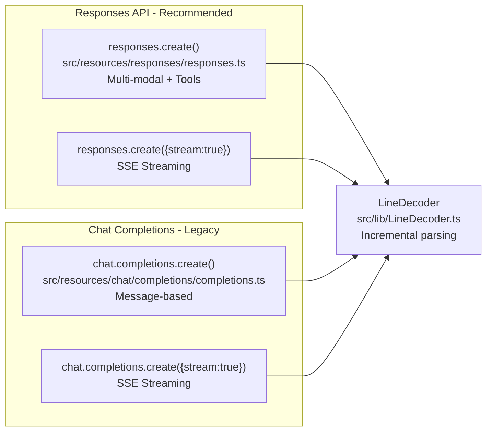
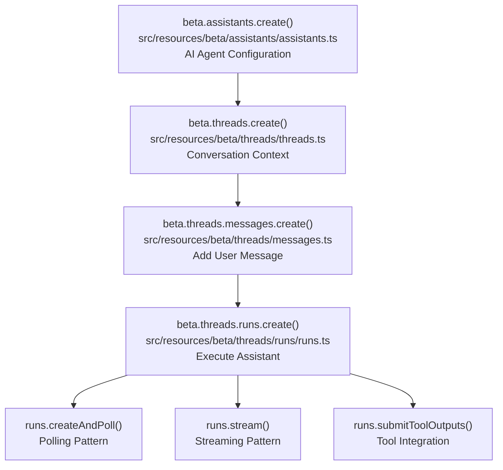
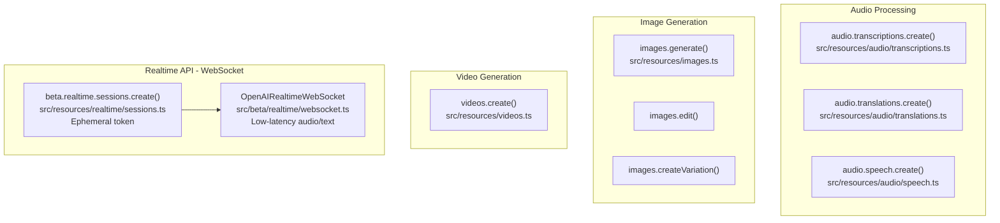

<!-- source: DeepWiki mcp.deepwiki.com · repo openai/openai-node · page 1 Overview · fetched 2026-10-26 -->

# Overview

<details>
<summary>Relevant source files</summary>

The following files were used as context for generating this wiki page:

- [.release-please-manifest.json](.release-please-manifest.json)
- [CHANGELOG.md](CHANGELOG.md)
- [README.md](README.md)
- [api.md](api.md)
- [jsr.json](jsr.json)
- [package.json](package.json)
- [scripts/build-deno](scripts/build-deno)
- [scripts/utils/convert-jsr-readme.cjs](scripts/utils/convert-jsr-readme.cjs)
- [src/index.ts](src/index.ts)
- [src/resources/index.ts](src/resources/index.ts)
- [src/version.ts](src/version.ts)

</details>


## Purpose and Scope

This page provides a high-level introduction to the OpenAI Node.js SDK, covering its architecture, supported platforms, and core capabilities. For detailed information about installation and setup, see [Installation and Setup](). For specifics about the main client classes, see [Core Client]().

## What is the OpenAI Node.js SDK

The OpenAI Node.js SDK is the official TypeScript/JavaScript client library for interacting with OpenAI's APIs. It provides a comprehensive, type-safe interface to all OpenAI services including chat completions, embeddings, file management, image generation, audio processing, and advanced features like the Assistants API and Realtime API.

The SDK is built with modern TypeScript and supports multiple JavaScript runtimes, making it suitable for server-side applications, edge computing, and various deployment environments.

**Core Package Information:**
- **Package name**: `openai` on npm, `@openai/openai` on JSR [package.json:2-3](), [jsr.json:2]()
- **Current version**: `6.42.0` [src/version.ts:1](), [.release-please-manifest.json:2]()
- **Language**: TypeScript with full JavaScript support [package.json:4]()
- **License**: Apache-2.0 [package.json:10]()
- **Runtime dependencies**: Zero (peer dependencies: `ws`, `zod` - both optional) [package.json:29](), [package.json:88-99]()

The SDK is uniquely built with **zero runtime dependencies**, relying entirely on Web Standards APIs (`fetch`, `ReadableStream`, `WebSocket`) available in modern JavaScript runtimes. This design ensures minimal bundle size, broad compatibility, and reduced security surface area.

Sources: [package.json:1-100](), [README.md:1-10](), [src/version.ts:1](), [jsr.json:1-17]()

## High-Level Architecture

The SDK follows a layered architecture with clear separation between client interfaces, API resources, and core infrastructure.

### Client Layer Architecture

**Client Initialization and Core Infrastructure**

```mermaid
graph TB
    subgraph "Client Classes"
        OpenAI["OpenAI<br/>src/client.ts<br/>ClientOptions"]
        AzureOpenAI["AzureOpenAI<br/>src/azure.ts<br/>Azure-specific auth"]
        BedrockOpenAI["BedrockOpenAI<br/>src/bedrock.ts<br/>Amazon Bedrock support"]
    end
    
    subgraph "HTTP Layer - Zero Dependencies"
        APIClient["APIClient<br/>src/core.ts<br/>Web Fetch API"]
        RetryLogic["Retry Logic<br/>Exponential backoff<br/>maxRetries: 2"]
        AuthLayer["Authentication<br/>API Key / Token Provider"]
    end
    
    subgraph "Top API Resources"
        Responses["responses<br/>src/resources/responses/responses.ts<br/>Recommended API"]
        Chat["chat.completions<br/>src/resources/chat/completions/completions.ts<br/>Legacy API"]
        Assistants["beta.assistants<br/>src/resources/beta/assistants/assistants.ts"]
        Threads["beta.threads<br/>src/resources/beta/threads/threads.ts"]
        Realtime["beta.realtime<br/>src/resources/realtime/realtime.ts"]
    end
    
    subgraph "Supporting Resources"
        Files["files<br/>src/resources/files.ts"]
        Audio["audio<br/>src/resources/audio/audio.ts"]
        Images["images<br/>src/resources/images.ts"]
        Embeddings["embeddings<br/>src/resources/embeddings.ts"]
        Models["models<br/>src/resources/models.ts"]
        FineTuning["fineTuning<br/>src/resources/fine-tuning/fine-tuning.ts"]
        Batches["batches<br/>src/resources/batches.ts"]
        Evals["evals<br/>src/resources/evals/evals.ts"]
        Videos["videos<br/>src/resources/videos.ts"]
    end
    
    OpenAI --> APIClient
    AzureOpenAI --> APIClient
    BedrockOpenAI --> APIClient
    
    APIClient --> RetryLogic
    APIClient --> AuthLayer
    
    OpenAI --> Responses
    OpenAI --> Chat
    OpenAI --> Assistants
    OpenAI --> Threads
    OpenAI --> Realtime
    OpenAI --> Files
    OpenAI --> Audio
    OpenAI --> Images
    OpenAI --> Embeddings
    OpenAI --> Models
    OpenAI --> FineTuning
    OpenAI --> Batches
    OpenAI --> Evals
    OpenAI --> Videos
```



The SDK exposes three main client classes: `OpenAI` (standard API access), `AzureOpenAI` (Azure deployments), and `BedrockOpenAI` (Amazon Bedrock integration). The HTTP layer uses the native Web Fetch API with **zero external dependencies**, implementing authentication, retry logic with exponential backoff, and error handling entirely through standard web APIs.

Sources: [src/index.ts:3-29](), [src/resources/index.ts:1-152](), [README.md:37-70](), [package.json:29](), [CHANGELOG.md:17]()

### API Resource Organization by Priority

**Primary Text Generation APIs**



**Conversational AI System (Assistants API)**



**Media Processing and Real-time**



Each resource class extends `APIResource` and provides type-safe methods for API endpoints. The Responses API is the recommended interface for new applications, while Chat Completions remains supported indefinitely for backward compatibility.

Sources: [src/resources/index.ts:1-152](), [README.md:32-90](), [api.md:1-115](), [jsr.json:4-8]()

## Supported Platforms and Runtimes

The SDK achieves broad compatibility by relying exclusively on Web Standard APIs (`fetch`, `ReadableStream`, `WebSocket`) available across modern JavaScript runtimes:

| Runtime | Support Level | Notes |
|---------|---------------|-------|
| Node.js | Full support | Uses native `fetch` (Node 18+) |
| Deno | Full support | Native via JSR `@openai/openai` |
| Bun | Full support | Native Web APIs |
| Cloudflare Workers | Full support | Edge runtime compatible |
| Vercel Edge Runtime | Full support | Edge runtime compatible |
| Web Browsers | Limited | Requires `dangerouslyAllowBrowser: true` |

**Multi-target Distribution:**
- **npm (`openai`)**: Dual CommonJS/ESM builds in `dist/` directory [package.json:72-87]()
- **JSR (`@openai/openai`)**: Native TypeScript sources for Deno [jsr.json:4-8]()
- **Export maps**: Runtime-appropriate module resolution via `package.json` exports [package.json:72-87]()

Sources: [README.md:17-29](), [package.json:72-87](), [jsr.json:1-17](), [package.json:29]()

## Key Features and Capabilities

### Zero-Dependency HTTP Infrastructure

The SDK implements all HTTP functionality using native Web APIs:

- **Web Fetch API**: All HTTP requests use native `fetch()` (no `node-fetch` or `axios`).
- **Retry system**: Automatic retry with exponential backoff for 429/5xx errors.
- **Authentication**: Supports static API keys and dynamic token providers (Azure AD, Workload Identity).
- **Timeout handling**: Default 10-minute timeout with per-request override.

Sources: [README.md:72-167](), [package.json:29]()

### Comprehensive API Coverage

**Core Text and Embedding APIs:**
- **Responses API** (`responses.create()`): Recommended interface for multi-modal text generation, tool usage, and structured outputs [src/resources/responses/responses.ts]().
- **Chat Completions** (`chat.completions.create()`): Legacy interface supported indefinitely with function calling and streaming [src/resources/chat/completions/completions.ts]().
- **Embeddings** (`embeddings.create()`): Text vectorization with base64 encoding optimization [src/resources/embeddings.ts]().

**Media Processing:**
- **Audio** (`audio.*`): Transcription, translation, and speech synthesis with streaming [src/resources/audio/audio.ts]().
- **Images** (`images.*`): Generation, editing, and variations with streaming support [src/resources/images.ts]().
- **Videos** (`videos.*`): Video generation, character creation, and management [src/resources/videos.ts]().

**Conversational AI (Beta):**
- **Assistants** (`beta.assistants.*`): Stateful AI agents with tool execution (FunctionTool, CodeInterpreterTool, FileSearchTool).
- **Threads** (`beta.threads.*`): Persistent conversation context across multiple runs.
- **Real-time Communication**: WebSocket-based low-latency audio/text conversations [src/resources/realtime/realtime.ts]().

**Supporting Services:**
- **Files** (`files.*`): Upload and management with purpose-based workflows (`fine-tune`, `assistants`, `batch`) [src/resources/files.ts]().
- **Fine-tuning** (`fineTuning.*`): Custom model training with checkpoints and graders [src/resources/fine-tuning/fine-tuning.ts]().
- **Batches** (`batches.*`): Asynchronous batch request processing [src/resources/batches.ts]().
- **Evaluations** (`evals.*`): Model performance testing [src/resources/evals/evals.ts]().

Sources: [src/resources/index.ts:1-152](), [README.md:30-224](), [api.md:1-115]()

### Developer Experience Features

- **Full TypeScript support**: Generated type definitions for all API parameters and responses.
- **Workload Identity**: Support for Kubernetes, Azure, and GCP short-lived tokens [README.md:72-167]().
- **Streaming**: Native async generator support for SSE streams [README.md:168-183]().
- **File Handling**: Multiple upload formats via `toFile()` helper and native stream support [README.md:185-221]().

Sources: [README.md:72-221](), [src/index.ts:1-30]()

## Distribution and Build System

The SDK uses a sophisticated build system to support multiple JavaScript runtimes and distribution channels:

```mermaid
graph LR
    TypeScriptSource["`src/index.ts`<br/>`src/resources/`<br/>`src/core/`"]
    
    subgraph "Build Pipeline"
        NPMBuild["`dist/index.js`<br/>`dist/index.mjs`<br/>`dist/index.d.ts`"]
        JSRBuild["`dist-deno/index.ts`<br/>`dist-deno/jsr.json`"]
        BuildScript["`scripts/build`<br/>`scripts/build-deno`"]
    end
    
    subgraph "Distribution"
        NPMRegistry["`npm install openai`<br/>package.json exports"]
        JSRRegistry["`deno add jsr:@openai/openai`<br/>jsr.json exports"]
    end
    
    TypeScriptSource --> BuildScript
    BuildScript --> NPMBuild
    BuildScript --> JSRBuild
    
    NPMBuild --> NPMRegistry
    JSRBuild --> JSRRegistry
```

**Build Process:**
- **TypeScript compilation**: Generates both CommonJS and ESM outputs [package.json:72-87]().
- **Deno transformation**: Converts imports and Node.js-specific code for Deno compatibility [scripts/build-deno:1-15](), [scripts/utils/convert-jsr-readme.cjs:1-140]().
- **Export maps**: Provides runtime-appropriate module resolution [package.json:72-87]().

Sources: [package.json:72-87](), [scripts/build-deno:1-15](), [jsr.json:4-8](), [scripts/utils/convert-jsr-readme.cjs:1-140]()

---

