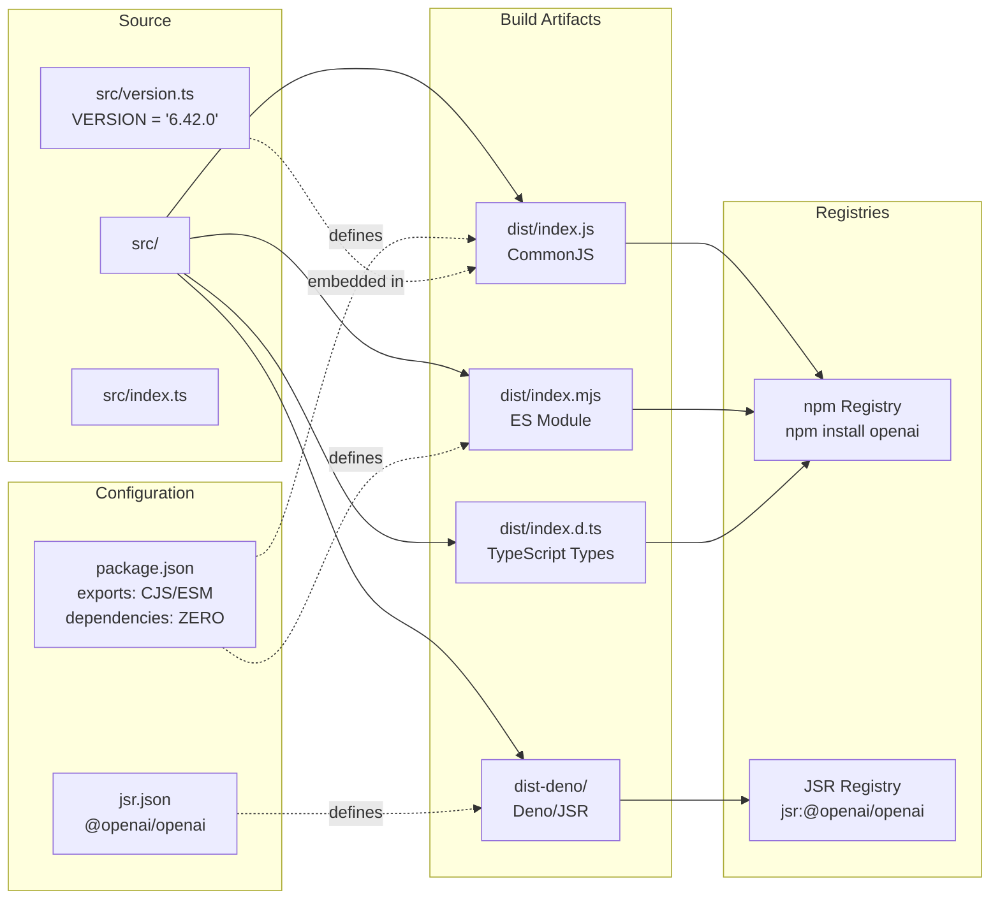
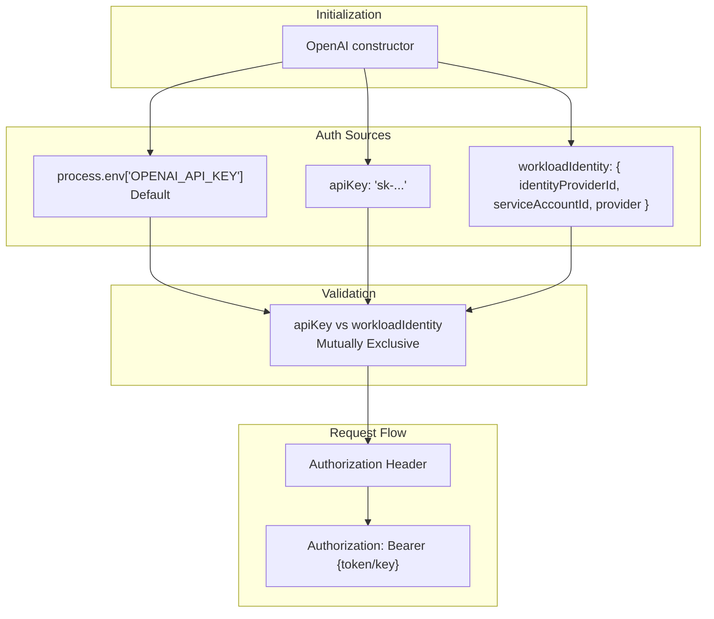
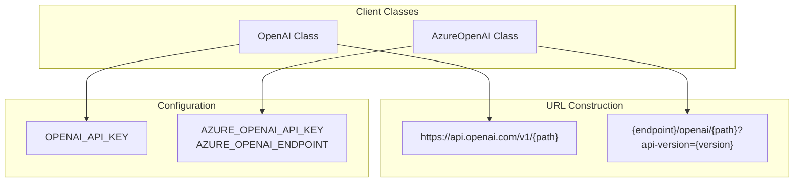

<!-- source: DeepWiki mcp.deepwiki.com · repo openai/openai-node · page 2 Installation and Setup · fetched 2026-10-26 -->

# Installation and Setup

<details>
<summary>Relevant source files</summary>

The following files were used as context for generating this wiki page:

- [.devcontainer/devcontainer.json](.devcontainer/devcontainer.json)
- [.release-please-manifest.json](.release-please-manifest.json)
- [CHANGELOG.md](CHANGELOG.md)
- [README.md](README.md)
- [jsr.json](jsr.json)
- [package.json](package.json)
- [scripts/build-deno](scripts/build-deno)
- [scripts/utils/convert-jsr-readme.cjs](scripts/utils/convert-jsr-readme.cjs)
- [src/version.ts](src/version.ts)
- [tsconfig.build.json](tsconfig.build.json)
- [tsconfig.deno.json](tsconfig.deno.json)
- [tsconfig.json](tsconfig.json)

</details>


This page covers the installation of the OpenAI TypeScript/JavaScript SDK and basic client initialization. It explains package manager installation, runtime requirements, API key configuration, and client instantiation patterns. For detailed configuration options like retries, timeouts, and proxy settings, see [Core Client](). For Azure-specific deployment setup, see [Azure OpenAI Client]().

## Package Installation

The SDK is distributed through two primary registries: NPM and JSR (JavaScript Registry for Deno).

### NPM Installation

```bash
npm install openai
```

The package is published as `openai` on the NPM registry with zero runtime dependencies.

**Sources:** [package.json:1-30](), [README.md:11-15]()

### JSR Installation

For Deno, Bun with JSR, or npm with JSR:

```bash
# Deno
deno add jsr:@openai/openai

# npm/npx
npx jsr add @openai/openai
```

Direct import without installation (Deno only):

```typescript
import OpenAI from 'jsr:@openai/openai';
```

**Sources:** [README.md:17-28](), [jsr.json:1-17]()

### Package Distribution Architecture



The build system generates dual-mode outputs (CommonJS and ESM) from TypeScript source files. The package uses `"type": "commonjs"` with conditional exports for ESM support. Version synchronization occurs across three files: `package.json`, `src/version.ts`, and `.release-please-manifest.json`.

**Sources:** [package.json:1-87](), [jsr.json:1-17](), [src/version.ts:1-1](), [.release-please-manifest.json:1-3](), [scripts/build-deno:1-15]()

## Supported Runtimes

| Runtime | Minimum Version | Notes |
|---------|----------------|-------|
| Node.js | 20 LTS or later | Non-EOL versions recommended |
| Deno | v1.28.0 or higher | Native support via JSR |
| Bun | 1.0 or later | Native support |
| Cloudflare Workers | N/A | Supported |
| Vercel Edge Runtime | N/A | Supported |
| Browsers | N/A | Requires `dangerouslyAllowBrowser: true` |

**TypeScript Requirement:** >= 5.8.3 (as specified in devDependencies)

**Sources:** [package.json:36-59](), [tsconfig.json:1-37]()

## API Key Configuration

The SDK requires authentication via an API key or Workload Identity, which can be provided through multiple methods:

### Environment Variable (Recommended)

```bash
export OPENAI_API_KEY='sk-...'
```

The `OpenAI` client constructor reads from `process.env['OPENAI_API_KEY']` by default.

**Sources:** [README.md:39-41]()

### Constructor Option

```typescript
import OpenAI from 'openai';

const client = new OpenAI({
  apiKey: 'sk-...'
});
```

**Sources:** [README.md:39-41]()

### Workload Identity Authentication

For secure, automated environments, you can use workload identity authentication with short-lived tokens from cloud identity providers instead of long-lived API keys. This is supported for Kubernetes, Azure, and GCP.

```typescript
import OpenAI from 'openai';
import { k8sServiceAccountTokenProvider } from 'openai/auth';

const client = new OpenAI({
  workloadIdentity: {
    identityProviderId: 'idp-123',
    serviceAccountId: 'sa-456',
    provider: k8sServiceAccountTokenProvider('/var/run/secrets/kubernetes.io/serviceaccount/token'),
  },
});
```

**Sources:** [README.md:72-163]()

### Authentication Configuration Flow



**Sources:** [README.md:39-41](), [README.md:72-78]()

## Client Initialization

### Basic Initialization

```typescript
import OpenAI from 'openai';

const client = new OpenAI({
  apiKey: process.env['OPENAI_API_KEY'], // Optional: defaults to env var
});
```

**Sources:** [README.md:36-50]()

### Client Initialization with Options

```typescript
import OpenAI from 'openai';

const client = new OpenAI({
  apiKey: 'sk-...',
  organization: 'org-...',       // Optional: defaults to OPENAI_ORG_ID env var
  project: 'proj_...',           // Optional: defaults to OPENAI_PROJECT_ID env var
  baseURL: 'https://api.openai.com/v1',  // Optional: custom base URL
  timeout: 20 * 1000,            // Optional: 20 seconds
  maxRetries: 2,                 // Optional: defaults to 2
});
```

**Sources:** [README.md:39-41](), [README.md:57-59]()

## Azure OpenAI Setup

Azure OpenAI requires additional configuration beyond the standard client, specifically an `endpoint` and `apiVersion`.

### Azure Client Initialization

```typescript
import { AzureOpenAI } from 'openai';
import { azureManagedIdentityTokenProvider } from 'openai/auth';

const client = new AzureOpenAI({
  apiKey: process.env['AZURE_OPENAI_API_KEY'],
  apiVersion: '2024-02-15-preview',
  endpoint: 'https://example-resource.azure.openai.com'
});
```

**Sources:** [README.md:100-113]()

### Azure vs Standard OpenAI Client Mapping



**Sources:** [README.md:100-113]()

## Verification

After installation and initialization, verify the setup with a simple request using the `Responses API`.

```typescript
import OpenAI from 'openai';

const client = new OpenAI();

const response = await client.responses.create({
  model: 'gpt-5.5',
  instructions: 'Verify setup',
  input: 'Is the SDK installed correctly?',
});

console.log(response.output_text);
```

**Sources:** [README.md:36-50]()

---

