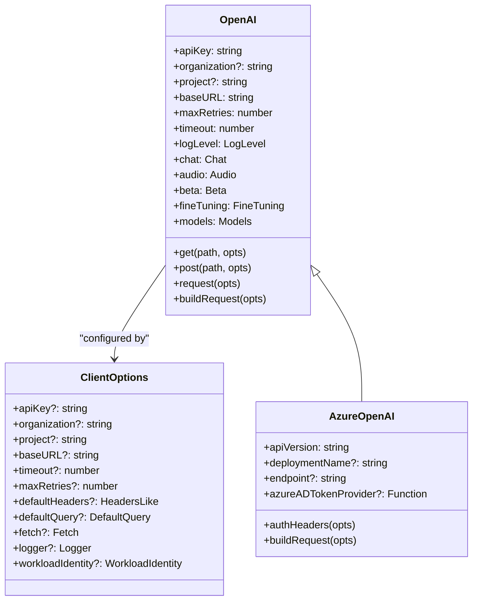
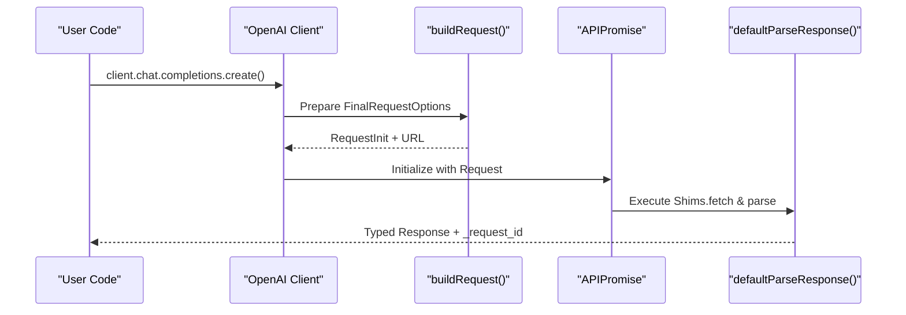

<!-- source: DeepWiki mcp.deepwiki.com · repo openai/openai-node · page 3 Core Client · fetched 2026-10-26 -->

# Core Client

<details>
<summary>Relevant source files</summary>

The following files were used as context for generating this wiki page:

- [api.md](api.md)
- [src/azure.ts](src/azure.ts)
- [src/client.ts](src/client.ts)
- [src/index.ts](src/index.ts)
- [src/resources/index.ts](src/resources/index.ts)
- [tests/index.test.ts](tests/index.test.ts)
- [tests/lib/azure.test.ts](tests/lib/azure.test.ts)
- [tests/log.test.ts](tests/log.test.ts)
- [tests/responses.test.ts](tests/responses.test.ts)
- [tests/utils/typing.ts](tests/utils/typing.ts)

</details>


The Core Client system provides the main client classes and configuration options for the OpenAI Node.js SDK. This page covers the `OpenAI` and `AzureOpenAI` client classes, their configuration options, and the underlying HTTP layer architecture.

For detailed information about specific client implementations and advanced features, see [OpenAI Client](#3.1) and [Azure OpenAI Client](#3.2).

## Main Client Classes

The SDK is built around a hierarchical client architecture where specialized clients inherit from a base implementation to provide consistent behavior across different environments.

### Core Client Hierarchy



**Sources:** [src/client.ts:756-778](), [src/azure.ts:41-151](), [src/client.ts:200-260]()

The `OpenAI` class serves as the base for all interactions, managing the request lifecycle, retries, and resource organization [src/client.ts:756-1100](). `AzureOpenAI` extends this base to handle Azure-specific deployment routing and authentication schemes like `api-key` headers or Active Directory tokens [src/azure.ts:125-150]().

## Client Configuration Options

Clients are configured via a `ClientOptions` object [src/client.ts:200-260](), which supports both explicit passing and environment variable fallbacks via `readEnv` [src/client.ts:632-650]().

### Authentication and Identity

| Option | Type | Description | Default |
|--------|------|-------------|---------|
| `apiKey` | `string` | Primary API credential | `process.env['OPENAI_API_KEY']` |
| `organization` | `string` | Organization identifier | `process.env['OPENAI_ORG_ID']` |
| `project` | `string` | Project identifier | `process.env['OPENAI_PROJECT_ID']` |
| `workloadIdentity` | `WorkloadIdentity` | Token exchange config | N/A |

**Sources:** [src/client.ts:203-214](), [src/client.ts:632-645](), [src/auth/workload-identity-auth.ts:1-20]()

### Network and HTTP Layer

| Option | Type | Description | Default |
|--------|------|-------------|---------|
| `baseURL` | `string` | API root URL | `https://api.openai.com/v1` |
| `timeout` | `number` | Request timeout (ms) | `600000` (10 min) |
| `maxRetries` | `number` | Retry attempts | `2` |
| `fetch` | `Fetch` | Custom fetch engine | `globalThis.fetch` |

**Sources:** [src/client.ts:216-228](), [tests/index.test.ts:131-132](), [src/client.ts:632-633]()

### Logging and Debugging

The SDK includes a built-in logging system that can be configured via `logLevel` or the `OPENAI_LOG` environment variable [src/client.ts:246-258](). Supported levels include `off`, `error`, `warn`, `info`, and `debug` [src/client.ts:8]().

**Sources:** [tests/index.test.ts:130-132](), [tests/index.test.ts:164-171](), [src/internal/utils/log.ts:1-10]()

## HTTP Layer Architecture

The SDK abstracts the underlying HTTP communication through several internal utilities and a custom promise wrapper.

### Request Execution Flow



**Sources:** [src/client.ts:1011-1050](), [src/core/api-promise.ts:1-50](), [src/internal/parse.ts:18-84]()

### The APIPromise Wrapper
All client methods return an `APIPromise`, which extends the standard `Promise`. It provides additional methods like `.asResponse()` to access the raw `Response` object and `.withResponse()` to get both data and metadata (like `_request_id`) simultaneously [src/core/api-promise.ts:10-40]().

**Sources:** [tests/responses.test.ts:30-40](), [src/core/api-promise.ts:1-72]()

### Streaming Support
For streaming endpoints, the SDK uses a `Stream` class that implements `AsyncIterable`. It handles Server-Sent Events (SSE) parsing and provides utilities for managing the lifecycle of the stream [src/core/streaming.ts:21-217]().

**Sources:** [src/core/streaming.ts:163-185](), [src/internal/parse.ts:24-45]()

## Client Instantiation Patterns

### OpenAI Standard
```typescript
import OpenAI from 'openai';

// Uses process.env['OPENAI_API_KEY'] by default
const client = new OpenAI();
```

### Azure OpenAI
Azure requires an `apiVersion` and either an `endpoint` or `baseURL`. It supports deployment-based routing where the model name is injected into the URL path if the `deployment` option is provided [src/azure.ts:125-137]().

```typescript
import { AzureOpenAI } from 'openai';

const client = new AzureOpenAI({
  endpoint: 'https://my-resource.azure.openai.com',
  apiVersion: '2024-02-15-preview',
  deployment: 'my-gpt-4-deployment'
});
```

**Sources:** [src/azure.ts:62-123](), [tests/lib/azure.test.ts:26-31]()

## Summary

The Core Client provides:
1. **Unified Interface**: A consistent pattern for `get`, `post`, and `request` across all resources [src/client.ts:930-970]().
2. **Flexible Auth**: Support for API Keys, Azure AD tokens, and Workload Identity [src/auth/workload-identity-auth.ts:1-20](), [src/azure.ts:141-150]().
3. **Robust Lifecycle**: Integrated retry logic, timeout management, and automatic response parsing [src/client.ts:1011-1050]().
4. **Metadata Injection**: Automatic attachment of `_request_id` to response objects for easier debugging [tests/responses.test.ts:51-55]().

For details, see [OpenAI Client](#3.1) and [Azure OpenAI Client](#3.2).

---

