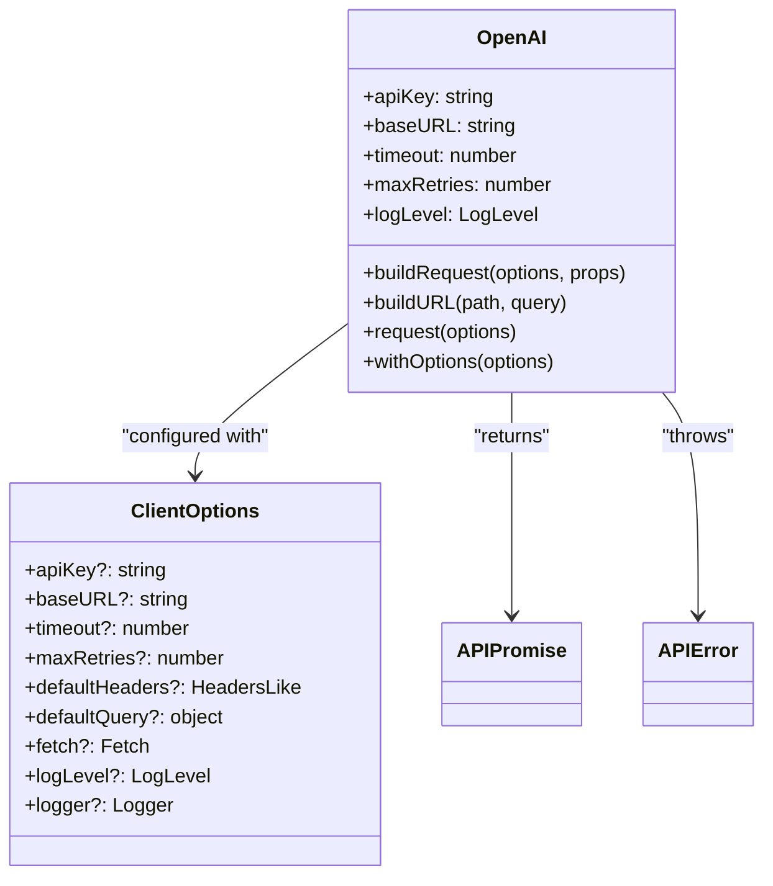
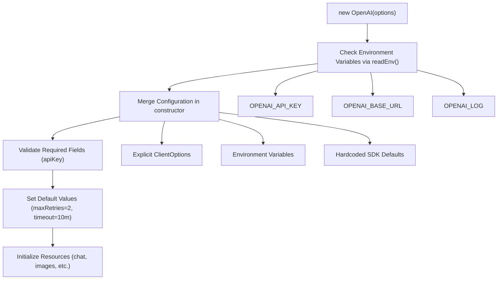
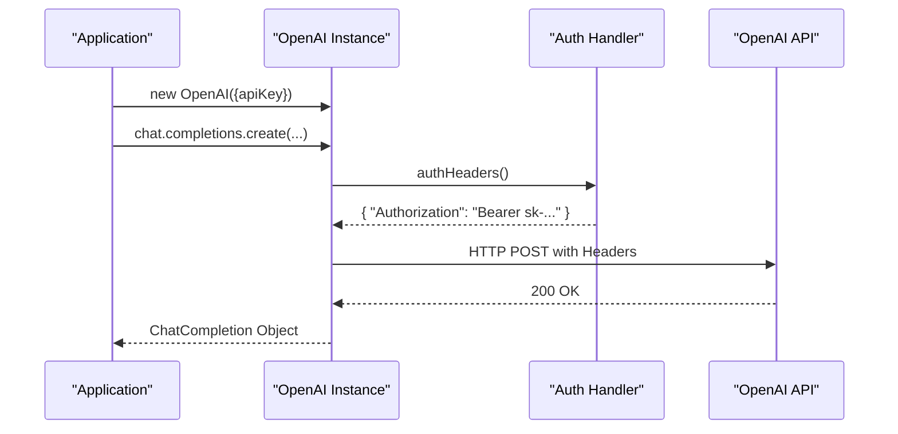
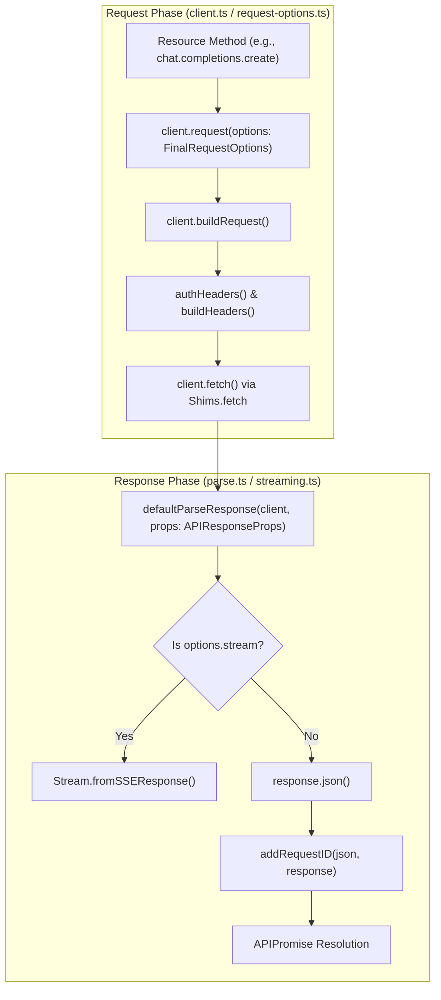

<!-- source: DeepWiki mcp.deepwiki.com · repo openai/openai-node · page 3.1 OpenAI Client · fetched 2026-10-26 -->

# OpenAI Client

Relevant source files

The following files were used as context for generating this wiki page:

- [src/azure.ts](src/azure.ts)
- [src/client.ts](src/client.ts)
- [src/core/resource.ts](src/core/resource.ts)
- [src/core/streaming.ts](src/core/streaming.ts)
- [src/internal/errors.ts](src/internal/errors.ts)
- [src/internal/headers.ts](src/internal/headers.ts)
- [src/internal/parse.ts](src/internal/parse.ts)
- [src/internal/qs/formats.ts](src/internal/qs/formats.ts)
- [src/internal/qs/stringify.ts](src/internal/qs/stringify.ts)
- [src/internal/qs/utils.ts](src/internal/qs/utils.ts)
- [src/internal/request-options.ts](src/internal/request-options.ts)
- [tests/index.test.ts](tests/index.test.ts)
- [tests/lib/azure.test.ts](tests/lib/azure.test.ts)
- [tests/log.test.ts](tests/log.test.ts)
- [tests/responses.test.ts](tests/responses.test.ts)
- [tests/utils/typing.ts](tests/utils/typing.ts)

## Purpose and Scope

This page documents the main `OpenAI` client class, its configuration options, authentication mechanisms, and request handling behavior. It covers client instantiation, configuration precedence, environment variable usage, and core request/response patterns.

The `OpenAI` client is designed to be zero-dependency and supports multiple runtimes including Node.js, Bun, Deno, and browsers. It provides the foundation for all [API Resources](#4) such as Chat, Embeddings, and Assistants.

For Azure-specific client functionality, see [Azure OpenAI Client](#3.2). For detailed API resource usage, see [API Resources](#4). For advanced streaming capabilities, see [Streaming](#5.1).

## Client Class Overview

The `OpenAI` class serves as the primary interface for interacting with OpenAI's APIs. It handles authentication, request building, retry logic, and response processing.

### Code Entity Space: OpenAI Client Structure
The following diagram maps the high-level client configuration to the internal code entities and types used for request preparation.

**Client Instantiation Flow**

The constructor initializes resource groups (e.g., `chat`, `images`) and resolves configuration by merging environment variables with explicit options.

Sources: [src/client.ts:233-315](), [tests/index.test.ts:10-28](), [src/internal/request-options.ts:12-84]()

## Configuration Options

The `ClientOptions` interface defines all available configuration parameters for the OpenAI client.

| Option | Type | Default | Description |
|--------|------|---------|-------------|
| `apiKey` | `string` | `process.env.OPENAI_API_KEY` | API authentication key |
| `baseURL` | `string` | `"https://api.openai.com/v1"` | Base URL for API requests |
| `timeout` | `number` | `600,000` (10m) | Request timeout in milliseconds |
| `maxRetries` | `number` | `2` | Maximum number of retry attempts |
| `defaultHeaders` | `HeadersLike` | `{}` | Headers added to every request |
| `defaultQuery` | `object` | `{}` | Query parameters added to every request |
| `fetch` | `Fetch` | `globalThis.fetch` | Custom fetch implementation |
| `logLevel` | `LogLevel` | `"warn"` | Logging verbosity level (`'debug'`, `'info'`, `'warn'`, `'error'`, `'off'`) |
| `logger` | `Logger` | `console` | Custom logger implementation |

**Configuration Precedence**

The client resolves configuration using a specific hierarchy:
1. **Explicit options** passed to the constructor or `withOptions()`.
2. **Environment variables** (e.g., `OPENAI_API_KEY`).
3. **Internal defaults** defined in the SDK.

Sources: [src/client.ts:233-270](), [tests/index.test.ts:130-134](), [tests/index.test.ts:197-217]()

## Authentication

The client primarily supports API key authentication via the `Authorization: Bearer` header. It also supports **Workload Identity** for environments like Kubernetes, Azure Managed Identity, and GCP via `WorkloadIdentityAuth`.

**Authentication Header Processing**
The client redacts the `Authorization` header in debug logs to prevent credential leakage. If `logLevel` is set to `debug`, the logger replaces sensitive values with `***` in `formatRequestDetails`.

Sources: [src/client.ts:850-863](), [tests/log.test.ts:30-43](), [src/auth/workload-identity-auth.ts:1-20](), [src/internal/parse.ts:6-16]()

## Request Lifecycle and Data Flow

The client manages the entire lifecycle of an HTTP request, from building the URL to parsing the response and attaching metadata like Request IDs.

### Natural Language to Code Entity Space: Request/Response Flow
This diagram maps the logical phases of a request to the specific functions and classes in the codebase that handle them.

### Request Building
`buildRequest` merges global `defaultHeaders` with request-specific headers. It also handles the `x-stainless-retry-count` header for tracking retries and generates a `requestLogID` using `uuid4()`.

### Response Parsing
The `defaultParseResponse` function in `src/internal/parse.ts` handles:
- **JSON Parsing**: Automatically parses JSON bodies and calls `addRequestID` to inject the `_request_id` property.
- **Streaming**: Initializes a `Stream` object for Server-Sent Events (SSE) responses using `Stream.fromSSEResponse`.
- **Binary Data**: Returns the raw response if `options.__binaryResponse` is set.
- **Empty Responses**: Returns `null` for HTTP `204` No Content.

Sources: [src/client.ts:792-840](), [src/internal/parse.ts:18-84](), [src/internal/headers.ts:71-92](), [src/internal/utils/uuid.ts:5-5]()

## Retry Logic

The client implements automatic retries for transient failures using exponential backoff with jitter.

**Retryable Conditions:**
- HTTP `408` (Request Timeout)
- HTTP `409` (Conflict)
- HTTP `429` (Rate Limit)
- HTTP `>= 500` (Internal Server Errors)
- Network connectivity errors (e.g., `ECONNREFUSED`) or `AbortError` handled via `isAbortError`.

The client respects the `Retry-After` header if present in `429` or `5xx` responses to determine the wait duration before the next attempt.

Sources: [src/client.ts:881-915](), [tests/index.test.ts:663-691](), [src/internal/utils/sleep.ts:7-7](), [src/internal/errors.ts:3-12]()

## URL and Query Parameter Handling

The `buildURL` method combines the `baseURL`, request `path`, and `query` parameters.

- **Default Query**: Parameters in `defaultQuery` are included in every request.
- **Null/Undefined**: Passing `null` for a header or query param in a specific request will remove it from the final request via `buildHeaders` or query serialization logic.
- **Serialization**: Query parameters are serialized using `stringifyQuery` which leverages a custom implementation in `src/internal/qs/stringify.ts` to handle nested objects and arrays.

Sources: [src/client.ts:865-879](), [tests/index.test.ts:44-51](), [src/internal/utils/query.ts:1-14](), [src/internal/qs/stringify.ts:60-220]()

## Environment Variables

The client automatically reads several environment variables during initialization if the corresponding options are not provided in the constructor.

| Environment Variable | SDK Usage |
|----------------------|-----------|
| `OPENAI_API_KEY` | Used as the default `apiKey`. |
| `OPENAI_ORG_ID` | Used as the default `organization`. |
| `OPENAI_PROJECT_ID` | Used as the default `project`. |
| `OPENAI_BASE_URL` | Overrides the default base URL. |
| `OPENAI_LOG` | Sets the initial `logLevel` (parsed in constructor). |

Sources: [src/client.ts:245-265](), [tests/index.test.ts:155-174](), [tests/index.test.ts:53-65]()

## Client Instance Management

### withOptions()
The `withOptions()` method allows creating a new client instance that inherits configuration from the current one but overrides specific values. This is useful for per-request configuration changes like different timeouts or headers.

### Request IDs
Every successful non-streaming JSON response has a non-enumerable `_request_id` property attached. This ID corresponds to the `x-request-id` header sent by the OpenAI API and is crucial for debugging and support.

Sources: [src/client.ts:317-323](), [src/internal/parse.ts:91-100](), [tests/responses.test.ts:42-55]()

---

