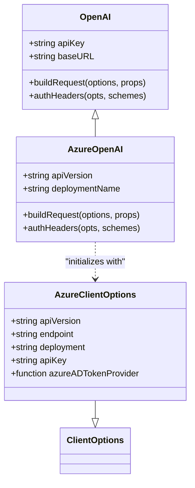
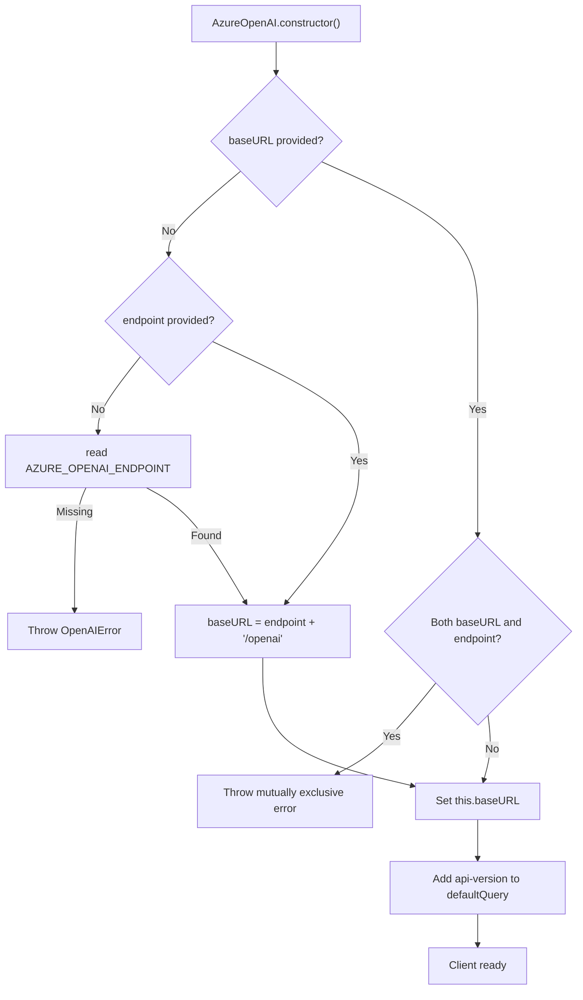
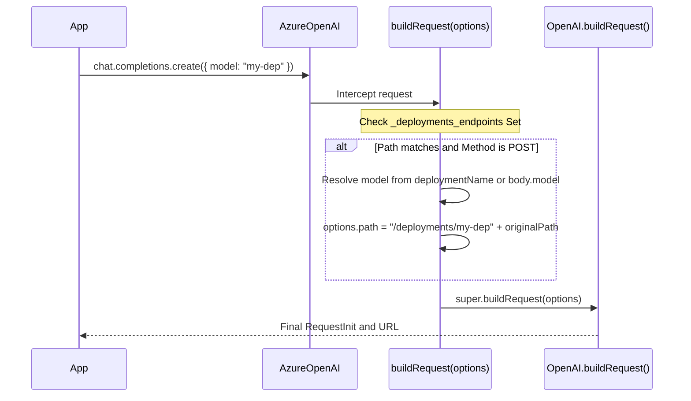

<!-- source: DeepWiki mcp.deepwiki.com · repo openai/openai-node · page 3.2 Azure OpenAI Client · fetched 2026-10-26 -->

# Azure OpenAI Client

<details>
<summary>Relevant source files</summary>

The following files were used as context for generating this wiki page:

- [azure.md](azure.md)
- [helpers.md](helpers.md)
- [realtime.md](realtime.md)
- [src/azure.ts](src/azure.ts)
- [src/client.ts](src/client.ts)
- [tests/api-resources/embeddings-base64-response.json](tests/api-resources/embeddings-base64-response.json)
- [tests/api-resources/embeddings-float-response.json](tests/api-resources/embeddings-float-response.json)
- [tests/index.test.ts](tests/index.test.ts)
- [tests/lib/azure.test.ts](tests/lib/azure.test.ts)
- [tests/log.test.ts](tests/log.test.ts)
- [tests/responses.test.ts](tests/responses.test.ts)
- [tests/utils/typing.ts](tests/utils/typing.ts)

</details>


## Purpose and Scope

The Azure OpenAI Client provides specialized functionality for interfacing with Microsoft Azure's OpenAI service. It extends the base `OpenAI` client class with Azure-specific authentication, URL routing, and deployment management capabilities. This document covers the Azure-specific configuration, authentication methods, and deployment routing mechanisms, including support for Realtime APIs.

For information about the base client functionality, see [OpenAI Client](3.1). For general installation and setup instructions, see [Installation and Setup](2).

---

## Class Architecture

The `AzureOpenAI` class extends the base `OpenAI` client and overrides key methods to accommodate Azure's service architecture.

### Code Entity Space: Azure Client Inheritance
Title: Azure OpenAI Client Inheritance Structure

Sources: [src/azure.ts:11-38](), [src/azure.ts:41-151]()

---

## Configuration Options

The `AzureOpenAI` client requires Azure-specific configuration parameters in addition to the base client options.

### Required Parameters

| Parameter | Type | Default | Description |
|-----------|------|---------|-------------|
| `apiVersion` | `string` | `process.env['OPENAI_API_VERSION']` | Azure API version (e.g., `'2024-02-15-preview'`) [src/azure.ts:15](). |
| `endpoint` or `baseURL` | `string` | `process.env['AZURE_OPENAI_ENDPOINT']` | Azure resource endpoint [src/azure.ts:20](). |

### Optional Parameters

| Parameter | Type | Default | Description |
|-----------|------|---------|-------------|
| `deployment` | `string` | `undefined` | Default model deployment name. Sets the base client URL to include `/deployments/{deployment}` [src/azure.ts:26](). |
| `apiKey` | `string` | `process.env['AZURE_OPENAI_API_KEY']` | Azure API key [src/azure.ts:31](). |
| `azureADTokenProvider` | `() => Promise<string>` | `undefined` | Azure AD token provider function for Microsoft Entra authentication [src/azure.ts:37](). |

**Example Initialization:**

```typescript
import { AzureOpenAI } from 'openai';

const client = new AzureOpenAI({
  endpoint: 'https://my-resource.azure.openai.com',
  apiKey: process.env.AZURE_OPENAI_API_KEY,
  apiVersion: '2024-02-15-preview',
});
```
Sources: [src/azure.ts:11-38](), [src/azure.ts:62-71](), [tests/lib/azure.test.ts:26-31]()

---

## Base URL Construction

The Azure client constructs base URLs differently than the standard OpenAI client, converting resource endpoints to OpenAI-compatible paths.

Title: Azure URL Construction Logic

Sources: [src/azure.ts:93-112](), [tests/lib/azure.test.ts:86-89](), [tests/lib/azure.test.ts:162-182]()

---

## Authentication Methods

The Azure client supports two mutually exclusive authentication methods.

### API Key Authentication

When using API key authentication, the client sends credentials via the `api-key` header (not the `Authorization` header used by the standard OpenAI client). This is implemented by overriding `authHeaders` [src/azure.ts:141-150]().

### Azure AD Token Provider

For Azure Active Directory (Azure Entra) authentication, provide an async function `azureADTokenProvider` [src/azure.ts:37](). The function is invoked on every request, allowing for dynamic token management.

**Key Differences:**

| Feature | API Key | Azure AD Token Provider |
|---------|---------|-------------------------|
| Header Used | `api-key` | `Authorization: Bearer` |
| Implementation | Static header in `authHeaders` | `apiKey` is set to the provider function [src/azure.ts:115]() |
| Browser Safety | Requires `dangerouslyAllowBrowser: true` | Automatically sets `dangerouslyAllowBrowser: true` [src/azure.ts:79]() |

Sources: [src/azure.ts:78-92](), [src/azure.ts:114-119](), [src/azure.ts:141-150]()

---

## Deployment Routing

Azure OpenAI uses deployment names in API paths. The `AzureOpenAI` client automatically converts model parameters to deployment paths for specific endpoints defined in `_deployments_endpoints` [src/azure.ts:153-163]().

### Code Entity Space: Deployment Path Injection
Title: Request Lifecycle with Deployment Injection

Sources: [src/azure.ts:125-139](), [src/azure.ts:153-163]()

---

## Realtime API Support

The SDK provides specialized support for Azure OpenAI Realtime via WebSockets. To utilize real-time features, you should create a fully configured `AzureOpenAI` client and pass it into the `.azure()` helper on the Realtime classes.

### Initialization Example

```typescript
import { AzureOpenAI } from 'openai';
import { OpenAIRealtimeWS } from 'openai/realtime/ws';

const client = new AzureOpenAI({
  apiKey: process.env.AZURE_OPENAI_API_KEY,
  apiVersion: '2024-10-01-preview',
  deployment: 'my-realtime-deployment',
});

const rt = await OpenAIRealtimeWS.azure(client);
```

**Implementation Details:**
- **Endpoint Structure**: Azure Realtime uses a different URL structure compared to standard OpenAI, which the `.azure()` helper handles automatically.
- **Authentication**: Supports both API key (via `api-key` query param or header) and Azure AD token providers.

Sources: [azure.md:33-53](), [src/azure.ts:122]()

---

## Error Handling and Validation

The `AzureOpenAI` constructor performs several strict validations:

1.  **API Version**: Throws if `apiVersion` is missing or empty [src/azure.ts:72-76]().
2.  **Credentials**: Throws if neither `apiKey` nor `azureADTokenProvider` is provided [src/azure.ts:82-86]().
3.  **Mutual Exclusivity**: Throws if both `apiKey` and `azureADTokenProvider` are provided [src/azure.ts:88-92]().
4.  **Base URL vs Endpoint**: Throws if both `baseURL` and `endpoint` are provided [src/azure.ts:109-112]().

Sources: [src/azure.ts:72-112](), [tests/lib/azure.test.ts:199-211]()

---

