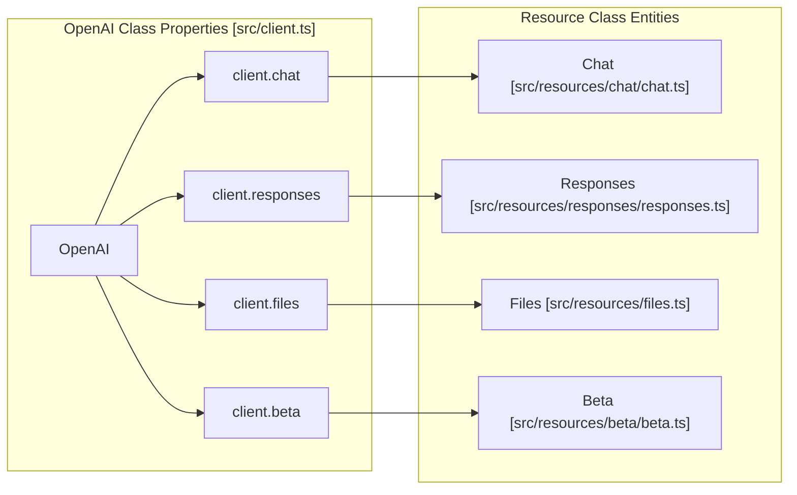
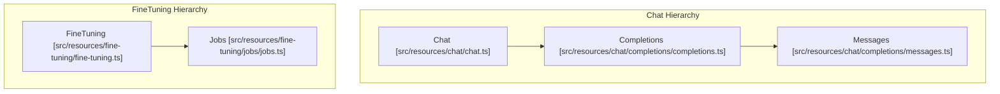

<!-- source: DeepWiki mcp.deepwiki.com · repo openai/openai-node · page 4 API Resources · fetched 2026-10-26 -->

# API Resources

<details>
<summary>Relevant source files</summary>

The following files were used as context for generating this wiki page:

- [api.md](api.md)
- [src/index.ts](src/index.ts)
- [src/resources/chat/chat.ts](src/resources/chat/chat.ts)
- [src/resources/chat/completions.ts](src/resources/chat/completions.ts)
- [src/resources/chat/index.ts](src/resources/chat/index.ts)
- [src/resources/completions.ts](src/resources/completions.ts)
- [src/resources/embeddings.ts](src/resources/embeddings.ts)
- [src/resources/files.ts](src/resources/files.ts)
- [src/resources/index.ts](src/resources/index.ts)

</details>


This document provides an overview of the API resource organization and structure in the OpenAI Node.js client library. It covers how API endpoints are organized into resource classes, the hierarchical structure of resources, and common access patterns used across the library.

For detailed information about specific API resources and their methods, see the individual resource pages ([Responses API](#4.1) through [Skills](#4.20)). For information about the core client configuration and setup, see [Core Client](#3).

## Resource Organization Overview

The OpenAI client library organizes API endpoints into logical resource groupings, each implemented as a class that extends the base `APIResource` class [src/resources/files.ts:17](). Resources are structured hierarchically and accessed through the main `OpenAI` client instance using a dot-notation pattern.

```mermaid
graph TB
    subgraph "Main Client [src/client.ts]"
        OpenAI["OpenAI Client Class"]
    end
    
    subgraph "Core API Resources [src/resources/index.ts]"
        Chat["chat"]
        Completions["completions"]
        Embeddings["embeddings"]
        Files["files"]
        Images["images"]
        Audio["audio"]
        Models["models"]
        Moderations["moderations"]
        Responses["responses"]
    end
    
    subgraph "Beta Resources [src/resources/beta/beta.ts]"
        Beta["beta"]
        Assistants["beta.assistants"]
        Threads["beta.threads"]
        Realtime["beta.realtime"]
    end
    
    subgraph "Advanced & Admin Resources [src/resources/index.ts]"
        FineTuning["fineTuning"]
        Evals["evals"]
        VectorStores["vectorStores"]
        Batches["batches"]
        Videos["videos"]
        Containers["containers"]
        Admin["admin"]
        Skills["skills"]
        Webhooks["webhooks"]
    end
    
    OpenAI --> Chat
    OpenAI --> Completions
    OpenAI --> Embeddings
    OpenAI --> Files
    OpenAI --> Images
    OpenAI --> Audio
    OpenAI --> Models
    OpenAI --> Moderations
    OpenAI --> Responses
    OpenAI --> Beta
    OpenAI --> FineTuning
    OpenAI --> Evals
    OpenAI --> VectorStores
    OpenAI --> Batches
    OpenAI --> Videos
    OpenAI --> Containers
    OpenAI --> Admin
    OpenAI --> Skills
    OpenAI --> Webhooks
    
    Beta --> Assistants
    Beta --> Threads
    Beta --> Realtime
```



Sources: [src/resources/index.ts:3-152](), [api.md:1-120]()

## Main Client Structure

The `OpenAI` class serves as the primary entry point and contains instances of all resource classes [src/index.ts:7](). Each resource is instantiated as a property on the client, providing a clean namespace for API operations.

### Resource Instantiation Pattern

The following diagram maps the high-level client properties to their corresponding internal class implementations.



Sources: [src/resources/chat/chat.ts:53-55](), [src/resources/files.ts:17](), [src/resources/index.ts:3-152]()

## Resource Categories

The API resources are organized into several logical categories based on their functionality and stability:

| Category | Resources | Description |
|----------|-----------|-------------|
| **Core APIs** | `chat`, `completions`, `embeddings`, `files`, `images`, `audio`, `models`, `moderations` | Stable endpoints for primary AI capabilities. |
| **New APIs** | `responses`, `videos` | Next-generation APIs for complex interactions and media generation. |
| **Beta APIs** | `beta.assistants`, `beta.threads`, `beta.realtime` | Preview features under active development. |
| **Advanced Features** | `fineTuning`, `evals`, `vectorStores`, `batches`, `skills` | Specialized functionality for RAG, evaluation, and customization. |
| **Infrastructure** | `containers`, `webhooks`, `admin` | Supporting services for code execution, event handling, and organization management. |

Sources: [src/resources/index.ts:3-152](), [api.md:1-120]()

## Hierarchical Resource Structure

Some resources contain nested sub-resources, creating a hierarchical API structure that mirrors the OpenAI REST API organization. For example, `Chat` contains `Completions` [src/resources/chat/chat.ts:54](), and `Completions` (within Chat) contains `Messages` [api.md:92-96]().



Sources: [src/resources/chat/chat.ts:54-59](), [api.md:92-96](), [src/resources/index.ts:17-100]()

## Common Resource Patterns

All API resources follow consistent patterns for common operations, providing a uniform developer experience across different endpoints.

### Standard CRUD Operations

Most resources implement a standard set of methods for Create, Read, Update, and Delete operations:

| Method | Purpose | Return Type | Example Usage |
|--------|---------|-------------|---------------|
| `create()` | Create a new resource | `APIPromise<Resource>` | `client.files.create({...})` [src/resources/files.ts:47]() |
| `retrieve()` | Get a specific resource by ID | `APIPromise<Resource>` | `client.files.retrieve('file-123')` [src/resources/files.ts:57]() |
| `update()` | Modify an existing resource | `APIPromise<Resource>` | `client.chat.completions.update(id, {...})` [api.md:88]() |
| `list()` | Get multiple resources with pagination | `PagePromise<Page, Resource>` | `client.files.list()` [src/resources/files.ts:64]() |
| `delete()` | Remove a resource | `APIPromise<DeletedObject>` | `client.files.delete('file-123')` [src/resources/files.ts:78]() |

### Streaming Support

Many resources support streaming responses for real-time data processing using the `Stream` class [src/resources/completions.ts:7]():

```typescript
// Example of streaming chat completions
const stream = await client.chat.completions.create({
  model: 'gpt-4o',
  messages: [{ role: 'user', content: 'Hello!' }],
  stream: true,
});
```
Sources: [src/resources/completions.ts:29](), [api.md:74]()

### Helper Methods and Utilities

Resources often include convenience methods beyond the basic CRUD operations:

| Resource | Helper Methods | Purpose |
|----------|----------------|---------|
| `files` | `waitForProcessing()` | Polls the file status until it reaches a terminal state (`processed`, `error`, or `deleted`) [src/resources/files.ts:97-118](). |
| `embeddings` | `create()` | Automatically handles `base64` encoding/decoding for performance optimization [src/resources/embeddings.ts:24-65](). |
| `webhooks` | Signature Verification | Helpers for verifying incoming webhook requests [src/resources/index.ts:152](). |

## Detailed Resource Pages

- [Responses API](#4.1) — Document the Responses API (recommended interface).
- [Chat Completions](#4.2) — Document the Chat Completions API (legacy interface).
- [Embeddings](#4.3) — Document the embeddings API for vector representations [src/resources/embeddings.ts:11]().
- [Audio Processing](#4.4) — Document audio transcription, translation, and speech.
- [Images](#4.5) — Document image generation, editing, and variation.
- [Moderations](#4.6) — Document content moderation API.
- [Files](#4.7) — Document file upload and management [src/resources/files.ts:15]().
- [Models](#4.8) — Document the models API for listing and retrieval.
- [Fine-tuning](#4.9) — Document fine-tuning jobs and methods.
- [Assistants API](#4.10) — Overview of the Assistants API system.
- [Realtime API](#4.11) — Document low-latency audio/text conversations.
- [Conversations](#4.12) — Document managing conversation history.
- [Vector Stores](#4.13) — Document vector store management for RAG.
- [Evaluations](#4.14) — Document the evaluations API.
- [Batches](#4.15) — Document the batches API for bulk processing.
- [Videos](#4.16) — Document AI-generated video management.
- [Containers](#4.17) — Document execution containers for tools.
- [Webhooks](#4.18) — Document webhook signature verification.
- [Administration](#4.19) — Document organization and project management.
- [Skills](#4.20) — Document reusable AI skill definitions.

---

