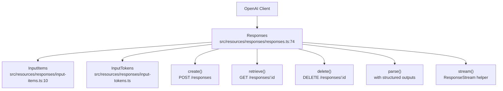
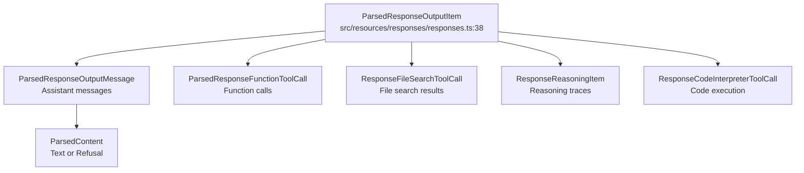
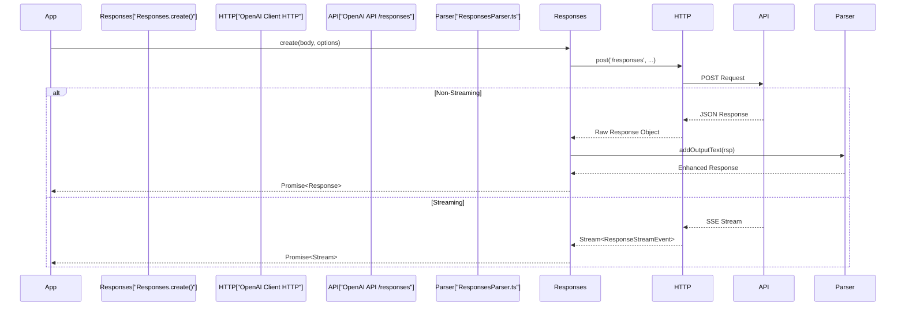

<!-- source: DeepWiki mcp.deepwiki.com · repo openai/openai-node · page 4.1 Responses API · fetched 2026-10-26 -->

# Responses API

<details>
<summary>Relevant source files</summary>

The following files were used as context for generating this wiki page:

- [.stats.yml](.stats.yml)
- [examples/responses/stream_background.ts](examples/responses/stream_background.ts)
- [examples/responses/websocket.ts](examples/responses/websocket.ts)
- [src/core/EventEmitter.ts](src/core/EventEmitter.ts)
- [src/internal/ws-adapter-browser.ts](src/internal/ws-adapter-browser.ts)
- [src/internal/ws-adapter-node.ts](src/internal/ws-adapter-node.ts)
- [src/internal/ws-adapter.ts](src/internal/ws-adapter.ts)
- [src/internal/ws.ts](src/internal/ws.ts)
- [src/lib/ResponsesParser.ts](src/lib/ResponsesParser.ts)
- [src/lib/responses/ResponseStream.ts](src/lib/responses/ResponseStream.ts)
- [src/resources/chat/completions/completions.ts](src/resources/chat/completions/completions.ts)
- [src/resources/responses/index.ts](src/resources/responses/index.ts)
- [src/resources/responses/internal-base.ts](src/resources/responses/internal-base.ts)
- [src/resources/responses/responses.ts](src/resources/responses/responses.ts)
- [src/resources/responses/ws-base.ts](src/resources/responses/ws-base.ts)
- [src/resources/responses/ws.ts](src/resources/responses/ws.ts)
- [src/resources/shared.ts](src/resources/shared.ts)
- [tests/api-resources/chat/completions/completions.test.ts](tests/api-resources/chat/completions/completions.test.ts)
- [tests/api-resources/responses/responses.test.ts](tests/api-resources/responses/responses.test.ts)
- [tests/lib/ResponseStream.test.ts](tests/lib/ResponseStream.test.ts)
- [tests/lib/__snapshots__/ResponseStream.test.ts.snap](tests/lib/__snapshots__/ResponseStream.test.ts.snap)
- [tests/ws.test.ts](tests/ws.test.ts)

</details>


The Responses API is the recommended interface for interacting with OpenAI models. It provides a modern, unified API surface for text generation, tool calling, structured outputs, and multi-turn conversations. This API supersedes the Chat Completions API for new projects, offering enhanced features like conversation state management, background processing, and improved streaming capabilities.

For information about the legacy Chat Completions API, see [Chat Completions](#4.2). For details on streaming implementation, see [Streaming](#5.1). For tool usage patterns, see [Function Calling and Tools](#5.3).

## Overview

The Responses API resource is implemented in [src/resources/responses/responses.ts:74]() as the `Responses` class, which extends `APIResource`. It provides methods for creating, retrieving, deleting, and managing model responses with support for both non-streaming and streaming modes.

**Core Resource Structure:**



**Sources:** [src/resources/responses/responses.ts:74-200](), [src/resources/responses/responses.ts:75-76]()

## Response Objects

The `Response` type represents a completed or in-progress model response. Key properties include the unique identifier, the model used, and an array of output items.

| Property | Description |
|----------|-------------|
| `id` | Unique identifier (e.g., `resp_677efb...`) |
| `model` | Model used (e.g., `gpt-5.4`, `o3`) |
| `output` | Array of `ParsedResponseOutputItem` generated |
| `output_text` | Convenience property for text output added by `addOutputText` |
| `status` | One of `completed`, `failed`, `in_progress`, `cancelled`, `queued`, `incomplete` |

The SDK automatically enhances response objects using `addOutputText` in the `_thenUnwrap` hook of `create` and `retrieve` methods [src/resources/responses/responses.ts:116-122](), [src/resources/responses/responses.ts:162-168]().

**Sources:** [src/resources/responses/responses.ts:24-70](), [src/resources/responses/responses.ts:116-122](), [src/resources/responses/responses.ts:162-168]()

### Response Output Items

The `output` array contains heterogeneous items representing different types of model outputs. The `ParsedResponseOutputItem` union covers messages, tool calls, and reasoning items [src/resources/responses/responses.ts:38-64]().



**Sources:** [src/resources/responses/responses.ts:24-64]()

## Creating Responses

The `create()` method [src/resources/responses/responses.ts:96-123]() is overloaded to handle both standard and streaming requests.

**Method Signatures:**
```typescript
create(body: ResponseCreateParamsNonStreaming, options?: RequestOptions): APIPromise<Response>
create(body: ResponseCreateParamsStreaming, options?: RequestOptions): APIPromise<Stream<ResponseStreamEvent>>
```

**Request Flow:**



**Sources:** [src/resources/responses/responses.ts:96-123](), [src/lib/ResponsesParser.ts:7]()

## Streaming Responses

The SDK provides a high-level `ResponseStream` class [src/lib/responses/ResponseStream.ts:64]() that manages the lifecycle of a streamed response, including event accumulation and snapshotting.

### ResponseStream Lifecycle
1. **Initialization**: Created via `ResponseStream.createResponse` [src/lib/responses/ResponseStream.ts:77]().
2. **Connection**: Establishes an SSE connection to `/responses` [src/lib/responses/ResponseStream.ts:187-191]().
3. **Accumulation**: As events like `response.output_text.delta` arrive, the internal snapshot is updated via `#accumulateResponse` [src/lib/responses/ResponseStream.ts:110-143](), [src/lib/responses/ResponseStream.ts:203]().
4. **Finalization**: When the stream ends, `finalizeResponse` is called in `#endRequest` to produce a complete `ParsedResponse` [src/lib/responses/ResponseStream.ts:150-163]().

**Sources:** [src/lib/responses/ResponseStream.ts:64-203]()

## Structured Outputs

The `parse()` method [src/resources/responses/responses.ts:189-196]() is the recommended way to generate type-safe JSON outputs. It uses `parseResponse` from the `ResponsesParser` library to extract and validate content [src/resources/responses/responses.ts:195]().

```typescript
// Example usage pattern
const response = await client.responses.parse({
  model: 'gpt-4o',
  tools: [ ... ],
  // ...
});
console.log(response.output_parsed); 
```

**Sources:** [src/resources/responses/responses.ts:189-196](), [src/lib/ResponsesParser.ts:5]()

## WebSocket Support (Realtime/Streaming)

For low-latency interactions, the SDK includes `ResponsesWS` [src/resources/responses/ws.ts:12](), which implements a WebSocket-based interface for the Responses API.

- **Base Class**: `ResponsesWSBase` [src/resources/responses/ws-base.ts:63]().
- **Node Implementation**: Uses the `ws` package and `NodeWebSocket` adapter [src/resources/responses/ws.ts:12-38]().
- **Events**: Emits server events such as `message`, `error`, and `close` via `ResponsesEmitter` [src/resources/responses/internal-base.ts:54-97]().
- **Queue Management**: Outgoing messages are buffered in a `SendQueue` during connection or reconnection phases [src/resources/responses/ws-base.ts:70](), [src/internal/ws.ts:85]().

**Sources:** [src/resources/responses/ws.ts:12-38](), [src/resources/responses/ws-base.ts:63-160](), [src/resources/responses/internal-base.ts:10-52](), [src/internal/ws.ts:85-157]()

## Sub-resources

### Input Items
The `inputItems` resource [src/resources/responses/responses.ts:75]() allows retrieving the items that contributed to a specific response.
- **Implementation**: `InputItems` class [src/resources/responses/input-items.ts:10]().
- **Endpoint**: `GET /responses/${responseID}/input_items` [src/resources/responses/responses.ts:156]().

### Input Tokens
The `inputTokens` resource [src/resources/responses/responses.ts:76]() provides utilities for token counting and management related to response inputs.

**Sources:** [src/resources/responses/responses.ts:75-76](), [src/resources/responses/input-items.ts:10]()

---

