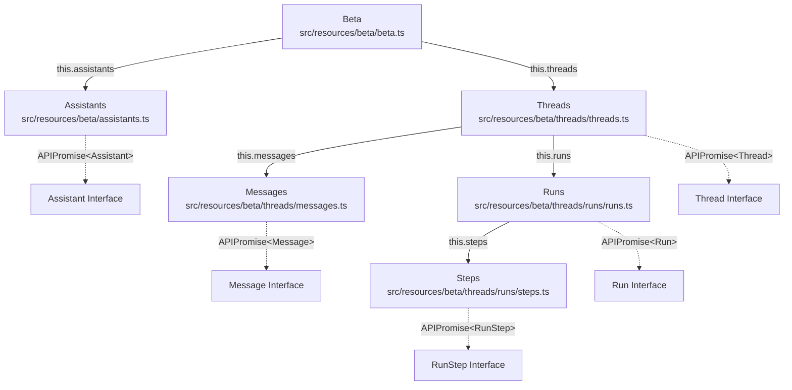
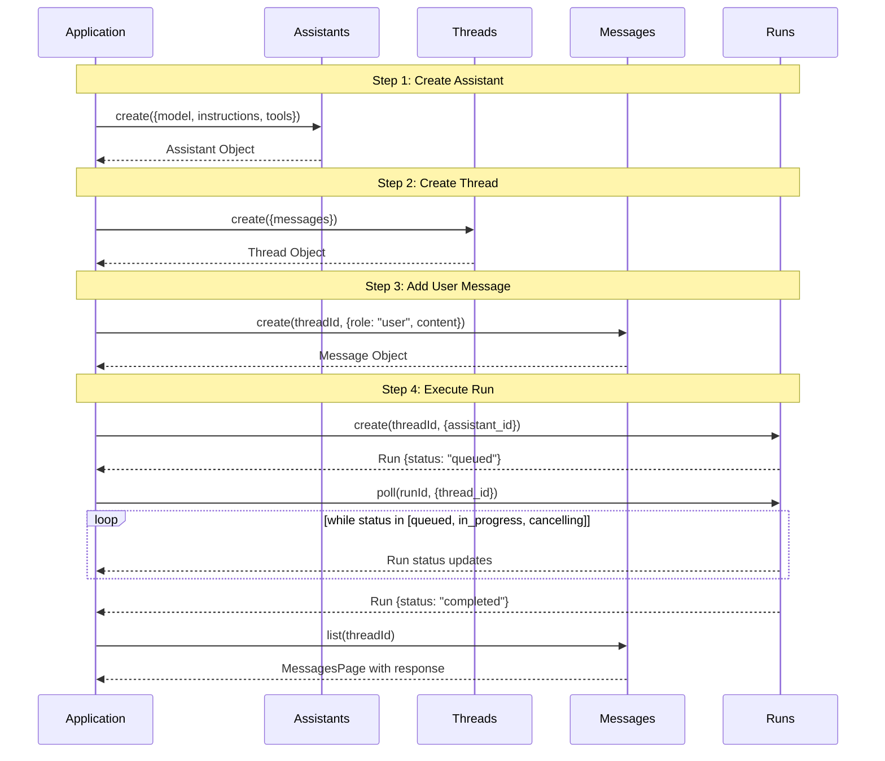
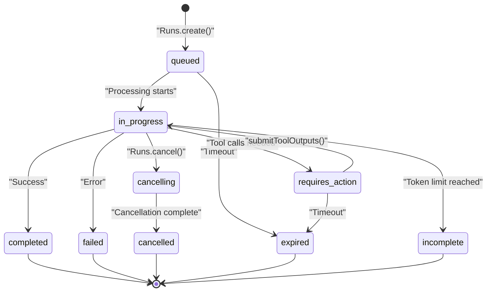
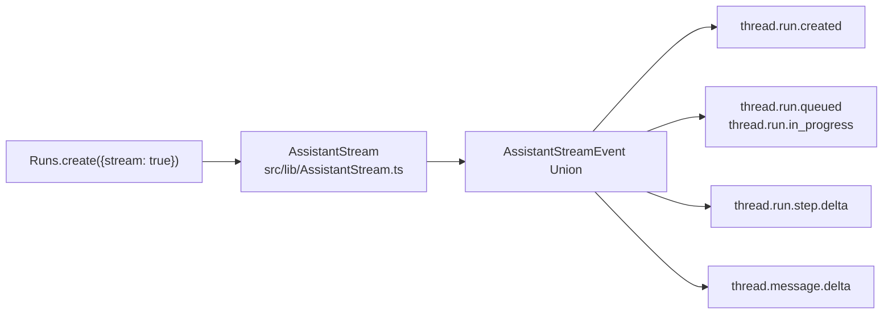

<!-- source: DeepWiki mcp.deepwiki.com · repo openai/openai-node · page 4.10 Assistants API · fetched 2026-10-26 -->

# Assistants API

<details>
<summary>Relevant source files</summary>

The following files were used as context for generating this wiki page:

- [src/resources/beta/assistants.ts](src/resources/beta/assistants.ts)
- [src/resources/beta/beta.ts](src/resources/beta/beta.ts)
- [src/resources/beta/index.ts](src/resources/beta/index.ts)
- [src/resources/beta/threads/index.ts](src/resources/beta/threads/index.ts)
- [src/resources/beta/threads/messages.ts](src/resources/beta/threads/messages.ts)
- [src/resources/beta/threads/runs/runs.ts](src/resources/beta/threads/runs/runs.ts)
- [src/resources/beta/threads/runs/steps.ts](src/resources/beta/threads/runs/steps.ts)
- [src/resources/beta/threads/threads.ts](src/resources/beta/threads/threads.ts)
- [src/resources/fine-tuning/jobs/jobs.ts](src/resources/fine-tuning/jobs/jobs.ts)
- [src/resources/vector-stores/index.ts](src/resources/vector-stores/index.ts)
- [src/resources/vector-stores/vector-stores.ts](src/resources/vector-stores/vector-stores.ts)

</details>


The Assistants API provides a stateful framework for building AI agents with persistent conversation threads, tool execution, and multi-turn interactions. This system enables creating assistants with specific instructions and capabilities, managing conversation contexts through threads, and executing runs that process messages using configured tools.

**Deprecation Notice:** The Assistants API is deprecated in favor of the Responses API. All resources under `client.beta.assistants`, `client.beta.threads`, `client.beta.threads.runs`, and `client.beta.threads.messages` include deprecation markers. [src/resources/beta/threads/runs/runs.ts:47-48](), [src/resources/beta/threads/threads.ts:78-79](), [src/resources/beta/assistants.ts:23-24]().

For detailed information on specific components, see:
- [Assistants](#4.10.1) — Assistant creation, configuration, and tool setup.
- [Threads](#4.10.2) — Thread management and conversation contexts.
- [Messages](#4.10.3) — Message operations within threads.
- [Runs](#4.10.4) — Run lifecycle, polling, streaming, and tool output submission.

## Architecture Overview

The Assistants API consists of four primary resources organized in a hierarchical structure. The `Beta` class acts as the entry point, exposing `assistants` and `threads` namespaces.



**Sources:** [src/resources/beta/beta.ts:96-101](), [src/resources/beta/assistants.ts:19-90](), [src/resources/beta/threads/threads.ts:80-82](), [src/resources/beta/threads/runs/runs.ts:49-50](), [src/resources/beta/threads/runs/steps.ts:17]()

## Core Resource Classes

| Resource | Class | Path | Primary Operations |
|----------|-------|------|-------------------|
| Assistants | `Assistants` | `src/resources/beta/assistants.ts` | `create()`, `retrieve()`, `update()`, `list()`, `delete()` |
| Threads | `Threads` | `src/resources/beta/threads/threads.ts` | `create()`, `retrieve()`, `update()`, `delete()`, `createAndRun()` |
| Messages | `Messages` | `src/resources/beta/threads/messages.ts` | `create()`, `retrieve()`, `update()`, `list()`, `delete()` |
| Runs | `Runs` | `src/resources/beta/threads/runs/runs.ts` | `create()`, `retrieve()`, `update()`, `list()`, `cancel()`, `createAndPoll()` |
| Steps | `Steps` | `src/resources/beta/threads/runs/steps.ts` | `retrieve()`, `list()` |

All API calls include the header `OpenAI-Beta: assistants=v2` to specify the API version. [src/resources/beta/threads/runs/runs.ts:78](), [src/resources/beta/assistants.ts:29]().

**Sources:** [src/resources/beta/assistants.ts:19](), [src/resources/beta/threads/threads.ts:80](), [src/resources/beta/threads/messages.ts:17](), [src/resources/beta/threads/runs/runs.ts:49](), [src/resources/beta/threads/runs/steps.ts:17]()

## Workflow Pattern

The typical usage pattern involves creating an assistant, initializing a thread, adding messages, and executing a run to process those messages.



**Sources:** [src/resources/beta/threads/threads.ts:89-96](), [src/resources/beta/threads/messages.ts:23-30](), [src/resources/beta/threads/runs/runs.ts:57-83](), [src/resources/beta/threads/runs/runs.ts:178-219]()

## Run Lifecycle and Status

The `Run` object represents an execution of an assistant on a thread. Runs transition through multiple states, from initial queuing to terminal completion or failure.



**Sources:** [src/resources/beta/threads/runs/runs.ts:197-217](), [src/resources/beta/threads/runs/runs.ts:137-144]()

## Tool System

Assistants support three tool types defined in the `AssistantTool` union type:

| Tool Type | Interface | Purpose |
|-----------|-----------|---------|
| `code_interpreter` | `CodeInterpreterTool` | Execute Python code, generate files and images. |
| `file_search` | `FileSearchTool` | Search through uploaded files using RAG via Vector Stores. |
| `function` | `FunctionTool` | Call external functions with JSON parameters. |

Tools are configured on assistants via the `tools` array. [src/resources/beta/assistants.ts:149-153]().

**Sources:** [src/resources/beta/assistants.ts:164-172](), [src/resources/beta/threads/runs/steps.ts:98-114](), [src/resources/beta/threads/runs/steps.ts:216-232]()

## Polling and Helper Methods

### createAndPoll Pattern

The `Runs` class provides helper methods that simplify the common workflow of waiting for a run to finish.

```typescript
// Runs.createAndPoll - Create run and poll until terminal state
async createAndPoll(
  threadId: string,
  body: RunCreateParamsNonStreaming,
  options?: RequestOptions & { pollIntervalMs?: number }
): Promise<Run>

// Runs.poll - Poll existing run until terminal state
async poll(
  runId: string,
  params: RunRetrieveParams,
  options?: RequestOptions & { pollIntervalMs?: number }
): Promise<Run>
```

The `poll` logic continues while the status is `queued`, `in_progress`, or `cancelling`. [src/resources/beta/threads/runs/runs.ts:199-201]().

**Sources:** [src/resources/beta/threads/runs/runs.ts:151-158](), [src/resources/beta/threads/runs/runs.ts:178-219]()

### createAndRunPoll Pattern

The `Threads` class provides a combined helper that creates both a thread and a run in one operation, then polls for completion.

```typescript
// Threads.createAndRunPoll - Create thread, run, and poll
async createAndRunPoll(
  body: ThreadCreateAndRunParamsNonStreaming,
  options?: RequestOptions & { pollIntervalMs?: number }
): Promise<Threads.Run>
```

**Sources:** [src/resources/beta/threads/threads.ts:171-177]()

## Streaming Support

Runs support streaming via Server-Sent Events (SSE). The SDK provides `AssistantStream` to manage these events.



**Sources:** [src/resources/beta/threads/runs/runs.ts:58-62](), [src/resources/beta/threads/threads.ts:182-184](), [src/resources/beta/assistants.ts:168]()

## Vector Stores and Tool Resources

The `file_search` tool relies on `VectorStores` to manage indexed content. Assistants and threads can be associated with these resources via `tool_resources`.

```typescript
// Assistant.ToolResources structure
interface ToolResources {
  code_interpreter?: {
    file_ids?: Array<string>
  }
  file_search?: {
    vector_store_ids?: Array<string>
  }
}
```

**Sources:** [src/resources/beta/assistants.ts:192](), [src/resources/vector-stores/vector-stores.ts:35-49](), [src/resources/beta/threads/threads.ts:277-309]()

## API Headers and Versioning

The SDK automatically injects the required beta header for all resources in the `beta` namespace.

```typescript
headers: buildHeaders([{ 'OpenAI-Beta': 'assistants=v2' }, options?.headers])
```

**Sources:** [src/resources/beta/assistants.ts:29](), [src/resources/beta/threads/threads.ts:93](), [src/resources/beta/threads/messages.ts:27](), [src/resources/beta/threads/runs/runs.ts:78]()

---

