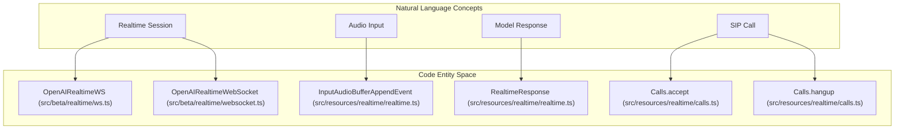
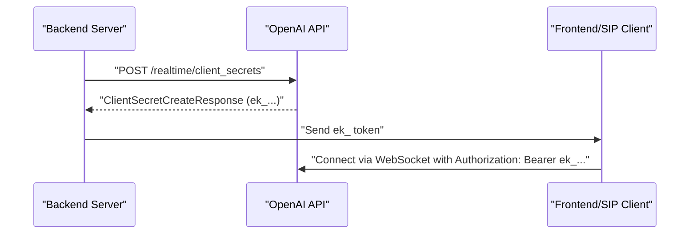

<!-- source: DeepWiki mcp.deepwiki.com · repo openai/openai-node · page 4.11 Realtime API · fetched 2026-10-26 -->

# Realtime API

<details>
<summary>Relevant source files</summary>

The following files were used as context for generating this wiki page:

- [examples/azure/chat.ts](examples/azure/chat.ts)
- [examples/azure/realtime/websocket.ts](examples/azure/realtime/websocket.ts)
- [examples/azure/realtime/ws.ts](examples/azure/realtime/ws.ts)
- [examples/realtime/websocket.ts](examples/realtime/websocket.ts)
- [examples/realtime/ws.ts](examples/realtime/ws.ts)
- [src/beta/realtime/internal-base.ts](src/beta/realtime/internal-base.ts)
- [src/beta/realtime/websocket.ts](src/beta/realtime/websocket.ts)
- [src/beta/realtime/ws.ts](src/beta/realtime/ws.ts)
- [src/realtime/websocket.ts](src/realtime/websocket.ts)
- [src/realtime/ws.ts](src/realtime/ws.ts)
- [src/resources/audio/speech.ts](src/resources/audio/speech.ts)
- [src/resources/beta/realtime/realtime.ts](src/resources/beta/realtime/realtime.ts)
- [src/resources/beta/realtime/sessions.ts](src/resources/beta/realtime/sessions.ts)
- [src/resources/beta/realtime/transcription-sessions.ts](src/resources/beta/realtime/transcription-sessions.ts)
- [src/resources/realtime/api.md](src/resources/realtime/api.md)
- [src/resources/realtime/calls.ts](src/resources/realtime/calls.ts)
- [src/resources/realtime/client-secrets.ts](src/resources/realtime/client-secrets.ts)
- [src/resources/realtime/index.ts](src/resources/realtime/index.ts)
- [src/resources/realtime/realtime.ts](src/resources/realtime/realtime.ts)
- [src/resources/videos.ts](src/resources/videos.ts)
- [tests/api-resources/audio/speech.test.ts](tests/api-resources/audio/speech.test.ts)
- [tests/api-resources/realtime/calls.test.ts](tests/api-resources/realtime/calls.test.ts)

</details>


The Realtime API enables low-latency, bidirectional audio and text conversations with OpenAI models over WebSocket connections. This page documents the SDK's client-side implementation for creating ephemeral sessions, managing WebSocket events, and configuring real-time audio processing including Voice Activity Detection (VAD), transcription, and SIP call management.

For server-sent event streaming with Chat Completions or Responses APIs, see [Streaming](#5.1). For the Assistants API's stateful conversation system, see [Assistants API](#4.10).

**Deprecation Notice**: The beta Realtime API implementation at [src/resources/beta/realtime/realtime.ts:21-27]() is deprecated. The API has now launched and is generally available. New implementations should use the resources in `src/resources/realtime/`.

## Overview

The Realtime API provides two primary resources accessible via `client.realtime`:

| Resource | Purpose | Endpoint |
|----------|---------|----------|
| `clientSecrets` | Create ephemeral API tokens for secure client-side (WebRTC/WS) access | `/realtime/client_secrets` |
| `calls` | Manage incoming SIP calls, including accepting, rejecting, and transferring | `/realtime/calls` |

**Sources**: [src/resources/realtime/realtime.ts:19-22](), [src/resources/realtime/client-secrets.ts:10-41](), [src/resources/realtime/calls.ts:11-87]()

## Realtime Client Implementation

The SDK provides specialized classes for WebSocket management: `OpenAIRealtimeWS` (for `ws` in Node.js) and `OpenAIRealtimeWebSocket` (for browser-native `WebSocket`).

### Natural Language to Code Entity Mapping



**Sources**: [src/beta/realtime/ws.ts:20-165](), [src/beta/realtime/websocket.ts:21-163](), [src/resources/realtime/calls.ts:11-87](), [src/resources/realtime/realtime.ts:19-22]()

### Basic Usage (Node.js)

```typescript
import { OpenAIRealtimeWS } from 'openai/realtime/ws';

const rt = new OpenAIRealtimeWS({ model: 'gpt-4o-realtime-preview' });

rt.socket.on('open', () => {
  rt.send({
    type: 'session.update',
    session: { modalities: ['text', 'audio'] }
  });

  rt.send({
    type: 'conversation.item.create',
    item: {
      type: 'message',
      role: 'user',
      content: [{ type: 'input_text', text: 'Hello!' }]
    }
  });

  rt.send({ type: 'response.create' });
});

rt.on('response.text.delta', (event) => process.stdout.write(event.delta));
```

**Sources**: [src/beta/realtime/ws.ts:149-155](), [src/resources/realtime/realtime.ts:164-192]()

## Session & Client Secrets

To connect from a browser or mobile device without exposing your primary API key, you must create a `client_secret` (ephemeral token).



**Sources**: [src/resources/realtime/client-secrets.ts:10-41](), [src/resources/beta/realtime/sessions.ts:8-32]()

### Ephemeral Key Creation

```typescript
const clientSecret = await client.realtime.clientSecrets.create({
  model: 'gpt-4o-realtime-preview',
  instructions: 'You are a helpful assistant.',
  voice: 'alloy'
});

// clientSecret.client_secret contains the "ek_..." token value
```

**Sources**: [src/resources/realtime/client-secrets.ts:34-40](), [src/resources/realtime/client-secrets.ts:46-187]()

## SIP Call Management

The `Calls` resource allows the Realtime API to interface with telephony systems via SIP.

| Method | Description |
|--------|-------------|
| `accept` | Connects an incoming SIP call to a Realtime session |
| `reject` | Declines an incoming call with a SIP status code |
| `hangup` | Terminates an active call (SIP or WebRTC) |
| `refer` | Transfers a call to another URI (SIP REFER) |

### Accepting a Call

```typescript
await client.realtime.calls.accept('call_id', {
  type: 'realtime',
  model: 'gpt-4o-realtime-preview',
  instructions: 'Handle this phone call professionally.'
});
```

**Sources**: [src/resources/realtime/calls.ts:12-30](), [src/resources/realtime/calls.ts:89-151]()

## Audio & Transcription

### Audio Formats

Supported formats for low-latency streaming:
- `pcm16`: 16-bit PCM at 24kHz, mono, little-endian.
- `g711_ulaw`: Standard telephony μ-law.
- `g711_alaw`: Standard telephony A-law.

**Sources**: [src/resources/beta/realtime/sessions.ts:44-48](), [src/resources/beta/realtime/transcription-sessions.ts:165-169]()

### Voice Activity Detection (VAD)

The API supports multiple turn detection modes:
1. **Server VAD**: Detects speech start/end based on audio volume.
2. **Semantic VAD**: Uses a model to semantically estimate if the user is finished speaking (e.g., ignoring "uhm").

```typescript
const sessionConfig = {
  turn_detection: {
    type: 'server_vad',
    threshold: 0.5,
    silence_duration_ms: 500
  }
};
```

**Sources**: [src/resources/beta/realtime/sessions.ts:149-161](), [src/resources/beta/realtime/transcription-sessions.ts:119-148]()

## Azure OpenAI Realtime

Azure-specific connections are supported via the `.azure()` static factory method on the Realtime classes. This method handles deployment-based routing and Azure AD or API key authentication.

```typescript
import { AzureOpenAI } from 'openai';
import { OpenAIRealtimeWebSocket } from 'openai/realtime/websocket';

const client = new AzureOpenAI({ deploymentName: 'my-realtime-deployment' });
const rt = await OpenAIRealtimeWebSocket.azure(client);
```

**Sources**: [src/beta/realtime/websocket.ts:115-146](), [src/beta/realtime/ws.ts:74-101]()

## WebSocket Events Reference

### Client-to-Server Events
- `session.update`: Modify session settings mid-stream.
- `input_audio_buffer.append`: Stream raw audio bytes (base64).
- `response.create`: Manually trigger a model response.
- `conversation.item.create`: Add text, function results, or system messages to history.

**Sources**: [src/resources/realtime/realtime.ts:164-192](), [src/resources/beta/realtime/realtime.ts:1017-1050]()

### Server-to-Client Events
- `response.audio.delta`: Streaming audio output chunks.
- `response.audio_transcript.delta`: Streaming text transcript of the audio.
- `input_audio_buffer.speech_started`: VAD trigger indicating user began speaking.
- `error`: Detailed error payloads for failed events.

**Sources**: [src/resources/realtime/realtime.ts:132-153](), [src/resources/beta/realtime/realtime.ts:1261-1321]()

## Error Handling

It is critical to listen for the `error` event. If no listener is registered, the SDK will log errors, but the connection might remain in an unstable state.

```typescript
rt.on('error', (err) => {
  console.error('Realtime Error:', err);
});
```

**Sources**: [src/beta/realtime/websocket.ts:95-97](), [src/beta/realtime/ws.ts:62-64]()

---

