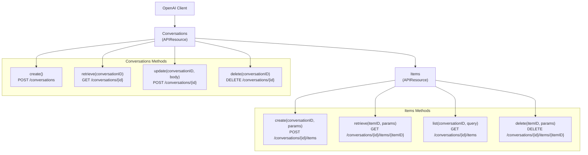
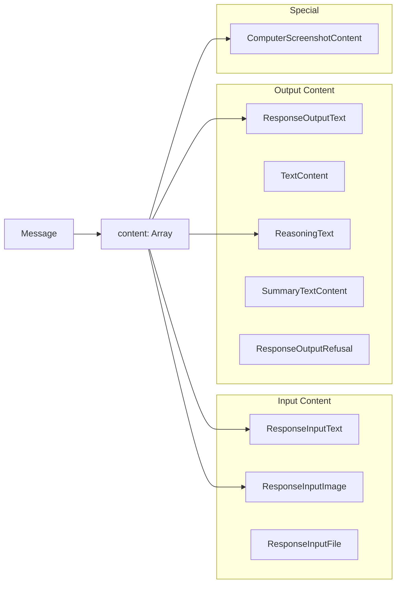

<!-- source: DeepWiki mcp.deepwiki.com · repo openai/openai-node · page 4.12 Conversations · fetched 2026-10-26 -->

# Conversations

<details>
<summary>Relevant source files</summary>

The following files were used as context for generating this wiki page:

- [src/resources/admin/organization/audit-logs.ts](src/resources/admin/organization/audit-logs.ts)
- [src/resources/conversations/conversations.ts](src/resources/conversations/conversations.ts)
- [src/resources/conversations/items.ts](src/resources/conversations/items.ts)
- [src/resources/responses/api.md](src/resources/responses/api.md)
- [src/resources/responses/input-items.ts](src/resources/responses/input-items.ts)
- [src/resources/responses/input-tokens.ts](src/resources/responses/input-tokens.ts)
- [tests/api-resources/conversations/conversations.test.ts](tests/api-resources/conversations/conversations.test.ts)
- [tests/api-resources/conversations/items.test.ts](tests/api-resources/conversations/items.test.ts)
- [tests/api-resources/responses/input-items.test.ts](tests/api-resources/responses/input-items.test.ts)
- [tests/api-resources/responses/input-tokens.test.ts](tests/api-resources/responses/input-tokens.test.ts)
- [tests/responsesItems.test.ts](tests/responsesItems.test.ts)

</details>


This document describes the Conversations API for managing conversation history and items. The Conversations API provides persistent storage for multi-turn dialogues, including messages, tool calls, and their outputs. It is designed to work with the Responses API for stateful conversation management.

For information about the Responses API and how it creates responses, see [Responses API](#4.1). For real-time conversation capabilities, see [Realtime API](#4.11).

**Scope**: This page covers the `client.conversations` resource and its `items` sub-resource, including conversation lifecycle management, item operations, content types, and integration with tool execution systems.

## Resource Architecture

The Conversations API is organized into two primary resource classes that handle different aspects of conversation management.

### Class Relationship Diagram


Sources: [src/resources/conversations/conversations.ts:24-71](), [src/resources/conversations/items.ts:18-81]()

## Conversation Object Structure

The `Conversation` object represents a container for conversation items with associated metadata.

| Field | Type | Description |
|-------|------|-------------|
| `id` | `string` | Unique conversation identifier |
| `created_at` | `number` | Unix timestamp in seconds since epoch |
| `metadata` | `unknown` | 16 key-value pairs (max 64 char keys, 512 char values) |
| `object` | `'conversation'` | Always set to `"conversation"` |

Sources: [src/resources/conversations/conversations.ts:100-125]()

## Creating and Managing Conversations

### Creating a Conversation

The `create()` method initializes a new conversation with optional initial items and metadata.

```typescript
// Method signature
create(
  body?: ConversationCreateParams | null | undefined,
  options?: RequestOptions
): APIPromise<Conversation>
```

**Parameters**:
- `items`: Optional array of `ResponseInputItem` objects (up to 20 at a time) [src/resources/conversations/conversations.ts:244-250]()
- `metadata`: Optional key-value pairs for storing additional information [src/resources/conversations/conversations.ts:252-260]()

Sources: [src/resources/conversations/conversations.ts:30-35](), [tests/api-resources/conversations/conversations.test.ts:12-21]()

### Retrieving a Conversation

The `retrieve()` method fetches a conversation by its ID.

```typescript
retrieve(conversationID: string, options?: RequestOptions): APIPromise<Conversation>
```

Sources: [src/resources/conversations/conversations.ts:40-45](), [tests/api-resources/conversations/conversations.test.ts:43-52]()

### Updating Conversation Metadata

The `update()` method modifies the metadata of an existing conversation.

```typescript
update(
  conversationID: string,
  body: ConversationUpdateParams,
  options?: RequestOptions
): APIPromise<Conversation>
```

Sources: [src/resources/conversations/conversations.ts:50-60](), [tests/api-resources/conversations/conversations.test.ts:54-67]()

### Deleting a Conversation

The `delete()` method removes a conversation. **Important**: Items within the conversation are not automatically deleted [src/resources/conversations/conversations.ts:63-63]().

```typescript
delete(conversationID: string, options?: RequestOptions): APIPromise<ConversationDeletedResource>
```

Sources: [src/resources/conversations/conversations.ts:65-70](), [src/resources/conversations/conversations.ts:135-141]()

## Conversation Items Management

The `Items` sub-resource manages individual items within a conversation. Items represent messages, tool calls, and their outputs.

### Named Path Parameters

The items methods use named path parameters for IDs. The `conversation_id` is required in the params object for retrieval and deletion.

```typescript
// Retrieve item
client.conversations.items.retrieve('msg_abc', { conversation_id: 'conv_123' });

// Delete item
client.conversations.items.delete('msg_abc', { conversation_id: 'conv_123' });
```

Sources: [src/resources/conversations/items.ts:39-50](), [src/resources/conversations/items.ts:70-80]()

### Creating Items

The `create()` method adds items to a conversation.

```typescript
create(
  conversationID: string,
  params: ItemCreateParams,
  options?: RequestOptions
): APIPromise<ConversationItemList>
```

Sources: [src/resources/conversations/items.ts:22-34](), [tests/api-resources/conversations/items.test.ts:12-29]()

### Listing Items

The `list()` method retrieves items for a conversation with cursor-based pagination.

```typescript
list(
  conversationID: string,
  query?: ItemListParams | null,
  options?: RequestOptions
): PagePromise<ConversationItemsPage, ConversationItem>
```

Sources: [src/resources/conversations/items.ts:55-65](), [tests/api-resources/conversations/items.test.ts:63-72]()

## Conversation Item Types

Items in a conversation form a union type encompassing messages and various tool-related artifacts.

### Item Type Hierarchy

```mermaid
graph TB
    ConversationItem["ConversationItem<br/>(Union Type)"]
    
    subgraph "Message Types"
        Message["Message<br/>role: user|assistant|system|tool|critic...<br/>content: Array<ContentType>"]
    end
    
    subgraph "Tool Call Types"
        FunctionCall["ResponseFunctionToolCallItem"]
        FunctionOutput["ResponseFunctionToolCallOutputItem"]
        FileSearch["ResponseFileSearchToolCall"]
        WebSearch["ResponseFunctionWebSearch"]
        ImageGen["ImageGenerationCall"]
        Computer["ResponseComputerToolCall"]
        CodeInterpreter["ResponseCodeInterpreterToolCall"]
        LocalShell["LocalShellCall"]
        ApplyPatch["ResponseApplyPatchToolCall"]
        Custom["ResponseCustomToolCall"]
    end
    
    subgraph "MCP Types"
        McpListTools["McpListTools"]
        McpApproval["McpApprovalRequest"]
        McpCall["McpCall"]
    end
    
    ConversationItem --> Message
    ConversationItem --> FunctionCall
    ConversationItem --> ImageGen
    ConversationItem --> Computer
    ConversationItem --> CodeInterpreter
    ConversationItem --> LocalShell
    ConversationItem --> McpCall
```


Sources: [src/resources/conversations/items.ts:90-116]()

## Message Content Types

The `Message` item type contains an array of content objects.

### Content Structure Diagram


### Message Fields
- `role`: One of `user`, `assistant`, `system`, `critic`, `discriminator`, `developer`, or `tool`. [src/resources/conversations/conversations.ts:168-171]()
- `status`: `in_progress`, `completed`, or `incomplete`. [src/resources/conversations/conversations.ts:177-177]()
- `phase`: Labels assistant messages as `commentary` or `final_answer`. [src/resources/conversations/conversations.ts:190-190]()

Sources: [src/resources/conversations/conversations.ts:146-191]()

## Tool Integration

### Image Generation Calls
```typescript
export interface ImageGenerationCall {
  id: string;
  result: string | null; // Base64 encoded image
  status: 'in_progress' | 'completed' | 'generating' | 'failed';
  type: 'image_generation_call';
}
```
Sources: [src/resources/conversations/items.ts:122-142]()

### Local Shell Execution
The SDK supports local shell command execution via `LocalShellCall` and `LocalShellCallOutput`.
- `action.command`: Array of command parts. [src/resources/conversations/items.ts:204-204]()
- `action.env`: Key-value environment variables. [src/resources/conversations/items.ts:209-209]()

Sources: [src/resources/conversations/items.ts:169-231](), [src/resources/conversations/items.ts:236-250]()

### MCP (Model Context Protocol)
Supports listing tools from servers, approval flows, and tool execution.
- `McpListTools`: Returns available tools from a specific `server_label`. [src/resources/conversations/items.ts:239-262]()
- `McpApprovalRequest`: Requests user approval for a tool call. [src/resources/conversations/items.ts:295-316]()
- `McpCall`: Executes the tool after approval. [src/resources/conversations/items.ts:355-381]()

Sources: [src/resources/conversations/items.ts:239-407]()

## Input Token Counting

The SDK provides a utility to count input tokens for a potential response, which can be linked to a conversation.

```typescript
const response = await client.responses.inputTokens.count({
  conversation: 'conv_123',
  input: 'What is the status of my order?'
});
```

Sources: [src/resources/responses/input-tokens.ts:9-30](), [src/resources/responses/input-tokens.ts:39-46]()

## Pagination

Listing items returns a `ConversationCursorPage` which supports asynchronous iteration.

```typescript
const items = await client.conversations.items.list('conv_123', { limit: 10 });

for await (const item of items) {
  console.log(item.id);
}
```

Sources: [src/resources/conversations/items.ts:55-65](), [src/resources/admin/organization/audit-logs.ts:5-8]()

## Summary of Key Classes

| Class | File Path | Role |
|-------|-----------|------|
| `Conversations` | [src/resources/conversations/conversations.ts:24-24]() | Entry point for conversation lifecycle (CRUD) |
| `Items` | [src/resources/conversations/items.ts:18-18]() | Manages items (messages, tool calls) within a conversation |
| `InputItems` | [src/resources/responses/input-items.ts:10-10]() | Lists input items specific to a generated Response |
| `InputTokens` | [src/resources/responses/input-tokens.ts:9-9]() | Utility for counting tokens in a conversation context |

Sources: [src/resources/conversations/conversations.ts](), [src/resources/conversations/items.ts](), [src/resources/responses/input-items.ts](), [src/resources/responses/input-tokens.ts]()

---

