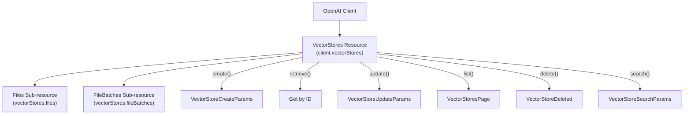
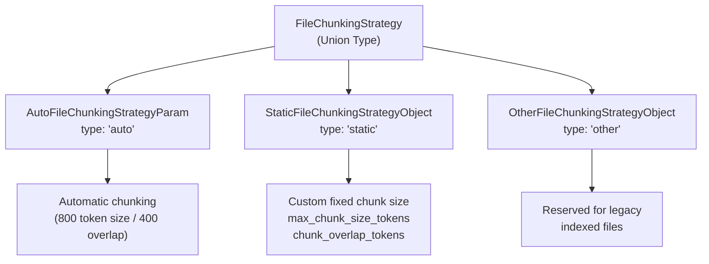
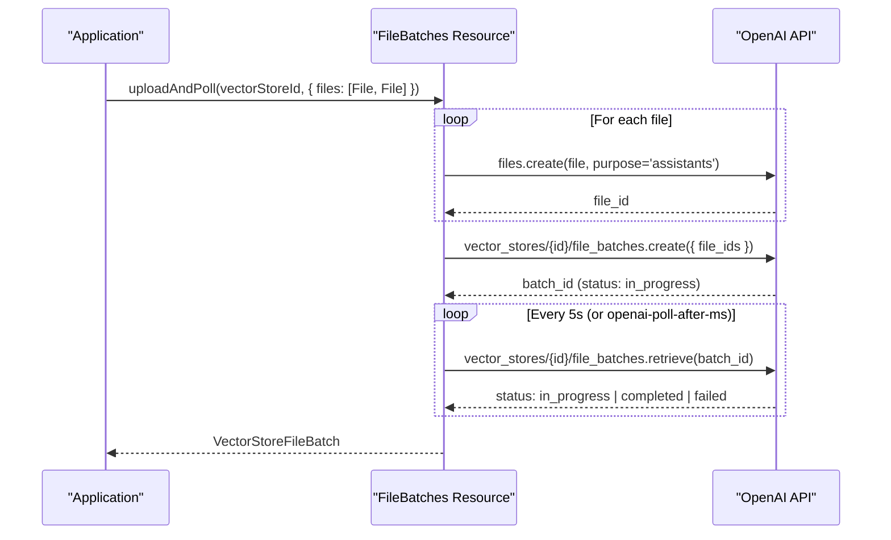
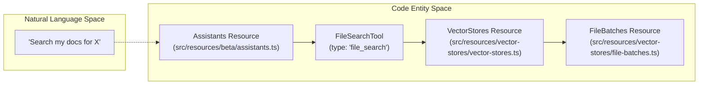

<!-- source: DeepWiki mcp.deepwiki.com · repo openai/openai-node · page 4.13 Vector Stores · fetched 2026-10-26 -->

# Vector Stores

<details>
<summary>Relevant source files</summary>

The following files were used as context for generating this wiki page:

- [src/resources/beta/beta.ts](src/resources/beta/beta.ts)
- [src/resources/beta/index.ts](src/resources/beta/index.ts)
- [src/resources/beta/threads/index.ts](src/resources/beta/threads/index.ts)
- [src/resources/vector-stores/file-batches.ts](src/resources/vector-stores/file-batches.ts)
- [src/resources/vector-stores/files.ts](src/resources/vector-stores/files.ts)
- [src/resources/vector-stores/index.ts](src/resources/vector-stores/index.ts)
- [src/resources/vector-stores/vector-stores.ts](src/resources/vector-stores/vector-stores.ts)
- [tests/api-resources/vector-stores/file-batches.test.ts](tests/api-resources/vector-stores/file-batches.test.ts)

</details>


## Purpose and Scope

The Vector Stores API enables efficient storage and retrieval of file content for use in Retrieval Augmented Generation (RAG) applications. Vector stores process uploaded files by chunking their content, generating embeddings, and storing them for semantic search. This API is primarily used in conjunction with the Assistants API's `file_search` tool. [src/resources/vector-stores/vector-stores.ts:203-206]().

The SDK provides high-level helpers for common workflows, such as uploading files and polling until processing is complete. [src/resources/vector-stores/file-batches.ts:158-162]().

**Sources:** [src/resources/vector-stores/vector-stores.ts:203-206](), [src/resources/vector-stores/file-batches.ts:158-162]()

---

## Vector Store Resource

### Resource Class Overview

The `VectorStores` resource class provides operations for creating, managing, and searching vector stores. It acts as a parent resource for file-specific operations. [src/resources/vector-stores/vector-stores.ts:35-37]().



**Sources:** [src/resources/vector-stores/vector-stores.ts:35-37](), [src/resources/vector-stores/vector-stores.ts:42-125]()

### Core Types

| Type | Description |
|------|-------------|
| `VectorStore` | The vector store object containing metadata, file counts, and status. [src/resources/vector-stores/vector-stores.ts:206-250]() |
| `VectorStoreDeleted` | Response object when a vector store is deleted. [src/resources/vector-stores/vector-stores.ts:96]() |
| `VectorStoreCreateParams` | Parameters for creating a new vector store. [src/resources/vector-stores/vector-stores.ts:42]() |
| `VectorStoreUpdateParams` | Parameters for updating vector store configuration. [src/resources/vector-stores/vector-stores.ts:65]() |
| `VectorStoresPage` | Paginated response for list operations. [src/resources/vector-stores/vector-stores.ts:127]() |

**Sources:** [src/resources/vector-stores/vector-stores.ts:42-127](), [src/resources/vector-stores/vector-stores.ts:206-250]()

---

## File Chunking Strategies

Vector stores process files by splitting them into chunks before generating embeddings. The SDK supports multiple chunking strategies. [src/resources/vector-stores/vector-stores.ts:146-152]().

### Chunking Strategy Types



**Sources:** [src/resources/vector-stores/vector-stores.ts:133-200]()

### Strategy Configuration

| Strategy Type | Description | Configuration |
|--------------|-------------|---------------|
| `auto` | Default strategy using 800 token chunks and 400 token overlap. [src/resources/vector-stores/vector-stores.ts:133-141]() | `type: 'auto'` |
| `static` | User-defined chunking parameters. [src/resources/vector-stores/vector-stores.ts:166-188]() | `max_chunk_size_tokens` (100-4096), `chunk_overlap_tokens` |
| `other` | Used for files indexed before the strategy concept was introduced. [src/resources/vector-stores/vector-stores.ts:155-164]() | `type: 'other'` |

**Sources:** [src/resources/vector-stores/vector-stores.ts:133-200]()

---

## Vector Store Files

The `Files` sub-resource manages individual file attachments within a vector store. [src/resources/vector-stores/files.ts:13]().

### Key Functions and Polling Helpers

The SDK includes convenient polling methods to handle the asynchronous nature of file processing.

| Function | Description |
|----------|-------------|
| `createAndPoll()` | Attaches an existing file ID and waits for processing. [src/resources/vector-stores/files.ts:99-106]() |
| `uploadAndPoll()` | Uploads a new file to the API and waits for processing. [src/resources/vector-stores/files.ts:173-180]() |
| `poll()` | Internal loop that checks `file.status` until it reaches `completed` or `failed`. [src/resources/vector-stores/files.ts:113-159]() |
| `content()` | Retrieves the parsed text content of a processed file. [src/resources/vector-stores/files.ts:185-200]() |

**Sources:** [src/resources/vector-stores/files.ts:13-201]()

---

## File Batches

For bulk operations, `FileBatches` allow adding multiple files simultaneously. [src/resources/vector-stores/file-batches.ts:16]().

### Batch Implementation and Data Flow



**Sources:** [src/resources/vector-stores/file-batches.ts:118-151](), [src/resources/vector-stores/file-batches.ts:158-196]()

---

## Integration with Assistants API

Vector stores are primarily consumed by the `file_search` tool in the Assistants API. [src/resources/beta/assistants.ts:16]().

### Code Entity Association



**Sources:** [src/resources/beta/beta.ts:99-100](), [src/resources/beta/index.ts:10](), [src/resources/vector-stores/vector-stores.ts:35-37]()

---

## Pagination and Search

The `VectorStores` resource supports cursor-based pagination for listing stores and searching content. [src/resources/vector-stores/vector-stores.ts:81-125]().

| Operation | Response Class | Data Type |
|-----------|----------------|-----------|
| `list()` | `VectorStoresPage` | `VectorStore` [src/resources/vector-stores/vector-stores.ts:84]() |
| `search()` | `VectorStoreSearchResponsesPage` | `VectorStoreSearchResponse` [src/resources/vector-stores/vector-stores.ts:112]() |
| `fileBatches.listFiles()` | `VectorStoreFilesPage` | `VectorStoreFile` [src/resources/vector-stores/file-batches.ts:85]() |

**Sources:** [src/resources/vector-stores/vector-stores.ts:127-130](), [src/resources/vector-stores/file-batches.ts:81-97]()

---

## Usage Patterns

### Bulk Upload and Poll
The `uploadAndPoll` method manages file uploads with a default concurrency of 5 and polls the batch status until terminal. [src/resources/vector-stores/file-batches.ts:158-196]().

```typescript
const batch = await client.vectorStores.fileBatches.uploadAndPoll(
  "vs_123",
  {
    files: [
      fs.createReadStream("manual.pdf"),
      fs.createReadStream("specs.pdf")
    ]
  }
);

if (batch.status === 'completed') {
  console.log("Files processed:", batch.file_counts.completed);
}
```

### Searching Directly
Direct search allows querying the vector store without an Assistant run. [src/resources/vector-stores/vector-stores.ts:108-112]().

```typescript
const results = await client.vectorStores.search("vs_123", {
  query: "What is the warranty period?",
  limit: 5
});

for await (const chunk of results) {
  console.log(chunk.text);
}
```

**Sources:** [src/resources/vector-stores/file-batches.ts:158-196](), [src/resources/vector-stores/vector-stores.ts:108-112]()

---

