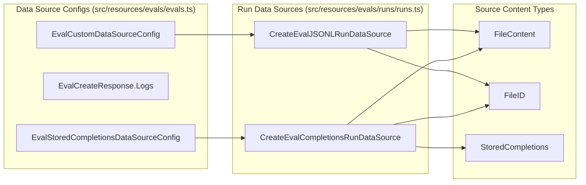
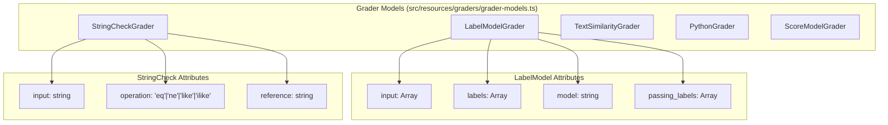
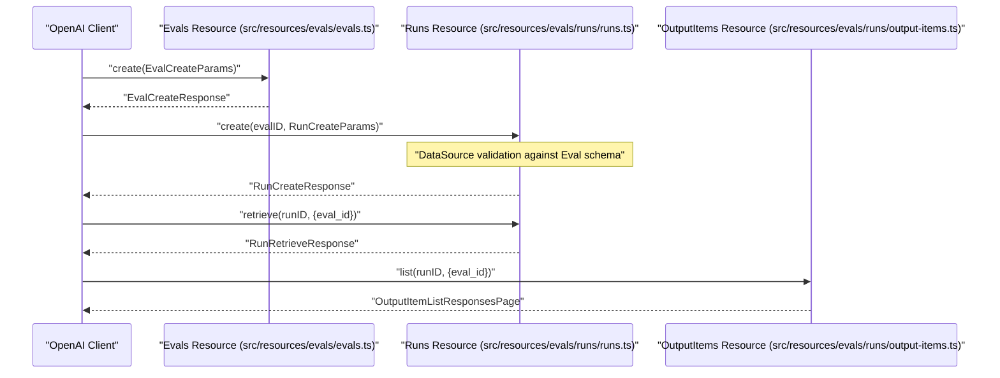

<!-- source: DeepWiki mcp.deepwiki.com · repo openai/openai-node · page 4.14 Evaluations · fetched 2026-10-26 -->

# Evaluations

<details>
<summary>Relevant source files</summary>

The following files were used as context for generating this wiki page:

- [src/resources/evals/evals.ts](src/resources/evals/evals.ts)
- [src/resources/evals/index.ts](src/resources/evals/index.ts)
- [src/resources/evals/runs/index.ts](src/resources/evals/runs/index.ts)
- [src/resources/evals/runs/runs.ts](src/resources/evals/runs/runs.ts)
- [src/resources/fine-tuning/checkpoints/checkpoints.ts](src/resources/fine-tuning/checkpoints/checkpoints.ts)
- [src/resources/fine-tuning/checkpoints/index.ts](src/resources/fine-tuning/checkpoints/index.ts)
- [src/resources/fine-tuning/checkpoints/permissions.ts](src/resources/fine-tuning/checkpoints/permissions.ts)
- [src/resources/graders/grader-models.ts](src/resources/graders/grader-models.ts)
- [tests/api-resources/evals/evals.test.ts](tests/api-resources/evals/evals.test.ts)
- [tests/api-resources/fine-tuning/checkpoints/permissions.test.ts](tests/api-resources/fine-tuning/checkpoints/permissions.test.ts)

</details>


The Evaluations system provides a comprehensive framework for testing and measuring model performance through structured grading criteria and configurable data sources. This system enables systematic evaluation of model outputs against predefined testing criteria using various grading methodologies including model-based scoring, string comparisons, text similarity metrics, and custom Python scripts.

For information about fine-tuning model training, see [Fine-tuning](#4.9). For information about model-based responses, see [Responses API](#4.1).

## Overview

The evaluation system consists of three primary components: **Evaluations** that define testing frameworks, **Runs** that execute evaluations against specific data and model configurations, and **Output Items** that contain individual test results. The system supports multiple data source types and grading methodologies to accommodate diverse evaluation scenarios.

### Architecture Overview

```mermaid
graph TB
    subgraph "Evaluation System Architecture"
        Evals["Evals (src/resources/evals/evals.ts)"]
        Runs["Runs (src/resources/evals/runs/runs.ts)"]
        OutputItems["OutputItems (src/resources/evals/runs/output-items.ts)"]
        GraderModels["GraderModels (src/resources/graders/grader-models.ts)"]
    end
    
    subgraph "Data Sources"
        CustomDS["EvalCustomDataSourceConfig"]
        LogsDS["EvalCreateResponse.Logs"]
        StoredCompletionsDS["EvalStoredCompletionsDataSourceConfig"]
        JSONLSource["CreateEvalJSONLRunDataSource"]
        CompletionsSource["CreateEvalCompletionsRunDataSource"]
    end
    
    subgraph "Grader Types"
        LabelModel["LabelModelGrader"]
        StringCheck["StringCheckGrader"]
        TextSimilarity["TextSimilarityGrader"]
        Python["PythonGrader"]
        ScoreModel["ScoreModelGrader"]
    end
    
    Evals --> Runs
    Runs --> OutputItems
    Evals --> GraderModels
    
    Evals --> CustomDS
    Evals --> LogsDS
    Evals --> StoredCompletionsDS
    
    Runs --> JSONLSource
    Runs --> CompletionsSource
    
    GraderModels --> LabelModel
    GraderModels --> StringCheck
    GraderModels --> TextSimilarity
    GraderModels --> Python
    GraderModels --> ScoreModel
```



Sources: [src/resources/evals/evals.ts:33-82](), [src/resources/evals/runs/runs.ts:25-92](), [src/resources/graders/grader-models.ts:8-251]()

## Core Classes and Structure

### Evals Class

The `Evals` class serves as the primary interface for evaluation management, providing methods to create, retrieve, update, list, and delete evaluation configurations. Each evaluation defines a testing framework with data source configuration and testing criteria.

| Method | Purpose | Return Type |
|--------|---------|-------------|
| `create()` | Create evaluation structure | `APIPromise<EvalCreateResponse>` |
| `retrieve()` | Get evaluation by ID | `APIPromise<EvalRetrieveResponse>` |
| `update()` | Update evaluation properties | `APIPromise<EvalUpdateResponse>` |
| `list()` | List evaluations for project | `PagePromise<EvalListResponsesPage, EvalListResponse>` |
| `delete()` | Delete evaluation | `APIPromise<EvalDeleteResponse>` |

The class includes a nested `runs` property providing access to evaluation run management through the `Runs` class.

Sources: [src/resources/evals/evals.ts:33-82]()

### Runs Class

The `Runs` class manages evaluation execution, handling the creation and monitoring of evaluation runs against specific data sources and model configurations.

| Method | Purpose | Return Type |
|--------|---------|-------------|
| `create()` | Start new evaluation run | `APIPromise<RunCreateResponse>` |
| `retrieve()` | Get run by ID | `APIPromise<RunRetrieveResponse>` |
| `list()` | List runs for evaluation | `PagePromise<RunListResponsesPage, RunListResponse>` |
| `delete()` | Delete evaluation run | `APIPromise<RunDeleteResponse>` |
| `cancel()` | Cancel ongoing run | `APIPromise<RunCancelResponse>` |

The class includes an `outputItems` property providing access to individual evaluation results through the `OutputItems` class.

Sources: [src/resources/evals/runs/runs.ts:25-92]()

## Data Source Configuration

Evaluations support multiple data source types to accommodate different evaluation scenarios and data formats.



Sources: [src/resources/evals/evals.ts:94-131](), [src/resources/evals/runs/runs.ts:99-181]()

### Custom Data Source Configuration

Custom data sources allow users to define arbitrary JSON schemas for evaluation data. The `EvalCustomDataSourceConfig` specifies the structure of item data used in testing criteria and run creation.

```typescript
export interface EvalCustomDataSourceConfig {
  schema: { [key: string]: unknown };
  type: 'custom';
}
```

Sources: [src/resources/evals/evals.ts:94-105]()

### Logs Data Source Configuration

Logs data sources enable evaluation against production API logs filtered by metadata properties. This is defined in `EvalCreateResponse.Logs`. The schema returned by this config defines what variables are available in the evaluation.

Sources: [src/resources/evals/evals.ts:200-213]()

### Stored Completions Data Source Configuration

Deprecated in favor of logs data source configuration, `EvalStoredCompletionsDataSourceConfig` previously supported evaluation against stored completion data with metadata filtering capabilities.

Sources: [src/resources/evals/evals.ts:110-131]()

## Grading System

The evaluation system supports distinct grader types for assessing model performance across different criteria and methodologies.



Sources: [src/resources/graders/grader-models.ts:64-286]()

### Label Model Grader

The `LabelModelGrader` uses language models with structured outputs to classify evaluation items into predefined labels. This grader type requires model support for structured outputs and defines passing criteria through specific label subsets.

Sources: [src/resources/graders/grader-models.ts:64-91]()

### String Check Grader

The `StringCheckGrader` performs direct string comparisons between input and reference text using specified operations including equality (`eq`), inequality (`ne`), pattern matching (`like`), and case-insensitive pattern matching (`ilike`).

Sources: [src/resources/graders/grader-models.ts:216-245]()

### Text Similarity Grader

The `TextSimilarityGrader` evaluates text similarity using metrics including `fuzzy_match`, `bleu`, `gleu`, `meteor`, and various `rouge` variants. This grader type requires a `pass_threshold` parameter defining minimum similarity scores.

Sources: [src/resources/graders/grader-models.ts:247-286]()

### Python Grader

The `PythonGrader` executes custom Python scripts for evaluation logic, supporting arbitrary assessment criteria through user-defined code in the `source` field.

Sources: [src/resources/graders/grader-models.ts:195-215]()

### Score Model Grader

The `ScoreModelGrader` uses language models to assign numerical scores to evaluation inputs within specified ranges (defaults to `[0, 1]`).

Sources: [src/resources/graders/grader-models.ts:220-251]()

## Evaluation Workflow

The evaluation process follows a structured workflow from evaluation creation through run execution to results analysis.



Sources: [src/resources/evals/evals.ts:44-46](), [src/resources/evals/runs/runs.ts:33-38](), [src/resources/evals/runs/output-items.ts:32-43]()

## Run Data Sources

Evaluation runs support specific data source types for execution.

### JSONL Run Data Source

The `CreateEvalJSONLRunDataSource` accepts either `file_content` (arrays of items) or `file_id` references to uploaded files containing JSONL data.

Sources: [src/resources/evals/runs/runs.ts:302-350]()

### Completions Run Data Source

The `CreateEvalCompletionsRunDataSource` enables evaluation through model sampling. It supports `input_messages` which can be a `template` (with variable references to the `item` namespace) or an `item_reference`.

Sources: [src/resources/evals/runs/runs.ts:99-130]()

## Results and Output Items

Evaluation runs generate structured results and detailed output items for individual evaluation instances.

### Output Items Management

The `OutputItems` class (accessed via `client.evals.runs.outputItems`) provides access to individual evaluation results with detailed grading information for each evaluated item.

Each `OutputItemRetrieveResponse` contains:
- `datasource_item`: The original input data.
- `results`: An array of `Result` objects containing the grader name, whether it `passed`, and the numeric `score`.
- `sample`: The model `input` and `output` generated during the run.

Sources: [src/resources/evals/runs/output-items.ts:51-101](), [src/resources/evals/runs/output-items.ts:107-134]()

## Checkpoint Permissions

While not part of the core Evaluations API, the `Permissions` resource under `fine-tuning` allows organization owners to manage access to model checkpoints, which may be relevant when selecting models for evaluation.

| Method | Purpose | Auth Requirement |
|--------|---------|------------------|
| `create()` | Share checkpoint with projects | Admin API Key |
| `list()` | View checkpoint permissions | Admin API Key |
| `delete()` | Revoke checkpoint access | Admin API Key |

Sources: [src/resources/fine-tuning/checkpoints/permissions.ts:17-124]()

---

