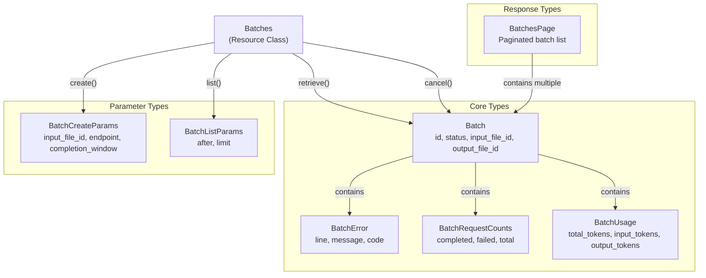
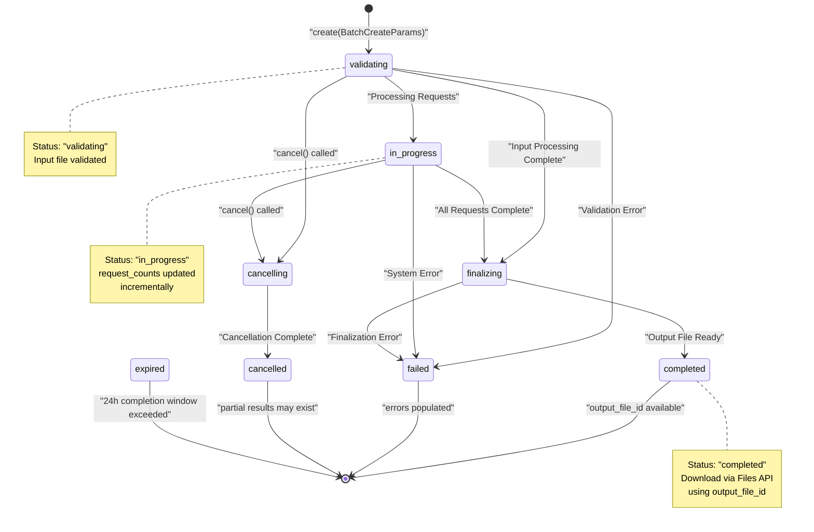
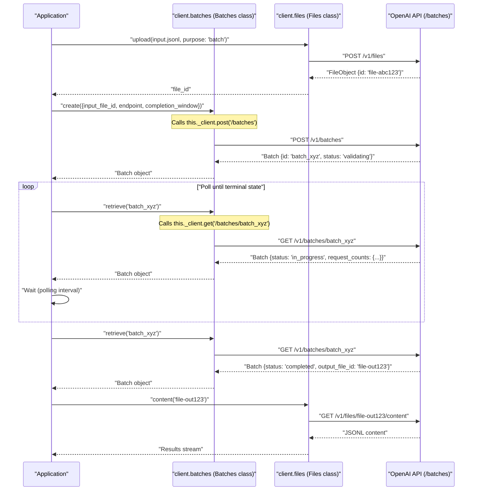

<!-- source: DeepWiki mcp.deepwiki.com · repo openai/openai-node · page 4.15 Batches · fetched 2026-10-26 -->

# Batches

<details>
<summary>Relevant source files</summary>

The following files were used as context for generating this wiki page:

- [src/resources/batches.ts](src/resources/batches.ts)
- [tests/api-resources/batches.test.ts](tests/api-resources/batches.test.ts)
- [tests/api-resources/uploads/uploads.test.ts](tests/api-resources/uploads/uploads.test.ts)

</details>


The Batches API enables asynchronous batch processing of large volumes of API requests. This resource allows applications to submit multiple requests for offline processing, providing cost savings (typically 50% discount) and simplified handling of high-volume workloads. Batches support various endpoints including Chat Completions, Embeddings, and other API operations.

For real-time request processing, see the Responses API ([4.1]()) or Chat Completions ([4.2]()). For file management required by batch processing, see Files ([4.7]()).

## Overview

The `Batches` resource provides methods to create, retrieve, list, and cancel batch processing jobs. Batches process requests from JSONL input files and write results to JSONL output files. The API tracks batch status, request counts, and error information throughout the processing lifecycle.

The Batches resource is accessed via `client.batches` on the OpenAI client instance.

**Sources:** [src/resources/batches.ts:14-14](), [src/resources/batches.ts:18-54]()

## Core Types and Interfaces

The Batches API exposes the following primary types:

| Type | Purpose |
|------|---------|
| `Batch` | Main batch object containing status, file IDs, and metadata |
| `BatchCreateParams` | Parameters for creating a new batch |
| `BatchListParams` | Query parameters for listing batches |
| `BatchError` | Error information for failed batch requests |
| `BatchRequestCounts` | Count of requests by status (completed, failed, total) |
| `BatchUsage` | Token usage statistics for the batch |
| `BatchesPage` | Paginated list of batch objects |



**Diagram: Batches Resource Type Hierarchy**

**Sources:** [src/resources/batches.ts:14-14](), [src/resources/batches.ts:58-181](), [src/resources/batches.ts:194-214](), [src/resources/batches.ts:219-234](), [src/resources/batches.ts:241-266]()

## Batch Lifecycle

A batch progresses through several states from creation to completion. The `status` field on the `Batch` object indicates the current state.



**Diagram: Batch Status State Machine**

**Sources:** [src/resources/batches.ts:89-97]()

## Creating Batches

### Input File Format

Batch requests are submitted via JSONL files uploaded through the Files API. Each line in the input file represents a single request.

Each request requires:
- `custom_id`: Unique identifier for correlating responses.
- `method`: HTTP method (typically `"POST"`).
- `url`: API endpoint path.
- `body`: Request parameters specific to the endpoint.

### Create Operation

The `create()` method on the `Batches` resource initiates batch processing:

```typescript
const batch = await client.batches.create({
  input_file_id: "file-abc123",
  endpoint: "/v1/chat/completions",
  completion_window: "24h"
});
```

**Parameters:**
- `input_file_id` (required): File ID from Files API with `purpose: "batch"`.
- `endpoint` (required): Target API endpoint (e.g., `"/v1/chat/completions"`, `"/v1/embeddings"`).
- `completion_window` (required): Processing deadline, typically `"24h"`.
- `metadata` (optional): Custom key-value pairs for tracking [src/resources/batches.ts:154-154]().

**Sources:** [src/resources/batches.ts:18-20](), [tests/api-resources/batches.test.ts:12-25]()

## Retrieving and Monitoring Batches

### Retrieve Operation

The `retrieve()` method fetches the current state of a batch:

```typescript
const batch = await client.batches.retrieve("batch_abc123");

console.log(batch.status); // "in_progress", "completed", etc.
console.log(batch.request_counts); // { completed: 50, failed: 2, total: 100 }
```

The `Batch` object contains:
- `id`: Batch identifier [src/resources/batches.ts:59-59]().
- `status`: Current state [src/resources/batches.ts:89-97]().
- `request_counts`: `BatchRequestCounts` with completion statistics [src/resources/batches.ts:173-173]().
- `input_file_id`: Reference to input JSONL file [src/resources/batches.ts:79-79]().
- `output_file_id`: Reference to output file (available when `status === "completed"`) [src/resources/batches.ts:168-168]().
- `error_file_id`: Reference to error details file (when errors occurred) [src/resources/batches.ts:117-117]().
- `created_at`: Unix timestamp [src/resources/batches.ts:69-69]().
- `completed_at`: Unix timestamp (when finished) [src/resources/batches.ts:112-112]().
- `metadata`: Custom tracking data [src/resources/batches.ts:154-154]().

**Sources:** [src/resources/batches.ts:25-27](), [src/resources/batches.ts:58-181]()

### List Operation

The `list()` method returns a paginated collection of batches:

```typescript
const batches = await client.batches.list({
  limit: 20,
  after: "batch_abc123"
});

for await (const batch of batches) {
  console.log(`${batch.id}: ${batch.status}`);
}
```

The method returns a `PagePromise` that resolves to a `BatchesPage` (a `CursorPage<Batch>`).

**Sources:** [src/resources/batches.ts:32-41](), [src/resources/batches.ts:56-56]()

## Request Counts and Progress Tracking

The `BatchRequestCounts` interface tracks processing progress:

| Field | Type | Description |
|-------|------|-------------|
| `total` | number | Total number of requests in batch |
| `completed` | number | Successfully processed requests |
| `failed` | number | Requests that encountered errors |

**Sources:** [src/resources/batches.ts:219-234]()

## Batch Usage Statistics

The `BatchUsage` interface provides token consumption metrics for batches created after September 7, 2025. This includes breakdowns for input and output tokens, such as cached tokens or reasoning tokens.

| Field | Type | Description |
|-------|------|-------------|
| `input_tokens` | number | The number of input tokens [src/resources/batches.ts:245-245](). |
| `input_tokens_details` | `InputTokensDetails` | Breakdown including `audio_tokens` and `cached_tokens` [src/resources/batches.ts:250-250](). |
| `output_tokens` | number | The number of output tokens [src/resources/batches.ts:255-255](). |
| `output_tokens_details` | `OutputTokensDetails` | Breakdown including `audio_tokens` and `reasoning_tokens` [src/resources/batches.ts:260-260](). |
| `total_tokens` | number | The total number of tokens used [src/resources/batches.ts:265-265](). |

**Sources:** [src/resources/batches.ts:241-266]()

## Error Handling

### Batch-Level Errors

Batches may fail during validation or processing, indicated by `status === "failed"`. The `BatchError` type captures error details:

| Field | Type | Description |
|-------|------|-------------|
| `line` | number \| null | Line number in input file where error occurred [src/resources/batches.ts:203-203](). |
| `message` | string | Human-readable error description [src/resources/batches.ts:208-208](). |
| `code` | string | Machine-readable error code [src/resources/batches.ts:198-198](). |

**Sources:** [src/resources/batches.ts:194-214]()

### Request-Level Errors

Individual request failures are recorded in the error file (`error_file_id`). Failed requests are counted in `request_counts.failed` but do not fail the entire batch.

**Sources:** [src/resources/batches.ts:117-117](), [src/resources/batches.ts:228-228]()

## Cancel Operation

The `cancel()` method attempts to stop in-progress batches:

```typescript
const batch = await client.batches.cancel("batch_abc123");
console.log(batch.status); // "cancelling"
```

Cancellation behavior:
- Batches in `validating` or `in_progress` states can be cancelled.
- Status transitions to `"cancelling"` (for up to 10 minutes) then `"cancelled"` [src/resources/batches.ts:44-47]().
- Partial results may be available in the output file [src/resources/batches.ts:44-47]().

**Sources:** [src/resources/batches.ts:48-53]()

## Data Flow and Interaction



**Diagram: Batch Processing Data Flow**

**Sources:** [src/resources/batches.ts:14-54](), [tests/api-resources/batches.test.ts:11-76]()

## Pagination

The `list()` method returns a `PagePromise` which facilitates easy navigation through batches using the `CursorPage` pattern.

```typescript
// Manual pagination
let page = await client.batches.list({ limit: 10 });
while (page.hasNextPage()) {
  page = await page.getNextPage();
}
```

**Sources:** [src/resources/batches.ts:32-41](), [src/resources/batches.ts:56-56]()

---

