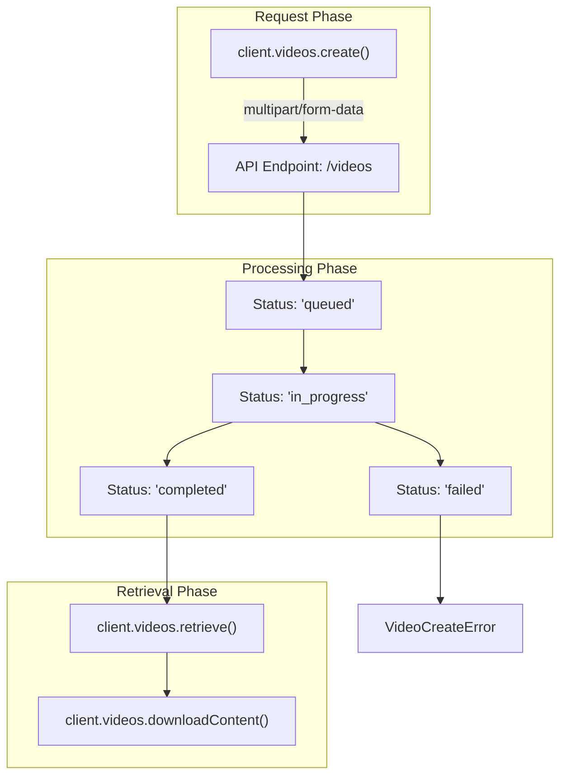
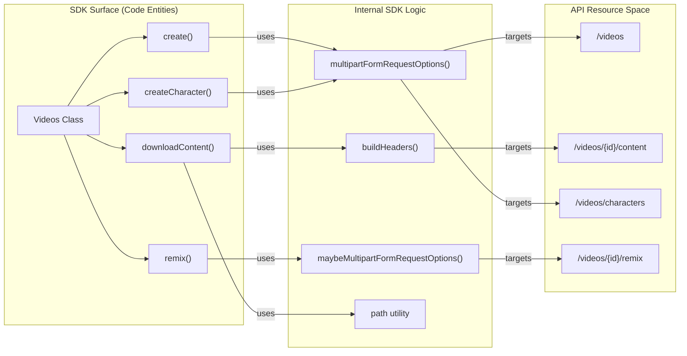
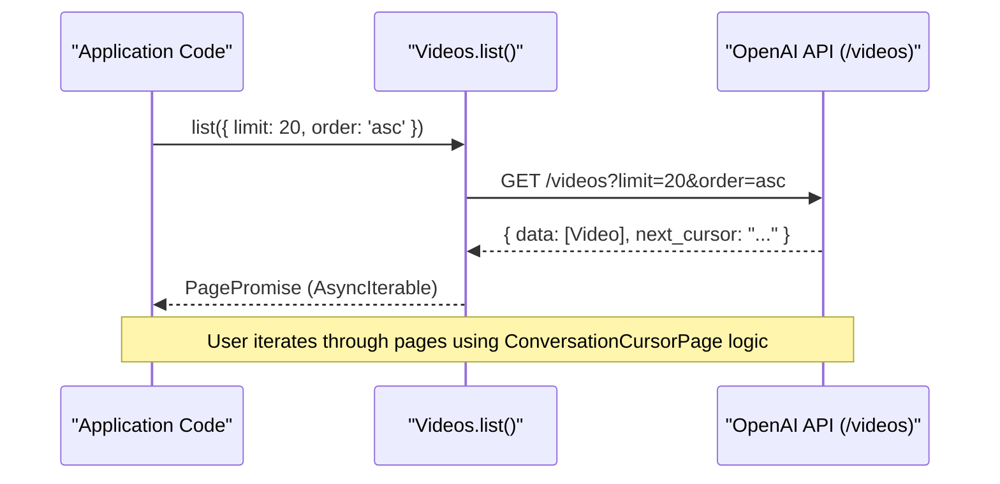

<!-- source: DeepWiki mcp.deepwiki.com · repo openai/openai-node · page 4.16 Videos · fetched 2026-10-26 -->

# Videos

Relevant source files

The following files were used as context for generating this wiki page:

- [src/resources/realtime/api.md](src/resources/realtime/api.md)
- [src/resources/realtime/calls.ts](src/resources/realtime/calls.ts)
- [src/resources/realtime/client-secrets.ts](src/resources/realtime/client-secrets.ts)
- [src/resources/realtime/index.ts](src/resources/realtime/index.ts)
- [src/resources/realtime/realtime.ts](src/resources/realtime/realtime.ts)
- [src/resources/videos.ts](src/resources/videos.ts)
- [tests/api-resources/containers/files/content.test.ts](tests/api-resources/containers/files/content.test.ts)
- [tests/api-resources/realtime/calls.test.ts](tests/api-resources/realtime/calls.test.ts)
- [tests/api-resources/skills/versions/content.test.ts](tests/api-resources/skills/versions/content.test.ts)
- [tests/api-resources/videos.test.ts](tests/api-resources/videos.test.ts)

The Videos API provides a comprehensive suite for AI-driven video production, including generation from text prompts, editing existing content, extending video duration, and managing persistent "characters" for consistency across generations.

## Overview

The `Videos` resource is accessed via `client.videos` and facilitates interactions with video models such as the `sora` family [src/resources/videos.ts:12](), [src/resources/videos.ts:222-228](). Most operations involving file uploads (like editing or character creation) utilize multipart form data, which the SDK handles automatically via the `multipartFormRequestOptions` or `maybeMultipartFormRequestOptions` utilities [src/resources/videos.ts:19-20](), [src/resources/videos.ts:60-61](), [src/resources/videos.ts:120-121]().

### Data Flow: Video Generation Lifecycle

Video generation is typically an asynchronous process. A job is created, returns a status of `queued` or `in_progress`, and eventually reaches `completed` or `failed` [src/resources/videos.ts:204-204]().

Title: Video Resource Lifecycle

Sources: [src/resources/videos.ts:16-21](), [src/resources/videos.ts:26-28](), [src/resources/videos.ts:204-204](), [src/resources/videos.ts:210-220]()

---

## Key Functions and Classes

### The Videos Resource Class
The `Videos` class extends `APIResource` and encapsulates all video-related endpoints [src/resources/videos.ts:12]().

| Method | Endpoint | Description |
| --- | --- | --- |
| `create` | `POST /videos` | Generates a new video from a prompt and optional reference assets [src/resources/videos.ts:16-21](). |
| `retrieve` | `GET /videos/{id}` | Fetches the latest metadata and current status for a generated video [src/resources/videos.ts:26-28](). |
| `list` | `GET /videos` | Returns a paginated list of recently generated videos for the current project [src/resources/videos.ts:33-42](). |
| `delete` | `DELETE /videos/{id}` | Permanently removes a video and its stored assets [src/resources/videos.ts:47-49](). |
| `downloadContent`| `GET /videos/{id}/content` | Streams the rendered video bytes or a derived preview asset [src/resources/videos.ts:69-81](). |
| `createCharacter`| `POST /videos/characters` | Extracts a character from an uploaded video [src/resources/videos.ts:54-62](). |
| `edit` | `POST /videos/edits` | Edits a source video or existing generated video [src/resources/videos.ts:87-92](). |
| `extend` | `POST /videos/extensions` | Creates an extension of a completed video [src/resources/videos.ts:97-102](). |
| `remix` | `POST /videos/{id}/remix` | Creates a remix of a completed video using a refreshed prompt [src/resources/videos.ts:117-122](). |
| `getCharacter` | `GET /videos/characters/{id}` | Fetches a specific character profile [src/resources/videos.ts:107-112](). |

Sources: [src/resources/videos.ts:12-123]()

---

## Implementation Details

### Video Generation (`create`)
The `create` method accepts a `VideoCreateParams` object. It requires a `prompt` and supports optional parameters like `model` (e.g., `sora-2`), `seconds` ('4', '8', '12'), and `size` (e.g., '1280x720') [src/resources/videos.ts:16-21](), [src/resources/videos.ts:222-232](). Input references can be provided as file IDs or URLs [src/resources/videos.ts:127-134]().

### Character Management
The API allows creating a persistent character from a video source. This character can then be referenced in subsequent generation tasks to maintain visual consistency.
*   **Create**: `client.videos.createCharacter` takes a `name` and a `video` file (Uploadable) [src/resources/videos.ts:54-62]().
*   **Retrieve**: `client.videos.getCharacter` fetches the character profile by ID using the `path` utility for URL construction [src/resources/videos.ts:107-112]().

### Content Download
Unlike metadata retrieval, `downloadContent` returns a binary stream. The SDK sets the `Accept: application/binary` header via `buildHeaders` and uses the `__binaryResponse: true` internal flag to ensure the raw `Response` object is returned to the caller [src/resources/videos.ts:69-81]().

Title: Code Entity Mapping for Video Operations

Sources: [src/resources/videos.ts:12-21](), [src/resources/videos.ts:54-81](), [src/resources/videos.ts:117-122](), [src/internal/uploads.ts:9-9](), [src/internal/headers.ts:7-7](), [src/internal/utils/path.ts:10-10]()

---

## Pagination and Lists

The `list` method returns a `PagePromise` that resolves to a `VideosPage` [src/resources/videos.ts:36-37](). This uses the `ConversationCursorPage` structure for cursor-based navigation through the project's video history [src/resources/videos.ts:5-5](), [src/resources/videos.ts:125-125]().

Title: Video Listing and Pagination Flow

Sources: [src/resources/videos.ts:33-42](), [src/resources/videos.ts:125-125]()

---

## Error Handling

Video jobs may fail during the generation process. The `Video` object includes an `error` field of type `VideoCreateError`, which contains a machine-readable `code` and a human-readable `message` [src/resources/videos.ts:158-158](), [src/resources/videos.ts:210-220](). This is distinct from HTTP-level errors (like `OpenAI.NotFoundError`), which are thrown during the initial request if the resource or path is invalid [tests/api-resources/videos.test.ts:66-66](), [tests/api-resources/videos.test.ts:105-105]().

Sources: [src/resources/videos.ts:158-158](), [src/resources/videos.ts:210-220](), [tests/api-resources/videos.test.ts:66-66](), [tests/api-resources/videos.test.ts:105-105]()

---

