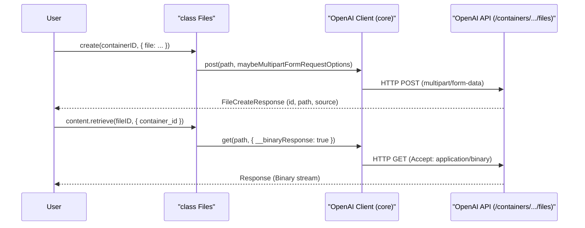

<!-- source: DeepWiki mcp.deepwiki.com · repo openai/openai-node · page 4.17 Containers · fetched 2026-10-26 -->

# Containers

<details>
<summary>Relevant source files</summary>

The following files were used as context for generating this wiki page:

- [src/resources/containers.ts](src/resources/containers.ts)
- [src/resources/containers/containers.ts](src/resources/containers/containers.ts)
- [src/resources/containers/files.ts](src/resources/containers/files.ts)
- [src/resources/containers/files/content.ts](src/resources/containers/files/content.ts)
- [src/resources/containers/files/files.ts](src/resources/containers/files/files.ts)
- [src/resources/containers/files/index.ts](src/resources/containers/files/index.ts)
- [src/resources/containers/index.ts](src/resources/containers/index.ts)
- [tests/api-resources/containers/containers.test.ts](tests/api-resources/containers/containers.test.ts)
- [tests/api-resources/containers/files/content.test.ts](tests/api-resources/containers/files/content.test.ts)
- [tests/api-resources/containers/files/files.test.ts](tests/api-resources/containers/files/files.test.ts)
- [tests/api-resources/skills/versions/content.test.ts](tests/api-resources/skills/versions/content.test.ts)
- [tests/api-resources/videos.test.ts](tests/api-resources/videos.test.ts)

</details>


The Containers API provides a managed execution environment for tools such as code interpreters and shells. This API allows for the creation of isolated environments, management of their lifecycle (including expiration and memory limits), and fine-grained control over files stored within those environments.

## Architecture and Data Flow

The Containers resource is structured as a hierarchical API where the base `Containers` class manages the lifecycle of the execution environments, while the nested `Files` resource handles data persistence and retrieval within those environments.

### Container Lifecycle Management
Containers are created with specific configurations including network policies and resource limits. They can be configured to automatically expire based on inactivity using the `expires_after` parameter [src/resources/containers/containers.ts:98-102]().

### File Management Flow
Files within a container can be managed through multipart form uploads or by referencing existing file IDs [src/resources/containers/files/files.ts:18-22](). The SDK provides a specialized `Content` resource for retrieving the raw binary data of files stored inside a container [src/resources/containers/files/content.ts:9-22]().

### Execution Entity Relationship
The following diagram illustrates the relationship between the SDK client and the Container resource entities.

**Container Resource Mapping**
```mermaid
graph TD
    subgraph "Natural Language Space"
        "Execution Environment"
        "File Storage"
        "Raw Data"
    end

    subgraph "Code Entity Space"
        "OpenAI_Client"["OpenAI Client"]
        "Containers_Class"["class Containers"]
        "Files_Class"["class Files"]
        "Content_Class"["class Content"]

        "OpenAI_Client" --> "Containers_Class"
        "Containers_Class" -- "has property .files" --> "Files_Class"
        "Files_Class" -- "has property .content" --> "Content_Class"
    end

    "Execution Environment" -.-> "Containers_Class"
    "File Storage" -.-> "Files_Class"
    "Raw Data" -.-> "Content_Class"
```
Sources: [src/resources/containers/containers.ts:23-24](), [src/resources/containers/files/files.ts:14-15](), [src/resources/containers/files/content.ts:9-9]()

## The Containers Resource

The `Containers` class handles the primary CRUD operations for execution environments.

### Key Methods
- `create(body, options)`: Initializes a new container. Supports configuring `expires_after`, `memory_limit`, and `network_policy` [src/resources/containers/containers.ts:29-31]().
- `retrieve(containerID, options)`: Fetches the current status and configuration of a container [src/resources/containers/containers.ts:36-41]().
- `list(query, options)`: Returns a paginated list of containers [src/resources/containers/containers.ts:46-55]().
- `delete(containerID, options)`: Permanently removes a container and its associated data [src/resources/containers/containers.ts:60-66]().

### Configuration Parameters
| Parameter | Type | Description |
| :--- | :--- | :--- |
| `name` | `string` | Human-readable name for the container. |
| `expires_after` | `object` | Defines when the container should be reaped (e.g., `last_active_at`) [src/resources/containers/containers.ts:126-136](). |
| `memory_limit` | `string` | Resource constraints: `1g`, `4g`, `16g`, or `64g` [src/resources/containers/containers.ts:112-112](). |
| `network_policy` | `object` | Configures `allowlist` or `disabled` network access [src/resources/containers/containers.ts:141-151](). |

Sources: [src/resources/containers/containers.ts:71-152](), [src/resources/containers/containers.ts:23-67]()

## File Operations

The `Files` class, accessed via `client.containers.files`, manages the filesystem within a specific container [src/resources/containers/files/files.ts:14-15]().

### File Creation and Upload
Files can be created in two ways [src/resources/containers/files/files.ts:18-22]():
1. **Multipart Upload**: Sending raw file content using the `Uploadable` type [src/resources/containers/files/files.ts:194-194]().
2. **Reference**: Providing an existing `file_id` [src/resources/containers/files/files.ts:199-199]().

The `create` method utilizes `maybeMultipartFormRequestOptions` to automatically detect and format the request if a raw file is provided [src/resources/containers/files/files.ts:28-31]().

### File Management Diagram
This diagram shows the internal data flow for file-related requests within the container sub-resource.

**Container File Data Flow**

Sources: [src/resources/containers/files/files.ts:23-32](), [src/resources/containers/files/content.ts:13-21](), [src/resources/containers/files/files.ts:79-114]()

## Binary Content Retrieval

The `Content` resource is a specialized sub-resource for accessing the raw bytes of a file. Unlike standard metadata retrieval, the `retrieve` method in this class is configured to handle binary responses.

- **Endpoint**: `GET /containers/${container_id}/files/${fileID}/content` [src/resources/containers/files/content.ts:15-15]().
- **Headers**: It explicitly sets `Accept: application/binary` using the `buildHeaders` utility [src/resources/containers/files/content.ts:17-17]().
- **Response Type**: Returns an `APIPromise<Response>`, with `__binaryResponse: true` set to allow the user to handle the raw stream directly via the standard Fetch API `Response` object [src/resources/containers/files/content.ts:13-21]().

Sources: [src/resources/containers/files/content.ts:9-22]()

## Implementation Details

### Pagination
The `list` methods for both Containers and Files use `CursorPage` and `PagePromise` for handling large sets of resources [src/resources/containers/containers.ts:49-50](), [src/resources/containers/files/files.ts:56-57]().

### Security
Every request in the Containers API includes the `__security: { bearerAuth: true }` flag, ensuring that the authentication token is correctly attached to the outgoing request [src/resources/containers/containers.ts:30-30](), [src/resources/containers/files/files.ts:30-30](), [src/resources/containers/files/content.ts:18-18]().

### Path Construction
The SDK uses the `path` template literal tag from `internal/utils/path` to safely construct URLs with container and file IDs [src/resources/containers/containers.ts:37-37](), [src/resources/containers/files/files.ts:29-29](), [src/resources/containers/files/content.ts:15-15]().

Sources: [src/resources/containers/containers.ts:23-67](), [src/resources/containers/files/files.ts:14-75](), [src/resources/containers/files/content.ts:1-31]()

---

