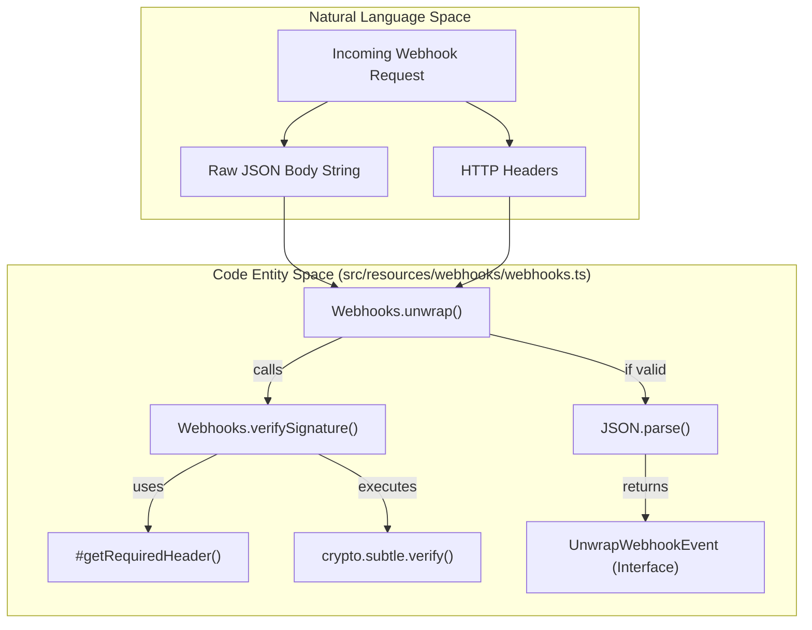
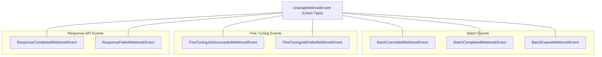

<!-- source: DeepWiki mcp.deepwiki.com · repo openai/openai-node · page 4.18 Webhooks · fetched 2026-10-26 -->

# Webhooks

<details>
<summary>Relevant source files</summary>

The following files were used as context for generating this wiki page:

- [src/resources/conversations/api.md](src/resources/conversations/api.md)
- [src/resources/webhooks.ts](src/resources/webhooks.ts)
- [src/resources/webhooks/api.md](src/resources/webhooks/api.md)
- [src/resources/webhooks/index.ts](src/resources/webhooks/index.ts)
- [src/resources/webhooks/webhooks.ts](src/resources/webhooks/webhooks.ts)

</details>


This page documents the webhook functionality provided by the OpenAI TypeScript/JavaScript SDK, focusing on signature verification, the `unwrap` helper, and supported event types.

Webhooks allow OpenAI to notify your application asynchronously when events occur, such as a batch job completing or a fine-tuning job succeeding.

---

## 1. Overview of Webhook Verification

When OpenAI sends webhook notifications, it includes cryptographic signatures and metadata in HTTP headers to prove the payload’s authenticity and protect against replay attacks. The SDK facilitates verifying these webhooks with built-in cryptographic validation leveraging the Web Crypto API [src/resources/webhooks/webhooks.ts:32-117]().

The verification process ensures:
- The webhook signature matches the expected HMAC-SHA256 signature computed using the shared webhook secret [src/resources/webhooks/webhooks.ts:85-112]().
- The webhook timestamp is within an acceptable timeframe (default 5 minutes) to prevent replay attacks [src/resources/webhooks/webhooks.ts:59-67]().
- Required headers (`webhook-signature`, `webhook-timestamp`, and `webhook-id`) are present and correctly formatted [src/resources/webhooks/webhooks.ts:49-57]().

If any of these checks fail, an `InvalidWebhookSignatureError` is thrown [src/resources/webhooks/webhooks.ts:3-3]().

---

## 2. Key Classes and Functions

### 2.1 `Webhooks` Class
The `Webhooks` class is the primary interface for handling webhook security and parsing.

- **Location**: [src/resources/webhooks/webhooks.ts:7-140]()
- **Inheritance**: Extends `APIResource` [src/resources/webhooks/webhooks.ts:7-7]().

| Method | Description |
| :--- | :--- |
| `unwrap()` | Validates the signature and returns the parsed `UnwrapWebhookEvent` object [src/resources/webhooks/webhooks.ts:11-20](). |
| `verifySignature()` | Performs the cryptographic verification logic. Throws on failure [src/resources/webhooks/webhooks.ts:32-117](). |

### 2.2 Signature Verification Logic
The `verifySignature` method implements the following security protocol:
1. **Environment Check**: Ensures the `crypto` global is available with `subtle` support [src/resources/webhooks/webhooks.ts:38-44]().
2. **Header Extraction**: Retrieves `webhook-signature`, `webhook-timestamp`, and `webhook-id` [src/resources/webhooks/webhooks.ts:48-51]().
3. **Secret Decoding**: If the secret starts with `whsec_`, it is treated as base64; otherwise, it is UTF-8 encoded [src/resources/webhooks/webhooks.ts:77-80]().
4. **Payload Construction**: Concatenates `${webhookId}.${timestamp}.${payload}` to form the signed string [src/resources/webhooks/webhooks.ts:83-83]().
5. **HMAC Verification**: Uses `crypto.subtle.verify` with SHA-256 to check the signature [src/resources/webhooks/webhooks.ts:98-103]().

Sources: [src/resources/webhooks/webhooks.ts:7-140](), [src/resources/webhooks/index.ts:1-4]()

---

## 3. Webhook Data Flow

The following diagram bridges the "Natural Language Space" of an incoming HTTP request to the "Code Entity Space" of the SDK methods.

### Diagram: Request to Verified Event

Sources: [src/resources/webhooks/webhooks.ts:11-140]()

---

## 4. Supported Webhook Event Types

The SDK provides TypeScript interfaces for all supported webhook events. Each event follows a standard structure containing an `id`, `created_at` timestamp, `type`, and a `data` payload.

### Event Mapping Table

| Event Type (`type`) | Interface Name | Purpose |
| :--- | :--- | :--- |
| `batch.cancelled` | `BatchCancelledWebhookEvent` | Sent when a batch API request is cancelled [src/resources/webhooks/webhooks.ts:145-170](). |
| `batch.completed` | `BatchCompletedWebhookEvent` | Sent when a batch API request completes successfully [src/resources/webhooks/webhooks.ts:187-212](). |
| `batch.expired` | `BatchExpiredWebhookEvent` | Sent when a batch API request expires [src/resources/webhooks/webhooks.ts:229-250](). |
| `fine_tuning.job.succeeded` | `FineTuningJobSucceededWebhookEvent` | Sent when a fine-tuning job finishes [src/resources/webhooks/api.md:14-14](). |
| `response.completed` | `ResponseCompletedWebhookEvent` | Sent when a Responses API task completes [src/resources/webhooks/api.md:17-17](). |

### Diagram: Event Interface Hierarchy
This diagram maps the natural event concepts to the specific TypeScript interfaces defined in the SDK.


Sources: [src/resources/webhooks/webhooks.ts:145-250](), [src/resources/webhooks/api.md:5-20]()

---

## 5. Security and Error Handling

### 5.1 Replay Protection
The `tolerance` parameter (default 300s) prevents replay attacks by ensuring the `webhook-timestamp` is close to the current system time [src/resources/webhooks/webhooks.ts:59-67]().

### 5.2 Error Types
- **`InvalidWebhookSignatureError`**: Thrown when the signature does not match or the timestamp is outside the tolerance window [src/resources/webhooks/webhooks.ts:114-116]().
- **Generic `Error`**: Thrown if the `crypto` global is missing, required headers are absent, or the webhook secret is not configured [src/resources/webhooks/webhooks.ts:43-43](), [src/resources/webhooks/webhooks.ts:121-123](), [src/resources/webhooks/webhooks.ts:135-135]().

### 5.3 Timing Attacks
The SDK uses `crypto.subtle.verify()` for signature comparison [src/resources/webhooks/webhooks.ts:98-103](). This is a cryptographic primitive designed to be timing-safe, preventing attackers from brute-forcing signatures based on response time differences.

Sources: [src/resources/webhooks/webhooks.ts:32-117]()

---

## 6. Implementation Example

The `unwrap` method is the recommended entry point for developers.

```typescript
// Internal flow of unwrap
async unwrap(payload, headers, secret, tolerance) {
  // 1. Validate signature using verifySignature()
  await this.verifySignature(payload, headers, secret, tolerance);
  
  // 2. Parse and return typed object
  return JSON.parse(payload) as UnwrapWebhookEvent;
}
```
Sources: [src/resources/webhooks/webhooks.ts:11-20]()

---

