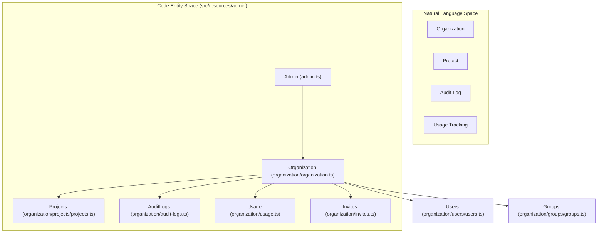
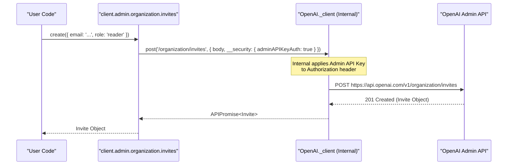

<!-- source: DeepWiki mcp.deepwiki.com · repo openai/openai-node · page 4.19 Administration · fetched 2026-10-26 -->

# Administration

Relevant source files

The following files were used as context for generating this wiki page:

- [MIGRATION.md](MIGRATION.md)
- [scripts/detect-breaking-changes](scripts/detect-breaking-changes)
- [src/resources/admin/admin.ts](src/resources/admin/admin.ts)
- [src/resources/admin/index.ts](src/resources/admin/index.ts)
- [src/resources/admin/organization.ts](src/resources/admin/organization.ts)
- [src/resources/admin/organization/admin-api-keys.ts](src/resources/admin/organization/admin-api-keys.ts)
- [src/resources/admin/organization/groups/groups.ts](src/resources/admin/organization/groups/groups.ts)
- [src/resources/admin/organization/groups/index.ts](src/resources/admin/organization/groups/index.ts)
- [src/resources/admin/organization/groups/roles.ts](src/resources/admin/organization/groups/roles.ts)
- [src/resources/admin/organization/groups/users.ts](src/resources/admin/organization/groups/users.ts)
- [src/resources/admin/organization/index.ts](src/resources/admin/organization/index.ts)
- [src/resources/admin/organization/invites.ts](src/resources/admin/organization/invites.ts)
- [src/resources/admin/organization/organization.ts](src/resources/admin/organization/organization.ts)
- [src/resources/admin/organization/projects/groups/groups.ts](src/resources/admin/organization/projects/groups/groups.ts)
- [src/resources/admin/organization/projects/groups/roles.ts](src/resources/admin/organization/projects/groups/roles.ts)
- [src/resources/admin/organization/projects/hosted-tool-permissions.ts](src/resources/admin/organization/projects/hosted-tool-permissions.ts)
- [src/resources/admin/organization/projects/index.ts](src/resources/admin/organization/projects/index.ts)
- [src/resources/admin/organization/projects/model-permissions.ts](src/resources/admin/organization/projects/model-permissions.ts)
- [src/resources/admin/organization/projects/projects.ts](src/resources/admin/organization/projects/projects.ts)
- [src/resources/admin/organization/projects/users/users.ts](src/resources/admin/organization/projects/users/users.ts)
- [src/resources/admin/organization/usage.ts](src/resources/admin/organization/usage.ts)
- [src/resources/admin/organization/users/users.ts](src/resources/admin/organization/users/users.ts)
- [tests/api-resources/admin/organization/audit-logs.test.ts](tests/api-resources/admin/organization/audit-logs.test.ts)
- [tests/api-resources/admin/organization/projects/hosted-tool-permissions.test.ts](tests/api-resources/admin/organization/projects/hosted-tool-permissions.test.ts)
- [tests/api-resources/admin/organization/projects/projects.test.ts](tests/api-resources/admin/organization/projects/projects.test.ts)
- [tests/api-resources/admin/organization/projects/users/users.test.ts](tests/api-resources/admin/organization/projects/users/users.test.ts)
- [tests/api-resources/admin/organization/usage.test.ts](tests/api-resources/admin/organization/usage.test.ts)

The Administration API provides programmatic tools for managing OpenAI organizations and projects. This includes user lifecycle management, project-level resource allocation, API key auditing, usage tracking, security configuration, and data retention policies.

## Overview

The administration functionality is organized under the `client.admin` namespace. It primarily interacts with the `/organization` base path and requires specific administrative permissions (often via an Admin API Key) to execute.

### Data Flow and Security
Requests to administrative endpoints are routed through the `Organization` resource class. Most methods within this namespace explicitly include the `__security: { adminAPIKeyAuth: true }` flag, ensuring that the SDK applies the correct authentication headers for administrative operations [src/resources/admin/organization/invites.ts:31-31]().

**Sources:** [src/resources/admin/organization/organization.ts:121-133](), [src/resources/admin/organization/invites.ts:27-32]()

---

## Organization Management

The `Organization` class acts as the central hub for managing global entities that span across all projects within the organization [src/resources/admin/organization/organization.ts:121-133]().

### Key Entities
| Entity | Code Class | Purpose |
| :--- | :--- | :--- |
| **Users** | `Users` | Manage organization-level membership and global roles [src/resources/admin/organization/users/users.ts:26-26](). |
| **Invites** | `Invites` | Handle the invitation lifecycle for new members [src/resources/admin/organization/invites.ts:13-13](). |
| **Groups** | `Groups` | Logical collections of users for bulk permissioning [src/resources/admin/organization/groups/groups.ts:35-35](). |
| **Roles** | `Roles` | Define and assign sets of permissions at the org level [src/resources/admin/organization/organization.ts:128-128](). |
| **Audit Logs** | `AuditLogs` | Retrieve a record of all actions and config changes [src/resources/admin/organization/organization.ts:122-122](). |
| **Admin API Keys** | `AdminAPIKeys` | Manage keys used specifically for administrative tasks [src/resources/admin/organization/organization.ts:123-123](). |
| **Data Retention** | `DataRetention` | Configure how long data is stored at the org level [src/resources/admin/organization/organization.ts:129-129](). |

### Entity Relationships
The following diagram illustrates how administrative entities are structured within the SDK's resource tree.

**Administration Resource Map**

**Sources:** [src/resources/admin/organization/organization.ts:121-133](), [src/resources/admin/organization/projects/projects.ts:117-130]()

---

## Project Management

Projects are isolated environments within an organization. The `Projects` class allows for creating, updating, and archiving these environments [src/resources/admin/organization/projects/projects.ts:116-116]().

### Project Lifecycle Functions
- **`create()`**: Initializes a new project. Projects can be created but not deleted [src/resources/admin/organization/projects/projects.ts:144-150]().
- **`archive()`**: Projects must be archived to be disabled, which prevents further usage [src/resources/admin/organization/projects/projects.ts:223-228]().
- **`list()`**: Returns a `PagePromise` of projects, supporting automatic pagination through `ConversationCursorPage` [src/resources/admin/organization/projects/projects.ts:200-209]().

### Project-Scoped Resources
Within a project, the SDK provides access to sub-resources:
- **`apiKeys`**: Manage API keys restricted to a single project [src/resources/admin/organization/projects/projects.ts:119-119]().
- **`rateLimits`**: Update model rate limits (TPM/RPM) for specific projects [src/resources/admin/organization/projects/projects.ts:120-120]().
- **`serviceAccounts`**: Manage non-user identities for automation [src/resources/admin/organization/projects/projects.ts:118-118]().
- **`modelPermissions`**: Control which models are available in a project [src/resources/admin/organization/projects/projects.ts:121-123]().
- **`spendAlerts`**: Configure thresholds for project-level spending [src/resources/admin/organization/projects/projects.ts:129-129]().

**Sources:** [src/resources/admin/organization/projects/projects.ts:116-130](), [src/resources/admin/organization/projects/projects.ts:144-228]()

---

## Usage Tracking

The `Usage` resource provides specialized methods to track consumption and costs across different model categories and features for the entire organization [src/resources/admin/organization/usage.ts:7-7]().

### Usage Categories
| Method | Data Tracked |
| :--- | :--- |
| `audioSpeeches()` | Text-to-Speech (TTS) usage [src/resources/admin/organization/usage.ts:19-28]() |
| `audioTranscriptions()` | Speech-to-Text usage [src/resources/admin/organization/usage.ts:41-50]() |
| `completions()` | Chat and legacy completion token usage [src/resources/admin/organization/usage.ts:85-91]() |
| `embeddings()` | Vector embedding generation usage [src/resources/admin/organization/usage.ts:123-129]() |
| `images()` | DALL-E image generation usage [src/resources/admin/organization/usage.ts:164-170]() |
| `costs()` | Aggregated monetary costs for the organization [src/resources/admin/organization/usage.ts:104-110]() |
| `vectorStores()` | Storage and usage for vector stores [src/resources/admin/organization/usage.ts:202-211]() |

**Sources:** [src/resources/admin/organization/usage.ts:7-234]()

---

## Implementation Details

### Pagination Patterns
Administration resources utilize different cursor-based pagination strategies depending on the underlying API requirements:
- **`ConversationCursorPage`**: Used for `Invites`, `Users`, and `Projects` [src/resources/admin/organization/invites.ts:68-68](), [src/resources/admin/organization/projects/projects.ts:204-204](), [src/resources/admin/organization/users/users.ts:77-77]().
- **`NextCursorPage`**: Used for `Groups` [src/resources/admin/organization/groups/groups.ts:113-113]().

### Request Flow Diagram
This diagram shows the path of an administrative request from the user code to the OpenAI API, highlighting the security context.

### Breaking Changes Note
Recent versions of the SDK changed how path parameters are handled. For administrative methods involving multiple path parameters (e.g., project-scoped user roles), only the last parameter is positional; others must be passed as named arguments [MIGRATION.md:35-47](), [MIGRATION.md:70-99]().

**Sources:** [src/resources/admin/organization/invites.ts:27-33](), [MIGRATION.md:35-99](), [src/resources/admin/organization/usage.ts:23-27]()

---

