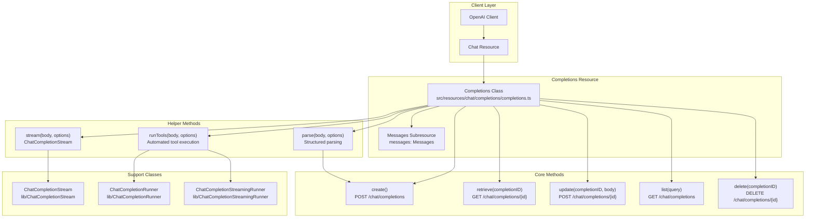
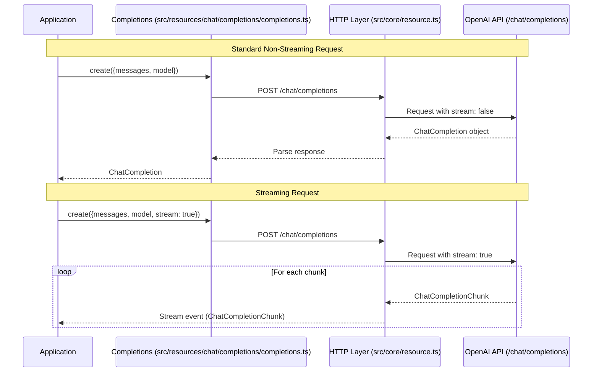
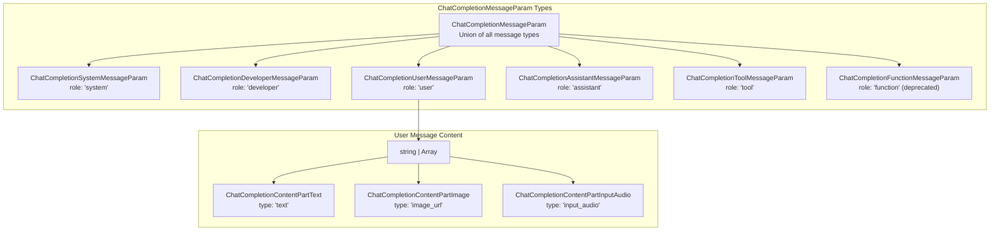
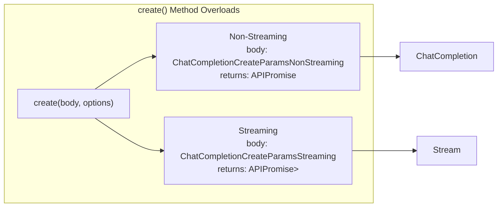
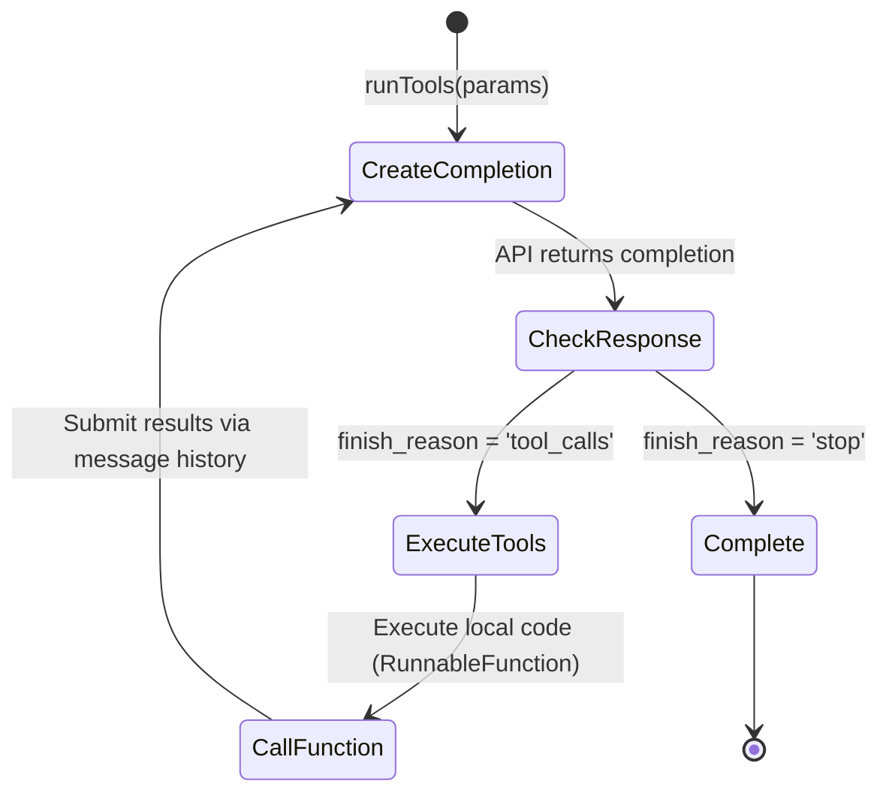

<!-- source: DeepWiki mcp.deepwiki.com · repo openai/openai-node · page 4.2 Chat Completions · fetched 2026-10-26 -->

# Chat Completions

<details>
<summary>Relevant source files</summary>

The following files were used as context for generating this wiki page:

- [.stats.yml](.stats.yml)
- [examples/tool-call-helpers-zod.ts](examples/tool-call-helpers-zod.ts)
- [examples/tool-call-helpers.ts](examples/tool-call-helpers.ts)
- [src/lib/AbstractChatCompletionRunner.ts](src/lib/AbstractChatCompletionRunner.ts)
- [src/lib/AssistantStream.ts](src/lib/AssistantStream.ts)
- [src/lib/ChatCompletionRunner.ts](src/lib/ChatCompletionRunner.ts)
- [src/lib/ChatCompletionStream.ts](src/lib/ChatCompletionStream.ts)
- [src/lib/ChatCompletionStreamingRunner.ts](src/lib/ChatCompletionStreamingRunner.ts)
- [src/lib/EventStream.ts](src/lib/EventStream.ts)
- [src/lib/RunnableFunction.ts](src/lib/RunnableFunction.ts)
- [src/lib/chatCompletionUtils.ts](src/lib/chatCompletionUtils.ts)
- [src/resources/beta/threads/runs/index.ts](src/resources/beta/threads/runs/index.ts)
- [src/resources/chat/chat.ts](src/resources/chat/chat.ts)
- [src/resources/chat/completions.ts](src/resources/chat/completions.ts)
- [src/resources/chat/completions/completions.ts](src/resources/chat/completions/completions.ts)
- [src/resources/chat/index.ts](src/resources/chat/index.ts)
- [src/resources/completions.ts](src/resources/completions.ts)
- [src/resources/embeddings.ts](src/resources/embeddings.ts)
- [src/resources/files.ts](src/resources/files.ts)
- [src/resources/responses/responses.ts](src/resources/responses/responses.ts)
- [src/resources/shared.ts](src/resources/shared.ts)
- [tests/api-resources/chat/completions/completions.test.ts](tests/api-resources/chat/completions/completions.test.ts)
- [tests/api-resources/responses/responses.test.ts](tests/api-resources/responses/responses.test.ts)

</details>


## Purpose and Scope

This document covers the Chat Completions API, the legacy interface for creating conversational responses from OpenAI models. The Chat Completions API is implemented in the `Completions` class at [src/resources/chat/completions/completions.ts]() and is accessible via `client.chat.completions`.

**Note:** For new projects, OpenAI recommends using the [Responses API](#4.1) instead, which provides the latest platform features and an improved developer experience. This page documents Chat Completions for backward compatibility and existing integrations.

For information about:
- Modern response creation with the latest features, see [Responses API](#4.1)
- Audio processing capabilities, see [Audio Processing](#4.4)
- Function calling patterns across all APIs, see [Function Calling and Tools](#5.3)
- Streaming implementation details, see [Streaming](#5.1)
- Structured output parsing, see [Structured Outputs and Parsing](#5.4)

Sources: [src/resources/chat/completions/completions.ts:26-38](), [src/resources/chat/chat.ts:53-54]()

## Core Architecture

### Completions Class Structure



**Completions Class Overview**

The `Completions` class extends `APIResource` and provides methods for creating and managing chat completions. It includes a subresource `Messages` for accessing stored completion messages at [src/resources/chat/completions/messages.ts]().

Sources: [src/resources/chat/completions/completions.ts:23-28](), [src/resources/chat/chat.ts:53-54]()

### Request and Response Flow



Sources: [src/resources/chat/completions/completions.ts:71-80](), [src/resources/chat/completions/completions.ts:182-204]()

## Message Format and Types

### Message Type Hierarchy



**Message Roles:**

| Role | Type | Purpose | Notes |
|------|------|---------|-------|
| `system` | `ChatCompletionSystemMessageParam` | High-level instructions | Traditional context setting |
| `developer` | `ChatCompletionDeveloperMessageParam` | Developer-level instructions | Supported by reasoning models |
| `user` | `ChatCompletionUserMessageParam` | User input (text/image/audio) | Supports multimodal content |
| `assistant` | `ChatCompletionAssistantMessageParam` | Previous model responses | May include tool calls |
| `tool` | `ChatCompletionToolMessageParam` | Tool execution results | References tool call ID |
| `function` | `ChatCompletionFunctionMessageParam` | Deprecated function results | Use `tool` instead |

Sources: [src/resources/chat/chat.ts:68-100](), [src/resources/chat/completions/completions.ts:55-58]()

## Creating Chat Completions

### Basic Creation

The `create()` method supports both streaming and non-streaming modes through method overloads:



**Method Signatures:**
- [src/resources/chat/completions/completions.ts:61-61]() - Non-streaming signature
- [src/resources/chat/completions/completions.ts:62-65]() - Streaming signature
- [src/resources/chat/completions/completions.ts:73-80]() - Implementation

### Request Parameters

**Required Parameters:**

| Parameter | Type | Description |
|-----------|------|-------------|
| `messages` | `Array<ChatCompletionMessageParam>` | Conversation history |
| `model` | `string \| ChatModel` | Model identifier (e.g., `'gpt-5.4'`) |

**Common Optional Parameters:**

| Parameter | Type | Description |
|-----------|------|-------------|
| `stream` | `boolean` | Enable streaming responses |
| `temperature` | `number` | Sampling temperature (0-2) |
| `max_tokens` | `number` | Maximum tokens to generate |
| `tools` | `Array<ChatCompletionTool>` | Available tools for the model |
| `tool_choice` | `ChatCompletionToolChoiceOption` | Control tool selection |
| `response_format` | `object` | Specify output format (text or JSON) |
| `store` | `boolean` | Whether to store the completion for later retrieval |

Sources: [src/resources/chat/completions/completions.test.ts:27-96](), [src/resources/chat/chat.ts:104-109]()

## Streaming Responses

### Raw Streaming

When `stream: true` is passed to `create()`, the SDK returns an `APIPromise<Stream<ChatCompletionChunk>>`. This allows for processing partial results as they are generated.

```typescript
const stream = await client.chat.completions.create({
  model: 'gpt-4o',
  messages: [{ role: 'user', content: 'Hello' }],
  stream: true,
});

for await (const chunk of stream) {
  process.stdout.write(chunk.choices[0]?.delta?.content || '');
}
```

Sources: [src/resources/chat/completions/completions.ts:62-65](), [src/core/streaming.ts]()

### ChatCompletionStream Helper

The `stream()` method is a convenience helper that returns a `ChatCompletionStream`. It provides an event-based interface and accumulates the final response snapshot.

| Event | Payload Type | Description |
|-------|--------------|-------------|
| `chunk` | `ChatCompletionChunk` | Emitted for every SSE event |
| `content` | `string, string` | Emitted when text content is received (delta, snapshot) |
| `content.delta` | `ContentDeltaEvent` | Emitted for parsed content deltas |
| `refusal.delta`| `RefusalDeltaEvent` | Emitted for model refusal deltas |

Sources: [src/resources/chat/completions/completions.ts:198-203](), [src/lib/ChatCompletionStream.ts:96-114]()

## Tool Calling

### Tool Definition

Tools enable the model to request execution of functions. The SDK uses `ChatCompletionTool` to define these capabilities.

```typescript
const tools: OpenAI.ChatCompletionTool[] = [
  {
    type: 'function',
    function: {
      name: 'get_weather',
      parameters: {
        type: 'object',
        properties: {
          location: { type: 'string' },
        },
      },
      strict: true,
    },
  },
];
```

Sources: [src/resources/chat/completions/completions.test.ts:69-79](), [src/resources/shared.ts:196-228]()

### Automated Tool Execution

The `runTools()` helper automatically executes tool calls in a loop until the model finishes. It uses `ChatCompletionRunner` or `ChatCompletionStreamingRunner` to manage the lifecycle.



Sources: [src/resources/chat/completions/completions.ts:182-193](), [src/lib/ChatCompletionRunner.ts](), [src/lib/ChatCompletionStreamingRunner.ts]()

## Parsing and Structured Outputs

### Parse Helper Method

The `parse()` helper extracts structured data from completions using `response_format` with JSON schema. It uses `parseChatCompletion` to validate and transform the raw API response into typed objects.

```typescript
const completion = await client.chat.completions.parse({
  model: 'gpt-4o',
  messages: [{ role: 'user', content: 'Extract data' }],
  response_format: zodResponseFormat(MySchema, 'result'),
});

const parsed = completion.choices[0].message.parsed;
```

Sources: [src/resources/chat/completions/completions.ts:164-179](), [src/lib/parser.ts]()

## Stored Completions

Completions created with `store: true` can be managed through retrieval and listing methods.

| Method | Endpoint | Description |
|--------|----------|-------------|
| `retrieve(id)` | `GET /chat/completions/{id}` | Get a stored completion |
| `update(id, body)` | `POST /chat/completions/{id}` | Update metadata of a stored completion |
| `list(query)` | `GET /chat/completions` | List stored completions (returns `ChatCompletionsPage`) |
| `delete(id)` | `DELETE /chat/completions/{id}` | Delete a stored completion |

Sources: [src/resources/chat/completions/completions.ts:82-162]()

## Reasoning Models

For reasoning models (o-series), the SDK supports the `reasoning_effort` parameter to constrain the effort spent on internal reasoning steps.

```typescript
const response = await client.chat.completions.create({
  model: 'o1',
  messages: [{ role: 'user', content: 'Complex logic puzzle' }],
  reasoning_effort: 'high',
});
```

Sources: [src/resources/chat/completions/completions.test.ts:58](), [src/resources/shared.ts:259-265]()

## Audio Modalities

Models like `gpt-4o-audio-preview` support generating audio directly. The request includes `modalities: ['text', 'audio']` and an `audio` configuration object specifying the `voice` and `format`.

Sources: [src/resources/chat/completions/completions.test.ts:36](), [src/resources/chat/chat.ts:69-70]()

---

