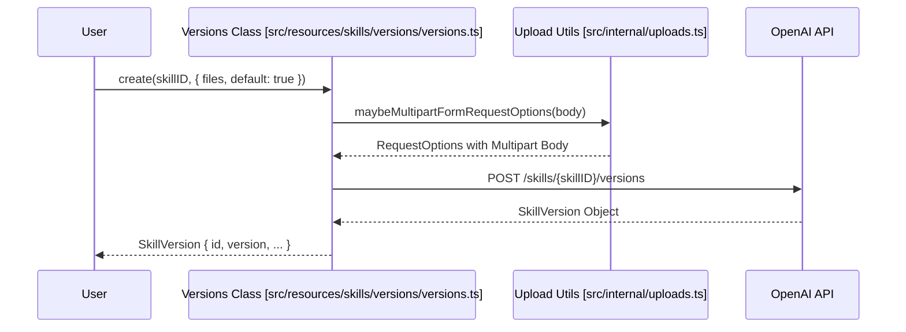

<!-- source: DeepWiki mcp.deepwiki.com · repo openai/openai-node · page 4.20 Skills · fetched 2026-10-26 -->

# Skills

<details>
<summary>Relevant source files</summary>

The following files were used as context for generating this wiki page:

- [src/resources/skills/content.ts](src/resources/skills/content.ts)
- [src/resources/skills/skills.ts](src/resources/skills/skills.ts)
- [src/resources/skills/versions/content.ts](src/resources/skills/versions/content.ts)
- [src/resources/skills/versions/versions.ts](src/resources/skills/versions/versions.ts)
- [tests/api-resources/skills/skills.test.ts](tests/api-resources/skills/skills.test.ts)
- [tests/api-resources/skills/versions/versions.test.ts](tests/api-resources/skills/versions/versions.test.ts)
- [tests/api-resources/uploads/parts.test.ts](tests/api-resources/uploads/parts.test.ts)

</details>


The Skills API provides a mechanism for creating, versioning, and managing reusable AI skill definitions. It allows developers to upload code or configuration bundles (as files or zip archives), manage immutable versions of those skills, and control which version is active via a default version pointer.

## Architecture and Data Flow

The Skills resource is organized into a hierarchical structure. The top-level `Skills` class manages the lifecycle of the skill entity itself, while the `Versions` sub-resource handles the immutable snapshots of skill content.

### Skill Management Lifecycle

1.  **Creation**: A skill is initialized by uploading files (directory upload or zip) via `client.skills.create()`. [src/resources/skills/skills.ts:32-37]()
2.  **Versioning**: New logic or content is added by creating a new version under an existing skill using `client.skills.versions.create()`. [src/resources/skills/versions/versions.ts:19-28]()
3.  **Content Retrieval**: Binary bundles (zip files) can be downloaded for either the skill's current default or a specific version. [src/resources/skills/content.ts:13-20]()
4.  **Promotion**: The `default_version` of a skill can be updated via `client.skills.update()` to point to a specific version number. [src/resources/skills/skills.ts:49-55]()

### Logical Entity Mapping

The following diagram maps the Natural Language concepts of "Skills" to the specific code entities and API routes used in the SDK.

**Skill Entity Relationship**
```mermaid
graph TD
    subgraph "Natural Language Space"
        "SkillDefinition"["Skill Definition"]
        "ImmutableVersion"["Immutable Version"]
        "SkillContent"["Skill Content (Binary)"]
    end

    subgraph "Code Entity Space"
        "SkillsClass"["class Skills [src/resources/skills/skills.ts]"]
        "VersionsClass"["class Versions [src/resources/skills/versions/versions.ts]"]
        "ContentClass"["class Content [src/resources/skills/content.ts]"]
        "VContentClass"["class Content [src/resources/skills/versions/content.ts]"]
        
        "SkillsClass" -->|"/skills"| "POST_create"["create()"]
        "SkillsClass" -->|"/skills/{id}"| "GET_retrieve"["retrieve()"]
        "VersionsClass" -->|"/skills/{id}/versions"| "POST_vcreate"["create()"]
        "ContentClass" -->|"/skills/{id}/content"| "GET_content"["retrieve()"]
        "VContentClass" -->|"/skills/{id}/versions/{v}/content"| "GET_vcontent"["retrieve()"]
    end

    "SkillDefinition" --- "SkillsClass"
    "ImmutableVersion" --- "VersionsClass"
    "SkillContent" --- "ContentClass"
    "SkillContent" --- "VContentClass"
```

**Sources:**
- [src/resources/skills/skills.ts:25-27]()
- [src/resources/skills/versions/versions.ts:13-15]()
- [src/resources/skills/content.ts:9-13]()
- [src/resources/skills/versions/content.ts:9-13]()

---

## The Skills Resource

The `Skills` class handles the primary operations for skill management. It supports multipart form data for file uploads during creation via `maybeMultipartFormRequestOptions`. [src/resources/skills/skills.ts:35-35]()

### Key Methods

| Method | Description | Endpoint |
| :--- | :--- | :--- |
| `create()` | Initializes a new skill, optionally with files. | `POST /skills` |
| `retrieve(id)` | Fetches skill metadata including `default_version` and `latest_version`. | `GET /skills/{id}` |
| `update(id, params)` | Updates the `default_version` pointer for the skill. | `POST /skills/{id}` |
| `list(query)` | Lists all skills in the project with cursor-based pagination. | `GET /skills` |
| `delete(id)` | Removes the skill and its associated versions. | `DELETE /skills/{id}` |

**Sources:**
- [src/resources/skills/skills.ts:32-76]()
- [src/resources/skills/skills.ts:153-173]()

---

## Skill Versions

Versions represent immutable snapshots of a skill. When a version is created, it is assigned a version number and can optionally be set as the default immediately. [src/resources/skills/versions/versions.ts:155-165]()

### Version Data Flow
The `Versions` class uses `maybeMultipartFormRequestOptions` to handle file uploads, allowing for `Uploadable` types (like `fs.ReadStream` or `Buffer`) to be sent as part of the version creation.



**Sources:**
- [src/resources/skills/versions/versions.ts:19-28]()
- [src/resources/skills/versions/versions.ts:91-126]()
- [src/internal/uploads.ts:22-22]() (referenced by Versions)

---

## Content Management

The SDK provides specialized `Content` classes for downloading the binary zip bundles of skills. These methods set the `Accept: application/binary` header and enable `__binaryResponse: true` to ensure the raw response is returned rather than parsed JSON. [src/resources/skills/content.ts:16-18]()

### Content Hierarchy

*   **Top-level Content**: `client.skills.content.retrieve(skillID)` downloads the content associated with the skill's current default version. [src/resources/skills/content.ts:13-20]()
*   **Version-specific Content**: `client.skills.versions.content.retrieve(version, { skill_id })` downloads the content for a specific version string. [src/resources/skills/versions/content.ts:13-21]()

---

## Implementation Details

### File Uploads
The Skills API utilizes the `Uploadable` type for both skill and version creation. This allows users to pass arrays of files or a single zip file. [src/resources/skills/skills.ts:157-157]() [src/resources/skills/versions/versions.ts:164-164]()

```typescript
// Example from tests/api-resources/skills/skills.test.ts:26-31
await client.skills.create({
  files: [await toFile(Buffer.from('Example data'), 'README.md')]
});
```

### Pagination
Listing skills and versions returns a `PagePromise`, which resolves to a `CursorPage`. This supports the `after`, `limit`, and `order` parameters. [src/resources/skills/skills.ts:64-68]() [src/resources/skills/versions/versions.ts:53-57]()

**Sources:**
- [src/resources/skills/skills.ts:60-69]()
- [src/resources/skills/versions/versions.ts:48-58]()
- [tests/api-resources/skills/skills.test.ts:72-82]()

### Security
All Skill API requests are authenticated using Bearer tokens, explicitly configured in the request options with `__security: { bearerAuth: true }`.

**Sources:**
- [src/resources/skills/skills.ts:35-35]()
- [src/resources/skills/skills.ts:43-43]()
- [src/resources/skills/versions/versions.ts:26-26]()
- [src/resources/skills/versions/content.ts:18-18]()

---

