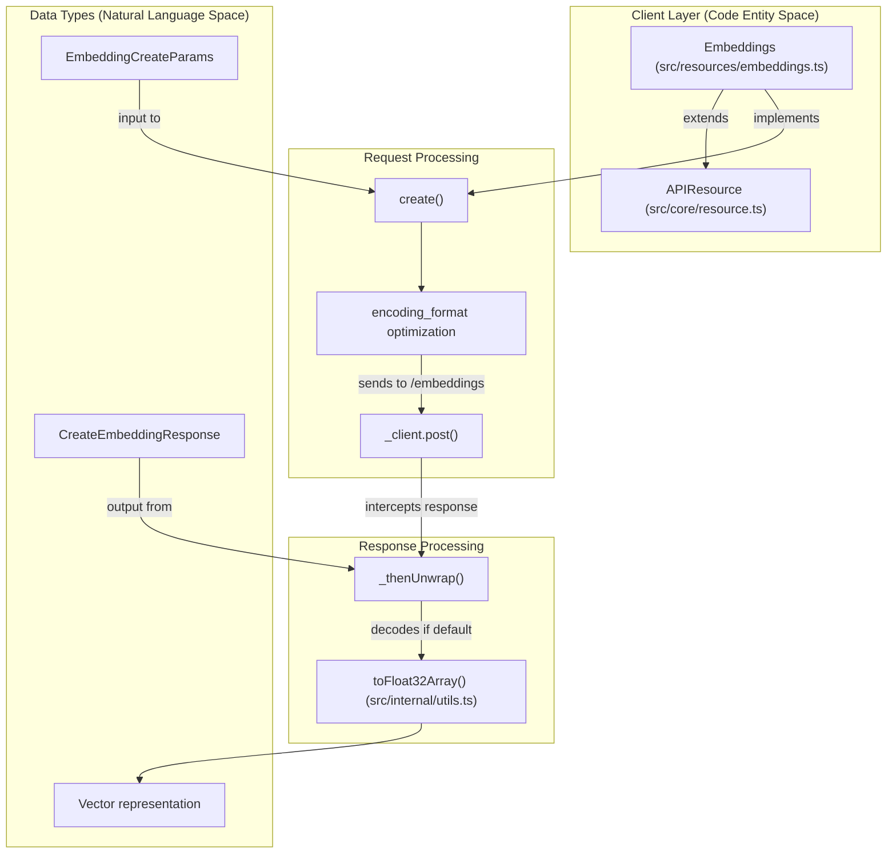
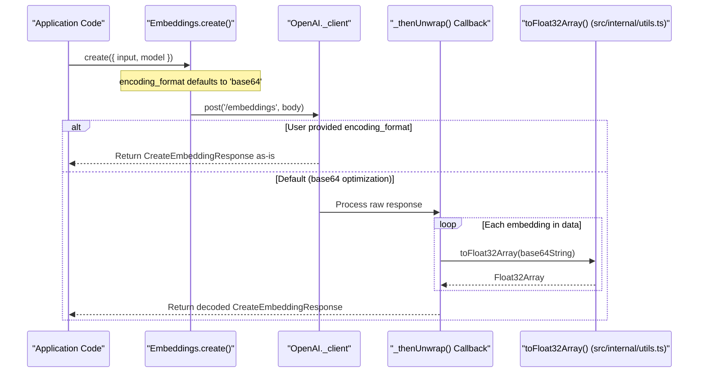
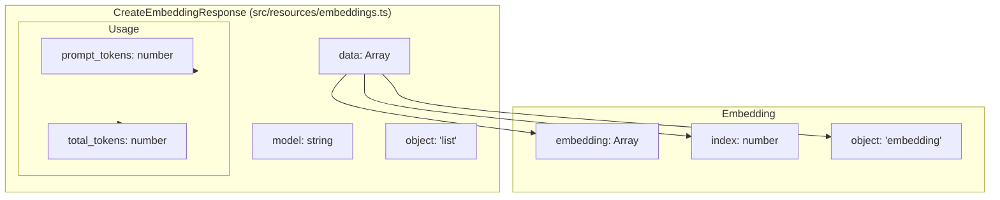

<!-- source: DeepWiki mcp.deepwiki.com · repo openai/openai-node · page 4.3 Embeddings · fetched 2026-10-26 -->

# Embeddings

<details>
<summary>Relevant source files</summary>

The following files were used as context for generating this wiki page:

- [src/resources/chat/chat.ts](src/resources/chat/chat.ts)
- [src/resources/chat/completions.ts](src/resources/chat/completions.ts)
- [src/resources/chat/index.ts](src/resources/chat/index.ts)
- [src/resources/completions.ts](src/resources/completions.ts)
- [src/resources/embeddings.ts](src/resources/embeddings.ts)
- [src/resources/files.ts](src/resources/files.ts)
- [tests/api-resources/audio/transcriptions.test.ts](tests/api-resources/audio/transcriptions.test.ts)
- [tests/api-resources/audio/translations.test.ts](tests/api-resources/audio/translations.test.ts)
- [tests/api-resources/embeddings.test.ts](tests/api-resources/embeddings.test.ts)
- [tests/api-resources/files.test.ts](tests/api-resources/files.test.ts)
- [tests/api-resources/models.test.ts](tests/api-resources/models.test.ts)

</details>


This document covers the Embeddings API resource, which converts text into high-dimensional numerical vectors for semantic analysis, search, and machine learning applications. The embeddings functionality is implemented in the `Embeddings` class and provides text vectorization capabilities with multiple encoding formats and model options.

For chat-based text generation, see [Chat Completions](4.2). For core client configuration, see [OpenAI Client](3.1).

## Overview

The Embeddings API transforms textual input into dense vector representations that capture semantic meaning. These vectors can be used for similarity search, clustering, classification, and other machine learning tasks.

### Architecture and Data Flow

The following diagram illustrates the relationship between the SDK's internal classes and the logical flow of an embedding request.

Title: Embeddings Architecture and Data Flow


**Sources:** [src/resources/embeddings.ts:11-66](), [src/core/resource.ts:3-3]()

## Request Flow and Encoding Optimization

The embeddings creation process includes automatic encoding format optimization for performance. When no explicit encoding format is specified, the client defaults to `base64` encoding for network efficiency, then converts the response to float32 arrays before returning them to the user.

Title: Embeddings Sequence and Encoding Logic


**Sources:** [src/resources/embeddings.ts:24-65](), [src/internal/utils.ts:6-6]()

## Input Formats and Parameters

The `EmbeddingCreateParams` interface supports multiple input formats and configuration options:

| Parameter | Type | Description |
|-----------|------|-------------|
| `input` | `string \| Array<string> \| Array<number> \| Array<Array<number>>` | Text or token arrays to embed. Max 8,192 tokens per input. |
| `model` | `(string & {}) \| EmbeddingModel` | ID of the model to use. |
| `dimensions` | `number` (optional) | Output vector dimensions. Only supported in `text-embedding-3` and later. |
| `encoding_format` | `'float' \| 'base64'` (optional) | Response encoding format. SDK defaults to `base64` for speed. |
| `user` | `string` (optional) | Unique identifier for end-user monitoring. |

The API enforces several limits:
- Maximum 8,192 tokens per input for all embedding models [src/resources/embeddings.ts:132-142]().
- Maximum 2,048 dimensions for input arrays [src/resources/embeddings.ts:143-143]().
- Maximum 300,000 tokens total across all inputs in a single request [src/resources/embeddings.ts:139-141]().

**Sources:** [src/resources/embeddings.ts:131-172]()

## Available Models

The library defines standard embedding models in the `EmbeddingModel` type:

```typescript
export type EmbeddingModel = 'text-embedding-ada-002' | 'text-embedding-3-small' | 'text-embedding-3-large';
```

The newer `text-embedding-3-small` and `text-embedding-3-large` models support the `dimensions` parameter for controlling output vector size, enabling performance and cost optimization.

**Sources:** [src/resources/embeddings.ts:129-129]()

## Response Structure

The `CreateEmbeddingResponse` represents the object returned by the `/embeddings` endpoint.

Title: Embedding Response Data Structure


Each `Embedding` object contains:
- `embedding`: The vector representation (list of floats) [src/resources/embeddings.ts:110-116]().
- `index`: The index of the embedding in the input list [src/resources/embeddings.ts:118-121]().
- `object`: Always set to `"embedding"` [src/resources/embeddings.ts:123-126]().

**Sources:** [src/resources/embeddings.ts:68-127]()

## Encoding Format Handling

The client implements intelligent encoding format management in the `create` method of the `Embeddings` class:

1.  **Default Behavior**: When `encoding_format` is not specified by the user, the SDK sets it to `'base64'` [src/resources/embeddings.ts:28-29]().
2.  **Performance Optimization**: Base64 is used to reduce payload size over the wire [src/resources/embeddings.ts:26-27]().
3.  **Automatic Decoding**: If the SDK forced base64, it uses `_thenUnwrap` to intercept the response and call `toFloat32Array` to convert the strings back into numerical arrays before the user receives the promise result [src/resources/embeddings.ts:55-64]().
4.  **User Override**: If a user explicitly provides an `encoding_format` (e.g., `'float'`), the SDK returns the response as-is without transformation [src/resources/embeddings.ts:45-47]().

**Sources:** [src/resources/embeddings.ts:24-65](), [src/internal/utils.ts:6-6]()

## Integration with Core Client

The `Embeddings` class extends `APIResource`, inheriting standard client functionality:

-   **HTTP Methods**: Uses `this._client.post()` to send requests to the `/embeddings` path [src/resources/embeddings.ts:35-42]().
-   **Security**: Automatically includes `bearerAuth` security configuration [src/resources/embeddings.ts:41-41]().
-   **Logging**: Uses `loggerFor(this._client)` to log debugging information regarding encoding format decisions [src/resources/embeddings.ts:32-32]().

**Sources:** [src/resources/embeddings.ts:11-66](), [src/core/resource.ts:3-3]()

---

