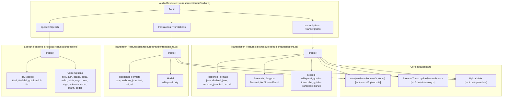
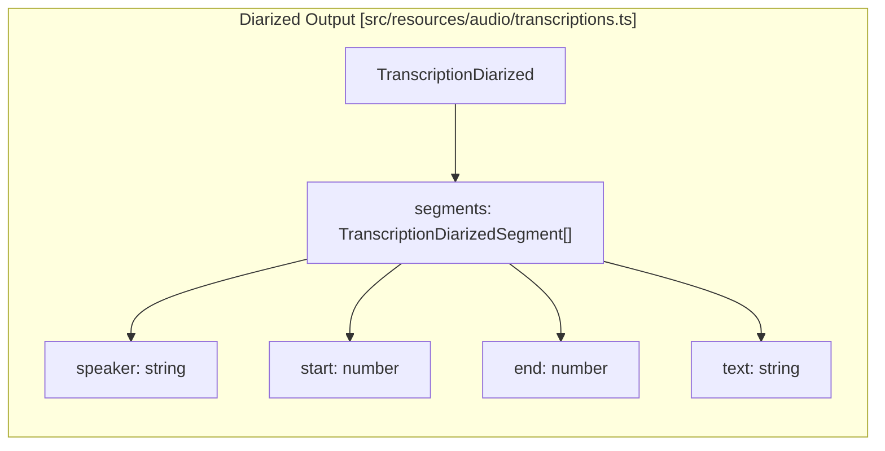
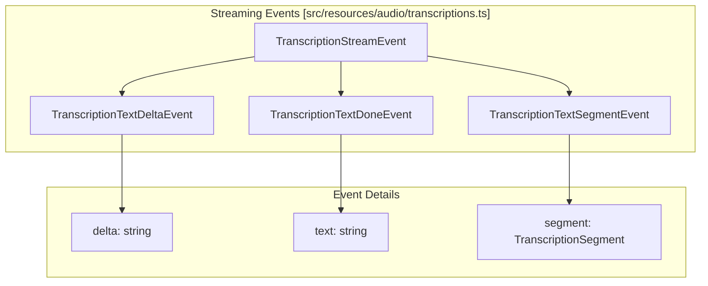
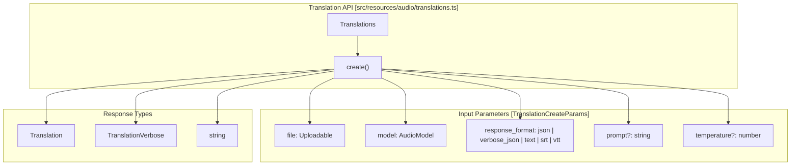
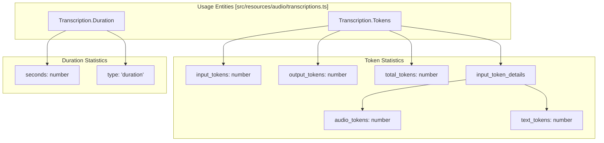

<!-- source: DeepWiki mcp.deepwiki.com · repo openai/openai-node · page 4.4 Audio Processing · fetched 2026-10-26 -->

# Audio Processing

<details>
<summary>Relevant source files</summary>

The following files were used as context for generating this wiki page:

- [examples/audio.ts](examples/audio.ts)
- [src/resources/audio/audio.ts](src/resources/audio/audio.ts)
- [src/resources/audio/index.ts](src/resources/audio/index.ts)
- [src/resources/audio/speech.ts](src/resources/audio/speech.ts)
- [src/resources/audio/transcriptions.ts](src/resources/audio/transcriptions.ts)
- [src/resources/audio/translations.ts](src/resources/audio/translations.ts)
- [src/resources/beta/realtime/realtime.ts](src/resources/beta/realtime/realtime.ts)
- [src/resources/beta/realtime/sessions.ts](src/resources/beta/realtime/sessions.ts)
- [src/resources/beta/realtime/transcription-sessions.ts](src/resources/beta/realtime/transcription-sessions.ts)
- [src/resources/images.ts](src/resources/images.ts)
- [src/resources/models.ts](src/resources/models.ts)
- [src/resources/moderations.ts](src/resources/moderations.ts)
- [tests/api-resources/audio/speech.test.ts](tests/api-resources/audio/speech.test.ts)

</details>


This document covers the audio processing capabilities of the OpenAI Node.js client library, including audio transcription, translation, and speech synthesis. The audio processing system provides comprehensive support for converting audio to text, translating audio to English, and generating speech from text. For file upload utilities used by audio processing, see [File Uploads and Utilities](#5.5). For streaming infrastructure used in real-time transcription, see [Streaming](#5.1).

## System Architecture

The audio processing system is organized into three main sub-resources under the `Audio` class, each handling specific audio-related operations.

### Audio Resource Hierarchy



**Sources:** [src/resources/audio/audio.ts:34-38](), [src/resources/audio/transcriptions.ts:15-24](), [src/resources/audio/translations.ts:14-25](), [src/resources/audio/speech.ts:11-28]()

## Audio Transcription

The `Transcriptions` class provides audio-to-text conversion with advanced features including streaming, multiple output formats, and diarization.

### Core Transcription Interface

The `create` method is overloaded to return different response types based on the `response_format` parameter.

```mermaid
graph TB
    subgraph "Transcription API [src/resources/audio/transcriptions.ts]"
        TranscriptionsClass["Transcriptions"]
        TranscriptionsClass --> CreateMethod["create()"]
    end
    
    subgraph "Input Parameters [TranscriptionCreateParams]"
        CreateMethod --> File["file: Uploadable"]
        CreateMethod --> Model["model: AudioModel"]
        CreateMethod --> ResponseFormat["response_format: AudioResponseFormat"]
        CreateMethod --> StreamParam["stream: boolean"]
        CreateMethod --> Language["language: string"]
        CreateMethod --> Prompt["prompt: string"]
        CreateMethod --> Temperature["temperature: number"]
    end
    
    subgraph "Response Types"
        CreateMethod --> TranscriptionResponse["Transcription"]
        CreateMethod --> DiarizedResponse["TranscriptionDiarized"]
        CreateMethod --> VerboseResponse["TranscriptionVerbose"]
        CreateMethod --> StringResponse["string"]
        CreateMethod --> StreamResponse["Stream&lt;TranscriptionStreamEvent&gt;"]
    end
    
    subgraph "Advanced Features"
        CreateMethod --> TimestampGranularities["timestamp_granularities: word | segment"]
        CreateMethod --> Include["include: logprobs"]
        CreateMethod --> UsageStats["usage: Tokens | Duration"]
    end
```



**Sources:** [src/resources/audio/transcriptions.ts:31-69](), [src/resources/audio/transcriptions.ts:76-93](), [src/resources/audio/transcriptions.ts:180-205](), [src/resources/audio/audio.ts:47-54]()

### Supported Models and Capabilities

| Model | Streaming | Response Formats | Special Features |
|-------|-----------|------------------|------------------|
| `whisper-1` | No | All formats | Powered by Whisper V2 |
| `gpt-4o-transcribe` | Yes | `json` only | Logprobs, token usage |
| `gpt-4o-mini-transcribe` | Yes | `json` only | Cost-efficient transcription |
| `gpt-4o-transcribe-diarize` | No | `diarized_json` | Speaker labels and annotations |

**Sources:** [src/resources/audio/audio.ts:40-45](), [src/resources/audio/audio.ts:47-54](), [src/resources/audio/transcriptions.ts:18-21]()

### Diarization and Speaker Annotation

Diarization identifies and labels different speakers in the audio input. This is primarily supported by the `gpt-4o-transcribe-diarize` model. To receive speaker annotations, the `response_format` must be set to `diarized_json`.



**Sources:** [src/resources/audio/transcriptions.ts:180-205](), [src/resources/audio/audio.ts:49-53]()

### Streaming Transcription Events

When `stream: true` is provided (supported by `gpt-4o-transcribe` models), the API returns a stream of events.



**Sources:** [src/resources/audio/transcriptions.ts:44-51](), [src/resources/audio/audio.ts:70-75]()

## Audio Translation

The `Translations` class translates audio from various source languages into English. Currently, only the `whisper-1` model is available for this resource.



**Sources:** [src/resources/audio/translations.ts:14-47](), [src/resources/audio/translations.ts:78-115]()

## Text to Speech (Speech Generation)

The `Speech` class generates audio from text input. Unlike transcription and translation which use multipart forms, speech generation returns binary audio content.

### Speech Creation Flow

```mermaid
graph LR
    subgraph "Speech API [src/resources/audio/speech.ts]"
        SpeechClass["Speech"]
        SpeechClass --> SpeechCreate["create()"]
    end
    
    subgraph "Parameters [SpeechCreateParams]"
        SpeechCreate --> InputText["input: string (max 4096)"]
        SpeechCreate --> Model["model: SpeechModel"]
        SpeechCreate --> Voice["voice: string | ID"]
        SpeechCreate --> Format["response_format: mp3 | opus | aac | flac | wav | pcm"]
        SpeechCreate --> Speed["speed: 0.25 to 4.0"]
        SpeechCreate --> Instructions["instructions?: string"]
    end
    
    subgraph "Response"
        SpeechCreate --> Response["APIPromise&lt;Response&gt;"]
        Response --> Binary["Binary Response Content"]
    end
```

**Sources:** [src/resources/audio/speech.ts:11-38](), [src/resources/audio/speech.ts:42-99]()

## Usage Statistics and Billing

The SDK provides detailed usage information for monitoring and billing. Statistics vary depending on whether the model is billed by token usage (like `gpt-4o-transcribe`) or by audio duration (like `whisper-1`).



**Sources:** [src/resources/audio/transcriptions.ts:116-158](), [src/resources/audio/transcriptions.ts:163-173]()

## Realtime API (Beta)

For low-latency, multi-modal interactions, the SDK includes a `Realtime` resource. This is used for creating sessions and transcription sessions that support WebSocket-based communication.

- **Sessions:** Used to create ephemeral tokens for browser-based Realtime API clients. [src/resources/beta/realtime/sessions.ts:8-32]()
- **Transcription Sessions:** Specifically for real-time audio transcription with ISO-639-1 language support and turn detection. [src/resources/beta/realtime/transcription-sessions.ts:8-32]()

**Sources:** [src/resources/beta/realtime/realtime.ts:23-27](), [src/resources/beta/realtime/sessions.ts:37-169](), [src/resources/beta/realtime/transcription-sessions.ts:41-70]()

---

