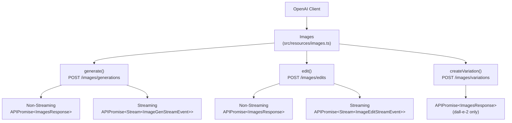
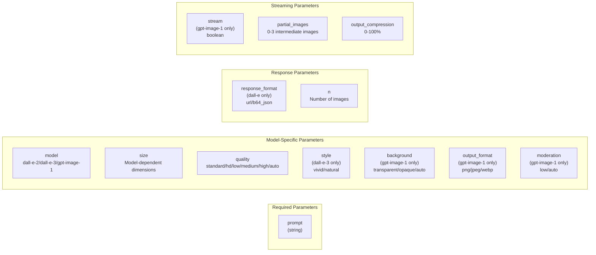
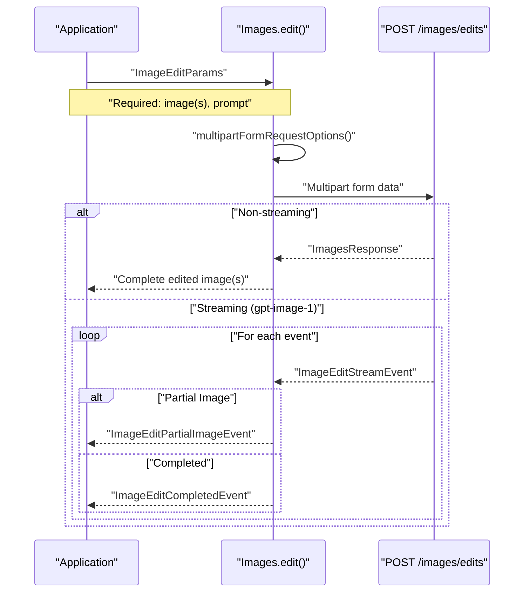
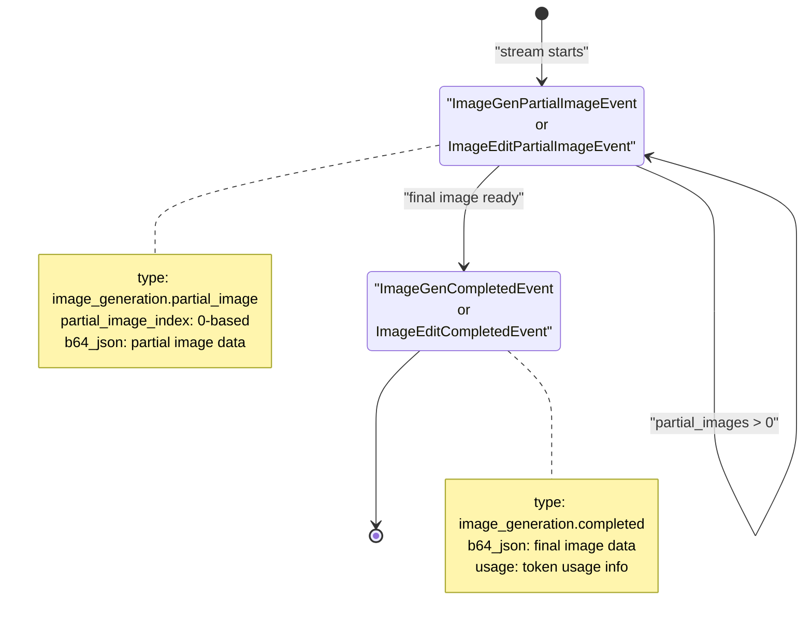
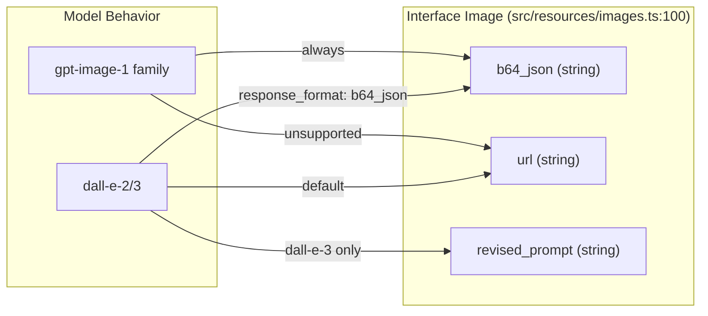

<!-- source: DeepWiki mcp.deepwiki.com · repo openai/openai-node · page 4.5 Images · fetched 2026-10-26 -->

# Images

Relevant source files

The following files were used as context for generating this wiki page:

- [src/resources/audio/audio.ts](src/resources/audio/audio.ts)
- [src/resources/audio/index.ts](src/resources/audio/index.ts)
- [src/resources/audio/transcriptions.ts](src/resources/audio/transcriptions.ts)
- [src/resources/audio/translations.ts](src/resources/audio/translations.ts)
- [src/resources/images.ts](src/resources/images.ts)
- [src/resources/models.ts](src/resources/models.ts)
- [src/resources/moderations.ts](src/resources/moderations.ts)
- [tests/api-resources/beta/assistants.test.ts](tests/api-resources/beta/assistants.test.ts)
- [tests/api-resources/beta/threads/messages.test.ts](tests/api-resources/beta/threads/messages.test.ts)
- [tests/api-resources/beta/threads/runs/runs.test.ts](tests/api-resources/beta/threads/runs/runs.test.ts)
- [tests/api-resources/beta/threads/threads.test.ts](tests/api-resources/beta/threads/threads.test.ts)
- [tests/api-resources/completions.test.ts](tests/api-resources/completions.test.ts)
- [tests/api-resources/fine-tuning/jobs/jobs.test.ts](tests/api-resources/fine-tuning/jobs/jobs.test.ts)
- [tests/api-resources/images.test.ts](tests/api-resources/images.test.ts)
- [tests/api-resources/moderations.test.ts](tests/api-resources/moderations.test.ts)

## Purpose and Scope

This document covers the Images API, which provides endpoints for generating, editing, and creating variations of images. The API is accessed through the `images` resource on the OpenAI client and supports multiple models including `dall-e-2`, `dall-e-3`, `gpt-image-1`, and `gpt-image-1-mini`.

For audio processing capabilities, see [Audio Processing](#4.4). For moderation of generated images, see [Moderations](#4.6).

**Sources:** [src/resources/images.ts:1-13](), [src/resources/images.ts:33-35]()

## API Resource Structure

The `Images` class extends `APIResource` [src/resources/images.ts:14]() and provides three main methods for image operations. The class is instantiated as `client.images` and handles all image-related API interactions.

### Code Entity Space to API Mapping

The following diagram maps the SDK class methods to their respective REST API endpoints and return types.

Title: Images API Resource Mapping

**Sources:** [src/resources/images.ts:14-95]()

## Image Generation

The `generate()` method creates images from text prompts [src/resources/images.ts:70](). It supports both streaming and non-streaming modes, with method overloads that provide type-safe return types based on the `stream` parameter [src/resources/images.ts:75-94]().

### Method Signatures

The method has distinct overloads based on the streaming parameter:

| Stream Mode | Return Type | Use Case |
|------------|-------------|----------|
| `stream: false` or undefined | `APIPromise<ImagesResponse>` | Complete images returned at once [src/resources/images.ts:75]() |
| `stream: true` | `APIPromise<Stream<ImageGenStreamEvent>>` | Progressive image updates [src/resources/images.ts:77-79]() |

**Sources:** [src/resources/images.ts:75-94]()

### Generation Parameters

Title: Image Generation Parameters

**Sources:** [src/resources/images.ts:661-779](), [tests/api-resources/images.test.ts:81-97]()

### Size Options by Model

| Model | Supported Sizes |
|-------|----------------|
| `dall-e-2` | `256x256`, `512x512`, `1024x1024` |
| `dall-e-3` | `1024x1024`, `1792x1024`, `1024x1792` |
| `gpt-image-1` | `1024x1024`, `1536x1024`, `1024x1536`, `auto` |

**Sources:** [src/resources/images.ts:742-756]()

## Image Editing

The `edit()` method modifies existing images based on a prompt [src/resources/images.ts:39](). It supports both `dall-e-2` and `gpt-image-1` family models, with the latter offering advanced features including multiple input images and streaming [src/resources/images.ts:34-35]().

### Editing Workflow

The implementation uses `multipartFormRequestOptions` to handle file uploads for the `image` and `mask` fields [src/resources/images.ts:57-60]().

Title: Image Edit Request Lifecycle

**Sources:** [src/resources/images.ts:45-62](), [src/internal/uploads.ts:9-10]()

### Editing-Specific Parameters

| Parameter | Type | Models | Description |
|-----------|------|--------|-------------|
| `image` | `Uploadable \| Array<Uploadable>` | All | Image(s) to edit. Single for dall-e-2, up to 16 for gpt-image-1 [src/resources/images.ts:518-527]() |
| `prompt` | `string` | All | Description of desired changes [src/resources/images.ts:547-553]() |
| `mask` | `Uploadable` | All | PNG with transparent areas indicating edit regions [src/resources/images.ts:532-535]() |
| `input_fidelity` | `'high' \| 'low'` | gpt-image-1 | Controls how closely output matches input features [src/resources/images.ts:529-530]() |

**Sources:** [src/resources/images.ts:518-634]()

## Image Variations

The `createVariation()` method generates variations of an existing image [src/resources/images.ts:16](). This endpoint only supports the `dall-e-2` model and returns a non-streaming response [src/resources/images.ts:16-25]().

### Variation Constraints

| Parameter | Requirement |
|-----------|------------|
| `image` | Valid PNG file [src/resources/images.ts:477-483]() |
| File size | Less than 4MB [src/resources/images.ts:477]() |
| Dimensions | Must be square [src/resources/images.ts:477]() |
| Model | Only `dall-e-2` supported [src/resources/images.ts:16]() |

**Sources:** [src/resources/images.ts:16-30](), [src/resources/images.ts:477-514]()

## Streaming Support

Streaming is only supported for `gpt-image-1` and `gpt-image-1-mini` models [src/resources/images.ts:34-35](). It enables progressive rendering by delivering partial images before the final result.

### Stream Event Types

Streaming responses iterate through events defined in the `ImageGenStreamEvent` [src/resources/images.ts:384]() and `ImageEditStreamEvent` [src/resources/images.ts:245]() unions.

Title: Image Streaming Event States

**Sources:** [src/resources/images.ts:342-382](), [src/resources/images.ts:203-243]()

## Response Formats

The API supports different response formats depending on the model used.

### Response Data Mapping

The following diagram associates the `Image` interface fields with model-specific behavior.

Title: Image Interface Model Mapping

**Sources:** [src/resources/images.ts:100-119]()

### Token Usage

For `gpt-image-1` models, the API returns token usage information in the `usage` field of the `ImagesResponse` [src/resources/images.ts:431]() and completed stream events [src/resources/images.ts:164]().

| Field | Description |
|-------|-------------|
| `input_tokens` | Total tokens in prompt + input images [src/resources/images.ts:303]() |
| `output_tokens` | Tokens used for generated image [src/resources/images.ts:313]() |
| `input_tokens_details` | Breakdown of `image_tokens` vs `text_tokens` [src/resources/images.ts:325-335]() |

**Sources:** [src/resources/images.ts:299-337](), [src/resources/images.ts:437-474]()

## Implementation Details

The `Images` class utilizes `multipartFormRequestOptions` for any endpoint requiring file uploads (`/images/variations` and `/images/edits`) [src/resources/images.ts:28, 57](). For standard generations, it uses a simple POST request with a JSON body [src/resources/images.ts:88]().

All methods return an `APIPromise`, which allows users to access the raw response via `.asResponse()` or the data and response via `.withResponse()` [tests/api-resources/images.test.ts:16-22]().

**Sources:** [src/resources/images.ts:25-94](), [tests/api-resources/images.test.ts:11-99]()

---

