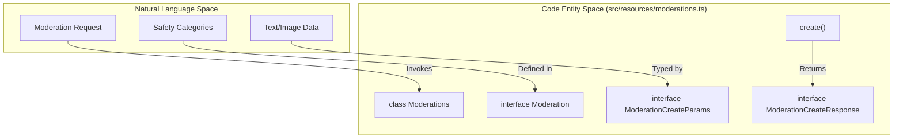
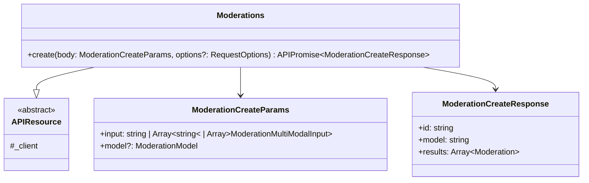
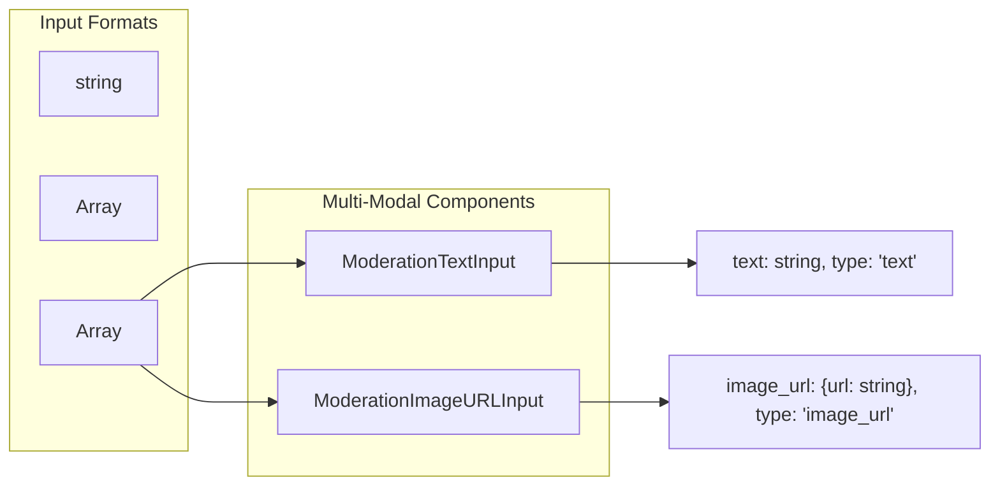
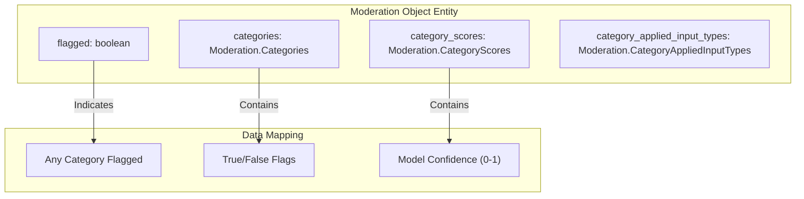
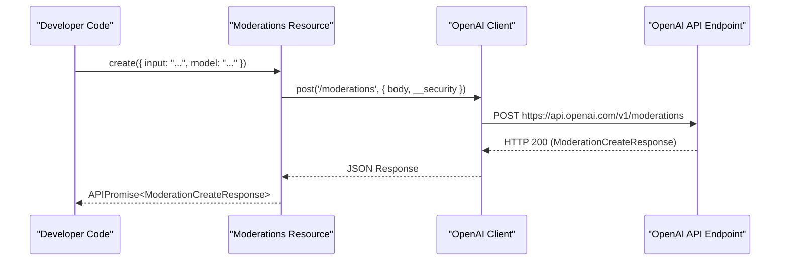

<!-- source: DeepWiki mcp.deepwiki.com · repo openai/openai-node · page 4.6 Moderations · fetched 2026-10-26 -->

# Moderations

Relevant source files

The following files were used as context for generating this wiki page:

- [src/resources/audio/audio.ts](src/resources/audio/audio.ts)
- [src/resources/audio/index.ts](src/resources/audio/index.ts)
- [src/resources/audio/transcriptions.ts](src/resources/audio/transcriptions.ts)
- [src/resources/audio/translations.ts](src/resources/audio/translations.ts)
- [src/resources/images.ts](src/resources/images.ts)
- [src/resources/models.ts](src/resources/models.ts)
- [src/resources/moderations.ts](src/resources/moderations.ts)

The Moderations API provides content safety classification for text and image inputs, identifying potentially harmful content across multiple categories. This system enables applications to filter unsafe content before processing or displaying it to users.

For other content-related APIs, see [Images](#4.5) for image generation and [Audio Processing](#4.4) for audio content processing.

## Overview

The moderations system is implemented through the `Moderations` class, which provides a single interface for classifying content safety across multiple categories including harassment, hate speech, violence, sexual content, and self-harm. The system supports both text-only and multi-modal (text and image) inputs using various specialized models.

### Natural Language to Code Entity Mapping

Sources: [src/resources/moderations.ts:7-18]()

## Core API Interface

The moderations system centers around the `Moderations` class with a single `create` method that processes content and returns safety classifications.

### Moderations Class

The `Moderations` class extends `APIResource` and provides the primary interface for content moderation:

Sources: [src/resources/moderations.ts:10-18](), [src/resources/moderations.ts:302-308](), [src/resources/moderations.ts:324-339]()

### Input Types and Formats

The API supports three input formats for flexible content submission via the `input` property in `ModerationCreateParams` [src/resources/moderations.ts:304-306]():

| Input Type | Description | Example Use Case |
|------------|-------------|------------------|
| `string` | Single text string | User message filtering |
| `Array<string>` | Batch text processing | Multiple comments or document sections |
| `Array<ModerationMultiModalInput>` | Text and image content | Social media posts with attachments |

Sources: [src/resources/moderations.ts:304-306](), [src/resources/moderations.ts:341-355](), [src/resources/moderations.ts:271-293]()

## Content Categories and Classification

The moderation system classifies content across multiple safety categories, each with boolean flags, confidence scores, and applicable input types.

### Category Hierarchy

The `Moderation.Categories` interface defines the safety checks performed by the model.

| Category | Description |
|----------|-------------|
| `harassment` | Content expressing harassing language towards any target. |
| `hate` | Hate based on race, gender, religion, etc. |
| `illicit` | Instructions facilitating wrongdoing (e.g., shoplifting). |
| `self-harm` | Promoting or depicting acts of self-harm. |
| `sexual` | Content meant to arouse sexual excitement. |
| `violence` | Depicting death, violence, or physical injury. |

Sources: [src/resources/moderations.ts:46-128]()

### Input Type Application

Different categories apply to different input types, defined in the `CategoryAppliedInputTypes` interface:

| Category | Applicable Input Types |
|----------|------------------------|
| `harassment` | `['text']` |
| `self-harm` | `['text', 'image']` |
| `sexual` | `['text', 'image']` |
| `violence` | `['text', 'image']` |
| `sexual/minors` | `['text']` |

Sources: [src/resources/moderations.ts:133-198]()

## Response Structure and Scoring

The moderation response provides comprehensive classification data for each input via the `Moderation` interface.

Sources: [src/resources/moderations.ts:20-40](), [src/resources/moderations.ts:203-269]()

## Available Models

The system supports multiple moderation models optimized for different content types. The `ModerationModel` type includes:

*   `omni-moderation-latest`: The latest multi-modal model.
*   `omni-moderation-2024-09-26`: A specific version of the omni model.
*   `text-moderation-latest`: The latest text-only model.
*   `text-moderation-stable`: The stable version of the text-only model.

Sources: [src/resources/moderations.ts:295-299]()

## Implementation and Data Flow

The `create` method in `src/resources/moderations.ts` handles the POST request to the `/moderations` endpoint. It uses the internal `_client.post` method and requires bearer authentication.

Sources: [src/resources/moderations.ts:15-17]()

---

