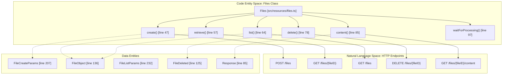
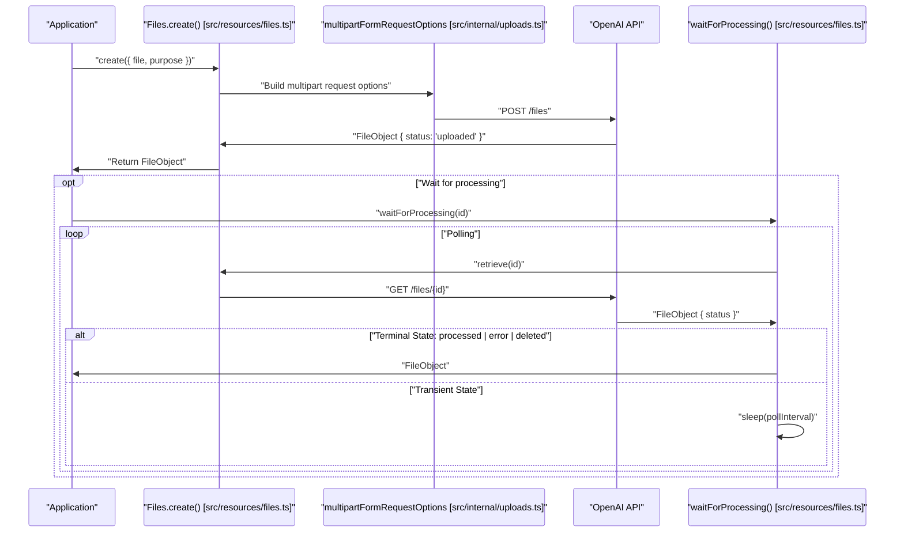
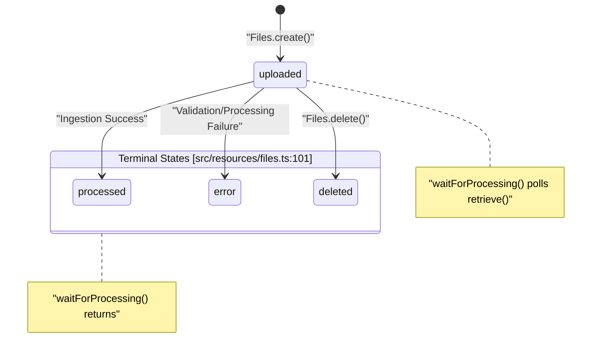

<!-- source: DeepWiki mcp.deepwiki.com · repo openai/openai-node · page 4.7 Files · fetched 2026-10-26 -->

# Files

Relevant source files

The following files were used as context for generating this wiki page:

- [src/resources/chat/chat.ts](src/resources/chat/chat.ts)
- [src/resources/chat/completions.ts](src/resources/chat/completions.ts)
- [src/resources/chat/index.ts](src/resources/chat/index.ts)
- [src/resources/completions.ts](src/resources/completions.ts)
- [src/resources/embeddings.ts](src/resources/embeddings.ts)
- [src/resources/files.ts](src/resources/files.ts)
- [tests/api-resources/audio/transcriptions.test.ts](tests/api-resources/audio/transcriptions.test.ts)
- [tests/api-resources/audio/translations.test.ts](tests/api-resources/audio/translations.test.ts)
- [tests/api-resources/embeddings.test.ts](tests/api-resources/embeddings.test.ts)
- [tests/api-resources/files.test.ts](tests/api-resources/files.test.ts)
- [tests/api-resources/models.test.ts](tests/api-resources/models.test.ts)

The Files API provides file upload, management, and processing capabilities for the OpenAI Node.js client library. This system handles file operations across various OpenAI services including Assistants, Fine-tuning, Batch processing, and Vision applications.

For information about file upload utilities and multipart form handling, see [File Uploads and Utilities](#5.5). For Assistant-specific file operations, see [Assistants API](#4.10).

## Core Files API Operations

The `Files` class in [src/resources/files.ts:17-119]() provides the primary interface for file operations:

Sources: [src/resources/files.ts:17-119](), [src/resources/files.ts:125-131](), [src/resources/files.ts:136-193](), [src/resources/files.ts:207-229]()

## File Upload and Processing Workflow

The file processing system follows a specific lifecycle from upload to ready state. The SDK uses `multipartFormRequestOptions` to handle the transition from local `Uploadable` types to the multipart/form-data required by the API.

Sources: [src/resources/files.ts:47-52](), [src/resources/files.ts:97-118](), [src/internal/uploads.ts:11-11]()

## File Purposes and Integration Points

Files serve different purposes across OpenAI APIs, each with specific requirements and constraints defined in the `FilePurpose` type.

| Purpose | Description | File Size Limit | Supported Formats | Used By |
|---------|-------------|-----------------|-------------------|---------|
| `assistants` | Files for Assistant tools | 2M tokens | Various | Assistants API |
| `assistants_output` | Generated Assistant outputs | - | - | Assistants API |
| `batch` | Batch processing input | 200 MB | `.jsonl` | Batch API |
| `batch_output` | Batch processing results | - | `.jsonl` | Batch API |
| `fine-tune` | Fine-tuning training data | - | `.jsonl` | Fine-tuning API |
| `fine-tune-results` | Fine-tuning outputs | - | - | Fine-tuning API |
| `vision` | Images for vision models | - | Image formats | Vision/Chat API |
| `user_data` | Flexible general purpose | - | Various | General use |
| `evals` | Evaluation datasets | - | Various | Evaluations API |

Sources: [src/resources/files.ts:18-45](), [src/resources/files.ts:167-175](), [src/resources/files.ts:205-205]()

## Processing States and Wait Utilities

The `waitForProcessing()` method provides a robust polling mechanism to handle the asynchronous nature of file ingestion (e.g., for `file_search` or `fine-tuning` validation).

The wait utility implements the following logic:
- **Default poll interval**: 5000ms (5 seconds) [src/resources/files.ts:99-99]().
- **Default max wait**: 1,800,000ms (30 minutes) [src/resources/files.ts:99-99]().
- **Terminal states**: `processed`, `error`, `deleted` [src/resources/files.ts:101-101]().
- **Timeout behavior**: Throws `APIConnectionTimeoutError` if `maxWait` is exceeded [src/resources/files.ts:111-113]().

Sources: [src/resources/files.ts:97-118](), [src/internal/utils/sleep.ts:1-1]()

## API Reference Details

### Core Methods

**`create(body: FileCreateParams, options?: RequestOptions): APIPromise<FileObject>`**
- Uploads a file using multipart form encoding [src/resources/files.ts:47-52]().
- Uses `multipartFormRequestOptions` to transform `Uploadable` inputs into request-compatible structures [src/resources/files.ts:50-50]().
- Individual files can be up to 512 MB, and projects can store up to 2.5 TB total [src/resources/files.ts:19-20]().

**`retrieve(fileID: string, options?: RequestOptions): APIPromise<FileObject>`**
- Fetches metadata for a specific file by ID [src/resources/files.ts:57-59]().
- Performs a `GET` request to `/files/${fileID}` [src/resources/files.ts:58-58]().

**`list(query?: FileListParams, options?: RequestOptions): PagePromise<FileObjectsPage, FileObject>`**
- Returns a paginated list of files using the `CursorPage` strategy [src/resources/files.ts:64-73]().
- Allows filtering by `purpose` [src/resources/files.ts:237-237]().

**`delete(fileID: string, options?: RequestOptions): APIPromise<FileDeleted>`**
- Permanently removes a file and its association with vector stores [src/resources/files.ts:76-80]().

**`content(fileID: string, options?: RequestOptions): APIPromise<Response>`**
- Downloads file content.
- Explicitly sets `Accept: application/binary` and `__binaryResponse: true` to bypass default JSON parsing [src/resources/files.ts:85-92]().

### Type Definitions

**`FileObject`** represents uploaded files with these key properties [src/resources/files.ts:136-193]():
- `id`: Unique identifier [src/resources/files.ts:140-140]().
- `status`: Current state (`uploaded`, `processed`, `error`) [src/resources/files.ts:181-181]().
- `purpose`: Intended usage (e.g., `fine-tune`, `assistants`) [src/resources/files.ts:167-175]().
- `bytes`: Size in bytes [src/resources/files.ts:145-145]().
- `expires_at`: Optional Unix timestamp for file expiration [src/resources/files.ts:186-186]().

**`FileCreateParams`** [src/resources/files.ts:207-229]():
- `file`: Must be an `Uploadable` (File, Buffer, ReadStream, etc.) [src/resources/files.ts:211-211]().
- `purpose`: The mandatory `FilePurpose` [src/resources/files.ts:216-216]().

Sources: [src/resources/files.ts:47-92](), [src/resources/files.ts:136-229]()

---

