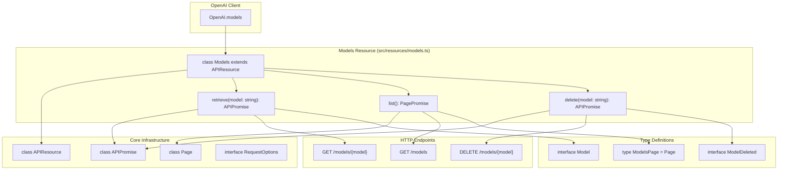
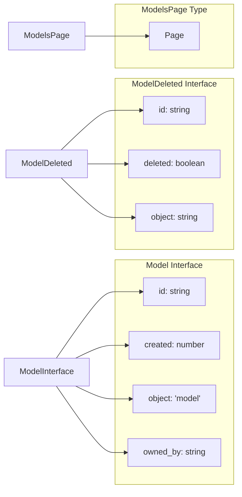
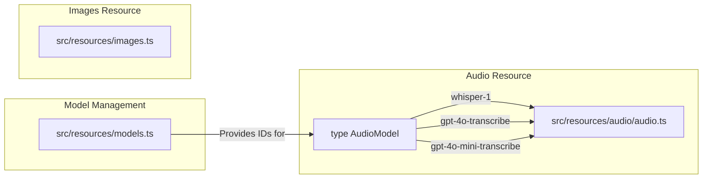

<!-- source: DeepWiki mcp.deepwiki.com · repo openai/openai-node · page 4.8 Models · fetched 2026-10-26 -->

# Models

Relevant source files

The following files were used as context for generating this wiki page:

- [src/resources/audio/audio.ts](src/resources/audio/audio.ts)
- [src/resources/audio/index.ts](src/resources/audio/index.ts)
- [src/resources/audio/transcriptions.ts](src/resources/audio/transcriptions.ts)
- [src/resources/audio/translations.ts](src/resources/audio/translations.ts)
- [src/resources/images.ts](src/resources/images.ts)
- [src/resources/models.ts](src/resources/models.ts)
- [src/resources/moderations.ts](src/resources/moderations.ts)

The Models API resource provides management operations for OpenAI models including listing available models, retrieving model details, and deleting fine-tuned models. The `Models` class is part of the core API resources exposed through the main OpenAI client and handles metadata operations on model objects rather than model inference.

This resource is distinct from model usage—for chat completions, see Chat Completions; for embeddings, see Embeddings; for creating custom models through fine-tuning, see Fine-tuning.

## Models API Architecture

**Models Resource Class Structure**
This diagram maps the `Models` class implementation to actual code entities, showing how the core methods interact with the HTTP API and return appropriate types from the SDK's type system.

Sources: [src/resources/models.ts:12-36](), [src/resources/models.ts:3-7]()

## Core Functionality

### Listing Available Models

The `list()` method retrieves all currently available models with basic information about each one. This includes both OpenAI's base models and any fine-tuned models accessible to your organization.

| Method | HTTP Operation | Return Type | Description |
|--------|---------------|-------------|-------------|
| `list()` | `GET /models` | `PagePromise<ModelsPage, Model>` | Lists all available models |

The method uses the SDK's pagination system via `getAPIList` and the `Page` class, even though no actual pagination occurs currently as noted in the source comments.

Sources: [src/resources/models.ts:25-27](), [src/resources/models.ts:38-39]()

### Retrieving Model Details

The `retrieve()` method fetches detailed information about a specific model by its identifier. This provides basic information including the model's owner and permissioning details.

| Method | Parameters | Return Type | Description |
|--------|------------|-------------|-------------|
| `retrieve()` | `model: string` | `APIPromise<Model>` | Retrieves specific model information |

The method constructs the API path using the SDK's internal `path` utility to safely interpolate the model identifier into the URL.

Sources: [src/resources/models.ts:17-19](), [src/resources/models.ts:7-7]()

### Deleting Fine-tuned Models

The `delete()` method removes fine-tuned models from your organization. This operation requires Owner role permissions and only applies to custom fine-tuned models, not base OpenAI models.

| Method | Parameters | Return Type | Description |
|--------|------------|-------------|-------------|
| `delete()` | `model: string` | `APIPromise<ModelDeleted>` | Deletes a fine-tuned model |

Sources: [src/resources/models.ts:33-35]()

## Data Structures

**Models API Data Structure**
This diagram illustrates the main data types returned by the Models API operations defined in `src/resources/models.ts`.

### Model Interface

The `Model` interface represents an OpenAI model offering that can be used with the API:

| Field | Type | Description |
|-------|------|-------------|
| `id` | `string` | The model identifier, which can be referenced in the API endpoints. |
| `created` | `number` | The Unix timestamp (in seconds) when the model was created. |
| `object` | `'model'` | The object type, which is always "model". |
| `owned_by` | `string` | The organization that owns the model. |

Sources: [src/resources/models.ts:44-64]()

### ModelDeleted Interface

The `ModelDeleted` interface represents the response when a model is successfully deleted:

| Field | Type | Description |
|-------|------|-------------|
| `id` | `string` | Identifier of deleted model |
| `deleted` | `boolean` | Deletion confirmation flag |
| `object` | `string` | Object type identifier |

Sources: [src/resources/models.ts:66-72]()

## Relationship to Other Resources

While the `Models` resource manages metadata, other resources define specific model identifier types for their respective operations. For instance, the Audio resource defines a union of supported models for transcription and translation tasks.

**Model Identifier Usage**
The SDK defines specific union types for models compatible with certain endpoints, such as `AudioModel` which includes `whisper-1`, `gpt-4o-transcribe`, and others.

Sources: [src/resources/audio/audio.ts:40-45](), [src/resources/audio/translations.ts:88-91](), [src/resources/images.ts:16-17](), [src/resources/images.ts:34-35]()

## Implementation Details

The `Models` class extends `APIResource` and uses the SDK's standard patterns for API interactions:

- **Path Construction**: Uses the `path` helper from `../internal/utils/path` for safe URL construction. [src/resources/models.ts:7-7]()
- **Security**: Explicitly passes `__security: { bearerAuth: true }` in request options for all methods. [src/resources/models.ts:18-18](), [src/resources/models.ts:26-26](), [src/resources/models.ts:34-34]()
- **Pagination**: Exports `ModelsPage` as a type alias for `Page<Model>` to maintain future compatibility with paginated results. [src/resources/models.ts:39-39]()
- **Namespacing**: Uses `export declare namespace Models` to export types alongside the class implementation. [src/resources/models.ts:74-76]()

Sources: [src/resources/models.ts:1-77]()

---

